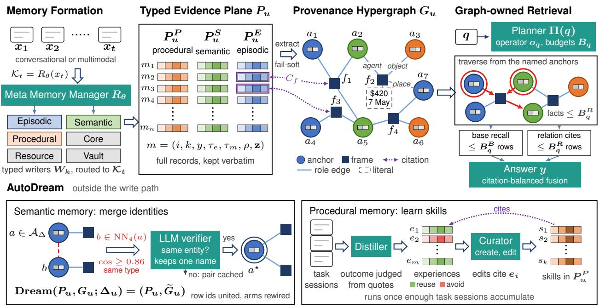
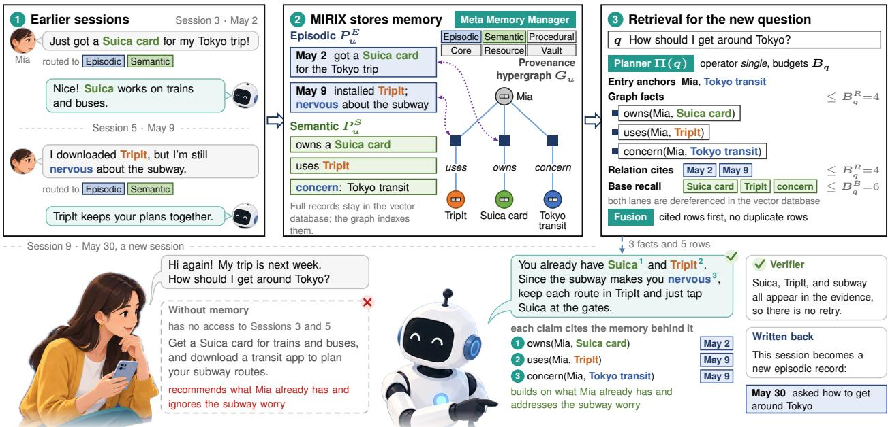
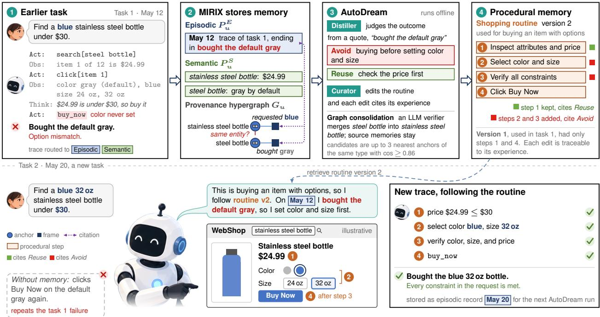
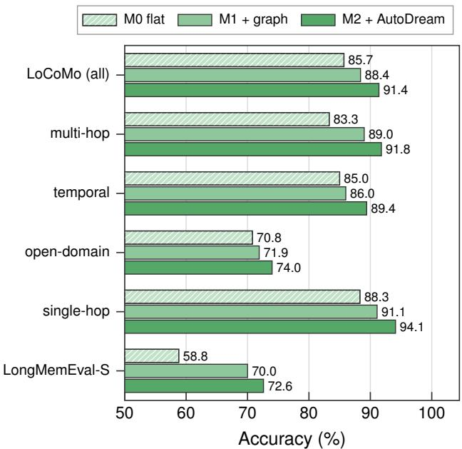
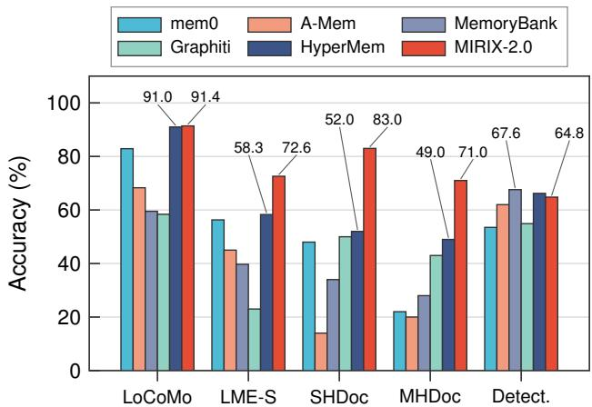
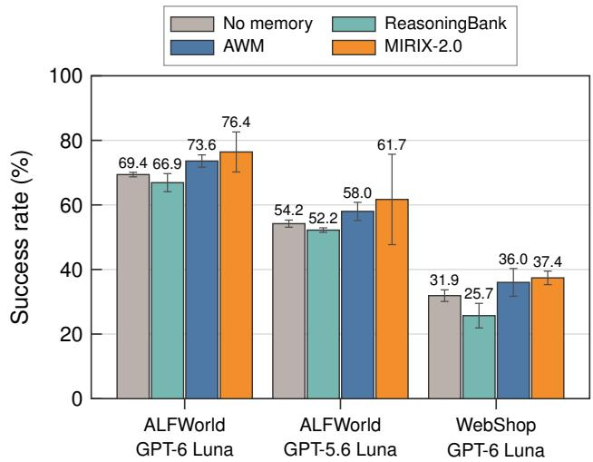
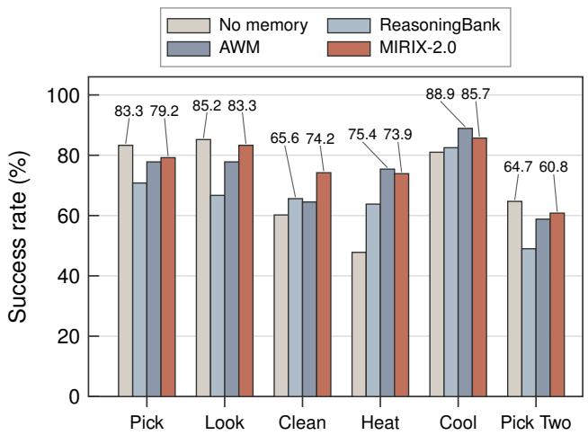
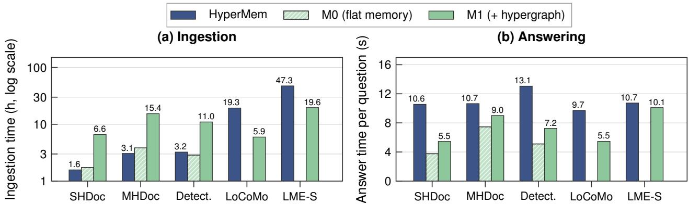
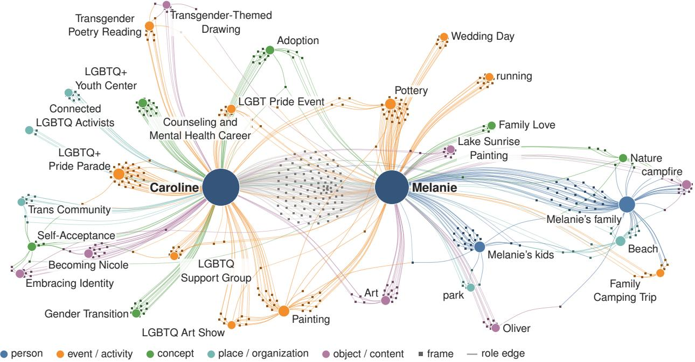

# MIRIX-2.0: Multi-Agent Memory System

Wei-Chieh Huang∗, Weizhi Zhang∗<sup>,</sup>†, Jiayan Nan∗, Peng Xia∗, Yu Wang∗<sup>,</sup>†

MIRIX AI

∗Equal contribution, †Corresponding author

Long-term memory lets LLM agents personalize, stay consistent, and reuse what worked before. Parametric memories need training, consolidation can lose details for good, and keeping every record leaves a growing store to search. We present MIRIX-2.0, a multi-agent memory system designed to be practical, accurate, and eficient at once. It is the most accurate of the compared systems on four of five QA benchmarks. It reaches 91.4% on LoCoMo and 72.6% on LongMemEval-S, where it leads the strongest baseline by 14.3 points, and with AutoDream disabled it gains 31.0 and 22.0 points over HyperMem on single-hop and multi-hop document QA. As procedural memory, it yields the highest mean success among the compared memory methods on ALFWorld and WebShop and reaches 49.2% on MetaClaw-Bench, against 44.0% for MetaClaw’s skill library. Six typed memory agents keep complete records as the system of record, and a provenance hypergraph indexes episodic and semantic records with n-ary frames that cite their rows. Retrieval runs under explicit budgets, so the evidence a question inspects does not grow with the history. AutoDream merges duplicate anchors outside the write path without rewriting any record, and it distills task sessions into skills. With AutoDream disabled, MIRIX-2.0 answers faster than HyperMem on all five timed benchmarks. It needs no fine-tuning, runs with closed and open models, and its code is public.

Author E-mails: {whuang80,wzhan42}@uic.edu, njy@tongji.edu, pxia@cs.unc.edu, yuw164@ucsd.edu Website: https://mirix.io/ M GitHub: https://github.com/Mirix-AI/MIRIX


  
Figure 1 Overview of MIRIX-2.0. Typed writers fill the evidence plane $P _ { u } ,$ the provenance hypergraph $G _ { u }$ indexes it with n-ary frames that cite their sources, retrieval traverses $G _ { u }$ under explicit budgets, and AutoDream consolidates outside the write path.

## 1 Introduction

Large language model (LLM) agents now work over horizons far longer than a single context window (Luo et al., 2025b; Huang et al., 2026b). A personal agent accumulates months of conversation with its user, and a task agent meets similar problems across many episodes. Memory lets such agents carry information across sessions (Wang et al., 2025a), so that they can personalize their responses (Zhang et al., 2026e), stay consistent with what they were told (Packer et al., 2023; Chhikara et al., 2025), and reuse what worked before (Wang et al., 2025e; Xia et al., 2026a). Benchmarks now measure this ability on long conversations (Maharana et al., 2024; Wu et al., 2025), long documents (Hu et al., 2026), multi-session agentic tasks (He et al., 2026), and lifelong personalization (Zhang et al., 2026d).

Benchmarks score a memory by its answers, but a team that deploys one asks more of it. A memory that agents can rely on in practice has to meet three requirements at once. It has to be accurate about the particulars of past experience, such as a name, a date, a count, or the distinction between two events, and about the connections between them. It has to be practical, which means deployable with the models a team already uses, nothing to train, answers that can be traced to stored records, and consolidation that cannot destroy what was stored. It also has to be eficient, with answer latency and token cost per question that stay bounded as the history grows.

Each family of existing systems gives up at least one of the three. Systems that consolidate records into extracted facts or abstractions (Chhikara et al., 2025; Ye et al., 2026) are compact but give up accuracy: the details they discard are gone for good, and consolidation can make a memory faulty even when it is distilled from useful experience (Zhang et al., 2026a). Systems that keep every record and retrieve from them directly lose nothing but give up eficiency, since retrieval must search an ever larger and noisier history (Huang et al., 2026b). Graph memories organize the same content around entities and their relations (Rasmussen et al., 2025; Edge et al., 2024), but binary triples split an n-ary fact into fragments and lose the connections among its participants (Luo et al., 2025a). Hypergraph memories (Yue et al., 2026) group episodes under topics and facts under episodes, but their hyperedges record which unit belongs where rather than the participants of a fact, and retrieval descends from topic summaries written at storage time, so a detail is reachable only after its topic has been retrieved. File-system memories, such as the auto memory of Claude Code (Anthropic, 2026), route retrieval through summaries in the same way: they keep notes in plain files behind a size-capped index that is loaded into every session, and the agent opens a file on the strength of its one-line summary. A detail that no summary mentions is reachable only by string search, which neither resolves an entity across files nor follows its relations, and index entries past the cap are not loaded at the start of a session. Both families prune top down to bound their cost, and both pay for the pruning with recall on details their summaries do not reflect. Parametric memories store experience in model weights or latent states (Wang et al., 2024b, 2025b,c; Behrouz et al., 2025) and give up practicality, since they require training and rule out closed models.

The requirements also weigh diferently for the two uses of memory. Recent studies separate user-centric memory, which personalizes an agent to its user, from agent-centric memory, which accumulates the agent’s own experience, and they find that the two face reversed challenges (Huang et al., 2026b,c). A user-centric memory has to record a user’s history broadly and connect its pieces, because a later question may depend on any detail of that history (Zhang et al., 2026d; Ma et al., 2026b). An agent-centric memory has to be precise and refined instead. It distills trajectories into strategies and skills (Zhao et al., 2024; Ouyang et al., 2026; Xia et al., 2026b), and retrieving too much can pull the agent’s attention away from the context that matters for its next action (Huang et al., 2026c). A practical system has to serve both uses from one store. Figures 2 and 3 trace one example of each setting through MIRIX-2.0.

In this work, we present MIRIX-2.0, a multi-agent memory system designed to be practical, accurate, and eficient at once. It keeps the multi-agent design of MIRIX (Wang and Chen, 2025) and rethinks how memory is stored, indexed, retrieved, and consolidated so that a specific layer meets each requirement (Figure 1). Six memory agents under a Meta Memory Manager write complete records to a typed evidence plane in a vector database, the system of record, so details survive consolidation and every graph fact the answer receives cites the rows it came from. The graph is only an index. The database write commits first, a failed graph write never rolls back a stored memory, and a failed graph read falls back to direct evidence retrieval. A provenance hypergraph indexes the entities, events, relations, roles, and times in episodic and semantic records as n-ary frames that cite the rows they were extracted from and carry dates, prices, and counts as literals, and undated events with similar wording keep distinct identities. At query time, a deterministic planner sets explicit budgets, retrieval enters the hypergraph at the anchors that match the question, and the answer receives graph facts together with the records they cite (Section 2.4). The evidence a question inspects is therefore bounded by construction and does not grow with the length of the history.

  
Figure 2 User-centric memory. Sessions are stored as episodic and semantic records, and a later question retrieves graph facts with their source rows to give a personalized answer.

Like sleep-time and ofline consolidation methods (Lin et al., 2025; Ye et al., 2026), AutoDream consolidates memory outside the write path, and it treats the two kinds of memory in opposite ways. For semantic memory, it consolidates identities and never rewrites evidence. It pairs each anchor introduced by new semantic rows with its nearest anchors of the same identity-stable type, such as a person or a place, and asks a language model whether a pair denotes one entity. A confirmed merge unites the citations of the two anchors and rewires the frames that mention them, while event anchors, fact frames, and stored records stay unchanged, so a merge can never destroy a stored memory. Its cost depends on the newly written semantic frontier rather than on the total size of memory, verification runs under explicit pair caps, and negative decisions are cached so that later cycles do not pay for the same pair again. For procedural memory, AutoDream refines instead. It judges each finished task session from quotes in its transcript, distills lessons worth reusing and mistakes worth avoiding, and lets a curator (Zhang et al., 2026c) create or edit skills whose edits can cite the experiences behind them.

We evaluate MIRIX-2.0 on conversational memory, long-document question answering, personalized generation, and procedural memory for interactive agents. MIRIX-2.0 has the highest accuracy of all compared memory systems on both conversational benchmarks, 91.4% on LoCoMo in our runs and 72.6% on LongMemEval-S, 14.3 points above the strongest baseline. On LoCoMo, the hypergraph raises accuracy over flat memory from 85.7% to 88.4%, with the largest gain on multi-hop questions, and AutoDream raises every question type and lifts the overall score to 91.4%. On LongMemEval-S, the hypergraph alone adds 11.2 points. On the single-hop and multi-hop document QA tasks of MemoryAgentBench (Hu et al., 2026), with AutoDream disabled, it answers 83.0% and 71.0% of the questions, 31.0 and 22.0 points above the strongest baseline, and on MemoryCD (Zhang et al., 2026d) it has the highest value on all four metrics for cross-domain review summarization. Used as procedural memory, MIRIX-2.0 gives the highest mean success among the compared memory methods on ALFWorld (Shridhar et al., 2021), at 76.4% with GPT-6 Luna against 73.6% for Agent Workflow Memory (AWM) (Wang et al., 2025e) and 69.4% without memory, and on WebShop (Yao et al., 2022), at 37.4%. With GPT-5.2 it reaches 49.2% accuracy on MetaClaw-Bench (Xia et al., 2026b), against 44.0% reported for the MetaClaw skill library.

What makes these results usable is the cost at which they come. With AutoDream disabled, MIRIX-2.0 answers faster than HyperMem, the strongest baseline, on all five benchmarks we timed, ingests the two conversational benchmarks in less time, and uses fewer answer tokens on four of the five. As procedural memory, on WebShop it uses the fewest training and test tokens among the memory methods while reaching the highest success. The cost is paid when long documents are ingested. Building the graph makes their ingestion about four times slower than flat memory and slower than that baseline. The full system with AutoDream is not timed, and the retrieval bounds cover the evidence a question inspects, not latency measured as the history grows. No model is fine-tuned, the same system runs with closed and open models, and the code is public.

Our contributions are as follows.

• Accurate and practical. A layered memory design in which six typed memory agents keep complete records as the system of record and a provenance-preserving n-ary hypergraph serves only as their index, with occurrence identities that keep distinct events apart and fail-soft indexing that never rolls back a stored memory.

• One memory for users and agents. To the best of our knowledge, MIRIX-2.0 is the first memory system that handles both user-centric and agent-centric memory, serving personalization and the refinement of agent skills from one store.

• Efficient and safe to consolidate. Graph-owned retrieval runs under explicit budgets and returns graph facts together with the records that justify them. AutoDream merges duplicate entity anchors under explicit caps without touching stored memories, which adds 3.0 points on LoCoMo, and distills task sessions into skills for procedural memory.

The rest of the paper is organized as follows. Section 2 presents MIRIX-2.0. It states the problem and the three technical requirements, introduces the typed evidence plane and the provenance hypergraph that indexes it, describes graph-owned retrieval under explicit budgets, and explains how AutoDream consolidates semantic and procedural memory outside the write path. Section 3 evaluates the accuracy of MIRIX-2.0 on conversational recall, long-document question answering, and personalized generation, its use as agent memory on ALFWorld, WebShop, and MetaClaw-Bench, and its cost in ingestion time, answer latency, and tokens. Section 4 relates MIRIX-2.0 to prior work on memory systems for LLM agents, multi-agent systems, and memory consolidation, and Section 5 concludes and discusses the limitations of this study. Section A gives the details of the method, and Section B gives the full results behind the figures.

## 2 Methodology

MIRIX-2.0 is designed to be practical, accurate, and eficient. It has to run with the models a team already uses and leave stored records intact, it has to keep a name, a date, a count, or the distinction between two events recoverable after writing and after consolidation, and it has to answer from a bounded evidence set however long the history grows. This section describes the layered design that delivers the three.

MIRIX-2.0 separates storage from indexing (Figure 1). A typed evidence plane stores complete memories and is the system of record (Section 2.2). A provenance hypergraph indexes the entities, events, relations, roles, and times in those memories, and every fact in it cites the records it came from (Section 2.3). Three paths operate on the two layers, and Algorithm 1 states each of them in pseudocode. The write path stores a memory and then indexes it. The read path plans a query, traverses the graph, and dereferences only the records it selects (Section 2.4). AutoDream, the third path, runs outside the other two (Section 2.5). On semantic memory it merges duplicate anchors in the hypergraph and returns the evidence store unchanged, so semantic consolidation changes how evidence is connected, never what evidence exists. On procedural memory, AutoDream instead distills task sessions into skills that cite the experiences behind them. Section A.6 collects the properties that hold regardless of how the language models behave.

  
Figure 3 Agent-centric memory. AutoDream turns a failed purchase into experiences and a revised routine, which a later task follows to meet every constraint.

## 2.1 Problem setup

For a user u, the system observes a stream $\mathcal { X } _ { u } = ( x _ { 1 } , \ldots , x _ { T } )$ of conversational or multimodal inputs. When it writes $x _ { t } ,$ future queries are unknown, so the writer must produce a persistent state

$$
\boldsymbol { S _ { u } ^ { t } } = ( P _ { u } ^ { t } , G _ { u } ^ { t } )\tag{1}
$$

from which a later query q can be answered with a bounded evidence set $\mathcal { R } ( q ; S _ { u } ^ { t } )$ . The evidence store $P _ { u }$ collects the typed stores, among them the episodic store $P _ { u } ^ { E }$ , the semantic store $P _ { u } ^ { S }$ , and the procedural store $P _ { u } ^ { P }$ . We seek high answer utility under three technical requirements.

1. Source fidelity. Concrete evidence remains recoverable after writing and after consolidation.

2. Bounded access. A query inspects a small graph neighborhood and a bounded set of cited rows instead of scanning the full history.

3. Temporal identity. Repeated descriptions of one event may share evidence, but distinct occurrences must not collapse merely because they are worded alike.

Source fidelity and temporal identity are what make the system accurate and its answers traceable, and bounded access is what keeps it eficient. The rest of this section shows how the two layers meet these requirements. Each subsection explains a block of Algorithm 1, and the numbers on its right point to the equations that define each step.

## 2.2 Typed evidence plane

Multi-agent routing. A Meta Memory Manager routes each input $x _ { t }$ to the subset ${ \mathcal { K } } _ { t } = R _ { \theta } ( x _ { t } )$ of memory types it updates (Algorithm 1, line 2). Each of the six types, Core, Episodic, Semantic, Procedural, Resource, and Knowledge Vault, has its own writer, and the writer of a selected type k produces the record $m _ { t } ^ { ( k ) } = W _ { k } ( x _ { t } , P _ { u } ^ { t - 1 } )$ and owns the schema and update operations of that type. Only episodic and semantic records are indexed by the hypergraph. Section A.1 gives the roles of the six types and the reason for this split.

```latex
Algorithm 1 MIRIX-2.0 for one user u. Calls marked ⋆ use a language model.
1: procedure $\mathrm { W R I T E } ( x _ { t } )$ 16: procedure Answer(q)
2: for $k \in R _ { \theta } ^ { \star } ( x _ { t } )$ do 17: $\hat { y } \gets \mathrm { A G E N T } ^ { \star } ( q )$ with at most five Read calls
3: $m \gets W _ { k } ^ { \star } ( x _ { t } , P _ { u } ) , \mathrm { C o M M T } ( P _ { u } , m )$ (2) 18: $\mathsf { i } \mathsf { f } \mathrm { C H E C K } ( \hat { y } )$ then
4: ${ \mathfrak { i f } } \ k \in \{ \mathrm { e p i s o d i c } , \mathrm { s e m a n t i c } \} \ { \mathfrak { t h e n } }$ 19: $\hat { y } \gets \mathrm { R E W R I T E } ^ { \star } ( \hat { y } , \mathrm { R E A D } ( q ^ { \prime } ) )$
5: $\Phi \gets \mathrm { E x T R A C T } ^ { \star } ( m ) \cup \mathrm { R E P A I R } ^ { \star } ( m )$ (5) 20: return $\hat { y }$
6: $A _ { m } \gets \mathrm { A D M I T } \big ( \mathrm { C A N O N } ^ { \star } ( \Phi ) \big )$ 21: procedure $\mathrm { S E M A N T I C D R E A M } \big ( \Delta _ { u } \big )$ (12)
7: $I _ { a } \gets I _ { a } \cup \left\{ i _ { m } \right\} \mathrm { f o r } a \in A _ { m }$ 22: for $( a , b ) \in \mathcal { C } _ { \Delta } \setminus \mathcal { N }$ do (13)
8: for $f \in \Phi \ \mathrm { w i t h } \ | A _ { f } | \geq 2 \ \mathsf { d o }$ 23: $\mathsf { i f } \ \mathrm { S A M E } ^ { \star } ( a , b )$ then
9: $\mathrm { U P S E R T } ( G _ { u } , \operatorname { i d } ( f ) , f )$ (6), (7) 24: $\mathrm { M E R G E } ( a \to b )$
10: $C _ { f } \gets C _ { f } \cup \{ i _ { m } \}$ 25: else
11: procedure Read(q) 26: ${ \mathcal { N } } \gets { \mathcal { N } } \cup \{ ( a , b ) \}$
12: $\Pi  \operatorname { P L A N } ( q )$ (9) 27: procedure ProceduralDream(S<sub>u</sub>)
13: $A _ { q } \gets \mathrm { T o p } ( \mathrm { R E C A L L } ( q ) , s _ { A } , K _ { A } )$ (10) 28: $e _ { 1 : m } \gets \mathrm { D I S T I L L } ^ { \star } ( S _ { u } )$
14: $F _ { q } \gets \mathrm { T o P } ( \operatorname { A D J } ( A _ { q } , \mathcal { P } _ { q } ) , s _ { F } , B _ { q } ^ { R } )$ (11) 29: $P _ { u } ^ { P } \gets \mathrm { C u R A T E } ^ { \star } ( \dot { P } _ { u } ^ { P } , e _ { 1 : m } )$
15: return $F _ { q } , \operatorname { F U S E } ( \operatorname { R o w s } ( A _ { q } ) , \bigcup _ { f \in F _ { q } } C _ { f } ; B _ { q } ^ { B } , B _ { q } ^ { R } )$
```

Evidence records. Each of the six memory types keeps its records in its own schema. The hypergraph indexes the episodic and semantic records, and each of them is represented as

$$
m = ( i , k , y , \tau _ { e } , \tau _ { m } , \rho , \mathbf { z } ) ,\tag{2}
$$

where i is an immutable row identifier, $k \in \{ \mathrm { e p i s o d i c } , \mathrm { s e m a n t i c } \}$ is its memory type, $y$ is the stored text, $\tau _ { e }$ is the event time when one applies, $\tau _ { m }$ is the mention or write time, $\rho$ records source and chunk provenance, and z holds the search embeddings. Full summaries and details remain in the vector database. The graph stores only identifiers and compact structural metadata.

Writers keep concrete details such as names, counts, and dates in each record, and a record is committed to the vector database before graph construction begins (line 3), so a failed graph write never rolls back a stored memory (Section A.1).

## 2.3 A provenance-preserving n-ary hypergraph

The second half of the write path turns each episodic or semantic record into graph structure (Algorithm 1, lines 5–9). For each user, MIRIX-2.0 maintains a hypergraph

$$
G _ { u } = ( \mathcal { A } _ { u } , \mathcal { F } _ { u } , \mathcal { E } _ { u } )\tag{3}
$$

with entity or concept anchors $\mathcal { A } _ { u } .$ reified fact frames $\mathcal { F } _ { u }$ , and role-typed incidence edges $\mathcal { E } _ { u }$ . Section A.7 shows the hypergraph MIRIX-2.0 builds for one LoCoMo conversation.

## Anchors. An anchor

$$
a = ( i _ { a } , n _ { a } , t _ { a } , { \bf e } _ { a } , I _ { a } ^ { E } , I _ { a } ^ { S } )\tag{4}
$$

stores a canonical name $n _ { a } .$ , an entity type $t _ { a }$ , a name embedding $\mathbf { e } _ { a }$ , and the identifiers $I _ { a } ^ { E }$ and $I _ { a } ^ { S }$ of the episodic and semantic rows that mention it. A deterministic key $\kappa ( n )$ normalizes case, punctuation, function words, word order, and singular and plural variants of a name while keeping numbers, and a deterministic admission gate rejects generic filing terms and dialogue-role pseudo-entities and caps the anchors admitted from one record (Section A.2).

Registry-guided canonicalization. Surface normalization cannot decide whether two semantically close names denote the same entity. For every extracted entity, approximate nearest-neighbor search therefore retrieves a few existing anchors of the user above a similarity threshold, and one language-model call per record makes a conservative same-entity decision for all of its entities. A rename is accepted only when it selects a retrieved candidate, so embeddings propose comparisons but never authorize a merge on their own. The neighbor count and the threshold, with their relation to the vector-index score, are in Section A.2.

N-ary frames. For each episodic or semantic record, an extractor produces a set of frames

$$
\boldsymbol { f } = \left( p , \{ ( r _ { j } , a _ { j } ) \} _ { j = 1 } ^ { d _ { f } } , \ell _ { f } , \tau _ { e } , \tau _ { m } , C _ { f } \right) ,\tag{5}
$$

where p is a canonical predicate, $r _ { j }$ is the open-vocabulary role of anchor $a _ { j } , \ell _ { f }$ maps literal attributes to their values, and $C _ { f }$ is the set of identifiers of the vector-database records the frame cites. A flight, for example, becomes one frame with agent, origin, destination, carrier, and companion arms instead of several disconnected triples, and owns(Mia, Suica card) in Figure 2 is a frame that cites the May 2 record. The extractor is instructed to keep dates, prices, counts, durations, and measurements as literals on the frame rather than as anchors, so that a value stays attached to the assertion it qualifies. A frame is materialized only if its arguments resolve to at least two distinct anchors of the user. When a deterministic audit finds that the extraction misses high-signal source details, one bounded repair call may add frames that the source supports, and it cannot remove anything the primary extraction produced. Section A.2 describes the audit.

Occurrence identity. Semantic claims and episodic occurrences follow diferent identity rules. Let $\sigma ( f )$ be the sorted set of role and anchor keys $\{ r _ { j } : \kappa ( n _ { a _ { j } } ) \}$ . A semantic frame is identified by

$$
\mathrm { i d } _ { S } ( f ) = H ( u , p , \sigma ( f ) ) ,\tag{6}
$$

so repeated support for the same durable claim accumulates citations on one node. An episodic frame adds an occurrence key,

$$
\begin{array} { r } { \mathrm { i d } _ { E } ( f ) = H ( u , p , \sigma ( f ) , \chi ( f ) ) , } \end{array}\tag{7}
$$

$$
\chi ( f ) = { \left\{ \begin{array} { l l } { \mathrm { e x p l i c i t ~ e v e n t ~ t i m e , } } & { { \mathrm { i f ~ e x t r a c t e d , } } } \\ { { \mathrm { i m m u t a b l e ~ m e m o r y ~ i d , } } } & { { \mathrm { o t h e r w i s e . } } } \end{array} \right. }\tag{8}
$$

Two mentions of the same dated event therefore share one frame, while two undated events with similar wording, such as two runs on diferent days, stay separate. A frame keeps the time of the event apart from the time it was mentioned, and whether the event is planned or done does not change its identity.

## 2.4 Graph-owned evidence retrieval

MIRIX-2.0 treats retrieval as the construction of a bounded evidence set rather than as open-ended similarity search. Episodic and semantic candidates must enter through the graph, and the vector database dereferences and reranks only the identifiers that graph traversal selects. This boundary keeps a hidden full-table search from doing the work attributed to the graph. Only a graph read that raises an error falls back to direct evidence retrieval. A query passes through planning, anchor entry, expansion along two evidence lanes, and fusion, and a verifier then checks the answer (Algorithm 1, lines 12–19). For the question in Figure 2, the planner chooses the single operator, enters the graph at Mia and Tokyo transit, and returns three facts with five rows.

Query plan. A deterministic planner maps a query to

$$
\Pi ( q ) = \left( o _ { q } , { \mathcal P } _ { q } , { \mathcal C } _ { q } , { \mathcal y } _ { q } , { \mathcal T } _ { q } , B _ { q } ^ { B } , B _ { q } ^ { R } \right) ,\tag{9}
$$

where the operator $o _ { q }$ is single, temporal, intersection, list-union, or count, $\mathcal { P } _ { q }$ holds canonical relation families and their surface forms, $\mathcal { C } _ { q }$ holds non-relational constraints, $\mathcal { { D } } _ { q }$ holds expected answer types, and $\mathcal { T } _ { q }$ holds date and temporal-order constraints. The two budgets cap the base-recall rows and the relation-cited rows, and $B _ { q } ^ { R }$ also caps the graph facts that the relation lane renders. The budgets grow with the operator, from 6 base rows and 4 cited rows for a single-value lookup to 8 and 12 for a count, since counting and set construction need broader evidence. Table 6 in Section A.3 lists all five operators.

Anchor entry. The query embedding first recalls fifteen anchors by name. A relation query adds the anchors that the question names exactly, and the union is scored by

$$
s _ { A } ( a , q ) = s _ { \mathrm { v e c } } + s _ { \mathrm { e x a c t } } + s _ { \mathrm { l e x } } + s _ { \mathrm { p r e d } } + s _ { \mathrm { s p e c } } - s _ { \mathrm { h u b } } .\tag{10}
$$

The vector score dominates. Exact mention, token overlap, predicate compatibility, and multi-token specificity break close ties, and a logarithmic degree penalty suppresses generic hubs. The top fifteen anchors are kept, which is the cap $K _ { A }$ of Algorithm 1. The cap on exactly named anchors and the hub and predicate rules are in Section A.3.

Two evidence lanes. The selected anchors open two bounded lanes. In the base-recall lane, anchors yield the episodic and semantic identifiers directly associated with them, and traversing an incident n-ary frame adds the frame’s cited memories and a bounded set of memories associated with its co-participants. In the relation-citation lane, which opens when the query plan contains a relation, the exactly named anchors seed an indexed adjacency lookup over their incident frames. Predicate filtering applies before a cap of 240 frames, the fact score below ranks the rest, and at most $B _ { q } ^ { R }$ of them are rendered as explicit graph facts that contribute their exact citations into the vector database. The provenance recomputation of the base lane and the object filter of the relation lane are in Section A.3.

Fact scoring. Each relation-lane frame receives the additive score

$$
\begin{array} { l } { { s _ { F } } ( f , q ) = { s _ { \mathrm { r e l } } } + { s _ { \mathrm { e n t i t y } } } + { s _ { \mathrm { c o n s t r a i n t } } } + { s _ { \mathrm { t y p e } } } } \\ { ~ + { s _ { \mathrm { t i m e } } } + { s _ { \mathrm { i n t e r s e c t i o n } } } + { s _ { \mathrm { s p e c i f i c i t y } } } } \\ { ~ + { s _ { \mathrm { r o l e } } } + { s _ { \mathrm { s t a t e } } } . } \end{array}\tag{11}
$$

The first seven terms score relation, named-entity, literal, answer-type, and temporal compatibility, a shared object for intersection questions, and the number of arguments a frame binds. The role term $S _ { \mathrm { r o l e } }$ rewards agreement between the argument direction implied by the question and the frame’s typed roles, and it penalizes incompatible roles. The state term $s _ { \mathrm { s t a t e } }$ rewards an event time that matches a requested date and penalizes planned occurrences in count, list-union, and temporal questions. Section A.3 describes its fallback and the treatment of intersection questions.

Citation-balanced fusion. Rows in each lane are reranked, and fusion takes up to $B _ { q } ^ { R }$ cited rows, then up to $B _ { q } ^ { B }$ base rows, and fills the remaining capacity from the rest of either lane without duplicating row identifiers. The returned evidence therefore contains both the graph facts and the source rows that justify them. The reranking prior, the per-type split, and the rule for near-duplicate paraphrases are also in Section A.3.

Answer-time verification. In our harness, the answering agent may call the retriever up to five times. After it drafts an answer, a rule-based check requests one more search and one rewrite by the answering model when the draft shows explicit uncertainty, lacks a value the question asks for, or disagrees with the evidence ledger, for example a count without a number or a month that neither the evidence nor the question contains. It also fires on every intersection question (line 19). The check runs in the answering agent rather than in the memory server, and it never inspects a reference answer. Section A.4 lists every trigger and the query of the extra search.

## 2.5 AutoDream: consolidation outside the write path

AutoDream runs outside the critical write path (Algorithm 1, lines 22–29). It treats the two kinds of memory it consolidates in opposite ways. On semantic memory it is an explicit service call that never schedules itself, and it refines identities under the contract

$$
\mathrm { D r e a m } ( P _ { u } , G _ { u } ; \Delta _ { u } ) = ( P _ { u } , \widetilde { G } _ { u } ) ,\tag{12}
$$

where $\Delta _ { u }$ is the newly written semantic frontier and $ { \widetilde { G } } _ { u }$ is the consolidated hypergraph. The evidence store $P _ { u }$ is returned unchanged. On procedural memory it starts in the background once five task sessions are pending, and it turns them into skills.

Semantic frontier. Each call receives the exact source-chunk identifiers of the batch just written, which resolve to the newly written semantic rows. These rows define a small frontier $\Delta _ { u } ,$ , so the cost of consolidation depends on new activity rather than on the total size of memory. The invocation schedule of our protocol is in Section A.5.

Candidate generation. Only anchors that are backed by semantic rows and belong to an identity-stable type $t \in \mathcal { T } _ { \mathrm { s a f e } } = \{ \mathrm { p e r s o n }$ , organization, location, object, concept} are eligible. For each eligible anchor $a \in \mathcal { A } _ { \Delta }$ backed by a frontier row, AutoDream takes the four nearest entries of the name index, which include a itself, and forms the candidate pairs

$$
\begin{array} { r } { \mathcal { C } _ { \Delta } = \left\{ ( a , b ) : \begin{array} { l } { a \in \mathcal { A } _ { \Delta } , b \in \mathrm { N N } _ { 4 } ( a ) \setminus \{ a \} , } \\ { \cos ( \mathbf { e } _ { a } , \mathbf { e } _ { b } ) \geq 0 . 8 6 , } \end{array} \right\} . } \\ { t _ { a } = t _ { b } \in \mathcal { T } _ { \mathrm { s a f e } } } \end{array}\tag{13}
$$

Episodic-only anchors are excluded by construction. An LLM decides whether each pair denotes the same entity and, if it does, chooses one of the two existing names as the canonical representative. Its output is constrained to the submitted pair, and invented representatives are rejected. In Figure 3, steel bottle and stainless steel bottle form such a pair.

Bounded schedule. Every Dream round verifies at most a fixed number of unseen pairs, and the final round also considers the eligible anchors that no earlier round used as a source. Explicit negative decisions are cached as the set $\mathcal { N }$ of Algorithm 1, so later cycles do not pay again to reconsider the same pair. Section A.5 states the caps of the intermediate, final, and repair rounds and the cache key.

Lossless structural merge. For a confirmed merge $a  b ,$ the system unions the episodic and semantic row identifiers, keeps aliases, sums mention counts, keeps the maximum admission score, and rewires every role-typed frame arm to b. Union, sum, and maximum are commutative and associative, so the order of repeated merges does not change the reachable evidence. The dropped anchor is removed only after its values and edges have been transferred.

Semantic Dream never rewrites the memories in the vector database, and it consolidates neither episodic-only anchors nor fact nodes. The asymmetry is deliberate. Semantic identity can be refined incrementally, whereas event occurrences and their citations are kept as observations. AutoDream therefore makes the graph less fragmented without creating a textual summary whose embedding could hide the details of its inputs.

Procedural refinement. For procedural memory, AutoDream refines instead of merging. A distiller judges the outcome of each pending session from quotes in its transcript and distills experiences $e _ { 1 } , \ldots , e _ { m }$ , each marked as a lesson worth reusing or a mistake worth avoiding. A curator (Zhang et al., 2026c) turns these experiences into skills in the procedural store $P _ { u } ^ { P }$ , and it can create, edit, or delete a skill. An edit can cite the experiences behind it with a quote of the text it adds, and a citation is recorded only when that quote checks out, so a cited step of a skill can be traced through its experiences to the quoted sessions they came from. In Figure 3, one failed purchase yields an experience to avoid and one to reuse, and the curator adds two steps to the shopping routine that cite the first and keeps a step that the second supports. The distiller’s unclear verdict and the curator’s non-edit verdicts are in Section A.5.

## 3 Experiments

We evaluate MIRIX-2.0 for the three properties it is designed for. Accuracy is measured for user memory on conversational recall, document QA, and personalized generation (Section 3.2), which mainly exercise semantic memory together with the episodic records that ground it, and for agent memory on held-out interactive tasks and on MetaClaw-Bench, whose tasks span 30 days (Section 3.3), which exercise procedural memory. Eficiency is measured as ingestion time, answer latency, and answer tokens for user memory, with AutoDream disabled in every timed run, and as training and test tokens for agents (Section 3.4). Practicality is built into the protocol itself. One system serves both uses, no model is fine-tuned, the agent evaluation covers closed and open backbones, and every graph configuration runs under the budgets of Section 2.4.

## 3.1 Experimental setup and system variants

Default system and ablations. Unless a configuration is explicitly identified otherwise, MIRIX-2.0 denotes the full architecture with the provenance hypergraph and AutoDream enabled. For the user-memory ablations, M0 uses flat vector memory without the graph or AutoDream, like MIRIX-1.0 (Wang and Chen, 2025), and the tables label it MIRIX-1.0. M1 adds graph indexing and retrieval but disables AutoDream, and M2 is the full graph plus AutoDream configuration. M1 and M2 are configurations of MIRIX-2.0, not successive releases of the method. In M2, semantic AutoDream is invoked by the ingestion driver after every five chunks and after the final chunk, outside the critical write path (Section 2.5 and Section A.5). It merges eligible entity anchors while preserving stored records and episodic occurrences.

The conversational tables report all three configurations. The available document QA results and graph eficiency measurements use M1 and are labeled accordingly; disabling AutoDream there is an experimental choice, not a restriction that prevents consolidation of document memories. MemoryCD is reported under the system name, but its recorded results do not identify an M0, M1, or M2 configuration, so we do not use them to estimate the contribution of AutoDream. For agent memory, we evaluate the procedural refinement path, in which AutoDream distills sessions into reusable skills whose retrieval is independent of the semantic hypergraph. The M0, M1, and M2 comparisons below therefore concern user-memory indexing and semantic consolidation, rather than a procedural graph ablation.

User-memory tasks and baselines. LoCoMo (Maharana et al., 2024) and LongMemEval-S (Wu et al., 2025) test conversational recall. SHDocQA, MHDocQA, and DetectiveQA in the MemoryAgentBench evaluation (Hu et al., 2026) extend this analysis to factual and relational evidence in documents. They are evidence-retrieval tests rather than direct personalization tasks. MemoryCD (Zhang et al., 2026d) tests whether stored user information supports personalized review summarization and generation. We compare with mem0, A-Mem, MemoryBank, Graphiti, and HyperMem on QA, and with the methods listed in the MemoryCD tables, including long-context and RAG baselines, on personalization.

Models and scoring. For the user-memory evaluation, the answerer and extractor use gpt-4.1-mini with temperature 0 and seed 42, and the topic extractor uses gpt-4.1-nano. MIRIX-2.0 uses text-embedding-3- small; external baselines retain their default embeddings. SHDocQA and MHDocQA use substring matching, and DetectiveQA uses letter exact matching. LoCoMo and LongMemEval-S use a gpt-4o-mini judge with majority-of-3 voting. MemoryCD uses ROUGE-1, ROUGE-L, BLEU-4, and BERTScore-F1. Agent backbones and evaluation protocols are specified in Section 3.3. Diferences in accuracy or success rate are reported in percentage points.

Eficiency and uncertainty. We report total ingestion wall-clock time, mean time to retrieve and answer a question, total answer tokens, and graph node and edge counts where available. Graph size measures index structure, not stored text length or total storage. For interactive agents, we report success, action steps, and training and test tokens, with mean and standard deviation over three runs. For LoCoMo, all comparisons below use the results in Table 1; M0, M1, and M2 are distinct system configurations, not repeated runs used to estimate variance.

## 3.2 User memory: recall, documents, and personalization

The hypergraph and AutoDream each improve conversational recall. Figure 4 and Table 1, with Table 7 in the appendix, compare the M0, M1, and M2 configurations under the evaluation protocol described above and show a consistent ordering on both conversational benchmarks. On LoCoMo, graph retrieval raises overall accuracy from 85.7% for M0 to 88.4% for M1, and semantic AutoDream raises it to 91.4% for M2. On LongMemEval-S, the corresponding values are 58.8%, 70.0%, and 72.6%. The graph increment is thus 2.7 points on LoCoMo and 11.2 points on LongMemEval-S, while Auto-Dream adds 3.0 and 2.6 points, respectively. The larger graph increment on LongMemEval-S suggests that evidence organization can matter more when flat retrieval has dificulty recovering the relevant history. It does not establish which question types account for that gain, since a LongMemEval-S cat egory breakdown is not available here.

Semantic consolidation can help temporal recall without rewriting events. The LoCoMo breakdown is more informative than overall accuracy alone. Moving from M0 to M1 improves multi-hop accuracy by 5.7 points, compared with 1.0 point on

  
Figure 4 Components of MIRIX-2.0 on LoCoMo, its four question types, and LongMemEval-S. The hypergraph (M1) and AutoDream (M2) each add accuracy over flat memory (M0).

temporal questions. Moving from M1 to M2 then improves every reported category, including 3.4 points on temporal questions. This pattern is consistent with the division of work in the method. N-ary frames connect related evidence, while identity consolidation gives retrieval a more coherent entry point into records that mention the same entity. Since semantic AutoDream preserves fact nodes and episodic occurrences,

Table 1 LoCoMo accuracy (%) by question type on 1,540 non-adversarial questions. Bold marks the best value in each column.
<table><tr><td>Method</td><td>Overall</td><td>Multi-hop</td><td>Temporal</td><td>Open</td><td>Single-hop</td></tr><tr><td>mem0</td><td>82.9</td><td>80.5</td><td>80.4</td><td>66.7</td><td>86.6</td></tr><tr><td>A-Mem</td><td>68.3</td><td>68.8</td><td>55.5</td><td>61.5</td><td>73.8</td></tr><tr><td>MemoryBank</td><td>59.5</td><td>70.9</td><td>14.6</td><td>52.1</td><td>73.6</td></tr><tr><td>Graphiti</td><td>58.4</td><td>65.2</td><td>37.1</td><td>53.1</td><td>64.9</td></tr><tr><td>HyperMem</td><td>91.0</td><td>91.1</td><td>84.4</td><td>76.0</td><td>95.2</td></tr><tr><td>MIRIX-1.0 (M0)</td><td>85.7</td><td>83.3</td><td>85.0</td><td>70.8</td><td>88.3</td></tr><tr><td>MIRIX-2.0 (M1, graph)</td><td>88.4</td><td>89.0</td><td>86.0</td><td>71.9</td><td>91.1</td></tr><tr><td>MIRIX-2.0 (M2, graph + dream)</td><td>91.4</td><td>91.8</td><td>89.4</td><td>74.0</td><td>94.1</td></tr></table>

temporal evidence can become easier to reach without collapsing distinct events. This is an interpretation of the aggregate results; a direct audit of retrieved records and merged anchors would be needed to establish the mechanism for individual answers.  
  
Figure 5 MIRIX-2.0 against memory baselines on five QA benchmarks. The document tasks use M1.

Figure 5 compares MIRIX-2.0 with all memory baselines on the five QA benchmarks. M2 exceeds Hyper-Mem by 0.4 points overall on LoCoMo and by 14.3 points on LongMemEval-S. Its LoCoMo advantage is concentrated in temporal and multi-hop questions, with gains of 5.0 and 0.7 points, while HyperMem retains higher open-domain and single-hop scores. The evidence therefore supports stronger recovery of connected and time-grounded facts, rather than dominance on every form of recall. HyperMem’s 91.0% comes from our own run and is lower than the 92.7% it reports. Section B.1 describes how we ran HyperMem with its original settings.

Keeping source details improves document QA. Table 8 in the appendix reports M1 on document QA. Its 83.0% on SHDocQA and 71.0% on MHDocQA exceed HyperMem by 31.0 and 22.0

points. Gains on both tasks are consistent with a design that retains source details as well as relational structure. Single-hop questions require the precise fact, while multi-hop questions also require connections between supporting records. In Sections 2.2 and 2.4, these requirements motivate source-faithful writers and retrieval of original rows alongside graph facts. The comparison measures the combined pipeline and does not isolate either feature.

DetectiveQA exposes a boundary of this advantage. M1 reaches 64.8%, below MemoryBank’s 67.6% and HyperMem’s 66.2%. Organizing explicit evidence does not by itself guarantee the inference needed to resolve a detective question. Without an error analysis, we cannot distinguish missed evidence from failures to reason over retrieved evidence. The document results also cannot establish an AutoDream benefit, because they evaluate M1 only.

Selective user memory supports personalized generation. Table 2, and Table 9 in the appendix, move from answering factual questions to generating text for a particular user. Cross-domain evaluation is especially relevant because useful preferences must transfer from other product domains to Home\_and\_Kitchen. This tests a diferent role for semantic memory from recalling a named event. A useful record must preserve a user’s relevant preferences while remaining accessible when the new request has a diferent surface topic.

For cross-domain summarization, MIRIX-2.0 has the highest value on all four metrics. Its ROUGE-L is .1510, compared with .1430 for the strongest baseline on that metric, and its BLEU-4 is .0209, compared with .0162. In the single-domain setting it leads on ROUGE-1 and ROUGE-L and ties the highest BERTScore, while long-context input has higher BLEU-4. Review generation shows the highest reported scores for MIRIX-2.0 in both settings on all four metrics, although several margins are small. Together, these results suggest that selective user memory can preserve useful information for generation without requiring the full history as context. They do not measure factual consistency, preference satisfaction, or user approval directly, and the available configuration record does not support a MemoryCD-specific claim about graph or AutoDream gains.

Table 2 Review summarization on MemoryCD (100 Home\_and\_Kitchen users). Bold marks column maxima.
<table><tr><td rowspan="2">Method</td><td colspan="4">Cross-domain</td><td colspan="4">Single-domain</td></tr><tr><td>R-1</td><td>R-L</td><td>B-4</td><td>BERT</td><td>R-1</td><td>R-L</td><td>B-4</td><td>BERT</td></tr><tr><td>Long-context</td><td>.1493</td><td>.1357</td><td>.0162</td><td>.8745</td><td>.1675</td><td>.1570</td><td>.0249</td><td>.8779</td></tr><tr><td>RAG</td><td>.1559</td><td>.1430</td><td>.0145</td><td>.8735</td><td>.1670</td><td>.1523</td><td>.0196</td><td>.8759</td></tr><tr><td>mem0</td><td>.1526</td><td>.1420</td><td>.0159</td><td>.8749</td><td>.1593</td><td>.1472</td><td>.0184</td><td>.8767</td></tr><tr><td>A-Mem</td><td>.1567</td><td>.1428</td><td>.0160</td><td>.8746</td><td>.1602</td><td>.1521</td><td>.0184</td><td>.8764</td></tr><tr><td>MemoryBank</td><td>.1409</td><td>.1291</td><td>.0131</td><td>.8736</td><td>.1584</td><td>.1449</td><td>.0188</td><td>.8760</td></tr><tr><td>Graphiti</td><td>.1534</td><td>.1415</td><td>.0139</td><td>.8741</td><td>.1520</td><td>.1418</td><td>.0172</td><td>.8746</td></tr><tr><td>MIRIX-2.0</td><td>.1603</td><td>.1510</td><td>.0209</td><td>.8754</td><td>.1715</td><td>.1617</td><td>.0234</td><td>.8779</td></tr></table>

## 3.3 Agent memory: held-out tasks and skills

Setup and transfer to held-out tasks. We evaluate procedural memory on ALFWorld (Shridhar et al., 2021) and WebShop (Yao et al., 2022), comparing an agent without memory with ReasoningBank (Ouyang et al., 2026), Agent Workflow Memory (AWM) (Wang et al., 2025e), and MIRIX-2.0. Within each comparison, methods share the actor prompt and backbone. ALFWorld uses GPT-6 Luna and GPT-5.6 Luna; WebShop uses GPT-6 Luna. Each memory method learns from the same training tasks, 39 for ALFWorld and 40 for WebShop. Memory is then frozen for evaluation on 134 held-out ALFWorld episodes with a 50-step cap and 140 WebShop instructions with a 15-step cap. Results are averaged over three independent runs. The separation between memory learning and evaluation tests reuse of acquired procedures on new tasks.

This setting exercises the procedural branch of AutoDream (Section 2.5). Sessions supply lessons to reuse and mistakes to avoid, and a curator turns those experiences into skills. Unlike semantic consolidation, which preserves the factual records and changes their index, procedural refinement changes the instructions available to the actor. The experiments evaluate the utility of that combined process; they do not separately ablate the outcome judge, experience distiller, or curator.

ALFWorld: useful procedures must generalize across action sequences. Figure 6, and Table 10 in the appendix, show the highest mean overall success among the compared methods for MIRIX-2.0 with both backbones. With GPT-6 Luna it reaches 76.4%, compared with 69.4% without memory and 73.6% with AWM. With GPT-5.6 Luna it reaches 61.7%, compared with 54.2% and 58.0%, respectively. The gains over no memory are similar, at 7.0 and 7.5 points, but they are not uniform across task types (Figure 7). With GPT-6 Luna, Clean improves from 60.2% to 74.2% and Heat from 47.8% to 73.9%, while Pick, Look, and Pick Two remain below the no-memory scores. This suggests that procedures are most useful when they supply missing action structure; retrieving a routine can also interfere with a task the actor already handles well.

  
Figure 6 Agent memory on held-out tasks. Success rate, mean and standard deviation over three runs.

The step counts provide a complementary view. Successful episodes require 13.2 rather than 14.2 steps with GPT-6 Luna and 12.4 rather than 16.1 with GPT-5.6 Luna, relative to no memory. This is consistent with more direct action sequences, but the successful subsets difer across methods, so these are not paired measurements on identical solved tasks. The large success-rate standard deviations for MIRIX-2.0, 6.2 and 14.0 points, also limit the conclusion. It has the highest observed mean, but three runs do not establish a stable advantage over AWM.

Table 3 Agent memory on MetaClaw-Bench Part I (346 questions).
<table><tr><td>Model</td><td>Skill module</td><td>Acc. (%)</td><td>Compl. (%)</td></tr><tr><td rowspan="3">GPT-5.2</td><td>Baseline</td><td>41.1</td><td>14.7</td></tr><tr><td>MetaClaw Skills</td><td>44.0</td><td>17.1</td></tr><tr><td>MIRIX-2.0</td><td>49.2</td><td>27.7</td></tr><tr><td rowspan="3">Qwen3.6-35B-A3B</td><td>Baseline</td><td>40.3</td><td>12.1</td></tr><tr><td>MetaClaw Skills</td><td>51.8</td><td>30.8</td></tr><tr><td>MIRIX-2.0</td><td>52.7</td><td>30.8</td></tr></table>

WebShop: procedure quality matters more than memory availability. Table 11 in the appendix reports 37.4% success for MIRIX-2.0, compared with 31.9% without memory, 25.7% with ReasoningBank, and 36.0% with AWM. ReasoningBank falls below no memory on both interactive benchmarks with GPT-6 Luna, showing that adding experience memory is not suficient to improve an actor. In WebShop, MIRIX-2.0 leads the memory methods on Fashion and Beauty, ties AWM on Garden and Grocery, and trails AWM on Electronics. A plausible interpretation is that reusable constraint checks help some product searches, while other searches need more task-specific guidance. The category results do not directly identify which learned skills caused those diferences.

MIRIX-2.0 uses 8.2 steps per episode and 6.3 per successful episode, fewer than the other memory methods but slightly more than no memory at 7.9 and 6.2. Thus, its benefit is a higher success rate with modest additional interaction, not a reduction in steps relative to every baseline.

  
Figure 7 ALFWorld success by task type with GPT-6 Luna, over three runs.

MetaClaw-Bench: answer quality and completed artifacts are distinct. Table 3 evaluates agent memory on Part I of MetaClaw-Bench (Xia et al., 2026b), which spans 30 days. Accuracy is the oficial mean per-question score, which combines binary file checks with partial credit on multiplechoice questions, and completion is the completion rate over the 224 file-check questions. With GPT-5.2, MIRIX-2.0 improves the oficial mean question score from 44.0% for MetaClaw Skills to 49.2%, and file-check completion from 17.1% to 27.7%. The larger completion gain, 10.6 points, suggests that reusable procedures can help produce the required artifacts as well as improve question scores. With Qwen3.6-35B-A3B, the score gain is smaller, from 51.8% to 52.7%, and completion is tied at 30.8%. The benefit therefore depends on the backbone and on what the metric measures. The GPT-5.2 base-

lines are reported values from the MetaClaw paper, so this comparison is not evidence from a fully controlled rerun. Unlike ALFWorld and WebShop, this table does not report variation across independent runs or a matched procedural-component ablation.

## 3.4 Efficiency: ingestion time, answer latency, and tokens

Graph construction moves work into ingestion. Figure 8a and Table 12 in the appendix show the cost of organizing source records before queries arrive. Relative to M0, M1 increases ingestion time by 3.8 to 4.0 times across the three document tasks. M1 also has higher answer latency than M0 on each task, so graph retrieval is not intrinsically cheaper than flat retrieval. Its purpose is to improve access to structured evidence, with extraction and indexing paid in advance and additional evidence handling paid at query time.

  
Figure 8 Cost of user memory: (a) ingestion time and (b) answer time per question.

Against HyperMem, M1 answers faster on all three document tasks (Figure 8b), at 5.45 versus 10.55 seconds on SHDocQA, 9.01 versus 10.65 on MHDocQA, and 7.24 versus 13.05 on DetectiveQA. It uses fewer answer tokens on SHDocQA and MHDocQA, but more on DetectiveQA, at 1.16M versus 0.35M. The DetectiveQA result shows that lower latency can coexist with higher token use and lower accuracy. Latency, token cost, and answer quality therefore need to be assessed separately.

The available timings characterize M1, not the full M2 system. Figure 8b and Table 12 in the appendix show that M1 also has lower answer latency than HyperMem on LoCoMo and LongMemEval-S, completing the five-benchmark latency comparison. Its conversational ingestion time is lower as well, unlike the document setting. These measurements are consistent with bounded graph access keeping answer latency low, but they do not isolate the efects of candidate caps, model calls, or execution conditions. M2 adds consolidation calls and can change subsequent retrieval behavior. Its total ingestion cost, answer cost, and graph reduction must be measured directly before attaching the M1 latency claims to the full system. Node and edge counts alone likewise do not quantify evidence retention or compression.

Fewer agent steps do not necessarily mean fewer tokens. Table 4 separates the cost of learning a procedure from the cost of applying it, with the token accounting given in Section B.3. On WebShop, MIRIX-2.0 uses the fewest training and test tokens among the memory methods, 1.815M and 4.975M per run, while achieving the highest mean success. On ALFWorld, its 3.813M test tokens are the highest among the memory methods despite its lower mean step count. A retrieved procedure can reduce interaction steps while increasing the context processed at each step. Relative to no memory, test tokens rise on both benchmarks, so procedural memory should be judged by the resulting success and reuse, rather than assumed to save tokens automatically. The reported totals do not determine how many future tasks are needed to amortize memory learning, because no varying-horizon cost study is included.

## 3.5 What the experiments establish

The results support the three properties in diferent measure. Accuracy has the broadest support. The M0, M1, and M2 ordering holds on both conversational benchmarks, and MIRIX-2.0 leads the compared systems on four of the five QA benchmarks, two of them with AutoDream disabled. As procedural memory, it has the highest mean success among the compared memory methods on ALFWorld with both backbones and on WebShop, and the highest MetaClaw-Bench score with both backbones, while the no-memory comparisons show that retrieved experience can also hurt. Eficiency holds for answering more than for ingestion. With AutoDream disabled, MIRIX-2.0 answers faster than HyperMem on every timed benchmark, and on WebShop it uses the fewest training and test tokens among the memory methods. Graph construction, however, makes document ingestion 3.8 to 4.0 times slower than flat memory, and the ALFWorld test tokens of MIRIX-2.0 are the highest among the memory methods. Practicality rests on the design and on our protocol rather than on a deployment. One store serves both uses, no model is fine-tuned, and every graph fact returned to the answerer cites its source rows.

Table 4 Token use per run and success with GPT-6 Luna, mean ± std over three runs. Bold marks the best of the three memory methods.
<table><tr><td>Benchmark</td><td>Method</td><td>Training tokens (M) ↓</td><td>Test tokens (M) ↓</td><td>Success rate (%) ↑</td></tr><tr><td rowspan="4">ALFWorld</td><td>No memory</td><td>0</td><td>2.147±0.048</td><td>69.4±0.7</td></tr><tr><td>ReasoningBank</td><td>1.747±0.122</td><td>3.351±0.045</td><td>66.9±2.8</td></tr><tr><td>AWM</td><td>2.749±0.059</td><td>3.674±0.332</td><td>73.6±1.9</td></tr><tr><td>MIRIX-2.0</td><td>2.253±0.100</td><td>3.813±0.490</td><td>76.4±6.2</td></tr><tr><td rowspan="4">WebShop</td><td>No memory</td><td>0</td><td>4.238±0.463</td><td>31.9±1.8</td></tr><tr><td>ReasoningBank</td><td>2.010±0.242</td><td>6.620±0.674</td><td>25.7±3.8</td></tr><tr><td>AWM</td><td>1.909±0.127</td><td>5.448±0.356</td><td>36.0±4.3</td></tr><tr><td>MIRIX-2.0</td><td>1.815±0.054</td><td>4.975±0.340</td><td>37.4±2.1</td></tr></table>

The tables evaluate complete configurations, so the component explanations in this section remain interpretations, and the limitations in Section 5 list the ablations that would test them. The tables also do not measure merge precision, source-detail retention, skill provenance coverage, or the contribution of the six-writer routing policy, and they do not report memory length or user-memory ingestion tokens, for which graph counts and answer tokens cannot substitute.

## 4 Related Work

Memory systems for LLM agents. Memory systems for LLM agents keep past interactions outside the model and retrieve them when they become relevant (Huang et al., 2026b; Zhang et al., 2025c; Wang et al., 2025a; Guo et al., 2026). Early designs rank or decay a memory stream (Park et al., 2023; Zhong et al., 2024) or manage memory the way an operating system manages storage (Packer et al., 2023; Kang et al., 2025; Li et al., 2025). Later systems extract and update salient facts (Chhikara et al., 2025), link notes into an evolving network (Xu et al., 2025), compress what they store (Fang et al., 2026a; Liu et al., 2026a), or learn memory construction with reinforcement learning (Wang et al., 2025d; Yan et al., 2026). Graph memories organize content around entities and their relations (Bei et al., 2025; Rasmussen et al., 2025; Gutiérrez et al., 2024, 2025; Edge et al., 2024; Wu et al., 2026b), and hypergraph memories keep n-ary facts together (Luo et al., 2025a; Yue et al., 2026). Typed designs split memory by function, following cognitive accounts of episodic and semantic memory (Tulving, 1985; Pink et al., 2025). MIRIX (Wang and Chen, 2025) assigns six memory types to dedicated agents, and PersonaAgent (Zhang et al., 2026e) pairs episodic and semantic memory for personalization. Memory stored in model parameters or latent states (Wang et al., 2024b, 2025b,c; Behrouz et al., 2025) requires training and cannot be used with closed models. Evaluation has moved from recall over long conversations (Maharana et al., 2024; Wu et al., 2025) to multi-session agentic tasks (Hu et al., 2026; He et al., 2026), evolving environments (Ji et al., 2026), lifelong personalization (Zhang et al., 2026d), memory audits (Ma et al., 2026b), and comparisons of memory substrates (Huang et al., 2026c). MIRIX-2.0 combines the typed and the graph directions. Complete typed records remain the system of record, a provenance hypergraph serves only as their index, and every graph fact cites its source records.

Multi-agent systems. Multi-agent systems divide a task among LLM agents that take diferent roles (Guo et al., 2024; Luo et al., 2025b), from role-playing and conversable agents (Li et al., 2023; Wu et al., 2024) to software teams and groups of experts (Hong et al., 2024; Qian et al., 2024; Chen et al., 2024). Agents can debate (Du et al., 2024; Liang et al., 2024; Huang and Caragea, 2026), optimize their workflow (Zhuge et al., 2024; Zhang et al., 2025b), or communicate through latent representations (Yang et al., 2026). They also fail in new ways (Cemri et al., 2025; Huang et al., 2026a), and one response keeps humans in the loop as collaborators (Zou et al., 2025a,b; Wu et al., 2026a). Memory in these systems mostly serves the collaboration, through shared pools, graphs of team trajectories, and sharing across users under access control (Gao and Zhang, 2026; Zhang et al., 2025a; Rezazadeh et al., 2025). MIRIX-2.0 applies the multi-agent design to memory itself. A Meta Memory Manager routes each input to the agents of the six memory types, and each agent writes only the records of its own type.

Self-reflection and memory consolidation. Self-reflection lets an agent improve from feedback on its own behavior without updating its weights (Shinn et al., 2023; Madaan et al., 2023; Park et al., 2023; Zhao et al., 2025). Experience-driven methods turn such feedback into reusable knowledge, including insights (Zhao et al., 2024), executable skills (Wang et al., 2024a), workflows (Wang et al., 2025e), reasoning strategies (Ouyang et al., 2026), and evolving playbooks and case banks (Suzgun et al., 2026; Zhang et al., 2026c; Fang et al.,

2026b; Zhou et al., 2025). Skills can co-evolve with the policy (Xia et al., 2026a,b), be verified and optimized as artifacts (Zhang et al., 2026b; Ma et al., 2026a), or form a hypergraph (Xu et al., 2026), and agents, their harnesses, and their memory architectures can improve themselves (Xia et al., 2026d,c; Liu et al., 2026b; Gao et al., 2026; Fang et al., 2025). Consolidation can also run ofline, before queries arrive or while the user is inactive (Lin et al., 2025; Fang et al., 2026a; Xia et al., 2026b; Ye et al., 2026). Rewriting memory carries risks. Consolidated memories can become faulty (Zhang et al., 2026a), and a defective skill can contaminate the skills distilled after it (Shang et al., 2026). AutoDream also consolidates outside the write path, but it limits what consolidation may change. On semantic memory it merges only anchors that denote the same entity and never rewrites stored records. On procedural memory it keeps a judged outcome, and each experience a skill edit cites, only after checking the quoted text.

## 5 Conclusion

We presented MIRIX-2.0, a multi-agent memory system that keeps complete typed records, indexes them with a provenance hypergraph under explicit budgets, and runs AutoDream outside the write path to merge duplicate anchors and refine skills. It leads the compared systems on four of the five QA benchmarks, two of them with AutoDream disabled, reaching 91.4% on LoCoMo and 72.6% on LongMemEval-S, and it has the highest value on all four metrics for cross-domain review summarization on MemoryCD. On LoCoMo, the hypergraph and AutoDream each add accuracy over flat memory. As procedural memory, its distilled skills lead the compared memory methods in mean success on ALFWorld and WebShop, and with GPT-5.2 they reach 49.2% on MetaClaw-Bench, against 44.0% reported for the MetaClaw skill library. With AutoDream disabled, MIRIX-2.0 answers each question in less time than HyperMem on all five timed benchmarks, and on WebShop its skills cost the fewest tokens among the memory methods. One store serves both uses, and the system runs with closed and open models without fine-tuning. The results suggest that a memory layer can be practical, accurate, and eficient at once when complete records remain the system of record, the graph is only a bounded index, and consolidation changes how evidence is connected rather than what evidence exists. Limitations. Our ablations add components in groups. They do not isolate n-ary frames, cited source rows, occurrence identities, answer-time verification, or the judge, distiller, and curator of procedural memory, so the explanations in Section 3 remain interpretations. The user-memory results come from single runs, partly scored by an LLM judge, the agent results average three runs with large spreads, and some baselines are values reported by their authors.

## Ethics and Broader Impact Statement

MIRIX-2.0 lets assistants and task agents carry what users told them, and what the agents learned, from one session to the next. Every graph fact cites the records it was extracted from, so an answer can be traced to stored evidence. It is intended for assistants that users knowingly choose to use and should not be used to build profiles of people without their consent. A user-centric memory accumulates personal and possibly sensitive information. MIRIX-2.0 keeps sensitive verbatim values in a Knowledge Vault that the hypergraph does not index, but this does not replace consent and access control. A deployment should let users view, correct, and delete their memories, confine each memory to its user (Rezazadeh et al., 2025), and use model providers or local models that meet its privacy requirements, because stored content is sent to the model. Memory can also make mistakes persistent (Zhang et al., 2026a; Shang et al., 2026), and content injected into a conversation can be stored and later retrieved as if it were trusted. A wrong merge changes only the index, and a procedural edit keeps a citation only after its quote is checked, but in high-stakes settings learned skills and merged identities should still be reviewed by a person and stored memories audited periodically (Ma et al., 2026b). All experiments use publicly released benchmarks under their licenses. We collected no new data and ran no study with human participants. MemoryCD is built from public Amazon product reviews, and we use it as released without attempting to identify the reviewers.

## References

Anthropic. How Claude remembers your project. Claude Code documentation. https://code.claude.com/docs/en/ memory, 2026. Accessed: 2026-11-07.

Ali Behrouz, Peilin Zhong, and Vahab Mirrokni. Titans: Learning to memorize at test time. In Advances in Neural Information Processing Systems, 2025.

Yuanchen Bei, Weizhi Zhang, Siwen Wang, Weizhi Chen, Sheng Zhou, Hao Chen, Yong Li, Jiajun Bu, Shirui Pan, Yizhou Yu, Irwin King, Fakhri Karray, and Philip S. Yu. Graphs meet AI agents: Taxonomy, progress, and future opportunities. arXiv preprint arXiv:2506.18019, 2025.

Mert Cemri, Melissa Z. Pan, Shuyi Yang, Lakshya A. Agrawal, Bhavya Chopra, Rishabh Tiwari, Kurt Keutzer, Aditya Parameswaran, Dan Klein, Kannan Ramchandran, Matei Zaharia, Joseph E. Gonzalez, and Ion Stoica. Why do multi-agent LLM systems fail? In Advances in Neural Information Processing Systems, Datasets and Benchmarks Track, 2025.

Weize Chen, Yusheng Su, Jingwei Zuo, Cheng Yang, Chenfei Yuan, Chi-Min Chan, Heyang Yu, Yaxi Lu, Yi-Hsin Hung, Chen Qian, Yujia Qin, Xin Cong, Ruobing Xie, Zhiyuan Liu, Maosong Sun, and Jie Zhou. AgentVerse: Facilitating multi-agent collaboration and exploring emergent behaviors. In International Conference on Learning Representations, 2024.

Prateek Chhikara, Dev Khant, Saket Aryan, Taranjeet Singh, and Deshraj Yadav. Mem0: Building production-ready AI agents with scalable long-term memory. In European Conference on Artificial Intelligence, 2025.

Yilun Du, Shuang Li, Antonio Torralba, Joshua B. Tenenbaum, and Igor Mordatch. Improving factuality and reasoning in language models through multiagent debate. In International Conference on Machine Learning, 2024.

Darren Edge, Ha Trinh, Newman Cheng, Joshua Bradley, Alex Chao, Apurva Mody, Steven Truitt, Dasha Metropolitansky, Robert Osazuwa Ness, and Jonathan Larson. From local to global: A graph RAG approach to query-focused summarization. arXiv preprint arXiv:2404.16130, 2024.

Jinyuan Fang, Yanwen Peng, Xi Zhang, Yingxu Wang, Xinhao Yi, Guibin Zhang, Yi Xu, Bin Wu, Siwei Liu, Zihao Li, Zhaochun Ren, Nikos Aletras, Xi Wang, Han Zhou, and Zaiqiao Meng. A comprehensive survey of self-evolving AI agents: A new paradigm bridging foundation models and lifelong agentic systems. arXiv preprint arXiv:2508.07407, 2025.

Jizhan Fang, Xinle Deng, Haoming Xu, Ziyan Jiang, Yuqi Tang, Ziwen Xu, Shumin Deng, Yunzhi Yao, Mengru Wang, Shuofei Qiao, Huajun Chen, and Ningyu Zhang. LightMem: Lightweight and eficient memory-augmented generation. In International Conference on Learning Representations, 2026a.

Runnan Fang, Yuan Liang, Xiaobin Wang, Jialong Wu, Shuofei Qiao, Pengjun Xie, Fei Huang, Huajun Chen, and Ningyu Zhang. Memp: Exploring agent procedural memory. In Findings of the Association for Computational Linguistics: ACL 2026, 2026b.

Hang Gao and Yongfeng Zhang. INMS: Memory sharing for large language model based agents. In International Joint Conference on Natural Language Processing and Asia-Pacific Chapter of the Association for Computational Linguistics, 2026.

Huan-ang Gao, Jiayi Geng, Wenyue Hua, Mengkang Hu, Xinzhe Juan, Hongzhang Liu, Shilong Liu, Jiahao Qiu, Xuan Qi, Yiran Wu, Hongru Wang, Han Xiao, Yuhang Zhou, Shaokun Zhang, Jiayi Zhang, Jinyu Xiang, Yixiong Fang, Qiwen Zhao, Dongrui Liu, Qihan Ren, Cheng Qian, Zhenhailong Wang, Minda Hu, Huazheng Wang, Qingyun Wu, Heng Ji, and Mengdi Wang. A survey of self-evolving agents: What, when, how, and where to evolve on the path to artificial super intelligence. Transactions on Machine Learning Research, 2026.

Minghao Guo, Qingyue Jiao, Xiujin Liu, Jianhong Pang, Ruimeng Yang, Naihao Xu, Liwei Che, Haochen Xue, Ziqi Wang, Xinying Cai, Jiaxuan Luo, Jiaxin Deng, Xuesong Ye, Jintao Qu, Wenyao Gao, Jingwen Gu, Chenyang Zhao, Shichun Liu, Guibin Zhang, Zefang Liu, Siyin Wang, Wujiang Xu, Danrui Li, Zeru Shi, Woongyeong Yeo, Shuang Liu, Wei-Chieh Huang, Weizhi Zhang, Tianyu Yang, Kangsan Kim, et al. Seeing, maintaining, and learning: The evolution of multimodal agent memory. arXiv preprint arXiv:2610.19366, 2026.

Taicheng Guo, Xiuying Chen, Yaqi Wang, Ruidi Chang, Shichao Pei, Nitesh V. Chawla, Olaf Wiest, and Xiangliang Zhang. Large language model based multi-agents: A survey of progress and challenges. In Proceedings of the Thirty-Third International Joint Conference on Artificial Intelligence, 2024.

Bernal Jiménez Gutiérrez, Yiheng Shu, Yu Gu, Michihiro Yasunaga, and Yu Su. HippoRAG: Neurobiologically inspired long-term memory for large language models. In Advances in Neural Information Processing Systems, 2024.

Bernal Jiménez Gutiérrez, Yiheng Shu, Weijian Qi, Sizhe Zhou, and Yu Su. From RAG to memory: Non-parametric continual learning for large language models. In International Conference on Machine Learning, 2025.

Zexue He, Yu Wang, Churan Zhi, Yuanzhe Hu, Tzu-Ping Chen, Lang Yin, Ze Chen, Tong Arthur Wu, Siru Ouyang,

Zihan Wang, Jiaxin Pei, Julian McAuley, Yejin Choi, and Alex Pentland. MemoryArena: Benchmarking agent memory in interdependent multi-session agentic tasks. In International Conference on Machine Learning, 2026.

Sirui Hong, Mingchen Zhuge, Jiaqi Chen, Xiawu Zheng, Yuheng Cheng, Ceyao Zhang, Jinlin Wang, Zili Wang, Steven Ka Shing Yau, Zijuan Lin, Liyang Zhou, Chenyu Ran, Lingfeng Xiao, Chenglin Wu, and Jürgen Schmidhuber. MetaGPT: Meta programming for a multi-agent collaborative framework. In International Conference on Learning Representations, 2024.

Yuanzhe Hu, Yu Wang, and Julian McAuley. Evaluating memory in LLM agents via incremental multi-turn interactions. In International Conference on Learning Representations, 2026.

Liangjie Huang, Henry Peng Zou, Wei-Chieh Huang, Wooseong Yang, Yuwei Han, and Philip S. Yu. Believed but not said: Measuring hidden belief collapse in multi-agent LLM discussions. arXiv preprint arXiv:2610.22138, 2026a.

Wei-Chieh Huang and Cornelia Caragea. MADIAVE: Multi-agent debate for implicit attribute value extraction. In Findings of the Association for Computational Linguistics: EACL 2026, 2026.

Wei-Chieh Huang, Weizhi Zhang, Yueqing Liang, Yuanchen Bei, Yankai Chen, Tao Feng, Xinyu Pan, Zhen Tan, Yu Wang, Tianxin Wei, Shanglin Wu, Ruiyao Xu, Liangwei Yang, Rui Yang, Wooseong Yang, Chin-Yuan Yeh, Hanrong Zhang, Haozhen Zhang, Siqi Zhu, Henry Peng Zou, Wanjia Zhao, Song Wang, Wujiang Xu, Zixuan Ke, Zheng Hui, Dawei Li, Yaozu Wu, Langzhou He, Chen Wang, Xiongxiao Xu, Baixiang Huang, Juntao Tan, Shelby Heinecke, Huan Wang, Caiming Xiong, Ahmed A. Metwally, Jun Yan, Chen-Yu Lee, Hanqing Zeng, Yinglong Xia, Xiaokai Wei, Ali Payani, Yu Wang, Haitong Ma, Wenya Wang, Chenguang Wang, Yu Zhang, Xin Eric Wang, Yongfeng Zhang, Jiaxuan You, Hanghang Tong, Xiao Luo, Xue Liu, Yizhou Sun, Wei Wang, Julian McAuley, James Zou, Jiawei Han, Philip S. Yu, and Kai Shu. A survey of agent memory in the second half: Towards self-evolving and long-horizon agents. Transactions on Machine Learning Research, 2026b.

Wei-Chieh Huang, Weizhi Zhang, Yuchen Wu, Yankai Chen, Eric Hanchen Jiang, Wooseong Yang, Yiwei Yang, Henry Peng Zou, Hanrong Zhang, Ying Nian Wu, Haolun Wu, Kai-Wei Chang, Philip S. Yu, Xue Liu, and Aylin Caliskan. Harness the memory: A holistic evaluation of memory substrates in memory agents. In Advances in Neural Information Processing Systems, Evaluations and Datasets Track, 2026c.

Haonian Ji, Kaiwen Xiong, Siwei Han, Peng Xia, Shi Qiu, Yiyang Zhou, Jiaqi Liu, Jinlong Li, Bingzhou Li, Zeyu Zheng, Cihang Xie, and Huaxiu Yao. ClawArena: Benchmarking AI agents in evolving information environments. arXiv preprint arXiv:2604.04202, 2026.

Jiazheng Kang, Mingming Ji, Zhe Zhao, and Ting Bai. Memory OS of AI agent. In Proceedings of the 2025 Conference on Empirical Methods in Natural Language Processing, pages 25972–25981, 2025.

Guohao Li, Hasan Abed Al Kader Hammoud, Hani Itani, Dmitrii Khizbullin, and Bernard Ghanem. CAMEL: Communicative agents for “mind” exploration of large language model society. In Advances in Neural Information Processing Systems, 2023.

Zhiyu Li, Chenyang Xi, Chunyu Li, Ding Chen, Boyu Chen, Shichao Song, Simin Niu, Hanyu Wang, Jiawei Yang, Chen Tang, Qingchen Yu, Jihao Zhao, Yezhaohui Wang, Peng Liu, Zehao Lin, Pengyuan Wang, Jiahao Huo, Tianyi Chen, Kai Chen, Kehang Li, Zhen Tao, Huayi Lai, Hao Wu, Bo Tang, Zhengren Wang, Zhaoxin Fan, Ningyu Zhang, Linfeng Zhang, Junchi Yan, Mingchuan Yang, et al. MemOS: A memory OS for AI system. arXiv preprint arXiv:2507.03724, 2025.

Tian Liang, Zhiwei He, Wenxiang Jiao, Xing Wang, Yan Wang, Rui Wang, Yujiu Yang, Shuming Shi, and Zhaopeng Tu. Encouraging divergent thinking in large language models through multi-agent debate. In Proceedings of the 2024 Conference on Empirical Methods in Natural Language Processing, 2024.

Kevin Lin, Charlie Snell, Yu Wang, Charles Packer, Sarah Wooders, Ion Stoica, and Joseph E. Gonzalez. Sleep-time compute: Beyond inference scaling at test-time. arXiv preprint arXiv:2504.13171, 2025.

Jiaqi Liu, Yaofeng Su, Peng Xia, Siwei Han, Zeyu Zheng, Cihang Xie, Mingyu Ding, and Huaxiu Yao. SimpleMem: Eficient lifelong memory for LLM agents. In International Conference on Machine Learning, 2026a.

Jiaqi Liu, Xinyu Ye, Peng Xia, Zeyu Zheng, Cihang Xie, Mingyu Ding, and Huaxiu Yao. EvolveMem: Self-evolving memory architecture via AutoResearch for LLM agents. arXiv preprint arXiv:2605.13941, 2026b.

Haoran Luo, Haihong E, Guanting Chen, Yandan Zheng, Xiaobao Wu, Yikai Guo, Qika Lin, Yu Feng, Zemin Kuang, Meina Song, Yifan Zhu, and Luu Anh Tuan. HyperGraphRAG: Retrieval-augmented generation via hypergraph-structured knowledge representation. In Advances in Neural Information Processing Systems, 2025a.

Junyu Luo, Weizhi Zhang, Ye Yuan, Yusheng Zhao, Junwei Yang, Yiyang Gu, Bohan Wu, Binqi Chen, Ziyue Qiao, Qingqing Long, Rongcheng Tu, Xiao Luo, Wei Ju, Zhiping Xiao, Yifan Wang, Meng Xiao, Chenwu Liu, Jingyang Yuan, Shichang Zhang, Yiqiao Jin, Fan Zhang, Xian Wu, Hanqing Zhao, Dacheng Tao, Philip S. Yu, and Ming Zhang. Large language model agent: A survey on methodology, applications and challenges. arXiv preprint arXiv:2503.21460, 2025b.

Enze Ma, Chunyu Miao, Yankai Chen, Jie Yang, Liancheng Fang, Kening Zheng, Hanrong Zhang, Muyao Xu, Xinle

Yu, Chengze Li, Wei-Chieh Huang, Ziwei Ren, Yunhao Du, Zhixiang Shen, Xue Liu, Philip S. Yu, and Zhen Wang. SkillNEO: Non-elitist evolutionary optimization of agent skills. arXiv preprint arXiv:2610.20926, 2026a.

Enze Ma, Yufan Zhou, Wei-Chieh Huang, Jie Yang, Huanhuan Ma, Zixuan Wang, Chengze Li, Chunyu Miao, Philip S. Yu, and Zhen Wang. MemAudit: Auditing long-term agent memory via hidden user-state recovery. arXiv preprint arXiv:2606.24595, 2026b.

Aman Madaan, Niket Tandon, Prakhar Gupta, Skyler Hallinan, Luyu Gao, Sarah Wiegrefe, Uri Alon, Nouha Dziri, Shrimai Prabhumoye, Yiming Yang, Shashank Gupta, Bodhisattwa Prasad Majumder, Katherine Hermann, Sean Welleck, Amir Yazdanbakhsh, and Peter Clark. Self-Refine: Iterative refinement with self-feedback. In Advances in Neural Information Processing Systems, 2023.

Adyasha Maharana, Dong-Ho Lee, Sergey Tulyakov, Mohit Bansal, Francesco Barbieri, and Yuwei Fang. Evaluating very long-term conversational memory of LLM agents. In Proceedings of the 62nd Annual Meeting of the Association for Computational Linguistics (Volume 1: Long Papers), pages 13851–13870, 2024.

Siru Ouyang, Jun Yan, I-Hung Hsu, Yanfei Chen, Ke Jiang, Zifeng Wang, Rujun Han, Long T. Le, Samira Daruki, Xiangru Tang, Vishy Tirumalashetty, George Lee, Mahsan Rofouei, Hangfei Lin, Jiawei Han, Chen-Yu Lee, and Tomas Pfister. ReasoningBank: Scaling agent self-evolving with reasoning memory. In International Conference on Learning Representations, 2026.

Charles Packer, Sarah Wooders, Kevin Lin, Vivian Fang, Shishir G. Patil, Ion Stoica, and Joseph E. Gonzalez. MemGPT: Towards LLMs as operating systems. arXiv preprint arXiv:2310.08560, 2023.

Joon Sung Park, Joseph C. O’Brien, Carrie J. Cai, Meredith Ringel Morris, Percy Liang, and Michael S. Bernstein. Generative agents: Interactive simulacra of human behavior. In Proceedings of the 36th Annual ACM Symposium on User Interface Software and Technology, 2023.

Mathis Pink, Qinyuan Wu, Vy Ai Vo, Javier Turek, Jianing Mu, Alexander Huth, and Mariya Toneva. Position: Episodic memory is the missing piece for long-term LLM agents. arXiv preprint arXiv:2502.06975, 2025.

Chen Qian, Wei Liu, Hongzhang Liu, Nuo Chen, Yufan Dang, Jiahao Li, Cheng Yang, Weize Chen, Yusheng Su, Xin Cong, Juyuan Xu, Dahai Li, Zhiyuan Liu, and Maosong Sun. ChatDev: Communicative agents for software development. In Proceedings of the 62nd Annual Meeting of the Association for Computational Linguistics, 2024.

Preston Rasmussen, Pavlo Paliychuk, Travis Beauvais, Jack Ryan, and Daniel Chalef. Zep: A temporal knowledge graph architecture for agent memory. arXiv preprint arXiv:2501.13956, 2025.

Alireza Rezazadeh, Zichao Li, Ange Lou, Yuying Zhao, Wei Wei, and Yujia Bao. Collaborative memory: Multi-user memory sharing in LLM agents with dynamic access control. arXiv preprint arXiv:2505.18279, 2025.

Linfang Shang, Ming Xu, Yiding Sun, Tianle Xia, Lingxiang Hu, Lan Xu, and Ning Zheng. When self-evolution backfires: Pre-commit gating against skill contamination in LLM agents. arXiv preprint arXiv:2608.05810, 2026.

Noah Shinn, Federico Cassano, Ashwin Gopinath, Karthik Narasimhan, and Shunyu Yao. Reflexion: Language agents with verbal reinforcement learning. In Advances in Neural Information Processing Systems, 2023.

Mohit Shridhar, Xingdi Yuan, Marc-Alexandre Côté, Yonatan Bisk, Adam Trischler, and Matthew Hausknecht. ALFWorld: Aligning text and embodied environments for interactive learning. In International Conference on Learning Representations, 2021.

Mirac Suzgun, Mert Yuksekgonul, Federico Bianchi, Dan Jurafsky, and James Zou. Dynamic cheatsheet: Test-time learning with adaptive memory. In Proceedings of the 19th Conference of the European Chapter of the Association for Computational Linguistics (Volume 1: Long Papers), pages 7080–7106, 2026.

Endel Tulving. Memory and consciousness. Canadian Psychology/Psychologie canadienne, 26(1):1–12, 1985.

Guanzhi Wang, Yuqi Xie, Yunfan Jiang, Ajay Mandlekar, Chaowei Xiao, Yuke Zhu, Linxi Fan, and Anima Anandkumar. Voyager: An open-ended embodied agent with large language models. Transactions on Machine Learning Research, 2024a.

Yu Wang and Xi Chen. MIRIX: Multi-agent memory system for LLM-based agents. arXiv preprint arXiv:2507.07957, 2025.

Yu Wang, Yifan Gao, Xiusi Chen, Haoming Jiang, Shiyang Li, Jingfeng Yang, Qingyu Yin, Zheng Li, Xian Li, Bing Yin, Jingbo Shang, and Julian J. McAuley. MEMORYLLM: Towards self-updatable large language models. In International Conference on Machine Learning, 2024b.

Yu Wang, Chi Han, Tongtong Wu, Xiaoxin He, Wangchunshu Zhou, Nafis Sadeq, Xiusi Chen, Zexue He, Wei Wang, Gholamreza Hafari, Heng Ji, and Julian J. McAuley. Towards LifeSpan cognitive systems. Transactions on Machine Learning Research, 2025a.

Yu Wang, Dmitry Krotov, Yuanzhe Hu, Yifan Gao, Wangchunshu Zhou, Julian McAuley, Dan Gutfreund, Rogerio Feris, and Zexue He. M+: Extending MemoryLLM with scalable long-term memory. In International Conference on Machine Learning, 2025b.

Yu Wang, Xinshuang Liu, Xiusi Chen, Sean O’Brien, Junda Wu, and Julian McAuley. Self-updatable large language

models by integrating context into model parameters. In International Conference on Learning Representations, 2025c.

Yu Wang, Ryuichi Takanobu, Zhiqi Liang, Yuzhen Mao, Yuanzhe Hu, Julian McAuley, and Xiaojian Wu. Mem-α: Learning memory construction via reinforcement learning. arXiv preprint arXiv:2509.25911, 2025d.

Zora Zhiruo Wang, Jiayuan Mao, Daniel Fried, and Graham Neubig. Agent workflow memory. In Proceedings of the 42nd International Conference on Machine Learning, 2025e.

Di Wu, Hongwei Wang, Wenhao Yu, Yuwei Zhang, Kai-Wei Chang, and Dong Yu. LongMemEval: Benchmarking cha assistants on long-term interactive memory. In International Conference on Learning Representations, 2025.

Qingyun Wu, Gagan Bansal, Jieyu Zhang, Yiran Wu, Beibin Li, Erkang Zhu, Li Jiang, Xiaoyun Zhang, Shaokun Zhang, Jiale Liu, Ahmed Hassan Awadallah, Ryen W White, Doug Burger, and Chi Wang. AutoGen: Enabling next-gen LLM applications via multi-agent conversations. In Conference on Language Modeling, 2024.

Yaozu Wu, Wei-Chieh Huang, Jizhou Guo, Dongyuan Li, Renhe Jiang, Henry Peng Zou, Chunyu Miao, Shanghao Li, Weizhi Zhang, WeiWei Ye, Yankai Chen, Meng Zhang, Xue Liu, and Philip S. Yu. HAS-Bench: Evaluating LLM-based human-agent systems under configurable human participation. arXiv preprint arXiv:2607.04329, 2026a.

Zhaofen Wu, Hanrong Zhang, Fulin Lin, Wujiang Xu, Xinran Xu, Yankai Chen, Henry Peng Zou, Shaowen Chen, Weizhi Zhang, Xue Liu, Philip S. Yu, and Hongwei Wang. GAM: Hierarchical graph-based agentic memory for LLM agents. In Proceedings of the 64th Annual Meeting of the Association for Computational Linguistics (Volume 1: Long Papers), pages 34647–34664, 2026b.

Peng Xia, Jianwen Chen, Hanyang Wang, Jiaqi Liu, Kaide Zeng, Yu Wang, Siwei Han, Yiyang Zhou, Xujiang Zhao, Haifeng Chen, Zeyu Zheng, Cihang Xie, and Huaxiu Yao. SkillRL: Evolving agents via recursive skill-augmented reinforcement learning. In Advances in Neural Information Processing Systems, 2026a.

Peng Xia, Jianwen Chen, Xinyu Yang, Haoqin Tu, Jiaqi Liu, Kaiwen Xiong, Siwei Han, Shi Qiu, Haonian Ji, Yuyin Zhou, Zeyu Zheng, Cihang Xie, and Huaxiu Yao. MetaClaw: Just talk – an agent that meta-learns and evolves in the wild. arXiv preprint arXiv:2603.17187, 2026b.

Peng Xia, Rujun Han, Zifeng Wang, Yanfei Chen, Yufan Zhuang, Yoonho Lee, Chengsong Huang, Han Yu, Zhongying CuiZhu, Yifei Ming, Huaxiu Yao, Burak Gokturk, Tomas Pfister, and Chen-Yu Lee. RRSI: Regularized recursive self-improvement of agent harnesses. arXiv preprint arXiv:2609.24972, 2026c.

Peng Xia, Kaide Zeng, Jiaqi Liu, Can Qin, Fang Wu, Yiyang Zhou, Caiming Xiong, and Huaxiu Yao. Agent0: Unleashing self-evolving agents from zero data via tool-integrated reasoning. In Conference on Language Modeling, 2026d.

Ruiyao Xu, Tiankai Yang, and Wei-Chieh Huang. HyperSkill: Self-evolving LLM agents via hypergraph-structured skill memory. arXiv preprint arXiv:2608.16114, 2026.

Wujiang Xu, Zujie Liang, Kai Mei, Hang Gao, Juntao Tan, and Yongfeng Zhang. A-MEM: Agentic memory for LLM agents. In Advances in Neural Information Processing Systems, 2025.

Sikuan Yan, Xiufeng Yang, Zuchao Huang, Ercong Nie, Zifeng Ding, Zonggen Li, Xiaowen Ma, Jinhe Bi, Kristian Kersting, Jef Z. Pan, Hinrich Schütze, Volker Tresp, and Yunpu Ma. Memory-R1: Enhancing large language model agents to manage and utilize memories via reinforcement learning. In Proceedings of the 64th Annual Meeting of the Association for Computational Linguistics, 2026.

Wooseong Yang, Wei-Chieh Huang, Weizhi Zhang, Yu Wang, Philip S. Yu, and Junhyun Lee. XBridge: Entity-grounded latent bridge for heterogeneous LLM communication. In Advances in Neural Information Processing Systems, 2026.

Shunyu Yao, Howard Chen, John Yang, and Karthik Narasimhan. WebShop: Towards scalable real-world web interaction with grounded language agents. In Advances in Neural Information Processing Systems, 2022.

Chongrui Ye, Yuxiang Liu, Yu Wang, Haofei Yu, Yining Zhao, Ge Liu, Julian McAuley, and Jiaxuan You. Auto-Dreamer: Learning ofline memory consolidation for language agents. arXiv preprint arXiv:2605.20616, 2026.

Juwei Yue, Chuanrui Hu, Jiawei Sheng, Zuyi Zhou, Wenyuan Zhang, Tingwen Liu, Li Guo, and Yafeng Deng. HyperMem: Hypergraph memory for long-term conversations. In Proceedings of the 64th Annual Meeting of the Association for Computational Linguistics (Volume 1: Long Papers), pages 35237–35254, 2026.

Dylan Zhang, Yanshan Lin, Zhengkun Wu, Yihang Sun, Bingxuan Li, Dianqi Li, and Hao Peng. Useful memories become faulty when continuously updated by LLMs. arXiv preprint arXiv:2605.12978, 2026a.

Guibin Zhang, Muxin Fu, Guancheng Wan, Miao Yu, Kun Wang, and Shuicheng Yan. G-Memory: Tracing hierarchical memory for multi-agent systems. In Advances in Neural Information Processing Systems, 2025a.

Hanrong Zhang, Shicheng Fan, Henry Peng Zou, Yankai Chen, Zhenting Wang, Jiayu Zhou, Chengze Li, Wei-Chieh Huang, Yifei Yao, Kening Zheng, Xue Liu, Xiaoxiao Li, and Philip S. Yu. CoEvoSkills: Self-evolving agent skills via co-evolutionary verification. In Conference on Language Modeling, 2026b.

Jiayi Zhang, Jinyu Xiang, Zhaoyang Yu, Fengwei Teng, Xionghui Chen, Jiaqi Chen, Mingchen Zhuge, Xin Cheng, Sirui

Hong, Jinlin Wang, Bingnan Zheng, Bang Liu, Yuyu Luo, and Chenglin Wu. AFlow: Automating agentic workflow generation. In International Conference on Learning Representations, 2025b.

Qizheng Zhang, Changran Hu, Shubhangi Upasani, Boyuan Ma, Fenglu Hong, Vamsidhar Kamanuru, Jay Rainton, Chen Wu, Mengmeng Ji, Hanchen Li, Urmish Thakker, James Zou, and Kunle Olukotun. Agentic context engineering: Evolving contexts for self-improving language models. In International Conference on Learning Representations, 2026c.

Weizhi Zhang, Xiaokai Wei, Wei-Chieh Huang, Zheng Hui, Chen Wang, Michelle Gong, and Philip S. Yu. MemoryCD: Benchmarking long-context user memory of LLM agents for lifelong cross-domain personalization. In Findings of the Association for Computational Linguistics: EMNLP 2026, pages 38554–38575, 2026d.

Weizhi Zhang, Xinyang Zhang, Chenwei Zhang, Liangwei Yang, Jingbo Shang, Zhepei Wei, Henry Peng Zou, Zijie Huang, Zhengyang Wang, Yifan Gao, Xiaoman Pan, Lian Xiong, Jingguo Liu, Philip S. Yu, and Xian Li. PersonaAgent: Bridging memory and action for personalized LLM agents. In Findings of the Association for Computational Linguistics: ACL 2026, 2026e.

Zeyu Zhang, Xiaohe Bo, Chen Ma, Rui Li, Xu Chen, Quanyu Dai, Jieming Zhu, Zhenhua Dong, and Ji-Rong Wen. A survey on the memory mechanism of large language model-based agents. ACM Transactions on Information Systems, 43(6):1–47, 2025c.

Andrew Zhao, Daniel Huang, Quentin Xu, Matthieu Lin, Yong-Jin Liu, and Gao Huang. ExpeL: LLM agents are experiential learners. In Proceedings of the AAAI Conference on Artificial Intelligence, 2024.

Yusheng Zhao, Xiao Luo, Weizhi Zhang, Wei Ju, Zhiping Xiao, Philip S. Yu, and Ming Zhang. MARCO: Meta-reflection with cross-referencing for code reasoning. arXiv preprint arXiv:2505.17481, 2025.

Wanjun Zhong, Lianghong Guo, Qiqi Gao, He Ye, and Yanlin Wang. MemoryBank: Enhancing large language models with long-term memory. In Proceedings of the AAAI Conference on Artificial Intelligence, volume 38, pages 19724–19731, 2024.

Huichi Zhou, Yihang Chen, Siyuan Guo, Xue Yan, Kin Hei Lee, Zihan Wang, Ka Yiu Lee, Guchun Zhang, Kun Shao, Linyi Yang, and Jun Wang. Memento: Fine-tuning LLM agents without fine-tuning LLMs. arXiv preprint arXiv:2508.16153, 2025.

Mingchen Zhuge, Wenyi Wang, Louis Kirsch, Francesco Faccio, Dmitrii Khizbullin, and Jürgen Schmidhuber. GPTSwarm: Language agents as optimizable graphs. In International Conference on Machine Learning, 2024.

Henry Peng Zou, Wei-Chieh Huang, Yaozu Wu, Jizhou Guo, Yankai Chen, Chunyu Miao, Hoang Nguyen, Yue Zhou, Weizhi Zhang, Liancheng Fang, Hanrong Zhang, Fangxin Wang, Pengfei Zhang, Huacan Wang, Langzhou He, Yangning Li, Dongyuan Li, Renhe Jiang, Xue Liu, and Philip S. Yu. LLM-based human-agent collaboration and interaction systems: A survey. arXiv preprint arXiv:2505.00753, 2025a.

Henry Peng Zou, Wei-Chieh Huang, Yaozu Wu, Chunyu Miao, Dongyuan Li, Aiwei Liu, Yue Zhou, Yankai Chen, Weizhi Zhang, Yangning Li, Liancheng Fang, Renhe Jiang, and Philip S. Yu. A call for collaborative intelligence: Why human-agent systems should precede AI autonomy. arXiv preprint arXiv:2506.09420, 2025b.

## A Method details

This appendix collects the details of Section 2 that the main text summarizes or leaves out, in the order of its subsections. For each part it states the constants, schedules, scoring rules, and examples, explains why they are designed as they are, and names the step of Algorithm 1 they belong to.

## A.1 Memory types, routing, and writing

The Meta Memory Manager is the first call of the write path (Algorithm 1, line 2). The router reads the input and selects the memory types it updates. Each selected writer then reads the current store $P _ { u } ^ { t - 1 }$ and produces a record that line 3 commits to the evidence plane before any graph work begins. Formally, each input $x _ { t }$ is mapped to a subset of six specialized writers,

$$
\begin{array} { r } { \quad \mathcal { K } _ { t } = R _ { \theta } ( x _ { t } ) , \quad } \\ { m _ { t } ^ { ( k ) } = W _ { k } ( x _ { t } , P _ { u } ^ { t - 1 } ) , \quad k \in \mathcal { K } _ { t } , } \end{array}\tag{A.1}
$$

and each writer owns the schema and update operations of one memory type. Both steps of (A.1) are language-model calls, which is why the router and the writers carry the ⋆ mark in Algorithm 1. Table 5 lists the six types.

The separation is functional. Only episodic and semantic memory are indexed by the hypergraph, because they hold the event and relational evidence that cross-memory traversal needs. The other types keep their direct, type-specific retrieval paths. Core memory holds the persistent state of the user and the agent, procedural memory holds the skills that Section 2.5 refines, resource memory holds documents and multimodal artifacts, and the knowledge vault holds sensitive verbatim values. Each of them is read through its own typed path rather than through the graph. In Algorithm 1, the test k ∈ {episodic, semantic} is the only step of the write path that depends on whether a record is graph-indexed. In Figure 2, both user turns are routed to the episodic and semantic writers.

Source-faithful writing. Before a record reaches the graph extractor, the writer prompts of our runs ask the episodic and semantic writers to keep complete lists, names, counts, titles, locations, and dates in the record’s details instead of replacing them with a topical gist. Episodic writers store the time an event happened rather than the time it was mentioned, and they store a planned event with its planned date.

Write ordering. The write to the vector database commits before graph construction begins (line 3).   
Graph extraction is a fail-soft indexing hook, so a graph failure is logged but never rolls back a stored memory.   
The evidence plane is thus the durable system of record rather than a side efect of graph construction.

## A.2 Anchor admission, canonicalization, and frame extraction

This part details lines 5 to 9 of Algorithm 1, which turn a committed episodic or semantic record into the anchors and frames of Section 2.3.

Anchor keys and admission. The key $\kappa ( n )$ of an anchor name normalizes case, punctuation, articles and other function words, word order, and conservative singular and plural variants while keeping numbers. In the code it lowercases the name, replaces punctuation with spaces, drops a fixed list of eleven articles and function words, singularizes tokens of at least four letters, and sorts the remaining tokens, so that Mobile App and Mobile Apps share one key. The key is deliberately conservative. Numbers and dates are preserved, so 10 Gallons and 20 Gallons stay distinct, and only plural endings are normalized, so Training and Trains stay apart. A single admission gate rejects generic filing terms, such as advice, details, information, plan, and tips, and dialogue-role pseudo-entities such as user and assistant, and it keeps at most 16 anchors for an episodic record and 18 for a semantic one. The caps bound the anchor space of a user, and they are sized for the arguments of an assertion rather than for a bag of keywords, so that one frame with seven arguments does not exhaust them. The gate is the Admit call of Algorithm 1, and because it runs on the canonical key, one entry such as user also blocks User, Users, and the user.

Registry-guided canonicalization. For every extracted entity, approximate nearest-neighbor search retrieves up to four existing anchors of the user whose cosine similarity is at least 0.72, and one language-model call per record makes a conservative same-entity decision for all of its entities. The vector index scores a pair by $( 1 + \cos ) / 2 .$ , so the thresholds in the code are 0.86 here and 0.93 for AutoDream (Section A.5). The call is instructed not to merge diferent quantities, diferent days or months, diferent form or model codes, or related but distinct concepts. Canonicalization runs before the admission gate, which is the order $\mathrm { A D M I T } \big ( \mathrm { C A N O N } ^ { \star } ( \Phi ) \big )$ of Algorithm 1, so the gate judges canonical names rather than surface forms. The candidates come from the anchors the user already has, which is what keeps naming consistent as the graph grows and why we call the step registry-guided.

Table 5 The six memory types of MIRIX-2.0 and their roles.
<table><tr><td>Memory</td><td>Primary role</td><td>Hypergraph indexed</td></tr><tr><td>Core</td><td>persistent user and agent state</td><td>no</td></tr><tr><td>Episodic</td><td>time-grounded occurrences</td><td>yes</td></tr><tr><td>Semantic</td><td>durable facts and concepts</td><td>yes</td></tr><tr><td>Procedural</td><td>executable workflows</td><td>no</td></tr><tr><td>Resource</td><td>documents and multimodal artifacts</td><td>no</td></tr><tr><td>Knowledge Vault</td><td>sensitive verbatim values</td><td>no</td></tr></table>

Frames, literals, and repair. The extractor behind (5) is instructed to keep dates, prices, counts, durations, and measurements as literals on the frame rather than as anchors, so that values such as 7, \$420, or three months stay attached to the assertion they qualify. A frame is materialized only if its arguments resolve to at least two distinct anchors of the user, which is the test $| A _ { f } | \geq 2$ of Algorithm 1. When a deterministic audit finds that the extraction misses high-signal source details, such as quoted phrases, numbers, or concrete visual content, one bounded repair call may add frames that the source supports. The repair cannot remove anything the primary extraction produced. The audit compares the words of the rendered frames with the source text. It lists the quoted phrases and the numbers of the source that the frames do not cover, it treats a source with visual content as uncovered when the frames cover less than 45 percent of its content words, and it sends at most twelve missing items to the repair call. A missing date alone does not trigger a repair, because session dates recur in many records and are already preserved by provenance. A missing date is added to a call that a missing quote, number, or visual detail already requires. Repair is the Repair call of line 5, and the frames it adds pass through the same canonicalization, admission, and identity rules as the primary ones.

## A.3 Retrieval budgets, lanes, scores, and fusion

This part details the Read procedure of Algorithm 1, whose steps Section 2.4 introduces.

Operator budgets. The planner (9) fixes two row budgets for every query, and Table 6 lists them by operator. The budgets grow with the operator, because counting and set construction need broader evidence than a single-value lookup. A single-value question needs the one row that holds the value, so its cited-row budget is the smallest, whereas a count has to see many members of the set it counts. The evidence a question inspects is therefore bounded by its operator and not by the length of the history.

Table 6 Row budgets $B _ { q } ^ { B }$ and $B _ { q } ^ { R }$ per query operator.
<table><tr><td>Operator</td><td> $B _ { q } ^ { B }$ </td><td> $B _ { q } ^ { R }$ </td></tr><tr><td>Single</td><td>6</td><td>4</td></tr><tr><td>Temporal</td><td>6</td><td>6</td></tr><tr><td>Intersection</td><td>7</td><td>7</td></tr><tr><td>List-union</td><td>7</td><td>9</td></tr><tr><td>Count</td><td>8</td><td>12</td></tr></table>

Anchor entry. Beyond the fifteen anchors that vector recall returns, a relation query adds up to sixteen anchors that the question names exactly before the union is scored by (10). Person

hubs receive a larger penalty unless a relation query names them explicitly. Only the exactly named anchors carry degree and predicate information, so the hub and predicate terms act on them alone. The two entry routes serve diferent questions. Vector recall finds the anchors whose names paraphrase the question, and exact lookup finds the anchors that a relation question names, so that the relation lane can start from the named participants rather than from their nearest paraphrases.

Two evidence lanes. The lanes follow three rules beyond those of Section 2.4. In the base-recall lane, same-chunk support and immediate temporal neighbors are recomputed from the provenance stored in the vector database instead of being duplicated as graph bookkeeping edges. In the relation-citation lane, predicate filtering runs inside Neo4j before the cap of 240 frames, and when the question names a concrete object, only frames that contain it are kept. The base lane is the $\operatorname { R o w s } ( A _ { q } )$ term and the relation lane the $\mathrm { A D J } ( A _ { q } , \mathcal { P } _ { q } )$

term of Algorithm 1. Recomputing same-chunk and temporal neighbors from provenance keeps the graph free of edges that only restate what the evidence plane already records. Filtering by predicate inside the database before the cap means that an explicitly named hub with hundreds of incident frames does not trigger a full traversal, and the frames that survive the cap are selected by a deterministic order on the frame identifier, so which frames pass does not depend on the traversal order of the database.

Fact scoring. Two details of (11) complete Section 2.4. When a frame has no extracted event time, the state term $s _ { \mathrm { s t a t e } }$ falls back at half weight to the time of the source record, so the frame can still compete on time. For intersection questions, a hard shared-object group is preserved before these soft refinements, so recency cannot replace evidence that satisfies only one side of the intersection. The role term reads the typed roles of a frame, and the state term reads the status literal that marks an event as planned or completed (Section 2.3), which is how planned events are penalized in count, list-union, and temporal questions.

Citation-balanced fusion. Rows in each lane are reranked with a shallow vector-rank prior and the lexical coverage of the query. Fusion runs separately for episodic and semantic rows within the row limit of a request. Near-duplicate episodic paraphrases are collapsed only when they share a calendar date, so the same wording on two diferent dates stays separate. Cited rows are filled first because a graph fact without the row that supports it would leave the answer unverifiable, and the date condition on paraphrase collapse is the retrieval-side counterpart of the occurrence identity (7), which keeps undated repetitions apart at write time.

## A.4 Answer-time verification

The Answer procedure of Algorithm 1 belongs to the evaluation harness rather than to the memory server, and the rule-based check of Section 2.4 never inspects a reference answer. The check fires when it finds explicit uncertainty, a count without a number or one that disagrees with a listed count, a temporal answer without a time, an answer number or month that is absent from the evidence ledger and the question, ledger evidence with an incompatible role, or a planned event in a count question. It also fires on every intersection question. The extra search uses a query derived from $\Pi ( q )$ , or the question itself for a relation query. Most triggers mark a way in which a draft falls short of the evidence it was given or disagrees with it. A number or month that appears in neither the ledger nor the question was not retrieved, a count that disagrees with a listed count contradicts the evidence, and a planned event in a count question would count something that has not happened. Intersection questions always trigger the check because they need evidence for both sides, and a first retrieval that satisfies one side can look complete. The rewrite is line 19 of Algorithm 1, so the procedure adds at most one search and one model call to a question.

## A.5 AutoDream schedule, candidates, and procedural refinement

This part details the SemanticDream and ProceduralDream procedures of Algorithm 1 (lines 22 to 29) and expands Section 2.5.

Invocation protocol. Semantic AutoDream is an explicit service call that never schedules itself. In our protocol, the ingestion driver invokes AutoDream after every five chunks and once after the final chunk. The chunk identifiers of each call resolve to the newly written semantic rows, which define the frontier $\Delta _ { u }$ of (12), and the eligible anchors backed by those rows are the sources $\mathbf { \mathcal { A } } _ { \Delta }$ of (13). An intermediate call therefore examines only the anchors whose semantic rows the batch just wrote, and the final call also considers the eligible anchors that no earlier call used as a source.

Candidate generation. The identity-stable types $\mathcal { T } _ { \mathrm { s a f e } }$ of Section 2.5 are person, organization, location, object, and concept. Anchors of the types event, date, content, method, and other are excluded deliberately, because merging two of them can collapse distinct occurrences or temporal context even when their names are close in embedding space. Both endpoints of a candidate pair must be backed by semantic rows and share the same eligible type, and the cosine threshold 0.86 of (13) is the index score 0.93 under the $( 1 + \cos ) / 2$ scale of Section A.2.

Bounded schedule. An intermediate Dream verifies at most 80 unseen pairs from the current semantic delta. The final Dream considers the delta together with eligible anchors that have never served as a Dream source, and it verifies at most 120 pairs. If that round merges anything, one repair round examines only the touched representatives and verifies at most 60 more pairs. Explicit negative decisions are cached by anchor type, so later cycles do not pay again to reconsider the same pair. The cache key hashes the case-folded pair in sorted order together with the type, so the order in which a pair is encountered does not matter. Only explicit rejections are cached. A pair that a round did not reach within its cap is not recorded as rejected, so it becomes a candidate again whenever one of its anchors is in a later frontier. The intermediate rounds keep the graph consolidated while ingestion proceeds, and the final round sweeps up anchors that earlier rounds never used as a source. In Algorithm 1, the cache is the set $\mathcal { N }$ that line 22 subtracts from the candidate pairs, and the per-round caps bound the number of Same calls the loop makes.

Procedural refinement. Two rules of the procedural path complete Section 2.5. The distiller judges the outcome of each pending session from quotes in its transcript, and an outcome whose quotes do not occur in the transcript is downgraded to unclear rather than trusted. Besides creating, editing, or deleting a skill, the curator can mark an experience as already covered, not worth a skill, or deferred, so it can decline an experience without changing the store. The quote check on outcomes and the quote check on citations are the procedural counterpart of the provenance that the hypergraph keeps for facts. They keep the skill library traceable although both Distill<sup>⋆</sup> and Curate<sup>⋆</sup> in Algorithm 1 are language-model calls.

## A.6 Invariants, learned decisions, and complexity

Hard invariants. Four properties hold regardless of model behavior.

1. Every returned graph fact exposes the identifiers of its source memories.

2. Undated episodic occurrences from diferent memory rows receive diferent frame identities.

3. Retrieval and Dream both run under explicit candidate and output caps.

4. A failed graph write cannot destroy a committed memory, and a graph read that raises an error falls back to direct evidence retrieval.

Together with Equation (12), the first and fourth invariants give the source fidelity required in Section 2.1, the third gives bounded access, and the second gives temporal identity.

Learned and deterministic decisions. Language models route inputs, write typed memories, extract frames, repair missing source details, judge semantic identity, and distill and curate procedural experience. Together with answer generation, these are the calls marked ⋆ in Algorithm 1. Deterministic code owns the safety-critical boundaries, namely admissible anchor names, candidate allowlists, frame identities, the representation of events and their status, provenance attachment, query operators, lane budgets, merge algebra, and mutation order. An LLM may propose that two anchors are identical, for instance, but it cannot name an anchor outside the retrieved candidate set or delete evidence directly.

Complexity. Let d be the number of admitted anchors in one memory, h the number of frames extracted from it, $K _ { A }$ the anchor-retrieval cap, and $K _ { F }$ the adjacent-frame cap. Ignoring model inference and indexed database lookups, writing a memory into the graph costs $O ( d + h )$ . Post-retrieval ranking and fusion cost $O ( K _ { A } + K _ { F } + K _ { M } )$ , where $K _ { M }$ is the operator-dependent cited-row budget, and the system never materializes an unbounded evidence set from the vector database. For a Dream frontier of size $| \Delta _ { u } |$ , nearest-neighbor generation costs $O ( | \Delta _ { u } | \log | \mathcal { A } _ { u } | )$ under the vector index, and LLM verification is capped at 80 pairs per intermediate cycle and 180 pairs across the two possible final rounds. The constants behind these symbols are the ones of this appendix. The admission gate bounds d by 16 for an episodic record and 18 for a semantic one (Section A.2), $K _ { A }$ is the fifteen anchors kept after scoring, $K _ { F }$ is the cap of 240 frames, and $K _ { M }$ is $B _ { q } ^ { R }$ at most 12 (Section A.3). The 180 final pairs are the 120 of the final round plus the 60 of its repair round (Section A.5).

## A.7 Implementation and an example hypergraph

Evidence rows are stored in a vector database and the hypergraph in Neo4j. Figure 9 shows part of the hypergraph that MIRIX-2.0 builds for LoCoMo conversation conv-26, in which Caroline and Melanie talk from May to October 2023. The full graph has 792 anchors, 1,379 frames, and 3,303 role edges. The figure keeps the 32 anchors that appear in the most frames, leaving out generic duplicates such as Family and kids, together with the 448 frames that join at least two of them.

The two speakers are the largest hubs, with 650 and 529 frames. Topics that one speaker raises gather on that speaker’s side, such as the pride parade and Becoming Nicole for Caroline and pottery and her family for Melanie. The 94 frames that join only the two speakers lie between the hubs and are drawn in gray, and painting and art are reached from both sides. Each frame also keeps role labels, literals such as dates, and citations to its source records, which the figure leaves out. Through these frames one anchor gathers evidence across sessions. Self-Acceptance appears in 13 frames from 10 sessions, which link it to the LGBTQ support group, the pride parade, Becoming Nicole, and Caroline’s painting Embracing Identity.

  
Figure 9 The 32 anchors with the most frames in the conv-26 hypergraph and the 448 frames that join them. Anchors are colored by type and sized by frame count, and frames take the color of their nearest topic.

We built this graph with graph indexing and AutoDream enabled, using Claude Haiku 5.5 for extraction and Cohere Embed v4 for embeddings instead of the models described in Section 3.1.

## B Additional results

This appendix gives the full tables behind Figures 4 to 8. Accuracy and success rates are percentages, and diferences are in points.

## B.1 User memory

Table 7 lists the LongMemEval-S accuracy of every system, judged like LoCoMo by gpt-4o-mini with majorityof-3 voting. It reports M0, M1, and M2, so it complements the LoCoMo ablation of Table 1. Table 8 gives the results on the three document QA tasks of MemoryAgentBench. SHDocQA and MHDocQA ask single-hop and multi-hop questions about long documents and use substring matching on 100 questions each, and DetectiveQA uses letter exact matching on 71 questions. The document QA runs use M1, with AutoDream disabled by experimental choice.

We ran HyperMem ourselves with its original settings unchanged, and all HyperMem results in this paper come from these runs. On LoCoMo, our run reaches 91.0%, below the 92.7% reported by Yue et al. (2026).

On LongMemEval-S the graph increment of 11.2 points accounts for most of the 14.3-point margin over HyperMem. The flat configuration M0 reaches 58.8%, close to HyperMem at 58.3% and mem0 at 56.3%, while M1 reaches 70.0% and M2 72.6%, 14.3 points above HyperMem. On SHDocQA and MHDocQA, HyperMem is the strongest baseline, and M1 leads it by 31.0 and 22.0 points. DetectiveQA is the exception. MemoryBank leads with 67.6%, followed by HyperMem with 66.2% and M1 with 64.8%. A-Mem varies the most across the three document tasks, from 14.0% on SHDocQA to 62.0% on DetectiveQA.

Table 7 LongMemEval-S accuracy (%) on the evaluated 300 questions.
<table><tr><td>Method</td><td>Accuracy</td></tr><tr><td>mem0</td><td>56.3</td></tr><tr><td>A-Mem</td><td>45.0</td></tr><tr><td>MemoryBank</td><td>39.7</td></tr><tr><td>Graphiti</td><td>23.0</td></tr><tr><td>HyperMem</td><td>58.3</td></tr><tr><td>MIRIX-1.0 (M0)</td><td>58.8</td></tr><tr><td>MIRIX-2.0 (M1, graph)</td><td>70.0</td></tr><tr><td>MIRIX-2.0 (M2, graph + dream)</td><td>72.6</td></tr></table>

Table 8 Document QA accuracy (%). MIRIX-2.0 uses M1, with AutoDream disabled.
<table><tr><td>Method</td><td>SHDoc</td><td>MHDoc</td><td>Detective</td></tr><tr><td>mem0</td><td>48.0</td><td>22.0</td><td>53.5</td></tr><tr><td>A-Mem</td><td>14.0</td><td>20.0</td><td>62.0</td></tr><tr><td>MemoryBank</td><td>34.0</td><td>28.0</td><td>67.6</td></tr><tr><td>Graphiti</td><td>50.0</td><td>43.0</td><td>54.9</td></tr><tr><td>HyperMem</td><td>52.0</td><td>49.0</td><td>66.2</td></tr><tr><td>MIRIX-2.0</td><td>83.0</td><td>71.0</td><td>64.8</td></tr></table>

Table 9 completes the MemoryCD results of Table 2 with review generation for the same 100 users in the Home\_and\_Kitchen domain. In both MemoryCD tables, cross-domain memory comes from the other three Amazon domains, and single-domain memory and testing use the same domain, so the cross-domain setting asks whether preferences stored for other products carry over to a new domain. R-1, R-L, B-4, and BERT denote ROUGE-1, ROUGE-L, BLEU-4, and BERTScore-F1, higher is better, and bold marks column maxima, including ties.

Table 9 Review generation on MemoryCD, with the users and domains of Table 2.
<table><tr><td rowspan="2">Method</td><td colspan="4">Cross-domain</td><td colspan="4">Single-domain</td></tr><tr><td>R-1</td><td>R-L</td><td>B-4</td><td>BERT</td><td>R-1</td><td>R-L</td><td>B-4</td><td>BERT</td></tr><tr><td>Long-context</td><td>.2842</td><td>.1434</td><td>.0092</td><td>.8521</td><td>.2865</td><td>.1455</td><td>.0105</td><td>.8520</td></tr><tr><td>RAG</td><td>.2727</td><td>.1354</td><td>.0070</td><td>.8484</td><td>.2818</td><td>.1407</td><td>.0078</td><td>.8498</td></tr><tr><td>mem0</td><td>.2783</td><td>.1432</td><td>.0087</td><td>.8514</td><td>.2780</td><td>.1391</td><td>.0083</td><td>.8502</td></tr><tr><td>A-Mem</td><td>.2836</td><td>.1434</td><td>.0094</td><td>.8520</td><td>.2857</td><td>.1445</td><td>.0101</td><td>.8517</td></tr><tr><td>MemoryBank</td><td>.2799</td><td>.1424</td><td>.0073</td><td>.8505</td><td>.2835</td><td>.1424</td><td>.0089</td><td>.8514</td></tr><tr><td>Graphiti</td><td>.2717</td><td>.1379</td><td>.0083</td><td>.8496</td><td>.2808</td><td>.1441</td><td>.0099</td><td>.8512</td></tr><tr><td>MIRIX-2.0</td><td>.2846</td><td>.1491</td><td>.0108</td><td>.8544</td><td>.2868</td><td>.1487</td><td>.0106</td><td>.8539</td></tr></table>

MIRIX-2.0 has the highest value in every column of both settings, but the margins are small. In the crossdomain setting its ROUGE-L of .1491 is .0057 above the next best, .1434 for Long-context and A-Mem, and its BLEU-4 of .0108 is .0014 above A-Mem. BERTScore spans at most .006 across all systems in either setting. In the single-domain setting the margins shrink further, for example .2868 against .2865 for Long-context on ROUGE-1.

## B.2 Agent memory

Table 10 breaks down the ALFWorld success rates of Figure 6 by task type for both backbones, with the number of held-out episodes of each type in parentheses, 134 in total. All is the overall success rate, given as the mean and the sample standard deviation over three runs. Average steps are taken over all episodes, with a cap of 50 steps, and over successful episodes only, and lower is better. For each model, bold marks the best of the three memory methods. Figure 7 plots the GPT-6 Luna rows.

With GPT-6 Luna, MIRIX-2.0 is the best of the three memory methods on four of the six task types, Pick, Look, Clean, and Pick Two, and AWM is ahead on Heat and Cool. Against no memory, Clean gains 14.0 points, Heat 26.1, and Cool 4.7, while Pick, Look, and Pick Two lose 4.1, 1.9, and 3.9 points. With GPT-5.6 Luna, MIRIX-2.0 leads the memory methods on Look, Clean, and Cool and ties AWM on Heat at 63.8%, while ReasoningBank is ahead on Pick and AWM on Pick Two. With both backbones MIRIX-2.0 takes the fewest steps, 21.9 and 26.8 over all episodes and 13.2 and 12.4 over successful ones, but its overall standard deviation of 14.0 points with GPT-5.6 Luna is the largest in the table.

Table 10 ALFWorld success by task type (episodes per type in parentheses) and average steps, over three runs.
<table><tr><td></td><td></td><td colspan="7">Success rate (%)</td><td colspan="2">Avg. steps</td></tr><tr><td>Model</td><td>Method</td><td>Pick (24)</td><td>Look (18)</td><td>Clean (31)</td><td>Heat (23)</td><td>Cool (21)</td><td>Pick Two (17)</td><td>All</td><td>all</td><td>succ.</td></tr><tr><td rowspan="4">GPT-6 Luna</td><td>No memory</td><td>83.3</td><td>85.2</td><td>60.2</td><td>47.8</td><td>81.0</td><td>64.7</td><td>69.4±0.7</td><td>25.2</td><td>14.2</td></tr><tr><td>ReasoningBank</td><td>70.8</td><td>66.7</td><td>65.6</td><td>63.8</td><td>82.5</td><td>49.0</td><td>66.9±2.8</td><td>26.4 14.7</td><td></td></tr><tr><td>AWM</td><td>77.8</td><td>77.8</td><td>64.5</td><td>75.4</td><td>88.9</td><td>58.8</td><td>73.6±1.9</td><td>23.2</td><td>13.6</td></tr><tr><td>MIRIX-2.0</td><td>79.2</td><td>83.3</td><td>74.2</td><td>73.9</td><td>85.7</td><td>60.8</td><td>76.4±6.2</td><td>21.9</td><td>13.2</td></tr><tr><td rowspan="4">GPT-5.6 Luna</td><td>No memory</td><td>73.6</td><td>63.0</td><td>37.6</td><td>50.7</td><td>66.7</td><td>37.3</td><td>54.2±1.1</td><td>31.6</td><td>16.1</td></tr><tr><td>ReasoningBank</td><td>75.0</td><td>50.0</td><td>50.5</td><td>53.6</td><td>46.0</td><td>31.4</td><td>52.2±0.7</td><td>31.4</td><td>14.4</td></tr><tr><td>AWM</td><td>69.4</td><td>61.1</td><td>44.1</td><td>63.8</td><td>65.1</td><td>47.1</td><td>58.0±2.8</td><td>29.9</td><td>15.3</td></tr><tr><td>MIRIX-2.0</td><td>69.4</td><td>75.9</td><td>54.8</td><td>63.8</td><td>66.7</td><td>39.2</td><td>61.7±14.0</td><td>26.8</td><td>12.4</td></tr></table>

Table 11 gives the same breakdown for WebShop with GPT-6 Luna over the five product categories of the 140 test instructions, with a cap of 15 steps. A WebShop episode succeeds when its reward is 1, and bold again marks the best of the three memory methods.

Table 11 WebShop success by product category and average steps with GPT-6 Luna, over three runs.
<table><tr><td></td><td colspan="6">Success rate (%)</td><td colspan="2">Avg. steps</td></tr><tr><td>Method</td><td>Fashion (30)</td><td>Beauty (21)</td><td>Electronics (29)</td><td>Garden (32)</td><td>Grocery (28)</td><td>All</td><td>all</td><td>succ.</td></tr><tr><td>No memory</td><td>54.4</td><td>31.7</td><td>21.8</td><td>19.8</td><td>32.1</td><td>31.9±1.8</td><td>7.9</td><td>6.2</td></tr><tr><td>ReasoningBank</td><td>43.3</td><td>33.3</td><td>12.6</td><td>17.7</td><td>23.8</td><td>25.7±3.8</td><td>10.2</td><td>6.9</td></tr><tr><td>AWM</td><td>53.3</td><td>31.7</td><td>28.7</td><td>27.1</td><td>38.1</td><td>36.0±4.3</td><td>9.1</td><td>6.9</td></tr><tr><td>MIRIX-2.0</td><td>57.8</td><td>39.7</td><td>25.3</td><td>27.1</td><td>38.1</td><td>37.4±2.1</td><td>8.2</td><td>6.3</td></tr></table>

MIRIX-2.0 has the highest overall success, 37.4% against 36.0% for AWM and 31.9% without memory, and the smallest spread among the memory methods, 2.1 points. Its margins over AWM are 4.5 points on Fashion and 8.0 on Beauty. It matches AWM on Garden and Grocery, at 27.1% and 38.1%, and trails it by 3.4 points on Electronics. ReasoningBank falls below no memory overall, as it does on ALFWorld with both backbones, and on four of the five categories. All three memory methods take more steps over all episodes than no memory, 8.2 to 10.2 against 7.9, and MIRIX-2.0 takes the fewest of the three.

## B.3 Costs

Table 12 gives the measurements behind Figure 8. Ingest is the total wall-clock time in seconds, and Ans./q is the mean time to retrieve and answer one question. Answer tokens sum input and output over all questions, where K and M denote thousands and millions. Graph size counts Neo4j nodes and edges and excludes the evidence store. M0 builds no graph, and for HyperMem the column names its index type instead of a size. None of these measurements includes AutoDream, so they characterize M1 and not the full M2 system.

Table 12 shows where graph construction costs time. On the three document tasks, M1 ingests 3.8 to 4.0 times more slowly than M0 and 3.4 to 5.0 times more slowly than HyperMem. On the conversational benchmarks the order reverses, and M1 needs 21,416 s for LoCoMo against 69,467 s for HyperMem and 70,626 s for LongMemEval-S against 170,224 s. Answering is faster for M1 than for HyperMem on all five benchmarks, by between 0.63 s per question on LongMemEval-S and 5.81 s on DetectiveQA, although M0 answers the document questions faster still. M1 uses fewer answer tokens than HyperMem on four benchmarks and more on DetectiveQA, 1.16M against 0.35M. Its graphs range from 23,820 nodes and 32,394 edges for LoCoMo to 181,131 nodes and 205,428 edges for LongMemEval-S.

For Table 4, training covers actor interactions and memory learning, and testing covers actor interactions and memory retrieval on all test tasks, including unsuccessful ones. Counts include LLM input and output

Table 12 Cost of memory for HyperMem, M0, and M1, all without AutoDream.
<table><tr><td>Benchmark</td><td>Method</td><td>Ingest (s)</td><td> $\mathrm { A n s . / q \ ( s ) }$ </td><td>Ans. tok.</td><td>Graph (nodes/edges)</td></tr><tr><td rowspan="3">SHDoc</td><td>HyperMem</td><td>5,665</td><td>10.55</td><td>3.79M</td><td>hypergraph</td></tr><tr><td>MIRIX-1.0 (M0)</td><td>6,227</td><td>3.76</td><td>763K</td><td>none</td></tr><tr><td>MIRIX-2.0 (M1)</td><td>23,784</td><td>5.45</td><td>1.40M</td><td>29,341 / 33,526</td></tr><tr><td rowspan="3">MHDoc</td><td>HyperMem</td><td>11,031</td><td>10.65</td><td>3.06M</td><td>hypergraph</td></tr><tr><td>MIRIX-1.0 (M0)</td><td>13,792</td><td>7.46</td><td>1.23M</td><td>none</td></tr><tr><td>MIRIX-2.0 (M1)</td><td>55,301</td><td>9.01</td><td>1.33M</td><td>49,046 / 55,288</td></tr><tr><td rowspan="3">Detective</td><td>HyperMem</td><td>11,653</td><td>13.05</td><td>0.35M</td><td>hypergraph</td></tr><tr><td>MIRIX-1.0 (M0)</td><td>10,321</td><td>5.11</td><td>706K</td><td>none</td></tr><tr><td>MIRIX-2.0 (M1)</td><td>39,491</td><td>7.24</td><td>1.16M</td><td>36,987 / 46,651</td></tr><tr><td rowspan="2">LoCoMo</td><td>HyperMem</td><td>69,467</td><td>9.70</td><td>16.5M</td><td>hypergraph</td></tr><tr><td>MIRIX-2.0 (M1)</td><td>21,416</td><td>5.46</td><td>15.7M</td><td>23,820 / 32,394</td></tr><tr><td rowspan="2">LongMemEval-S</td><td>HyperMem</td><td>170,224</td><td>10.73</td><td>4.10M</td><td>hypergraph</td></tr><tr><td>MIRIX-2.0 (M1)</td><td>70,626</td><td>10.10</td><td>4.02M</td><td>181,131 / 205,428</td></tr></table>

tokens, with reasoning tokens in the output and cached tokens in the input, and exclude embedding tokens. No memory skips training.