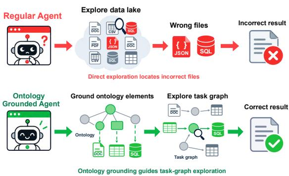
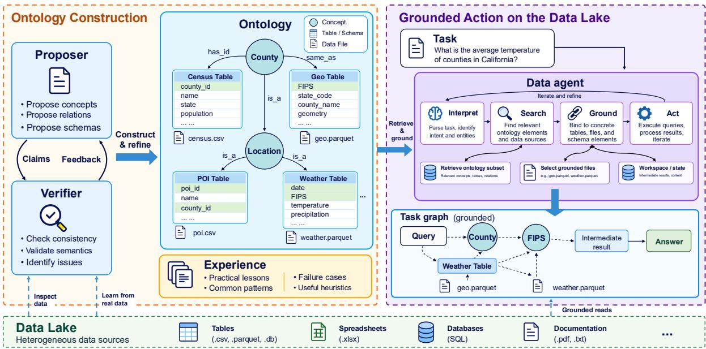
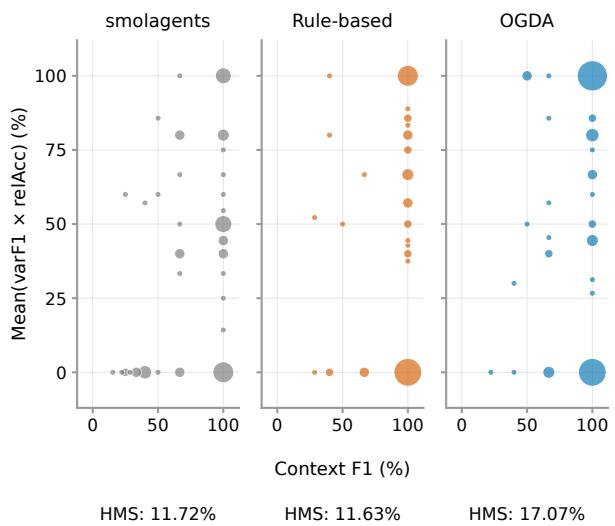
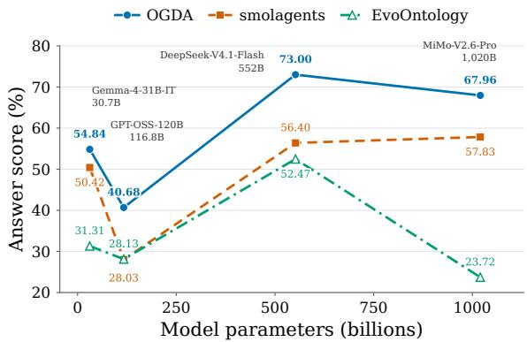
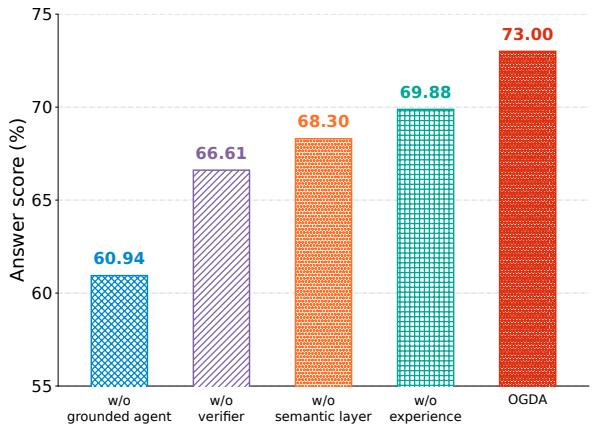
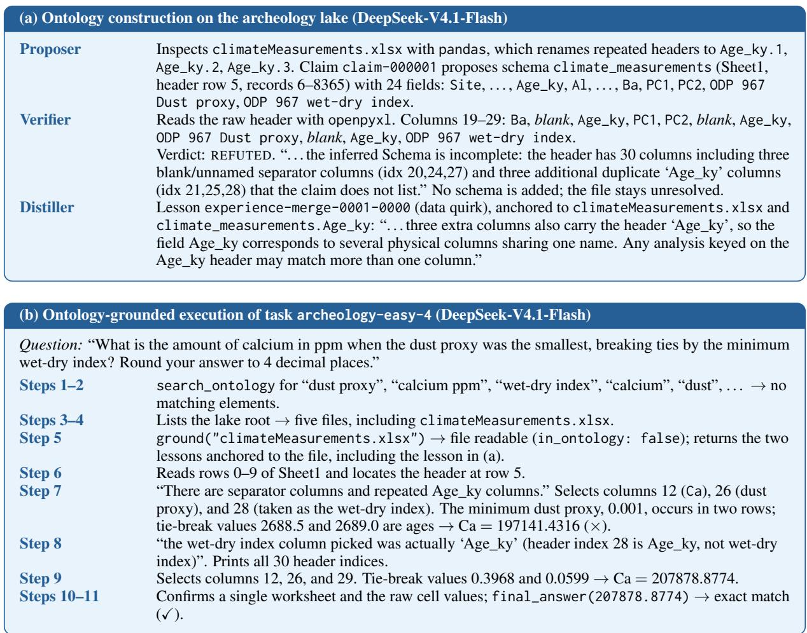
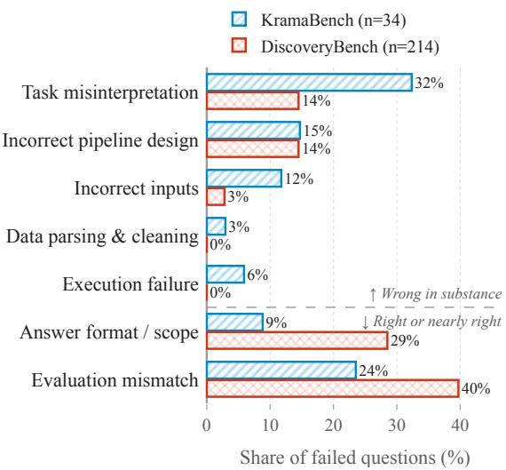

# OGDA: Ontology-Grounded Data Agents for Reliable Analysis over Heterogeneous Data Lakes

Boyi Zhang1, Hong Ting Tsang1, Yisen Gao1, Qiao Xiao1, LI Yufei1 Haoyu Huang1, Zhongwei Xie1, Jiaxin Bai2, Yangqiu Song1 1The Hong Kong University of Science and Technology 2Hong Kong Baptist University

{bzhangdd,httsangaj,ygaodi,qxiaoc,ylivm,hhuangcp,zxiebk}@connect.ust.hk baijiaxin@hkbu.edu.hk, yqsong@cse.ust.hk

## Abstract

Full-pipeline data analysis over real-world data lakes requires LLM agents to locate and integrate information across large collections of tables with different schemas. Existing data agents follow task-specific exploration, which exhausts the context window in massive lakes. As the context fills, the agent’s reasoning degrades, leading it to locate and process incorrect data files. These errors propagate into the final answer. To overcome these limitations, we introduce Ontology-Grounded Data Agent (OGDA), which utilizes a compact ontology to reduce exploration overhead and constrain data processing. OGDA constructs the ontology through agentic hypothesis testing. At each step, a proposer agent induces schemas, concepts, and relations from raw sources, and a verifier checks each proposal against the underlying data. During task execution, the ontology serves as a representation of the data lake for the agent to explore. Every data-processing action is constrained by a task graph, which the agent can extend only after observing the semantic meaning of the data. Across KramaBench and DiscoveryBench with three LLM backbones, OGDA outperforms the strongest baselines by up to 10.82 points. These results suggest that explicitly modeling the data lake is a key step toward reliable end-to-end data agents.

## 1 Introduction

Data analysis answers a question end-to-end from raw data, spanning data preparation, integration, and computation. Traditional approaches decompose this process into separately designed stages, including data discovery, cleaning, integration, and computation (Castro Fernandez et al., 2018; Wang et al., 2020; Yu et al., 2018). Each stage assumes a predefined problem space with fixed objectives and a known target structure. Thus, it must be redesigned by hand whenever the data or question changes.

  
Figure 1: Direct exploration can select incorrect files and propagate source-selection errors into the result. OGDA grounds relevant ontology elements in an explicit task graph that guides exploration of the corresponding sources.

LLMs have shown strong reasoning abilities required for data analysis, from interpreting tabular data to generating analysis code that answers complex questions (Cheng et al., 2023; Lai et al., 2023). Motivated by such capabilities, many works utilize LLMs to remove much of the manual design by translating natural-language questions directly into executable queries or analysis code (Hong et al., 2024; Gao et al., 2024; Pourreza and Rafiei, 2023). Furthermore, LLM agents extend this capability to multi-step tasks. By interleaving reasoning with actions, agents gather information, revise plans, and carry out tasks through successive interactions with an environment (Yao et al., 2023). Building on this paradigm, data analysis agents automate the data analysis pipeline, from locating relevant files to iteratively refining analysis solutions (Nam et al., 2026; Hong et al., 2025; You et al., 2025). Their design implicitly assumes that the data relevant to a task can be found and understood by exploring sources within the agent’s context.

However, this assumption does not hold in realworld data lakes. A lake typically mixes various relational tables with no shared schema describing what they contain or how their fields relate (Lei et al., 2025; Lai et al., 2026). As illustrated in Figure 1, this exploration often exhausts the agent’s context window before the task reaches its final step. Moreover, evidence discovered early is likely to be buried under the growing exploration trace, causing hallucinations and error propagation (Zhang et al., 2024; Liu et al., 2024). Existing context management methods mitigate context limitations by managing external memory, summarizing completed subgoals, or compressing interaction histories (Hu et al., 2025; Liu et al., 2026; Zhang et al., 2025). While these approaches improve context efficiency, they do not explicitly model the semantic meaning of the underlying data or the relationships between sources. Data analysts confront the same problem when managing large, heterogeneous collections, and a common practice is to maintain a semantic layer over the data (Hai et al., 2016; Xiao et al., 2018; Halevy et al., 2016). A table’s schema describes what each field inside the table represents. Building on this, an ontology of the data lake records how various fields connect through shared concepts, so that an analyst can locate and combine the data a question requires without inspecting every raw file.

Inspired by this practice, grounding data agents in an ontology offers a promising way to guide analysis using the semantic knowledge underlying a data lake. However, realizing this approach presents two challenges. First, real-world data lakes rarely provide a predefined ontology. Second, merely supplying an ontology as additional context does not ensure that an agent will use it effectively. Without explicit constraints, the agent may still explore irrelevant files or perform computations without consulting the available semantic knowledge.

To address these challenges, we propose Ontology-Grounded Data Agent (OGDA)1, a framework that automatically constructs an ontology over a data lake and uses it to govern both the context and the actions of an LLM agent. First, agentic ontology construction abstracts the lake into an ontology in which schemas group files holding the same kind of record and concepts align semantically equivalent fields across files. During construction, a data agent proposes each schema, concept, and edge as a hypothesis induced from exploration of the data lake. An independent verifier tests each hypothesis by designing and executing experiments over the lake. Experience distillation captures lessons from this exploration and verification. These lessons complement the ontology with knowledge beyond its explicit elements. Second, ontology-grounded action turns this representation into an explicit constraint on execution. The agent must commit the ontology elements relevant to the task to a task graph, and any action on data outside that graph is rejected. The ontology thus orchestrates both what enters the agent’s context and which data the agent may act on, so the agent’s context scales with the task rather than with the size of the lake.

In summary, our contributions are:

• We introduce OGDA, which orchestrates agent execution and context through an ontology-based task graph.

• We develop a hypothesis-testing procedure that constructs structural and semantic representations from raw files and distills reusable experience from exploration.

• Our experiments demonstrate that OGDA significantly outperforms existing methods across KramaBench (Lai et al., 2026) and DiscoveryBench (Majumder et al., 2025) over three backbone models.

## 2 Related Work

## 2.1 Data Agents

Early LLM-based data systems answer questions over a given structured source. Text-to-SQL methods such as DIN-SQL (Pourreza and Rafiei, 2023) and MAC-SQL (Wang et al., 2025) decompose a question, link its terms to the tables and columns of a database, and correct queries through feedback from either LLMs or the execution environment. StructGPT (Jiang et al., 2023) lets an LLM iteratively read evidence from tables, knowledge graphs, and databases through specialized interfaces.

Data analysis agents extend this paradigm to full analyses over files, spanning data preparation, modeling, and interpretation. ReAct (Yao et al., 2023) interleaves reasoning with actions, while Reflexion (Shinn et al., 2023) uses verbal feedback to improve subsequent attempts. For data science, DS-Agent (Guo et al., 2024) reuses past successful solutions through case-based reasoning. Data Interpreter (Hong et al., 2025) decomposes a task into a hierarchical graph of subtasks with stepwise verification, and DatawiseAgent (You et al., 2025) organizes planning, incremental execution, and selfdebugging around a computational notebook. DS-STAR (Nam et al., 2026) targets heterogeneous file formats by first describing each data file and then iteratively planning, executing, and verifying analysis steps. These methods organize how an agent plans and carries out an analysis. OGDA additionally represents cross-file correspondences in an ontology and requires the agent to inspect schema descriptions before grounding the relevant files in a task graph. This graph determines which raw data the agent may read.

  
Figure 2: Overview of OGDA. Left: a proposer and verifier construct and refine an ontology of the heterogeneous data lake through claims and feedback, while exploration yields reusable experience. Right: a data agent interprets a task, searches the ontology, grounds relevant elements in a task graph, and acts on the corresponding data. The task graph connects grounded files, intermediate results, and the final answer.

## 2.2 Semantic Layer Construction

A semantic layer maps the underlying data to domain concepts and their relations, so that queries can be posed over concepts rather than isolated files (Xiao et al., 2018). Think-on-Graph (Sun et al., 2024) and RoG (LUO et al., 2024) let LLMs reason along paths in a knowledge graph, and OG-RAG (Sharma et al., 2025) anchors retrieval in a domain ontology. These systems assume that the semantic layer already exists.

Constructing such a layer typically requires expert effort, and prior work automates it in several ways. Aurum (Castro Fernandez et al., 2018) supports data discovery through relationships such as content and schema similarity across sources. LLM-based methods induce semantic layers from text (Zhang and Soh, 2024; Bai et al., 2026) or from database schemas and their associated questions (Baek et al., 2025). EvoOntology (Chong et al., 2026) constructs an ontology through workload-guided data probes and refines it using agent trajectories, accepting updates through paired evaluation. In contrast, OGDA explores the lake independently of downstream tasks to extract implicit domain knowledge and verify these interpretations against the underlying sources before incorporating them into the ontology.

## 3 Method

In this section, we first formalize the data analysis task and the ontology over a data lake in Section 3.1. We then introduce agentic ontology construction in Section 3.2 and describe how the ontology orchestrates the data agent’s context and actions in Section 3.3. Figure 2 presents an overview of OGDA.

## 3.1 Problem Formulation

Data lake and task. A data lake D = $\{ f _ { 1 } , \ldots , f _ { N } \}$ is a collection of heterogeneous files. Each file f stores its data under a set of fields $\Phi ( f )$ , where a field is a named attribute such as a table column or a JSON key. A task is a naturallanguage question $q$ over $\mathcal { D }$ with a ground-truth answer $a ^ { * }$ . Answering $q$ requires only a small subset of the lake, which we call the support of the task, $S _ { q } \subseteq { \mathcal { D } }$ . The answer is computed by a program p over the support, $a ^ { * } = p ( S _ { q } )$ , which may filter, aggregate, and join data across files in $S _ { q }$ by their fields. Fields, however, are named locally. The same semantic value can appear under different names in different files.

Ontology over the data lake. We model the data lake with an ontology $\mathcal { O } = ( \mathcal { D } , \Sigma , \mathcal { C } , \mathcal { L } )$ that separates how data are stored from what they mean. $\mathbf { A }$ schema $\sigma \in \Sigma$ is a set of fields, each with a name, a data type, and a natural-language description of its meaning. A file $f$ instantiates $\sigma$ if every field of $f$ is correctly described by $\sigma _ { \mathrm { { : } } }$ written as $f \models \sigma$ Files, schemas, and the instantiation relation form the structural layer. A concept $c \in { \mathcal { C } }$ denotes a lake-wide meaning. A link $l = ( x , r , c ) \in \mathcal { L }$ with relation type $r \in \mathcal { R }$ connects a field of a schema or a concept x to a concept c. Concepts and links form the semantic layer. Fields of different schemas relate only through the concepts they link to, which makes cross-file alignment explicit.

## 3.2 Agentic Ontology Construction

Construction through exploration. Ontology construction requires recovering domain knowledge that is implicit in the data. Observed values, their distributions, and dependencies between fields provide evidence about the concepts and relationships a data source can support (Gorskis et al., 2016). A proposer explores the lake to interpret these regularities and formulate candidate ontology changes as typed claims. These interpretations remain hypotheses because a pattern in the data does not by itself establish its domain meaning or scope. Verification tests the claims against the underlying sources; accepted claims update the ontology, while contradictory evidence guides further exploration and revision. Construction proceeds from local structure to shared semantics, first inducing schemas and then relating them through concepts. Appendix A presents the construction and grounded-action algorithms.

Schema induction. The structural stage jointly determines which files share a record structure and how their fields should be interpreted. Given a batch $B \subseteq { \mathcal { D } }$ , the proposer partitions it into disjoint groups $B _ { 1 } , \ldots , B _ { K }$ . For each group $B _ { i } ,$ , the proposer induces a schema $\sigma _ { i }$ such that $f \models \sigma _ { i }$ for every $f \in B _ { i }$ . The proposer inspects file contents to identify record organization and field types, then interprets the observed values together with available documentation to infer field meanings. Comparing these observations across files establishes the scope over which a common description applies. File grouping and schema description are jointly refined to ensure that each schema accurately represents the structure and meaning of all assigned files. When observations contradict a shared description, the agent revises either the schema or its file assignments. This process consolidates structurally and semantically compatible files into reusable schemas for subsequent semantic analysis.

Semantic enrichment. The semantic stage identifies domain meanings that connect the induced schemas. With the structural layer fixed, the proposer explores correspondences among field descriptions and the data they describe, using the schemas to organize its investigation of the underlying sources. This exploration concerns whether locally defined attributes express compatible meanings and what relationship those meanings support. Value correspondences supply evidence for a proposed alignment, while the surrounding schema and documentation constrain its interpretation. The proposer abstracts these interpretations into concepts $c \in { \mathcal { C } }$ and links $( x , r , c ) \in { \mathcal { L } }$ , expressing how fields or concepts relate to a shared meaning. Verification determines which proposed relationships are retained. This stage preserves source-specific descriptions while making their semantic connections explicit, allowing related data to be discovered through concepts across schema boundaries.

Experience distillation. Experience distillation retains knowledge acquired during construction that schemas, concepts, and links do not express. After each iteration, a distiller summarizes exploration and verification traces into short naturallanguage lessons stored as experience $\mathcal { E } .$ Lessons capture data discrepancies and unsuccessful analysis approaches, preserving findings from both accepted and rejected claims for subsequent reasoning. Each lesson $\textit { e } \in \textit { \mathcal { E } }$ is anchored to the most specific relevant schemas, fields, or concepts through a set $A _ { e }$ . Retrieving an element $y$ during construction or grounding it during task execution (Section 3.3) supplies the associated lessons $\mathcal { E } ( y ) = \{ e \in \mathcal { E } : y \in A _ { e } \}$ . This selective retrieval makes prior findings available when relevant without exhausting the context window.

## 3.3 Ontology-Grounded Action

During task execution, OGDA uses the ontology to orchestrate the data agent’s observations and actions in the environment. Before processing a raw data file, the agent retrieves its available semantic and structural information from the ontology. Computation is restricted to files in the task graph after the agent interprets the relevant ontology elements and identifies the files as potential support $S _ { q }$ for the task. The agent alternates between ontology observation and task-graph-based action as new observations and intermediate results reveal additional data requirements.

Ontology-based observation. The agent observes the data lake through its ontology rather than directly inspecting raw files. Given a task or an intermediate information need, the agent searches for relevant ontology elements and inspects their descriptions to determine whether to add the associated files to the task graph for later computation. Let $t = 0 , 1 , \ldots$ . index the agent’s execution steps. At step t, a query $u _ { t }$ based on the task and observations accumulated so far returns the context

$$
\begin{array} { r l } & { H _ { t } = \mathcal { N } _ { 2 } ( \mathrm { S e a r c h } ( \mathcal { O } , u _ { t } ) ) , } \\ & { K _ { t } = \Bigg ( \mathrm { D e s c r i b e } ( H _ { t } ) , \bigcup _ { y \in V ( H _ { t } ) } \mathcal { E } ( y ) \Bigg ) , } \end{array}\tag{1}
$$

where $\mathcal { N } _ { 2 }$ forms the subgraph of matched elements and their neighbors within two hops. Describe returns domain knowledge in $H _ { t }$ . Links to neighboring fields explain how this knowledge is represented and organized. Associated experience adds findings from construction that qualify how the sources should be interpreted or used. Based on $K _ { t } ,$ the agent assesses semantic relevance and whether the available record structure supports the required computation. Repeated search and inspection progressively connect task requirements to candidate sources.

The agent records the sources selected through observation in a task graph before reading them. The task graph $G _ { q } ^ { t }$ records the selected files together with their ontology associations, representing the agent’s current hypothesis about the data required for the task, with $G _ { q } ^ { 0 } \ = \ ( \emptyset , \emptyset )$ . Let $\mathcal { T } _ { t } \subseteq \Sigma$ contain the schemas whose descriptions have been inspected. A set of candidate files $F _ { t }$ can be grounded only when

$$
\left\{ \sigma \in \Sigma \ | \ \exists f \in F _ { t } , \ f \right\} = \sigma \} \subseteq { \mathcal { T } } _ { t } .\tag{2}
$$

The agent then selects $F _ { t }$ according to the task requirements and expands the graph through

$$
\begin{array} { r l } & { G _ { q } ^ { t + 1 } = G _ { q } ^ { t } \cup \mathrm { c l } ( F _ { t } ) , } \\ & { \widehat { S } _ { q } ^ { t + 1 } = R ( G _ { q } ^ { t + 1 } ) , } \end{array}\tag{3}
$$

where $\operatorname { c l } ( F _ { t } )$ contains the selected files and their available ontology associations and $R ( G )$ denotes the files accessible through $G .$ . The resulting $\widehat { S } _ { q } ^ { t + 1 }$ is the agent’s current hypothesis about the support of the task after the grounding update.

Task graph-based action. The agent performs computation over the support recorded in its task graph. It produces a program $p _ { t }$ that operates on a subset $S _ { t }$ of the grounded support and returns a result $o _ { t }$ ,

$$
o _ { t } = p _ { t } ( S _ { t } ) , \qquad S _ { t } \subseteq { \widehat { S } } _ { q } ^ { t } = R ( G _ { q } ^ { t } ) .\tag{4}
$$

Each $p _ { t }$ contributes to the answer-producing program $p$ in Section 3.1. Intermediate results can reveal missing data requirements, prompting further ontology observation and grounding before computation continues. This interleaving develops the support hypothesis alongside the computation, while requiring source selection to be informed by schema descriptions. Algorithm 2 gives the execution procedure in detail.

## 4 Experiments

We evaluate OGDA on two benchmarks spanning data-to-insight pipelines and scientific hypothesis discovery. We first describe the evaluation setup and then compare its performance with five agent baselines.

## 4.1 Experimental Setup

Benchmarks. We evaluate OGDA on two benchmarks for full-pipeline data analysis over realworld data. KramaBench (Lai et al., 2026) contains 104 curated data-to-insight tasks over about 1,700 real-world files from 24 sources in six domains, requiring file discovery, cleaning, and integration before analysis. DiscoveryBench (Majumder et al., 2025) evaluates data-driven hypothesis discovery. We use its 239-task real-data test split, drawn from published studies.

<table><tr><td rowspan="2">Model</td><td rowspan="2">Method</td><td colspan="4">KramaBench</td><td colspan="6">DiscoveryBench</td></tr><tr><td colspan="2">Answer</td><td colspan="2">Pipeline</td><td colspan="2">HMS</td><td colspan="2">ctxF1</td><td colspan="2">varF1</td></tr><tr><td rowspan="5"></td><td></td><td>Score↑</td><td></td><td>Δ↑ Score↑</td><td></td><td>Δ↑ Score↑</td><td></td><td>Δ↑ Score↑</td><td></td><td>Δ↑ Score↑</td><td>∆↑</td></tr><tr><td>Smolagents</td><td>56.40</td><td></td><td>43.12</td><td></td><td>11.72</td><td></td><td>28.87</td><td></td><td>68.09</td><td></td></tr><tr><td>Reflexion</td><td>62.18</td><td>+5.78</td><td>52.73</td><td>+9.61</td><td>9.62</td><td>-2.10</td><td>25.37</td><td>-3.50</td><td>68.22</td><td>+0.13</td></tr><tr><td>DS-STAR</td><td>43.66</td><td>-12.74</td><td>38.42</td><td>-4.70</td><td>11.46</td><td>-0.26</td><td>22.69</td><td>-6.18</td><td>76.10</td><td>+8.01</td></tr><tr><td>Data Interpreter</td><td>56.16 56.83</td><td>-0.24 +0.43</td><td>47.91</td><td>+4.79 +9.74</td><td>12.58</td><td>+0.86</td><td>26.08</td><td>-2.79</td><td>75.92</td><td>+7.83</td></tr><tr><td></td><td>DatawiseAgent OGDA (ours)</td><td>73.00</td><td>+16.60</td><td>52.86 49.77</td><td>+6.65</td><td>11.57 17.07</td><td>-0.15 +5.35</td><td>25.53 31.65</td><td>-3.34 +2.78</td><td>74.28 79.55</td><td>+6.19 +11.46</td></tr><tr><td rowspan="5">GPT-6-Luna</td><td>Smolagents</td><td>44.13</td><td></td><td>38.97</td><td></td><td>8.81</td><td></td><td>24.15</td><td></td><td>77.94</td><td></td></tr><tr><td>Reflexion</td><td>40.69</td><td>-3.44</td><td>43.78</td><td>+4.81</td><td>9.80</td><td>+0.99</td><td>21.89</td><td>-2.26</td><td>78.91</td><td>+0.97</td></tr><tr><td>DS-STAR</td><td>48.42</td><td>+4.29</td><td>38.69</td><td>-0.28</td><td>10.85</td><td>+2.04</td><td>24.08</td><td>-0.07</td><td>83.52</td><td>+5.58</td></tr><tr><td>Data Interpreter</td><td>45.93</td><td>+1.80</td><td>46.50</td><td>+7.53</td><td>8.81</td><td>+0.00</td><td>20.64</td><td>-3.51</td><td>77.92</td><td>-0.02</td></tr><tr><td>DatawiseAgent</td><td>49.66</td><td>+5.53</td><td>48.30</td><td>+9.33</td><td>9.59</td><td>+0.78</td><td>23.10</td><td>-1.05</td><td>79.36</td><td>+1.42</td></tr><tr><td></td><td>OGDA (ours)</td><td>52.96</td><td>+8.83</td><td>46.39</td><td>+7.42</td><td>13.35</td><td>+4.54</td><td>26.57</td><td>+2.42</td><td>83.94</td><td>+6.00</td></tr><tr><td rowspan="6">MiMo-V2.6-Pro</td><td>Smolagents</td><td>57.83</td><td></td><td>49.38</td><td></td><td>10.92</td><td></td><td>29.80</td><td></td><td>65.42</td><td></td></tr><tr><td>Reflexion</td><td>56.74</td><td>-1.09</td><td>45.88</td><td>-3.50</td><td>6.18</td><td>-4.74</td><td>19.83</td><td>-9.97</td><td>61.98</td><td>-3.44</td></tr><tr><td>DS-STAR</td><td>58.08</td><td>+0.25</td><td>41.43</td><td>-7.95</td><td>11.72</td><td>+0.80</td><td>27.76</td><td>-2.04</td><td>77.16</td><td>+11.74</td></tr><tr><td>Data Interpreter</td><td>55.31</td><td>-2.52</td><td>48.66</td><td>-0.72</td><td>11.89</td><td>+0.97</td><td>29.92</td><td>+0.12</td><td>72.56</td><td>+7.14</td></tr><tr><td>DatawiseAgent</td><td>52.22</td><td>-5.61</td><td>45.54</td><td>-3.84</td><td>13.31</td><td>+2.39</td><td>30.54</td><td>+0.74</td><td>72.70</td><td>+7.28</td></tr><tr><td>OGDA (ours)</td><td>68.54</td><td>+10.71</td><td>48.53</td><td>-0.85</td><td>17.23</td><td>+6.31</td><td>33.77</td><td>+3.97</td><td>79.45</td><td>+14.03</td></tr></table>

Table 1: Performance across two benchmarks and three model backbones. For each metric, ∆ is the percentagepoint difference from smolagents with the same backbone; a dash denotes the reference. Bold and underlining mark the highest and second-highest scores for each backbone–metric pair. Light blue highlights OGDA.

Metrics. For KramaBench, we report the mean answer score using the designated metric for each answer type and the pipeline score measuring coverage of required functionalities (Lai et al., 2026). For DiscoveryBench, we report Hypothesis Matching Score (HMS), context F1 (ctxF1), and variable F1 (varF1), which assess overall hypothesis agreement, context matching, and variable matching, respectively (Majumder et al., 2025). We use DeepSeek-V4.1-Flash as the LLM evaluator for all methods. Appendix B.1 provides scoring details.

Baselines. We compare against five agent baselines that differ in how they plan and revise dataanalysis workflows. Smolagents (Roucher et al., 2025) is a ReAct-style (Yao et al., 2023) coding agent that interleaves reasoning, code execution, and observations. Reflexion (Shinn et al., 2023) uses verbal self-reflection on task feedback to improve subsequent attempts. Data Interpreter (Hong et al., 2025) decomposes a task into a hierarchical graph of subtasks and executes them with code. DS-STAR (Nam et al., 2026) iteratively plans, executes, and verifies data-science steps over heterogeneous files. DatawiseAgent (You et al., 2025) provides a notebook-centric framework for data-science automation. We evaluate all methods with DeepSeek-V4.1-Flash (Xu et al., 2026), GPT-6-Luna (OpenAI, 2026), and MiMo-V2.6-Pro (Xiaomi MiMo Team, 2026). For the main results in Table 1, each OGDA backbone constructs its own ontology and serves all roles during ontology construction and task execution. The cross-backbone reuse experiment in Section 5.2 instead uses an ontology constructed by DeepSeek-V4.1-Flash.

Implementation. For OGDA, we allow the agent a maximum of 30 steps during task execution and 20 steps during ontology construction stages. We implement Reflexion on top of smolagents, augmenting its ReAct-style coding agent with verbal self-reflection between attempts. We allow a maximum of 30 agent steps for both smolagents and Reflexion. DS-STAR is limited to 10 steps and four revisions, while Data Interpreter may revise its plan up to four times. All methods execute code in the same isolated sandbox, with access to the data lake and no internet access. Appendix B.2 specifies generation and baseline settings, and Appendix B.3 provides further implementation details for OGDA.

## 4.2 Main Results

OGDA consistently outperforms the strongest baselines across backbones and benchmarks. Table 1 shows that OGDA achieves the highest mean KramaBench answer score and DiscoveryBench HMS for every evaluated backbone. Relative to the strongest baseline for each backbone, OGDA improves KramaBench answer scores by 10.82, 3.30, and 10.46 percentage points with DeepSeek-V4.1- Flash, GPT-6-Luna, and MiMo-V2.6-Pro, respectively. The corresponding gains in DiscoveryBench HMS are 4.49, 2.50, and 3.92 percentage points. OGDA consistently maintains its advantage, suggesting that ontology grounding benefits backbones of differing capability rather than depending on a particular one. While the gains in KramaBench pipeline score are less consistent, the improvements in final answer quality across both benchmarks suggest that explicitly modeling data semantics and grounding action in relevant sources provides a robust foundation for heterogeneous data analysis.

## 5 Analysis

We examine three research questions about OGDA: whether agent-constructed ontologies guide exploration to the gold-standard files required by a task, whether a constructed ontology can be reused across generation backbones, and which components contribute to answer quality.

## 5.1 RQ1: Does the ontology guide exploration to the task support files?

We examine whether the constructed ontology guides exploration toward the gold-standard files needed to answer a task, i.e., the task’s support $S _ { q } .$ . Table 3 in Appendix D directly evaluates this aspect through explicit file-reading references in saved code across 104 tasks and 311 required input units.

OGDA achieves the highest explicit-unit coverage with GPT-6-Luna and MiMo-V2.6-Pro and approaches the strongest baseline with DeepSeek-V4.1-Flash. With GPT-6-Luna, it covers 143/311 units (45.98%), exceeding the strongest baseline, DatawiseAgent (43.73%), by 2.25 percentage points. With MiMo-V2.6-Pro, it covers 179/311 units (57.56%), exceeding DatawiseAgent (49.52%) by 8.04 points. With DeepSeek-V4.1- Flash, it also covers 182/311 units (58.52%), ranking second to DatawiseAgent (60.45%) with a gap of 1.93 percentage points. These results indicate that ontology grounding steers the agent toward the task’s support files more consistently than the direct exploration used by the baselines.

  
Figure 3: Task-level hypothesis quality on Discovery-Bench. From left to right: smolagents, OGDA with a rule-based ontology, and OGDA with an ontology built by DeepSeek-V4.1-Flash. Bubble area is proportional to the number of tasks sharing a coordinate.

To examine whether our ontology construction paradigm contributes to hypotheses in the correct context, we compare smolagents with OGDA using either a rule-based ontology or one constructed with DeepSeek-V4.1-Flash on DiscoveryBench, shown in Figure 3. The rule-based construction procedure in Appendix C provides a deterministic alternative to agentic construction. The vertical axis measures variable and relationship correctness within matched hypothesis pairs. With the constructed ontology, OGDA moves tasks toward the upper-right corner of Figure 3, where both context F1 and within-pair correctness reach 100%. The rule-based ontology achieves an HMS of 11.63%, compared with 11.72% for smolagents and 17.07% for the agentically constructed ontology. Grounding in an ontology that records only file headers thus provides little benefit. The gain depends on the field meanings and cross-file relations that agentic construction adds, so grounding and construction quality are complementary rather than interchangeable.

## 5.2 RQ2: Can an ontology be reused across backbones?

We test whether an ontology constructed by one model remains useful when another model performs the analysis. We construct the ontology once with DeepSeek-V4.1-Flash and reuse it with four generation backbones on KramaBench. Details are in Appendix E. We compare against smolagents, which uses no ontology, and EvoOntology (Chong et al., 2026), which builds an ontology layer for data agents from sampled agent traces.

  
Figure 4: Ontology reuse across generation backbones on KramaBench. We compare OGDA, smolagents, and EvoOntology with Gemma-4-31B-IT, GPT-OSS-120B, DeepSeek-V4.1-Flash, and MiMo-V2.6-Pro.

As shown in Figure 4, OGDA achieves the highest answer score with every backbone. It improves over smolagents by 4.42, 12.65, 16.60, and 10.13 percentage points with Gemma-4-31B-IT (Gemma Team, 2026), GPT-OSS-120B (OpenAI, 2025), DeepSeek-V4.1-Flash, and MiMo-V2.6-Pro. A single construction can therefore be shared across backbones rather than repeated for each.

## 5.3 RQ3: Which components improve answer quality? Ablation Study

We ablate the four components of OGDA, the ontology-grounded agent, verifier, semantic layer, and experience, to examine their contributions to KramaBench answer quality. Experimental details are provided in Appendix F.

Ontology-Grounded Agent. Replacing the ontology-grounded agent with smolagents produces the largest observed decrease, from 73.00% to 60.94%. This variant retains read-only access to the ontology, and it still outperforms plain smolagents by 4.54 points. However, 12.06 of OGDA’s 16.60-point gain over smolagents appears only when the ontology also governs data access. Without the task graph’s constraints, ontology information is merely advisory. More specifically, the agent can read files whose schemas it has not inspected, and source-selection errors propagate into the computation.

  
Figure 5: Component ablations on KramaBench with DeepSeek-V4.1-Flash. Each variant removes one component from OGDA. Values are answer scores (%).

Verifier. Removing the verifier during ontology construction reduces the answer score to 66.61%, a decrease of 6.39 percentage points compared with the full system. In OGDA, the verifier independently tests claims inferred from file contents against the underlying data. The decrease suggests that independent verification during construction helps produce an ontology that reliably supports downstream analysis.

Semantic layer. Removing the semantic layer, retaining schemas but dropping the lake-wide concepts and the links that connect them, reduces the answer score to 68.30%. The observed decrease suggests that representing these meanings is useful beyond organizing local structure alone.

Experience. Removing the distiller eliminates experience from both ontology construction and task execution, reducing the answer score to 69.88%. Experience records knowledge that the ontology cannot express as claims, such as discrepancies between documentation and data and analysis approaches that failed. The decrease suggests that producing and reusing these lessons across construction and execution provides useful context beyond the schemas, concepts, and relations explicitly represented in the ontology.

## 6 Conclusion

We introduced OGDA, an ontology-grounded framework for data analysis over heterogeneous data lakes. OGDA builds an ontology through a hypothesize-and-verify loop and grounds each analysis in a task graph that makes source selection explicit and governs data access. Across KramaBench and DiscoveryBench with three LLM backbones, OGDA achieves the highest answer scores and HMS among the evaluated methods, and ablations identify grounded execution as the largest contributor.

## Limitations

OGDA is designed for lakes of record-structured data, such as tables, spreadsheets, databases, and semi-structured files, with free text serving mainly as evidence for field meanings. It does not model non-textual modalities such as images, audio, or video. These sources lack the fields and values that schema induction and concept alignment rely on. Extending the ontology to multimodal sources would require new schema abstractions and verification procedures for content that cannot be checked through value correspondences. In addition, OGDA’s answers can only be as reliable as the ontology and the data beneath it. Verification tests proposed claims against the lake itself, so noisy, inconsistent, or incomplete data can yield ontology elements that are consistent with the observed values but do not reflect their intended meaning. The same noise affects computation at execution time. Grounding narrows the agent’s attention to the right sources, but it cannot correct errors within those sources, so OGDA does not guarantee correct outputs when the underlying data are unreliable.

## References

Jinheon Baek, Horst Samulowitz, Oktie Hassanzadeh, Dharmashankar Subramanian, Sola Shirai, Alfio Gliozzo, and Debarun Bhattacharjya. 2025. Knowledge base construction for knowledge-augmented text-to-SQL. In Findings of the Association for Computational Linguistics: ACL 2025, pages 26569– 26583, Vienna, Austria. Association for Computational Linguistics.

Jiaxin Bai, Wei Fan, Qi Hu, Qing Zong, Chunyang Li, Hong Ting Tsang, Hongyu Luo, Yauwai Yim, Haoyu Huang, Xiao Zhou, Feng Qin, Tianshi Zheng, Xi Peng, Xin Yao, Huiwen Yang, Leijie Wu, JI Yi, Gong Zhang, Renhai Chen, and Yangqiu Song. 2026. AutoSchemaKG: Autonomous knowledge graph construction through dynamic schema induction from web-scale corpora. In Proceedings of the 64th Annual Meeting of the Association for Computational Linguistics (Volume 1: Long Papers), pages 20557– 20584, San Diego, California, United States. Association for Computational Linguistics.

Raul Castro Fernandez, Ziawasch Abedjan, Famien Koko, Gina Yuan, Samuel Madden, and Michael

Stonebraker. 2018. Aurum: A data discovery system. In 2018 IEEE 34th International Conference on Data Engineering (ICDE), pages 1001–1012.

Liying Cheng, Xingxuan Li, and Lidong Bing. 2023. Is GPT-4 a good data analyst? In Findings of the Associationfor Computational Linguistics: EMNLP 2023, pages 9496–9514, Singapore. Association for Computational Linguistics.

Meiduo Chong, Shaolei Zhang, Ju Fan, and Xiaoyong Du. 2026. EvoOntology: A self-evolving ontology layer for data agents. Preprint, arXiv:2609.15779.

Dawei Gao, Haibin Wang, Yaliang Li, Xiuyu Sun, Yichen Qian, Bolin Ding, and Jingren Zhou. 2024. Text-to-SQL empowered by large language models: A benchmark evaluation. Proc. VLDB Endow., 17(5):1132–1145.

Gemma Team. 2026. Gemma 4 technical report. Preprint, arXiv:2607.02770.

Henrihs Gorskis, Ludmila Aleksejeva, and Inese Polaka. 2016. Database analysis for ontology learning. Procedia Computer Science, 102:113–120.

Siyuan Guo, Cheng Deng, Ying Wen, Hechang Chen, Yi Chang, and Jun Wang. 2024. DS-Agent: automated data science by empowering large language models with case-based reasoning. In Proceedings of the 41st International Conference on Machine Learning, ICML’24. JMLR.org.

Rihan Hai, Sandra Geisler, and Christoph Quix. 2016. Constance: An intelligent data lake system. In Proceedings of the 2016 International Conference on Management of Data, SIGMOD ’16, page 2097–2100, New York, NY, USA. Association for Computing Machinery.

Alon Halevy, Flip Korn, Natalya F. Noy, Christopher Olston, Neoklis Polyzotis, Sudip Roy, and Steven Euijong Whang. 2016. Goods: Organizing google’s datasets. In Proceedings of the 2016 International Conference on Management of Data, SIGMOD ’16, page 795–806, New York, NY, USA. Association for Computing Machinery.

Sirui Hong, Yizhang Lin, Bang Liu, Bangbang Liu, Binhao Wu, Ceyao Zhang, Danyang Li, Jiaqi Chen, Jiayi Zhang, Jinlin Wang, Li Zhang, Lingyao Zhang, Min Yang, Mingchen Zhuge, Taicheng Guo, Tuo Zhou, Wei Tao, Robert Tang, Xiangtao Lu, and 9 others. 2025. Data interpreter: An LLM agent for data science. In Findings of the Association for Computational Linguistics: ACL 2025, pages 19796–19821, Vienna, Austria. Association for Computational Linguistics.

Zijin Hong, Zheng Yuan, Hao Chen, Qinggang Zhang, Feiran Huang, and Xiao Huang. 2024. Knowledgeto-SQL: Enhancing SQL generation with data expert LLM. In Findings of the Association for Computational Linguistics: ACL 2024, pages 10997–11008, Bangkok, Thailand. Association for Computational Linguistics.

Mengkang Hu, Tianxing Chen, Qiguang Chen, Yao Mu, Wenqi Shao, and Ping Luo. 2025. HiAgent: Hierarchical working memory management for solving long-horizon agent tasks with large language model. In Proceedings of the 63rd Annual Meeting of the Associationfor Computational Linguistics (Volume 1: Long Papers), pages 32779–32798, Vienna, Austria. Association for Computational Linguistics.

Jinhao Jiang, Kun Zhou, Zican Dong, Keming Ye, Xin Zhao, and Ji-Rong Wen. 2023. StructGPT: A general framework for large language model to reason over structured data. In Proceedings of the 2023 Conference on Empirical Methods in Natural Language Processing, pages 9237–9251, Singapore. Association for Computational Linguistics.

Eugenie Lai, Gerardo Vitagliano, Ziyu Zhang, Om Chabra, SIVAPRASAD SUDHIR, Anna Zeng, Anton A. Zabreyko, Chenning Li, Ferdi Kossmann, Jialin Ding, Jun Chen, Markos Markakis, Matthew Russo, Weiyang Wang, Ziniu Wu, Mike Cafarella, Lei Cao, Samuel Madden, and Tim Kraska. 2026. KRAMABENCH: A benchmark for AI systems on data-to-insight pipelines over data lakes. In The Fourteenth International Conference on Learning Representations.

Yuhang Lai, Chengxi Li, Yiming Wang, Tianyi Zhang, Ruiqi Zhong, Luke Zettlemoyer, Wen-tau Yih, Daniel Fried, Sida Wang, and Tao Yu. 2023. DS-1000: a natural and reliable benchmark for data science code generation. In Proceedings ofthe 40th International Conference on Machine Learning, ICML’23. JMLR.org.

Fangyu Lei, Jixuan Chen, Yuxiao Ye, Ruisheng Cao, Dongchan Shin, Hongjin SU, ZHAOQING SUO, Hongcheng Gao, Wenjing Hu, Pengcheng Yin, Victor Zhong, Caiming Xiong, Ruoxi Sun, Qian Liu, Sida Wang, and Tao Yu. 2025. Spider 2.0: Evaluating language models on real-world enterprise text-to-SQL workflows. In The Thirteenth International Conference on Learning Representations.

Nelson F. Liu, Kevin Lin, John Hewitt, Ashwin Paranjape, Michele Bevilacqua, Fabio Petroni, and Percy Liang. 2024. Lost in the middle: How language models use long contexts. Transactions ofthe Association for Computational Linguistics, 12:157–173.

Shukai Liu, Bo Jiang, Jian Yang, Yizhi LI, Jinyang Guo, Xianglong Liu, and Bryan Dai. 2026. Context as a tool: Context management for long-horizon SWEagents. In Findings of the Association for Computational Linguistics: ACL 2026, pages 20604–20617, San Diego, California, United States. Association for Computational Linguistics.

LINHAO LUO, Yuan-Fang Li, Gholamreza Haffari, and Shirui Pan. 2024. Reasoning on graphs: Faithful and interpretable large language model reasoning. In The Twelfth International Conference on Learning Representations.

Bodhisattwa Prasad Majumder, Harshit Surana, Dhruv Agarwal, Bhavana Dalvi Mishra, Abhijeetsingh Meena, Aryan Prakhar, Tirth Vora, Tushar Khot, Ashish Sabharwal, and Peter Clark. 2025. DiscoveryBench: Towards data-driven discovery with large language models. In The Thirteenth International Conference on Learning Representations.

Jaehyun Nam, Jinsung Yoon, Jiefeng Chen, Rajarishi Sinha, Jinwoo Shin, and Tomas Pfister. 2026. DS-STAR: Data science agent for solving diverse tasks across heterogeneous formats and open-ended queries. Transactions on Machine Learning Research.

OpenAI. 2025. gpt-oss-120b & gpt-oss-20b model card. Preprint, arXiv:2508.10925.

OpenAI. 2026. GPT-6 Luna. https://developers. openai.com/api/docs/models/gpt-6-luna. Accessed: 2026-10-07.

Mohammadreza Pourreza and Davood Rafiei. 2023. DIN-SQL: Decomposed in-context learning of textto-SQL with self-correction. In Thirty-seventh Conference on Neural Information Processing Systems.

Aymeric Roucher, Albert Villanova del Moral, Thomas Wolf, Leandro von Werra, and Erik Kaunismäki. 2025. ‘smolagents‘: a smol library to build great agentic systems. https://github.com/ huggingface/smolagents.

Kartik Sharma, Peeyush Kumar, and Yunqing Li. 2025. OG-RAG: Ontology-grounded retrieval-augmented generation for large language models. In Proceedings ofthe 2025 Conference on Empirical Methods in Natural Language Processing, pages 32962–32981, Suzhou, China. Association for Computational Linguistics.

Noah Shinn, Federico Cassano, Ashwin Gopinath, Karthik R Narasimhan, and Shunyu Yao. 2023. Reflexion: language agents with verbal reinforcement learning. In Thirty-seventh Conference on Neural Information Processing Systems.

Jiashuo Sun, Chengjin Xu, Lumingyuan Tang, Saizhuo Wang, Chen Lin, Yeyun Gong, Lionel Ni, Heung-Yeung Shum, and Jian Guo. 2024. Think-on-graph: Deep and responsible reasoning of large language model on knowledge graph. In The Twelfth International Conference on Learning Representations.

Bailin Wang, Richard Shin, Xiaodong Liu, Oleksandr Polozov, and Matthew Richardson. 2020. RAT-SQL: Relation-aware schema encoding and linking for textto-SQL parsers. In Proceedings ofthe 58th Annual Meeting of the Association for Computational Linguistics, pages 7567–7578, Online. Association for Computational Linguistics.

Bing Wang, Changyu Ren, Jian Yang, Xinnian Liang, Jiaqi Bai, LinZheng Chai, Zhao Yan, Qian-Wen Zhang,

Di Yin, Xing Sun, and Zhoujun Li. 2025. MAC   
SQL: A multi-agent collaborative framework for text  
to-SQL. In Proceedings of the 31st International   
Conference on Computational Linguistics, pages 540–   
557, Abu Dhabi, UAE. Association for Computa   
tional Linguistics.   
Guohui Xiao, Diego Calvanese, Roman Kontchakov,   
Domenico Lembo, Antonella Poggi, Riccardo Rosati,   
and Michael Zakharyaschev. 2018. Ontology-based   
data access: A survey. In Proceedings of the Twenty-  
Seventh International Joint Conference on Artificial   
Intelligence, IJCAI-18, pages 5511–5519. Interna   
tional Joint Conferences on Artificial Intelligence   
Organization.   
Xiaomi MiMo Team. 2026. MiMo-V2.6-Pro-  
RL. https://huggingface.co/XiaomiMiMo/   
MiMo-V2.6-Pro-RL.   
Anyi Xu, B Li, Bangcai Lin, Bing Xue, BingCheng   
Xian, Bingzheng Xu, Bochao Wu, Bowei Zhang,   
Boyi Deng, CC Yu, et al. 2026. DeepSeek-V4.1-   
Flash: Pushing the limits of KV cache compression.   
arXiv preprint arXiv:2609.19969.   
Shunyu Yao, Jeffrey Zhao, Dian Yu, Nan Du, Izhak   
Shafran, Karthik R Narasimhan, and Yuan Cao. 2023.   
ReAct: Synergizing reasoning and acting in language   
models. In The Eleventh International Conference   
on Learning Representations.   
Ziming You, Yumiao Zhang, Dexuan Xu, Yiwei Lou,   
Yandong Yan, Wei Wang, Huamin Zhang, and   
Yu Huang. 2025. DatawiseAgent: A notebook  
centric LLM agent framework for adaptive and robust   
data science automation. In Proceedings ofthe 2025   
Conference on Empirical Methods in Natural Lan  
guage Processing, pages 1099–1123, Suzhou, China.   
Association for Computational Linguistics.   
Tao Yu, Rui Zhang, Kai Yang, Michihiro Yasunaga,   
Dongxu Wang, Zifan Li, James Ma, Irene Li, Qingn  
ing Yao, Shanelle Roman, Zilin Zhang, and Dragomir   
Radev. 2018. Spider: A large-scale human-labeled   
dataset for complex and cross-domain semantic pars  
ing and text-to-SQL task. In Proceedings ofthe 2018   
Conference on Empirical Methods in Natural Lan  
guage Processing, pages 3911–3921, Brussels, Bel   
gium. Association for Computational Linguistics.   
Bowen Zhang and Harold Soh. 2024. Extract, define,   
canonicalize: An LLM-based framework for knowl  
edge graph construction. In Proceedings ofthe 2024   
Conference on Empirical Methods in Natural Lan  
guage Processing, pages 9820–9836, Miami, Florida,   
USA. Association for Computational Linguistics.   
Boyi Zhang, Zhuo Liu, and Hangfeng He. 2025. TreeR   
are: Syntax tree-guided retrieval and reasoning for   
knowledge-intensive question answering. In Pro  
ceedings of the 2025 Conference on Empirical Meth  
ods in Natural Language Processing, pages 18741–   
18762, Suzhou, China. Association for Computa   
tional Linguistics.

Algorithm 1 Agentic ontology construction   
Require: Data lake D (task-blind), proposer ${ \mathcal P } _ { \mathrm { { : } } }$   
verifier V, distiller $x ,$ maximum passes $T$   
Ensure: Ontology O and experience $\mathcal { E }$   
1: $\mathcal { O }  \varnothing ; \quad \mathcal { E }  \varnothing$   
Stage 1: structural induction   
2: for all batches $B \subseteq { \mathcal { D } }$ do   
3: $H  { \mathcal { P } } ( B , { \mathcal { O } } ) \triangleright$ cluster files; one schema   
per cluster   
4: revise H until it passes executable checks   
on D   
5: $\mathcal { O }  \mathcal { O } \oplus \{ h \in H$ : h accepted } ▷   
documented, or judged by V   
6: ${ \mathcal { E } }  { \mathcal { E } } \cup { \mathcal { X } } ( H )$   
7: end for   
Stage 2: semantic enrichment   
8: for $t = 1 , \dots , T$ do   
9: H ← P.ENRICH(O, E) ▷ concepts, links,   
removals   
10: test and revise H with V, including Eq. (5)   
for key-field links   
11: $H _ { \mathrm { a c c } }  \{ h \in H$ : h accepted }   
12: $\begin{array} { r } { \mathcal { O }  \mathcal { O } \oplus H _ { \mathrm { a c c } } ; \quad \mathcal { E }  \mathcal { E } \cup \mathcal { X } ( H ) } \end{array}$   
13: if $H _ { \mathrm { a c c } } = \emptyset$ then break   
14: end if   
15: end for   
16: return ${ \mathcal { O } } , { \mathcal { E } }$

Muru Zhang, Ofir Press, William Merrill, Alisa Liu, and   
Noah A. Smith. 2024. How language model hallu  
cinations can snowball. In Forty-first International   
Conference on Machine Learning.

## A Algorithms for OGDA

Algorithms 1 and 2 give the procedures of Sections 3.2 and 3.3. Algorithm 1 observes only the data lake D and never a task; its first stage induces the structural layer and its second stage enriches the semantic layer. Algorithm 2 answers a task with the resulting ontology and experience; the agent reads only files placed in its task graph.

For the key-field overlap test in Algorithm 1, val(ϕ) denotes the set of distinct values of field $\phi$ across files instantiating its schema, and θ is the overlap threshold:

$$
\mathrm { o v } ( \phi , \phi ^ { \prime } ) = \frac { | \mathrm { v a l } ( \phi ) \cap \mathrm { v a l } ( \phi ^ { \prime } ) | } { \operatorname* { m i n } \big ( | \mathrm { v a l } ( \phi ) | , | \mathrm { v a l } ( \phi ^ { \prime } ) | \big ) } \ : \geq \ : \theta .\tag{5}
$$

Algorithm 2 Ontology-grounded action   
Require: Task q, ontology O, experience E, lake   
D, agent $\pi ,$ step budget M   
Ensure: Answer aˆ and task graph $G _ { q }$   
1: $G _ { q } \gets ( \emptyset , \emptyset ) ; \quad \mathbb { Z } \gets \emptyset ; \quad \tau \gets ( \boldsymbol { \dot { q } } )$   
2: for $n = 1 , \ldots , M$ do   
3: $p _ { n } \gets \pi ( \tau )$ ▷ search, inspect, ground,   
read, write, or answer   
4: $\mathbf { i f } \ p _ { n }$ inspects schema $\sigma$ then   
5: $o _ { n } \gets$ schema description and associ  
ated experience   
6: ${ \mathcal { T } }  { \mathcal { T } } \cup \{ \sigma \}$   
7: else if $p _ { n }$ grounds files F then   
8: $\Sigma _ { F }  \{ \sigma \in \Sigma \mid \exists f \in F , f \mid = \sigma \}$   
9: if $\Sigma _ { F } \nsubseteq { \cal T }$ then   
10: $o _ { n } \gets ^ { \star \star }$ inspect the required schema   
descriptions first”   
11: else   
12: $G _ { q } ^ { \prime } \gets G _ { q } \cup \operatorname { c l } ( F )$   
13: $o _ { n } \gets$ new elements, files, and   
lessons $\mathcal { E } ( G _ { q } ^ { \prime } ) \setminus \mathcal { E } ( G _ { q } )$   
14: $\dot { G } _ { q } \gets G _ { q } ^ { \prime }$   
15: end if   
16: else if $p _ { n }$ reads a file $f \not \in R ( G _ { q } )$ then   
17: $o _ { n } \gets ^ { \star }$ “ground $f$ first”   
18: else if $p _ { n }$ answers aˆ then   
19: add aˆ to $G _ { q } ,$ derived from the data read;   
return $\hat { a } , G _ { q }$   
20: else   
21: $o _ { n } \gets \mathrm { E x E C U T E } ( p _ { n } )$ ▷ results enter   
$G _ { q }$ as derived nodes   
22: end if   
23: $\tau  \tau \cdot ( p _ { n } , o _ { n } )$   
24: end for   
25: return NONE, $G _ { q }$

## B Experiment Details

## B.1 Metric Implementation

Evaluator configuration. We use DeepSeek-V4.1-Flash with high reasoning effort and a maximum output length of 16k tokens per evaluator call for all LLM-based judgments on KramaBench and DiscoveryBench. This evaluator is shared across all methods and generation backbones. We express the resulting benchmark scores as percentages.

KramaBench answer score. Each task receives a score $s _ { i } ~ \in ~ [ 0 , 1 ]$ using the benchmark’s designated primary metric for its answer type (Lai et al., 2026). Exact string and numeric answers use binary correctness, approximate numeric answers use a relative-error score, and list answers use F1 with the prescribed item-matching criterion. The headline answer score gives every task equal weight:

$$
S _ { \mathrm { a n s w e r } } = { \frac { 1 0 0 } { 1 0 4 } } \sum _ { i = 1 } ^ { 1 0 4 } s _ { i } .\tag{6}
$$

Of these 104 tasks, 10 (approximately 9.6%) require an LLM judge, while the remaining 94 (approximately 90.4%) are graded deterministically. For each of the 10 LLM-graded tasks, the judge answers a binary yes/no question about answer correctness, mapped to a score of 1 or 0.

KramaBench pipeline score. Pipeline evaluation separately checks the generated code against the human-annotated key functionalities for each task (Lai et al., 2026). For task $i ,$ let $K _ { i }$ denote this set and let $b _ { i k } \in \{ 0 , 1 \}$ indicate the judge’s decision on whether the code covers functionality k. The task-level pipeline score is

$$
p _ { i } = { \frac { 1 } { | K _ { i } | } } \sum _ { k \in K _ { i } } b _ { i k } .\tag{7}
$$

We average these task-level scores and multiply by 100. Thus, tasks receive equal weight regardless of how many functionalities they contain. The 10/94 split applies only to answer evaluation; pipeline evaluation uses LLM judgments of functionality coverage.

DiscoveryBench metrics. We evaluate generated hypotheses against gold hypotheses using context F1 (ctxF1), variable F1 (varF1), and Hypothesis Matching Score (HMS) (Majumder et al., 2025). The evaluator decomposes each hypothesis into sub-hypotheses with a context, interacting variables, and a relationship. If extraction returns an empty set, it uses the original hypothesis as a fallback sub-hypothesis. It then forms one-to-one matches between generated and gold sub-hypotheses whose contexts are semantically equivalent. Let $n _ { p }$ and $n _ { g }$ be the numbers of generated and gold sub-hypotheses, and let M be the matched pairs. For nonempty generated and gold sets, context precision and recall are $P _ { c } = | \mathcal { M } | / n _ { p }$ and $R _ { c } = | { \mathcal { M } } | / n _ { g }$ , giving

$$
\mathrm { c t x F 1 } = { \frac { 2 P _ { c } R _ { c } } { P _ { c } + R _ { c } } } .\tag{8}
$$

Within each matched pair m, the judge identifies the variables in both sub-hypotheses and their semantic overlap, accounting for paraphrases. Their precision and recall yield a variable F1 score $v _ { m } .$ The relationship score $r _ { m }$ is 1 for an equivalent relationship, 0.5 for a similar but less specific relationship, and 0 for a different relationship. For tasks with at least one matched pair, the conditional variable F1 and task-level HMS are

$$
\begin{array} { l } { \displaystyle \mathrm { v a r F 1 } = \frac { 1 } { | \mathcal { M } | } \sum _ { m \in \mathcal { M } } v _ { m } , } \\ { \displaystyle \mathrm { H M S } = R _ { c } \cdot \frac { 1 } { n _ { p } } \sum _ { m \in \mathcal { M } } v _ { m } r _ { m } . } \end{array}\tag{9}
$$

HMS multiplies context recall by the accuracy averaged over all generated sub-hypotheses; unmatched generated sub-hypotheses contribute zero. When no contexts match, ctxF1 and HMS are zero, while the within-pair variable F1 is undefined. Thus, HMS rewards correct variables and relationships while penalizing both missing gold contexts and unmatched generated contexts. Benchmark HMS is the mean task-level HMS over all 239 tasks, multiplied by 100.

## B.2 Baselines

For the main experiments, all three generation backbones—DeepSeek-V4.1-Flash, GPT-6-Luna, and MiMo-V2.6-Pro—run with thinking disabled and otherwise use their default generation parameters across all methods. We use the CodeAgent variant of smolagents, which permits and encourages combining multiple logical operations in a single code block within one agent step. Our Reflexion implementation builds on the same CodeAgent and follows the same convention, adding verbal selfreflection between attempts.

## B.3 Implementation Details of OGDA

For each construction backbone, we model each data lake once and reuse the resulting ontology and experience across all tasks on that lake. The proposer and verifier each have a maximum budget of 20 agent steps per invocation. We use batches of 8 files for schema induction and 32 claims for verification. Ontology search ranks elements by cosine similarity between bag-of-words representations of the query and ontology elements, retrieves the top 10 matches, and expands each match to include its two-hop neighborhood and connecting relations.

## C Ontology Details

Constructed ontology statistics. Table 2 reports the numbers of schemas, fields, tables, concepts, and links constructed by each model, aggregated over six KramaBench lakes and ten Discovery-Bench lakes.

Rule-based ontology. To measure what agentic construction contributes beyond the structure that a deterministic profiler can recover, we replace the construction loop of Section 3.2 with a fixed set of rules that involve no model calls. Let $\mathcal { D } _ { \mathrm { t a b } } \subseteq$ D denote the delimited-text and spreadsheet files of the lake, where each sheet of a workbook is treated as a separate file. For a file $f ,$ let $\operatorname { h d r } ( f ) =$ $\left( u _ { 1 } , \ldots , u _ { m } \right)$ be the cells of its first row. The rules assume that this row is the header and admit $f$ only if hdr(f) contains at least two non-empty cells. This is the rule-based variant evaluated in Figure 3. Each admitted file receives its own schema $\sigma _ { f } ,$ with $f \models \sigma _ { f } .$

$$
\begin{array} { r } { \Sigma _ { \mathrm { r u l e } } = \{ \sigma _ { f } : f \in \mathcal { D } _ { \mathrm { t a b } } , \qquad } \\ { | \{ j : u _ { j } \not = \varepsilon \} | \ge 2 \} . } \end{array}\tag{10}
$$

Here, ε denotes an empty cell. The fields of $\sigma _ { f }$ are the distinct non-empty header cells of $f ,$ in order of first occurrence. A field is typed as numeric if every non-empty value among the first 20 records of its column parses as a number, and as a string otherwise. Schemas and fields carry no descriptions, no documentation is associated with any schema, and the semantic layer and the experience store are empty, ${ \mathcal { C } } = { \mathcal { L } } = { \mathcal { E } } = \emptyset$ . Files that are not admitted, such as documentation, semi-structured records, and free text, remain outside the ontology; the data agent can still ground them as raw files (Section 3.3).

The rule-based ontology thus omits several decisions made during agentic construction: clustering files that hold the same kind of record into one schema, locating headers and record regions that do not start at the first row, attaching documentation and deriving field meanings from it, building the semantic layer, and distilling experience.

## D File-Reading References in Saved Code

Table 3 reports file-reading references identified in saved code across 104 tasks and 311 required input units. These percentages measure references in saved code, not confirmed file use during successful execution. A read reference may be exploratory, conditional, unexecuted, or part of an unsuccessful attempt; it does not establish that the file’s contents contributed to the final answer. Comments, filenames mentioned in search, grounding, or listing calls, and answer text are excluded as read evidence. The analysis traces simple variable paths and literal code nested in exec or compile, but arbitrary runtime values, branch assignments, imported helpers, and complex transformations may remain unresolved.

<table><tr><td>Benchmark</td><td>Construction model</td><td>Lakes</td><td>Schemas</td><td>Fields</td><td>Tables</td><td>Concepts</td><td>Links</td></tr><tr><td rowspan="3">KramaBench</td><td>DeepSeek-V4.1-Flash</td><td>6</td><td>100</td><td>1,577</td><td>1,723</td><td>294</td><td>1,791</td></tr><tr><td>GPT-6-Luna</td><td>6</td><td>78</td><td>1,487</td><td>602</td><td>33</td><td>136</td></tr><tr><td>MiMo-V2.6-Pro</td><td>6</td><td>80</td><td>779</td><td>1,706</td><td>116</td><td>336</td></tr><tr><td rowspan="3">DiscoveryBench</td><td>DeepSeek-V4.1-Flash</td><td>10</td><td>21</td><td>837</td><td>21</td><td>210</td><td>1,285</td></tr><tr><td>GPT-6-Luna</td><td>10</td><td>20</td><td>800</td><td>20</td><td>88</td><td>265</td></tr><tr><td>MiMo-V2.6-Pro</td><td>10</td><td>21</td><td>838</td><td>21</td><td>183</td><td>554</td></tr></table>

Table 2: Constructed ontology statistics by benchmark and construction model. Counts are totals across the listed lakes.
<table><tr><td>Model</td><td>Method</td><td>Saved answers</td><td>Full</td><td>Partial</td><td>Dynamic only</td><td>No evidence</td><td>Empty code</td><td>Missing output</td><td>Explicit units / 311</td><td>Explicit %</td></tr><tr><td rowspan="6">DeepSeek- V4.1-Flash</td><td>smolagents</td><td>90/104</td><td>49</td><td>22</td><td>7</td><td>12</td><td>14</td><td>0</td><td>106/311</td><td>34.08</td></tr><tr><td>Reflexion</td><td>104/104</td><td>59</td><td>19</td><td>6</td><td>20</td><td>0</td><td>0</td><td>134/311</td><td>43.09</td></tr><tr><td>DS-STAR</td><td>91/104</td><td>55</td><td>20</td><td>7</td><td>10</td><td>12</td><td>0</td><td>115/311</td><td>36.98</td></tr><tr><td>Data Interpreter</td><td>102/104</td><td>60</td><td>26</td><td>10</td><td>8</td><td>0</td><td>0</td><td>141/311</td><td>45.34</td></tr><tr><td>OGDA</td><td>103/104</td><td>67</td><td>25</td><td>5</td><td>7</td><td>0</td><td>0</td><td>182/311</td><td>58.52</td></tr><tr><td>DatawiseAgent</td><td>89/104</td><td>70</td><td>26</td><td>3</td><td>5</td><td>0</td><td>0</td><td>188/311</td><td>60.45</td></tr><tr><td rowspan="6">GPT-6-Luna</td><td>smolagents</td><td>104/104</td><td>38</td><td>17</td><td>7</td><td>42</td><td>0</td><td>0</td><td>98/311</td><td>31.51</td></tr><tr><td>Reflexion</td><td>104/104</td><td>47</td><td>20</td><td>8</td><td>29</td><td>0</td><td>0</td><td>108/311</td><td>34.73</td></tr><tr><td>DS-STAR</td><td>86/104</td><td>44</td><td>19</td><td>9</td><td>20</td><td>12</td><td>0</td><td>87/311</td><td>27.97</td></tr><tr><td>Data Interpreter</td><td>95/104</td><td>56</td><td>27</td><td>6</td><td>15</td><td>0</td><td>0</td><td>126/311</td><td>40.51</td></tr><tr><td>OGDA</td><td>104/104</td><td>50</td><td>28</td><td>4</td><td>22</td><td>0</td><td>0</td><td>143/311</td><td>45.98</td></tr><tr><td>DatawiseAgent</td><td>99/104</td><td>62</td><td>24</td><td>6</td><td>10</td><td>2</td><td>0</td><td>136/311</td><td>43.73</td></tr><tr><td rowspan="6">MiMo-V2.6-Pro</td><td>smolagents</td><td>101/104</td><td>51</td><td>21</td><td>5</td><td>24</td><td>2</td><td>1</td><td>120/311</td><td>38.59</td></tr><tr><td>Reflexion</td><td>97/104</td><td>55</td><td>23</td><td>14</td><td>8</td><td>4</td><td>0</td><td>146/311</td><td>46.95</td></tr><tr><td>DS-STAR</td><td>92/104</td><td>53</td><td>21</td><td>5</td><td>13</td><td>12</td><td>0</td><td>142/311</td><td>45.66</td></tr><tr><td>Data Interpreter</td><td>98/104</td><td>64</td><td>25</td><td>7</td><td>8</td><td>0</td><td>0</td><td>153/311</td><td>49.20</td></tr><tr><td>OGDA</td><td>103/104</td><td>65</td><td>25</td><td>4</td><td>10</td><td>0 16</td><td>0</td><td>179/311</td><td>57.56</td></tr><tr><td>DatawiseAgent</td><td>82/104</td><td>57</td><td>24</td><td>2</td><td>5</td><td></td><td>0</td><td>154/311</td><td>49.52</td></tr></table>

Table 3: File-reading references in saved code. Task categories are counts over 104 tasks; explicit-unit coverage is reported over 311 required units. Saved answers are reported separately and do not establish successful execution or file use. Only the supplied model–method results are shown.

Full means that every required unit has an explicit filename in a traced read call; Partial means that some do. Dynamic only denotes family or pattern reads without explicit filenames. No evidence means that no matching read was established, not that a file was unused. Empty code and missing output are reported separately. The explicit-unit percentage is the number of required units with explicit read evidence divided by 311. Every required wildcard remains unresolved for a claim that all its members were used, even when matching member files are read. Dynamic family references do not count as additional covered inputs.

## E Cross-Backbone Reuse Experiment (RQ2)

The experiment in Section 5.2 evaluates whether an ontology can support task execution with a different generation backbone from the model used to construct it. We construct the ontology with DeepSeek-V4.1-Flash and reuse it in OGDA on KramaBench with four generation backbones: Gemma-4-31B-IT, GPT-OSS-120B, DeepSeek-V4.1-Flash, and MiMo-V2.6-Pro. All generation backbones in this experiment run with thinking disabled, except GPT-OSS-120B, which uses low thinking effort. We compare OGDA with smolagents and EvoOntology (Chong et al., 2026) using the KramaBench answer score described in Section 4.1. Figure 4 reports the results for each backbone.

EvoOntology configuration. We use DeepSeek-V4.1-Flash to construct the EvoOntology baseline. For each KramaBench data lake, DeepSeek-V4.1- Flash synthesizes 60 questions: 40 for initial ontology construction and 20 for ontology evolution. EvoOntology uses agent traces from these synthetic questions to construct and evolve its ontology.

## F Component Ablation Details (RQ3)

Experimental design. The ablations in Section 5.3 examine the contributions of the ontologygrounded agent, verifier, semantic layer, and experience on KramaBench with DeepSeek-V4.1-Flash. We distinguish changes to ontology construction from changes to the task-solving agent and the ontology information available during execution. The agent and semantic-layer ablations operate on saved ontologies, whereas the verifier and experience ablations modify ontology construction. The verifier ablation accepts every proposed claim, while the experience ablation removes the distiller, so no experience is produced or available in either stage.

Without the ontology-grounded agent. We replace the ontology-grounded task-solving agent with smolagents (Roucher et al., 2025), while retaining access to the saved ontology. The replacement agent receives an initial ontology retrieval for the task question and can subsequently invoke search\_ontology and get\_schema. These tools provide read-only access to Concepts, Schemas, Fields, Tables, their relationships, and associated experience. Retrieved file references are mapped to the staged benchmark inputs used for execution.

The replacement agent executes Python code over these inputs without the full system’s ground interface or its requirement to ground relevant objects before reading lake files. In the full system, grounding adds selected ontology objects to a task graph and determines which lake files the agent can read; the graph also records dependencies between input files, derived artifacts, and the answer. Thus, this variant evaluates the replacement of the ontology-grounded execution procedure while preserving ontology retrieval.

Without the verifier. We remove the verifier during ontology construction and automatically accept every claim proposed by the proposer. For each set of proposed claims H, the accepted set is $H _ { \mathrm { a c c } } = H$ , and the corresponding changes are applied to the ontology without verifier judgment or verifier-guided revision. The resulting ontology is used by the ontology-grounded task-solving agent. This intervention evaluates the contribution of verification to ontology construction and downstream task performance.

Without experience. We remove the distiller during ontology construction, so no experience is produced $( { \mathcal { E } } = \emptyset )$ . Neither the construction agents nor the task-solving agent can access experience. Schema induction, semantic enrichment, and verification remain active, and the resulting ontology is used for task execution. The agent can still retrieve Concepts and Links, inspect schemas, ground relevant objects, and compute over the corresponding files using the full system’s execution procedure.

This intervention measures the contribution of producing and reusing distilled lessons across both ontology construction and task execution.

## G Case Study

Figure 6 traces task archeology-easy-4 of KramaBench through ontology construction and task execution, both with DeepSeek-V4.1-Flash. The archeology lake contains five files. The task requires one of them, climateMeasurements.xlsx, a sediment-core record whose single worksheet places several proxy series side by side. Each series block carries its own Age\_ky column, and blank columns separate the blocks. The execution took 11 steps and 59.6K tokens.

Verification keeps a misleading schema out of the ontology. The proposer inspected the file with pandas, which silently renames repeated headers, and proposed a schema with a single Age\_ky field. The verifier read the raw header and found the three repeated columns and three separators that the claim omitted. It refuted the claim, the only refutation among the 119 claims for this lake. Had the claim been accepted, the ontology would have described a 24-column layout with one Age\_ky column, the same misreading the agent made in step 7. Construction instead left the file unresolved, so the ontology made no statement about its columns.

Experience retains what a refuted claim revealed. A refuted claim adds nothing to the ontology, but the evidence behind the verdict remains useful. The distiller turned the verifier’s finding into a lesson anchored to the file and its Age\_ky field. During execution, the lesson reached the agent through grounding (Algorithm 2): it was returned in step 5, when the file entered the task graph. The agent’s reasoning in step 7 mentions the repeated Age\_ky columns, and in step 8 it recognized that its chosen column was one of them and re-indexed the header. The trace does not establish that the lesson alone caused this correction, since the agent had also printed the header in step 6. The correction nonetheless follows the layout that the lesson describes, and without it the answer would have been 197141.4316.

  
Figure 6: Case study from saved traces. (a) The verifier refutes a schema claim that omits repeated Age\_ky columns, and the distiller records the finding as a lesson. (b) Grounding the unresolved file returns that lesson; the agent corrects an initial selection of an Age\_ky column and answers correctly. Steps are condensed; quoted text is verbatim from the traces.

Grounding covers files outside the ontology. Because no schema described the file, the agent’s searches in steps 1–2 matched no ontology element, and the agent listed the lake directly. It then grounded the file by its path. With no schema instantiated by the file, the inspection condition in Eq. (2) holds trivially, and the file became readable. All subsequent reads stayed within the task graph. The case also exposes a cost of conservative construction: an unresolved file is invisible to ontology search, so the agent spent four steps locating it. Retaining such a file as a partially described schema with an attached caveat could shorten this search, which we leave for future work.

## H Error Analysis

We analyze the execution trajectories of OGDA on KramaBench and DiscoveryBench for questions that receive less than full credit. We assign each question one primary error type, summarized in Figure 7. The seven categories distinguish errors in substance from cases where the answer is right or nearly right in substance but loses credit because of its presentation, scope, or evaluation.

Task misinterpretation leads on KramaBench (32%), where substantive errors account for 68% of failures. DiscoveryBench is dominated by evaluation mismatch (40%) and answer format / scope (29%), highlighting hypothesis scope and reference matching as its main sources of lost credit.

  
Figure 7: Primary error types identified from OGDA execution trajectories on KramaBench and Discovery-Bench. Percentages are computed over questions receiving less than full credit in each benchmark. The dashed line separates errors in substance from cases with right or nearly right substance.

Wrong in substance. The first five categories identify failures in interpreting or carrying out the analysis:

1. Task misinterpretation. The agent answers a different question by using an unintended population, subset, time period, definition, or target quantity. Its answer may be internally consistent but does not address the intended task.

2. Incorrect pipeline design. The agent understands the question and uses the correct data but constructs the analysis incorrectly. Examples include an incorrect join, filter, grouping key, aggregation, interpolation, time window, order of operations, or statistical test or model.

3. Incorrect inputs. The agent selects the wrong file, table, sheet, column, or variable, or omits a required source. This category also includes cases where a required file is absent from the data lake and the agent substitutes a proxy.

4. Data parsing & cleaning. The source and analysis plan are correct, but loading or cleaning introduces errors, such as mishandled headers, skipped rows, missing values, type or unit conversions, string normalization, duplicates, or date parsing.

5. Execution failure. The agent produces no answer supported by computation because it crashes, exhausts its step or time budget, repeatedly fails to execute code, or ends with a guess.

Right or nearly right in substance. The remaining two categories distinguish output mismatches from evaluation discrepancies:

6. Answer format / scope. The answer is right or nearly right in substance but does not match the requested output. On KramaBench, this includes incorrect units, rounding, or representation. On DiscoveryBench, the hypothesis may be too broad or too narrow, introduce unrequested claims or variables, or express its context differently from the reference, preventing the evaluator from matching it.

7. Evaluation mismatch. The answer is correct or clearly defensible, but credit is lost because of the evaluator or reference. Examples include an incorrect judgment, reference claims beyond the question’s scope, a debatable convention in the gold answer, or a gold answer that contradicts the data or its reference pipeline. We assign this label only when supported by concrete evidence; if the agent also makes a substantive error, we assign the corresponding agent-error category instead.

## I Cost Analysis

Table 4 reports costs in USD over 343 selected task runs for each model–method pair. Generation cost per task is the reported generation total divided by 343. We report ontology construction both as a total and as an amortized cost per task, also divided by 343; total cost per task includes both components.

## J Agent Prompts

The following boxes present condensed versions of the verifier, proposer, and task-execution prompts. We use File uniformly for a source file, worksheet, or record region, identified by its source path and any applicable sheet or row range.

## Verifier Prompt

Independently verify outstanding Claims about one Lake's Ontology against relevant Lake Files and accepted context in the JSON task. Claims are proposals, not evidence; they may reference objects added by other Claims, and context may reflect completed verdicts. Do not rewrite Claims or use Proposer reasoning.

Check inferred Schemas and unsupported File-to-Schema assignments. Do not reinterpret declared Schema meanings supplied by Documentation.

<table><tr><td>Model</td><td>Method</td><td>Generation / task</td><td>Construction total</td><td>Construction / task</td><td>Total / task</td></tr><tr><td rowspan="6">DeepSeek-V4.1-Flash</td><td>smolagents</td><td>0.01467</td><td>0.0000</td><td>0.00000</td><td>0.01467</td></tr><tr><td>Reflexion</td><td>0.03307</td><td>0.0000</td><td>0.00000</td><td>0.03307</td></tr><tr><td>DS-STAR</td><td>0.02527</td><td>0.0000</td><td>0.00000</td><td>0.02527</td></tr><tr><td>Data Interpreter</td><td>0.00535</td><td>0.0000</td><td>0.00000</td><td>0.00535</td></tr><tr><td>OGDA</td><td>0.01242</td><td>4.2127</td><td>0.01228</td><td>0.02470</td></tr><tr><td>DatawiseAgent</td><td>0.00936</td><td>0.0000</td><td>0.00000</td><td>0.00936</td></tr><tr><td rowspan="6">GPT-6-Luna</td><td>smolagents</td><td>0.01300</td><td>0.0000</td><td>0.00000</td><td>0.01300</td></tr><tr><td>Reflexion</td><td>0.02807</td><td>0.0000</td><td>0.00000</td><td>0.02807</td></tr><tr><td>DS-STAR</td><td>0.03219</td><td>0.0000</td><td>0.00000</td><td>0.03219</td></tr><tr><td>Data Interpreter</td><td>0.00245</td><td>0.0000</td><td>0.00000</td><td>0.00245</td></tr><tr><td>OGDA</td><td>0.00415</td><td>0.5053</td><td>0.00147</td><td>0.00562</td></tr><tr><td>DatawiseAgent</td><td>0.00581</td><td>0.0000</td><td>0.00000</td><td>0.00581</td></tr><tr><td rowspan="6">MiMo-V2.6-Pro</td><td>smolagents</td><td>0.02394</td><td>0.0000</td><td>0.00000</td><td>0.02394</td></tr><tr><td>Reflexion</td><td>0.04867</td><td>0.0000</td><td>0.00000</td><td>0.04867</td></tr><tr><td>DS-STAR</td><td>0.06265</td><td>0.0000</td><td>0.00000</td><td>0.06265</td></tr><tr><td>Data Interpreter</td><td>0.00813</td><td>0.0000</td><td>0.00000</td><td>0.00813</td></tr><tr><td>OGDA</td><td>0.03024</td><td>9.7268</td><td>0.02836</td><td>0.05860</td></tr><tr><td>DatawiseAgent</td><td>0.02859</td><td>0.0000</td><td>0.00000</td><td>0.02859</td></tr></table>

Table 4: Generation and ontology construction costs in USD. Per-task costs use 343 runs per row; construction costs are amortized over those runs. Per-task values are rounded to five decimal places, with lower bounds rounded down.

## Proposer Prompt

Build one Lake's Ontology from JSON stage, accepted context, and remaining\_work. Read context once into Python. Repropose revisions with the same id. Leave Experience to its writer.

## FILE\_MAPPING

Inspect Documentation first: files gives absolute paths; documentation\_candidates are unverified filename hints. Reuse accepted definitions; otherwise consult known Documentation as support, not assigned data.

Inspect every assigned File's record regions and nonempty worksheets once; reuse observations; Propose only Schema and File-to-Schema assignment Claims; no removals.

\- Declared Schemas cite existing Documentation and copy its Field meanings, never inferred meanings. Documentation is support, not data. Mapped Files require structural checks and accepted Schemas.

## SCHEMA\_ENRICHMENT

Use supplied schema\_ids, accepted summaries, Concepts, Links, and get\_schema definitions to propose Concepts/Links, including shared meanings across Schemas. Revise/remove only Concepts/Links; preserve Schemas, Fields, and Files.

Never reread raw Files, rediscover structure, or revalidate documented meanings. Record specific evidence gaps in unresolved; revisit Schemas/remaining\_work, not completed Files.

Submit small useful batches; skip unchanged objects and exact refuted/undecidable entries in decided\_proposals. Empty claims are valid when no supported changes remain.

## WORKFLOW

get\_schema(schema\_id) returns Fields/Files; search\_ontology(query, hops=2) returns matches/neighbours. Never search empty context. Only submitted, accepted Claims update the Ontology; rereading cannot expose pending Claims.

Batch related Python steps/tool calls with known formats; reuse metadata, cache intermediates, and print only counts, relevant samples, or problems.

## Task-Execution Prompt

Answer a Lake task by finding data in the Harness, grounding it in a task graph, and computing with Python. The JSON task supplies task (question and optional answer\_format), max\_steps (step budget), and workspace.

Use File for a source addressed by its path and, when applicable, worksheet or record region. Apply the same search, grounding, and access rules to these sources.

## TOOLS

search\_ontology(query, hops=2) returns matched objects and neighbours within hops edges: Concepts, Fields with schema\_id, Schema summaries, Files, traversed edges (source, kind, target), paths from matches to neighbours, and Experience. Files omitted from a Schema's listing are partitions of the same dataset; search path terms to find them.

\- get\_schema(schema\_id) returns a Schema, all its Fields, and its first associated Files.

ground(ids) accepts one id or a list: Schema (with all associated Files), File, Field, Concept (with Links and connected Fields, Files, and Concepts), or Lake path. A path resolves to its mapped sources. It adds them to the task graph and returns additions, Schema Fields, edges, newly readable Files, and relevant Experience.

## FILES

LAKE\_ROOT is read-only. Read only grounded Files or Documentation of grounded Schemas. Otherwise, PermissionError requires grounding the File before retrying.

\- Write created, converted, cleaned, joined, or split files in WORKSPACE; each becomes a task-graph node.

## WORKFLOW

1. Preserve the question's population, filters, measure, period, and units exactly.

2. Search, ground the next computation's data, and compute. These may share one step; ground more as needed. Inspect associated Schema descriptions before grounding mapped Files.

3. Call final\_answer as soon as answered. Print only counts, small samples, and computed values.