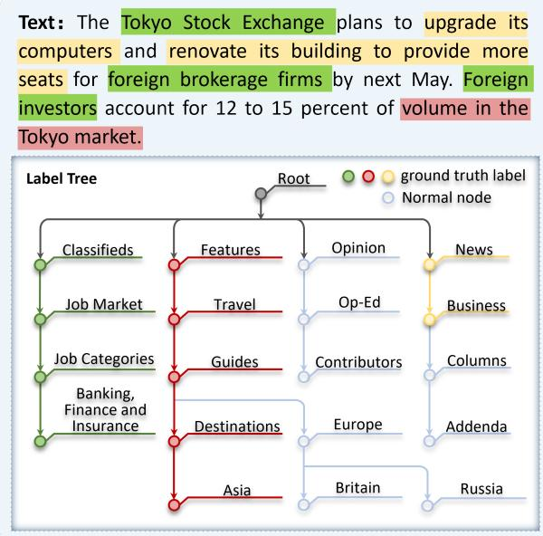
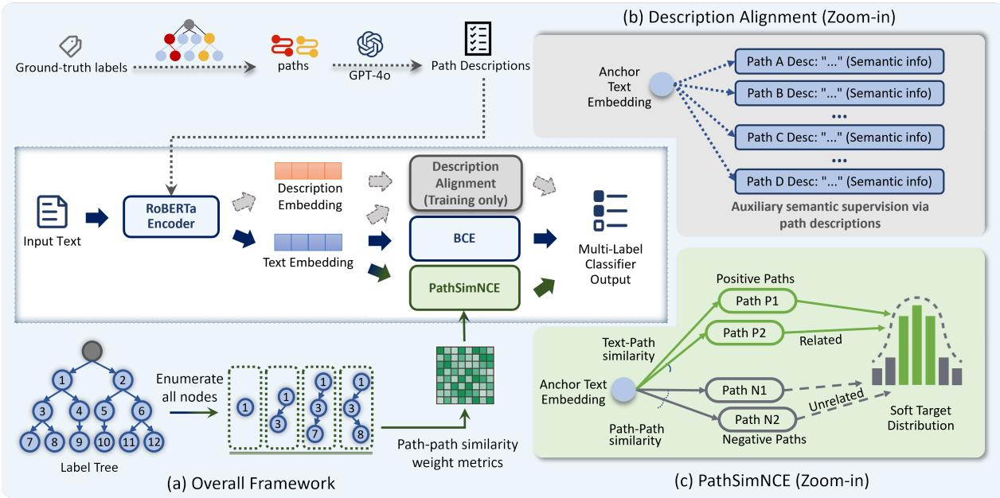
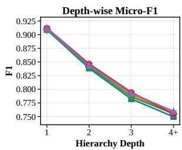
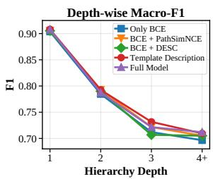
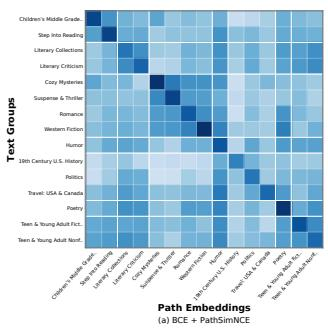
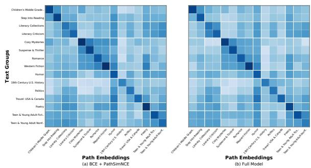
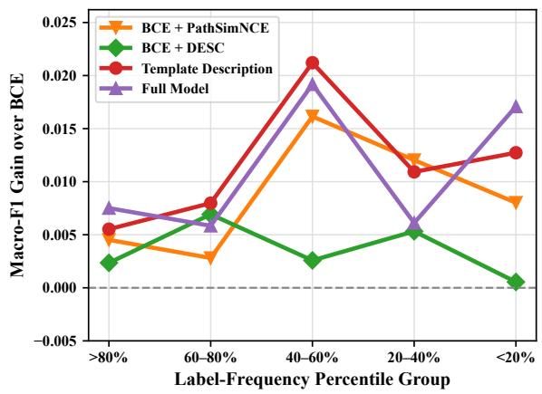
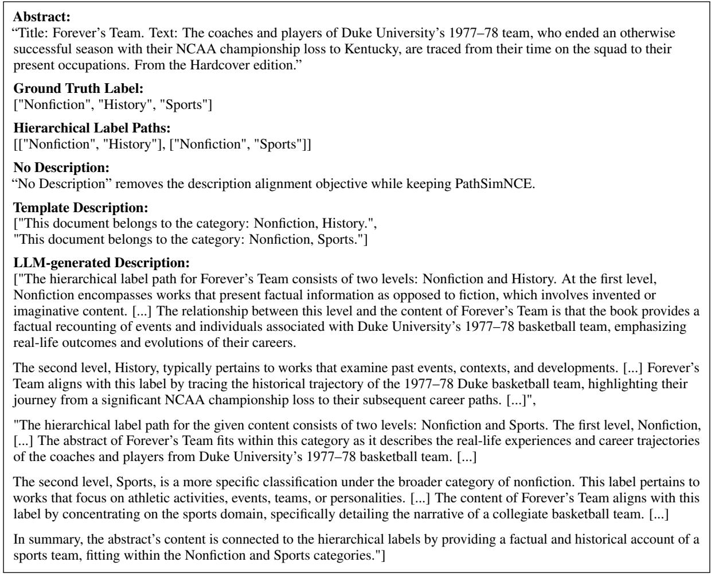
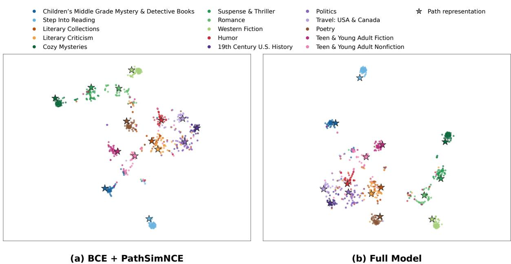

# Path-Level Structural and Semantic Alignment for Hierarchical Multi-Label Text Classification

Xindi Wang1, Aifen Xiong2, Baiyang Wang2, Xuri Ge1, Robert Mercer3, Frank Rudzicz4, Yifan Peng5, Zhumin Chen1, Hongjun Wang2

1School of Artificial Intelligence, Shandong University, Jinan, China   
2School of Information Science and Engineering, Shandong University, Qingdao, China 3Department of Computer Science, Western University, London, Ontario, Canada 4Faculty of Computer Science, Dalhousie University, Halifax, Nova Scotia, Canada   
5Department of Population Health Sciences, Weill Cornell Medicine, New York, NY, USA Correspondence: chenzhumin@sdu.edu.cn; hjw@sdu.edu.cn

## Abstract

Hierarchical multi-label text classification (HMTC) requires models to capture both structural dependencies among labels and the finegrained semantics of labels at different hierarchy levels. Existing methods often model hierarchy through prediction constraints or representations of individual labels and local relations. Structural and semantic supervision, however, are usually formulated separately. We instead use complete root-to-node label paths as a shared unit for both. Our framework introduces two auxiliary training objectives while retaining a standard multi-label classifier at inference. PathSimNCE aligns document representations with hierarchical paths using hierarchyaware contrastive targets. These targets provide graded supervision for structurally related paths while preserving explicit supervision for the ground-truth paths. The complementary semantic objective uses LLM-generated, documentconditioned descriptions of the same positive paths. It thereby provides context-specific label semantics beyond static label representations. Experiments on three benchmarks show consistent improvements: structural alignment is particularly beneficial in deeper hierarchies, while semantic alignment provides additional gains for fine-grained labels.

## 1 Introduction

Hierarchical multi-label text classification (HMTC) assigns multiple labels organized in a predefined hierarchy to a document (Liu et al., 2023a) (Figure 1). It arises in applications such as news topic classification (Kowsari et al., 2019), scientific publication categorization (Chen et al., 2024), and book genre annotation (Zhou et al., 2020). Unlike flat multi-label classification, HMTC must account for dependencies among labels at different levels of granularity, ranging from broad categories to finegrained concepts (Zhong et al., 2026).

  
Figure 1: An example of HMTC. Labels are organized in a top-down hierarchy from coarse to fine. Labels sharing the same color correspond to nodes along the same hierarchical label path.

Two challenges are particularly important in this setting. First, standard label-wise objectives treat labels largely as independent prediction targets and do not explicitly capture structural relations such as ancestry and siblinghood (Zhu et al., 2023). This limitation becomes more consequential in deep hierarchies, where closely related labels may share substantial hierarchical context but differ only at lower levels. Second, label names alone often provide insufficient semantic information for distinguishing fine-grained categories (Chen et al., 2021; Baldini Soares et al., 2019). Effective HMTC therefore requires supervision that reflects both the structural proximity among labels and their documentspecific semantic meanings.

Existing work incorporates hierarchical information primarily through prediction-level constraints or hierarchy-aware representation learning. Prediction-level approaches use structured inference, top-down decoding, or specialized prediction modules to enforce parent–child consistency (Kim et al., 2024; Vaswani et al., 2025). Representation-based approaches encode hierarchical relations using graph encoders, hierarchical attention, or structured label embeddings (Sadat and Caragea, 2022; Zhu et al., 2024; Zhang et al., 2026). Other methods employ re-weighting, sampling, or metric-learning strategies to improve the prediction of fine-grained labels (Cao et al., 2019; Huang et al., 2021). Although effective, these methods often model structure and label semantics separately, leaving complete root-to-node paths underexplored as a common supervision unit for both.

In this work, we propose a path-level representation learning framework with complementary structural and semantic objectives. Each non-root label is associated with its root-to-node path, which preserves its full ancestral context. Our structural objective, PathSimNCE, aligns document and path representations using hierarchy-aware contrastive targets. It assigns graded supervision to structurally related paths while preserving explicit supervision for the ground-truth paths. Our semantic objective aligns documents with LLM-generated, documentconditioned descriptions of the same positive paths, providing fine-grained semantic supervision beyond static label names. Both objectives are used only during training and complement the standard label-wise classification loss. At inference time, only the text encoder and multi-label classifier are retained.

Our contributions are summarized as follows:

• We propose a path-level framework that uses root-to-node paths as a common unit for structural and semantic supervision, without introducing additional inference-time components.

• We introduce PathSimNCE, a structural alignment objective that uses hierarchy-aware contrastive targets to provide graded supervision over hierarchical paths while preserving explicit supervision for the ground-truth paths.

• We introduce a complementary semantic alignment objective based on documentconditioned path descriptions generated offline by an LLM, providing fine-grained semantic supervision.

• We conduct experiments on three HMTC benchmarks and analyze the proposed objectives across hierarchy depths, label frequencies, and representation spaces.

## 2 Related Work

We review prior work on HMTC, focusing on prediction- and constraint-based methods, representation-based hierarchical modeling, and hierarchy-aware contrastive learning.

Prediction- and constraint-based approaches incorporate hierarchical dependencies directly into label prediction. Some methods extend flat multilabel classifiers with hierarchy-regularized objectives or structured inference, while others employ level- or node-specific classifiers followed by topdown or node-wise prediction (Kowsari et al., 2017; Shimura et al., 2018). To reduce the complexity of local classification, the hierarchy may be partitioned by level, parent, or node (Stein et al., 2019; Peng et al., 2018; Krendzelak and Jakab, 2021). Sequential formulations further represent hierarchical classification as a sequence of label-assignment decisions (Mao et al., 2019; Im et al., 2023). These approaches can explicitly model prediction dependencies and enforce hierarchical consistency. However, top-down and sequential decisions may propagate errors from coarse to fine levels, and many such methods require hierarchy-specific prediction or inference procedures.

Representation-based methods incorporate hierarchical structure into document or label representations rather than enforcing it solely through prediction-time constraints. Common strategies include graph-based encoders, hierarchy-aware attention, structured message passing, and specialized geometric spaces. For instance, Zhou et al. (2020) encode hierarchical relationships within a unified classification model, while Chen et al. (2021) formulate hierarchical classification as text–label semantic matching. Other studies enrich label representations using knowledge graphs and label attention (Liu et al., 2023b; Kumar and Toshniwal,

2025), or employ tree-isomorphic networks to represent complex hierarchical topologies (Zhu et al., 2023; Liu et al., 2025a). These methods demonstrate the value of learning hierarchy-aware representations, although many introduce dedicated graph, attention, or geometric modules that remain part of the model architecture.

Hierarchy-aware contrastive learning aligns texts, instances, or labels in a shared representation space while using hierarchical relations to construct contrastive supervision. Prior work has explored hierarchy-aware positive and negative sample construction (Xiong et al., 2026), including negative paths or labels selected according to their positions in the hierarchy (Zhou et al., 2025). Other approaches inject hierarchical information into the text encoder (Wang et al., 2022), or jointly contrast instances and labels while accounting for their hierarchical relations (U et al., 2023; Li et al., 2026). Hierarchical margins and rebalancing strategies have also been introduced to improve contrastive learning for infrequent or fine-grained labels (Kim et al., 2024; Zhang et al., 2024). Collectively, these studies show that hierarchical relations can improve representation learning, but many contrastive formulations express supervision through discrete positive–negative assignments, margin constraints, or specialized hierarchy-aware modules.

Our framework follows this representationlearning direction but uses root-to-node label paths as a common unit for structural and semantic supervision. PathSimNCE incorporates hierarchical structure into the learning objective through path-similarity-based contrastive targets, assigning graded supervision to structurally related paths while preserving explicit supervision for the ground-truth paths. A complementary description alignment objective supplies documentconditioned semantic supervision for the same paths. Both objectives are used only during training, allowing the model to retain a standard multilabel prediction architecture at inference.

## 3 Methodology

We propose a path-level representation learning framework that augments a standard HMTC classifier with complementary structural and semantic alignment objectives during training (Figure 2). For structural alignment, document representations and root-to-node label paths are projected into a shared contrastive space, where PathSimNCE provides graded supervision based on hierarchical path similarity while preserving explicit supervision for the ground-truth paths. For semantic alignment, document representations are aligned with documentconditioned path descriptions generated offline by an LLM. The two alignment objectives are jointly optimized with the standard label-wise classification loss, enabling the model to integrate label prediction, hierarchical structure, and fine-grained semantics during training. At inference time, only the text encoder and standard multi-label classifier are retained, without requiring path representations, descriptions, or a hierarchy-specific decoder.

## 3.1 Task Formulation

We consider hierarchical multi-label text classification over a label set $\mathcal { V }$ organized in a hierarchy, where each label has at most one parent. Given a document $x ,$ the goal is to predict its ground-truth label set $\mathcal { V } _ { x } \subseteq \mathcal { V }$ , which may contain labels at multiple hierarchy levels, including ancestor labels.

For each non-root label $y \in \mathcal { V }$ , we construct a unique hierarchical path by tracing the parent links from $y$ to the root and arranging the resulting nodes in root-to-label order:

$$
p ( y ) = \big ( y ^ { ( 0 ) } , y ^ { ( 1 ) } , \dots , y ^ { ( d _ { y } ) } \big ) ,
$$

where $y ^ { ( 0 ) }$ is the root of the corresponding hierarchy branch and $y ^ { ( d _ { y } ) } = y$ . A root label does not have an associated path because it has no parent. The complete path inventory of a benchmark is denoted as ${ \mathcal P } ,$ and the positive path set associated with x is defined as:

$$
{ \mathcal { P } } _ { x } = \{ p ( y ) | y \in \mathcal { V } _ { x } , \operatorname { p a r e n t } ( y ) \operatorname { e x i s t s } \} .
$$

Because a document may have multiple labels, ${ \mathcal P } _ { x }$ may contain multiple and potentially overlapping paths. These paths are used only to provide auxiliary supervision during training. The model itself predicts the complete label set $\mathcal { \partial } _ { x }$ , including root and ancestor labels, using a standard multi-label classifier.

## 3.2 Document, Path, and Description Representations

We map documents, hierarchical paths, and document-conditioned path descriptions into two task-specific representation spaces: a structural alignment space for PathSimNCE and a semantic alignment space for description alignment.

  
Figure 2: Overview of the proposed hierarchy-aware representation learning framework. (a) Instead of treating labels as isolated identifiers, each label is associated with its root-to-node path in the hierarchy. The model is jointly optimized with three objectives: binary cross-entropy (BCE), PathSimNCE, and description alignment. (b) Description alignment uses LLM-generated path descriptions to provide complementary semantic supervision during training only. (c) PathSimNCE performs hierarchy-aware contrastive learning by combining text–path and path–path similarities to generate soft structural supervision targets.

Document Representations. Given a document x, we obtain its contextualized representation using a RoBERTa (Liu et al., 2019) encoder:

$$
\begin{array} { r } { \mathbf { h } _ { x } = \mathrm { P o o l } \big ( \mathrm { R o B E R T a } ( x ) \big ) , } \end{array}\tag{1}
$$

where Pool(·) denotes the pooling operation applied to the encoder output. We then project $\mathbf { h } _ { x }$ into the structural and semantic alignment spaces:

$$
\begin{array} { r } { { \bf z } _ { x } = f _ { \mathrm { t e x t } } ( { \bf h } _ { x } ) , \qquad { \bf z } _ { x } ^ { \mathrm { d e s c } } = f _ { \mathrm { d e s c } } ( { \bf h } _ { x } ) . } \end{array}\tag{2}
$$

Path Representations. Each hierarchical path $p \in \mathcal { P }$ is associated with a learnable embedding $\mathbf { h } _ { p } ^ { \mathrm { p a t h } } \in \mathbb { R } ^ { d }$ from a trainable embedding table. The path embedding is projected into the structural alignment space:

$$
\begin{array} { r } { { \bf z } _ { p } ^ { \mathrm { p a t h } } = f _ { \mathrm { p a t h } } \left( { \bf h } _ { p } ^ { \mathrm { p a t h } } \right) . } \end{array}\tag{3}
$$

These path embeddings are jointly optimized with the text encoder and serve as structural anchors in PathSimNCE.

Description Representations. For each groundtruth document–path pair $( x , p )$ , where $p \in \mathcal { P } _ { x }$ , we use an LLM to generate a document-conditioned path description $d _ { x , p } .$ . The description explains how the content of $x$ corresponds to the hierarchical labels represented by p and is used only during training. We encode it using the same RoBERTa encoder and project it into the semantic alignment space:

$$
\begin{array} { r l } & { \mathbf { h } _ { x , p } ^ { \mathrm { d e s c } } = \mathrm { P o o l } \big ( \mathrm { R o B E R T a } ( d _ { x , p } ) \big ) , } \\ & { \mathbf { z } _ { x , p } ^ { \mathrm { d e s c } } = f _ { \mathrm { d e s c } } \big ( \mathbf { h } _ { x , p } ^ { \mathrm { d e s c } } \big ) . } \end{array}\tag{4}
$$

The resulting description representations provide auxiliary semantic views of the document–path relationships, complementing the structural supervision supplied by PathSimNCE.

## 3.3 PathSimNCE: Path Similarity-Aware InfoNCE

We propose PathSimNCE, a hierarchy-aware contrastive objective that aligns document representations with hierarchical paths while explicitly modeling structural similarities among paths. For each document $x _ { i }$ with positive path set ${ \mathcal P } _ { x _ { i } }$ , we construct a sample-specific candidate set $\mathcal { C } _ { i }$ from the global path inventory $\mathcal { P } _ { \cdot }$ . Document–path similarities define a predicted distribution over $\mathcal { C } _ { i }$ , while hierarchical relationships among paths are used to construct a soft target distribution.

Hierarchical Path Similarity. For two paths $p , p ^ { \prime } \in \mathcal { P }$ , we define their hierarchical distance based on their lowest common ancestor (LCA):

$$
\mathrm { d i s t } ( p , p ^ { \prime } ) = | p | + | p ^ { \prime } | - 2 \left| \mathrm { L C A } ( p , p ^ { \prime } ) \right| ,\tag{5}
$$

where $| \cdot |$ denotes the number of nodes. We convert this distance into a structural similarity score:

$$
\begin{array} { r } { \sin _ { \mathrm { p a t h } } ( p , p ^ { \prime } ) = \exp \left( - \lambda \operatorname { d i s t } ( p , p ^ { \prime } ) \right) , } \end{array}\tag{6}
$$

where $\lambda > 0$ controls the decay rate.

Candidate Path Construction and Negative Path Sampling. For document $x _ { i }$ , we first remove its positive paths ${ \mathcal P } _ { x _ { i } }$ from the complete path inventory to form the negative path pool:

$$
\mathcal { U } _ { i } = \mathcal { P } \setminus \mathcal { P } _ { x _ { i } } .\tag{7}
$$

For each candidate path $p \in \mathcal { U } _ { i } .$ , we define its distance from the positive path set as the minimum hierarchical distance to any positive path:

$$
\delta _ { i } ( p ) = \operatorname* { m i n } _ { p ^ { + } \in \mathcal { P } _ { x _ { i } } } \mathrm { d i s t } ( p , p ^ { + } ) ,\tag{8}
$$

where $p ^ { + }$ denotes a positive path associated with $x _ { i } .$ We then group candidate paths according to this distance:

$$
\mathcal { G } _ { i , r } = \{ p \in \mathcal { U } _ { i } \mid \delta _ { i } ( p ) = r \} ,\tag{9}
$$

where $\mathcal { G } _ { i , r }$ contains all candidate paths whose minimum distance to the positive path set is r. A smaller value of $r$ indicates that the paths in the group are hierarchically closer to the ground-truth paths.

Within each distance group, we rank candidate paths according to the current model predictions. Specifically, the prediction score of a path is defined as the average predicted probability of its constituent labels:

$$
\mathrm { s c o r e } _ { i } ( p ) = \frac { 1 } { | p | } \sum _ { y \in p } \hat { y } _ { i } ,\tag{10}
$$

where $\hat { y } _ { i }$ is the probability assigned by the classifier to label $y$ for document $x _ { i }$ . Paths within each $\mathcal { G } _ { i , r }$ are sorted by scor $\mathrm { e } _ { i } ( p )$ in descending order.

We sample negative paths in rounds, visiting the distance groups from nearest to farthest and selecting the highest-ranked remaining path from each group in every round. Sampling continues until K negative paths have been selected, yielding the negative-path set ${ \mathcal { N } } _ { i }$

Finally, the sample-specific candidate set is:

$$
{ \mathcal { C } } _ { i } = { \mathcal { P } } _ { x _ { i } } \cup { \mathcal { N } } _ { i } .\tag{11}
$$

This sampling strategy prioritizes hierarchically close and high-scoring negative paths while retaining candidates from different distance groups.

PathSimNCE Objective. Given the candidate set $\mathcal { C } _ { i }$ , we compute the cosine similarity between document $x _ { i }$ and each candidate path $p \in \mathcal { C } _ { i }$

$$
a _ { i } ( \boldsymbol { p } ) = \frac { \mathbf { z } _ { x _ { i } } ^ { \top } \mathbf { z } _ { p } ^ { \mathrm { p a t h } } } { \tau _ { \mathrm { h } } \| \mathbf { z } _ { x _ { i } } \| _ { 2 } \| \mathbf { z } _ { p } ^ { \mathrm { p a t h } } \| _ { 2 } } ,\tag{12}
$$

where $\tau _ { \mathrm { h } } ~ > ~ 0$ is a temperature hyperparameter. These similarity scores define the predicted distribution over the candidate paths:

$$
\hat { q } _ { i } ( p ) = \frac { \exp \bigl ( a _ { i } ( p ) \bigr ) } { \displaystyle \sum _ { \tilde { p } \in \mathcal { C } _ { i } } \exp \bigl ( a _ { i } ( \tilde { p } ) \bigr ) } .\tag{13}
$$

To construct the target distribution, we first aggregate the structural similarity of each candidate path to all positive paths:

$$
s _ { i } ( p ) = \sum _ { p ^ { + } \in \mathcal { P } _ { x _ { i } } } \operatorname { s i m } _ { \mathrm { p a t h } } ( p , p ^ { + } ) ,\tag{14}
$$

We then normalize these scores over the candidate set to obtain the structure-aware distribution:

$$
q _ { i } ^ { s } ( p ) = \frac { s _ { i } ( p ) } { \displaystyle \sum _ { \tilde { p } \in { \mathcal C } _ { i } } s _ { i } ( \tilde { p } ) } .\tag{15}
$$

To retain explicit supervision from the groundtruth paths, we additionally define a uniform positive distribution:

$$
q _ { i } ^ { \mathrm { g t } } ( \boldsymbol { p } ) = \left\{ \begin{array} { l l } { \displaystyle \frac { 1 } { | \mathcal { P } _ { x _ { i } } | } , } & { \boldsymbol { p } \in \mathcal { P } _ { x _ { i } } , } \\ { \displaystyle 0 , } & { \boldsymbol { p } \notin \mathcal { P } _ { x _ { i } } . } \end{array} \right.\tag{16}
$$

The final soft target is obtained by interpolating the two distributions:

$$
q _ { i } ( p ) = ( 1 - \gamma ) q _ { i } ^ { s } ( p ) + \gamma q _ { i } ^ { \mathrm { g t } } ( p ) ,\tag{17}
$$

where $\gamma \in [ 0 , 1 ]$ controls the contribution of exact ground-truth supervision.

For a mini-batch $\{ x _ { i } \} _ { i = 1 } ^ { B }$ , PathSimNCE is defined as the cross-entropy between the target distribution $q _ { i }$ and the predicted distribution ${ \hat { q } } _ { i } \mathbf { : }$

$$
\mathcal { L } _ { \mathrm { P a t h S i m N C E } } = - \frac { 1 } { B } \sum _ { i = 1 } ^ { B } \sum _ { p \in \mathcal { C } _ { i } } q _ { i } ( p ) \log \hat { q } _ { i } ( p ) .\tag{18}
$$

This objective aligns document representations with their positive paths while propagating graded supervision to structurally related candidate paths.

<table><tr><td rowspan="2">Model</td><td colspan="2">WOS</td><td colspan="2">BGC</td><td colspan="2">NYT</td></tr><tr><td>Micro-F1</td><td>Macro-F1</td><td>Micro-F1</td><td>Macro-F1</td><td>Micro-F1</td><td>Macro-F1</td></tr><tr><td>RoBERTa-base</td><td>86.45</td><td>78.89</td><td>81.40</td><td>67.13</td><td>81.79</td><td>72.06</td></tr><tr><td>HGCLR (Wang et al., 2022)</td><td>86.90</td><td>80.98</td><td>81.24</td><td>67.00</td><td>81.08</td><td>71.45</td></tr><tr><td>HiTIN (Zhu et al., 2023)</td><td>86.63</td><td>80.92</td><td>80.45</td><td>66.22</td><td>80.30</td><td>69.80</td></tr><tr><td>HILL (Zhu et al., 2024)</td><td>87.35</td><td>82.04</td><td>81.15</td><td>66.03</td><td>80.96</td><td>70.21</td></tr><tr><td>HALB (Zhang et al., 2024)</td><td>86.97</td><td>81.26</td><td>81.34</td><td>67.00</td><td>80.70</td><td>70.93</td></tr><tr><td>HYDRA Local (Karl and Scherp, 2025)</td><td>86.90</td><td>81.14</td><td>82.18</td><td>66.01</td><td>81.87</td><td>72.43</td></tr><tr><td>DFG (Liu et al., 2025b)</td><td>87.44</td><td>81.80</td><td>81.20</td><td>66.73</td><td>81.28</td><td>72.15</td></tr><tr><td>HDCL-SRC (Su et al., 2026)</td><td>87.03</td><td>81.47</td><td>81.56</td><td>67.92</td><td>81.69</td><td>72.71</td></tr><tr><td>LGSA (Zhang et al., 2026)</td><td>88.11</td><td>82.93</td><td>82.12</td><td>68.40</td><td>81.76</td><td>69.95</td></tr><tr><td>Ours</td><td>88.15±0.12</td><td>81.23±0.27</td><td>82.39±0.15</td><td>68.85±0.33</td><td>82.52±0.22</td><td>73.18±0.26</td></tr></table>

Table 1: Performance comparison with previous methods on the WOS, BGC, and NYT datasets. To ensure a fair comparison, all reproduced methods use the same RoBERTa-base encoder, regardless of the encoders originally adopted in their respective papers. Results for our method are reported as mean ± standard deviation over three runs. Bold indicates the best result in each column. Except for HYDRA Local, whose results are taken from the original paper, all reported results are obtained from our own experiments.

<table><tr><td>Dataset</td><td>#Labels</td><td>Depth</td><td>Avg # label</td><td>Avg length</td></tr><tr><td>WOS</td><td>141</td><td>2</td><td>2.00</td><td>207.62</td></tr><tr><td>BGC</td><td>146</td><td>4</td><td>3.01</td><td>162.88</td></tr><tr><td>NYT</td><td>166</td><td>8</td><td>7.58</td><td>605.90</td></tr></table>

Table 2: Statistics of the datasets.

## 3.4 Description Alignment

While PathSimNCE captures hierarchical structure through path-level supervision, it does not explicitly model the semantic correspondence between a document and its positive paths. To provide complementary semantic supervision, we introduce a description alignment objective that aligns each document with the LLM-generated descriptions of its positive paths.

For a mini-batch $\{ x _ { i } \} _ { i = 1 } ^ { B }$ , the description alignment loss is defined as follows:

$$
\mathcal { L } _ { \mathrm { D E S C } } = - \frac { 1 } { B } \sum _ { i = 1 } ^ { B } \frac { 1 } { | \mathcal { P } _ { x _ { i } } | } \sum _ { p \in \mathcal { P } _ { x _ { i } } } \log \frac { \exp \big ( ( \mathbf { z } _ { x _ { i } } ^ { \mathrm { d e s c } } ) ^ { \top } \mathbf { z } _ { x _ { i } , p } ^ { \mathrm { d e s c } } / \tau _ { \mathrm { d e s c } } \big ) } { \displaystyle \sum _ { j = 1 } ^ { B } \sum _ { \tilde { p } \in \mathcal { P } _ { x _ { j } } } \exp \Big ( ( \mathbf { z } _ { x _ { i } } ^ { \mathrm { d e s c } } ) ^ { \top } \mathbf { z } _ { x _ { j } , \tilde { p } } ^ { \mathrm { d e s c } } / \tau _ { \mathrm { d e s c } } \Big ) } .\tag{19}
$$

Here, $\tau _ { \mathrm { d e s c } } > 0$ is a temperature hyperparameter. The numerator measures the similarity between document $x _ { i }$ and the description associated with one of its positive paths $p \in \mathcal { P } _ { x _ { i } }$ , while the denominator contrasts $x _ { i }$ against all path descriptions in the mini-batch. By averaging over all $p \in \mathcal { P } _ { x _ { i } }$ , the objective aligns the document representation with the semantic descriptions of all its positive paths.

## 3.5 Joint Learning

The proposed framework is trained end-to-end by jointly optimizing the label prediction objective and

the two auxiliary representation learning objectives. The standard multi-label classifier is trained using the binary cross-entropy loss:

$$
\mathcal { L } _ { \mathrm { B C E } } = - \frac { 1 } { | \mathcal { V } | } \sum _ { y \in \mathcal { V } } \Big [ y _ { i } \log \hat { y } _ { i } + ( 1 - y _ { i } ) \log ( 1 - \hat { y } _ { i } ) \Big ] ,\tag{20}
$$

where $y _ { i } \in \{ 0 , 1 \}$ denotes the ground-truth indicator of label $y$ for input $x _ { i }$ , and $\hat { y } _ { i }$ denotes the corresponding predicted probability.

The overall training objective is:

$$
\mathcal { L } = \mathcal { L } _ { \mathrm { B C E } } + \beta \mathcal { L } _ { \mathrm { P a t h S i m N C E } } + \beta _ { \mathrm { d e s c } } \mathcal { L } _ { \mathrm { D E S C } } ,\tag{21}
$$

where $\beta$ and $\beta _ { \mathrm { d e s c } }$ control the contributions of Path-SimNCE and the description alignment objective, respectively.

The three objectives provide complementary supervision: $\mathcal { L } _ { \mathrm { B C E } }$ directly supervises label prediction, $\mathcal { L } _ { \mathrm { P a t h S i m N C E } }$ incorporates hierarchical structure through path-level alignment, and $\mathcal { L } _ { \mathrm { D E S C } }$ provides document-conditioned semantic supervision. At inference time, the model retains only the text encoder and the standard multi-label classifier, with no additional inputs or computation.

## 4 Experimental settings

We evaluate our method on three widely used HMTC benchmarks: WOS-46985 (WOS) (Kowsari et al., 2017), which contains scientific abstracts; the Blurb Genre Collection (BGC) (Aly et al., 2019), which contains multi-genre book blurbs; and the New York Times Annotated Corpus (NYT) (Sandhaus), which contains hierarchically labeled news articles. Their label hierarchies

have maximum depths of 2, 4, and 8, respectively.   
Dataset statistics are summarized in Table 2.

We implement all models in PyTorch (Paszke et al., 2019) and train them on a single NVIDIA H100 80GB GPU. We use AdamW and set the RoBERTa learning rate lr to $3 . 5 \times 1 0 ^ { - 5 }$ and the task-specific learning rate head\_lr to $1 \times 1 0 ^ { - 4 }$ Models are trained with a batch size of 32 for up to 50 epochs, with early stopping on validation micro-F1 using a patience of 6 epochs. We set $\tau _ { \mathrm { h } } = \tau _ { \mathrm { d e s c } } = 0 . 0 7 , \beta = 0 . 2 , \beta _ { \mathrm { d e s c } } = 0 . 1$ , and $\gamma = 0 . 1$ The hyperparameter search space and tuning results are provided in Appendix A. Path descriptions are generated offline using GPT-4o (OpenAI, 2024); prompting details are provided in Appendix B. Following prior work, we report micro-F1 and macro-F1, using a probability threshold of 0.5 to obtain label predictions. Our code is available at https://anonymous.4open.science/r/ jubilant-octo-journey-D685/.

## 5 Results and Discussion

## 5.1 Main Results

Table 1 compares our method with representative HMTC baselines on WOS, BGC, and NYT. All methods use RoBERTa-base as the text encoder under the same experimental setting. Our method achieves the best Micro-F1 on all three datasets and the best Macro-F1 on BGC and NYT.

On WOS, our method obtains a Micro-F1 score of 88.15, slightly surpassing the strongest baseline by 0.04 points. Its Macro-F1 score of 81.23 remains competitive, although it is lower than the best baseline result of 82.93. This may be because WOS has a relatively shallow hierarchy, offering fewer structural relationships for path-level supervision to exploit. On BGC, our method achieves 82.39 Micro-F1 and 68.85 Macro-F1, improving over the corresponding strongest baselines by 0.21 and 0.45 points, respectively. The largest Micro-F1 improvement is observed on NYT, where our method reaches 82.52 Micro-F1 and 73.18 Macro-F1, exceeding the strongest baselines by 0.65 and 0.47 points.

These results demonstrate the effectiveness of our framework across hierarchies of different depths, while requiring only the standard multilabel classification branch at inference time. Representative case studies illustrating the effects of structural and semantic supervision are provided in Appendix C.

  
Figure 3: Depth-wise Micro-F1 and Macro-F1 on NYT. Labels at depths of four or greater are grouped into the 4+ category because of data sparsity. The virtual TOP label at depth 0 is excluded.

## 5.2 Ablation Studies

We examine the contributions of the two auxiliary objectives and the effect of different descriptions in Table 3. All variants use the same encoder, classifier, and training configuration.

Contributions of Training Objectives. Starting from the BCE baseline, we separately add Path-SimNCE and description alignment. Both objectives improve Micro-F1 and Macro-F1 on all three datasets. PathSimNCE produces larger gains, improving Micro-F1 by 1.08, 0.28, and 0.50 points on WOS, BGC, and NYT, respectively. Description alignment also consistently improves the BCE baseline, although its gains are smaller when used alone. Combining the two objectives yields the best overall results, outperforming BCE+PathSimNCE by 0.62, 0.71, and 0.23 Micro-F1 points on the three datasets. These results show that structural path supervision provides the main improvement, while description alignment offers complementary semantic supervision.

Effects of Description Variants. We next fix BCE+PathSimNCE and vary the semantic supervision used for description alignment. We compare no description alignment, template-based descriptions constructed from predefined template using label names, and document-conditioned descriptions generated by GPT-4o. Prompting details and template examples are provided in Appendix D. Template-based descriptions provide only marginal improvements on BGC and NYT and substantially degrade performance on WOS. In contrast, LLMgenerated descriptions consistently achieve the best results, improving over the variant without description alignment by 0.62, 0.71, and 0.23 Micro-F1 points on WOS, BGC, and NYT, respectively. This comparison suggests that semantic alignment benefits from descriptions that capture the documentspecific meaning of a path rather than relying on fixed verbalizations of its labels.ChildreChildren’s MidStep I

<table><tr><td></td><td colspan="2">WOS</td><td colspan="2">BGC</td><td colspan="2">NYT</td></tr><tr><td>Model</td><td>Micro-F1</td><td>Macro-F1</td><td>Micro-F1</td><td>Macro-F1</td><td>Micro-F1</td><td>Macro-F1</td></tr><tr><td>BCE</td><td> $8 6 . 4 5 { \scriptstyle \pm 0 . 1 6 }$ </td><td> $7 8 . 8 9 { \scriptstyle \pm 0 . 1 8 }$ </td><td> $8 1 . 4 0 { \scriptstyle \pm 0 . 1 3 }$ </td><td> $6 7 . 1 3 { \scriptstyle \pm 0 . 3 0 }$ </td><td> $8 1 . 7 9 2 0 . 1 8$ </td><td> $7 2 . 0 6 { \scriptstyle \pm 0 . 2 2 }$ </td></tr><tr><td>BCE+PathSimNCE</td><td> $8 7 . 5 3 { \scriptstyle \pm 0 . 2 3 }$ </td><td> $8 0 . 6 6 { \scriptstyle \pm 0 . 3 3 }$ </td><td> $8 1 . 6 8 { \pm } 0 . 1 9$ </td><td> $6 7 . 8 5 { \scriptstyle \pm 0 . 2 9 }$ </td><td> $8 2 . 2 9 { \scriptstyle \pm 0 . 1 2 }$ </td><td> $7 2 . 9 4 { \scriptstyle \pm 0 . 3 1 }$ </td></tr><tr><td>BCE+DESC</td><td> $8 7 . 1 1 { \scriptstyle \pm 0 . 2 2 }$ </td><td> $7 9 . 6 8 { \scriptstyle \pm 0 . 3 2 }$ </td><td> $8 1 . 6 0 { \pm } 0 . 1 5$ </td><td> $6 7 . 7 3 { \scriptstyle \pm 0 . 3 0 }$ </td><td> $8 2 . 1 4 { \scriptstyle \pm 0 . 2 1 }$ </td><td> $7 2 . 4 3 { \scriptstyle \pm 0 . 3 3 }$ </td></tr><tr><td>No Description</td><td> $8 7 . 5 3 { \scriptstyle \pm 0 . 2 3 }$ </td><td> $8 0 . 6 6 { \scriptstyle \pm 0 . 3 3 }$ </td><td> $8 1 . 6 8 { \pm } 0 . 1 9$ </td><td> $6 7 . 8 5 { \scriptstyle \pm 0 . 2 9 }$ </td><td> $8 2 . 2 9 { \scriptstyle \pm 0 . 1 2 }$ </td><td> $7 2 . 9 4 { \scriptstyle \pm 0 . 3 1 }$ </td></tr><tr><td>Template Description</td><td> $8 6 . 1 7 { \scriptstyle \pm 0 . 1 4 }$ </td><td> $7 7 . 7 6 { \scriptstyle \pm 0 . 2 2 }$ </td><td> $8 1 . 7 2 { \scriptstyle \pm 0 . 1 9 }$ </td><td> $6 7 . 9 0 { \scriptstyle \pm 0 . 2 9 }$ </td><td> $8 2 . 3 2 { \pm } 0 . 1 3$ </td><td> $7 2 . 9 8 { \scriptstyle \pm 0 . 3 6 }$ </td></tr><tr><td>LLM-generated Description</td><td> $8 8 . 1 5 { \scriptstyle \pm 0 . 1 2 }$ </td><td> $8 1 . 2 3 { \scriptstyle \pm 0 . 2 7 } $ </td><td> $8 2 . 3 9 { \pm } 0 . 1 5$ </td><td> $6 8 . 8 5 { \scriptstyle \pm 0 . 3 3 }$ </td><td> $8 2 . 5 2 { \pm } 0 . 2 2$ </td><td> $7 3 . 1 8 { \scriptstyle \pm 0 . 2 6 }$ </td></tr></table>

Table 3: Ablation results on the three datasets. The upper block examines the contributions of the training objectives, and the lower block compares different forms of semantic supervision while retaining BCE and PathSimNCE. Results are reported as mean ± standard deviation over three runs.

## 5.3 Performance across Hierarchy DepthsSuspense & Thril erSuspense & Thril er

To examine model behavior at different hierarchyHumorText HumorText levels, we report depth-wise Micro-F1 and Macro-PoliticsTravel: USA & CanadaPoliticsTravel: USA & Canada F1 on NYT in Figure 3. Labels at depths of fourTeen & Young Adult Fict.Teen & You g Ad lt Fict. or greater are grouped into a single 4+ category because of data sparsity. Both metrics generally decrease with depth, reflecting the increasing difficulty of predicting fine-grained labels.

Compared with BCE, BCE+PathSimNCE achieves consistent improvements across all depth groups, with the gains remaining evident at depths 3 and 4+. The full model obtains the best Micro-F1 and Macro-F1 in the 4+ group, indicating that semantic supervision further complements structural supervision for the deepest labels. Although template-based descriptions perform competitively at some shallower levels, their overall improvements are less consistent, in line with the aggregate results in Table 3. These findings suggest that Path-SimNCE provides robust supervision across hierarchy levels, while document-conditioned descriptions are particularly helpful for fine-grained labels. We additionally analyze model performance across different label-frequency groups in Appendix E.

## 5.4 Document–Path Alignment Analysis

To qualitatively examine the structural alignment learned by our model, we visualize document–path cosine similarities on BGC. We select 15 representative paths covering several hierarchy branches and arrange paths from the same branch next to one another where possible. For each selected path, we sample the same number of test documents for which it is a ground-truth path.

As shown in Figure 4, both BCE+PathSimNCE and the full model exhibit clear diagonal dominance, indicating that documents are represented closest to their ground-truth paths. Paths from related hierarchy branches generally show higher local similarities than paths from more distant branches, which is consistent with the graded structural supervision introduced by PathSimNCE. The full model retains this alignment after incorporating description-based semantic supervision. Additional t-SNE visualizations of document and path representations are provided in Appendix F.

  
Figure 4: Document–path cosine similarity heatmaps on BGC for (a) BCE+PathSimNCE and (b) the full model. Each row represents a group of test documents sharing the corresponding ground-truth path, and each column represents a selected path embedding. Both panels use the same color scale, and darker colors indicate higher average cosine similarity.

## 6 Conclusion

We propose a path-level structural and semantic alignment framework for hierarchical multi-label text classification. It uses complete root-to-node label paths as a shared unit for structural and semantic supervision. We use two auxiliary training objectives. PathSimNCE aligns document representations with hierarchical paths using graded structural supervision while preserving explicit supervision for the ground-truth paths. The complementary semantic objective uses document-conditioned descriptions of the same positive paths to capture context-specific label semantics. Both objectives are training-only. The model retains a standard multi-label classifier without additional inferencetime inputs or computation.

Experiments on three datasets show consistent improvements. Structural alignment is particularly beneficial in deeper hierarchies, while semantic alignment provides additional gains for finegrained labels. These results support hierarchical paths as a common interface for combining structural and semantic supervision. In future, we plan to extend the framework to more general hierarchies, including taxonomies allowing multiple parents per label. We will also investigate more scalable approaches to constructing and using path descriptions for large label hierarchies.

## Limitations

Our framework has several limitations. First, it assumes that a reliable label hierarchy is available and that each non-root label has a unique parent. Consequently, the current path construction and structural targets cannot be directly applied to more general taxonomies in which labels have multiple parents. Moreover, when the given hierarchy is noisy, incomplete, or weakly related to label semantics, path-level supervision may become less informative.

Second, description alignment relies on LLMgenerated, document-conditioned path descriptions. Although these descriptions are generated offline and used only during training, their generation introduces additional pre-processing cost, particularly for large datasets with many document–path pairs. Inaccurate, overly generic, or biased descriptions may also introduce noisy semantic supervision and reduce the benefits of description alignment.

Finally, the proposed objectives inject structural and semantic information during training but do not impose hard hierarchical constraints on predictions. Because labels are still predicted independently by a standard multi-label classifier, the resulting label set is not guaranteed to be hierarchically consistent at inference time.

## Ethics Statement

We are using the publicly-available datasets, and we do not see any ethics issues in this paper.

## Usage of Large Language Models

We use GPT-4o to generate document-conditioned path descriptions for ground-truth document–path pairs. The descriptions are generated offline and used only as auxiliary semantic supervision during training; GPT-4o is not involved at inference time. In addition, GPT-4o is used to assist manuscript polishing for improving language clarity and readability.

## Impact Statements

This work studies representation learning for hierarchical multi-label text classification while retaining a standard multi-label classifier at inference time. The proposed framework is evaluated on publicly available benchmark datasets. Its effectiveness depends on the quality of the label hierarchy and, for description alignment, the quality of the LLMgenerated path descriptions.

## References

Rami Aly, Steffen Remus, and Chris Biemann. 2019. Hierarchical multi-label classification of text with capsule networks. In Proceedings of the 57th Annual Meeting ofthe Associationfor Computational Linguistics: Student Research Workshop, pages 323– 330, Florence, Italy. Association for Computational Linguistics.

Livio Baldini Soares, Nicholas FitzGerald, Jeffrey Ling, and Tom Kwiatkowski. 2019. Matching the blanks: Distributional similarity for relation learning. In Proceedings of the 57th Annual Meeting of the Association for Computational Linguistics, pages 2895– 2905, Florence, Italy. Association for Computational Linguistics.

Kaidi Cao, Colin Wei, Adrien Gaidon, Nikos Arechiga, and Tengyu Ma. 2019. Learning imbalanced datasets with label-distribution-aware margin loss. In Advances in Neural Information Processing Systems, volume 32. Curran Associates, Inc.

Haibin Chen, Qianli Ma, Zhenxi Lin, and Jiangyue Yan. 2021. Hierarchy-aware label semantics matching network for hierarchical text classification. In Proceedings of the 59th Annual Meeting of the Association for Computational Linguistics and the 11th International Joint Conference on Natural Language Processing (Volume 1: Long Papers), pages 4370–4379, Online. Association for Computational Linguistics.

Huiyao Chen, Yu Zhao, Zulong Chen, Mengjia Wang, Liangyue Li, Meishan Zhang, and Min Zhang. 2024. Retrieval-style in-context learning for few-shot hierarchical text classification. Transactions of the Associationfor Computational Linguistics, 12:1214– 1231.

Yi Huang, Buse Giledereli, Abdullatif Köksal, Arzucan Özgür, and Elif Ozkirimli. 2021. Balancing methods for multi-label text classification with long-tailed class distribution. In Proceedings of the 2021 Conference on Empirical Methods in Natural Language Processing, pages 8153–8161, Online and Punta Cana, Dominican Republic. Association for Computational Linguistics.

SangHun Im, GiBaeg Kim, Heung-Seon Oh, Seongung Jo, and Dong Hwan Kim. 2023. Hierarchical text classification as sub-hierarchy sequence generation. Proceedings of the AAAI Conference on Artificial Intelligence, 37(11):12933–12941.

Fabian Karl and Ansgar Scherp. 2025. HYDRA: A multi-head encoder-only architecture for hierarchical text classification. In Proceedings of the 2025 Conference on Empirical Methods in Natural Language Processing, pages 9303–9314, Suzhou, China. Association for Computational Linguistics.

Gibaeg Kim, SangHun Im, and Heung-Seon Oh. 2024. Hierarchy-aware biased bound margin loss function for hierarchical text classification. In Findings of the Associationfor Computational Linguistics: ACL 2024, pages 7672–7682, Bangkok, Thailand. Association for Computational Linguistics.

Kamran Kowsari, Donald E. Brown, Mojtaba Heidarysafa, Kiana Jafari Meimandi, Matthew S. Gerber, and Laura E. Barnes. 2017. Hdltex: Hierarchical deep learning for text classification. In 2017 16th IEEE International Conference on Machine Learning and Applications (ICMLA), pages 364–371.

Kamran Kowsari, Kiana Jafari Meimandi, Mojtaba Heidarysafa, Sanjana Mendu, Laura Barnes, and Donald Brown. 2019. Text classification algorithms: A survey. Information, 10(4).

Milan Krendzelak and Frantisek Jakab. 2021. Hierarchical text classification using CNNs with local approaches. Computing and Informatics, 39(5):907– 924.

Ashish Kumar and Durga Toshniwal. 2025. HyILR: Hyperbolic instance-specific local relationships for hierarchical text classification. In Proceedings ofthe 63rd Annual Meeting of the Association for Computational Linguistics (Volume 4: Student Research Workshop), pages 872–883, Vienna, Austria. Association for Computational Linguistics.

Yubin Li, Zhaojian Cui, Haokai Gao, Jiale Liu, and Yuncheng Jiang. 2026. Exploring global and local hierarchies: Dual classifier with mutual distillation for hierarchical text classification. IEEE Transactions on Knowledge and Data Engineering, 38(2):1084–1098.

Qitong Liu, Hao Peng, Xiang Huang, Zhifeng Hao, Qingyun Sun, Zhengtao Yu, and Philip S. Yu. 2025a. Hierarchical text classification optimization via structural entropy and singular smoothing. IEEE Transactions on Knowledge and Data Engineering, 37(9):5283–5297.

Renyuan Liu, Xuejie Zhang, Jin Wang, and Xiaobing Zhou. 2025b. Disentangled feature graph for hierarchical text classification. Information Processing & Management, 62(3):104065.

Rundong Liu, Wenhan Liang, Weijun Luo, Yuxiang Song, He Zhang, Ruohua Xu, Yunfeng Li, and Ming Liu. 2023a. Recent advances in hierarchical multi-label text classification: A survey. Preprint, arXiv:2307.16265.

Ye Liu, Kai Zhang, Zhenya Huang, Kehang Wang, Yanghai Zhang, Qi Liu, and Enhong Chen. 2023b. Enhancing hierarchical text classification through knowledge graph integration. In Findings ofthe Associationfor Computational Linguistics: ACL 2023, pages 5797–5810, Toronto, Canada. Association for Computational Linguistics.

Yinhan Liu, Myle Ott, Naman Goyal, Jingfei Du, Mandar Joshi, Danqi Chen, Omer Levy, Mike Lewis, Luke Zettlemoyer, and Veselin Stoyanov. 2019. Roberta: A robustly optimized bert pretraining approach. Preprint, arXiv:1907.11692.

Yuning Mao, Jingjing Tian, Jiawei Han, and Xiang Ren. 2019. Hierarchical text classification with reinforced label assignment. In Proceedings ofthe 2019 Conference on Empirical Methods in Natural Language Processing and the 9th International Joint Conference on Natural Language Processing (EMNLP-IJCNLP), pages 445–455, Hong Kong, China. Association for Computational Linguistics.

OpenAI. 2024. Gpt-4o model. https://platform. openai.com/docs/models/gpt-4o.

Adam Paszke, Sam Gross, Francisco Massa, Adam Lerer, James Bradbury, Gregory Chanan, Trevor Killeen, Zeming Lin, Natalia Gimelshein, Luca Antiga, Alban Desmaison, Andreas Kopf, Edward Yang, Zachary DeVito, Martin Raison, Alykhan Tejani, Sasank Chilamkurthy, Benoit Steiner, Lu Fang, and 2 others. 2019. Pytorch: An imperative style, high-performance deep learning library. In Advances in Neural Information Processing Systems, volume 32. Curran Associates, Inc.

Hao Peng, Jianxin Li, Yu He, Yaopeng Liu, Mengjiao Bao, Lihong Wang, Yangqiu Song, and Qiang Yang. 2018. Large-scale hierarchical text classification with recursively regularized deep graph-cnn. In Proceedings of the 2018 World Wide Web Conference, WWW ’18, page 1063–1072, Republic and Canton of Geneva, CHE. International World Wide Web Conferences Steering Committee.

Mobashir Sadat and Cornelia Caragea. 2022. Hierarchical multi-label classification of scientific documents. In Proceedings of the 2022 Conference on Empirical Methods in Natural Language Processing, pages 8923–8937, Abu Dhabi, United Arab Emirates. Association for Computational Linguistics.

Evan Sandhaus. The new york times annotated corpus. (ACQUIRED).

Kazuya Shimura, Jiyi Li, and Fumiyo Fukumoto. 2018. HFT-CNN: Learning hierarchical category structure for multi-label short text categorization. In Proceedings ofthe 2018 Conference on Empirical Methods in Natural Language Processing, pages 811–816, Brussels, Belgium. Association for Computational Linguistics.

Roger Alan Stein, Patricia A. Jaques, and João Francisco Valiati. 2019. An analysis of hierarchical text classification using word embeddings. Information Sciences, 471:216–232.

Lianshuang Su, Xuejie Zhang, Jin Wang, and Xiaobing Zhou. 2026. Hierarchy-aware dynamic contrastive learning and structural relation constraints for hierarchical text classification. In ICASSP 2026 - 2026 IEEE International Conference on Acoustics, Speech and Signal Processing (ICASSP), pages 19272–19276.

Simon Chi Lok U, Jie He, Víctor Gutiérrez-Basulto, and Jeff Z. Pan. 2023. Instances and labels: Hierarchyaware joint supervised contrastive learning for hierarchical multi-label text classification. In Findings of the Association for Computational Linguistics: EMNLP 2023, pages 8858–8875, Singapore. Association for Computational Linguistics.

Ashwin Vaswani, Yashas Samaga, Gaurav Aggarwal, Praneeth Netrapalli, and Narayan Hegde. 2025. All mistakes are not equal: Comprehensive hierarchy aware multilabel predictions (champ). In Pattern Recognition, pages 264–282, Cham. Springer Nature Switzerland.

Zihan Wang, Peiyi Wang, Lianzhe Huang, Xin Sun, and Houfeng Wang. 2022. Incorporating hierarchy into text encoder: a contrastive learning approach for hierarchical text classification. In Proceedings of the 60th Annual Meeting of the Association for Computational Linguistics (Volume 1: Long Papers), pages 7109–7119, Dublin, Ireland. Association for Computational Linguistics.

Ke Xiong, Qian Wu, Wangjie Gan, Yuke Li, and Xuhong Zhang. 2026. Schk-htc: Sibling contrastive learning with hierarchical knowledge-aware prompt tuning for hierarchical text classification. ArXiv, abs/2604.15998.

Jun Zhang, Yubin Li, Fanfan Shen, Chenxi Xia, Hai Tan, and Yanxiang He. 2024. Hierarchy-aware and label balanced model for hierarchical text classification. Knowledge-Based Systems, 300:112153.

Shuai Zhang, Weibo Xu, Jiahao Nie, and Kecheng Huang. 2026. LGSA: Label geometry structuring and aligning for hierarchical text classification. In Proceedings of the 64th Annual Meeting of the Associationfor Computational Linguistics (Volume 1: Long Papers), pages 28654–28665, San Diego, California, United States. Association for Computational Linguistics.

Shuming Zhong, Jingmin Luan, Yao Yu, and Zhenhe Ma. 2026. Label-aware evidence modulation for multi-granularity multi-label classification of scientific documents. IEEE Access, 14:74688–74708.

Jie Zhou, Chunping Ma, Dingkun Long, Guangwei Xu, Ning Ding, Haoyu Zhang, Pengjun Xie, and Gongshen Liu. 2020. Hierarchy-aware global model for hierarchical text classification. In Proceedings of the 58th Annual Meeting ofthe Associationfor Computational Linguistics, pages 1106–1117, Online. Association for Computational Linguistics.

Juncheng Zhou, Lijuan Zhang, Yachen He, Rongli Fan, Lei Zhang, and Jian Wan. 2025. A novel negative sample generation method for contrastive learning in hierarchical text classification. In Proceedings of the 31st International Conference on Computational Linguistics, pages 5645–5655, Abu Dhabi, UAE. Association for Computational Linguistics.

He Zhu, Junran Wu, Ruomei Liu, Yue Hou, Ze Yuan, Shangzhe Li, Yicheng Pan, and Ke Xu. 2024. HILL: Hierarchy-aware information lossless contrastive learning for hierarchical text classification. In Proceedings ofthe 2024 Conference ofthe North American Chapter ofthe Associationfor Computational Linguistics: Human Language Technologies (Volume 1: Long Papers), pages 4731–4745, Mexico City, Mexico. Association for Computational Linguistics.

He Zhu, Chong Zhang, Junjie Huang, Junran Wu, and Ke Xu. 2023. HiTIN: Hierarchy-aware tree isomorphism network for hierarchical text classification. In Proceedings of the 61st Annual Meeting of the Associationfor Computational Linguistics (Volume 1: Long Papers), pages 7809–7821, Toronto, Canada. Association for Computational Linguistics.

## Appendix

## A Hyperparameter Analysis

To examine the sensitivity of the proposed framework to its main hyperparameters, we conduct controlled experiments on the NYT dataset by varying one parameter at a time while keeping the remaining settings fixed. We consider the loss weights $\beta$ and $\beta _ { \mathrm { d e s c } }$ , the temperature parameters $\tau _ { h }$ and τdesc, the interpolation coefficient γ, and the learning rates of the RoBERTa encoder and task-specific parameters. Bold entries in Table 4 denote the settings adopted in the final model. This analysis allows us to examine how each component influences the overall performance while controlling for the effects of the remaining hyperparameters.

As shown in Table 4, $\beta = 0 . 2 , \beta _ { \mathrm { d e s c } } = 0 . 1$ and $\tau _ { h } = \tau _ { \mathrm { d e s c } } = 0 . 0 7$ achieve strong overall performance within the tested ranges. Both temperature parameters exhibit performance variations when their values are increased or decreased from

<table><tr><td>Parameter</td><td>Value</td><td>Micro-F1</td><td>Macro-F1</td></tr><tr><td rowspan="4"> $\beta$ </td><td>0.3</td><td>82.06</td><td>72.70</td></tr><tr><td>0.2</td><td>82.52</td><td>73.18</td></tr><tr><td>0.1</td><td>82.20</td><td>72.83</td></tr><tr><td>0.2</td><td>82.32</td><td>72.88</td></tr><tr><td rowspan="2"> $\beta _ { \mathrm { d e s c } }$ </td><td>0.1</td><td>82.52</td><td>73.18</td></tr><tr><td>0.10</td><td>82.30</td><td>72.66</td></tr><tr><td rowspan="3"> $\tau _ { h }$ </td><td>0.07</td><td>82.52</td><td>73.18</td></tr><tr><td>0.05</td><td>82.28</td><td>72.56</td></tr><tr><td></td><td></td><td></td></tr><tr><td rowspan="3"> $\tau _ { \mathrm { d e s c } }$ </td><td>0.10 0.07</td><td>82.23</td><td>72.51 73.18</td></tr><tr><td>0.05</td><td>82.52 82.31</td><td>72.48</td></tr><tr><td></td><td></td><td></td></tr><tr><td rowspan="3"> $\gamma$ </td><td>0.2</td><td>81.37</td><td>71.67</td></tr><tr><td>0.1</td><td>82.52</td><td>73.18</td></tr><tr><td>0.0</td><td>82.26</td><td>72.51</td></tr><tr><td rowspan="3"> $l r$ </td><td> $5 \times 1 0 ^ { - 5 }$ </td><td>82.57</td><td>72.82</td></tr><tr><td> $\mathbf { 3 . 5 \times 1 0 ^ { - 5 } }$ </td><td>82.52</td><td>73.18</td></tr><tr><td> $3 \times 1 0 ^ { - 5 }$ </td><td>82.41</td><td>73.09</td></tr><tr><td rowspan="3">head_lr</td><td> $2 \times 1 0 ^ { - 4 }$ </td><td>82.36</td><td>72.92</td></tr><tr><td> $\mathbf { 1 \times 1 0 ^ { - 4 } }$ </td><td>82.52</td><td>73.18</td></tr><tr><td> $8 \times 1 0 ^ { - 5 }$ </td><td>82.39</td><td>73.24</td></tr></table>

Table 4: Hyperparameter sensitivity on the NYT dataset. Bold indicates the hyperparameter settings used in the final model and their corresponding performance.

0.07, with the selected settings yielding the highest Micro-F1 and Macro-F1 in their respective experiments. For $\gamma ,$ the selected value of 0.1 also yields the best overall results, suggesting that a moderate balance between structure-aware and explicit ground-truth supervision is beneficial in this setting.

The learning-rate settings show slight tradeoffs between Micro-F1 and Macro-F1. A larger RoBERTa learning rate gives a slightly higher Micro-F1, while a smaller task-specific learning rate yields a marginally higher Macro-F1. Nevertheless, the selected values of $3 . 5 \times 1 0 ^ { - 5 }$ and 1 × $1 0 ^ { - 4 }$ provide balanced overall performance. Overall, the model remains reasonably stable across the evaluated hyperparameter ranges.

## B GPT Prompt

We generate one semantic description for each gold text-path pair using GPT-4o and reuse these descriptions as auxiliary supervision during training. The procedure has three steps: (1) serialize the gold root-to-label path into a textual path string; (2) pair the path string with the source abstract; and (3) prompt the LLM to generate a concise explanation of how the document content matches the hierarchical path. We used the following prompt to generate the path descriptions using GPT-4o.

Abstract:   
"{abstract}"   
Hierarchical Label Path:   
{label\_path\_str}   
Task:   
Generate a detailed description that:   
- Defines each label in the hierarchy and their   
relationships.   
- Explains how the abstract content corresponds   
to each label.   
- Avoids introducing external $\mathsf { o r }$ unrelated   
information.   
- Uses professional and academic language.   
- Is approximately 200 words in length.

## C Case Analysis

To qualitatively examine how the two auxiliary objectives affect the final predictions, Table 5 presents two representative cases from the BGC test set. We compare the BCE baseline, the variants with Path-SimNCE or description alignment, and the Full Model. All variants use the same standard multilabel prediction architecture and differ only in the supervision introduced during training.

In Case 1, the BCE baseline identifies only the coarse labels Fiction and Science Fiction. Adding PathSimNCE further recovers Mystery & Suspense and Suspense & Thriller, while description alignment additionally identifies Mystery & Suspense and the semantically specific label Cyber Punk. The Full Model recovers the complete ground-truth label set. In Case 2, both auxiliary objectives recover the missing labels Fiction and Fiction Classics, but each single-objective variant also introduces one additional category. The Full Model retains the complete ground-truth label set without these extra predictions.

  
Figure 5: Macro-F1 gains over the BCE baseline across label-frequency percentile groups on NYT. Labels are ranked by their numbers of training instances and divided into five equally sized groups from the most frequent to the least frequent. Positive values indicate improvements over BCE.

<table><tr><td>Item</td><td>Case 1: Count Zero</td><td>Case 2: Coriolanus</td></tr><tr><td>Input Text</td><td>A stylish, streetsmart, frighteningly probable parable of the future ... A corporate mercenary wakes in a reconstructed body, a beautiful woman by his side. Then Hosaka Corporation reactivates him, for a mission more dangerous than the one he&#x27;s recovering from: to get a defecting chief of R&amp;D—and the biochip he&#x27;s perfected—out intact. .. . But this proves to be of supreme interest to certain other parties—some of whom aren&#x27;t remotely human . .</td><td>The legendary Pelican Shakespeare series features authoritative and meticulously researched texts paired with scholarship by renowned Shakespeareans. Each book includes an essay on the theatrical world of Shakespeare&#x27;s time, an introduction to the individual play, and a detailed note on the text used. ... With more than 1,800 titles, Penguin Classics represents a global bookshelf of the best works throughout history</td></tr><tr><td>Ground Truth</td><td>Fiction; Science Fiction; Mystery &amp; Suspense; Suspense &amp; Thriller; Cyber Punk</td><td>and across genres and disciplines. Classics; Fiction; Fiction Classics</td></tr><tr><td>Only BCE</td><td>Fiction; Science Fiction</td><td>Classics</td></tr><tr><td>BCE + PathSimNCE</td><td>Fiction; Science Fiction; Mystery &amp; Suspense; Suspense &amp; Thriller</td><td>Classics; Fiction; Fiction Classics; Literary Collections</td></tr><tr><td>BCE + DESC</td><td>Fiction; Science Fiction; Mystery &amp; Suspense; Cyber Punk</td><td>Classics; Fiction; Fiction Classics; Literary Criticism</td></tr><tr><td>Full Model</td><td>Fiction; Science Fiction; Mystery &amp; Suspense; Suspense &amp; Thriller; Cyber Punk</td><td>Classics; Fiction; Fiction Classics</td></tr></table>

Table 5: Predicted label sets of four model variants on two BGC test cases.

Overall, these cases illustrate that PathSimNCE and description alignment provide complementary structural and semantic supervision. Their joint optimization can lead to more complete and precise label predictions while retaining the standard multilabel classification architecture.

## D Description Example

The following example illustrates the input-output format used to construct semantic supervision (Figure 6).

## E Performance across Label Frequencies

We further examine whether the proposed objectives benefit labels with different training frequencies. Labels are ranked by their numbers of training instances and divided into five equally sized percentile groups, ordered from the most frequent to the least frequent. Figure 5 reports the Macro-F1 gain of each variant over the BCE baseline within each group.

All variants generally improve over BCE across the frequency groups, although the magnitude of the improvement varies. PathSimNCE provides consistent gains across both frequent and less frequent labels, while the effect of description alignment alone is comparatively modest. Notably, the full model achieves its largest improvement in the lowest-frequency group, suggesting that structural and semantic supervision are complementary for labels with limited training examples.

## F T-SNE Visualization

To complement the cosine-similarity heatmaps in Figure 4, we use t-SNE to visualize the learned text and path representations on BGC (Figure 7), using the same 15 representative paths. Same-colored circles denote text representations whose ground-truth label sets contain a given path, and the matching star denotes its path representation. Thus, both figures examine the same text groups and paths from different perspectives.

In Figure 7, text representations associated with each ground-truth path generally lie close to its path representation under both BCE+PathSimNCE and the Full Model. This spatial proximity complements the diagonal dominance in Figure 4’s heatmaps, where diagonal entries exceed offdiagonal similarity scores, jointly illustrating the learned document–path alignment. The Full Model preserves this alignment after incorporating description-based semantic supervision, consistent with the heatmap results.

  
Figure 6: An example of the input-output format used to construct semantic supervision.

  
Figure 7: T-SNE visualization of text and path representations on the BGC dataset using the same 15 representative paths as in Figure 4. Circles of the same color denote text representations whose ground-truth label sets contain the corresponding path, while the star marker of the same color denotes that path representation. (a) BCE + PathSimNCE. (b) Full Model. The spatial proximity between each text group and its corresponding path representation provides a complementary view of the document–path alignment shown by the cosine-similarity heatmaps.