# Prune, Don’t Merge: Expert Compression of Mixture-of-Experts LLMs on Multilingual Production Tasks

Tomas Rasymas∗ Povilas Kvedaras Hostinger Research

## Abstract

Mixture-of-Experts language models are cheap to run per token but expensive to hold in GPU memory, which drives the cost of serving them in production. One-shot expert compression shrinks them after a single calibration pass. Its two current state-of-the-art methods are REAP for expert pruning, which deletes the least salient experts, and REAM for expert merging, which merges them into the most salient ones. Both have been evaluated only on academic benchmarks. We compare the two on five multilingual production tasks of a web-hosting company, from classification to the generation of marketing HTML email templates, with two 30B-parameter models (Qwen3-30B-A3B-Instruct-2507 and the hybrid Mamba-attention Nemotron-3.5-Lightning) at 25% and 50% of experts removed and the same calibration data. Pruning wins: on the same rows, REAP is significantly better in 16 of 20 comparisons and REAM in 2. At 25%, REAP keeps 93.6% of Qwen3-30B’s generative quality and REAM 62.5%, although on benchmarks the two are within a point for the same model. The damage concentrates in the output contract rather than the content: 89.8–95.2% of each significant loss on email templates comes from hard-gate failures such as invalid JSON, broken mobile layouts and runaway generation, and most failed non-English domain descriptions copy the prompt’s English opening phrase. Cross-perplexity and logit divergence, two diagnostics from the REAP paper, also track production quality, as does the rate of repetition loops; n-gram diversity does not. We close with practical guidance for compressing MoE models for production.

Keywords: mixture of experts; expert pruning; expert merging; model compression; production evaluation; multilingual generation

## 1 Introduction

Serving large language models (LLMs) in production is paid for in GPU memory and GPU hours. Mixture-of-Experts (MoE) models change the balance between the two. A model with 30B parameters, of which about 3B are active for each token, computes like a small dense model but must hold all of its experts in memory: 61.1 GB for Qwen3-30B-A3B-Instruct-2507 and 65.8 GB for Nemotron-3.5-Lightning-30B-A3B in BF16. The weights compete with the key–value cache for memory (Kwon et al., 2023; Liu et al., 2026), and decoding is bound by memory bandwidth (Yu et al., 2025). For high-volume workloads, the memory a model needs therefore decides how many GPUs it takes.

Expert compression attacks this cost directly. It removes whole routed experts from every MoE layer and leaves a smaller checkpoint of the same architecture, which serving stacks such as vLLM load unchanged; the one-shot methods need only a calibration pass. Two families compete, pruning and merging, and we compare the current state-of-the-art method of each. REAP (Lasby et al., 2026) is the state of the art in expert pruning: it outperforms earlier pruning and merging methods, argues that merging introduces an irreducible error in fine-grained MoEs, and shows pruning ahead on generative benchmarks. REAM (Jha et al., 2026) is the state of the art in expert merging: it builds on REAP’s own saliency and, with the best of ten calibration mixtures, reports slightly higher generative scores than REAP at 25% compression of the same Qwen3 model that we study.

Both papers measure on academic benchmarks: multiple-choice suites, code, mathematics and creative writing. Production tasks difer in ways those benchmarks do not test. Answers must satisfy an output contract (a JSON schema, HTML rules, hard format gates). They serve users in dozens of languages, and a product’s own judge or rubric accepts them. Some answers run to thousands of tokens. And calibration data must come from product trafic, chosen without access to the test metric.

We therefore evaluate REAP and REAM where they would be deployed. We compress two architecturally diferent 30B-A3B MoE models with each method at 25% and 50%, on the same calibration data of production conversations. We then evaluate all ten models on five production tasks of Hostinger, a web-hosting company, with 2,000 rows per task in 17–35 languages and the production metrics. REAM chooses its merge centres with REAP’s saliency, so the two methods keep almost the same experts, and the comparison isolates what happens to the others.

We ask how much production quality each method keeps, and which of the two is better once the evaluation looks like production. We then ask how the compressed models fail, and whether the damage is the same in every language. Next we ask whether the diagnostics that the two papers use to explain their results agree with production outcomes. Figure 1 previews the main answer.

Contributions.

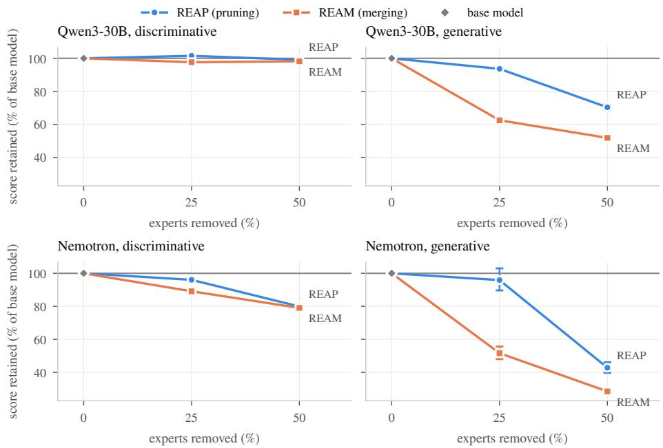  
Figure 1: Merging falls behind on generation. Mean score retained (% of the base model’s score) against the share of experts removed, for the discriminative tasks (website cues, brand names, categorisation; left) and the generative tasks (domain descriptions, email templates; right), one row per base model. Blue circles are REAP, orange squares REAM, and the grey diamond is the base model (100% by definition). Error bars are 95% bootstrap CIs, and tasks have equal weight. On Qwen3-30B’s generative tasks, REAP at 50% keeps more than REAM at 25%.

• The first evaluation of REAP and REAM on production tasks: ten models, five tasks, 2,000 rows each, with paired bootstrap intervals and multiplecomparison correction (Section 4).

• A head-to-head result: REAP is significantly better than REAM in 16 of 20 comparisons. On marketing email template generation it leads by up to +30.2 rubric points, and by +51.0 points under the production scoring rules (Section 5.2).

• A failure analysis: compression mostly breaks the output contract, through format gates, runaway generation and English template phrases copied into non-English answers (Section 5.3).

• A test of which benchmark claims and diagnostics carry over to production (Section 5.5, Section 6), and practical guidance (Section 7).

## 2 Related work

Expert pruning and merging. One-shot expert compression removes whole experts after a calibration pass. Merging methods were reported to do better than pruning on discriminative benchmarks: M-SMoE aligns and merges experts (Li et al., 2024), and HC-SMoE clusters them by their outputs (Chen et al., 2025). REAP (Lasby et al., 2026) reversed the verdict for generation. It argues that merging with summed gates loses the router’s independent control of the merged experts, and it prunes by router-weighted activation instead. REAM (Jha et al., 2026) merges into REAP’s most salient experts without summing gates. Hybrids choose per expert between pruning and merging (Huang et al., 2026), or repair the router afterwards (Hyeon and Do, 2026).

Almost all of this work reports benchmark averages, and two studies show what such averages hide. With a fixed pruning mask, multiple-choice accuracy stays at 92–97% while GSM8K and code scores collapse (Ali et al., 2026). A benchmark of composable MoE compression finds that removing experts is the main source of loss, and that REAM is slightly behind REAP at 25% (Benazir et al., 2026). That is the only independent REAP–REAM comparison we know of. Studies closer to deployment prune for one domain, for example biomedicine on the same Qwen3 checkpoint and a Nemotron 3 Nano model (Yamaguchi et al., 2026). None compares pruning with merging on production tasks, on output contracts or across many languages.

Serving MoE models. Every expert of an MoE model must stay resident in GPU memory, where the experts compete with the key–value cache (Liu et al., 2026), and decoding cost grows with the number of distinct experts read per step (Yu et al., 2025). Ofloading experts to host memory saves GPU memory but adds transfer latency (Liu et al., 2026). Quantisation lowers the bits per expert instead. Expert compression is complementary: it removes experts and can be combined with quantisation, although the efects do not simply add (Benazir et al., 2026).

Calibration data. Compression quality depends on the calibration data (Ji et al., 2025). At high sparsity, calibration choices that look alike on commonsense accuracy difer by 51.9 points on code (Xu et al., 2026). For MoE models, the calibration mixture moves REAM between multiple-choice and generative strength (Jha et al., 2026). Standard calibration also covers mostly prompt tokens, and adding the model’s own generated tokens helps decodeheavy tasks (Lucas et al., 2026).

Evidence on the calibration language is split:

• English-only calibration transferred across seven languages for expert pruning of gpt-oss-20b (Salim et al., 2026b);

• in dense pruning, target-language calibration kept perplexity but not downstream accuracy (Kurz et al., 2026);

• English calibration eroded Lithuanian in expert-pruned MoE models (Rasymas and Kvedaras, 2026).

Multilingual efects and language confusion. Compression hurts other languages more than English. Quantisation damages non-Latin-script languages in ways that automatic metrics understate (Marchisio et al., 2024a). Multilingual pruning hurts under-represented languages first (Choenni and Titov, 2025). Pruned models often still recognise an answer in multiple choice but fail to generate it: for 12% of English items, and for 34–50% of items in other languages (Wen et al., 2026). Inside MoE models, masking late-layer language-specific experts disrupts language consistency (Chen et al., 2026).

English-centric models also produce language confusion: whole lines or single words in the wrong language (Marchisio et al., 2024b), a failure traced to the final layers (Nie et al., 2025). The domain-description failures in Section 5.3 are of the word-level kind.

Evaluating compressed models beyond benchmarks. Aggregate accuracy hides how many answers flip: per-item churn can be several times the net change (Dutta et al., 2024). Compression also damages capabilities that averages miss: parseable output (Ning et al., 2026), instruction following and JSONschema adherence (Salim et al., 2026a), and freedom from repetition loops (Lee et al., 2026).

Evaluations of compression on production data are rare (Behdin et al., 2025); we found none for MoE expert compression. LLM judges are themselves inconsistent (Haldar and Hockenmaier, 2025). We therefore score with the production judge that accepted the references, and add rule-based checks.

## 3 The two methods

An MoE layer with N routed experts $\boldsymbol { E } _ { 1 } , \dots , \boldsymbol { E } _ { N }$ sends each token x to the top-k experts $T ( x )$ chosen by its router, and combines their outputs with gate weights $\begin{array} { r } { g _ { j } ( x ) \colon y ( x ) = \sum _ { j \in T ( x ) } g _ { j } ( x ) E _ { j } ( x ) } \end{array}$ , plus a shared expert in Nemotron. Both methods remove a fixed share r of the routed experts in every MoE layer, delete their router rows and keep k. Shared experts, attention and Mamba layers are untouched.

REAP: pruning. REAP (Lasby et al., 2026) scores each expert by its mean gate-weighted output norm over the calibration tokens routed to it, $X _ { j } = \{ x :$ $j \in T ( x ) \}$

$$
S _ { j } = \frac { 1 } { | X _ { j } | } \sum _ { x \in X _ { j } } g _ { j } ( x ) \| E _ { j } ( x ) \| _ { 2 } ,\tag{1}
$$

and deletes the $r N$ experts with the lowest $S _ { j }$ . The router then chooses its top-k among the experts that remain.

REAM: merging. REAM (Jha et al., 2026) ranks experts by the same saliency and makes the (1 − r)N most salient ones group centres. In order of saliency, each centre takes the unassigned experts most similar to it, measured by router logits and gate-weighted outputs, until its group holds C experts. Following REAM, C = 16 at 25% and C = 32 at 50%. Members are aligned to their centre neuron by neuron (Hungarian matching) and averaged with saliency weights. The router keeps only the centres’ rows, so REAM, unlike earlier merging methods, does not sum gates.

Implementation. REAP is llm-compressor’s REAPPruningModifier (Red Hat AI and vLLM Project, 2024). REAM is our port of the oficial code to the same pipeline, needed because the original supports only Qwen-style layers. Both run sequentially, each layer calibrated on the outputs of the already compressed layers before it; REAM’s paper calibrated its baselines, REAP included, in a single pass. The port deviates from the original code in four documented ways, among them that the group size C counts the centre. Unit tests check that grouping and alignment reproduce the original functions, and all runs use deterministic kernels (Appendix I lists the deviations).

## 4 Experimental setup

Tasks. The five tasks are LLM calls from Hostinger products (Table 1); Appendix A shows an anonymised reference answer for each. Three are discriminative. Website cues asks whether a website description mentions colours or fonts. Brand names asks the model to copy the user’s own brand name from a description. Product categorisation assigns an e-commerce product to a store category from an open label set, usually from a candidate list. Two are generative. Domain descriptions asks for a one- or two-sentence marketing text for a domain name in a requested language, and the prompt asks it to open with “This domain is”. Email templates asks an email-marketing product for a complete, responsive HTML template of a marketing email, such as a newsletter, a promotion, or a transactional email sent after a purchase or a sign-up, returned inside JSON.

References are production outputs of an earlier production model that the product’s LLM judge accepted, not human labels; the brand task keeps only rows with a stated brand. Each task has 2,000 validation rows, the same for every model, balanced over five reporting languages (en, pt, es, fr, id) and an “other” group as far as the data allow.

Models. Both base models have about 30B total and 3B active parameters and 128 routed experts per MoE layer. Qwen3-30B-A3B-Instruct-2507 (Yang et al., 2025) is a Transformer with 48 MoE layers, top-8 routing, a softmax router and gated experts. NVIDIA-Nemotron-3.5-Lightning-30B-A3B (NVIDIA, 2026) is a hybrid of Mamba-2 (Dao and Gu, 2024), attention and MoE layers, derived from Nemotron 3 Nano (NVIDIA, 2025). It has 23 MoE layers, top-6 routing, a

Table 1: The five production tasks. Lang. = number of languages in the 2,000 validation rows. Tokens = median answer length of the base Qwen3-30B.
<table><tr><td>Task</td><td>Type</td><td>Output</td><td>Decoding Lang. Primary</td><td></td><td>metric</td><td>Tokens</td></tr><tr><td>Website cues</td><td>classification</td><td>JSON, 2 booleans</td><td>greedy</td><td>19</td><td>exact match</td><td>23</td></tr><tr><td>Brand names</td><td>span extraction</td><td>JSON (schema)</td><td>greedy</td><td></td><td>24 exact match</td><td>24</td></tr><tr><td>Categorisation</td><td>open-label categorisa- tion</td><td>JSON (schema)</td><td>greedy</td><td></td><td>33 judge pass rate</td><td>11</td></tr><tr><td>Domain descriptions</td><td>short generation</td><td>plain text</td><td>sampled</td><td></td><td>17 judge pass rate</td><td>20</td></tr><tr><td>Email templates</td><td>long structured</td><td>JSON with HTML</td><td>sampled</td><td></td><td>35 rubric score (0-100)</td><td>2,724</td></tr></table>

sigmoid router with bias, one shared expert and gateless squared-ReLU experts.   
Thinking is of. We call them Qwen3-30B and Nemotron.

Compression and calibration. Each method removes 25% or 50% of the routed experts in every MoE layer (128 → 96 or 64), giving eight compressed models. All runs of a model share one calibration set, disjoint from validation: whole production conversations (system prompt, user message, accepted answer) in the model’s chat template, about 590k tokens per task and 5,666 conversations in total. Answers are only 8.7% of the calibration tokens. All 59 distinct system prompts are English, so at least 68.2% of the calibration text is English, even though the rows of three tasks are language-balanced. Website cues and domain descriptions are also 78% and 71% English by rows (Appendix H).

Generation. All models are served with vLLM 0.32 (Kwon et al., 2023). Following REAP, decoding is greedy for the three discriminative tasks. Domain descriptions and email templates use each model’s default sampling, with the seed fixed per row so that every model draws the same random numbers on a row. As in production, brand names and categorisation are constrained to their JSON schema, with vLLM’s structured outputs, which use the XGrammar constrained-decoding engine (Dong et al., 2025). Answers are capped at 32,768 tokens (1,024 for the schema-constrained tasks).

Metrics. The primary metrics are those of production. Website cues and brand names use exact match. Categorisation and domain descriptions use the pass rate of the production LLM judge, OpenAI gpt-6.1-sol, the judge that accepted the references. Email templates use the production rubric. It scores 13 categories with static checks, checks on the rendered email at desktop and mobile width, and LLM text and vision judges, and it sets the score to 0 if any of five hard gates fails: output parseable, HTML present, HTML complete, unsubscribe link, mobile layout intact.

The production email score swung on one habit. The base Qwen3-30B often returns a complete <body> without the <html> wrapper: it fails html\_complete in 1,230 of 2,000 answers and scores 26.1. We therefore relax two gates: a complete <body> passes html\_complete, and any unsubscribe link passes unsubscribe\_link. This lifts the base model to 70.2. We report the production score as well (Appendix D).

Statistics. Every comparison is paired, on the same 2,000 rows: a compressed model against its own base model, or REAP against REAM. We report 95% paired bootstrap confidence intervals (CIs; 10,000 resamples (Efron and Tibshirani, 1994)). We test with McNemar’s exact test for pass/fail metrics (McNemar, 1947) and a paired sign-flip permutation test on the mean for email scores, Holm-corrected (Holm, 1979) over the 40 base comparisons and, separately, over the 20 head-to-head comparisons. Significant means Holm-corrected $p < 0 . 0 5$ Pass/fail metrics are percentages, so their changes are percentage points (pp); email scores are rubric points. Retention is the compressed score divided by the base score. Each configuration was compressed once, so the tests compare these checkpoints on these rows; they do not cover the variance from compressing with another calibration sample.

## 5 Results

## 5.1 How much quality survives compression

Table 2 gives every change from the base model (Figure 3 in Appendix B plots them with their CIs). Of the 40 changes, 32 are significant: 29 losses and 3 gains, all three gains on Qwen3-30B’s brand names.

REAP at 25% is close to lossless for Qwen3-30B outside generation. Website cues (−0.2 pp), categorisation (−1.0 pp) and email templates (+0.9 points) change by amounts that are not significant, and brand names gain +3.9 pp. Its one significant loss is domain descriptions (−13.0 pp).

Nemotron is more fragile: REAP at 25% already loses −4.0 pp on brand names, −3.0 pp on categorisation and −5.9 pp on domain descriptions. Removing half the experts costs generation most. Qwen3-30B with REAP at 50% keeps 99.1% of its discriminative score, but loses −22.2 pp on domain descriptions and −25.0 points on email templates. The CIs are 2.4–5.2 pp wide (0.6–2.0 pp for website cues), far narrower than the large changes.

## 5.2 Pruning versus merging

Compared directly on the same rows (Figure 2), REAP is significantly better in 16 of 20 comparisons and REAM in 2. The remaining 2, website cues on Qwen3- 30B, show no significant diference. The largest gaps are on generation, both for Qwen3-30B at 25%: +30.2 rubric points [+28.4, +32.0] on email templates and +18.1 pp [+15.9, +20.3] on domain descriptions.

Table 2: Primary metric of each base model and change of each compressed model (compressed − base on the same 2,000 rows, in pp; rubric points for email templates). Bold: significant after Holm correction over the 40 comparisons. Retention rows: mean score retained (% of base) over the discriminative (first three) and the generative (last two) tasks. Appendix B gives every CI and p-value.
<table><tr><td></td><td>Base</td><td>REAP 25%</td><td>REAP 50%</td><td>REAM 25%</td><td>REAM 50%</td></tr><tr><td>Qwen3-30B</td><td></td><td></td><td></td><td></td><td></td></tr><tr><td>Website cues</td><td>98.8</td><td>-0.2</td><td>-1.0</td><td>-0.5</td><td>-1.7</td></tr><tr><td>Brand names</td><td>64.8</td><td>+3.9</td><td>+4.2</td><td>-0.3</td><td>+5.9</td></tr><tr><td>Categorisation</td><td>81.7</td><td>-1.0</td><td>-6.7</td><td>-5.0</td><td>-10.4</td></tr><tr><td>Domain descriptions</td><td>93.5</td><td>-13.0</td><td>-22.2</td><td>-31.1</td><td>-30.1</td></tr><tr><td>Email templates</td><td>70.2</td><td>+0.9</td><td>-25.0</td><td>-29.3</td><td>-45.1</td></tr><tr><td>Retention, discr. (%)</td><td>100</td><td>101.5</td><td>99.1</td><td>97.7</td><td>98.2</td></tr><tr><td>Retention, gen. (%)</td><td>100</td><td>93.6</td><td>70.3</td><td>62.5</td><td>51.8</td></tr><tr><td>Nemotron</td><td></td><td></td><td></td><td></td><td></td></tr><tr><td>Website cues</td><td>96.0</td><td>+0.5</td><td>-1.3</td><td>-0.5</td><td>-4.4</td></tr><tr><td>Brand names</td><td>49.8</td><td>-4.0</td><td>-21.1</td><td>-10.0</td><td>-15.6</td></tr><tr><td>Categorisation</td><td>68.2</td><td>-3.0</td><td>-11.3</td><td>-8.3</td><td>-18.3</td></tr><tr><td>Domain descriptions</td><td>58.8</td><td>-5.9</td><td>-22.0</td><td>-18.8</td><td>-27.1</td></tr><tr><td>Email templates</td><td>12.8</td><td>+0.2</td><td>-9.8</td><td>-8.3</td><td>-12.4</td></tr><tr><td>Retention, discr. (%)</td><td>100</td><td>96.0</td><td>79.9</td><td>89.1</td><td>79.0</td></tr><tr><td>Retention, gen. (%)</td><td>100</td><td>95.9</td><td>42.8</td><td>51.6</td><td>28.5</td></tr></table>

Figure 1 shows the pattern that REAP’s analysis predicts. On Qwen3-30B’s discriminative tasks both methods keep almost everything at 25% (101.5% and 97.7%), while on generation REAM falls far behind (62.5% against 93.6%). REAP with half the experts removed (70.3%) even keeps more than REAM with a quarter removed. On Nemotron, merging also loses on the discriminative tasks at 25% (89.1% against 96.0%).

The result depends neither on the relaxed email-template gates nor on Nemotron’s weak results on that task. Under the production gates REAP’s lead grows to +51.0 rubric points at 25% and +35.8 at 50% on Qwen3-30B, with all four production-rule comparisons significant (Appendix D). Without the email-template task the count is 12 for REAP, 2 for REAM and 2 ties, out of 16. Nemotron’s base score on email templates is only 12.8, which makes its generative retention noisy: at REAP 25% it is 101.8% [89.8, 115.4] on email templates, against 90.0% on domain descriptions alone.

REAM’s two wins are both on brand names at 50%, and they difer in kind (Appendix C). On Qwen3-30B it is a detection efect: REAM returns a brand more often (detection 95.2% against 91.5%), while REAP’s returned brands are slightly more often right (precision 75.5% against 74.3%). Every validation row states a brand, so abstaining is always wrong and REAM’s gain is entirely detection; on real trafic, where about a quarter of requests name no brand, it could cost accuracy. The same efect explains Qwen3-30B’s gains over its base model on this task, since the base model answers “no brand” too often (detection 87.2%). On Nemotron, REAM’s win is genuine precision (63.7% against 52.6%).

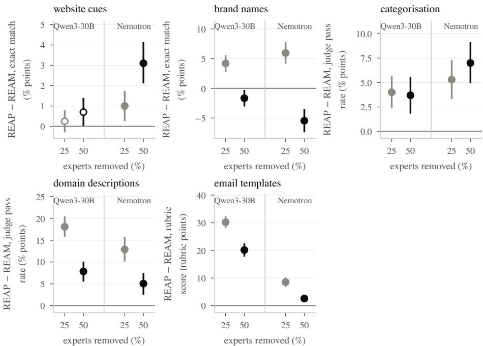  
Figure 2: REAP beats REAM on the same rows in 16 of 20 comparisons. REAP − REAM in each task’s metric (positive = REAP better), at 25% (grey) and 50% (black) of experts removed for each base model. Bars are 95% paired-bootstrap CIs. Filled markers are significant after Holm correction over the 20 comparisons. REAM is better only on brand names at 50%.

## 5.3 How compressed models fail

The failures cluster on the two generative tasks, and most are failures to keep the output contract (Figure 4 in Appendix D gives every failure rate). On the three discriminative tasks the output stays valid: the schema keeps JSON valid in at least 99.9% of brand and categorisation answers, and website cues stay at least 99.7% valid, so the failures there are wrong answers. Small net changes hide many of them. Qwen3-30B REAP 25% loses 4.8% of the categorisation rows its base model passed and gains 3.8%, and only 78.0% of its categories equal the base model’s (Figure 7 in Appendix F).

Email templates: compression breaks the contract, not the content. The template score is the gate pass rate times the mean score of the answers that pass, so each loss splits into a gate part and a quality part (a symmetric split; Table 3). For every significant loss, 89.8–95.2% is the gate part. The templates that pass change much less: Qwen3-30B’s average 79.2 for the base model, 76.5 for REAP 50% and 75.0 for REAM 25%.

Table 3: Email templates: where the score goes. Production and relaxed rubric scores; the share of answers passing every (relaxed) gate, and their mean relaxed score; the share of the loss against the base model that comes from gate failures (a symmetric split of score = pass rate × mean of passing answers; significant losses only); and the answers that ran to the 32k-token cap (of 2,000).
<table><tr><td rowspan="2">Model</td><td colspan="2">Score (0–100)</td><td rowspan="2">Passes all</td><td>Mean score if</td><td>Loss from</td><td>Runaway</td></tr><tr><td>production</td><td>relaxed</td><td>gates (%)</td><td>all gates pass</td><td>gates (%) answers</td></tr><tr><td>Qwen3-30B</td><td>26.1</td><td>70.2</td><td>88.7</td><td>79.2</td><td></td><td>6</td></tr><tr><td>REAP 25%</td><td>51.3</td><td>71.1</td><td>89.9</td><td>79.1</td><td></td><td>14</td></tr><tr><td>REAP 50%</td><td>37.7</td><td>45.3</td><td>59.2</td><td>76.5</td><td>92.1</td><td>102</td></tr><tr><td>REAM 25%</td><td>0.4</td><td>40.9</td><td>54.5</td><td>75.0</td><td>89.8</td><td>61</td></tr><tr><td>REAM 50%</td><td>1.9</td><td>25.1</td><td>34.4</td><td>73.1</td><td>91.7</td><td>215</td></tr><tr><td>Nemotron</td><td>11.9</td><td>12.8</td><td>17.8</td><td>72.0</td><td></td><td>38</td></tr><tr><td>REAP 25%</td><td>12.1</td><td>13.0</td><td>17.9</td><td>72.5</td><td></td><td>32</td></tr><tr><td>REAP 50%</td><td>2.6</td><td>2.9</td><td>4.3</td><td>67.7</td><td>95.2</td><td>226</td></tr><tr><td>REAM 25%</td><td>2.9</td><td>4.5</td><td>6.7</td><td>67.7</td><td>93.7</td><td>166</td></tr><tr><td>REAM 50%</td><td>0.1</td><td>0.4</td><td>0.6</td><td>63.1</td><td>93.4</td><td>299</td></tr></table>

Three failures dominate (Appendix D). Qwen3-30B’s rendered templates overflow a narrow screen in 10.0% of the base model’s answers, but in 35.1% at REAP 50%, 40.1% at REAM 25% and 51.7% at REAM 50%. Its JSON becomes invalid more often (1.1% → 12.2% at REAM 50%). And answers run away to the 32k-token cap, repeating text: 6 of 2,000 for the base model, 102 at REAP 50% and 215 at REAM 50%. Runaway answers also cost GPU time: Qwen3- 30B REAM 50% generates 11,364 thousand email-template tokens, where the base model generates 5,731 thousand.

Nemotron’s base model already fails the contract. 544 of its answers are invalid JSON, and it passes every gate in only 17.8%. Its low score therefore reflects instruction following rather than template quality: its passing templates average 72.0.

Domain descriptions: the English opener. The prompt is in English and asks for an answer “in such form This domain $\mathit { i s } ^ { \prime \prime }$ in the requested language; the references translate that opener. Compressed Qwen3-30B models increasingly copy it untranslated and continue in the requested language (“This domain adalah. . . ”, “This dominio es. . . ”). This is a word-level form of language confusion (Marchisio et al., 2024b), and the judge rejects it (Table 4).

At REAM 25%, 39.6% of the non-English rows open in English, against 3.3% for the base model, while only 1.3% are entirely English. The answers that keep the target language pass 94.4% of the time, close to the base model’s 95.8%. At the base model’s opener rate, REAM 25%’s non-English pass rate would be 89.7% instead of 55.1%. The opener therefore explains 92.3% of REAM

Table 4: Domain descriptions: compressed Qwen3-30B copies the English opener. Judge pass rate on English and non-English rows; among non-English rows, the share that opens with the English “This” but is otherwise in the requested language, the share in the wrong language (and how many of those are English), the share the language detector could not classify, and the pass rate of rows with neither failure; and the non-English pass rate the model would have at its base model’s opener and wrong-language rates.
<table><tr><td rowspan="2"></td><td colspan="2">Pass (%)</td><td colspan="4">Non-English rows (%)</td><td colspan="2">Pass non-En.</td></tr><tr><td>En.</td><td>non- En.</td><td>opener only</td><td>wrong lang.</td><td>of which</td><td></td><td>En. undet. neither</td><td>at base drift</td></tr><tr><td>Qwen3-30B</td><td>98.2</td><td>92.6</td><td>3.3</td><td>0.2</td><td>0</td><td>1.7</td><td>95.8</td><td></td></tr><tr><td>REAP 25%</td><td>99.4</td><td>76.6</td><td>11.5</td><td>0.2</td><td>0</td><td>1.8</td><td>86.3</td><td>82.6</td></tr><tr><td>REAP 50%</td><td>96.8</td><td>66.0</td><td>17.0</td><td>6.7</td><td>97</td><td>2.2</td><td>86.7</td><td>82.5</td></tr><tr><td>REAM 25%</td><td>97.7</td><td>55.1</td><td>39.6</td><td>2.4</td><td>54</td><td>1.8</td><td>94.4</td><td>89.7</td></tr><tr><td>REAM 50%</td><td>95.6</td><td>56.8</td><td>23.2</td><td>10.0</td><td>90</td><td>0.7</td><td>84.5</td><td>80.2</td></tr><tr><td>Nemotron</td><td>92.7</td><td>51.7</td><td>19.4</td><td>14.0</td><td>84</td><td>1.4</td><td>69.4</td><td></td></tr><tr><td>REAP 25%</td><td>93.3</td><td>44.5</td><td>25.8</td><td>15.0</td><td>90</td><td>0.7</td><td>61.9</td><td>47.3</td></tr><tr><td>REAP 50%</td><td>96.2</td><td>24.5</td><td>36.9</td><td>25.4</td><td>90</td><td>1.3</td><td>45.1</td><td>33.8</td></tr><tr><td>REAM 25%</td><td>86.3</td><td>30.4</td><td>26.2</td><td>12.7</td><td>53</td><td>11.2</td><td>45.0</td><td>34.8</td></tr><tr><td>REAM 50%</td><td>78.9</td><td>22.0</td><td>18.8</td><td>16.0</td><td>62</td><td>5.7</td><td>32.3</td><td>23.4</td></tr></table>

25%’s non-English loss, but only 37.3% of REAP 25%’s. Nemotron, by contrast, answers in the wrong language outright, mostly English: 14.0% of its base model’s non-English rows, rising to 25.4% at REAP 50%.

## 5.4 Is the damage the same in every language?

Mostly yes, with one task-specific exception (Figure 6 in Appendix E). For every task and compressed model we tested the diference between the change on non-English rows and the change on English rows. 9 of the 40 cells are significant after Holm correction, all with non-English worse, and 8 of them are domain descriptions, with a mean gap of −22.7 pp. Outside that task the gaps are small (means of −0.2 to −2.7 pp, and −0.5 rubric points on email templates), and only 1 cell is significant.

The domain-description gap is partly built into the task, because English rows cannot fail by leaving the opener untranslated. It is also consistent with the calibration, which is at least 68.2% English text and 71% English rows for this task, and with studies of language-specific experts (Chen et al., 2026) and of expert pruning with English calibration (Rasymas and Kvedaras, 2026). Our data cannot separate these explanations. Nemotron’s wrong-language answers are the clearer case of non-English capacity loss.

## 5.5 Do the benchmark diagnostics agree with production?

REAP explains its result with three measurements of generated text: crossperplexity (the base model’s perplexity of a compressed model’s answers), completion-logit divergence from the base model, and n-gram diversity, aimed at the repetitiveness of merged models. REAM proposes the rank of the pre-logit embeddings as a quality signal. We scored each diagnostic by how well it orders the five variants of each task and model by quality (Kendall $\tau )$ and by whether it ranks REAP above REAM where quality does (Table 12 in Appendix G).

Cross-perplexity agrees best $( \tau = + 0 . 7 0 $ positive in 9 of 10 cells). REAM’s answers are less likely under the base model than $\mathrm { R E A P ^ { \bullet } s }$ in all 20 cells, for example 2.13 against 1.50 on Qwen3-30B’s domain descriptions at 25%. Logit divergence agrees in level $( \tau = + 0 . 5 0 )$ and is larger for REAM in 20 of 20 cells. Repetition is best measured directly. At 25%, REAM produces 4.4 times (Qwen3-30B) and 5.2 times (Nemotron) as many runaway email-template answers as REAP, and the loop rate tracks quality $( \tau = + 0 . 7 4 )$ . n-gram diversity tracks quality only when the loops are included $( \tau = + 0 . 7 0$ with them, +0.15 without). Efective rank is a weaker positive signal $( \tau = + 0 . 4 4 )$ , and numerical rank is full for every model on four of the five tasks. These diagnostics come without CIs and over few cells, so they support evaluation on the task but do not replace it.

## 6 What transfers from benchmarks to production

Table 5 sets the claims of the two papers against our results. The settings difer in three ways that matter. REAP evaluates Qwen3-30B-A3B with thinking of, not the Instruct-2507 checkpoint, with domain-specific calibration. REAM evaluates the same checkpoint as we do but reports each method at its best of ten calibration mixtures; averaged over the ten, the two methods are level (GEN 64.0 for REAP and 63.8 for REAM at 25%, with REAM ahead in 6 of 10 mixtures). And REAM calibrated its baselines in one pass and itself sequentially, a choice its own ablation values at about one point. Our verdicts therefore concern 128- expert 30B-A3B models with production calibration. $\mathrm { R E A P ^ { \bullet } s }$ theory concerns merging with summed gates, which REAM avoids; that REAP’s conclusion also holds against REAM is an empirical extension, not a test of the theory.

Four properties of production tasks are consistent with the gaps, although we do not test them causally. Production fails on the output contract (JSON, HTML gates, language rules), which benchmarks that parse leniently do not count. It asks for generation in many languages, which neither paper evaluates. Its calibration comes from product trafic, chosen without looking at the test metric. And long sampled answers give a compressed model many chances to fall into a loop: up to 14.9% of email-template answers at 50% run to the cap.

Table 5: Claims of the REAP and REAM papers against our production results. Benchmark numbers are quoted from the papers (section in brackets); ours are from this study.
<table><tr><td>Claim (source)</td><td>Production evidence (ours)</td><td>Verdict</td></tr><tr><td>“Expert pruning is a superior strategy for generative tasks&quot; (REAP, abstract); at 25% on Qwen3-30B-A3B pruning and M-SMoE are within about a</td><td>REAP better in 16 of 20 comparisons; Qwen3-30B generative retention at 25% and larger, 93.6% vs 62.5%</td><td>Confirmed also against REAM</td></tr><tr><td>REAM beats REAP on generation at 25%: GEN 69.8 vs 68.6, best of ten mixtures (REAM §5.1)</td><td>REAP ahead on 4 of 5 tasks at 25% on Not seen in Qwen3-30B, by up to +30.2 points</td><td>production</td></tr><tr><td>At 50%, REAP leads on GEN (62.8 vs 60.7), REAM on multiple-choice (REAM App. A.3)</td><td>REAP ahead on three tasks; REAM ahead only on brand names (detection) confirmed</td><td>Partly</td></tr><tr><td>Merging collapses expert functions (&quot;functional subspace collapse&quot;, REAP §3.3)</td><td>Not measured on the experts; REAM&#x27;s Consistent; outputs diverge further from the base model&#x27;s (next row)</td><td>not tested directly</td></tr><tr><td>Merged outputs have higher cross-perplexity and diverge faster with position (REAP §5)</td><td>Cross-perplexity higher for REAM in all 20 cells; JSD in 20; position trend not testable on our short and HTML answers</td><td>Level confirmed</td></tr><tr><td>Merged outputs are “more repetitive&quot;(REAP §5)</td><td>REAM has 1.3–5.2 times as many runaway email-template answers; distinct-2 without loops does not differ</td><td>Confirmed via loops</td></tr><tr><td>Rank of pre-logit embeddings predicts quality (REAM §5.4)</td><td>Effective rank τ = +0.44; numerical rank saturates</td><td>Weak</td></tr><tr><td>Group size C “is not heavily tuned&quot; (REAM App. A.1)</td><td>We use REAM&#x27;s C (16 at 25%, 32 at 50%) without tuning, also for Nemotron</td><td>Not tested</td></tr><tr><td>Code generation survives 50% pruning (REAP: 97% of Qwen3-30B-A3B&#x27;s code score, §5) quality</td><td>REAP 50% keeps 70.3%(Qwen3-30B) and 42.8% (Nemotron) of generative</td><td>Not for these tasks</td></tr></table>

## 7 Discussion and recommendations

Why does deleting beat merging here? REAP attributes merging’s weakness to averaging experts that the router used for diferent inputs (Lasby et al., 2026). REAM avoids summed gates, but it still replaces surviving experts with saliency-weighted averages of up to C experts, while pruning leaves every survivor intact. The damage concentrates where exact behaviour matters (format rules, a translated template phrase, long structured output), and REAM’s outputs drift further from the base model by every measure. A smaller C, a capped group size, router repair (Hyeon and Do, 2026) or a per-expert choice between pruning and merging (Huang et al., 2026) may narrow the gap.

For practitioners we draw four recommendations:

1. Prefer pruning. REAP wins most comparisons and gives checkpoints of the same size as REAM.

2. Treat 25% as the limit for generative products. At 25% REAP is close to lossless for Qwen3-30B outside generation. At 50% even REAP loses −22.2 pp on domain descriptions and −25.0 points on email templates.

3. Evaluate the output contract and every language, not only the mean. JSON validity, format gates, untranslated template text and runaway generation explain most of the loss, and benchmark averages do not show them.

4. Cover the tokens that matter in calibration. Answers are only 8.7% of the calibration tokens, yet the failures are in what the model generates. Weighting answer tokens, or calibrating on the model’s own generations (Lucas et al., 2026), is a hypothesis worth testing.

## 8 Limitations

Each configuration was compressed once, with one calibration set, so the CIs cover which rows were evaluated, not compression randomness or the choice of calibration data, and the 20 head-to-head comparisons are correlated comparisons among eight checkpoints rather than independent replications. We study two base models of one size class, two ratios, and no other pruning or merging methods (frequency pruning, HC-SMoE, M-SMoE). REAM is our port, with documented deviations including the group-size convention, and C follows REAM’s choice for Qwen3 without tuning for Nemotron. References are judgeapproved outputs of an earlier production model rather than human labels; two tasks are scored by the same LLM judge that accepted their references, and the email-template rubric includes LLM judges. The relaxed email-template gates are our decision (the relaxed unsubscribe rule also accepts placeholder links), and both scores are reported. The brand task excludes rows without a brand, which rewards detection. Two tasks are sampled, as in production. The calibration is English-heavy in text for every task and in rows for two, and the per-language cell intervals in Figure 6 are uncorrected. We do not measure serving memory, latency or throughput. The tasks are private product data, so the study cannot be repeated on the same rows.

## 9 Conclusion

On production tasks, deleting experts beats merging them. With the same calibration data and nearly the same experts kept, REAP is better than REAM in 16 of 20 comparisons. The margins are widest on generation, where the small benchmark diference between the methods does not carry over. The failures are mostly broken output contracts: invalid JSON, broken layouts, runaway answers and untranslated template phrases. Compression at 25% with REAP is close to lossless for Qwen3-30B outside generation, with a quarter of the routed experts removed. Compressed MoE models should be evaluated per failure type and per language, on the tasks they will serve.

## Data and code availability

The datasets are private logs of Hostinger products and contain customer input, so they cannot be released. The code, compressed models and per-row results are not released either. Sections 3 and 4 and the appendices describe the methods, the REAM port and the evaluation in enough detail to repeat the study on other data.

## Competing interests

Both authors are employees of Hostinger, whose products provide the tasks and data. The study received no external funding, and the authors have no other competing interests.

## Use of generative AI

An AI assistant was used as an aid in writing the analysis code and in drafting and editing the text. All numbers in the paper are generated by scripts from the experiment results, and the authors reviewed the analyses and the text and take responsibility for them.

## References

Ezza Ali, Sehrish Bibi, Momina Moetesum, and Faisal Shafait. What we keep of what we forget: Replacement operators and routing semantics in training-free MoE expert pruning. arXiv preprint arXiv:2610.41366, 2026.

Kayhan Behdin, Ata Fatahibaarzi, Qingquan Song, et al. Scaling down, serving fast: Compressing and deploying eficient LLMs for recommendation systems. In Proceedings of the 2025 Conference on Empirical Methods in Natural Language Processing: Industry Track, pages 1687–1702. Association for Computational Linguistics, 2025. URL https://aclanthology.org/2025. emnlp-industry.119/. arXiv:2502.14305.

Afsara Benazir, Chen Chen, Rongxiao Qu, Jiabo Huang, Jingtao Li, and Lingjuan Lyu. Benchmarking composable compression techniques in mixtureof-experts LLMs. arXiv preprint arXiv:2608.21693, 2026.

I-Chun Chen, Hsu-Shen Liu, Wei-Fang Sun, Chen-Hao Chao, Yen-Chang Hsu, and Chun-Yi Lee. Retraining-free merging of sparse MoE via hierarchical clustering. In Proceedings of the 42nd International Conference on Machine Learning, volume 267 of Proceedings of Machine Learning Research, pages 8594–8620. PMLR, 2025. URL https://proceedings.mlr.press/v267/ chen25aq.html. arXiv:2410.08589.

Yuxin Chen, Zhengzhou Cai, Xiangtian Ji, Weixiang Zhao, An Zhang, Xiang Wang, and Tat-Seng Chua. Understanding multilingualism in mixture-ofexperts LLMs: Routing mechanism, expert specialization, and layerwise steering. arXiv preprint arXiv:2601.14050, 2026.

Rochelle Choenni and Ivan Titov. M-Wanda: Improving one-shot pruning for multilingual LLMs. In Proceedings of the 2025 Conference on Empirical Methods in Natural Language Processing, pages 26951–26964, Suzhou, China, 2025. Association for Computational Linguistics. doi:10.18653/v1/2025.emnlpmain.1369.

Tri Dao and Albert Gu. Transformers are SSMs: Generalized models and eficient algorithms through structured state space duality. In Proceedings of the 41st International Conference on Machine Learning, volume 235 of Proceedings of Machine Learning Research, pages 10041–10071, 2024. URL https://proceedings.mlr.press/v235/dao24a.html. arXiv:2405.21060.

Yixin Dong, Charlie F. Ruan, Yaxing Cai, Ziyi Xu, Yilong Zhao, Ruihang Lai, and Tianqi Chen. XGrammar: Flexible and eficient structured generation engine for large language models. In Proceedings of Machine Learning and Systems 7 (MLSys 2025), 2025. URL https://proceedings.mlsys.org/paper\_files/paper/2025/hash/ 5c20ca4b0b20b0bd2f1d839dc605e70f-Abstract-Conference.html. arXiv:2411.15100.

Abhinav Dutta, Sanjeev Krishnan, Nipun Kwatra, and Ramachandran Ramjee. Accuracy is not all you need. In Advances in Neural Information Processing Systems, volume 37, pages 124347–124390, 2024. URL https://proceedings.neurips.cc/paper\_files/paper/2024/ hash/e0e956681b04ac126679e8c7dd706b2e-Abstract-Conference.html. arXiv:2407.09141.

Bradley Efron and Robert J. Tibshirani. An Introduction to the Bootstrap. Chapman and Hall/CRC, 1994. doi:10.1201/9780429246593.

Rajarshi Haldar and Julia Hockenmaier. Rating roulette: Self-inconsistency in LLM-as-a-judge frameworks. In Findings of the Association for Computational Linguistics: EMNLP 2025, pages 24986–25004. Association for

Computational Linguistics, 2025. URL https://aclanthology.org/2025. findings-emnlp.1361/.

Sture Holm. A simple sequentially rejective multiple test procedure. Scandinavian Journal of Statistics, 6(2):65–70, 1979.

Shanfeng Huang, Rongqian Zhang, Zhou Fang, Song Xiao, and Hai Du. PRIME: Frequency-aware unified pruning and merging for MoE compression. arXiv preprint arXiv:2610.13982, 2026.

Sieun Hyeon and Jaeyoung Do. Is retraining-free enough? the necessity of router calibration for eficient MoE compression. arXiv preprint arXiv:2603.02217, 2026.

Saurav Jha, Maryam Hashemzadeh, Ali Saheb Pasand, Ali Parviz, Min-Joong Lee, and Boris Knyazev. REAM: Merging improves pruning of experts in LLMs. arXiv preprint arXiv:2604.04356, 2026.

Yixin Ji, Yang Xiang, Juntao Li, Qingrong Xia, Ping Li, Xinyu Duan, Zhefeng Wang, and Min Zhang. Beware of calibration data for pruning large language models. In The Thirteenth International Conference on Learning Representations (ICLR), 2025. URL https://proceedings.iclr.cc/paper\_files/paper/2025/hash/ 2ede933e10afa991a10b6f36b6522129-Abstract-Conference.html. arXiv:2410.17711.

Simon Kurz, Jian-Jia Chen, Lucie Flek, and Zhixue Zhao. On the limitations of language-targeted pruning: Investigating the calibration language impact in multilingual LLM pruning. Transactions ofthe Association for Computational Linguistics, 14:167–192, 2026. doi:10.1162/tacl.a.599.

Woosuk Kwon, Zhuohan Li, Siyuan Zhuang, Ying Sheng, Lianmin Zheng, Cody Hao Yu, Joseph E. Gonzalez, Hao Zhang, and Ion Stoica. Eficient memory management for large language model serving with PagedAttention. In Proceedings ofthe 29th Symposium on Operating Systems Principles (SOSP ’23), pages 611–626. ACM, 2023. doi:10.1145/3600006.3613165.

Mike Lasby, Ivan Lazarevich, Nish Sinnadurai, Sean Lie, Yani Ioannou, and Vithursan Thangarasa. REAP the experts: Why pruning prevails for one-shot MoE compression. In The Fourteenth International Conference on Learning Representations (ICLR), 2026. URL https://arxiv.org/abs/2510.13999. arXiv:2510.13999.

Junyoung Lee, Sehyeon Park, Shinhyoung Jang, Seonha Ryu, Hojeong Kim, Hyunsei Lee, Il Hong Suh, and Yeseong Kim. FOCUS & RePAIR: Mitigating text degeneration via token-level guidance for pruned large language models. In International Conference on Machine Learning (ICML), 2026. URL https://icml.cc/virtual/2026/poster/66464. arXiv:2608.26676.

Pingzhi Li, Zhenyu Zhang, Prateek Yadav, Yi-Lin Sung, Yu Cheng, Mohit Bansal, and Tianlong Chen. Merge, then compress: Demystify eficient SMoE with hints from its routing policy. In The Twelfth International Conference on Learning Representations (ICLR), 2024. URL https: //arxiv.org/abs/2310.01334. arXiv:2310.01334.

Qingxiu Liu, Yongchao He, Runhan Jiang, Zion Wang, Bohan Zhao, Mi Zhang, and Patrick P. C. Lee. FluxMoE: Decoupling expert residency for highperformance MoE serving. arXiv preprint arXiv:2604.02715, 2026.

Ryan Lucas, Kayhan Behdin, Zhipeng Wang, Qingquan Song, Shao Tang, and Rahul Mazumder. Reasoning models can be accurately pruned via chain-of-thought reconstruction. In The Fourteenth International Conference on Learning Representations (ICLR), 2026. URL https://proceedings.iclr.cc/paper\_files/paper/2026/hash/ e70ffb3f05096e62b5077d8e1b62e668-Abstract-Conference.html. arXiv:2509.12464.

Kelly Marchisio, Saurabh Dash, Hongyu Chen, Dennis Aumiller, Ahmet Üstün, Sara Hooker, and Sebastian Ruder. How does quantization afect multilingual LLMs? In Findings of the Association for Computational Linguistics: EMNLP 2024, pages 15928–15947. Association for Computational Linguistics, 2024a. URL https://aclanthology.org/2024.findings-emnlp.935/. arXiv:2407.03211.

Kelly Marchisio, Wei-Yin Ko, Alexandre Bérard, Théo Dehaze, and Sebastian Ruder. Understanding and mitigating language confusion in LLMs. In Proceedings of the 2024 Conference on Empirical Methods in Natural Language Processing, pages 6653–6677, Miami, Florida, USA, 2024b. Association for Computational Linguistics. doi:10.18653/v1/2024.emnlp-main.380.

Quinn McNemar. Note on the sampling error of the diference between correlated proportions or percentages. Psychometrika, 12(2):153–157, 1947. doi:10.1007/BF02295996.

Ercong Nie, Helmut Schmid, and Hinrich Schütze. Mechanistic understanding and mitigation of language confusion in English-centric large language mod els. In Findings of the Association for Computational Linguistics: EMNLP 2025, pages 690–706, Suzhou, China, 2025. Association for Computational Linguistics. doi:10.18653/v1/2025.findings-emnlp.37.

Jiahui Ning, Liang Chen, Yuchen Liang, Yi Zhang, and Fenglei Fan. ACE-Compression: An ability-centric evaluation of compressed large language models. arXiv preprint arXiv:2610.27913, 2026.

NVIDIA. Nemotron 3 nano: Open, eficient mixture-of-experts hybrid Mambatransformer model for agentic reasoning. arXiv preprint arXiv:2512.20848, 2025.

NVIDIA. Nemotron 3.5 super and lightning: Open, eficient mixture-ofexperts hybrid Mamba-transformer models for agentic AI. arXiv preprint arXiv:2610.38095, 2026.

Tomas Rasymas and Povilas Kvedaras. English calibration erodes Lithuanian in expert-pruned mixture-of-experts language models. arXiv preprint arXiv:2611.07654, 2026.

Red Hat AI and vLLM Project. LLM Compressor, 2024. URL https://github. com/vllm-project/llm-compressor. Software.

Luis Frentzen Salim, Komang Rinartha, Chia-Chun Wu, Tran Van Nhiem, Lun-Wei Ku, and Yung-Hui Li. The fragility and dynamics of LLM pruningrecovery steps. arXiv preprint arXiv:2610.15574, 2026a.

Luis Frentzen Salim, Chia-Chun Wu, Tran Van Nhiem, Lun-Wei Ku, and Yung-Hui Li. Towards robust calibration dataset for domain-general mixture of experts pruning. arXiv preprint arXiv:2610.15578, 2026b.

Rui Wen, Lu Sun, Jiayang Liu, Zesheng Xu, Tianshuo Cong, and Zheng Li. The benchmark illusion: Pruned LLMs can pass multiple choice but fail to answer. In Proceedings of the 2026 Conference on Empirical Methods in Natural Language Processing, pages 52565–52575. Association for Computational Linguistics, 2026. URL https://aclanthology.org/2026.emnlp-main.2313/. arXiv:2606.17609.

Hu Xu, Zhaolong Xing, Congcong Liu, Jiaxing Wang, Zhida Jiang, Junshi Huang, Zhen Chen, and Jianfeng Xu. Rethinking calibration for high-sparsity LLM pruning: From single sources to capability coverage. arXiv preprint arXiv:2606.03328, 2026.

Atsuki Yamaguchi, Szymon Palucha, Léo Bijar, Aline Villavicencio, and Nikolaos Aletras. On the utility and factual reliability of pruned mixture-of-experts models in the biomedical domain. arXiv preprint arXiv:2607.01444, 2026.

An Yang, Anfeng Li, Baosong Yang, et al. Qwen3 technical report. arXiv preprint arXiv:2505.09388, 2025.

Yanpeng Yu, Haiyue Ma, Krish Agarwal, Nicolai Oswald, Qijing Huang, Hugo Linsenmaier, Chunhui Mei, Ritchie Zhao, Ritika Borkar, Bita Darvish Rouhani, David Nellans, Ronny Krashinsky, and Anurag Khandelwal. Efi cient MoE serving in the memory-bound regime: Balance activated experts, not tokens. arXiv preprint arXiv:2512.09277, 2025.

## Appendices

Conventions shared by the appendices:

• changes are compressed − base on the same rows, in percentage points (rubric points for email templates);

• REAP − REAM is positive when REAP is better;

• significant means Holm-corrected p < 0.05;

• filled markers in figures are significant, hollow ones are not.

## A Dataset samples

This appendix shows, for each task, what the model must return: a short description of the task, one reference answer and how answers are scored. The prompts (system prompt and user message) describe internal systems and are not shown.

• Each reference answer is the output of an earlier production model on a real validation row, accepted by the product’s judge, and anonymised: every brand, company or person name, domain, email address, URL, phone number and street address is replaced by a fictitious one.

• Long parts are abridged with [. . . ].

In the boxes, [...] marks omitted text.

## Website-description cues

Task. From a user’s description of the website they want, the website builder decides whether the description names specific colours and whether it names specific fonts, and returns the two booleans as JSON.

Row language. English (en).

Reference answer Anonymised production example   
{   
"isColorMentioned": true,   
"isFontMentioned": false   
}

Scoring. Exact match: an answer is correct only if it is JSON with exactly the two keys and both booleans equal the reference, a production answer accepted by an LLM judge.

## Brand-name extraction

Task. Find the user’s own brand name in a website description and return it exactly as written, with source set to detected; every row used here states a brand.

Row language. English (en).

Reference answer Anonymised production example   
{"brand\_name":"Bella's Bakery","source":"detected"}

Scoring. Exact match: an answer is correct only if source is detected and brand\_name is identical to the reference, including case and punctuation. As in production, answers are constrained to a JSON schema with exactly these two keys (structured output).

## Product categorisation

Task. Assign a new online-store product to a category: reuse one of the store’s categories when one fits, otherwise propose a new generic two-word category. Row language. English (en).

Reference answer Anonymised production example   
{"category": "Cards"}

Scoring. LLM-judge pass rate: the production judge that accepted the reference sees the production request and the answer and returns pass or fail; a new generic category passes unless a listed category is clearly better. As in production, answers are constrained to a JSON schema with the single key category (structured output).

## Domain descriptions

Task. Say in a short marketing text what a domain name is good for, in the requested language, starting with “This domain is” and without repeating the domain name.

Row language. English (en).

Reference answer Anonymised production example   
This domain is suitable for floral and gifting services. It's ideal for an online flower   
,→ shop.

Scoring. LLM-judge pass rate: the production judge that accepted the reference checks the language, the required opening (a faithful translation counts in other languages), that the domain is not named, and the length, leniently.

## Email template generation

Task. Write a complete, responsive HTML template of a marketing email (here an educational newsletter for a cofee brand) from the user’s chat request and the sender’s brand information, returned as JSON with the keys html, content (a short chat reply to the user) and template\_name.

Row language. English (en).

The reference answer is abridged to its skeleton: the JSON keys, the opening of the html string, one content block, the footer with the unsubscribe link and the start of the content reply; long style attributes are shortened. The html string is shown unescaped, with its \n escapes as line breaks and \" as ".

Reference answer Anonymised production example   
{"html": "<!DOCTYPE html>   
<html lang="en">   
<head> [...] <title>The Impact of Your Cup</title> </head>   
<body>   

   
[...] header with logo, hero heading, first button, mission section [...]   
<h3 style="margin: 0; font-size: 26px; color: #FFFFFF; font-weight: 700;">Guatemala   
,→ Highlands</h3>   

   
Medium Roast | \$21.99 USD    
Smooth and balanced with a rich cocoa base, roasted almond, and a gentle cherry sweetness   
,→ .   

   
[...] product image and button, second product, image grid, closing call to action,   
,→ social icons [...]   

Copper Kettle Coffee 123 Main St #100 Anytown, OH 43000    
<a href="https://example-coffee.com/privacy-policy" [...]>Privacy Policy</a>
   

   
<a clicktracking='off' href="{{unsubscribe-link}}" [...]>Unsubscribe</a>   

   

{{signature}}
   
[...]   
</body>   
</html>",   
"content": "This email template highlights Copper Kettle Coffee's commitment to direct   
,→ trade and community impact, [...]",   
"template\_name": "Direct Trade Impact Newsletter"}

Scoring. Production rubric (version 1.2), from 0 to 100. Five hard gates set the score to 0 when they fail: output\_parseable, html\_present, html\_complete, unsubscribe\_link and mobile\_layout\_intact. Otherwise the score combines 13 category scores (output\_validity, client\_safety, structure, typography, spacing, required\_blocks, links\_media, conditional, content\_field, language, rendered, text\_judge, vision\_judge), from deterministic checks, the email rendered in a browser, and a text and a vision LLM judge. The score used in this paper relaxes two gates (html\_complete, unsubscribe\_link); the production score with every gate is reported next to it.

## B All comparisons

Table 6 lists every compressed model’s score, its change from the base model with the 95% paired-bootstrap CI, its retention with CI, and the Holm-corrected p-value. The tests are McNemar’s exact test for pass/fail tasks and the paired sign-flip permutation test for email templates. Table 7 gives the head-to-head

diferences.

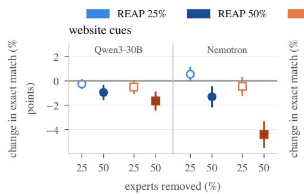

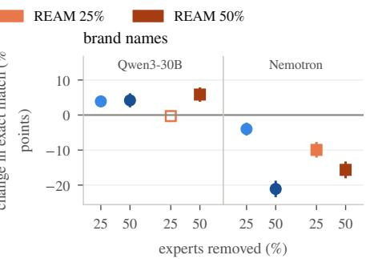

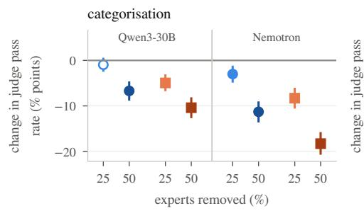

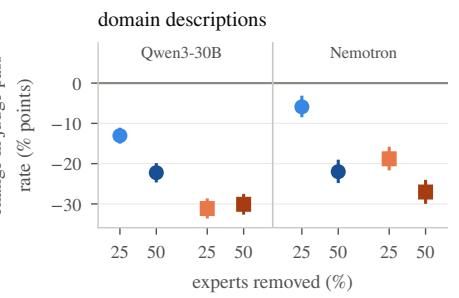

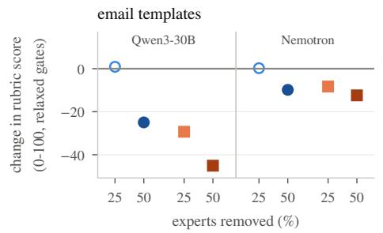  
Figure 3: REAM is below REAP at the same ratio in almost every task and model. Change from the base model in each task’s metric (named on the y-axis; negative = worse), for Qwen3-30B (left half of each panel) and Nemotron (right half), REAP (circles) and REAM (squares) at 25% and 50%. Bars are 95% paired-bootstrap CIs; filled markers are significant after Holm correction, hollow ones are not.

Table 6: Every comparison with the base model (2,000 rows each). Change = compressed − base with 95% paired-bootstrap CI; retention = compressed / base.
<table><tr><td>Task, model</td><td>Base</td><td>Variant</td><td>Score</td><td colspan="2">Change [95% CI]</td><td>Retention (%)</td><td>[95% CI]</td><td>p (Holm)</td></tr><tr><td>Website cues, Qwen3-30B</td><td>98.8</td><td>REAP 25%</td><td>98.5</td><td></td><td> $- 0 . 2 \ [ - 0 . 6 , \ 0 . 0 ]$ </td><td>99.7 [99.4, 100.1]</td><td></td><td>1.000</td></tr><tr><td></td><td></td><td>REAP 50%</td><td>97.8</td><td></td><td> $- 1 . 0 \ \mathrm { \bar { [ - 1 . 5 , ~ - 0 . 4 ] } }$ </td><td>99.0 [98.5, 99.6]</td><td></td><td>0.009</td></tr><tr><td></td><td></td><td>REAM 25%</td><td>98.2</td><td></td><td> $- 0 . 5 \ \mathrm { \bar { [ - 1 . 0 , 0 . 0 ] } } ^ { \mathrm { ~ } }$ </td><td> $\begin{array} { l } { 9 9 . 5 \ \mathrm { [ 9 9 . 0 , ~ 1 0 0 . { \dot { 0 } } ] } } \\ { 9 8 . 3 \ \mathrm { [ 9 7 . 6 , ~ 9 9 . 0 ] } } \end{array}$ </td><td></td><td>0.529</td></tr><tr><td></td><td></td><td>REAM 50%</td><td>97.1</td><td></td><td> $- 1 . 7 \ [ - 2 . 4 , \ - 1 . 0 ]$ </td><td></td><td></td><td>&lt;0.001</td></tr><tr><td>Website cues, Nemotron</td><td>96.0</td><td>REAP 25%</td><td>96.5</td><td></td><td>+0.5 [0.0, 1.1]</td><td></td><td>100.6 [100.1, 101.1]</td><td>0.491</td></tr><tr><td></td><td></td><td>REAP 50%</td><td>94.7</td><td></td><td>−1.3 [−2.1, −0.5]</td><td>98.6 [97.8, 99.5]</td><td></td><td>0.020</td></tr><tr><td></td><td></td><td>REAM 25%</td><td>95.5</td><td></td><td>−0.5 [−1.2, 0.2]</td><td>99.5</td><td>[98.8, 100.3]</td><td>1.000</td></tr><tr><td></td><td></td><td>REAM 50%</td><td>91.5</td><td></td><td> $- 4 . 4 \ [ - 5 . 4 , \ - 3 . 4 ]$ </td><td>95.4 [94.3, 96.4]</td><td></td><td>&lt;0.001</td></tr><tr><td>Brand names, Qwen3-30B</td><td>64.8</td><td>REAP 25%</td><td>68.7</td><td></td><td>+3.9 [2.7, 5.1]</td><td></td><td>106.0 [104.1, 108.0]</td><td>&lt;0.001</td></tr><tr><td></td><td></td><td>REAP 50%</td><td>69.0</td><td>+4.2</td><td>[2.6, 5.8]</td><td></td><td>106.5 [103.9, 109.2]</td><td>&lt;0.001</td></tr><tr><td></td><td></td><td>REAM 25%</td><td>64.5</td><td>-0.3</td><td>[−1.6, 1.0]</td><td></td><td>99.5 [97.6, 101.6]</td><td>1.000</td></tr><tr><td></td><td></td><td>REAM 50%</td><td>70.7</td><td></td><td>+5.9 [4.1, 7.6]</td><td></td><td> $1 0 9 . 0 \ \mathrm { { [ 1 0 6 . 3 , 1 1 1 . 9 ] } }$ </td><td>&lt;0.001</td></tr><tr><td>Brand names, Nemotron</td><td>49.8</td><td>REAP 25%</td><td>45.8</td><td></td><td></td><td></td><td>92.0 [89.1, 94.9]</td><td></td></tr><tr><td></td><td></td><td>REAP 50%</td><td>28.6</td><td></td><td>-4.0 [−5.5, −2.5]</td><td>57.6</td><td>[54.2, 60.9]</td><td>&lt;0.001 &lt;0.001</td></tr><tr><td></td><td></td><td>REAM 25%</td><td>39.8</td><td></td><td> $- 2 1 . 1 \ [ - 2 3 . 1 , \ - \dot { 1 } 9 . 1 ]$  -10.0 [−11.8, -8.0]</td><td>80.0</td><td>[76.6, 83.6]</td><td>&lt;0.001</td></tr><tr><td></td><td></td><td>REAM 50%</td><td>34.1</td><td></td><td> $- 1 5 . 6 \ \mathrm { \normalfont ~ \left[ - 1 7 . 7 , ~ - 1 3 . \mathrm { \normalfont ~ \AA } \right] }$ </td><td></td><td>68.5 [64.9, 72.2]</td><td>&lt;0.001</td></tr><tr><td>Categorisation, Qwen3-30B</td><td>81.7</td><td>REAP 25%</td><td>80.7</td><td></td><td>−1.0 [−2.2, 0.4]</td><td>98.8</td><td>[97.3, 100.4]</td><td></td></tr><tr><td></td><td></td><td>REAP 50%</td><td>75.0</td><td></td><td>−6.7 [−8.6, −4.9]</td><td>91.8</td><td>[89.6, 94.0]</td><td>1.000 &lt;0.001</td></tr><tr><td></td><td></td><td>REAM 25%</td><td>76.7</td><td></td><td>-5.0 [−6.5, −3.3]</td><td>93.9</td><td>[92.0, 95.9]</td><td>&lt;0.001</td></tr><tr><td></td><td></td><td>REAM 50%</td><td>71.2</td><td></td><td> $- 1 0 . 4 \ [ - 1 2 . 5 , \ - 8 . 4 ]$ </td><td>87.3</td><td>[84.9, 89.6]</td><td>&lt;0.001</td></tr><tr><td>Categorisation, Nemotron</td><td>68.2</td><td>REAP 25%</td><td>65.2</td><td></td><td></td><td>95.6</td><td>[93.2, 97.9]</td><td>0.004</td></tr><tr><td></td><td></td><td>REAP 50%</td><td>56.9</td><td></td><td> $\begin{array} { l } { { - 3 . 0 ~ \left[ - 4 . 7 , - 1 . 4 \right] } } \\ { { - 1 1 . 3 ~ \left[ - 1 3 . 4 , ~ - 9 . 2 \right] } } \\ { { - 8 . 3 ~ \left[ - 1 0 . 3 , ~ - 6 . 2 \right] } } \\ { { - 1 8 . 3 ~ \left[ - 2 0 . 5 , ~ - 1 6 . 0 \right] } } \end{array}$ </td><td>83.4</td><td>[80.6, 86.3]</td><td>&lt;0.001</td></tr><tr><td></td><td></td><td>REAM 25%</td><td>59.9</td><td></td><td></td><td>87.8</td><td>[85.0, 90.7]</td><td>&lt;0.001</td></tr><tr><td></td><td></td><td>REAM 50%</td><td>49.9</td><td></td><td></td><td>73.1</td><td>[70.2, 76.2]</td><td>&lt;0.001</td></tr><tr><td>Domain descr., Qwen3-30B</td><td>93.5</td><td>REAP 25%</td><td>80.5</td><td></td><td></td><td>86.1</td><td>[84.4, 87.7]</td><td>&lt;0.001</td></tr><tr><td></td><td></td><td>REAP 50%</td><td>71.3</td><td></td><td> $\begin{array} { r l } & { - 1 3 . 0 ~ [ - 1 4 . 7 , ~ - 1 1 . 5 ] } \\ & { - 2 2 . 2 ~ [ - 2 4 . 3 , ~ - 2 0 . 2 ] } \\ & { - 3 1 . 1 ~ [ - 3 3 . 3 , ~ - 2 9 . 0 ] } \\ & { - 3 0 . 1 ~ [ - 3 2 . 3 , ~ - 2 7 . 9 ] } \end{array}$ </td><td>76.2</td><td>[74.1, 78.3]</td><td>&lt;0.001</td></tr><tr><td></td><td></td><td>REAM 25%</td><td>62.4</td><td></td><td></td><td>66.7</td><td>[64.5, 68.9]</td><td>&lt;0.001</td></tr><tr><td></td><td></td><td>REAM 50%</td><td>63.5</td><td></td><td></td><td>67.8</td><td>[65.6, 70.1]</td><td>&lt;0.001</td></tr><tr><td>Domain descr., Nemotron</td><td>58.8</td><td>REAP 25%</td><td>52.9</td><td></td><td></td><td></td><td>90.0 [86.4, 93.9]</td><td>&lt;0.001</td></tr><tr><td></td><td></td><td>REAP 50%</td><td>36.8</td><td></td><td> $\begin{array} { l } { - 5 . 9 \ \left[ { - 8 . 1 , - 3 . 5 } \right] } \\ { - 2 2 . 0 \ \left[ { - 2 4 . 4 , \ - 1 9 . 4 } \right] } \\ { - 1 8 . 8 \ \left[ { - 2 1 . 3 , \ - 1 6 . 2 } \right] } \\ { - 2 7 . 1 \ \left[ { - 2 9 . 6 , \ - 2 4 . 4 } \right] } \end{array}$ </td><td></td><td>62.6 [59.1, 66.3]</td><td>&lt;0.001</td></tr><tr><td></td><td></td><td>REAM 25%</td><td>40.0</td><td></td><td></td><td>68.0</td><td>[64.4, 72.0]</td><td>&lt;0.001</td></tr><tr><td></td><td></td><td>REAM 50%</td><td>31.7</td><td></td><td></td><td>54.0 [50.5, 57.7]</td><td></td><td>&lt;0.001</td></tr><tr><td>Email templates, Qwen3-30B</td><td>70.2</td><td>REAP 25%</td><td>71.1</td><td></td><td></td><td></td><td>101.2 [99.3, 103.3]</td><td>1.000</td></tr><tr><td></td><td></td><td>REAP 50%</td><td>45.3</td><td></td><td> $\begin{array} { l } { + 0 . 9 \ [ - 0 . 5 , 2 . 3 ] } \\ { - 2 5 . 0 \ [ - 2 6 . 8 , \ - 2 3 . 1 ] } \\ { - 2 9 . 3 \ [ - 3 1 . 2 , \ - 2 7 . 4 ] } \\ { - 4 5 . 1 \ [ - 4 6 . 9 , \ - 4 3 . 3 ] } \end{array}$ </td><td></td><td>64.4 [62.0, 66.9]</td><td>0.002</td></tr><tr><td></td><td></td><td>REAM 25%</td><td>40.9</td><td></td><td></td><td>58.3</td><td>[55.8, 60.8]</td><td>0.002</td></tr><tr><td></td><td></td><td>REAM 50%</td><td>25.1</td><td></td><td></td><td>35.8</td><td>[33.6, 37.9]</td><td>0.002</td></tr><tr><td>Email templates, Nemotron</td><td></td><td></td><td></td><td></td><td></td><td></td><td></td><td></td></tr><tr><td></td><td>12.8</td><td>REAP 25% REAP 50%</td><td>13.0 2.9</td><td></td><td> $+ 0 . 2 \ [ - 1 . 4 , 1 . 8 ]$  -9.8 [-11.2, -8.5]</td><td></td><td>101.8 [89.8, 115.4] 23.0 [18.2, 28.5]</td><td>1.000 0.002</td></tr><tr><td></td><td></td><td>REAM 25%</td><td>4.5</td><td></td><td> $- 8 . 3 \ \lvert - 9 . 7 , \ - 6 . 9 \rvert$ </td><td></td><td>35.2 [29.0, 42.2]</td><td>0.002</td></tr><tr><td></td><td></td><td>REAM 50%</td><td>0.4</td><td></td><td> $- 1 2 . 4 \ [ - 1 3 . 7 , \ - 1 1 . 2 ]$ </td><td>3.0 [1.4, 4.8]</td><td></td><td>0.002</td></tr><tr><td></td><td></td><td></td><td></td><td></td><td></td><td></td><td></td><td></td></tr></table>

Table 7: REAP − REAM on the same rows, with 95% paired-bootstrap CIs. Bold: REAP significantly better; italic†: REAM significantly better (Holm over the 20 comparisons).
<table><tr><td></td><td colspan="2">Qwen3-30B</td><td colspan="2">Nemotron</td></tr><tr><td>Task</td><td>25%</td><td>50%</td><td>25%</td><td>50%</td></tr><tr><td>Website cues</td><td>+0.2 [−0.2, 0.8]</td><td>+0.7 [0.0, 1.4]</td><td>+1.0 [0.3, 1.7]</td><td>+3.1 [2.2, 4.1]</td></tr><tr><td>Brand names</td><td>+4.2 [3.0, 5.5]</td><td> $- 1 . 7 \ [ - 2 . 9 , \ - 0 . 4 ] ^ { \dagger }$ </td><td>+6.0 [4.3, 7.6]</td><td> $- 5 . 5 \ [ - 7 . 2 , \ - 3 . 6 ] ^ { \dagger }$ </td></tr><tr><td>Categorisation</td><td>+4.0 [2.5, 5.5]</td><td>+3.7 [1.9, 5.5]</td><td>+5.3 [3.4, 7.2]</td><td>+7.0 [5.0, 9.0]</td></tr><tr><td>Domain descr.</td><td>+18.1 [15.9, 20.3]</td><td>+7.8 [5.7, 9.9]</td><td>+12.9 [10.3, 15.6]</td><td>+5.1 [2.7, 7.3]</td></tr><tr><td>Email templates</td><td>+30.2 [28.4, 32.0]</td><td>+20.1 [18.0, 22.2]</td><td>+8.5 [7.2, 9.9]</td><td>+2.6 [2.0, 3.2]</td></tr></table>

## C Brand names: detection and precision

Every validation row of the brand task states a brand, so an answer can fail in two ways: it returns no brand (a detection failure), or it returns the wrong one (a precision failure). Table 8 splits each change in exact match into these two parts.

Table 8: Brand names: detection versus precision. Detection = answers that return a brand; precision = exact matches among those. The change in exact match from the base model splits into a detection part and a precision part, which sum to the total. Every validation row states a brand.
<table><tr><td rowspan="2">Model</td><td rowspan="2">Exact (%)</td><td rowspan="2">Detec-</td><td colspan="2">Precision (%)</td><td rowspan="2"></td><td colspan="2">Change in exact (points)</td></tr><tr><td colspan="2">95% CI</td><td>total detect.</td><td>precis.</td></tr><tr><td>Qwen3-30B</td><td>64.8</td><td>tion (%) 87.2</td><td>74.3</td><td>[72.3, 76.3]</td><td></td><td></td><td></td></tr><tr><td>REAP 25%</td><td>68.7</td><td>91.0</td><td>75.5</td><td>[73.5, 77.4]</td><td>+3.9</td><td>+2.8</td><td>+1.1</td></tr><tr><td>REAP 50%</td><td>69.0</td><td>91.5</td><td>75.5</td><td>[73.5, 77.4]</td><td>+4.2</td><td>+3.2</td><td>+1.0</td></tr><tr><td>REAM 25%</td><td>64.5</td><td>88.2</td><td>73.1</td><td>[71.1, 75.2]</td><td>-0.3</td><td>+0.7</td><td>-1.0</td></tr><tr><td>REAM 50%</td><td>70.7</td><td>95.2</td><td>74.3</td><td>[72.2, 76.2]</td><td>+5.9</td><td>+5.9</td><td>-0.1</td></tr><tr><td>Nemotron</td><td>49.8</td><td>78.5</td><td>63.4</td><td>[61.1, 65.8]</td><td></td><td></td><td></td></tr><tr><td>REAP 25%</td><td>45.8</td><td>72.0</td><td>63.5</td><td>[61.0, 66.0]</td><td>-4.0</td><td>-4.1</td><td>+0.1</td></tr><tr><td>REAP 50%</td><td>28.6</td><td>54.5</td><td>52.6</td><td>[49.7, 55.5]</td><td>-21.1</td><td>-13.9</td><td>-7.2</td></tr><tr><td>REAM 25%</td><td>39.8</td><td>61.6</td><td>64.6</td><td>[61.9, 67.3]</td><td>-9.9</td><td>-10.8</td><td>+0.8</td></tr><tr><td>REAM 50%</td><td>34.1</td><td>53.5</td><td>63.7</td><td>[60.8, 66.6]</td><td>-15.6</td><td>-15.9</td><td>+0.2</td></tr></table>

## D Email templates: rubric, gates and production scores

The rubric. The production rubric (version 1.2) scores an answer in 13 categories with weighted checks: output validity, client safety, structure, typography, spacing, required blocks, links and media, conditional content, content fields, language, the rendered page, a text judge and a vision judge. The rendered checks load the email in a headless browser at desktop and mobile width.

The gates. Five checks are hard gates:

• output parseable: the answer is valid JSON with the required keys;

• HTML present;

• HTML complete;

• unsubscribe link;

• mobile layout intact: the rendered page does not overflow a narrow screen.

The relaxed rules. We relax two gates:

• html\_complete passes a complete <body>...</body> without the <html> wrapper. A bare <table> fragment still fails.

• unsubscribe\_link passes any unsubscribe link in any of the dataset’s languages, for example <a href="#">Unsubscribe</a>, not only the template placeholder.

Nothing else changes, and all 2,000 production references are full documents.

## Results.

• The production score orders the models by a formatting habit. Under the production rules Qwen3-30B scores 26.1, REAP 25% 51.3 and REAM 25% 0.4. That order follows how often each model omits the <html> wrapper, not template quality (Table 9).

• REAP still leads under the production rules, in all four comparisons (Table 10).

• Per category, merging hurts content most: links and media, language, the rendered page and the vision judge (Figure 5).

Table 9: Email templates: answers failing each gate (%). The relaxed rules are the ones scored; the last two columns apply the production rules to the two relaxed gates.
<table><tr><td></td><td colspan="5">Relaxed rules (as scored)</td><td colspan="2">Production rules</td></tr><tr><td>Model</td><td>parseable</td><td>HTML</td><td>complete</td><td>unsubscribe</td><td>mobile</td><td>complete</td><td>unsubscribe</td></tr><tr><td>Qwen3-30B</td><td>1.1</td><td>0.0</td><td>0.1</td><td>0.1</td><td>10.0</td><td>61.5</td><td>0.2</td></tr><tr><td>REAP 25%</td><td>1.1</td><td>0.0</td><td>0.1</td><td>0.1</td><td>8.8</td><td>28.0</td><td>0.1</td></tr><tr><td>REAP 50%</td><td>5.4</td><td>0.1</td><td>0.4</td><td>0.1</td><td>35.1</td><td>14.3</td><td>0.2</td></tr><tr><td>REAM 25%</td><td>5.1</td><td>0.0</td><td>0.1</td><td>0.4</td><td>40.1</td><td>94.3</td><td>0.8</td></tr><tr><td>REAM 50%</td><td>12.2</td><td>0.0</td><td>2.6</td><td>0.4</td><td>51.7</td><td>82.5</td><td>0.5</td></tr><tr><td>Nemotron</td><td>27.2</td><td>0.1</td><td>34.9</td><td>35.0</td><td>13.9</td><td>35.3</td><td>36.9</td></tr><tr><td>REAP 25%</td><td>22.8</td><td>0.2</td><td>32.3</td><td>40.3</td><td>15.2</td><td>32.8</td><td>42.5</td></tr><tr><td>REAP 50%</td><td>47.8</td><td>0.1</td><td>27.9</td><td>36.4</td><td>16.2</td><td>28.1</td><td>37.5</td></tr><tr><td>REAM 25%</td><td>34.0</td><td>0.4</td><td>30.2</td><td>54.1</td><td>10.4</td><td>44.9</td><td>54.9</td></tr><tr><td>REAM 50%</td><td>46.7</td><td>0.1</td><td>46.4</td><td>43.4</td><td>15.2</td><td>49.5</td><td>44.9</td></tr></table>

Table 10: REAP − REAM on email templates under the production and the relaxed rules (rubric points, 95% paired-bootstrap CI; production: Holm over these four comparisons).
<table><tr><td rowspan="2">Model</td><td colspan="5">Production gates</td><td rowspan="2">Relaxed</td></tr><tr><td>REAP</td><td>REAM</td><td></td><td>diff. 95% CI</td><td>Holm p</td></tr><tr><td>Qwen3-30B 25%</td><td>51.3</td><td>0.4</td><td>+51.0</td><td> $[ + 4 9 . 3 , + 5 2 . 6 ]$ </td><td>&lt;0.001</td><td>diff. +30.2</td></tr><tr><td>Qwen3-30B 50%</td><td>37.7</td><td>1.9</td><td>+35.8</td><td> $[ + 3 4 . 0 , + 3 7 . 5 ]$ </td><td>&lt;0.001</td><td>+20.1</td></tr><tr><td>Nemotron 25%</td><td>12.1</td><td>2.9</td><td>+9.2</td><td> $[ + 7 . 9 , + 1 0 . 4 ]$ </td><td>&lt;0.001</td><td>+8.5</td></tr><tr><td>Nemotron 50%</td><td>2.6</td><td>0.1</td><td>+2.5</td><td> $[ + 1 . 9 , + 3 . 1 ]$ </td><td>&lt;0.001</td><td>+2.6</td></tr></table>

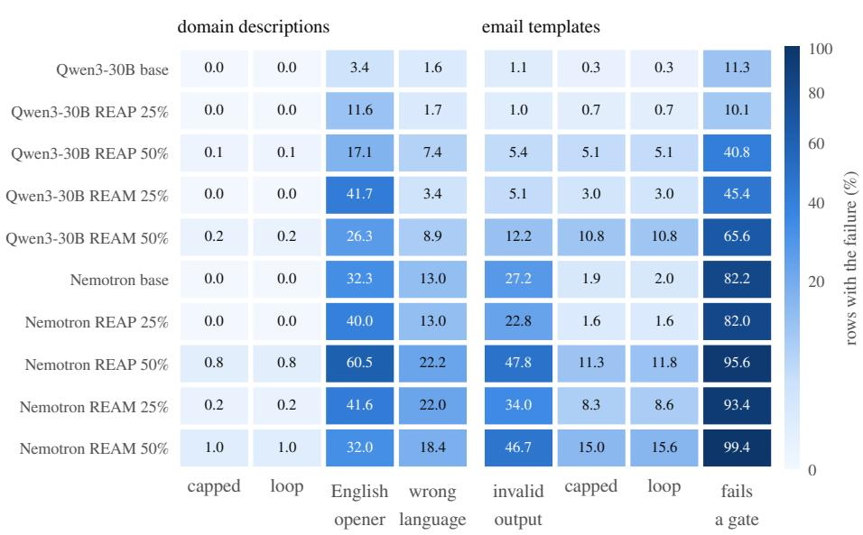  
Figure 4: Failures concentrate in the output contract of the generative tasks. Share of the 2,000 rows with each failure (colour scale, square-root scaled). Domain descriptions: answers that ran to the 32k-token cap, repetition loops, non-English answers that open in English, and answers in the wrong language. Email templates: invalid JSON, capped answers, loops, and answers failing at least one hard gate. The three discriminative tasks are left out: every rate there is below 1%.

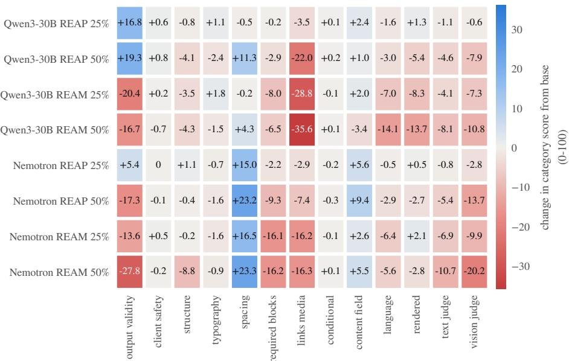  
Figure 5: Merging hurts links and media, language and the rendered page most. Change of each rubric category score from the base model (points of 100; red = worse). Categories use the production checks, so output validity includes the <html> wrapper; that is why it rises for Qwen3-30B REAP.

## E Languages

Table 11 tests, for every task and compressed model, whether the change from the base model difers between English and non-English rows.

• The gap = non-English change − English change, with a 95% bootstrap CI (rows resampled within each group).

• Correction: Holm over the 40 cells.

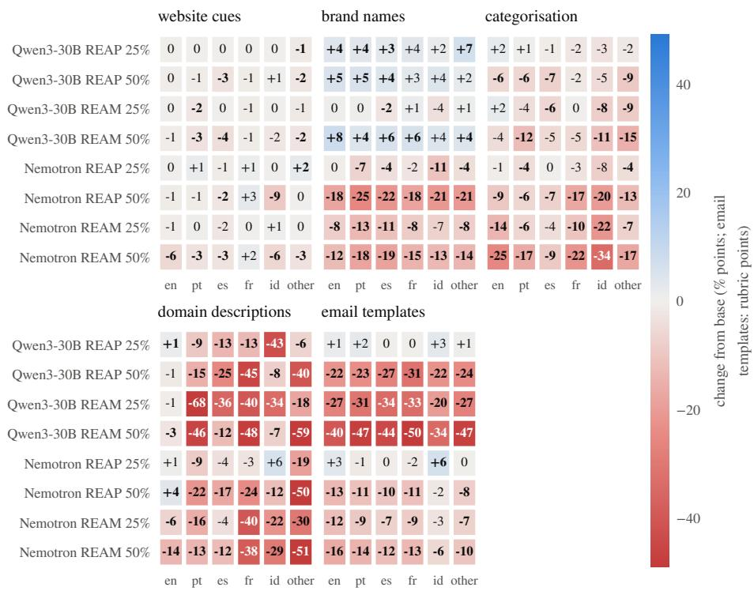  
Figure 6: Only domain descriptions show a consistent English advantage. Change from the base model per language group (columns; “other” pools the remaining languages) for each compressed model (rows) and task (panels), in pp (rubric points for email templates); red = worse, blue = better. Bold: the cell’s 95% bootstrap CI excludes 0, uncorrected; the corrected tests are in Table 11.

Table 11: English versus non-English change per task and compressed model (pp; rubric points for email templates). Bold: Holm-significant over the 40 cells.
<table><tr><td rowspan="2">Task, model</td><td colspan="2">Change from base</td><td rowspan="2" colspan="2">Gap: non-En. - En.</td><td rowspan="2">Holm p</td></tr><tr><td>English</td><td>non-English [95% CI]</td></tr><tr><td>Website cues</td><td></td><td></td><td></td><td></td><td></td></tr><tr><td>Qwen3-30B REAP 25%</td><td>-0.1</td><td>-0.4</td><td>-0.3</td><td>[−1.0, +0.3]</td><td></td></tr><tr><td>Qwen3-30B REAP 50%</td><td>-0.5</td><td>-1.5</td><td>-1.0</td><td>-2.1, +0.1]</td><td>1</td></tr><tr><td>Qwen3-30B REAM 25%</td><td>0.0</td><td>-1.1</td><td>-1.1</td><td>-2.1, −0.1]</td><td>0.78</td></tr><tr><td>Qwen3-30B REAM 50%</td><td>-0.7</td><td>-2.7</td><td>-2.1</td><td>[−3.5, -0.7]</td><td>0.068</td></tr><tr><td>Nemotron REAP 25%</td><td>+0.3</td><td>+0.8</td><td>+0.6</td><td>−0.5, +1.6]</td><td>1</td></tr><tr><td>Nemotron REAP 50%</td><td>-1.0</td><td>-1.6</td><td>-0.5</td><td>[−2.2, +1.1]</td><td>1</td></tr><tr><td>Nemotron REAM 25%</td><td>-0.7</td><td>-0.2</td><td>+0.5</td><td>[−1.0, +1.9]</td><td>1</td></tr><tr><td>Nemotron REAM 50%</td><td>-5.7</td><td>-3.0</td><td>+2.7</td><td>[+0.8, +4.7]</td><td>0.2</td></tr><tr><td>Brand names</td><td></td><td></td><td></td><td></td><td></td></tr><tr><td>Qwen3-30B REAP 25%</td><td>+4.2</td><td>+3.8</td><td>-0.3</td><td>[-3.3, +2.5]</td><td></td></tr><tr><td>Qwen3-30B REAP 50%</td><td>+5.0</td><td>+3.9</td><td>-1.0</td><td>[−5.1, +3.0]</td><td>1 1</td></tr><tr><td>Qwen3-30B REAM 25%</td><td>+0.4</td><td>-0.5</td><td>-0.9</td><td>-4.0, +2.1</td><td>1</td></tr><tr><td>Qwen3-30B REAM 50%</td><td>+8.3</td><td>+5.1</td><td>-3.2</td><td>-7.3, +0.8]</td><td>1</td></tr><tr><td>Nemotron REAP 25%</td><td>-0.4</td><td>-5.1</td><td>-4.7</td><td>-8.1, -1.3]</td><td>0.24</td></tr><tr><td>Nemotron REAP 50%</td><td>-17.7</td><td>-22.2</td><td>-4.5</td><td>[−9.1, -0.1]</td><td>0.94</td></tr><tr><td>Nemotron REAM 25%</td><td>-7.9</td><td>-10.6</td><td>-2.7</td><td>[−7.0, +1.7]</td><td>1 1</td></tr><tr><td>Nemotron REAM 50%</td><td>-12.5</td><td>-16.7</td><td>-4.2</td><td>[-8.8, +0.5]</td><td></td></tr><tr><td>Categorisation</td><td></td><td></td><td></td><td></td><td></td></tr><tr><td>Qwen3-30B REAP 25%</td><td>+2.2</td><td>-1.4</td><td></td><td>-3.7 [−7.2, −0.2]</td><td>0.79</td></tr><tr><td>Qwen3-30B REAP 50%</td><td>-5.5</td><td>-6.9</td><td>-1.4</td><td>[-6.5, +3.9]</td><td>1</td></tr><tr><td>Qwen3-30B REAM 25%</td><td>+2.2</td><td>-6.1</td><td>-8.3</td><td>[−12.1, −4.5]</td><td>0.008</td></tr><tr><td>Qwen3-30B REAM 50%</td><td>-4.4</td><td>-11.3</td><td>-6.9</td><td>[-12.0, -1.8]</td><td>0.23</td></tr><tr><td>Nemotron REAP 25%</td><td>-0.7</td><td>-3.4</td><td>-2.6</td><td>[−6.8, +1.5]</td><td>1</td></tr><tr><td>Nemotron REAP 50%</td><td>-9.2</td><td>-11.6</td><td>-2.4</td><td>[−7.9, +3.2]</td><td>1</td></tr><tr><td>Nemotron REAM 25%</td><td>-13.6</td><td>-7.5</td><td>+6.1</td><td>[+0.4, +11.9]</td><td>0.78</td></tr><tr><td>Nemotron REAM 50%</td><td>-25.0</td><td>-17.2</td><td>+7.8</td><td>[+1.5, +14.3]</td><td>0.34</td></tr><tr><td>Domain descr.</td><td></td><td></td><td></td><td></td><td></td></tr><tr><td>Qwen3-30B REAP 25%</td><td>+1.2</td><td>-16.0</td><td></td><td>-17.2 [-19.5, -14.9]</td><td>0.008</td></tr><tr><td>Qwen3-30B REAP 50%</td><td>-1.5</td><td>-26.5</td><td>-25.1</td><td>[-28.3, -21.9]</td><td>0.008</td></tr><tr><td>Qwen3-30B REAM 25%</td><td>-0.6</td><td>-37.5</td><td>-36.9</td><td>[-39.9, -33.8]</td><td>0.008</td></tr><tr><td>Qwen3-30B REAM 50%</td><td>-2.6</td><td>-35.8</td><td>-33.1</td><td>[-36.6, -29.6]</td><td>0.008</td></tr><tr><td>Nemotron REAP 25%</td><td>+0.6</td><td>-7.2</td><td></td><td>-7.8 [−12.4, −3.3]</td><td>0.008</td></tr><tr><td>Nemotron REAP 50%</td><td>+3.5</td><td>-27.3</td><td>-30.8</td><td>[-35.0, -26.5]</td><td>0.008</td></tr><tr><td>Nemotron REAM 25%</td><td>-6.4</td><td>-21.4</td><td>-14.9</td><td>[-20.2, -9.6]</td><td>0.008</td></tr><tr><td>Nemotron REAM 50%</td><td>-13.7</td><td>-29.8</td><td>-16.1</td><td>[-21.6, −10.4]</td><td>0.008</td></tr><tr><td>Email templates</td><td></td><td></td><td></td><td></td><td></td></tr><tr><td>Qwen3-30B REAP 25%</td><td>+1.5</td><td>+0.8</td><td></td><td>-0.7 [−4.6, +3.1]</td><td></td></tr><tr><td>Qwen3-30B REAP 50%</td><td>-21.8</td><td>-25.6</td><td>-3.9</td><td>[-9.1, +1.3]</td><td></td></tr><tr><td>Qwen3-30B REAM 25%</td><td>-26.7</td><td>-29.9</td><td>-3.2</td><td>-8.6, +2.2]</td><td>1</td></tr><tr><td>Qwen3-30B REAM 50%</td><td>-40.2</td><td>-46.1</td><td>-6.0</td><td>[−11.2, −0.9]</td><td>0.54 1</td></tr><tr><td>Nemotron REAP 25%</td><td>+3.1</td><td>-0.4</td><td>-3.4</td><td>[−8.2, +1.2]</td><td></td></tr><tr><td>Nemotron REAP 50%</td><td>-13.2</td><td>-9.1</td><td>+4.1</td><td>[+0.4, +8.0]</td><td>0.77</td></tr><tr><td>Nemotron REAM 25%</td><td>-11.5</td><td>-7.6</td><td>+3.9</td><td>[0.0, +7.9]</td><td>0.94</td></tr><tr><td>Nemotron REAM 50%</td><td>-16.3</td><td>-11.6</td><td></td><td>+4.7 [+1.2, +8.3]</td><td>0.22</td></tr></table>

## F Agreement with the base model

A small net change can hide many answers that changed. Figure 7 counts, for every compressed model, how often it gives exactly the base model’s answer, and how many rows it newly fails or newly passes.

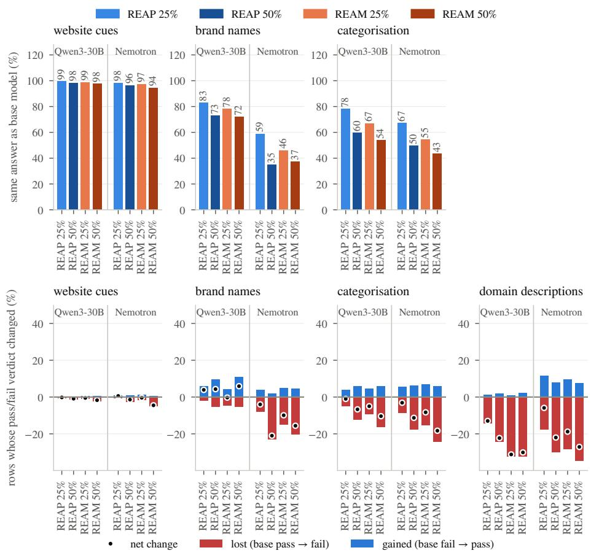  
Figure 7: Small net changes hide many flipped answers. Top: share of rows where a compressed model gives exactly the base model’s answer (greedy tasks; categorisation compares the normalised category). Bottom: rows whose pass/fail verdict changed. Red bars below zero are rows lost (the base model passes, the compressed model fails); blue bars above zero are rows gained; the dot is the net change.

## G Diagnostics from the benchmark papers Definitions.

• Cross-perplexity is the base model’s perplexity of a compressed model’s

answers, token-weighted over all answers of a task. Answers that ran to the 32k-token cap are excluded.

• Own perplexity is each model’s perplexity of its own answers.

• Completion-logit JSD is the Jensen–Shannon divergence (bits) between the compressed and the base model’s next-token distributions, along the compressed model’s answers on 200 rows per task.

Each distribution is restricted to the compressed model’s top-20 tokens plus a remainder bucket, so the value is a lower bound.

– For brand names and categorisation the first answer token is excluded from all log-probability measures, because the schema forces it.

• Distinct-2 is the share of unique bigrams: within averages over answers, across pools all of a model’s answers. Repetition loops are excluded unless stated otherwise.

• Loop rate is the share of answers that end in a repetition loop. A loop is an answer that hit the token cap, or one whose last 3,000 characters compress below 10%.

• Embedding rank uses the final normalised hidden states at 64 evenly spaced positions of 200 prompt-plus-reference rows per task (12,800 embeddings).

The numerical rank counts singular values above $s _ { \operatorname* { m a x } } \cdot \operatorname* { m a x } ( n , d )$ ϵfp32.

– The efective rank is the exponential of the entropy of the normalised singular values, after mean-centring.

Scoring the diagnostics. Table 12 scores each diagnostic in two ways:

• the Kendall τ between the diagnostic, signed so that higher is better, and the primary metric, over the variants of each task and base model;

• over matched cells, how often the diagnostic ranks REAP and REAM the same way as quality does.

Table 13 gives cross-perplexity and JSD per task and Table 14 gives distinct-2 and efective rank. Figure 8 plots cross-perplexity against the share of experts removed.

Table 12: Cross-perplexity, logit divergence and loops track production quality. Mean Kendall τ between each diagnostic (signed so that higher = better) and the primary metric over the variants of each task and base model, with the number of positive cells; and, over matched (task, model, ratio) cells, how often the diagnostic favours REAP, how often quality agrees, and how often both order REAP and REAM the same way. aJSD has no base-model value, so τ uses four variants.
<table><tr><td rowspan="3">Diagnostic</td><td rowspan="3">Better when</td><td rowspan="2"></td><td colspan="2">Kendall τ</td><td colspan="3">REAP vs REAM</td></tr><tr><td>Tasks mean</td><td>&gt; 0</td><td>REAP better</td><td>quality agrees</td><td>same order</td></tr><tr><td>Cross-perplexity</td><td>lower</td><td>all</td><td>+0.70</td><td>9/10</td><td>20/20</td><td></td><td>18/2018/20</td></tr><tr><td>Completion JSDª</td><td>lower</td><td>all</td><td>+0.50</td><td>7/10</td><td>20/20</td><td></td><td>18/2018/20</td></tr><tr><td>Effective rank</td><td>higher</td><td>all</td><td>+0.44</td><td>6/10</td><td>15/20</td><td></td><td>13/15 13/20</td></tr><tr><td>Distinct-2, no loops</td><td>higher</td><td>gen.</td><td>+0.15</td><td>3/4</td><td>1/8</td><td>1/1</td><td>1/8</td></tr><tr><td>Distinct-2, with loops higher</td><td></td><td>gen.</td><td>+0.70</td><td>4/4</td><td>6/8</td><td>6/6</td><td>6/8</td></tr><tr><td>Loop rate</td><td>lower</td><td>gen.</td><td>+0.74</td><td>4/4</td><td>7/8</td><td></td><td>7/7 7/8</td></tr><tr><td>Own perplexity</td><td>lower</td><td>all</td><td>+0.8010/10</td><td></td><td>18/20</td><td></td><td>18/18 20/20</td></tr></table>

Table 13: Cross-perplexity and completion-logit JSD per task.
<table><tr><td rowspan="2">Model</td><td colspan="5">Cross-perplexity</td><td colspan="5">Completion-logit JSD (bits)</td></tr><tr><td>Website</td><td>Brand</td><td>Categorisation</td><td>Domain</td><td>Email</td><td>Website</td><td>Brand</td><td>Categorisation</td><td>Domain</td><td>Email</td></tr><tr><td>Qwen3-30B</td><td>1.000</td><td>1.042</td><td>1.038</td><td>1.19</td><td>1.048</td><td></td><td></td><td></td><td></td><td></td></tr><tr><td>REAP 25%</td><td>1.001</td><td>1.073</td><td>1.11</td><td>1.50</td><td>1.065</td><td>0.000</td><td>0.008</td><td>0.013</td><td>0.056</td><td>0.005</td></tr><tr><td>REAP 50%</td><td>1.005</td><td>1.15</td><td>1.32</td><td>4.00</td><td>1.12</td><td>0.000</td><td>0.024</td><td>0.034</td><td>0.168</td><td>0.018</td></tr><tr><td>REAM 25%</td><td>1.003</td><td>1.086</td><td>1.30</td><td>2.13</td><td>1.13</td><td>0.001</td><td>0.010</td><td>0.030</td><td>0.101</td><td>0.018</td></tr><tr><td>REAM 50%</td><td>1.009</td><td>1.16</td><td>1.57</td><td>5.90</td><td>1.20</td><td>0.001</td><td>0.029</td><td>0.049</td><td>0.215</td><td>0.029</td></tr><tr><td>Nemotron</td><td>1.003</td><td>1.074</td><td>1.11</td><td>2.20</td><td>1.089</td><td></td><td></td><td></td><td></td><td></td></tr><tr><td>REAP 25%</td><td>1.004</td><td>1.16</td><td>1.21</td><td>3.16</td><td>1.19</td><td>0.000</td><td>0.023</td><td>0.018</td><td>0.062</td><td>0.023</td></tr><tr><td>REAP 50%</td><td>1.007</td><td>1.37</td><td>1.40</td><td>7.11</td><td>1.36</td><td>0.001</td><td>0.052</td><td>0.051</td><td>0.060</td><td>0.045</td></tr><tr><td>REAM 25%</td><td>1.004</td><td>1.26</td><td>1.35</td><td>7.21</td><td>1.34</td><td>0.001</td><td>0.040</td><td>0.047</td><td>0.142</td><td>0.038</td></tr><tr><td>REAM 50%</td><td>1.008</td><td>1.42</td><td>1.63</td><td>18.31</td><td>1.45</td><td>0.002</td><td>0.059</td><td>0.071</td><td>0.123</td><td>0.048</td></tr></table>

Table 14: Distinct-2 (repetition loops excluded) and efective rank of the pre-logit embeddings.
<table><tr><td rowspan="2">Model</td><td colspan="4">distinct-2</td><td colspan="5">Effective rank of pre-logit embeddings</td></tr><tr><td>Domain descr. within</td><td>across</td><td>Email templates within</td><td>across</td><td>Website</td><td>Brand</td><td>Categorisation</td><td>Domain</td><td>Email</td></tr><tr><td>Qwen3-30B</td><td>1.000</td><td>0.378</td><td>0.950</td><td>0.690</td><td>1,184</td><td>1,242</td><td>1,413</td><td>892</td><td>1,272</td></tr><tr><td>REAP 25%</td><td>1.000</td><td>0.359</td><td>0.950</td><td>0.698</td><td>1,165</td><td>1,230</td><td>1,396</td><td>876</td><td>1,257</td></tr><tr><td>REAP 50%</td><td>0.998</td><td>0.332</td><td>0.928</td><td>0.696</td><td>1,104</td><td>1,180</td><td>1,332</td><td>839</td><td>1,226</td></tr><tr><td>REAM 25%</td><td>1.000</td><td>0.372</td><td>0.934</td><td>0.702</td><td>1,154</td><td>1,215</td><td>1,379</td><td>873</td><td>1,241</td></tr><tr><td>REAM 50%</td><td>0.998</td><td>0.346</td><td>0.912</td><td>0.664</td><td>1,091</td><td>1,150</td><td>1,289</td><td>832</td><td>1,207</td></tr><tr><td>Nemotron</td><td>0.998</td><td>0.494</td><td>0.880</td><td>0.572</td><td>1,709</td><td>1,764</td><td>1,899</td><td>1,105</td><td>1,911</td></tr><tr><td>REAP 25%</td><td>0.995</td><td>0.492</td><td>0.907</td><td>0.622</td><td>1,704</td><td>1,757</td><td>1,878</td><td>1,092</td><td>1,909</td></tr><tr><td>REAP 50%</td><td>0.994</td><td>0.477</td><td>0.817</td><td>0.491</td><td>1,688</td><td>1,734</td><td>1,824</td><td>1,074</td><td>1,909</td></tr><tr><td>REAM 25%</td><td>0.997</td><td>0.557</td><td>0.899</td><td>0.625</td><td>1,701</td><td>1,754</td><td>1,878</td><td>1,130</td><td>1,912</td></tr><tr><td>REAM 50%</td><td>0.988</td><td>0.572</td><td>0.821</td><td>0.530</td><td>1,709</td><td>1,732</td><td>1,815</td><td>1,116</td><td>1,910</td></tr></table>

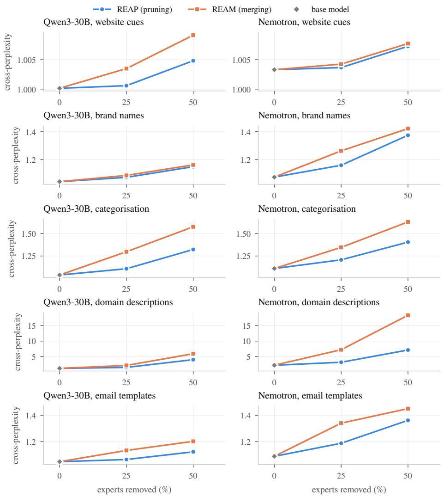  
Figure 8: REAM’s answers are less likely under the base model than $\mathbf { R E A P ^ { \bullet } s }$ in every task. Cross-perplexity (y-axis) against the share of experts removed, one row per task and one column per base model. For the base model the value is its perplexity of its own answers.

## H Calibration

Table 15 describes the calibration set, tokenised with the Qwen3 tokenizer and chat template, as compression saw it.

Table 15: Calibration composition per task. Shares of tokens in system prompts, user messages and answers; share of tokens from English rows; a lower bound on the share of English text (English rows plus the English system prompts of the other rows); distinct system prompts detected as English.
<table><tr><td></td><td></td><td>Tokens</td><td colspan="3">Share of tokens (%)</td><td colspan="3">English (%)</td><td rowspan="2">Sys. pr.</td></tr><tr><td>Task</td><td>Rows</td><td>(k)</td><td>system</td><td>user</td><td>answer</td><td>rows</td><td>tokens</td><td>text ≥</td></tr><tr><td>Website cues</td><td>1,103</td><td>592</td><td>0.2</td><td>94.8</td><td>5.0</td><td>77.9</td><td>74.6</td><td>74.6</td><td>1/1</td></tr><tr><td>Brand names</td><td>272</td><td>593</td><td></td><td>59.4 39.7</td><td>0.9</td><td>18.8</td><td>18.5</td><td>66.7</td><td>2/2</td></tr><tr><td>Categorisation</td><td>1,067</td><td>592</td><td>20.9</td><td>76.6</td><td>2.5</td><td>20.2</td><td>15.1</td><td>31.9</td><td>4/4</td></tr><tr><td>Domain descr.</td><td>3,174</td><td>592</td><td>64.3</td><td>24.3</td><td>11.4</td><td>71.0</td><td>70.0</td><td>88.8</td><td>2/2</td></tr><tr><td>Email templates</td><td>50</td><td>592</td><td>74.6</td><td>1.4</td><td>24.0</td><td>18.0</td><td>17.6</td><td>79.2</td><td>50/50</td></tr><tr><td>All tasks</td><td>5,666</td><td>2,962</td><td>43.9</td><td>47.4</td><td>8.7</td><td>59.8</td><td>39.1</td><td>68.2</td><td>59/59</td></tr></table>

## I Implementation details

Models. Qwen3-30B-A3B-Instruct-2507 and NVIDIA-Nemotron-3.5- Lightning-30B-A3B-BF16, at pinned Hugging Face revisions. Nemotron’s multi-token-prediction layer is not used, so base and compressed models decode the same way.

REAP. llm-compressor 0.15’s REAPPruningModifier, run with the sequential pipeline:

• each MoE layer is calibrated on the outputs of the already compressed layers before it;

• the same number of experts is removed in every MoE layer;

• the router rows of the removed experts are deleted.

REAM port. The original REAM code supports only Qwen-style layers: the MoE block at layer.mlp, gated experts, a softmax router and attention-only decoder layers. Our port re-implements it as an llm-compressor modifier on top of REAP’s calibration code, so it also covers Nemotron: Mamba layers, gateless squared-ReLU experts, a sigmoid router with bias and a shared expert.

The algorithm, per MoE layer:

1. one batched pass computes router logits, gate-weighted outputs and acti vations of every expert on every calibration token;

2. the most salient experts become centres;

3. in order of saliency, each centre takes the most similar unassigned experts, up to a group of C including itself (C = 16 at 25%, 32 at 50%);

4. members are aligned to their centre by Hungarian matching on activation and weight costs and averaged with saliency weights;

5. the router keeps the centres’ rows;

6. the next layer is calibrated on the merged layer’s outputs.

Deliberate deviations from the original code:

• router scores use the model’s own scoring function (sigmoid for Nemotron);

• all experts of a layer are compared on the same sampled tokens;

• saliency is computed from the router’s actual top-k weights;

• the group size counts the centre (REAM’s text reads “up to C unassigned non-centroid experts”);

• grouped routing and multi-GPU calibration are not supported; neither model needs them.

## Validation:

• unit tests check that grouping and the principal-component computations match the original functions;

• a neuron-shufled copy of an expert is aligned back and merges into the original;

• all compressed checkpoints load without missing or unexpected weights.

Determinism. Without deterministic kernels, two REAM runs of the same configuration agreed in only 18 of 48 Qwen3-30B layers. With torch.use\_deterministic\_algorithms(True) two runs are bit-identical, at about 25% extra time, and all runs use it.

## Generation and scoring.

• Serving: vLLM 0.32 with BF16 weights.

• Decoding: greedy for website cues, brand names and categorisation. Each model’s default sampling for domain descriptions and email templates: Qwen3-30B temperature 0.7, top-p 0.8, top-k 20; Nemotron temperature 1.0, top-p 0.95. The seed is derived from the row identifier.

• Structured outputs: brand names and categorisation use the production JSON schemas with structured outputs (XGrammar).

• Length caps: 1,024 answer tokens for the schema-constrained tasks, 32,768 for the others.

• Judging: categorisation and domain descriptions use the production judge with the product’s judge instructions. A cache keyed by row and answer text gives identical answers identical verdicts.

• Email templates: scored with the production rubric library, with rendered checks in headless Chromium.

Hardware and software. 4 × NVIDIA RTX PRO 6000 Blackwell (96 GB); every compression and generation run used one GPU. Python 3.12 throughout, with these stacks:

• compression: llm-compressor 0.15, PyTorch 2.14, Transformers 5.21;

• generation: vLLM 0.32, PyTorch 2.13, Transformers 5.19;

• probe and analysis: PyTorch 2.14, Transformers 5.21.