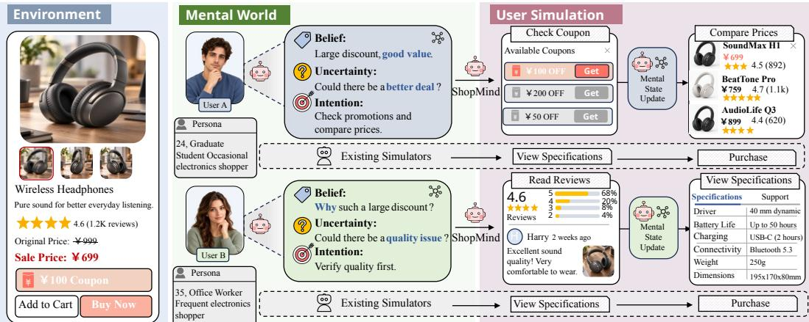
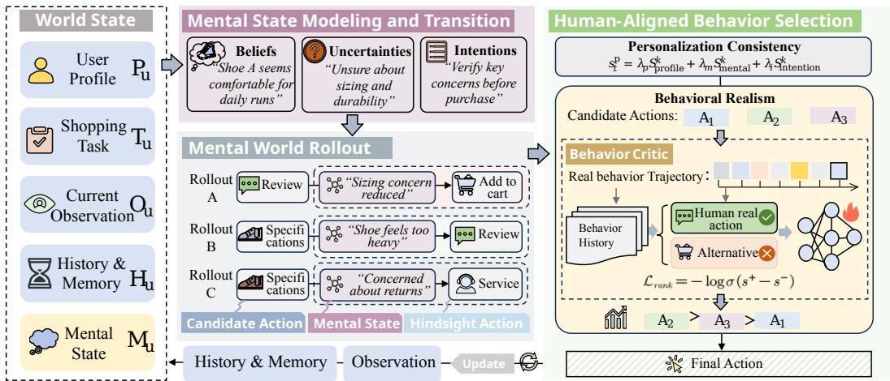
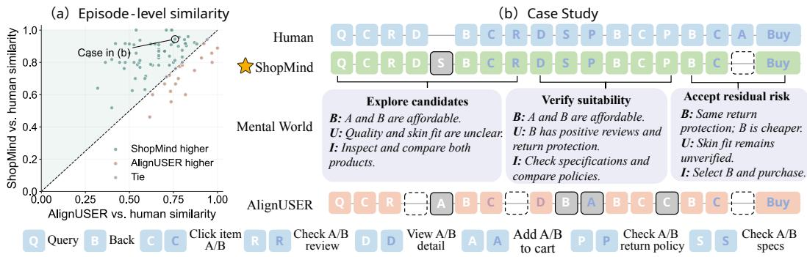
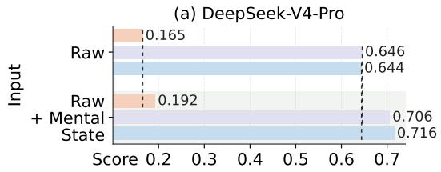
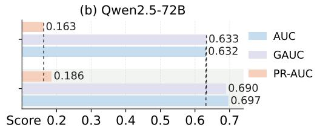

# SHOPMIND: A MENTAL WORLD MODEL FOR PER-SONALIZED AND REALISTIC E-COMMERCE USER SIM-ULATION

Peixuan Hou1, Bin Chen1, Li He2, Jian Xu2, Xiuli Ma1, Guojie Song1∗ 1State Key Laboratory of General Artificial Intelligence, School of Intelligence Science and Technology, Peking University 2Alibaba Group

## ABSTRACT

Large language models are widely used in e-commerce user simulation, providing a foundation for understanding users and predicting human decisions. However, existing simulators still struggle to achieve both personalization and behavioral realism. Most methods predict the next action directly from interaction histories and the current context, without accounting for the evolving mental world that underlies user behavior. Theory of Mind suggests that behavior is driven by mental states, including beliefs, uncertainties, and intentions. Users may interpret the same information in distinct ways, leading to divergent behaviors, while an individual’s mental state evolves through interaction and shapes subsequent actions. Ignoring this process prevents simulators from faithfully capturing individual differences and realistic behavior patterns, and undermines its effectiveness in downstream applications. To address this, we propose ShopMind, a Mental World Model for e-commerce user simulation that captures how consumers interpret shopping information and how their mental states evolve, better reflecting individual users and real-world behavior patterns. We further use behavior–mental state pairs synthesized by ShopMind to train a Mental State Reconstruction (MSR) model, which infers consumers’ latent mental states from observable behavior. Experiments show that ShopMind improves personalization by 18.0% and behavioral realism by 19.6% over the strongest alternatives. Moreover, MSR improves performance on consumption value measurement and CTR prediction, showing the utility of ShopMind for understanding and predicting real user behavior.

## 1 INTRODUCTION

Large language models (LLMs) have shown strong potential for simulating human online shopping behavior (Aher et al., 2023; Argyle et al., 2023; Park et al., 2023; Horton et al., 2024). LLM-based e-commerce user simulation can provide low-cost evaluation environments for recommender systems (Zhang et al., 2025; Huang et al., 2025) and has broader applications in cognitive science and psychology (Binz & Schulz, 2023; Dillion et al., 2023; Lin, 2026). It offers an important foundation for understanding human decision-making and improving behavioral prediction.

Recent studies have increasingly explored LLM-based e-commerce user simulation. Given a user profile, interaction history, and the current shopping context, an e-commerce user simulator predicts the user’s next action. Existing approaches mainly improve simulation quality along two directions: some leverage real shopping trajectories for supervised fine-tuning or reinforcement learning to better align simulated behaviors with real users (Lu et al., 2026; Zhang et al., 2026), while others condition user simulation on personas, preferences, and interaction histories to capture individual behavioral differences (Mansour et al., 2025; Wang et al., 2025; 2026; Ling et al., 2026). However, existing simulators still struggle to achieve both personalized and realistic behavior. A key limitation is that they largely predict the next action from observable signals, without explicitly modeling the evolving mental world of consumers throughout the shopping process. User behavior cannot be fully explained by observable context alone, as decisions are also shaped by how individuals perceive and interpret the information they encounter (Bettman et al., 1998). Theory of Mind provides a natural perspective for this view: Behavior is driven by mental states, including beliefs, intentions, and uncertainties (Premack & Woodruff, 1978). For example, when exposed to the same discounted product, a price-sensitive user may perceive it as a purchase opportunity, whereas a quality-oriented user may interpret the discount as a signal of lower quality and make a different decision. In addition, the same user’s mental state may evolve through browsing, further shaping subsequent behavior. Ignoring the mental world limits both the personalization and realism of simulated behavior and undermines the simulator’s effectiveness for user understanding and behavioral prediction.

  
Figure 1: Illustration of the proposed ShopMind. Users may form different mental states from the same shopping information, leading to different behaviors. By modeling this evolving mental world, ShopMind enables more personalized and realistic user simulation than other approaches.

To address this limitation, we propose ShopMind, a mental world model for e-commerce user simulation. As shown in Figure 1, ShopMind continuously models and updates consumers’ beliefs, uncertainties, and intentions to capture how they interpret shopping information and make decisions, enabling more realistic and personalized simulation. It consists of three core modules: Mental State Modeling and Transition tracks the consumer’s evolving mental state; Mental-World Rollout explores candidate actions by simulating their subsequent mental-state and behavioral trajectories; and Human-Aligned Behavior Selection selects the next action by balancing individual consistency and behavioral realism, with realism assessed by a Behavior Critic trained on real shopping trajectories. The selected action drives the next interaction, which in turn updates both the shopping environment and the consumer’s mental state, yielding shopping trajectories that are both behaviorally plausible and tailored to individual users. Throughout this process, ShopMind continuously aligns evolving mental states with generated behaviors, naturally producing behavior–mental-state pairs that are largely unavailable in real-world interaction logs. We use these synthesized pairs to train a Mental State Reconstruction (MSR) model. While ShopMind generates behavior from mental states, MSR tackles the inverse problem of inferring latent mental states from observed behavior, supporting more accurate user understanding and behavior prediction on real-world data.

Experiments show that ShopMind achieves gains of 18.0% in personalization and 19.6% in behavioral realism over the strongest baselines. Moreover, the mental states reconstructed by MSR improve consumption value measurement and CTR prediction, indicating that the mental-state su pervision produced by ShopMind facilitates the understanding and prediction of real user behavior.

In summary, the main contributions of this work can be summarized as follows:

• We propose ShopMind, a mental world model for e-commerce user simulation. Shop-Mind models consumers’ mental states and their evolution, capturing how users interpret shopping information and make decisions to enable personalized and realistic simulation.

• ShopMind synthesizes shopping trajectories paired with evolving mental states. A Mental State Reconstruction (MSR) model is trained on these data to recover latent mental states from observable behavior, supporting user understanding and behavior prediction.

• Experiments show that ShopMind improves personalization by 18.0% and behavioral realism by 19.6% over the strongest baselines, while MSR-reconstructed mental states significantly improve consumption value measurement and future behavior prediction.

## 2 RELATED WORK

E-commerce User Simulation. LLM-based virtual shoppers have recently emerged as a promising approach to e-commerce user simulation. PAARS constructs persona-conditioned shopper populations from historical data to better match real user distributions (Mansour et al., 2025). Lu et al. (2026) show that supervised fine-tuning on real shopping trajectories improves behavioral fidelity, while Shop-R1 further employs reinforcement learning to align generated actions with human behavior (Zhang et al., 2026). Customer-R1 extends this line toward personalized simulation by incorporating explicit user personas (Wang et al., 2025), and OPeRA and ShopperBench further emphasize persona-aware, multi-step shopping behavior (Wang et al., 2026; Ling et al., 2026). Despite these advances, existing approaches still predict behavior largely from observable signals, with limited consideration of how consumers interpret information and how their mental states evolve over time.

World Model. World models learn environment dynamics to anticipate the outcomes of different actions and support planning (Ha & Schmidhuber, 2018). Representative methods such as PlaNet, Dreamer, and MuZero use learned or imagined future trajectories to guide decision-making (Hafner et al., 2019; 2020; Schrittwieser et al., 2020), but primarily model the external world. Recent work extends this idea to the mental world by explicitly modeling latent human states, including beliefs, goals, and intentions, and how they evolve with observations and actions (Liu et al., 2026a; Fei & Zhao, 2026). Fei & Zhao (2026) further formulate mental world modeling as jointly tracking physical and mental states to better predict human decisions. Building on this perspective, ShopMind brings mental world modeling to e-commerce user simulation by continuously tracking consumers beliefs, uncertainties, and intentions and using their evolution to drive subsequent behavior.

## 3 PROBLEM FORMULATION

We study personalized and realistic user behavior simulation in e-commerce. We formulate the task as follows. For each user u, let $P _ { u }$ denote the user profile capturing relatively stable user characteristics, and $T _ { u }$ the shopping task specifying the goal and constraints of the current episode. At step $t , O _ { t }$ denotes the observable shopping context, while $H _ { t }$ summarizes the interaction history and retrieved memory. The goal is to model a user policy π that generates the next action $A _ { t }$ conditioned on the available context, i.e., $A _ { t } \sim \pi ( \cdot \mid P _ { u } , T _ { u } , O _ { t } , H _ { t } )$ . Rather than directly mapping observable context to actions, ShopMind models user behavior through an evolving mental state $M _ { t } ,$ where $M _ { t } = F _ { \theta } ( P _ { u } , T _ { u } , O _ { t } , { \bf \bar { H } } _ { t } )$ and $A _ { t } \sim \pi _ { \theta } ( \cdot \mid M _ { t } , P _ { u } , T _ { u } , O _ { t } , H _ { t } )$ . Here, $F _ { \theta }$ models mental-state formation and transition, while $M _ { t }$ captures the user’s current beliefs, uncertainties, and intentions. After executing $A _ { t } ,$ , the environment returns a new observation $O _ { t + 1 }$ , which further updates the mental state, forming the sequential process $O _ { t }  M _ { t }  A _ { t }  O _ { t + 1 }  M _ { t + 1 }$

## 4 SHOPMIND: MENTAL WORLD MODEL

Existing methods typically predict user actions from observable shopping context, overlooking the evolving mental state that shapes behavior. ShopMind addresses this limitation by modeling a dynamic mental world that captures the consumer’s internal mental state, and uses it to guide subsequent behavior generation. As shown in Figure 2, the framework consists of three stages: (1) Mental State Modeling and Transition maintains a structured representation of the consumer’s mental state (beliefs, uncertainties, and intentions), and updates it as new information arrives; (2) Mental-World Rollout generates candidate actions and simulates their future environment, mentalstate, and behavioral trajectories; and (3) Human-Aligned Behavior Selection ranks candidates by individual consistency and behavioral realism, combining LLM-based trajectory assessment with a Behavior Critic trained on real consumer trajectories. Together, these stages capture how evolving mental states shape behavior while producing personalized and realistic user behaviors.

## 4.1 MENTAL STATE MODELING AND TRANSITION

Theory of Mind (Premack & Woodruff, 1978) suggests that human behavior depends on internal mental states, such as beliefs, uncertainties, and intentions, which evolve as new information is ac-

  
Figure 2: Overview of the ShopMind framework. The model maintains an evolving mental state, performs mental-world rollouts over candidate behaviors, and selects the final action by jointly considering personalization consistency and behavioral realism through a learned Behavior Critic.

quired. Inspired by this perspective, ShopMind represents the consumer’s mental state in a structured form, making its evolution explicit and consistently trackable throughout the shopping process.

Guided by Theory of Mind, we represent the consumer’s mental state at time step t as

$$
M _ { t } = \left( \boldsymbol { B } _ { t } , \boldsymbol { U } _ { t } , \boldsymbol { I } _ { t } , \boldsymbol { E } _ { t } \right) ,
$$

where $B _ { t }$ summarizes the beliefs formed from observed information, including the user’s understanding and judgments of the shopping context and candidate products; $U _ { t }$ captures unresolved uncertainties that may influence subsequent decisions; $I _ { t }$ specifies the user’s current intention and immediate goal; and $\dot { \boldsymbol E } _ { t }$ stores the supporting evidence for these mental states.

Since the mental state depends on both the current observation and interaction history, ShopMind maintains a memory $H _ { t }$ of decision-relevant past behaviors and observations. The mental state is initialized from the user profile, shopping task, and initial observation, and is subsequently updated using the previous state, interaction memory, and latest action and observation:

$$
M _ { 0 } = F _ { \theta } ^ { \mathrm { i n i t } } ( P _ { u } , T _ { u } , O _ { 0 } ) , \qquad M _ { t + 1 } = F _ { \theta } ( M _ { t } , P _ { u } , T _ { u } , H _ { t } , A _ { t } , O _ { t + 1 } ) .
$$

A key challenge in modeling mental-state dynamics is that users’ mental states do not necessarily change with every behavioral interaction. Treating every low-level action as a mental-state transition would introduce spurious fluctuations and undermine the temporal coherence of the inferred mental trajectory. To address this, ShopMind introduces an update gate that triggers a state transition only when the newly observed information is sufficiently informative to update the current mental state; otherwise, $M _ { t + 1 } = M _ { t }$ . This mechanism preserves stable mental states across behaviorally trivial interactions while allowing meaningful cognitive changes to emerge when new evidence is acquired.

## 4.2 MENTAL WORLD ROLLOUT

Given the mental state, ShopMind first generates a set of candidate actions. However, evaluating candidates only at the current step can be myopic, as actions with similar immediate plausibility may lead to different future trajectories. For example, when a user is comparing two products, both examining the current product further and switching to another candidate may seem reasonable at the current step, yet lead to different trajectories: one may reduce uncertainty and clarify preference, while the other may provide little new information and prolong the comparison. Accordingly, Shop-Mind rolls out each candidate independently, simulating subsequent environment changes, mentalstate transitions, and behaviors, thereby promoting more coherent and realistic decision trajectories.

We define the current decision context as $J _ { t } = ( P _ { u } , T _ { u } , O _ { t } , H _ { t } , M _ { t } )$ , consisting of the user profile, shopping task, current observation, interaction memory, and mental state. Given $J _ { t } ,$ ShopMind generates K candidate actions: $\mathcal { C } _ { t } = \{ a _ { t } ^ { 1 } , \ldots , a _ { t } ^ { K } \}$ . To ensure executability, candidate generation is constrained by the valid action space under the environment state. Each candidate $a _ { t } ^ { k }$ is then rolled out for L steps in an independent copy of the environment, producing an imagined trajectory

$$
\hat { \tau } _ { t } ^ { k } = \left( a _ { t } ^ { k } , \hat { O } _ { t + 1 } ^ { k } , \hat { M } _ { t + 1 } ^ { k } , \dots , \hat { O } _ { t + L } ^ { k } , \hat { M } _ { t + L } ^ { k } \right) .
$$

The rollout jointly simulates how each candidate may reshape the environment and the user’s mental state, allowing the current action to be evaluated through its possible future trajectory.

## 4.3 HUMAN-ALIGNED BEHAVIOR SELECTION

For each candidate trajectory, ShopMind evaluates it along two dimensions: Personalized Consistency and Behavioral Realism. The former assesses alignment with the user’s profile and mental state. Behavioral Realism, in contrast, measures real-world plausibility, distinguishing among individually consistent actions and favoring those that better reflect real-world behavioral patterns.

Personalized Consistency. It considers three aspects of the rollout trajectory: profile alignment $S _ { \mathrm { p r o f i l e } } ^ { k }$ with the user’s characteristics, mental-state coherence $S _ { \mathrm { m e n t a l } } ^ { k }$ throughout the rollout, and intention consistency $S _ { \mathrm { i n t e n t i o n } } ^ { k }$ between the current intention and subsequent behaviors. An LLMbased evaluator scores these dimensions, and the resulting scores are aggregated as

$$
s _ { t } ^ { k , \mathrm { p c } } = \lambda _ { p } S _ { \mathrm { p r o f i l e } } ^ { k } + \lambda _ { m } S _ { \mathrm { m e n t a l } } ^ { k } + \lambda _ { i } S _ { \mathrm { i n t e n t i o n } } ^ { k } ,
$$

to quantify the consistency of the trajectory with the user’s mental state and behavioral tendencies.

Behavioral Realism. Multiple candidate actions may be similarly plausible for a given user, yet differ in behavioral realism. When uncertain about fit, for instance, the user may check the size guide, read reviews, or contact customer service, although these actions vary in how closely they reflect real-world behavioral patterns. Therefore, we train a Behavior Critic on real consumer trajectories to assign each candidate a scalar behavioral plausibility score, indicating how well the action matches real user behavior under the current shopping context: $c _ { t } ^ { k } = C _ { \phi } ( { \breve { H } } _ { t } , O _ { t } , a _ { t } ^ { k } )$ , where $H _ { t }$ and $O _ { t }$ denote the interaction history and observation, respectively. Higher scores indicate greater behavioral realism. The critic is trained with a pairwise ranking objective, encouraging the observed next action $a ^ { + }$ to score higher than an alternative $a ^ { - } \colon C _ { \phi } ( h _ { t } , a ^ { + } ) > C _ { \phi } ( h _ { t } , a ^ { - } )$ . We optimize

$$
\mathcal { L } _ { \mathrm { c r i t i c } } = - \log \sigma \big ( C _ { \phi } ( h _ { t } , a ^ { + } ) - C _ { \phi } ( h _ { t } , a ^ { - } ) \big ) .
$$

For final selection, we rank candidates by personalized consistency $s _ { t } ^ { k , \mathrm { p c } }$ and define the top-two margin as $\Delta _ { t } ~ = ~ s _ { t } ^ { ( 1 ) , \mathrm { p c } } - s _ { t } ^ { ( 2 ) , \mathrm { p c } }$ . If $\Delta _ { t } ~ \geq ~ \tau _ { \mathrm { m a r g i n } }$ , we select the top-ranked candidate unless strongly rejected by the Behavior Critic. Otherwise, candidates with $s _ { t } ^ { k , \mathrm { p c } } \geq \tau _ { \mathrm { c o m p a t } }$ form $\mathcal { C } _ { t } ^ { \mathrm { p c } }$ from which the Behavior Critic selects the most realistic action:

$$
A _ { t } = \arg \operatorname* { m a x } _ { a _ { t } ^ { k } \in \mathcal { C } _ { t } ^ { \mathrm { p c } } } C _ { \phi } ( H _ { t } , O _ { t } , a _ { t } ^ { k } ) .
$$

This design preserves clear user-specific behavioral tendencies while using real consumer behavior to resolve ambiguous choices, balancing personalization and behavioral realism.

## 5 LEARNING MENTAL STATE RECONSTRUCTION FROM SHOPMIND

Beyond behavior simulation, ShopMind provides scalable supervision for reconstructing latent mental states from observed behavior. Real-world e-commerce logs capture user interaction histories, but rarely record how mental states evolve during shopping. These latent states provide a richer representation of users for understanding their values and predicting future behavior, yet obtaining such annotations through surveys or interviews is costly and difficult to scale. ShopMind instead jointly synthesizes behavioral trajectories and aligned mental-state transitions, enabling large-scale behavior–mental-state supervision. After quality filtering, we use these data to train a Mental State Reconstruction (MSR) model that infers latent mental states from real behavioral traces and supports downstream consumer value measurement and behavior prediction.

  
Figure 3: Qualitative comparison of ShopMind and AlignUSER (Bougie et al., 2026b), a strong baseline, on 80 randomly sampled episodes from the Taobao real log dataset. (a) ShopMind shows higher similarity to human trajectories. (b) A case illustrates how mental-world modeling help ShopMind better follow human decision dynamics, while AlignUSER exhibits larger deviations.

## 5.1 DATA CONSTRUCTION

Given the lack of continuous mental-state annotations in real-world logs, we leverage ShopMind to synthesize complete shopping trajectories together with the mental-state sequences that evolve throughout the interaction. Each trajectory starts from the initial shopping context and ends with a purchase or session termination. We organize each trajectory as a single MSR training instance, pairing the complete observable interaction with its aligned mental-state sequence:

$$
\mathcal { D } _ { \mathrm { M S R } } = \left\{ \left( X _ { 1 : T _ { i } } ^ { ( i ) } , M _ { 1 : K _ { i } } ^ { ( i ) } \right) \right\} _ { i = 1 } ^ { N } ,
$$

where $X _ { 1 : T _ { i } } ^ { ( i ) }$ denotes the user profile and interaction trajectory, and $M _ { 1 : K } ^ { ( i ) }$ denotes the corresponding sequence of latent mental states, with each mental state potentially spanning multiple consecutive interactions. To ensure dataset quality, we first perform deterministic checks on purchase outcomes, action execution, and mental-state transitions, followed by an LLM-based evaluation of task fit, decision consistency, state–action consistency, and evidence quality. We further conduct human review to validate trajectory quality. After filtering, the final dataset contains 5K high-quality samples for MSR training. Quality-control results are reported in Appendix C.2.

## 5.2 MENTAL STATE RECONSTRUCTION MODEL

We train a Mental State Reconstruction (MSR) model on the quality-controlled trajectories to recover latent mental-state evolution from observed shopping behavior. Given an observable trajectory $X _ { 1 : T }$ , MSR reconstructs the corresponding mental-state sequence: $\hat { M } _ { 1 : T } = f _ { \theta } ( X _ { 1 : T } )$ , where each $\hat { M } _ { t } = \{ \hat { B } _ { t } , \hat { U } _ { t } , \hat { I } _ { t } \}$ represents the reconstructed beliefs, uncertainties, and intentions at step t. We use Qwen3-8B (Yang et al., 2025a) as the backbone and fine-tune it on the 5K quality-filtered trajectories using supervised fine-tuning (SFT). MSR is formulated as a conditional generation task, producing the same structured mental-state representation as ShopMind. The training objective is

$$
\mathcal { L } _ { \mathrm { M S R } } = - \sum _ { i = 1 } ^ { N } \log p _ { \theta } \left( M _ { 1 : T _ { i } } ^ { ( i ) } \mid X _ { 1 : T _ { i } } ^ { ( i ) } \right) .
$$

This objective enables MSR to reconstruct how latent mental states evolve throughout an observed shopping trajectory. Additional training details are provided in Appendix C.

## 6 EXPERIMENTS

Our experiments focus on two research questions: (1) RQ1: Can ShopMind generate more personalized and realistic shopping behaviors than existing e-commerce user simulators? (2) RQ2: Can MSR trained on ShopMind-synthesized data improve real-user understanding and behavior prediction, demonstrating the real-world transferability of the synthesized mental-state supervision? We further conduct ablation studies to quantify the contribution of each key component.

Table 1: Performance comparison of individual consistency. ShopMind achieves the best performance across all metrics. ⋆, †, and ‡ denote the first-, second-, and third-best results, respectively.
<table><tr><td></td><td></td><td colspan="4">OPeRA</td><td colspan="4">Taobao</td></tr><tr><td>Method</td><td>Method Type</td><td>Ind. JS↓</td><td>Spearman ↑</td><td>Gap Err. ↓</td><td>∆ JS↑</td><td>Ind. JS↓</td><td>Spearman ↑</td><td>Gap Err. ↓</td><td>∆ JS↑</td></tr><tr><td>Zero-shot</td><td>Prompting</td><td>31.02</td><td>0.334</td><td>0.054</td><td>-0.44</td><td>34.28</td><td>0.281</td><td>0.061</td><td>-0.62</td></tr><tr><td>SFT</td><td>SFT</td><td>26.48</td><td>0.330</td><td>0.051</td><td>-1.41</td><td>29.82</td><td>0.308</td><td>0.051</td><td>-1.94</td></tr><tr><td>SFT+Rationale</td><td>SFT</td><td>24.31</td><td>0.363</td><td>0.039</td><td>-2.61</td><td>25.16</td><td>0.337</td><td>0.042</td><td>-0.91</td></tr><tr><td>SimUSER v2</td><td>Agent</td><td>32.24</td><td>0.238</td><td>0.055</td><td>+0.29</td><td>31.82</td><td>0.254</td><td>0.057</td><td>+1.14</td></tr><tr><td>DGDPO</td><td>Agent</td><td>30.22</td><td>0.296</td><td>0.037</td><td>+1.74</td><td>29.74</td><td>0.303</td><td>0.044</td><td>+1.86</td></tr><tr><td>ContextSim</td><td>Agent</td><td>32.04</td><td>0.214</td><td>0.054</td><td>+2.44†</td><td>28.96</td><td>0.319</td><td>0.049</td><td>+2.17</td></tr><tr><td>IToM</td><td>Agent</td><td>30.25</td><td>0.315</td><td>0.054</td><td>+1.25</td><td>27.83</td><td>0.326</td><td>0.047</td><td>+2.35†</td></tr><tr><td>AlignUSER</td><td>Agent</td><td>20.36†</td><td>0.376†</td><td>0.035†</td><td>-0.36</td><td>23.47†</td><td>0.348‡</td><td>0.039†</td><td>+0.18</td></tr><tr><td>Shop-R1</td><td>RL</td><td>22.60‡</td><td>0.368‡</td><td>0.036</td><td>-1.27</td><td>25.72</td><td>0.341</td><td>0.045</td><td>-1.52</td></tr><tr><td>Customer-R1</td><td>RL</td><td>27.46</td><td>0.347</td><td>0.043</td><td>-1.53</td><td>26.41</td><td>0.352†</td><td>0.043</td><td>-0.94</td></tr><tr><td>ShopMind</td><td>Mental World</td><td>17.21*</td><td>0.438*</td><td>0.028 *</td><td></td><td>+4.12 ↑18.63*</td><td>0.421*</td><td>0.031*</td><td>+4.36 7</td></tr></table>

## 6.1 EXPERIMENTAL SETUP

Implementation Details. ShopMind uses DeepSeek-V4-Pro (DeepSeek-AI, 2026) as its backbone, with K = 4 candidates and an L = 2 rollout horizon. The Behavior Critic is initialized from Qwen3-4B (Yang et al., 2025a) and fine-tuned with LoRA using LLaMA-Factory (Zheng et al., 2024) on two NVIDIA A100 80GB GPUs. More details are provided in Appendix A.

Datasets and Models. For RQ1, we evaluate ShopMind on next-action prediction and multi-step trajectory reproduction using OPeRA (Wang et al., 2026), ShopCART (Lu et al., 2026), and Taobao real shopping logs. We compare against representative LLM-based user simulation methods, including SimUSER (Bougie & Watanabe, 2025), DGDPO (Liu et al., 2026b), AlignUSER (Bougie et al., 2026b), IToM (Chen et al., 2026), Shop-R1 (Zhang et al., 2026), ContextSim (Bougie et al., 2026a), and Customer-R1 (Wang et al., 2025) (see Appendix D). For RQ2, we evaluate MSR on two tasks: consumption value measurement and CTR prediction. On B2V-Bench (Hou et al., 2026), we compare against 10 strong LLMs and B2V-Verifier to assess whether mental states improve value measurement. For CTR prediction, we construct a test set from real Taobao logs, using DeepSeek-V4- Pro (DeepSeek-AI, 2026) and Qwen2.5-72B (Yang et al., 2025b) as backbones (see Appendix E).

Evaluation Metrics. RQ1 is evaluated using Individual Action Distribution JS, User-level Spearman ρ, Persona Shuffle ∆, and Group Gap Error for individual consistency; Exact Action Accuracy, Action Type Macro-F1, Top-k Action Accuracy, Non-Terminal Action Accuracy, Purchase F1, and Exit F1 for local behavioral fidelity; and Action Transition JS, Session Length Error, Purchase Rate Error, and Action JS for sequential realism. Jensen–Shannon divergence is used for distributional comparison (Lin, 1991). RQ2 adopts the evaluation protocol of B2V-Bench (Hou et al., 2026) for consumption value measurement, and uses AUC, GAUC, and PR-AUC for CTR prediction.

## 6.2 RQ1: PERSONALIZATION AND BEHAVIORAL REALISM

ShopMind is evaluated along two dimensions: Individual Consistency and Behavioral Realism.   
Behavioral realism is further examined at both local decision and long-horizon trajectory levels.   
Figure 3 qualitatively illustrates closer alignment between ShopMind and human trajectories.

Individual Consistency. We assess individual consistency by comparing simulated behaviors with real user behavior patterns. Given each user’s profile and shopping task, the model generates shopping trajectories, from which these distributions are computed. As shown in Table 1, ShopMind achieves an average 18.0% improvement in personalization, as measured by Individual JS across OPeRA and Taobao. We also perform a persona-shuffle test by randomly permuting user profiles while keeping all other inputs unchanged. ShopMind exhibits the largest ∆JS, indicating a stronger dependence on user-specific information and greater sensitivity to individual differences.

Behavioral Realism. We first evaluate next-action prediction given the user profile, current observation, and interaction history. As shown in Table 2, ShopMind achieves the best performance on most metrics across both datasets. Although some baselines achieve higher F1 on individual terminal actions, their predictions are often biased toward a specific outcome (e.g., Customer-R1 attains high Exit F1 but zero Buy F1). Furthermore, we evaluate behavioral realism over complete shopping sessions. Starting only from the initial user information and environment, each model acts autonomously until termination. Table 3 shows that ShopMind achieves the best performance on all 12 metrics. Using Transition JS as the representative metric of behavioral realism, ShopMind achieves an average relative improvement of 19.6% over the strongest baselines. These results suggest that modeling evolving mental world and future action consequences helps distinguish among plausible actions, improving both local prediction accuracy and long-horizon behavioral realism.

Table 2: Performance comparison of local behavior prediction. ShopMind achieves the best performance on most metrics. ⋆, †, and ‡ denote the first-, second-, and third-best results, respectively.
<table><tr><td></td><td colspan="5">OPeRA</td><td colspan="5">ShopCART</td></tr><tr><td>Method</td><td>Exact Acc. ↑</td><td>Non-Term. Acc. ↑</td><td>Macro F1↑</td><td>Top-3 Acc. ↑</td><td>Buy F1↑</td><td>Exact Acc. ↑</td><td>Macro F1↑</td><td>Top-3 Acc. ↑</td><td>Buy F1↑</td><td>Exit F1↑</td></tr><tr><td>Zero-shot</td><td>6.10</td><td>4.85</td><td>32.50</td><td>8.98</td><td>67.31†|</td><td>6.96</td><td>17.60</td><td>9.23</td><td>36.76</td><td>0.62</td></tr><tr><td>SFT</td><td>29.38</td><td>27.50</td><td>45.45</td><td>42.35</td><td>20.69</td><td>20.83</td><td>40.62</td><td>41.28</td><td>35.46</td><td>33.71</td></tr><tr><td>SFT+Rationale</td><td>33.04</td><td>29.89</td><td>42.32</td><td>46.23</td><td>52.05</td><td>15.14</td><td>39.09</td><td>43.60</td><td>59.70†</td><td>14.25</td></tr><tr><td>SimUSER v2</td><td>5.32</td><td>3.55</td><td>35.81</td><td>12.31</td><td>42.67</td><td>4.26</td><td>27.98</td><td>1.23</td><td>29.51</td><td>1.23</td></tr><tr><td>DGDPO</td><td>5.99</td><td>5.14</td><td>34.33</td><td>9.20</td><td>67.31†</td><td>6.41</td><td>20.72</td><td>10.85</td><td>41.63</td><td>3.17</td></tr><tr><td>ContextSim</td><td>16.19</td><td>12.96</td><td>35.46</td><td>28.49</td><td>42.67</td><td>11.05</td><td>35.79</td><td>35.51</td><td>20.93</td><td>36.45</td></tr><tr><td>IToM</td><td>6.21</td><td>4.70</td><td>31.21</td><td>8.76</td><td>68.63</td><td>7.57</td><td>18.08</td><td>9.49</td><td>37.16</td><td>2.45</td></tr><tr><td>AlignUSER</td><td>35.92</td><td>33.62†</td><td>47.81</td><td>47.89†</td><td>51.85</td><td>22.98</td><td>48.40†</td><td>44.13</td><td>31.37</td><td>58.77†</td></tr><tr><td>Shop-R1</td><td>37.18†</td><td>32.95</td><td>49.26†</td><td>47.31</td><td>52.74</td><td>16.45</td><td>41.49</td><td>44.47†</td><td>60.61 *</td><td>22.83</td></tr><tr><td>Customer-R1</td><td>27.82</td><td>24.63</td><td>18.74</td><td>31.86</td><td>0.00</td><td>28.02†</td><td>15.11</td><td>30.46</td><td>0.00</td><td>94.85 大</td></tr><tr><td>ShopMind</td><td>41.22 *</td><td>37.10 ★</td><td>52.89 *</td><td>60.85 *</td><td>54.23↓|</td><td>31.29 *</td><td>49.14 *</td><td>45.94 *</td><td>58.53</td><td>27.45</td></tr></table>

Table 3: Performance comparison of long-horizon behavioral realism. ShopMind achieves consistent gains across all metrics. ⋆, †, and ‡ denote the first-, second-, and third-best results, respectively.
<table><tr><td></td><td colspan="4">OPeRA</td><td colspan="4">ShopCART</td><td colspan="4">Taobao</td></tr><tr><td>Method</td><td>Trans. JS↓</td><td>Len. Err. ↓</td><td>Buy Err. ↓</td><td>Action JS↓</td><td>Trans. JS↓</td><td>Len. Err. ↓</td><td>Buy Err. ↓</td><td>Action JS↓</td><td>Trans. JS↓</td><td>Len. Err. ↓</td><td>Buy Err. ↓</td><td>Action JS↓</td></tr><tr><td>Zero-shot</td><td>38.06</td><td>7.47</td><td>31.11</td><td>23.53</td><td>51.73</td><td>2.80</td><td>48.18</td><td>31.20</td><td>44.82</td><td>6.95</td><td>27.64</td><td>25.81</td></tr><tr><td>SFT</td><td>18.05</td><td>4.78</td><td>43.33</td><td>14.65</td><td>23.84</td><td>2.64</td><td>6.37</td><td>12.76</td><td>17.83</td><td>4.35</td><td>12.77</td><td>13.26</td></tr><tr><td>SFT+Rationale</td><td>14.45</td><td>5.13</td><td>15.56</td><td>10.84†</td><td>33.05</td><td>4.27</td><td>1.40</td><td>15.30</td><td>20.31</td><td>4.88</td><td>10.42</td><td>13.95</td></tr><tr><td>SimUSER v2</td><td>32.74</td><td>7.21</td><td>12.22</td><td>25.04</td><td>28.07</td><td>3.62</td><td>19.89</td><td>21.78</td><td>29.63</td><td>6.38</td><td>14.21</td><td>22.16</td></tr><tr><td>DGDPO</td><td>39.14</td><td>7.11</td><td>34.44</td><td>22.16</td><td>41.36</td><td>3.18</td><td>31.27</td><td>22.43</td><td>34.88</td><td>6.17</td><td>24.93</td><td>20.42</td></tr><tr><td>ContextSim</td><td>17.56</td><td>7.20</td><td>12.22</td><td>18.32</td><td>20.95</td><td>2.38</td><td>8.40</td><td>11.59</td><td>18.94</td><td>5.22</td><td>9.18</td><td>14.03</td></tr><tr><td>IToM</td><td>37.85</td><td>7.54</td><td>34.44</td><td>21.43</td><td>48.08</td><td>2.78</td><td>43.42</td><td>26.00</td><td>40.26</td><td>6.84</td><td>29.77</td><td>23.65</td></tr><tr><td>AlignUSER</td><td>13.14†</td><td>4.37†</td><td>4.44†</td><td>11.38‡</td><td>19.73†</td><td>2.41</td><td>0.28†</td><td>6.18†</td><td>16.72†</td><td>4.12</td><td>5.36</td><td>12.47</td></tr><tr><td>Shop-R1</td><td>15.82</td><td>5.06</td><td>9.74</td><td>12.63</td><td>32.25</td><td>4.14</td><td>1.68</td><td>13.82</td><td>27.14</td><td>4.56</td><td>3.92†</td><td>11.84†</td></tr><tr><td>Customer-R1</td><td>25.68</td><td>4.61</td><td>14.83</td><td>16.27</td><td>50.66</td><td>2.21†</td><td>9.80</td><td>17.56</td><td>31.77</td><td>3.91†</td><td>7.13</td><td>14.28</td></tr><tr><td>ShopMind</td><td>10.92*</td><td>3.86*</td><td>3.71*</td><td>8.93 * |</td><td>16.84*</td><td>1.98*</td><td>0.21 *</td><td>5.24*|</td><td>12.18*</td><td>3.62*</td><td>2.84*</td><td>9.41 *</td></tr></table>

  
Figure 4: CTR prediction performance with and without MSR-reconstructed mental states. Adding mental states consistently improves AUC, GAUC, and PR-AUC across both models.

## 6.3 RQ2: REAL-WORLD UTILITY OF MSR

We use consumption value measurement to test whether MSR provides a deeper understanding of users, and CTR prediction to assess its utility for subsequent behavior prediction.

Table 4: Consumption value measurement results. Best, second, and third results are marked by ⋆, †, and ‡. MSR-reconstructed mental states provide the strongest gains for value measurement.
<table><tr><td>Type Model</td><td></td><td>NDCG @1↑</td><td>NDCG @2↑</td><td>NDCG @3↑</td><td>Primary Acc. ↑</td><td>Primary Top-2 Acc. ↑</td></tr><tr><td rowspan="9">General LLM</td><td>Claude-Haiku-4 (Anthropic, 2025)</td><td>0.7135</td><td>0.6721</td><td>0.6716</td><td>0.5743</td><td>0.7434</td></tr><tr><td>DeepSeek-V3.2 (DeepSeek-AI et al., 2025)</td><td>0.7211</td><td>0.6967</td><td>0.6917</td><td>0.5613</td><td>0.7565</td></tr><tr><td>Gemini-2.5-Flash (Gemini Team, Google, 2025)</td><td>0.7750</td><td>0.7026</td><td>0.6746</td><td>0.5780</td><td>0.7174</td></tr><tr><td>Gemini-2.5-Pro (Gemini Team, Google, 2025)</td><td>0.5353</td><td>0.5170</td><td>0.5142</td><td>0.4442</td><td>0.5576</td></tr><tr><td>GLM-5 (GLM-5 Team et al., 2026)</td><td>0.7044</td><td>0.6729</td><td>0.6594</td><td>0.5780</td><td>0.7137</td></tr><tr><td>GPT-4o (OpenAI, 2024)</td><td>0.7211</td><td>0.6417</td><td>0.6345</td><td>0.5260</td><td>0.6449</td></tr><tr><td>GPT-5 (OpenAI, 2025)</td><td>0.6858</td><td>0.6873</td><td>0.7052</td><td>0.5483</td><td>0.7590</td></tr><tr><td>Qwen3-235B (Yang et al., 2025a)</td><td>0.7304</td><td>0.6998</td><td>0.6975</td><td>0.5743</td><td>0.7416</td></tr><tr><td>B2V-Verifier Hou et al. (2026)</td><td>0.8236†</td><td>0.8069†</td><td>0.7977†</td><td>0.6518†</td><td>0.8420†</td></tr><tr><td rowspan="3">Task-specific</td><td>B2V + Zero-shot Mental State</td><td>0.7931‡</td><td>0.7662</td><td>0.7849</td><td>0.6123</td><td>0.7943</td></tr><tr><td>B2V + MSR Mental State (Ours)</td><td>0.8474*</td><td>0.8714*</td><td>0.8590*</td><td>0.7868*</td><td>0.9154*</td></tr><tr><td>∆ vs. B2V-Verifier</td><td></td><td>+2.89% +7.99% +7.68%</td><td></td><td>+20.71%</td><td>+8.72%</td></tr></table>

Table 5: Ablation study of ShopMind on Taobao logs across behavioral fidelity and personalization.
<table><tr><td></td><td colspan="3">Local Fidelity</td><td colspan="4">Sequential Realism</td><td colspan="3">Individual Consistency</td></tr><tr><td>Variant</td><td>Exact Acc. ↑</td><td>Macro F1↑</td><td>Top-3 Acc. ↑</td><td>Trans. JS↓</td><td>Len. Err. ↓</td><td>Buy Err. ↓</td><td>Action JS↓</td><td>Indiv. JS↓</td><td>Spearman ρ↑</td><td>∆ JS↑</td></tr><tr><td>ShopMind</td><td>53.58</td><td>59.02</td><td>72.4</td><td>12.18</td><td>3.62</td><td>2.84</td><td>9.41</td><td>18.63</td><td>0.421</td><td>+4.36</td></tr><tr><td>w/o Mental World</td><td>13.27</td><td>38.61</td><td>21.9</td><td>30.84</td><td>6.37</td><td>11.26</td><td>16.92</td><td>28.41</td><td>0.301</td><td>+0.84</td></tr><tr><td>w/o Rollout</td><td>50.84</td><td>56.47</td><td>68.9</td><td>22.63</td><td>5.41</td><td>7.38</td><td>15.27</td><td>20.12</td><td>0.397</td><td>+3.72</td></tr><tr><td>w/o Individual Consistency</td><td>50.96</td><td>55.83</td><td>68.2</td><td>13.86</td><td>3.91</td><td>3.31</td><td>10.24</td><td>29.16</td><td>0.318</td><td>+1.43</td></tr><tr><td>w/o Behavior Critic</td><td>44.72</td><td>49.86</td><td>62.5</td><td>18.41</td><td>4.67</td><td>6.14</td><td>14.38</td><td>20.37</td><td>0.389</td><td>+3.58</td></tr></table>

Consumption Value Measurement. For each real shopping trajectory, MSR reconstructs the latent mental state from observed behavior, which is integrated with the original behavior to predict the user’s consumption value constructs. As shown in Table 4, B2V + MSR Mental State consistently outperforms both general LLMs and B2V-Verifier, with the largest gain on Primary Accuracy. In contrast, B2V + Zero-shot Mental State performs worse than B2V-Verifier, indicating that the gains stem from accurate mental-state reconstruction rather than simply adding inferred mental information, and further validating the effectiveness of the ShopMind-synthesized training data.

CTR Prediction. In this task, reconstructed mental states provide additional user-side signals for predicting subsequent click behavior. As shown in Figure 4, incorporating MSR-reconstructed mental states consistently improves performance across both backbones and all metrics, with full results reported in Appendix E.2. Directly using zero-shot mental states, however, degrades performance relative to the raw-behavior input. This comparison provides stronger evidence that the gains stem from ShopMind-synthesized mental-state supervision rather than from simply adding mental-state descriptions, demonstrating its transferability to real-world behavioral forecasting.

## 6.4 ABLATION STUDY

We ablate each core component of ShopMind to examine its contribution. The ablation results in Table 5 show that each component contributes to a distinct aspect of ShopMind. Removing the Mental World causes the largest degradation, highlighting its central role in maintaining coherent and personalized behavior. Without Rollout, performance declines mainly in sequential realism, suggesting that short-horizon simulation is important for maintaining realistic long-term trajectories. In contrast, ablating Individual Consistency primarily degrades user-level consistency and persona sensitivity, confirming its role in preserving individualized behavioral patterns. The Behavior Critic mainly affects local and sequential realism by filtering behaviorally implausible actions. Overall, all components contribute effectively to ShopMind’s performance. Additionally, the hyperparameter sensitivity analysis in Appendix B shows that ShopMind remains robust across a range of hyperparameter settings, with K = 4 and L = 2 achieving the best overall performance.

## 7 CONCLUSION

In this work, we introduce ShopMind, a Mental World Model for e-commerce user simulation that captures how consumers interpret shopping information and continuously form and update their beliefs, uncertainties, and intentions to drive more personalized and realistic behavior. Using the synthesized behavior–mental-state pairs, we further train a Mental State Reconstruction model that infers latent mental states from observed behaviors for real-user understanding and behavior prediction. Experiments show that ShopMind improves personalization and behavioral realism by 18% and 19.6%, respectively, while MSR-reconstructed mental states further enhance consumption value measurement and future behavior prediction, validating the utility of ShopMind-synthesized mental-state supervision. This work takes a step toward establishing Mental World Models as a general framework for modeling human cognition and behavior, with broader implications for recommender systems, user modeling, and computational cognitive science.

## AI USE STATEMENT

We used generative AI tools to assist with the generation of synthetic behavior–mental-state data and to polish the writing of the manuscript. All AI-assisted data and text were reviewed and verified by the authors. We take full responsibility for the final content of this work.

## ETHICS STATEMENT

This work uses real-world user interaction data that were anonymized and de-identified prior to analysis. No personally identifiable information is included in the data used for our experiments, and all analyses are conducted solely on anonymized behavioral records for research purposes. Accordingly, the study is designed to preserve user privacy and minimize potential privacy risks.

## REPRODUCIBILITY STATEMENT

The code and implementation details for this work are available in our anonymous repository at https://anonymous.4open.science/r/ShopMind-0E94. The main paper describes the model architecture, training procedure, datasets, baselines, and experimental settings, while additional implementation details and hyperparameter configurations are provided in the appendix.

## REFERENCES

Gati V. Aher, Rosa I. Arriaga, and Adam Tauman Kalai. Using large language models to simulate multiple humans and replicate human subject studies. In Proceedings of the 40th International Conference on Machine Learning, volume 202 of Proceedings of Machine Learning Research, pp. 337–371. PMLR, 2023.

Anthropic. Claude haiku 4.5 system card. Anthropic, October 2025. URL https://www-cdn. anthropic.com/7aad69bf12627d42234e01ee7c36305dc2f6a970.pdf.

Lisa P. Argyle, Ethan C. Busby, Nancy Fulda, Joshua R. Gubler, Christopher Rytting, and David Wingate. Out of one, many: Using language models to simulate human samples. Political Analysis, 31(3):337–351, 2023. doi: 10.1017/pan.2023.2.

James R. Bettman, Mary Frances Luce, and John W. Payne. Constructive consumer choice processes. Journal ofConsumer Research, 25(3):187–217, 1998. doi: 10.1086/209535.

Marcel Binz and Eric Schulz. Using cognitive psychology to understand GPT-3. Proceedings of the National Academy ofSciences, 120(6):e2218523120, 2023. doi: 10.1073/pnas.2218523120.

Nicolas Bougie and Narimawa Watanabe. SimUSER: Simulating user behavior with large language models for recommender system evaluation. In Proceedings of the 63rd Annual Meeting of the Association for Computational Linguistics (Volume 6: Industry Track), pp. 43–60, Vienna, Austria, July 2025. Association for Computational Linguistics. doi: 10.18653/v1/2025.acl-industry.5. URL https://aclanthology.org/2025.acl-industry.5/.

Nicolas Bougie, Gian Maria Marconi, Xiaotong Ye, and Narimasa Watanabe. Beyond offline A/B testing: Context-aware agent simulation for recommender system evaluation. arXiv preprint arXiv:2604.09549, 2026a. URL https://arxiv.org/abs/2604.09549.

Nicolas Bougie, Gian Maria Marconi, Xiaotong Ye, and Narimawa Watanabe. AlignUSER: Human-aligned LLM agents via world models for recommender system evaluation. In Proceedings of the 64th Annual Meeting of the Association for Computational Linguistics (Volume 1: Long Papers), pp. 16433–16451, San Diego, California, United States, July 2026b. Association for Computational Linguistics. doi: 10.18653/v1/2026.acl-long.747. URL https: //aclanthology.org/2026.acl-long.747/.

Mengyu Chen, Feiyu Lu, Chun-Fu Chen, Lucas Vinh Tran, and Jay Katukuri. Inverse theory of mind modeling for content recommendation: From web browsing to dynamic intelligent interfaces. arXiv preprint arXiv:2608.11354, 2026. URL https://arxiv.org/abs/2608.11354.

DeepSeek-AI. DeepSeek-V4: Towards highly efficient million-token context intelligence. arXiv preprint arXiv:2606.19348, 2026. URL https://arxiv.org/abs/2606.19348.

DeepSeek-AI, Aixin Liu, Aoxue Mei, Bangcai Lin, Bing Xue, Bingxuan Wang, Bingzheng Xu, Bochao Wu, Bowei Zhang, Chaofan Lin, et al. Deepseek-v3.2: Pushing the frontier of open large language models. arXiv preprint arXiv:2512.02556, 2025. URL https://arxiv.org/abs/ 2512.02556.

Danica Dillion, Niket Tandon, Yuling Gu, and Kurt Gray. Can AI language models replace human participants? Trends in Cognitive Sciences, 27(7):597–600, 2023. doi: 10.1016/j.tics.2023.04. 008.

Hao Fei and Yiran Zhao. Mental world modeling. arXiv preprint arXiv:2607.27201, 2026. URL https://arxiv.org/abs/2607.27201.

Gemini Team, Google. Gemini 2.5: Pushing the frontier with advanced reasoning, multimodality, long context, and next generation agentic capabilities. arXiv preprint arXiv:2507.06261, 2025. URL https://arxiv.org/abs/2507.06261.

GLM-5 Team, Aohan Zeng, Xin Lv, Zhenyu Hou, Zhengxiao Du, Qinkai Zheng, Bin Chen, Da Yin, Chendi Ge, Chengxing Xie, et al. GLM-5: From vibe coding to agentic engineering. arXiv preprint arXiv:2602.15763, 2026. URL https://arxiv.org/abs/2602.15763.

David Ha and Jurgen Schmidhuber. Recurrent world models facilitate policy evolution. In¨ Advances in Neural Information Processing Systems, volume 31, pp. 2451–2463. Curran Associates, Inc., 2018.

Danijar Hafner, Timothy Lillicrap, Ian Fischer, Ruben Villegas, David Ha, Honglak Lee, and James Davidson. Learning latent dynamics for planning from pixels. In Proceedings of the 36th International Conference on Machine Learning, volume 97 of Proceedings of Machine Learning Research, pp. 2555–2565. PMLR, 2019.

Danijar Hafner, Timothy Lillicrap, Jimmy Ba, and Mohammad Norouzi. Dream to control: Learning behaviors by latent imagination. In International Conference on Learning Representations, 2020.

John J. Horton, Apostolos Filippas, and Benjamin S. Manning. Large language models as simulated economic agents: What can we learn from homo silicus? In Proceedings of the 25th ACM Con ference on Economics and Computation, pp. 614–615. Association for Computing Machinery, 2024. doi: 10.1145/3670865.3673513.

Peixuan Hou, Bin Chen, Li He, Jian Xu, Bo Zheng, Xiuli Ma, and Guojie Song. Behavior2Value: Benchmarking and empowering LLMs for consumer value measurement from e-commerce behaviors. arXiv preprint arXiv:2609.18203, 2026. URL https://arxiv.org/abs/2609. 18203.

Xu Huang, Jianxun Lian, Yuxuan Lei, Jing Yao, Defu Lian, and Xing Xie. Recommender AI agent: Integrating large language models for interactive recommendations. ACM Transactions on Information Systems, 43(4):96:1–96:33, 2025. doi: 10.1145/3731446.

Jianhua Lin. Divergence measures based on the shannon entropy. IEEE Transactions on Information Theory, 37(1):145–151, 1991. doi: 10.1109/18.61115.

Zhicheng Lin. Large language models as psychological simulators: A methodological guide. Advances in Methods and Practices in Psychological Science, 9(1), 2026. doi: 10.1177/ 25152459251410153.

Yuan Ling, Chunqing Yuan, Shujing Dong, Yongjian Yang, Nataraj Mocherla, and Ayush Goyal. ShopperBench: A benchmark for personalized shopping with persona-guided simulation. In Proceedings of the 19th Conference of the European Chapter of the Association for Computational Linguistics (Volume 5: Industry Track), pp. 837–846, Rabat, Morocco, March 2026. Association for Computational Linguistics. doi: 10.18653/v1/2026.eacl-industry.62. URL https://aclanthology.org/2026.eacl-industry.62/.

Biyuan Liu, Daigang Xu, Lei Jiang, Wenjun Guo, and Ping Chen. Modeling the mental world for embodied ai: A comprehensive review. arXiv preprint arXiv:2601.02378, 2026a. URL https: //arxiv.org/abs/2601.02378.

Hongyang Liu, Zhu Sun, Tianjun Wei, Yan Wang, Jiajie Zhu, and Xinghua Qu. Diagnostic-guided dynamic profile optimization for LLM-based user simulators in sequential recommendation. In Proceedings of the AAAI Conference on Artificial Intelligence, volume 40, pp. 15306–15314, 2026b. doi: 10.1609/aaai.v40i18.38556.

Yuxuan Lu, Jing Huang, Yan Han, Bingsheng Yao, Sisong Bei, Yaochen Xie, Yisi Sang, Qi He, and Dakuo Wang. Can LLM agents simulate multi-turn human behavior? evidence from real online customer behavior data. In Proceedings ofthe 64th Annual Meeting ofthe Associationfor Computational Linguistics (Volume 1: Long Papers), pp. 43961–43977, San Diego, California, United States, July 2026. Association for Computational Linguistics. doi: 10.18653/v1/2026. acl-long.2034. URL https://aclanthology.org/2026.acl-long.2034/.

Saab Mansour, Leonardo Perelli, Lorenzo Mainetti, George Davidson, and Stefano D’Amato. PAARS: Persona aligned agentic retail shoppers. In Proceedings of the 1st Workshop for Research on Agent Language Models (REALM 2025), pp. 143–159, Vienna, Austria, July 2025. Association for Computational Linguistics. doi: 10.18653/v1/2025.realm-1.11. URL https: //aclanthology.org/2025.realm-1.11/.

OpenAI. GPT-4o system card. OpenAI, August 2024. URL https://openai.com/index/ gpt-4o-system-card/.

OpenAI. GPT-5 system card. OpenAI, August 2025. URL https://openai.com/index/ gpt-5-system-card/.

Joon Sung Park, Joseph C. O’Brien, Carrie Jun Cai, Meredith Ringel Morris, Percy Liang, and Michael S. Bernstein. Generative agents: Interactive simulacra of human behavior. In Proceedings of the 36th Annual ACM Symposium on User Interface Software and Technology, pp. 1–22. Association for Computing Machinery, 2023. doi: 10.1145/3586183.3606763.

David Premack and Guy Woodruff. Does the chimpanzee have a theory of mind? Behavioral and Brain Sciences, 1(4):515–526, 1978. doi: 10.1017/S0140525X00076512.

Julian Schrittwieser, Ioannis Antonoglou, Thomas Hubert, Karen Simonyan, Laurent Sifre, Simon Schmitt, Arthur Guez, Edward Lockhart, Demis Hassabis, Thore Graepel, Timothy Lillicrap, and David Silver. Mastering atari, go, chess and shogi by planning with a learned model. Nature, 588 (7839):604–609, 2020. doi: 10.1038/s41586-020-03051-4.

Ziyi Wang, Yuxuan Lu, Yimeng Zhang, Jing Huang, and Dakuo Wang. Customer-R1: Personalized simulation of human behaviors via RL-based LLM agent in online shopping. arXiv preprint arXiv:2510.07230, 2025. URL https://arxiv.org/abs/2510.07230.

Ziyi Wang, Yuxuan Lu, Wenbo Li, Amirali Amini, Bo Sun, Yakov Bart, Weimin Lyu, Jiri Gesi, Tian Wang, Jing Huang, Yu Su, Upol Ehsan, Malihe Alikhani, Toby Jia-Jun Li, Lydia Chilton, and Dakuo Wang. OPeRA: A dataset of observation, persona, rationale, and action for evaluating LLMs on human online shopping behavior simulation. In Proceedings ofthe 64th Annual Meeting ofthe Associationfor Computational Linguistics (Volume 1: Long Papers), pp. 43942–43960, San Diego, California, United States, July 2026. Association for Computational Linguistics. doi: 10. 18653/v1/2026.acl-long.2033. URL https://aclanthology.org/2026.acl-long. 2033/.

An Yang, Anfeng Li, Baosong Yang, Beichen Zhang, Binyuan Hui, Bo Zheng, Bowen Yu, Chang Gao, Chengen Huang, Chenxu Lv, Chujie Zheng, Dayiheng Liu, et al. Qwen3 technical report. arXiv preprint arXiv:2505.09388, 2025a.

An Yang, Baosong Yang, Beichen Zhang, Binyuan Hui, Bo Zheng, Bowen Yu, Chengyuan Li, Dayiheng Liu, Fei Huang, Haoran Wei, et al. Qwen2.5 Technical Report. arXiv preprint arXiv:2412.15115, 2025b.

Yimeng Zhang, Tian Wang, Jiri Gesi, Ziyi Wang, Yuxuan Lu, Jiacheng Lin, Sinong Zhan, Vianne Gao, Ruochen Jiao, Junze Liu, Kun Qian, Yuxin Tang, Ran Xue, Houyu Zhang, Qingjun Cui, Yufan Guo, and Dakuo Wang. Shop-R1: Rewarding LLMs to simulate human behavior in online shopping via reinforcement learning. In International Conference on Learning Representations, 2026.

Zijian Zhang, Shuchang Liu, Ziru Liu, Rui Zhong, Qingpeng Cai, Xiangyu Zhao, Chunxu Zhang, Qidong Liu, and Peng Jiang. LLM-powered user simulator for recommender system. In Proceedings of the AAAI Conference on Artificial Intelligence, volume 39, pp. 13339–13347, 2025. doi: 10.1609/aaai.v39i12.33456.

Yaowei Zheng, Richong Zhang, Junhao Zhang, Yanhan Ye, and Zheyan Luo. Llamafactory: Unified efficient fine-tuning of 100+ language models. In Proceedings of the 62nd Annual Meeting of the Association for Computational Linguistics (Volume 3: System Demonstrations), pp. 400–410, Bangkok, Thailand, 2024. Association for Computational Linguistics. doi: 10.18653/v1/2024. acl-demos.38.

## APPENDIX

## A SHOPMIND IMPLEMENTATION DETAILS

This section provides additional implementation details of mental world rollout, personalized consistency evaluation, Behavior Critic training, and human-aligned behavior selection.

## A.1 MENTAL WORLD ROLLOUT

At each interaction step, ShopMind first constructs the current decision context $\begin{array} { r l } { J _ { t } } & { { } = } \end{array}$ $\left( P _ { u } , T _ { u } , O _ { t } , H _ { t } , M _ { t } \right)$ and generates K candidate actions $\mathcal { C } _ { t } = \{ a _ { t } ^ { 1 } , \ldots , a _ { t } ^ { K } \}$ . We use $K = 4$ in the default configuration. Candidate generation is constrained by the valid action space of the current environment. Actions requiring an explicit target must refer to an available product, option, or interface element. The candidate set is encouraged to cover different plausible directions of the current decision, such as acquiring additional information, comparing alternatives, progressing toward purchase, or terminating the session when appropriate.

For each candidate $a _ { t } ^ { k }$ , ShopMind creates an independent copy of the current environment and mental state and performs a counterfactual rollout of L steps. We use $L = 2$ by default. The resulting imagined trajectory is

$$
\hat { \tau } _ { t } ^ { k } = \left( a _ { t } ^ { k } , \hat { O } _ { t + 1 } ^ { k } , \hat { M } _ { t + 1 } ^ { k } , \dots , \hat { O } _ { t + L } ^ { k } , \hat { M } _ { t + L } ^ { k } \right) .
$$

At every rollout step, the imagined action first changes the copied environment. ShopMind then applies the same mental-state update mechanism to determine whether the new observation should change the imagined mental state. Subsequent behavior is generated conditioned on the resulting environment and mental state, allowing the initial candidate to be evaluated through the future trajectory it may induce. Candidate rollouts are completely isolated from one another. Environment changes or imagined mental states from one branch cannot modify another branch or the real interaction state. A rollout terminates when the maximum horizon is reached, the simulated environment terminates, or no valid continuation is available. Algorithm 1 summarizes the rollout procedure.

All main experiments use $K = 4$ candidate actions and a rollout horizon of $L = 2$ unless otherwise specified. The sensitivity to K and L is analyzed separately in Appendix B.

Algorithm 1 Mental World Rollout   
Require: Decision context J , candidate number K, rollout horizon L   
1: Generate valid candidates $\mathcal { C } _ { t } = \{ a _ { t } ^ { 1 } , . . . , a _ { t } ^ { K } \}$   
2: for each candidate $a _ { t } ^ { k } \in { \mathcal { C } } _ { t }$ do   
3: Copy the current environment and mental state   
4: Set the first imagined action to $a _ { t } ^ { k }$   
5: for $l = 0 , \ldots , \bar { L ^ { - 1 } }$ do   
6: Execute the imagined action in the copied environment   
7: Obtain the imagined observation $\hat { O } _ { t + l + 1 } ^ { k }$   
8: Apply the mental-state update gate   
9: if a mental-state update is triggered then   
10: Generate $\hat { M } _ { t + l + 1 } ^ { k }$   
11: else   
12: Retain the preceding imagined mental state   
13: end if   
14: if the environment terminates or $l = L - 1$ then   
15: break   
16: end if   
17: Generate the next valid rollout action   
18: end for   
19: end for   
20: return $\{ \hat { \tau } _ { t } ^ { k } \} _ { k = 1 } ^ { K }$

## A.2 PERSONALIZED CONSISTENCY EVALUATION

For each imagined trajectory, ShopMind evaluates whether the resulting behavior remains consistent with the characteristics and current decision state of the specific user. Given

$$
( P _ { u } , T _ { u } , M _ { t } , H _ { t } , \hat { \tau } _ { t } ^ { k } ) ,
$$

an LLM-based evaluator assesses three complementary dimensions: profile alignment, mental-state coherence, and intention consistency.

Profile alignment. $S _ { \mathrm { p r o f i l e } } ^ { k }$ measures whether the imagined trajectory is consistent with the user’s relatively stable characteristics, preferences, and behavioral tendencies. Explicit shopping constraints, such as budget and product requirements, are also considered when judging whether a trajectory is compatible with the user.

Mental-state coherence. $S _ { \mathrm { m e n t a l } } ^ { k }$ measures whether the behaviors and mental-state transitions throughout the rollout remain coherent with the user’s current beliefs and unresolved uncertainties. The evaluator considers whether each simulated transition can be reasonably supported by the information available along the imagined trajectory and whether the resulting mental-state evolution remains internally consistent.

Intention consistency. $S _ { \mathrm { i n t e n t i o n } } ^ { k }$ measures whether the imagined behaviors are consistent with the user’s current high-level intention and whether they meaningfully advance that intention. Since one intention may govern multiple low-level actions, exact action–intention matching is not required. For example, an intention to compare two shortlisted products may be realized through several information-seeking and navigation actions.

The three scores are aggregated as

$$
s _ { t } ^ { k , \mathrm { p c } } = \lambda _ { p } S _ { \mathrm { p r o f i l e } } ^ { k } + \lambda _ { m } S _ { \mathrm { m e n t a l } } ^ { k } + \lambda _ { i } S _ { \mathrm { i n t e n t i o n } } ^ { k } ,
$$

where we set

$$
\lambda _ { p } = 0 . 3 5 , \qquad \lambda _ { m } = 0 . 3 0 , \qquad \lambda _ { i } = 0 . 3 5 .
$$

## A.3 BEHAVIOR CRITIC

Behavioral regularities can differ substantially across e-commerce environments. Different datasets may have different action spaces, interface structures, product exposure mechanisms, session patterns, and population-level action distributions. We therefore train a separate Behavior Critic for each evaluation dataset using its corresponding training interactions.

Specifically, experiments on OPeRA use a Critic trained on OPeRA behavioral trajectories, while ShopCART and Taobao use Critics trained on their respective training data. All dataset-specific Critics share the same backbone, fine-tuning strategy, pairwise training objective, and optimization configuration. No interactions from an evaluation test split are used to train its corresponding Critic.

Training data construction. For each real behavioral context $h _ { t } .$ , the observed next action is treated as the positive example $a ^ { + }$ . We construct alternative actions $a ^ { - }$ under the same interaction prefix so that the Critic learns to distinguish the behavior actually observed in real trajectories from contextually mismatched alternatives. Four types of negative samples are used. The first keeps the observed action type but replaces its target with an incorrect product or SKU. The second uses a different plausible action on the same target. The third involves another product from the same category. The fourth uses a more broadly mismatched random action. Together, these negatives expose the Critic to both hard context-dependent alternatives and easier mismatched behaviors.

For each dataset-specific Critic, we sample 30,000 training contexts, 5,000 validation contexts, and 5,000 test contexts from the corresponding dataset. Each context is paired with one observed positive action and four negative alternatives, yielding 120,000, 20,000, and 20,000 positive–negative pairs for training, validation, and testing, respectively.

Model and training. We instantiate the Behavior Critic with Qwen3-4B-Instruct-2507 and train it as a reward model with a learned scalar value head. LoRA is applied to all target modules with rank 16, scaling factor 32, and dropout 0.05. Each dataset-specific Critic is trained for three epochs with a learning rate of $1 \times 1 0 ^ { - 4 }$ . We use cosine learning-rate scheduling with 100 warmup steps, weight decay of 0.01, and a maximum gradient norm of 1.0. The per-device training batch size is 1 with 16 gradient accumulation steps. Training uses BF16 precision and gradient checkpointing, and the random seed is fixed to 42. Validation is performed after every training epoch.

## A.4 HUMAN-ALIGNED BEHAVIOR SELECTION

ShopMind combines Personalized Consistency and Behavioral Realism through a gated selection strategy. Candidate trajectories are first ranked by their personalized consistency scores $s _ { t } ^ { k , \mathrm { p c } }$ . Let the two highest scores be $s _ { t } ^ { ( 1 ) , \mathrm { p c } }$ and $s _ { t } ^ { ( 2 ) , \mathrm { p c } }$ , with margin $\Delta _ { t } = s _ { t } ^ { ( 1 ) , \mathrm { p c } } - s _ { t } ^ { ( 2 ) , \mathrm { p c } }$ . We set $\tau _ { \mathrm { m a r g i n } } =$ $0 . 1 5 , \tau _ { \mathrm { c o m p a t } } = 0 . 6 0$ , and $\tau _ { \mathrm { c r i t i c } } = 0 . 2 0$ . When $\Delta _ { t } \geq \tau _ { \mathrm { m a r g i n } }$ , the top-ranked candidate indicates a sufficiently clear user-specific preference and is selected unless its Behavior Critic score falls below $\tau _ { \mathrm { c r i t i c } }$ . When $\Delta _ { t } < \tau _ { \mathrm { m a r g i n } }$ , we retain candidates whose personalized consistency scores satisfy $s _ { t } ^ { k , \mathrm { p c } } \geq \tau _ { \mathrm { c o m p a t } }$ , forming

$$
\mathcal { C } _ { t } ^ { \mathrm { p c } } = \left\{ a _ { t } ^ { k } : s _ { t } ^ { k , \mathrm { p c } } \geq \tau _ { \mathrm { c o m p a t } } \right\} .
$$

The Behavior Critic then resolves the ambiguity by selecting

$$
A _ { t } = \arg \operatorname* { m a x } _ { a _ { t } ^ { k } \in \mathcal { C } _ { t } ^ { \mathrm { p c } } } C _ { \phi } ( H _ { t } , O _ { t } , a _ { t } ^ { k } ) .
$$

If no candidate satisfies the compatibility threshold, ShopMind falls back to the candidate with the highest Personalized Consistency score. Purchase and exit actions receive no special preference and follow the same grounding and selection rules as other candidate actions. Algorithm 2 summarizes the complete selection procedure.

This selection mechanism gives priority to clear user-specific tendencies when the Personalized Consistency signal is decisive, while using behavioral patterns learned from real consumer trajectories to resolve ambiguous choices. Personalized Consistency and the Behavior Critic therefore provide complementary signals for preserving personalization and behavioral realism.

Algorithm 2 Human-Aligned Behavior Selection   
Require: Candidate trajectories $\overline { { \mathcal { T } _ { t } } }$   
1: Evaluate $s _ { t } ^ { k , \mathrm { p c } }$ for all $\hat { \tau } _ { t } ^ { k } \in \mathcal { T } _ { t }$   
2: Rank candidates by $s _ { t } ^ { k , \mathrm { \bar { p c } } }$   
3: Let $k _ { 1 }$ and $k _ { 2 }$ denote the top two candidates   
4: $\Delta _ { t }  s _ { t } ^ { k _ { 1 } , \mathrm { p c } } - s _ { t } ^ { k _ { 2 } , \mathrm { p c } }$   
5: Compute $C _ { \phi } ( H _ { t } , O _ { t } , a _ { t } ^ { k } )$ for all candidates   
6: if $\Delta _ { t } \geq \tau _ { \mathrm { m a r g i n } }$ and $C _ { \phi } ( H _ { t } , O _ { t } , a _ { t } ^ { k _ { 1 } } ) \geq \tau _ { \mathrm { c r i t i c } }$ then   
7: return $a _ { t } ^ { k _ { 1 } }$   
8: end if   
9: ${ \mathcal { C } } _ { t } ^ { \mathrm { p c } } \gets \left\{ { a } _ { t } ^ { k } : { s } _ { t } ^ { k , \mathrm { p c } } \geq \tau _ { \mathrm { c o m p a t } } \right\}$   
10: if $\mathcal { C } _ { t } ^ { \mathrm { p c } } = \dot { \emptyset }$ then   
11: return $a _ { t } ^ { k _ { 1 } }$   
12: else   
13: return arg max $C _ { \phi } ( H _ { t } , O _ { t } , a _ { t } ^ { k } )$   
$a _ { t } ^ { k } \in { \mathcal { C } } _ { t } ^ { \mathrm { P } ^ { \sf C } }$   
14: end if

Table 6: Sensitivity of ShopMind to the number of candidate behaviors K on Taobao logs. The rollout horizon is fixed at $\underline { { L = 2 } }$
<table><tr><td></td><td colspan="3">Local Fidelity</td><td colspan="4">Sequential Realism</td><td colspan="3">Individual Consistency</td></tr><tr><td>Candidates K</td><td>Exact Acc. ↑</td><td>Macro F1↑</td><td>Top-3 Acc. ↑</td><td>Trans. JS↓</td><td>Len. Err. ↓</td><td>Buy Err. ↓</td><td>Action JS↓</td><td>Indiv. JS↓</td><td>Spearman ρ↑</td><td> $\Delta$  JS↑</td></tr><tr><td>K = 2</td><td>51.02</td><td>56.74</td><td>69.5</td><td>15.74</td><td>4.23</td><td>4.12</td><td>11.53</td><td>19.74</td><td>0.404</td><td>+3.91</td></tr><tr><td>K = 4</td><td>53.58</td><td>59.02</td><td>72.4</td><td>12.18</td><td>3.62</td><td>2.84</td><td>9.41</td><td>18.63</td><td>0.421</td><td>+4.36</td></tr><tr><td>K = 6</td><td>53.49</td><td>58.93</td><td>72.3</td><td>12.24</td><td>3.65</td><td>2.89</td><td>9.46</td><td>18.69</td><td>0.420</td><td>+4.33</td></tr><tr><td>K = 8</td><td>53.31</td><td>58.79</td><td>72.1</td><td>12.31</td><td>3.69</td><td>2.95</td><td>9.53</td><td>18.77</td><td>0.418</td><td>+4.28</td></tr></table>

## B HYPERPARAMETER SENSITIVITY

We further examine the sensitivity of ShopMind to two key hyperparameters: the number of candidate behaviors K and the rollout horizon L. These hyperparameters control the diversity of candidate actions considered at each decision step and the amount of future evolution used to evaluate each candidate, respectively. Unless otherwise specified, all other settings are fixed to the default configuration used in the main experiments. We report results on the Taobao dataset using the same metrics as in the main evaluation.

## B.1 NUMBER OF CANDIDATE BEHAVIORS

We first vary the number of candidate behaviors K while fixing the rollout horizon at $L = 2 .$ As shown in Table 6, increasing K from 2 to 4 consistently improves performance across the three evaluation dimensions. Increasing the candidate set beyond $K = 4$ provides only marginal changes and slightly degrades several metrics, suggesting that four candidates are sufficient to cover meaningful behavioral alternatives without introducing excessive redundancy. We therefore use K = 4 as the default setting.

## B.2 ROLLOUT HORIZON

We next study the effect of the rollout horizon L while fixing the number of candidate behaviors at $K = 4$ . As shown in Table 7, introducing future rollout substantially improves performance, particularly on trajectory-level metrics. Increasing the horizon from $L \ = \ 0$ to $L \ = \ 2$ steadily improves local fidelity, sequential realism, and individual consistency. Without rollout $( L = 0 )$ candidate selection relies only on the current decision context and performs substantially worse on sequential metrics. Extending the horizon beyond $L = 2$ provides little additional benefit and slightly degrades several metrics. This suggests that short-horizon rollout is sufficient to capture the near-term consequences of candidate behaviors, while longer rollouts may introduce accumulated simulation errors. We therefore use $L = 2$ in all main experiments.

Table 7: Sensitivity of ShopMind to the rollout horizon L on Taobao logs. The number of candidate behaviors is fixed at $K = 4 .$
<table><tr><td rowspan="2">Horizon L</td><td colspan="3">Local Fidelity</td><td colspan="4">Sequential Realism</td><td colspan="3">Individual Consistency</td></tr><tr><td>Exact Acc. ↑</td><td>Macro F1↑</td><td>Top-3 Acc. ↑</td><td>Trans. JS↓</td><td>Len. Err. ↓</td><td>Buy Err. ↓</td><td>Action JS↓</td><td>Indiv. JS↓</td><td>Spearman  $\rho \uparrow$ </td><td>∆ JS↑</td></tr><tr><td> $L = 0$ </td><td>50.84</td><td>56.47</td><td>68.9</td><td>22.63</td><td>5.41</td><td>7.38</td><td>15.27</td><td>20.12</td><td>0.397</td><td>+3.72</td></tr><tr><td> $L = 1$ </td><td>52.31</td><td>57.78</td><td>70.7</td><td>16.37</td><td>4.28</td><td>4.63</td><td>11.76</td><td>19.37</td><td>0.409</td><td>+4.08</td></tr><tr><td> $\mathbf { L } = \mathbf { 2 }$ </td><td>53.58</td><td>59.02</td><td>72.4</td><td>12.18</td><td>3.62</td><td>2.84</td><td>9.41</td><td>18.63</td><td>0.421</td><td>+4.36</td></tr><tr><td> $L = 3$ </td><td>53.44</td><td>58.89</td><td>72.2</td><td>12.36</td><td>3.68</td><td>2.93</td><td>9.54</td><td>18.72</td><td>0.419</td><td>+4.31</td></tr><tr><td> $L = 5$ </td><td>53.12</td><td>58.61</td><td>71.9</td><td>12.81</td><td>3.81</td><td>3.18</td><td>9.87</td><td>18.94</td><td>0.415</td><td>+4.21</td></tr></table>

## C MENTAL STATE RECONSTRUCTION DETAILS

ShopMind jointly generates behavioral trajectories and the latent mental-state evolution underlying these behaviors. These aligned trajectories provide supervision for Mental State Reconstruction (MSR), which learns to recover consumers’ latent beliefs, uncertainties, and intentions from observed shopping behavior. This section describes the construction and quality control of the MSR training data, the supervision format, and the model training configuration.

## C.1 TRAINING DATA CONSTRUCTION

Each MSR training instance contains a task instruction, a complete behavioral trajectory, and its aligned mental-state sequence. The instruction specifies the reconstruction objective, valid shopping stages, and structured output format. Given a trajectory $H _ { 1 : T } = ( A _ { 1 } , O _ { 1 } , \dots , \bar { \cdot } A _ { T } , O _ { T } )$ , MSR learns to reconstruct the corresponding mental-state sequence $\mathcal { M } _ { 1 : K } = ( M _ { 1 } , \dots , M _ { K } )$ . Importantly, K need not equal T. Multiple consecutive low-level actions may share the same latent mental state, while a new state is introduced only when the trajectory exhibits a meaningful cognitive transition.

The input behavior history is a natural-language representation of the complete shopping trajectory. It preserves decision-relevant interactions such as search queries, product views, review inspection, specification checking, option selection, cart operations, and purchase-related behaviors, together with relevant product, price, and attribute information. Low-level logging fields that do not contribute to reconstructing the consumer’s decision process are removed. This representation allows MSR to operate on behavioral information that can also be obtained from real e-commerce logs without depending on platform-specific event identifiers.

## C.2 QUALITY CONTROL

Synthetic mental states may contain inconsistencies even when the generated behavior itself appears plausible. We therefore apply a multi-stage quality control pipeline before using a trajectory for MSR training. The procedure combines deterministic validation, LLM-based semantic evaluation, and human review.

We first apply rule-based checks to verify the structural validity of each trajectory along three dimensions. First, the terminal outcome must be internally consistent: the episode must contain a nonempty behavior sequence and terminate with a valid purchase or exit action. For purchase episodes, the purchased product must also be identifiable. Second, when candidate planning records are available, the selected candidate must match the action actually executed in the environment. Third, mental-state transitions must remain consistent with the update gate: recorded transitions must align with the behavior trajectory, and the mental state cannot change when the update gate is closed. Any trajectory violating these deterministic constraints is rejected before semantic evaluation. Trajectories passing deterministic validation are further evaluated by an LLM-based quality judge along four dimensions: task fit, decision consistency, state–action consistency, and evidence quality. Task fit evaluates whether the final decision is compatible with the shopping task. Decision consistency assesses whether the purchased product is coherent with the beliefs, uncertainties, and preferences formed before purchase. State–action consistency examines whether the evolving intentions and mental states can reasonably explain subsequent user actions. Evidence quality evaluates whether mental-state judgments are grounded in information that has actually been observed rather than unsupported, future, or counterfactual evidence. The four dimensions contribute 30, 30, 25, and 15 points, respectively, giving a maximum quality score of 100:

Table 8: Quality-control statistics for MSR training data. Acceptance at each stage is computed relative to its input.
<table><tr><td>Stage</td><td>Input</td><td>Accepted</td><td>Acceptance</td></tr><tr><td>Generated purchase trajectories</td><td>7,200</td><td>7,200</td><td>100.0%</td></tr><tr><td>Deterministic checks</td><td>7,200</td><td>6,550</td><td>91.0%</td></tr><tr><td>LLM quality evaluation</td><td>6,550</td><td>5,100</td><td>77.9%</td></tr><tr><td>Human review and final filtering</td><td>5,100</td><td>5,000</td><td>98.0%</td></tr><tr><td>Final MSR training set</td><td></td><td>5,000</td><td>69.4%†</td></tr></table>

† Overall retention relative to the initially generated purchase trajectories.

$$
S _ { \mathrm { q u a l i t y } } = S _ { \mathrm { t a s k } } + S _ { \mathrm { d e c i s i o n } } + S _ { \mathrm { s t a t e - a c t i o n } } + S _ { \mathrm { e v i d e n c e } } .
$$

A trajectory passes the score-based criterion when

$$
S _ { \mathrm { q u a l i t y } } \geq 7 0 .
$$

In addition to the numerical score, several severe semantic inconsistencies are treated as hard fail ures. These include an unexplained conflict between the final purchase and the preceding mental state, a purchase immediately following an incompatible intention, unsupported information appearing in the mental trajectory, and leakage of evidence from unselected counterfactual rollouts. A trajectory with any such hard failure is rejected regardless of its aggregate score.

We further conduct human review on all trajectories that pass the automatic filtering stages. Human annotators examine whether the reconstructed beliefs are supported by the observed trajectory, whether unresolved uncertainties evolve plausibly, whether intentions explain subsequent behaviors, and whether mental-state transitions occur at meaningful decision boundaries.

Table 8 summarizes the quality-control statistics. Starting from approximately 7,200 successfully generated purchase trajectories, deterministic validation retains 6,550, and LLM-based evaluation further retains 5,100. All 5,100 LLM-accepted trajectories are then manually reviewed. After human validation, 5,000 trajectories are retained as the final high-quality MSR training corpus.

## C.3 MODEL TRAINING

We initialize MSR from Qwen3-8B and fine-tune it using LoRA on the 5,000 quality-checked behavior–mental-state trajectories. Training is distributed across 16 GPUs for 2,000 optimization steps. The per-device batch size is 2, and gradients are accumulated over 8 steps. We use BF16 precision and a learning rate of $5 \times 1 0 ^ { - 5 }$

## D COMPARISON METHODS AND EXPERIMENTAL SETUP

This section describes the implementation of the comparison methods and the experimental protocols used to evaluate behavioral realism and individual consistency. All methods are evaluated under the same environment interface, data preprocessing pipeline, and structured action space whenever applicable.

## D.1 DATASETS AND EVALUATION SPLITS

We evaluate behavior simulation on OPeRA, ShopCART, and an in-house Taobao interaction dataset. For local behavioral fidelity and sequential realism, we follow the official train–test splits of

Table 9: Dataset statistics used in the behavior simulation experiments.
<table><tr><td>Dataset</td><td>Sessions</td><td>Train</td><td>Test</td><td>Eval. Steps</td></tr><tr><td>OPeRA</td><td>527</td><td>437</td><td>90</td><td>902</td></tr><tr><td>ShopCART</td><td>31,865</td><td>31,508</td><td>357</td><td>1,149</td></tr><tr><td>Taobao</td><td>10,000</td><td>8,000</td><td>2,000</td><td>17,436</td></tr></table>

OPeRA and ShopCART and construct a user-disjoint split for Taobao. The first interaction of each test session is provided as observed context, and evaluation starts from the second action. Dataset statistics are summarized in Table 9.

OPeRA contains 527 filtered sessions, including 437 training sessions and 90 test sessions. The test split contains 992 recorded actions, resulting in 902 evaluated next-action decisions after excluding the first action of each session. ShopCART contains 31,865 sessions, including 31,508 training sessions and 357 test sessions. Its test split contains 1,506 actions and yields 1,149 evaluated decisions. The Taobao dataset contains 10,000 shopping sessions, with 8,000 used for training and 2,000 for testing. The test split contains 19,436 actions, yielding 17,436 evaluated decisions.

Individual consistency additionally requires multiple sessions associated with the same user. OPeRA provides stable cross-session user identities and is therefore used for this evaluation. ShopCART does not provide sufficiently stable cross-session user or persona identifiers and is excluded from the individual-consistency experiment.

## D.2 UNIFIED INPUT AND ACTION INTERFACE

The comparison methods are adapted to a common interaction interface. The primary backbone used in the comparison study is Qwen2.5-7B-Instruct, with a maximum context budget of 32,768 tokens including the generated output. At each decision step, the model input may contain the method-specific system instruction, user profile or method-specific memory, preceding actions and associated rationales when required by the method, and the current webpage. Historical webpages are not additionally concatenated (history obs=0); behavioral history is represented through the recorded action sequence and method-specific memory. Webpages are cleaned and compressed using the same preprocessing pipeline before being passed to the model. When the complete context exceeds the token budget, method-specific history is truncated while preserving the current observation. All methods produce actions in the same structured environment space. A click action specifies the target element name, an input action specifies both the target element and input text, and terminate ends the current session. Evaluation uses strict matching: click predictions must match the target element name, input predictions must match both the element and entered text, and termination actions are matched by action type.

## D.3 BASELINE IMPLEMENTATIONS

We compare ShopMind with zero-shot prompting, supervised fine-tuning, reasoning- and reinforcement-learning-based methods, and existing user simulators. For each baseline, we use the backbone model reported in the original work and preserve its core training or inference procedure whenever applicable. All methods are evaluated on the same three datasets using identical webpage preprocessing, context budgets, and a unified action interface. Unless otherwise specified, stochastic decoding uses temperature 0.7.

Zero-shot. The original backbone model directly predicts the next valid shopping action from the user context, interaction history, and current webpage without task-specific training.

SFT and SFT+Rationale. Both methods are trained separately on the training split of each evaluation dataset. SFT directly predicts the target action, while SFT+Rationale first generates a behavioral rationale and then predicts the action. We use the same optimization settings across datasets, with a global batch size of 64 and a learning rate of $2 \times 1 0 ^ { - 5 }$ . For individual-consistency evaluation, training is restricted to temporally preceding sessions to avoid future information leakage.

Table 10: CTR prediction results on real-world Taobao interaction logs. Best results within each backbone are highlighted in bold.
<table><tr><td>Backbone</td><td>Input</td><td>AUC↑</td><td>GAUC ↑</td><td>PR-AUC ↑</td></tr><tr><td rowspan="3">DeepSeek-V4-Pro</td><td>Raw</td><td>0.6441</td><td>0.6456</td><td>0.1653</td></tr><tr><td>Raw + Zero-shot Mental State</td><td>0.6081</td><td>0.6090</td><td>0.1597</td></tr><tr><td>Raw + MSR Mental State</td><td>0.7156</td><td>0.7057</td><td>0.1924</td></tr><tr><td rowspan="3">Qwen2.5-72B</td><td>Raw</td><td>0.6317</td><td>0.6332</td><td>0.1628</td></tr><tr><td>Raw + Zero-shot Mental State</td><td>0.5964</td><td>0.5981</td><td>0.1491</td></tr><tr><td>Raw + MSR Mental State</td><td>0.6968</td><td>0.6895</td><td>0.1857</td></tr></table>

Shop-R1 and Customer-R1. We follow the reinforcement-learning procedures of the original methods and initialize them from the corresponding supervised checkpoint. Shop-R1 uses its hierarchical action reward with self-certainty, whereas Customer-R1 adopts a difficulty-weighted action reward. We use learning rates of $1 \times 1 0 ^ { - 7 }$ and $5 \times 1 0 ^ { - 7 }$ , respectively, with a KL coefficient of 0.001 and 64 sampled completions per update.

AlignUSER. We adapt AlignUSER following its two-stage training procedure, combining worldmodel learning with behavior cloning and counterfactual reflection. The method is trained separately on the available training data of each evaluation dataset, with two epochs per stage and a learning rate of $1 \times 1 0 ^ { - 5 }$

ContextSim. We implement the policy variant of ContextSim using LoRA with rank 8, scaling factor 16, and dropout 0.05. Models are trained separately on the three evaluation datasets for five epochs with a learning rate of $1 \times 1 0 ^ { - 5 }$ . For individual-consistency evaluation, only temporally preceding training data are used. At inference time, the reasoning-action variant uses temperature 1.0 and top- $p = 0 . 9 5$

SimUSER, DGDPO, and IToM. We use project-adapted implementations while preserving their method-specific prompting, state modeling, and decision procedures. Each method is applied consistently across the three evaluation datasets, and its outputs are normalized to the shared action representation for fair comparison.

## E DOWNSTREAM TASK IMPLEMENTATION DETAILS

## E.1 CONSUMPTION VALUE MEASUREMENT

We consider two variants that differ only in how the mental-state sequence is obtained.

B2V+MSR Mental State. For this variant, the mental-state sequence is reconstructed using the trained MSR model:

$$
\begin{array} { r } { \hat { \mathcal { M } } ^ { \mathrm { M S R } } = \mathrm { M S R } ( H ) . } \end{array}
$$

The reconstructed beliefs, uncertainties, and intentions are concatenated with the corresponding behavior trajectory and paired with the B2V-Bench value annotation. These augmented training instances are then used to fine-tune Qwen3-8B with LoRA for consumption value prediction. The model is trained for 1,500 optimization steps on 16 GPUs. We use a per-device batch size of 1, gradient accumulation over 4 steps, BF16 precision, and a learning rate of $5 \times 1 0 ^ { - 5 }$

B2V+Zero-shot Mental State. To isolate the benefit of MSR from the general benefit of explicitly providing mental-state information, we construct a second variant using zero-shot mental-state reconstruction. Instead of MSR, the original Qwen3-8B model directly reconstructs the mental-state sequence from the behavior trajectory without task-specific MSR fine-tuning:

$$
\begin{array} { r } { \hat { \mathcal { M } } ^ { \mathrm { Z S } } = \mathrm { Q w e n 3 - } \mathcal { 8 } \mathrm { B } _ { \mathrm { z e r o - s h o t } } ( H ) . } \end{array}
$$

The reconstructed mental states are concatenated with the same behavioral trajectory and paired with the same value labels:

$$
[ H ; \hat { \mathcal { M } } ^ { \mathrm { Z S } } ] \longrightarrow V .
$$

We then fine-tune another Qwen3-8B value prediction model using the same LoRA training setup as B2V+MSR Mental. This controlled comparison keeps the downstream value predictor, behavioral input, value supervision, and optimization configuration fixed, while changing only the source of the reconstructed mental states. It therefore directly evaluates whether mental states reconstructed by MSR provide more useful representations for consumption value measurement than those obtained from a general-purpose LLM in a zero-shot setting.

## E.2 CTR PREDICTION

Dataset construction. We construct the CTR dataset from real-world Taobao interaction logs. For each shopping session, we randomly select a product-click event after the first interaction as the prediction point, ensuring that a nonempty behavioral history is available.

Let $t _ { c }$ denote the cutoff time of the selected click. The model observes only interactions before this point, i.e., $H _ { < t _ { c } } = ( A _ { t } , O _ { t } ) : t < t _ { c }$ . The click at $t _ { c }$ and all subsequent interactions are excluded, preventing future-information leakage. The product clicked at $t _ { c }$ serves as the positive candidate. Negative candidates are drawn from two sources: (1) other products appearing in the same session, excluding the positive item, and (2) products from the same second-level category that do not appear in the session, with at most four category-matched negatives per prediction point. All candidates for the same prediction point therefore share an identical behavioral history and differ only in candidateproduct information and click labels. Each candidate is represented by its title, price, category, and shop information. A prediction instance is defined as

$$
\begin{array} { r } { x _ { u , j } = ( H _ { < t _ { c } } , q _ { j } ) , \qquad y _ { u , j } \in \{ 0 , 1 \} , } \end{array}
$$

where $q _ { j }$ denotes the candidate product and $y _ { u , j } = 1$ only for the product clicked at $t _ { c }$ . The behavioral history preserves decision-relevant information, including product names, prices, shops, and interaction types, while the click label is used only as supervision and never exposed to the model input.

Mental-state augmentation. We use the same controlled construction as in the consumption value measurement experiment. Starting from the same truncated behavior history, we construct two mental-state-augmented variants that differ only in how the mental states are reconstructed.

For the zero-shot variant, we directly prompt the original Qwen3-8B model, without MSR-specific fine-tuning, to reconstruct the mental-state trajectory:

$$
\begin{array} { r } { \hat { \mathcal { M } } _ { < t _ { c } } ^ { \mathrm { Z S } } = \mathrm { Q w e n 3 - } 8 \mathrm { B } _ { \mathrm { z e r o - s h o t } } ( H _ { < t _ { c } } ) . } \end{array}
$$

For the MSR variant, we use the trained Mental State Reconstruction model:

$$
\begin{array} { r } { \hat { \mathcal { M } } _ { < t _ { c } } ^ { \mathrm { M S R } } = \mathrm { M S R } ( H _ { < t _ { c } } ) . } \end{array}
$$

Both reconstruction methods follow the same mental-state schema, describing the evolution of shopping stage, beliefs, uncertainties, and intentions before the prediction point. The resulting mentalstate sequence is concatenated with the original behavioral history.

We therefore evaluate three input conditions:

$$
\begin{array} { r l } { \mathrm { R a w : ~ } } & { H _ { < t _ { c } } , } \\ { \mathrm { R a w : ~ } } & { [ H _ { < t _ { c } } , \backslash ] } \\ { \mathrm { R a w : ~ } } & { [ H _ { < t _ { c } } , \backslash ] \mathrm { ~ } \dot { \mathrm { M e n t a l ~ S t a t e : } } \quad [ H _ { < t _ { c } } ; \hat { \mathcal { M } } _ { < t _ { c } } ^ { \mathrm { Z S } } ] , } \\ { \mathrm { R a w + M S R ~ M e n t a l ~ S t a t e : } \quad [ H _ { < t _ { c } } ; \hat { \mathcal { M } } _ { < t _ { c } } ^ { \mathrm { M S R } } ] . } \end{array}
$$

The three conditions use exactly the same behavioral histories, candidate products, and click labels. Thus, the comparison isolates both the incremental value of explicit mental-state information and the quality of the mental-state reconstruction. In particular, “Zero-shot Mental State” refers to zero-shot mental-state reconstruction, rather than zero-shot CTR prediction.

Results. Table 10 reports the CTR prediction results. Adding zero-shot reconstructed mental states does not improve the Raw baseline, indicating that additional mental-state text alone is insufficient. In contrast, MSR-reconstructed mental states consistently improve all three ranking metrics for both prediction backbones.