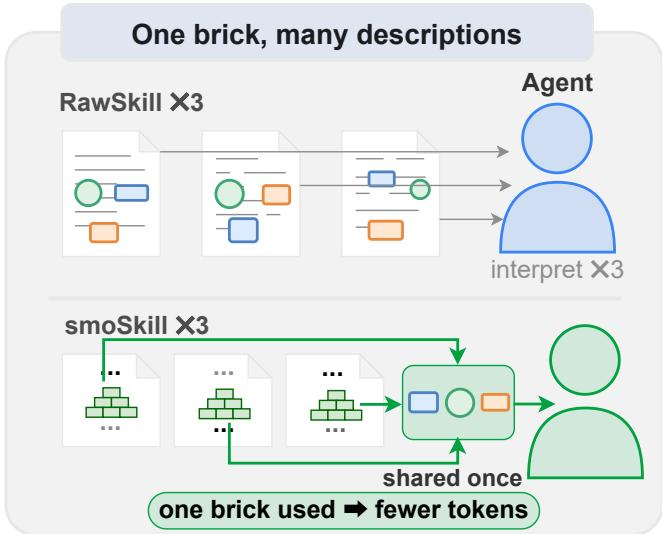
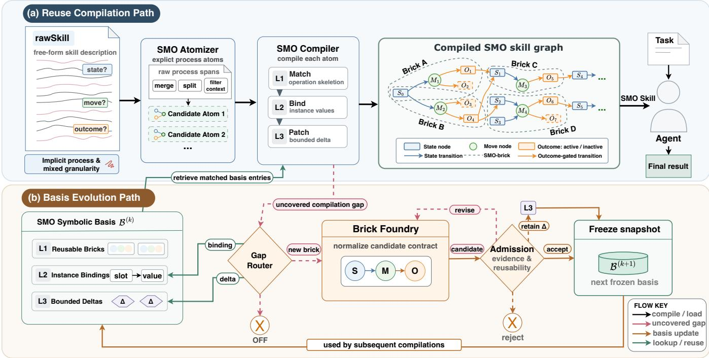
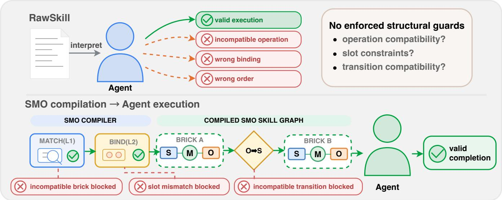

# SMO: Compiling Natural Language Skills into Graphs of Reusable State-Move-Outcome Bricks

Chao Chen, Jiashuo Zhang, Yunhang Shen, Liangyu Lian, Rongrong Ji∗

Xiamen University

## Abstract

Large language model agents increasingly rely on reusable natural-language skills, yet growing skill collections remain accumulations of isolated text artifacts that are dificult to compare, deduplicate, and compose. We argue that the reusable content of a skill lies not in its surface wording but in its procedural transitions: which operation to execute under a given state and which observable outcome to produce. Based on this observation, we propose State–Move–Outcome (SMO), a compilation-like framework that decomposes raw skills into reusable procedural bricks and organizes admitted bricks as an externalized symbolic structure. When compiling a skill, SMO first retrieves and composes existing bricks, dynamically connects them through Outcome-to-State conditions, and creates a candidate brick only for an uncovered procedure; the candidate becomes reusable only after validation and admission. Experiments on SkillsBench v1.1 demonstrate that SMO represents 232 rawSkills from 87 underlying tasks with 95 shared bricks, reducing the corresponding skill representations from 366,472 to 149,154 tokens—a 59.3% reduction and 2.46× compression. Across 232 skill-conditioned evaluation instances, SMO raises the average task score from 0.6379 to 0.7478 and increases 5/5 Pass instances from 138 to 164, while matching or outperforming rawSkill on 208 of 232 instances. It also reduces average runtime token consumption by 38.38%. These results show that compiling naturallanguage skills into shared procedural units can jointly improve skill reuse, representation eficiency, and downstream execution.

## Introduction

Large language model (LLM) agents increasingly rely on procedural knowledge stored outside model parameters. Prior work has shown that external language structures can be treated not merely as static prompts, but as programs that can be compiled and optimized against downstream objectives (Khattab et al. 2023). Recent agent systems further induce reusable workflows from interaction histories, distill reasoning strategies from successful and failed trajectories, dynamically organize linked memories, and manage growing skill ecosystems (Wang et al. 2024; Ouyang et al. 2025; Xu et al. 2026; Li et al. 2026a). Benchmarks have accordingly begun to evaluate skills as first-class agent artifacts rather than incidental prompts (Li et al. 2026b). Agent skills are therefore becoming persistent procedural infrastructure that must be represented and maintained at corpus scale.

Most of this infrastructure is still authored and distributed as natural-language instructions or semi-structured SKILL.md packages. SkillsBench, for example, defines a skill package around a natural-language SKILL.md file and associated resources; SkillOpt treats such a document as trainable external state; and AgentSkillOS studies ecosystems containing up to hundreds of thousands of complete skills (Li et al. 2026b; Yang et al. 2026; Li et al. 2026a). This document-centric representation is convenient for authors, but it obscures reusable procedures. As illustrated in Figure 1, several rawSkills may express the same operation in substantially diferent prose, requiring the agent to interpret redundant content repeatedly. A single document may also mix reusable operations with task-specific entities, paths, formats, and explanations. The resulting corpus is dificult to compare, deduplicate, compose, and update systematically.

Existing approaches address adjacent aspects of this problem rather than the corpus-level problem as a whole. (i) Experience-learning methods distill workflows, rules, memories, or hierarchical skills from agent trajectories (Zhao et al. 2024; Peng et al. 2024; Wang et al. 2024; Chen et al. 2024; Ouyang et al. 2025; Xu et al. 2026; Xia et al. 2026; Ding et al. 2026). (ii) Compilation and automated-design methods optimize declarative LM programs, function-call plans, agent modules, workflows, or individual skills (Khattab et al. 2023; Kim et al. 2023; Hu, Lu, and Clune 2025; Zhang et al. 2025; Shang et al. 2025; Yang et al. 2026; Liang et al. 2026; Chen et al. 2026). (iii) Ecosystem-level systems retrieve and orchestrate complete skills, while graph-based tool selectors structure transitions among predefined tools (Li et al. 2026a; Jia and Li 2026). These directions improve acquisition, optimization, discovery, or runtime execution, but they do not establish a shared procedural basis that can reconstruct many independently authored skill documents.

Challenge 1: discovering reusable procedures across heterogeneous descriptions. Surface similarity is insuficient because distinct wording may implement the same transition, while similar wording may hide diferent preconditions, operations, or outcomes. A corpus-level representation must therefore identify equivalence at the level of executable State–Move–Outcome behavior, while separating task-specific values from genuinely new operations.

  
Figure 1: One procedure, many descriptions. Multiple rawSkills may encode the same operation using diferent natural-language expressions, causing repeated interpretation. SMO compiles them into smoSkills that reference one shared admitted brick, reducing duplicated procedural context while retaining task-specific composition.

Challenge 2: reconstructing skills through valid composition. Decomposition alone does not guarantee that the resulting units can be reassembled. A reusable unit must expose when it applies, what it does, and what it establishes; adjacent units can be connected only when the preceding Outcome satisfies the successor State. Small residual diferences must remain bounded, and uncovered procedures must not be silently approximated by incompatible units.

Challenge 3: reducing redundancy without sacrificing utility. Shorter text is not necessarily a better skill representation. Corpus compression must preserve the procedures required for downstream tasks, prevent unvalidated units from contaminating the shared basis, and reduce the context repeatedly loaded during execution. Representation size, task utility, and runtime cost must consequently be evaluated together.

We address these challenges with State–Move–Outcome (SMO), a compilation-like framework for natural-language skill corpora. SMO atomizes each rawSkill into procedural requirements, reconstructs them through L1 brick matching, L2 instance binding, and L3 bounded-delta patching, and assembles the matched bricks into a graph through Outcome-to-State gates. Compilation gaps are classified as bindings, bounded deltas, new-brick candidates, or out-offamily cases; admitted candidates and retained deltas are incorporated into the next frozen symbolic-basis snapshot. On 232 SkillsBench v1.1 skill–task instances, SMO achieves 2.46× representation compression, raises the average task score from 0.6379 to 0.7478, and reduces average runtime token consumption by 38.38%.

Our contributions are:

1. We introduce a State–Move–Outcome representation that separates reusable procedural transitions from taskspecific bindings and bounded diferences.

2. We present a corpus-level compilation procedure that prioritizes brick reuse, constructs skill graphs through Outcome-to-State gates, and admits uncovered procedures only through controlled basis evolution.

3. We demonstrate that shared procedural compilation can improve downstream task utility while reducing both skill-representation size and runtime token consumption.

## Related Work

## Agent Skill Learning and Management

Recent agents convert interaction histories into reusable external knowledge. ExpeL allows agents to extract transferable insights from experience, while Hypothesis, Verification, and Induction develops skills through self-driven interaction and verification (Zhao et al. 2024; Peng et al. 2024). Agent Workflow Memory induces recurring workflows, ReUseIt synthesizes workflows from successful and failed executions, and ReasoningBank distills generalizable reasoning strategies (Wang et al. 2024; Liu et al. 2026; Ouyang et al. 2025). AutoManual maintains structured rules before formulating an instruction manual, A-MEM dynamically links and evolves memory notes, and SkillGen induces an action-centric graph of step-wise skills (Chen et al. 2024; Xu et al. 2026; Ding et al. 2026). SkillRL further constructs a hierarchical skill library that co-evolves with the policy (Xia et al. 2026). These methods primarily learn reusable artifacts from interaction trajectories. SMO instead starts from an existing corpus of independently authored skills and identifies procedural transitions shared across documents.

Other work operates at the skill-document or ecosystem level. SkillOpt optimizes individual natural-language skills, SkillsBench evaluates modular skill packages, and Anything2Skill turns heterogeneous resources into complete structured skill contracts organized in a SkillBank (Yang et al. 2026; Li et al. 2026b; Pan et al. 2026). AgentSkillOS organizes complete skills through a capability tree and DAG pipelines (Li et al. 2026a). These systems establish the value of skill optimization, structuring, evaluation, and orchestration, but retain the complete skill as their principal unit. SMO instead decomposes many skills into a shared procedural basis and represents each skill through bindings and brick composition.

## Compilation and Structured Skill Representation

DSPy establishes a compilation paradigm in which declarative LM programs are optimized against task-level objectives rather than executed as fixed prompts (Khattab et al. 2023). At the agent-system level, ADAS searches over code-defined designs (Hu, Lu, and Clune 2025). AgentSquare searches modular combinations (Shang et al. 2025), while AFlow searches workflow graphs (Zhang et al. 2025). SMO applies this optimization perspective at a diferent representation level: it compiles independently authored natural-language skills into reusable State–Move–Outcome transitions shared across skills.

Recent work also compiles or restructures individual agent programs and skills. LLMCompiler constructs dependencyaware plans for parallel function calling; the Scheduling– Structural–Logical representation converts one skill document into a typed graph; and SkVM compiles skills for portable execution across models and harnesses (Kim et al. 2023; Liang et al. 2026; Chen et al. 2026). AutoTool constructs a directed graph over predefined tools to reduce repeated model inference during tool selection (Jia and Li 2026). These systems structure one program, skill package, or tool set at a time. SMO instead discovers shared procedural units across a skill corpus and composes them only when their Outcome and State conditions are compatible.

## Compression of External Agent Knowledge

Compression of external knowledge must preserve downstream utility rather than merely shorten its surface form. Context-aware Prompt Compression removes less relevant sentences while retaining answer-critical context, CMT compresses documents into memories for continual knowledge learning, and SkillRL abstracts experience into hierarchical skills (Liskavets et al. 2025; Li et al. 2025; Xia et al. 2026). SMO instead compiles an entire skill corpus: repeated procedures are stored once as admitted bricks, task-specific diferences remain in bindings or bounded deltas, and evaluation jointly measures representation tokens, task performance, and runtime consumption.

## Method

State–Move–Outcome (SMO) compiles an independently authored natural-language skill against a frozen symbolic basis. For a rawSkill $s _ { i }$ and basis snapshot $B ^ { ( k ) }$ , the complete compilation relation is

$$
G _ { i } = \mathrm { C o m p i l e } \left( s _ { i } ; \mathcal { B } ^ { ( k ) } \right) = ( C _ { i } , E _ { i } , \theta _ { i } , \Delta _ { i } ) ,\tag{1}
$$

where smoSkill $G _ { i }$ contains selected bricks $C _ { i }$ , topology $E _ { i } ,$ bindings $\theta _ { i } .$ , and bounded adaptations $\Delta _ { i }$ . Atomization defines what must be reconstructed; L1–L3 produce $C _ { i } , \theta _ { i } .$ and $\Delta _ { i } ;$ and Outcome-to-State composition constructs $E _ { i }$

Figure 2 separates reuse compilation from basis evolution. The upper path computes Equation 1; the lower path handles uncovered content. Accepted content afects only later frozen snapshots, never the current compilation.

## From rawSkill to Compiled Components

Frozen basis and brick contract. The snapshot used at round k is $\begin{array} { r c l } { B ^ { ( k ) } } & { = } & { ( B _ { 1 } ^ { ( k ) } , B _ { 2 } ^ { ( k ) } , B _ { 3 } ^ { ( k ) } ) } \end{array}$ The layers contain reusable operation skeletons, binding information, and bounded diferences. An L1 brick $\quad b \quad =$ $( S _ { b } , M _ { b } , O _ { b } , P _ { b } , F _ { b } , \nu _ { b } )$ specifies its State, Move, Outcome, bindable slots, failure boundary, and verifier. State, Move, Outcome, and the failure boundary decide reuse; $P _ { b }$ constrains binding, and $\nu _ { b }$ checks the instantiated result.

Atomization. The Atomizer converts $s _ { i }$ into an ordered set of procedural requirements $R _ { i } = \left( r _ { i , 1 } , \ldots , r _ { i , K _ { i } } \right)$ . It filters non-executable context, merges spans describing one transition, splits independent transitions, and makes supported prerequisites and outcomes explicit. Dependency cues are retained for topology construction. Requirements specify what Equation 1 must cover; they are not automatically admitted as bricks.

L1 matching. For each requirement r, semantic retrieval proposes a small L1 candidate set. A candidate brick b is reusable under a tentative binding θ only if

$$
\begin{array} { r l } & { \mathrm { M a t c h } ( r , b , \theta ) = Q _ { S } ( r , b [ \theta ] ) \land Q _ { M } ( r , b [ \theta ] ) } \\ & { \land Q _ { O } ( r , b [ \theta ] ) \land Q _ { F } ( r , b [ \theta ] ) . } \end{array}\tag{2}
$$

The predicates check State, operation roles, Outcome coverage, and failure boundaries. Similarity narrows retrieval but cannot override a failed check. A matched brick or bounded matched path enters $C _ { i }$

L2 binding and L3 adaptation. L2 maps the slots of selected bricks to values in the current rawSkill. For a typed slot $p ,$ let Dom(p) be its valid domain, and let $p _ { a } ~ \equiv ~ p _ { b }$ denote two occurrences that must share a value. The skilllevel binding $\theta _ { i }$ must satisfy

$$
\begin{array} { c } { { \theta _ { i } ( p ) \in \mathrm { D o m } ( p ) , } } \\ { { p _ { a } \equiv p _ { b } \Longrightarrow \theta _ { i } ( p _ { a } ) = \theta _ { i } ( p _ { b } ) . } } \end{array}\tag{3}
$$

This enforces types, units, roles, and repeated-variable consistency without specializing L1. For example, one sorting brick can bind its field and direction to price and ascending.

When binding is insuficient, L3 may attach a bounded adaptation $\delta _ { i , u }$ to $b _ { u } ,$ such as a local tie-breaking rule. The efective brick is $\tilde { b } _ { i , u } = b _ { u } [ \theta _ { i } ] \oplus \delta _ { i , u }$ , where empty $\delta _ { i , u }$ means no adaptation; nonempty adaptations form $\Delta _ { i }$ . This preserves a shared skeleton while allowing small skill-specific diferences. New branches, aggregations, recovery procedures, and persistent state changes instead become compilation gaps. Every requirement in $R _ { i }$ must be covered by $C _ { i } ,$ instantiated through $\theta _ { i } ,$ and, when needed, adapted through $\Delta _ { i }$ before topology construction.

## Topology Construction and Structural Guards

SMO connects efective bricks by operational dependencies rather than by copied sentence order. For two efective bricks $\tilde { b } _ { i , u }$ and $\tilde { b } _ { i , v }$ , define

$$
\begin{array} { c } { g _ { u v } = \operatorname { S a t } ( O _ { \tilde { b } _ { i , u } } , S _ { \tilde { b } _ { i , v } } ) } \\ { \qquad \wedge \operatorname {  C o n f i c t } ( O _ { \tilde { b } _ { i , u } } , F _ { \tilde { b } _ { i , v } } ) , } \\ { \qquad ( u , v ) \in E _ { i } \Longleftrightarrow g _ { u v } = 1 . } \end{array}\tag{4}
$$

An edge therefore requires a predecessor Outcome that satisfies the successor State without violating its failure boundary. Because the gate follows $\theta _ { i }$ and $\Delta _ { i } ,$ topology reflects the concrete rawSkill. It supports sequences, branches, merges, and parallel subprocedures while exposing missing dependencies.

Before emitting $G _ { i } ,$ the compiler checks that all requirements are covered, selected bricks form a connected executable graph, every branch terminates, and terminal Outcomes cover the requested goal:

$$
\begin{array} { r l } & { \mathrm { V a l i d } ( G _ { i } ) = \mathrm { C o v e r } ( R _ { i } , G _ { i } ) \wedge \mathrm { C o n n e c t } ( G _ { i } ) } \\ & { \qquad \wedge \mathrm { T e r m i n a t e } ( G _ { i } ) \wedge \mathrm { G o a l } ( s _ { i } , G _ { i } ) . } \end{array}\tag{5}
$$

  
Figure 2: Overview of SMO. (a) The reuse path atomizes a rawSkill, reconstructs its requirements through L1 matching, L2 binding, and L3 bounded patching, and assembles a skill graph for Agent execution. (b) Only compilation gaps enter basis evolution. New operations join the next frozen snapshot only after candidate construction and admission; Agent execution does not feed back into SMO.

These checks catch omissions, disconnected nodes, unterminated branches, and incomplete results. They establish structural consistency, not semantic equivalence or guaranteed success.

As Figure 3 illustrates, L1 blocks incompatible operations, L2 blocks invalid bindings, and Outcome-to-State gates block invalid orderings. L3 adaptations cannot bypass these checks.

## Controlled Basis Evolution

The snapshot $B ^ { ( k ) }$ remains immutable. A requirement not assignable to $C _ { i } , \theta _ { i } .$ , or $\Delta _ { i }$ becomes a gap, classified as binding, bounded delta, possible new brick, or out-of-family. Binding and delta routes query frozen layers without writing to them; out-of-family procedures are not absorbed.

For a possible new operation, the Brick Foundry constructs candidate c with a complete contract and graph position. Admission requires completeness, novelty, connectivity, verifiability, and plausible reuse:

$$
\begin{array} { r l } & { \mathrm { A d m i t } ( c ) = A _ { \mathrm { c o m p l e t e } } ( c ) \wedge A _ { \mathrm { n o v e l } } ( c ) \wedge A _ { \mathrm { c o n n e c t } } ( c ) } \\ & { \qquad \wedge A _ { \mathrm { v e r i f y } } ( c ) \wedge A _ { \mathrm { r e u s e } } ( c ) . } \end{array}\tag{6}
$$

Incomplete candidates are revised, local diferences may remain deltas, and unsupported candidates are rejected. ${ \mathrm { A c } } -$ cepted bricks and retained deltas enter the next frozen snapshot $B ^ { ( k + 1 ) }$ without altering $B ^ { ( k ) }$ or current $G _ { i }$ . Thus only compilation gaps evolve the basis; Agent execution does not feed back.

## Execution, Reuse, and Complexity

At runtime, the Agent traverses $E _ { i }$ , checks each bound State, performs the Move, uses $\nu _ { b }$ to confirm the Outcome, and follows an enabled successor. It executes skill-specific $\tilde { b } _ { i , u }$ while contracts in $C _ { i }$ remain shared.

For a loaded set $Q$ of smoSkills, repeated bricks are stored once through $\textstyle U _ { Q } = \bigcup _ { i \in Q } C _ { i }$ . With $L ( \cdot )$ denoting tokenized representation length, raw and compiled loading costs are

$$
\begin{array} { r l } & { C _ { \mathrm { r a w } } ( Q ) = \displaystyle \sum _ { i \in Q } L ( s _ { i } ) , } \\ & { C _ { \mathrm { S M O } } ( Q ) = L ( U _ { Q } ) + \displaystyle \sum _ { i \in Q } L ( ( E _ { i } , \theta _ { i } , \Delta _ { i } ) ) . } \end{array}\tag{7}
$$

The first term stores repeated bricks once; the second preserves skill-specific topology, bindings, and adaptations. Savings combine compact reconstruction with cross-skill deduplication and vanish at the sharing level when no bricks recur.

For complexity, let $T _ { i }$ be the length of $s _ { i } , K _ { i }$ its number of requirements, h the maximum number of retrieved candidates per requirement, and ℓ the maximum tested short-path length. After indexed retrieval, the main costs satisfy

$$
\begin{array} { l l } { { T _ { \mathrm { a t o m } } = { \cal O } ( T _ { i } ) , } } & { { T _ { \mathrm { r e c o n } } = { \cal O } ( K _ { i } h ^ { \ell } ) , } } \\ { { \nonumber } } & { { T _ { \mathrm { g r a p h } } = { \cal O } ( | C _ { i } | ^ { 2 } ) , \quad T _ { \mathrm { r u n } } = { \cal O } ( | C _ { i } | + | E _ { i } | ) . } } \end{array}\tag{8}
$$

Atomization is linear in rawSkill length, bounded path testing dominates reconstruction, topology construction is quadratic

  
Figure 3: Structural guards before Agent execution. L1 matching blocks incompatible operations, L2 binding blocks slot mismatches, and Outcome-to-State gates block incompatible transitions. The guards prune identifiable structural errors but do not guarantee task success.

in selected bricks, and traversal is linear in the compiled graph, excluding model calls and tools. Derivations are deferred to the supplement.

## Experiments

We evaluate whether SMO can compile natural-language skills into a compact shared representation while improving task performance and reducing inference cost. The main study covers 87 SkillsBench tasks and 232 associated skills; a paired diagnostic corpus separately controls for generic structuring. We examine representation compression, reuse, downstream performance, inference tokens, and ablations of structure and sharing.

## Experimental Setup

Dataset and raw skills. We use SkillsBench v1.1 (Li et al. 2026b) at commit a8eefb4: 87 tasks with isolated environments and 232 oficial SKILL.md documents. We compile every document into one smoSkill while preserving its task mapping, yielding 232 skill-conditioned instances over 87 distinct tasks.

Controlled fixture corpus. To separate generic structuring from brick sharing, we construct an internal engineeringdiagnostic corpus with 20 source clusters and 60 primary units. A source cluster groups units derived from the same diagnostic source; a primary unit is the content-preserving item transformed across conditions. Each unit is converted one-to-one into three representations without changing its content or order, yielding 60 paired units per condition and 180 test units in total. The paired design varies the external representation while holding unit content and ordering fixed. These fixtures are used only for this representation-level control and are not drawn from SkillsBench, TerminalWorld, or Anything2Skill’s oficial data.

Baselines and ablations. On SkillsBench, No Skill uses only the task instruction, rawSkill loads the oficial document, and SMO loads its compiled counterpart. Length-Matched Compression controls for text length, while SMO w/o Sharing assigns private bricks to control for cross-skill reuse. All use identical task inputs, executor, and environment.

On the fixture corpus, Raw Control preserves the unstructured source; Structured Contract uses GPT-5.5 to render the same content as a complete standalone contract inspired by Anything2Skill (Pan et al. 2026); and Full SMO uses its already compiled brick decomposition. A local deterministic renderer serializes the SMO objects; it neither discovers nor rewrites bricks and makes no LLM call. Structured Contract controls for generic structuring; it is not a reproduction of Anything2Skill’s taxonomy, SkillBank, retrieval pipeline, or datasets.

Implementation details. Task execution uses the configured model identifier openai/gpt-5.5 with the Codex-ACP agent and reasoning\_effort=high. We use BenchFlow 0.4.0 (commit 7a479e9) in isolated Docker environments. Each skill-conditioned instance is executed independently five times, with identical decoding settings across the compared methods. We retain the task-specific time limits declared by the benchmark configurations rather than imposing a single global timeout.

Representation length is computed from the serialized representation with the same tokenizer implementation pinned in the evaluation code for every condition. It includes only the rawSkill or smoSkill representation, excluding task inputs and execution traces. Runtime token consumption is obtained from execution logs. We first average the five runs of each instance and then report a macro-average over the relevant instances. This metric measures task-execution cost after deployment and excludes the one-time ofline cost of

Table 1: Representation results. Panel (b) compares the two structured conditions over 60 paired units each and normalizes indices to Structured Contract.  
(a) SkillsBench corpus compression
<table><tr><td>Representation Skills Shared bricks</td><td></td><td></td><td>Tokens</td><td>Reduction</td><td>Ratio</td></tr><tr><td>rawSkill</td><td>232</td><td></td><td>366,472</td><td>0.0%</td><td>1.00×</td></tr><tr><td>smoSkill</td><td>232</td><td>95</td><td>149,154</td><td>59.3%</td><td>2.46×</td></tr></table>

(b) Controlled structured-representation comparison
<table><tr><td>Representation</td><td></td><td></td><td>Tok. idx. ↓ Comp. ↑ Byte idx. ↓ Reuse ↑</td></tr><tr><td>Structured Contract</td><td>1.0000</td><td>1.00×</td><td>1.0000</td></tr><tr><td>Full SMO</td><td>.5337</td><td>1.87×</td><td>.4646 95.0%</td></tr></table>

compiling skills with SMO.

Evaluation metrics. For each run, an independent GPT-5.5 judge scores the complete execution trace in [0, 1] under a fixed rubric. The judge provides semantic scores; deterministic programs check format and constraints and aggregate results. On the fixture corpus, a unit is accepted only when its semantic score meets the pre-specified criterion and every deterministic check succeeds; the criterion is fixed across conditions. We average five run-level scores per skillconditioned instance and then macro-average over 232 instances. 5/5 Pass requires all five runs to be fully successful and is therefore not pass@5. Better/Tie/Worse compares instance-level averages.

Representation eficiency is reported through the number of shared bricks, total skill-representation tokens, percentage token reduction, and compression ratio. Token reduction is the percentage decrease from the rawSkill representation to the corresponding smoSkill representation, and the compression ratio divides the rawSkill token count by the smoSkill token count. Runtime eficiency is summarized by the average execution tokens per instance and their percentage decrease relative to rawSkill. These quantities are described directly because they are standard ratios rather than new metrics introduced by SMO.

## Skill Representation Compression and Reuse

Table 1 reports corpus-level representation eficiency. The 232 rawSkills contain 366,472 representation tokens in total. SMO compiles them into 232 corresponding smoSkills using 95 shared bricks, reducing the representation to 149,154 tokens. This amounts to a 59.3% reduction and a 2.46× compression ratio. The comparison measures the token length of functionally corresponding skill representations rather than directly comparing the number of rawSkills with the number of bricks.

Controlled structured baseline. The fixture verifier accepts 36/60 Raw Control units and 60/60 units under both structured conditions. Holding acceptance fixed, Table 1(b) shows that Full SMO reduces the context-token index by 46.63% and serialized bytes by 53.54% relative to Structured Contract, giving 1.87× token compression. Uniquebrick reuse is the fraction of evaluated bricks referenced by at least two distinct source clusters; the 95.0% rate therefore measures cross-cluster sharing.

The 36/60 versus 60/60 acceptance contrast is not used as a downstream task-performance claim; it verifies that the two structured conditions preserve the fixture contracts before their representation sizes are compared. Raw Control is therefore omitted from Table 1(b): comparing its size with accepted representations would confound compression with missing contract content. Token and byte indices are computed from the exact serialized outputs of each condition. The token index measures model-context load, whereas the byte index checks that the observed reduction is not specific to one tokenizer.

The reuse metric is inventory-based rather than invocationweighted: each distinct brick counts once, so one frequently used brick cannot dominate the result. Requiring references from at least two source clusters also excludes repeated use confined to one source. The metric therefore targets the crosssource structural sharing that distinguishes a brick inventory from a collection of independent contracts.

Because the 60 primary units are transformed one-to-one, every Full SMO item has a content-matched Structured Contract counterpart. The 46.63% token reduction is therefore measured over paired representations rather than unrelated corpora or diferent task mixtures. We treat this result as a controlled representation comparison after both conditions meet the same acceptance rule, not as an end-to-end reproduction or task-accuracy comparison with Anything2Skill.

Together with the SkillsBench ablations, the controls isolate three alternatives. Length-Matched Compression tests whether fewer tokens alone sufice; Structured Contract tests whether a complete standalone schema sufices; and SMO without sharing tests whether private structured units sufice. Full SMO is the only condition that combines procedural decomposition with cross-skill sharing.

## Task Performance on SkillsBench

Table 2 compares No Skill, rawSkill, and SMO. Loading the oficial rawSkills raises the average task score from 0.4397 to 0.6379 and increases the number of 5/5 Pass instances from 95 to 138, showing that the oficial skills provide useful task knowledge. SMO further raises the average score to 0.7478 and achieves 5/5 Pass on 164 instances. Relative to rawSkill, this corresponds to an absolute average-score improvement of 0.1099 and a net increase of 26 5/5 Pass instances.

At the instance level, SMO is better than, tied with, or worse than rawSkill on 50, 158, and 24 instances, respectively. Fifty instances move from non-5/5 to 5/5 Pass, whereas 24 move in the opposite direction. Overall, SMO matches or outperforms rawSkill on 208 of 232 instances. The regressions nevertheless show that structured compilation is not lossless for every skill.

## Inference Eficiency

To separate token use from the composition of successful instances, Table 4 partitions the 232 pairs by whether rawSkill and SMO attain 5/5 Pass. SMO reduces average inference tokens in every group: by 32.63% when both methods pass and by 47.88% for SMO-only successes. Thus, its performance improvement is not obtained by spending more inference tokens.

Table 2: Task performance on SkillsBench. B/T/W is relative to rawSkill.
<table><tr><td colspan="2">Method Avg. score ↑ 5/5 Pass ↑</td><td>B/T/W</td></tr><tr><td>No Skill 0.4397</td><td>95/232</td><td></td></tr><tr><td>rawSkill 0.6379</td><td>138/232</td><td>Reference</td></tr><tr><td>SMO 0.7478</td><td>164/232</td><td>50/158/24</td></tr></table>

Table 3: Ablations. Tokens are in thousands (k); 5/5 Pass is a count out of 232.

(a) Task quality
<table><tr><td>Method</td><td>Avg. score ↑ 5/5 ↑</td><td>B/T/W</td></tr><tr><td>rawSkill</td><td>0.6379</td><td>138 Reference</td></tr><tr><td>Length-matched</td><td>0.6025</td><td>129 20/183/29</td></tr><tr><td>SMO w/o sharing</td><td>0.7494</td><td>164 49/160/23</td></tr><tr><td>Full SMO</td><td>0.7478</td><td>16450/158/24</td></tr></table>

(b) Representation and runtime eficiency
<table><tr><td>Method</td><td>Bricks ↓ Repr. k ↓ Save ↑ Run k ↓</td><td></td><td></td><td>Save ↑</td></tr><tr><td>rawSkill</td><td></td><td>366.5</td><td>0.0% 1,296.8</td><td>0.0%</td></tr><tr><td>Length-matched</td><td></td><td>149.2</td><td>59.3%1,207.0</td><td>6.93%</td></tr><tr><td>SMO w/o sharing</td><td>379</td><td>228.3</td><td>37.7%1,190.9</td><td>8.17%</td></tr><tr><td>Full SMO</td><td>95</td><td>149.2</td><td>59.3%799.1</td><td>38.38%</td></tr></table>

Across all pairs, SMO reduces average inference cost from 1,296,830.6 to 799,111.3 tokens per instance, saving 38.38%. It also saves 40.92% on the 24 regressions, showing that eficiency gains and task regressions can coexist; token length alone does not explain a regression, so task performance and runtime cost must be reported jointly.

## Ablation Study

Table 3 isolates representation length, SMO structure, and cross-skill reuse. Despite matching full SMO’s 149,154 tokens, Length-Matched Compression scores 0.6025 with 129 5/5 Pass instances, below rawSkill. Text shortening alone therefore cannot explain SMO’s gains.

The fixture comparison adds a stronger structural control: after both Structured Contract and Full SMO reach 60/60 verifier acceptance, shared bricks still reduce context tokens by 46.63%. This separates SMO’s sharing benefit from generic contract structuring.

Disabling cross-skill sharing increases the representation to 379 private bricks and 228,312 tokens, reducing representation savings from 59.3% to 37.7% and runtime savings from 38.38% to 8.17%. Yet SMO without sharing and full SMO score 0.7494 and 0.7478, respectively, and both attain 5/5 Pass on 164 instances. Brick sharing therefore primarily improves representation and runtime eficiency without an evident aggregate-quality loss.

When a task requires multiple smoSkills, a shared brick is injected once; private copies re-enter the context through each skill. Taken together, the controls show that shorter text alone cannot account for the gains: SMO structure preserves task utility, while cross-skill sharing reduces representation and runtime context.

Table 4: Average inference tokens (thousands) by 5/5 Pass outcome.
<table><tr><td>Outcome group</td><td>n rawSkill</td><td>SMO</td><td>Save ↑</td></tr><tr><td>Both 5/5</td><td>114 1,105.3</td><td>744.7</td><td>32.63%</td></tr><tr><td>Neither 5/5</td><td>44 1,244.9</td><td>784.2</td><td>37.01%</td></tr><tr><td>SMO only</td><td>50 1,420.9</td><td>740.6</td><td>47.88%</td></tr><tr><td>rawSkill only</td><td>24 2,043.2</td><td>1,207.1 40.92%</td><td></td></tr><tr><td>All</td><td>2321,296.8</td><td>799.1 38.38%</td><td></td></tr></table>

The near-equal aggregate scores of full SMO and the nosharing variant support this division of roles, but do not imply strict causal independence: changing context length or ordering may still alter individual executions. These ablations evaluate deployed representations and runtime traces; the separate one-time compilation cost is not included.

## Limitations

Our evaluation has two main limitations. First, it uses a fixed SkillsBench collection, one executor configuration (GPT-5.5 with Codex-ACP), and a GPT-5.5 judge under a fixed rubric. The Structured Contract comparison uses an internal diagnostic fixture corpus rather than Anything2Skill’s oficial data or complete system. Results may not transfer directly to other models, harnesses, or skill collections.

Second, SMO does not improve every instance: 24 instances regress from 5/5 Pass to non-5/5, suggesting that compilation may occasionally omit useful details or alter how instructions are interpreted. Moreover, the reported runtime tokens exclude the one-time ofline compilation cost, so the overall benefit depends on how frequently compiled skills are reused.

## Conclusion

We introduced State–Move–Outcome (SMO), a compilationlike framework that transforms natural-language skills into reusable procedural bricks and dynamically assembles them into executable skill graphs. On SkillsBench v1.1, SMO reduced representation tokens by 59.3%, improved the average task score from 0.6379 to 0.7478, and reduced average runtime token consumption by 38.38%. Ablations indicate that these gains arise from the SMO structure and cross-skill reuse rather than text shortening or standalone structuring alone.

Future work will test additional models and skill collections while strengthening admission and measuring the amortized benefit of reuse.

## References

Chen, L.; Feng, E.; Xia, Y.; and Chen, H. 2026. SkVM: Revisiting Language VM for Skills across Heterogenous LLMs and Harnesses. arXiv preprint arXiv:2604.03088.

Chen, M.; Li, Y.; Yang, Y.; Yu, S.; Lin, B.; and He, X. 2024. AutoManual: Constructing Instruction Manuals by

LLM Agents via Interactive Environmental Learning. Advances in Neural Information Processing Systems, 37: 589– 631.

Ding, R.; Cheng, W.; Shao, M.; and Zhao, C. 2026. SkillGen: Learning Domain Skills for In-Context Sequential Decision Making. In Proceedings ofthe AAAI Conference on Artificial Intelligence, volume 40, 30512–30520.

Hu, S.; Lu, C.; and Clune, J. 2025. Automated design of agentic systems. In International Conference on Learning Representations, volume 2025, 21344–21377.

Jia, J.; and Li, Q. 2026. AutoTool: Eficient Tool Selection for Large Language Model Agents. In Proceedings ofthe AAAI Conference on Artificial Intelligence, volume 40, 31265– 31273.

Khattab, O.; Singhvi, A.; Maheshwari, P.; Zhang, Z.; Santhanam, K.; Vardhamanan, S.; Haq, S.; Sharma, A.; Joshi, T. T.; Moazam, H.; et al. 2023. DSPy: Compiling Declarative Language Model Calls into Self-Improving Pipelines. arXiv preprint arXiv:2310.03714.

Kim, S.; Moon, S.; Tabrizi, R.; Lee, N.; Mahoney, M. W.; Keutzer, K.; and Gholami, A. 2023. An LLM Compiler for Parallel Function Calling. arXiv preprint arXiv:2312.04511.

Li, D.; Sun, Z.; Hu, X.; Hu, B.; and Zhang, M. 2025. CMT: A Memory Compression Method for Continual Knowledge Learning of Large Language Models. In Proceedings of the AAAI Conference on Artificial Intelligence, volume 39, 24413–24421.

Li, H.; Mu, C.; Chen, J.; Ren, S.; Cui, Z.; Zhang, Y.; Bai, L.; and Hu, S. 2026a. Organizing, orchestrating, and benchmarking agent skills at ecosystem scale. arXiv preprint arXiv:2603.02176.

Li, X.; Liu, Y.; Chen, W.; You, B.; Di, Z.; He, Y.; Zheng, S.; Choe, K. W.; Sun, J.; Wang, S.; et al. 2026b. SkillsBench: Benchmarking How Well Agent Skills Work across Diverse Tasks. arXiv preprint arXiv:2602.12670.

Liang, Q.; Wang, H.; Liang, Z.; and Liu, Y. 2026. From skill text to skill structure: The scheduling-structural-logical representation for agent skills. arXiv preprint arXiv:2604.24026.

Liskavets, B.; Ushakov, M.; Roy, S.; Klibanov, M.; Etemad, A.; and Luke, S. K. 2025. Prompt Compression with Context-Aware Sentence Encoding for Fast and Improved LLM Inference. In Proceedings of the AAAI Conference on Artificial Intelligence, volume 39, 24595–24604.

Liu, Y.; Sra, M.; Inala, J. P.; and Wang, C. 2026. ReUseIt: Synthesizing Reusable AI Agent Workflows for Web Automation. In Proceedings of the 31st International Conference on Intelligent User Interfaces, 885–908.

Ouyang, S.; Yan, J.; Hsu, I.; Chen, Y.; Jiang, K.; Wang, Z.; Han, R.; Le, L. T.; Daruki, S.; Tang, X.; et al. 2025. ReasoningBank: Scaling Agent Self-Evolving with Reasoning Memory. arXiv preprint arXiv:2509.25140.

Pan, Q.; Yang, Y.; Li, J.; Zhou, J.; Chen, K.; Li, X.; Chen, Q.; and He, L. 2026. Anything2Skill: Compiling External Knowledge into Reusable Skills for Agents. arXiv preprint arXiv:2606.09316.

Peng, S.; Hu, X.; Yi, Q.; Zhang, R.; Guo, J.; Huang, D.; Tian, Z.; Chen, R.; Du, Z.; Guo, Q.; et al. 2024. Hypothesis, Verification, and Induction: Grounding Large Language Models with Self-Driven Skill Learning. In Proceedings of the AAAI Conference on Artificial Intelligence, volume 38, 14599–14607.

Shang, Y.; Li, Y.; Zhao, K.; Ma, L.; Liu, J.; Xu, F.; and Li, Y. 2025. AgentSquare: Automatic LLM Agent Search in Modular Design Space. In International Conference on Learning Representations, volume 2025, 3841–3865.

Wang, Z. Z.; Mao, J.; Fried, D.; and Neubig, G. 2024. Agent workflow memory. arXiv preprint arXiv:2409.07429.

Xia, P.; Chen, J.; Wang, H.; Liu, J.; Zeng, K.; Wang, Y.; Han, S.; Zhou, Y.; Zhao, X.; Chen, H.; et al. 2026. SkillRL: Evolving Agents via Recursive Skill-Augmented Reinforcement Learning. arXiv preprint arXiv:2602.08234.

Xu, W.; Liang, Z.; Mei, K.; Gao, H.; Tan, J.; and Zhang, Y. 2026. A-MEM: Agentic Memory for LLM Agents. Advances in Neural Information Processing Systems, 38: 17577–17604.

Yang, Y.; Gong, Z.; Huang, W.; Yang, Q.; Zhou, Z.; Huang, Z.; Li, Y.; Gao, X.; Dai, Q.; Liu, B.; et al. 2026. SkillOpt: Executive Strategy for Self-Evolving Agent Skills. arXiv preprint arXiv:2605.23904.

Zhang, J.; Xiang, J.; Yu, Z.; Teng, F.; Chen, X.; Chen, J.; Zhuge, M.; Cheng, X.; Hong, S.; Wang, J.; et al. 2025. AFlow: Automating Agentic Workflow Generation. In International Conference on Learning Representations, volume 2025, 34040–34077.

Zhao, A.; Huang, D.; Xu, Q.; Lin, M.; Liu, Y.-J.; and Huang, G. 2024. ExpeL: LLM Agents Are Experiential Learners. In Proceedings of the AAAI Conference on Artificial Intelligence, volume 38, 19632–19642.