# Safe Reinforcement Learning for Multi-Turn Clinical Agents: When Dense Rewards Beat Outcome Rewards

Brendan P. Murphy cs.brendan@gmail.com

Agustina Saenz, MD, MPH asaenz@stanford.edu

## Abstract

Reinforcement learning with verifiable rewards is increasingly used to improve language model reasoning, yet its effects on sequential decision procedures remain poorly understood. We study this problem in clinical multi-turn agents that must decide what information to request, when to stop gathering evidence, and which action to take. We introduce three controlled environments: medication refill triage, acute diagnostic work-up, and dosing titration. Each environment includes hidden clinical states, query costs, exact adaptive oracles, and deterministic outcome verifiers. Across these tasks, outcome-only group relative policy optimization often improves aggregate reward while producing undesirable procedures, including premature commitment, one-question collapse, and failures on rare high-risk cases. In diagnostics, assigning dense credit to questions that reduce uncertainty improves held-out value and moderate-case support across three training seeds relative to outcome-only reinforcement learning, without the high-risk seed collapse observed under outcome-only training. Separating exploration from exploitation further increases high-risk support at its best checkpoint, but at the cost of excessive information gathering on low-acuity cases. Additional experiments show that the optimal strength of process credit is task-dependent; after a supervised warmup that already gathers carefully, reinforcement learning raises aggregate reward by trimming questions while degrading high-risk performance; and reinforcement learning does not reliably repair rare behavior gaps inherited from biased supervised data. These findings show that verifiable final outcomes are insufficient for training reliable multi-turn agents. Reward design must account for the procedure used to reach an answer, and evaluation must distinguish adaptive information gathering from reward-exploiting shortcuts. More broadly, the results identify reward geometry, initialization coverage, and task headroom as interacting determinants of whether reinforcement learning improves or degrades sequential reasoning in safety-critical settings.

## 1 Introduction

Clinical decision making is often a sequential process of gathering evidence under uncertainty. A clinician evaluating acute chest pain may need to obtain an electrocardiogram, cardiac biomarkers, haemodynamic findings, and symptom history before deciding whether emergency treatment is warranted. A clinician reviewing a medication refill may need recent renal function, adverse effects, adherence, and contraindications before approving or modifying therapy. A clinician adjusting an anticoagulant must balance clotting risk against bleeding risk, often using information that is incomplete at the beginning of the encounter. In each setting, the quality of the decision depends not only on the final action, but also on which information was requested, how that evidence was interpreted, and when the decision maker chose to stop gathering.

Clinical language agents face the same sequential problem. An agent that acts from an incomplete prompt may miss a dangerous condition; an agent that asks every available question may create unnecessary delay and burden. The desired policy must therefore learn three related behaviours: what to ask, when enough information has been obtained, and which action to take. This makes clinical multi-turn interaction different from one-shot medical question answering. The target is not merely a correct response to a fully specified vignette; it is a reliable decision procedure for reaching an action from an initially incomplete state.

Recent research has begun to evaluate medical language models as sequential decision makers rather than static question-answering systems. Nori et al. introduce the Sequential Diagnosis Benchmark (SDBench), in which agents iteratively request clinical findings and diagnostic tests before committing to a diagnosis [Nori et al., 2025]. Their MAI Diagnostic Orchestrator (MAI-DxO) demonstrates that structured, cost-aware inference-time orchestration can improve diagnostic efficiency without updating model parameters. This motivates a complementary learning question: whether reinforcement learning can induce effective information-gathering procedures within the policy itself, and under what conditions those procedures improve or degrade.

Reinforcement learning with verifiable rewards, or RLVR, is a natural candidate for training such procedures. Supervised fine-tuning can teach an action schema, clinical protocols, and examples of desirable conversations. It does not directly optimize the tradeoff between requesting more evidence and committing to a decision. Reinforcement learning can, in principle, optimize that tradeoff. If the final action can be scored, and each additional question carries a cost, an agent can be rewarded for gathering useful information while avoiding unnecessary investigation. Recent work has extended RLVR from mathematics and code to medical reasoning [Chen et al., 2024, Zhang et al., 2025, Lin et al., 2025]; however, most medical RLVR evaluations still emphasize the correctness of a final answer rather than the quality of the sequential process used to obtain it.

Many language agents now trained with reinforcement learning share a gather-then-commit structure: search agents decide what to retrieve before answering, coding agents what to inspect before editing, and tool-use agents which calls to make before acting, yet the dominant recipe rewards only the final outcome. Whether outcome-only training teaches a sound information-gathering procedure or a reward-exploiting shortcut is therefore a general open question, and clinical decision-making is its high-stakes instance.

This distinction creates an important safety problem. A terminal reward may assign a high score to the correct clinical action even when that action was reached through an unreliable procedure. A model may commit after one question, choose a broadly conservative action that performs adequately on common cases, or avoid a difficult decision by selecting an intermediate option. Such policies can improve average reward while becoming less reliable on rare, high-risk cases. Conversely, a reward that strongly encourages information gathering may cause the model to ask too many questions, delay action, or escalate unnecessarily. Aggregate reward alone may therefore conceal clinically important changes in behaviour.

We study these learning dynamics in three controlled clinical environments: medication refill triage, acute diagnostic work-up, and dosing titration. Each environment is formulated as an ask-to-commit decision process. The agent begins with an incomplete case, may request individual findings, receives deterministic answers from a simulator, and eventually commits to a clinical action. The environment includes a hidden clinical state, an explicit cost for each question, a hand-specified utility function, and an exact adaptive oracle that identifies the optimal sequence of questions and actions. Cases are generated from the simulator rather than extracted from clinical records. The environments are therefore not intended as clinical validation benchmarks; their purpose is to isolate how reinforcement learning changes information gathering when the state, reward, and optimal policy can be measured exactly.

Figure 1 summarizes the sequential decision problem and illustrates how different reward designs can produce qualitatively different information-gathering procedures for the same underlying clinical state.

The central question is whether RL learns a better decision procedure, or merely a more effective way to exploit the reward. We first compare outcome-only group relative policy optimization, or GRPO, with credit-assignment GRPO, which gives additional training credit to questions that reduce uncertainty about the hidden clinical state. We then study a decoupled exploration and exploitation variant that separates information gathering from final commitment. Finally, we examine how the benefit of RL depends on supervised initialization, including a setting in which supervised fine-tuning

## AExperimental setup

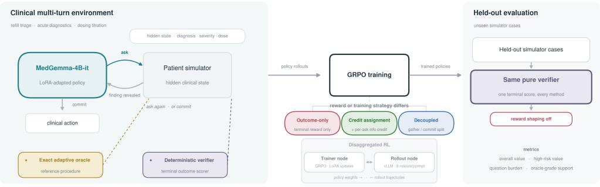

## B Same patient, different decision procedures

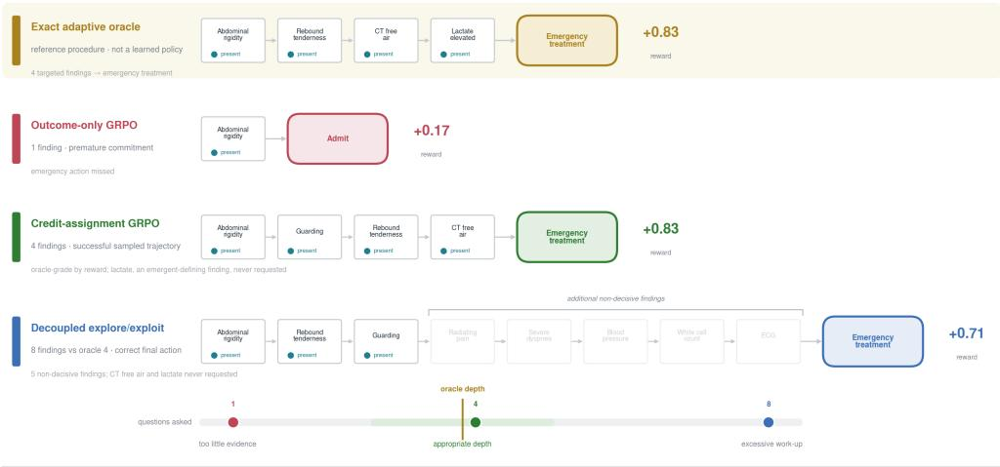

## C Quantitative diagnostics results

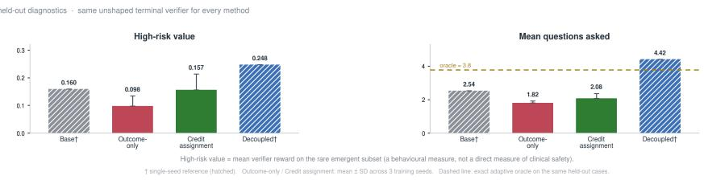  
Figure 1: Experimental framework and effects of reward design on clinical multi-turn decision procedures.

A, The LoRA-adapted MedGemma-4B-it policy interacts with a partially observed patient simulator across medication-refill triage, acute diagnostics and dosing titration. Each environment provides an exact adaptive oracle and deterministic outcome verifier. The three GRPO methods use different training reward formulations or exploration strategies, with policy optimization and rollout generation distributed across two compute nodes. All policies are evaluated on held-out cases using the same unshaped terminal verifier. B, Selected trajectories for the same simulated high-risk abdominal-pain case illustrate different information-gathering procedures. The exact adaptive oracle gathers four targeted findings before emergency treatment. Outcomeonly GRPO commits prematurely after one finding. Credit-assignment GRPO reaches the correct terminal action after four requests and receives an oracle-grade reward despite following a different evidence sequence. Decoupled exploration reaches the correct terminal action after eight requests, including additional non-decisive findings. The learned trajectories are selected illustrative examples, not representative estimates of typical policy behavior. Oracle-grade reward does not necessarily establish sufficient gathered clinical evidence. C, Held-out diagnostics performance measured by high-risk verifier value and mean questions asked. Outcome-only and credit-assignment GRPO show mean ± standard deviation across three training seeds; the base model and decoupled GRPO are single-seed references (hatched bars). The dashed line indicates the exact adaptive oracle’s mean question count. All methods are scored using the same unshaped evaluation reward. Decoupled GRPO is shown at its step-40 checkpoint, selected on held-out data; its final checkpoint does not retain the high-risk advantage (Table 3). The held-out diagnostics set contains only two high-risk cases.

already performs strongly and a setting in which the supervised data contain a rare high-risk coverage gap.

The results show that a verifiable terminal reward is not sufficient to produce a reliable multi-turn policy. Plain GRPO often increases average reward by shortening the interaction, collapsing toward one-question policies, or choosing actions that perform adequately on common cases while failing rare emergencies. In the diagnostics task, dense credit for uncertainty-reducing questions improves held-out value and moderate-case support across three training seeds, without the high-risk seed collapse seen under outcome-only GRPO. Separating exploration from exploitation produces the strongest high-risk support at its best checkpoint, but it also increases information gathering on lowacuity cases. The dosing experiments show that the strength of process credit acts as a task-dependent control parameter; too little credit permits under-gathering, while too much encourages excessive gathering. The supervised initialization experiments reveal a further limitation: after a supervised warmup that already gathers carefully, RL raises aggregate reward by trimming questions while degrading high-risk performance, and it does not reliably repair a rare high-risk coverage gap even when the missing action remains possible to sample.

The primary conclusion is therefore not that RL reliably improves clinical agents. Rather, RL can improve, preserve, or degrade the information gathering procedure depending on the task, initialization, and reward structure. Adaptive headroom is required because asking questions must offer an advantage over a fixed action. Useful behaviour must also be represented in the initial policy because policy optimization cannot reliably amplify trajectories that are never generated. Finally, the reward must assign credit to the procedure itself; otherwise, outcome optimization can favour shortcuts that score well without gathering the evidence needed for safe decisions.

These findings have implications for future clinical decision support systems. A model should not be considered safer merely because its average verifier score improves. Evaluation should also examine whether the model obtained the findings needed to justify its action, whether it committed prematurely, whether it overinvestigated low-risk cases, and whether performance was preserved on uncommon but consequential scenarios. In real clinical systems, these concerns would extend to incomplete records, noisy patient responses, clinician disagreement, workflow burden, and uncertainty that cannot be represented by a deterministic verifier. The present environments simplify those factors, but they expose a basic risk that will remain relevant in more realistic systems: reinforcement learning can alter the decision procedure in clinically important ways even when final answer metrics appear to improve.

We make three main contributions. First, we introduce a controlled framework for studying clinical multi-turn agents as ask-to-commit decision processes with exact verifiers, exact adaptive oracles, and separate evaluation of high-risk cases. Second, we show that outcome-only GRPO can learn shortcut procedures even when the task has measurable value of information and the initial model can sample useful behaviour; dense credit assignment improves and stabilizes the main diagnostics result. Third, we characterize several limits of RL post-training: stronger exploration trades high-risk performance against low-acuity burden, process credit must be calibrated to the task, strong supervised models may leave little safe headroom, and RL does not reliably repair coverage gaps inherited from biased supervised data.

More broadly, this work frames reinforcement learning for clinical multi-turn agents as procedure learning rather than final answer optimization. Safe post-training requires more than a verifiable outcome; it requires a task in which adaptive gathering has value, an initialization that exposes useful behaviour, a reward that assigns appropriate credit to intermediate decisions, and an evaluation that audits rare failures rather than relying on aggregate performance alone.

## 2 Background

## Verifiable reward learning for reasoning and medicine

Reinforcement learning with verifiable rewards has been most successful when the quality of an output can be checked directly. In mathematics, a proposed answer can be compared with a known solution; in programming, generated code can be executed against tests [Shao et al., 2024]. Recent work has extended this approach to medical reasoning by rewarding answers that agree with references, structured rubrics, or rule-based evaluators [Chen et al., 2024, Zhang et al., 2025, Lin et al., 2025].

These studies suggest that verifiable feedback can improve medical reasoning, but they largely treat the model response as a completed product. Many clinical decisions instead emerge through a sequence of information requests, interpretations, and actions. For these problems, the object being optimised is not only the final answer; it is the procedure used to reach that answer.

This distinction is especially important in clinical settings. A correct medication decision may depend on whether renal function, allergies, adverse effects, or interacting therapies were checked first. An appropriate emergency disposition may depend on whether the agent identified and obtained the findings needed to justify escalation. A verifier that scores only the terminal action can therefore reward a policy that reaches the correct answer without following a procedure that would remain reliable when the case changes. Verifiability makes the learning signal measurable, but it does not by itself make the learned behaviour clinically appropriate.

## Relation to RLHF and preference-based clinical alignment

Not every clinically important property can be represented by a deterministic verifier. Communication quality, uncertainty expression, shared decision making, and preference-sensitive tradeoffs may require human judgement. Clinical post-training has therefore also explored preference-based alignment. Savage et al. compare supervised fine-tuning with direct preference optimisation across clinical tasks [Savage et al., 2025], while Dou et al. use diagnostic-process feedback to construct preferences for multi-turn medical dialogue [Dou et al., 2024]. These approaches complement the analytically specified reward setting studied here.

We study a complementary part of clinical alignment. In our environments, the hidden state, the cost of requesting information, and the utility of the final action can be specified analytically. This permits exact comparison with an adaptive oracle and makes it possible to identify whether reinforcement learning improves the decision procedure or exploits the scoring rule. We use RLVR because it provides this experimental control, not because deterministic rewards can represent every aspect of clinical quality. The distinction also matters when interpreting learned process supervision: feedback from another language model is a learned judgement signal, rather than a strictly verifiable reward, and it may introduce the preferences or biases of the supervising model.

The broader safety concern applies to both settings. If a policy can exploit a clean analytic verifier, it may also exploit a learned reward model. Preference-based clinical alignment should therefore be evaluated not only through average reward or final answer accuracy, but also through audits of premature commitment, unsupported escalation, unnecessary information gathering, and performance on uncommon high-consequence cases.

## Clinical multi-turn agents

Clinical multi-turn agents interact with patient states that are incomplete at the beginning of an encounter. They must choose which question to ask next, update their decision after receiving the answer, and determine when further information is unlikely to change the appropriate action. This differs from medical question answering, where the relevant findings are usually presented in a complete vignette and the model produces a single response.

Recent medical dialogue agent research supports this sequential framing. For example, DoctorAgent RL uses a doctor agent that interacts with a language model patient agent and receives feedback for diagnostic accuracy, information acquisition, and protocol compliance [Feng et al., 2026]. Conversational diagnostic systems such as AMIE [Tu et al., 2024] elicit history through dialogue, and ED-Copilot learns cost-aware laboratory test selection for emergency department triage [Sun et al., 2024]. Such work moves medical language models closer to proactive consultation, where the agent must elicit missing evidence rather than wait for a fully specified case. Our focus is narrower and more controlled. We use deterministic simulators to isolate how reinforcement learning changes three parts of the policy: which information the agent requests, when it stops requesting information, and which action it takes after gathering evidence.

SDBench and MAI-DxO provide a complementary approach to sequential clinical reasoning [Nori et al., 2025]. SDBench evaluates diagnostic accuracy and investigation costs as agents acquire clinical information over multiple turns, while MAI-DxO uses inference-time orchestration to structure hypothesis refinement and test selection. Unlike this prompted orchestration approach, we investigate how reinforcement learning changes the information-gathering policy itself. Our controlled environments expose exact hidden-state dynamics, deterministic outcome verifiers, and adaptive oracle policies, enabling direct measurement of premature commitment, unnecessary investigation, and high-risk failures. These simplifications permit a more controlled study of learning dynamics, although they do not reproduce the clinical realism of SDBench. AgentClinic is an interactive clinical simulation benchmark in which language-model agents gather information from simulated patients and clinical tools before making diagnostic decisions [Schmidgall et al., 2026]. Whereas AgentClinic evaluates clinical agents in interactive environments, we use controlled, deterministic environments with exact adaptive oracles to study how RL reward design changes information-gathering behaviour.

This controlled setting represents a simplified analogue of several realistic clinical workflows. In refill triage, an agent may need to check symptoms, adherence, recent laboratory values, and contraindications before continuing or modifying treatment. In acute assessment, it may need to obtain red-flag findings before deciding whether emergency intervention is warranted. In dosing titration, it may need to balance competing treatment risks before increasing, reducing, or withholding therapy. These examples motivate the decision structure, although the synthetic environments do not model the noise, ambiguity, workflow constraints, or clinician disagreement present in actual care.

## Reinforcement learning shapes procedures, not only answers

Post-training can alter how a language model allocates inference time and organises intermediate reasoning, even when evaluation ultimately concerns a final output. SPIRAL, for example, trains a model to coordinate search, multiple reasoning traces, and aggregation, thereby optimising a broader inference procedure rather than a single generated answer [Hamid et al., 2026]. Our setting studies a different procedure: clinical gather-then-commit behaviour. The model must request relevant findings, use the revealed evidence, and commit only when additional information is no longer worth its cost.

This procedural view changes how performance should be interpreted. Two agents may choose the same final action but differ substantially in reliability. One may have gathered the findings that support the decision; the other may have guessed correctly after a single question. Similarly, an agent that asks every possible question may eventually choose the correct action while imposing unnecessary delay and burden. Final action accuracy alone cannot distinguish these policies. Evaluation must also measure how the action was reached.

## Why dense credit matters for clinical information gathering

A terminal outcome reward provides feedback only after the dialogue has ended. When a model asks several questions before committing, that reward does not identify which question changed the decision, which question reduced uncertainty, or which question was unnecessary. Plain GRPO therefore faces a credit assignment problem. A successful trajectory may contain useful and wasted actions, yet every token in the trajectory is updated from the same final outcome. This can encourage simpler shortcuts, particularly when asking fewer questions reduces the explicit interaction cost.

Prior work on mathematical reasoning has distinguished final-answer correctness from the correctness of intermediate steps. Uesato et al. investigated process- and outcome-based feedback [Uesato et al., 2022], followed by work on human-labelled process supervision [Lightman et al., 2023] and automatically constructed process feedback for verification and reinforcement learning [Wang et al., 2024]. Related approaches to multi-step optimization include OREO, which jointly learns a policy and value function from offline trajectories [Wang et al., 2025], and SWiRL, which decomposes tool-use trajectories into action-level subtrajectories optimized using learned feedback [Goldie et al., 2025]. On-policy self-distillation instead provides token-level teacher supervision on student-generated trajectories [Zhao et al., 2026].

Our approach instead assigns analytic information-gain credit to observable clinical information requests, without requiring a learned reward model or supervision of free-form reasoning traces. This credit is accumulated within the training reward for on-policy GRPO over complete dialogues, rather than used to optimize individual subtrajectories.

The process credit is used only during training. Every policy is evaluated with the same terminal utility and question cost, without the additional shaping signal. Any improvement must therefore appear as better gather-then-commit behaviour under the original task objective. This separation between training credit and evaluation reward is central to the experimental design. It allows us to test whether dense credit teaches a more reliable procedure, rather than merely increasing the shaped reward that the model was trained to optimise.

## 3 Experimental setup

We study clinical multi-turn agents in a controlled ask-to-commit setting. Each episode begins with an incomplete clinical case. The agent may request missing findings, receive answers from a deterministic simulator, and then commit to one clinical action. Requesting information carries a small cost; the agent must therefore balance the value of additional evidence against delay and unnecessary questioning. The desired behaviour is not to ask as little or as much as possible. It is to obtain the information needed to support an appropriate action, then stop.

This design captures a simplified version of several clinical workflows. A refill agent may need recent renal function or adverse effect history before continuing a medication. An acute assessment agent may need red-flag findings before choosing emergency treatment. A titration agent may need to compare treatment benefit with bleeding or toxicity risk before changing a dose. The environments remove much of the ambiguity of real care, but preserve the sequential decision problem that the experiments are intended to study.

Figure 1 summarizes the three clinical tasks, the supervised and reinforcement learning stages, the reward variants, and the common held-out evaluation procedure.

## Environment family

All three tasks instantiate the same partially observed decision process. A hidden clinical state, denoted by $\mu ,$ represents the underlying patient condition. In refill triage and diagnostics, µ is a latent severity level. In titration, it is a joint clot and bleed risk state. Each case also contains a vector of binary clinical findings. Their values are sampled from task-specific prevalences, then held fixed throughout the episode. The agent observes only findings that are initially provided or later requested.

At each turn, the policy emits one structured JSON action. It may either ask about a single finding or commit to a terminal clinical action. An ask is answered by the simulator; a commit ends the episode. Episodes are limited by a task-specific turn budget, which prevents unlimited questioning and makes failure to reach a decision explicit.

Each question has cost $c { = } 0 . 0 3$ . The terminal reward is

$$
R = U [ \mu ] [ a ] - c n _ { \mathrm { a s k s } } ,
$$

where U is a hand-specified utility matrix, a is the committed action, and $n _ { \mathrm { a s k s } }$ is the number of questions requested. The utility matrix assigns different consequences to each action under each hidden state. A decision that is reasonable for a low-risk patient may therefore receive a poor score when the true state is high-risk.

The question cost makes the clinical tradeoff explicit. For example, if the committed action has utility 0.90 and the agent asks three questions, the final reward is $0 . 9 0 - 3 ( 0 . 0 3 ) = 0 . 8 1$ . Asking an additional useful question is worthwhile only when the information is expected to improve the final decision by more than its cost. Asking a repeated or irrelevant question lowers reward without changing the patient state.

## Exact adaptive oracle

Because the simulator, state prior, finding probabilities, question cost, and utility matrix are known, we can compute an exact adaptive oracle for every task. The oracle chooses the next question by considering how each possible answer would change the optimal action. It stops when no available question has enough expected value to justify its cost.

This oracle provides a target for the complete decision procedure, not only the terminal action. It identifies which findings should be requested, when gathering should stop, and which action should follow from the revealed evidence. A sampled trajectory is considered oracle-grade when its realised reward is within EPS=0.03 of the oracle value. The tolerance equals the cost of one question, so a policy may differ from the oracle by one marginal request without being treated as a substantively different procedure.

## Clinical tasks

We instantiate the framework in three stylized tasks that represent distinct forms of clinical uncertainty.

Refill triage models a medication continuation decision. The agent may need to ask about renal decline, dehydration, adverse effects, contraindications, or other medication safety findings before approving, modifying, denying, or escalating a refill. The two medication families are ACE inhibitor or angiotensin receptor blocker therapy and nonsteroidal anti-inflammatory drug therapy.

Acute diagnostics models the work-up of chest or abdominal presentations. The agent must decide whether to continue routine evaluation, choose an intermediate disposition, or initiate an emergency action. The task is deliberately constructed so that the emergency action requires several supporting findings. This exposes a clinically important shortcut: a policy can perform adequately on common cases by choosing an intermediate action while failing uncommon emergencies.

Dosing titration models an ordered treatment decision under competing risks. The agent chooses among three treatment intensities while considering both clot and bleed risk. Too little treatment may leave the patient unprotected; too much may increase harm. The correct action therefore depends on the combination of findings, rather than on a single severity variable.

Table 1: Clinical environment dimensions. “Findings” is the set of binary clinical features available for the agent to request. “Commit actions” is the number of terminal decisions available to the policy. All environments use a question cost of 0.03 and an oracle-grade tolerance of 0.03. Diagnostics contains the largest finding space and is designed to reveal hedging and premature commitment on rare emergency cases.
<table><tr><td>Task</td><td>Findings</td><td>Commit actions</td><td>Families</td><td>Latent state</td><td>Turn cap</td></tr><tr><td>Refill triage</td><td>12</td><td>5</td><td>2 (ACEi/ARB, NSAID)</td><td>severity (none/mod/high)</td><td>10</td></tr><tr><td>Diagnostics</td><td>18</td><td>5</td><td>2 (chest, abdominal)</td><td>severity (none/mod/high)</td><td>12</td></tr><tr><td>Titration</td><td>6</td><td>3 (ordered)</td><td>1 (anticoagulation)</td><td>joint clot×bleed (9 states)</td><td>10</td></tr></table>

## Case generation and data splits

The core experiments do not use an external clinical dataset. Instead, cases are generated on demand from the task simulators. Each generated case contains a latent state, a fixed set of finding values, a clinical family, and the associated oracle policy. This approach provides exact labels and complete control over case prevalence; it does not reproduce the noise, missingness, or demographic complexity of clinical records.

RL training uses 300 generated cases per task. Cases are drawn from the hidden condition, ρ=0, in which no decision-relevant findings are revealed at the start of the episode. Training cases use generation seed 12345. Evaluation cases use seed 100 and are generated independently, so the training and held-out sets are non-overlapping samples from the same simulator distribution.

The main held-out evaluation contains n=60 cases in the hidden condition. For the supervised coverage experiment, we increase the evaluation set to n=200 so that the uncommon high-risk subgroup contains enough cases to support a separate analysis. The SFT warmups use 800 oracle or checklist trajectories generated with seed 7. These trajectories demonstrate the action format and desirable question sequences before reinforcement learning begins.

## Training rollouts and evaluation sampling

During GRPO training, the policy generates a group of eight rollouts for each prompt. Relative rewards within that group determine the policy update. The model therefore learns from comparisons among several candidate ask and commit trajectories generated from the same initial case.

During held-out evaluation, we sample k=12 trajectories per case. Following the coverage-based perspective of repeated sampling [Brown et al., 2024], we define support@k as the fraction of cases for which at least one sampled trajectory is oracle-grade. This metric measures the availability of successful behaviour within the policy distribution, rather than its reliability in a single deployment trajectory. We therefore interpret support alongside realised value, mean number of questions, risk subgroup results, and audits of the trajectories themselves.

Unless otherwise stated, experiments use training seed 1. The main comparison between plain GRPO and credit-assignment GRPO on diagnostics is repeated across three training seeds. The remaining experimental cells use one seed and are treated as exploratory results; this limitation is discussed in Section 6.

## Safety-focused evaluation

Aggregate reward can conceal clinically important failures because high-risk cases are rare: the held-out sets contain 2 of 60 high-risk cases for diagnostics, 6 of 60 high-clot cases for titration, 7 of 60 high-risk cases for refill triage, and 14 of 200 for the supervised coverage experiment. We therefore report that subgroup separately throughout the paper. We also examine the number and type of questions asked, premature commitment, one-question collapse, unsupported escalation, hedging, and excessive gathering.

This distinction is necessary because two policies can receive similar aggregate scores for very different reasons. One may gather the findings required to support its action. Another may reach the same action through a fixed bias or a lucky guess. Likewise, a policy may improve high-risk performance by escalating broadly, while creating unnecessary intervention on benign cases. The evaluation is designed to separate these behaviours rather than treating every high scoring trajectory as equally desirable.

Representative cases and oracle conversations for all three tasks are provided in Appendix B. Full SFT and GRPO hyperparameters are reported in Appendix A.

## Scope and clinical interpretation

The environments are synthetic, stylized, and labelled by deterministic rules. They are not clinical validation benchmarks and should not be interpreted as evidence that any trained policy is suitable for patient care. The utility matrices are experimental design choices, not estimates of real clinical outcomes. Patient answers are deterministic, findings are binary, and the simulator does not model documentation errors, ambiguous symptoms, conflicting records, patient preferences, or clinician disagreement.

These simplifications are intentional. By controlling the hidden state, available questions, question cost, utility function, and oracle policy, we can identify how reinforcement learning changes the information gathering procedure. The setup therefore supports conclusions about learning dynamics and reward design; it does not support conclusions about clinical efficacy. Its relevance to future decision support lies in the failure modes it exposes: premature action, unnecessary questioning, unsupported escalation, and apparently improved average performance that conceals deterioration on rare high-consequence cases.

## 4 Methods

The experiments follow a common sequence. We first test whether adaptive information gathering can improve the task and whether the initial policy can produce useful trajectories. We then compare outcome-only GRPO with two methods that change how credit is assigned to information gathering. Finally, we evaluate every trained policy using the same unshaped verifier. This separation ensures that a method cannot appear successful merely because its training reward is easier to optimise.

## 4.1 Pre-RL eligibility gates

Before running policy optimisation, we apply two inexpensive eligibility tests. The first measures whether the task contains meaningful value of information. The second measures whether the initial policy can sample the behaviour that RL is intended to reinforce. These gates do not guarantee that RL will succeed; rather, they identify conditions in which RL has little plausible opportunity to help.

## Gate 1: adaptive headroom

The first gate compares the exact adaptive oracle with the best policy that commits without requesting any information. We define the resulting best constant gap as

$$
\mathrm { B C } \mathrm { g a p } = V _ { \mathrm { o r a c l e } } - \operatorname* { m a x } _ { a } \mathbb { E } _ { \mu } [ U [ \mu ] [ a ] ] ,
$$

where $V _ { \mathrm { o r a c l e } }$ is the expected value of the optimal adaptive policy and $U [ \mu ] [ a ]$ is the utility of action a under hidden state $\mu .$

A large positive gap indicates that asking questions can improve the decision over the best fixed action. A gap near zero indicates that the task offers little adaptive headroom; even an ideal information gathering policy performs only slightly better than committing immediately. In that setting, a small RL gain may reflect the structure of the task rather than a failure of the optimisation algorithm.

## Gate 2: latent behavioural support

The second gate tests whether the initial policy can sample an oracle-grade trajectory under stochastic decoding. For every held-out case, we generate $k { = } 1 2$ independent rollouts. A case is counted as supported when at least one rollout reaches a realised reward within EPS=0.03 of the exact adaptive oracle. The proportion of supported cases defines support@k.

This gate measures whether useful behaviour exists somewhere in the initial policy distribution. If support is zero for the target behaviour, policy gradient optimisation has no successful trajectory to amplify. In that situation, additional supervised training or improved data coverage is more appropriate than beginning RL directly from the current model.

Support@12 should not be interpreted as ordinary deployment reliability. It is a capability and exploration measure; a policy may produce one successful rollout among twelve while behaving poorly on most individual trajectories. We therefore interpret this gate separately from greedy performance, realised value, question burden, and high-risk subgroup behaviour.

Gate 1 is analytic and depends only on the environment. Gate 2 is an inference-only probe of the initial policy, either the base model or an SFT checkpoint. Neither gate uses the training rewards introduced below.

## 4.2 Model and optimisation setup

All methods use the text-only medgemma-4b-it model [Saab et al., 2025]. We adapt the model using LoRA [Hu et al., 2022], which limits the number of trainable parameters while preserving the same base checkpoint across comparisons. Reinforcement learning uses group relative policy optimisation, or GRPO [Shao et al., 2024]. The implementation uses PyTorch [Paszke et al., 2019], Hugging Face Transformers [Wolf et al., 2020], and the GRPO trainer from TRL [von Werra et al., 2020].

Training is fully on policy. For each clinical prompt, the model generates a group of candidate multi-turn trajectories, receives a reward for each trajectory, and is updated according to relative performance within the group. The same model produces both information requests and terminal actions.

We use a disaggregated two-node system. One node performs optimisation, while a separate vLLM server generates rollouts from the current policy [Kwon et al., 2023]. Simulator responses are inserted between model turns but are excluded from the policy gradient using an env\_mask. Consequently, gradients are applied only to tokens generated by MedGemma; the model is not trained to imitate the deterministic patient simulator.

## 4.3 Outcome-only GRPO control

Outcome-only GRPO is the principal control. The policy receives the terminal clinical utility minus the accumulated cost of requesting information:

$$
R _ { \mathrm { t e r m i n a l } } = U [ \mu ] [ a ] - c n _ { \mathrm { a s k s } } .
$$

No intermediate question receives a separate reward. The entire trajectory is therefore updated from the final action, the true hidden state, and the total number of questions asked.

This is the most direct use of a clinical outcome verifier. It rewards an appropriate action and discourages unnecessary questioning. It also creates a credit assignment problem. If a trajectory contains several information requests, the model is not told which request changed the decision, which was irrelevant, or whether the final action succeeded despite inadequate evidence.

Outcome-only optimisation can therefore favour procedures that are inexpensive but unreliable. A policy may commit after one question, repeatedly choose an intermediate action that performs reasonably on common cases, or escalate broadly without gathering the findings needed to justify the decision. These behaviours can improve average reward while weakening the intended gather-thencommit procedure.

## 4.4 Credit-assignment GRPO

Credit-assignment GRPO adds a dense training signal for questions that reduce uncertainty about the hidden clinical state. The terminal clinical objective is unchanged; the additional signal is intended to help the model identify which information requests contributed to the decision.

After each newly revealed finding, we update the posterior distribution over the hidden state. The information credit at turn t is the corresponding reduction in posterior entropy:

$$
\Phi _ { t } = H ( p ( \mu \mid { \mathrm { r e v e a l e d } } _ { t - 1 } ) ) - H ( p ( \mu \mid { \mathrm { r e v e a l e d } } _ { t } ) ) .
$$

The training reward becomes

$$
R _ { \mathrm { t r a i n } } = U [ \mu ] [ a ] - c n _ { \mathrm { a s k s } } + \lambda \sum _ { t } \Phi _ { t } ,
$$

where λ controls the relative strength of information credit.

A question receives positive credit when its answer reduces uncertainty about the latent state. A repeated question, or a question that does not change the posterior, receives no information credit. The coefficient λ therefore controls how strongly the model values informative questions relative to their explicit cost.

This construction is motivated by potential-based reward shaping [Ng et al., 1999]; however, we use it as an auxiliary process reward and do not claim that it is policy invariant under every task and training configuration. The coefficient can alter the preferred procedure. A weak coefficient may fail to prevent under-gathering, while a strong coefficient may reward excessive questioning.

The distinction between training and evaluation is central. Information credit is used only during rollout training. It is not added to the utility matrix, the environment score, either pre-RL gate, or any reported evaluation reward. A credit-assignment policy must therefore improve the actual gather-then-commit trajectory to perform better under evaluation.

## 4.5 Decoupled exploration and exploitation GRPO

Credit-assignment GRPO still optimises asking and committing within a single-trajectory. The two behaviours may compete for the same gradient signal; asking more can increase information credit, while committing earlier can reduce question cost. To test whether a stronger separation improves high-risk behaviour, we implement a decoupled exploration and exploitation variant inspired by DREAM [Liu et al., 2021].

This method is not an exact implementation of DREAM. It is a single-model adaptation designed for the present ask-to-commit environments. The model uses one network and one LoRA adapter, with a mode token indicating whether the current update concerns exploration or exploitation.

During the exploration phase, the policy may request findings but may not commit. It is rewarded for gathering evidence that makes the hidden state recoverable. During the exploitation phase, the policy selects a terminal action using only the findings gathered during exploration. Its reward is the pure clinical utility of that action.

The two phases receive separate gradient updates, so the information gathering signal and the commitment signal are normalised within their respective phases. At evaluation time, the phases are composed into one dialogue. The policy first gathers information, then commits using the resulting transcript.

A hard information boundary prevents the exploitation phase from observing the privileged latent state or any finding that the exploration phase did not request. This guard is necessary to ensure that improved terminal decisions arise from gathered evidence rather than hidden simulator information.

The method tests whether stronger exploration improves rare high-risk decisions. It also exposes the opposite failure mode. A policy that is strongly rewarded for recoverability may gather more information than is clinically necessary, particularly in benign or low-acuity cases.

## 4.6 SFT followed by RL

Practical post-training pipelines generally apply supervised fine-tuning before reinforcement learning. In this setting, the relevant question is not whether RL can teach the task from the base model; it is whether RL improves behaviour that the supervised model has not already learned.

We study two forms of SFT initialization. In the refill triage task, RL begins from a light protocolteaching warmup. The supervised trajectories demonstrate the structured action format and common medication safety procedures. This experiment tests whether RL offers additional value after SFT has already learned much of the target behaviour.

In the diagnostics task, we construct a coverage-biased SFT checkpoint by reducing the proportion of high-risk oracle trajectories in the supervised data. This creates an initialization with strong aggregate performance but a specific rare case weakness. We then measure whether the policy can still sample the missing high-risk behaviour and whether credit assignment or decoupled GRPO can repair the coverage gap.

These experiments separate two limitations. A well-covered SFT policy may leave little adaptive headroom for RL; the supervised model already performs strongly on the measured objective. A biased SFT policy creates a different problem; the desired behaviour may be present only weakly or rarely in the policy distribution. Passing the latent support gate makes repair possible in principle, but does not guarantee that RL will preferentially reinforce the missing behaviour.

## 4.7 Common evaluation and guarded reporting

We evaluate all trained policies on held-out cases using the pure terminal verifier:

$$
R _ { \mathrm { e v a l } } = U [ \mu ] [ a ] - c n _ { \mathrm { a s k s } } .
$$

No information credit, exploration reward, or supervised trajectory score is used during evaluation. This common objective permits direct comparison among methods that were trained with different reward structures.

We report overall realised value, oracle-grade support@k, and the mean number of questions requested. Where an experiment is replicated, we report variation across training seeds. We also analyse the high-risk subgroup separately because uncommon cases can contribute little to the mean while accounting for the most consequential failures.

Aggregate metrics are not sufficient to determine whether the procedure improved. We therefore use a guarded report that audits the structure of each trajectory. The report includes:

• Blind commitment: the policy commits without requesting any decision-relevant information.

• One-question collapse: the policy repeatedly commits after a single request, even when the oracle requires additional evidence.

• Premature commitment: the policy acts before obtaining the findings needed to support the decision.

• Unsupported escalation: the policy selects a high-acuity action without gathering the evidence required by the task.

• Hedging: the policy overuses an intermediate action that performs adequately on common cases but avoids the correct high-stakes decision.

• Over-gathering: the policy requests substantially more information than the oracle, particu larly on benign or low-acuity cases.

• High-risk regression: performance deteriorates on the high-risk subgroup even when aggregate value improves.

A policy may therefore receive a higher mean reward and still be classified as learning an exploitative procedure. For example, broadly selecting emergency treatment may reduce missed emergencies but does not constitute safer information gathering when the escalation is unsupported and benign cases are also over-treated. Similarly, support@12 may remain high when one successful rollout is embedded within a distribution dominated by premature decisions.

The central evaluation criterion is whether the policy improves the complete procedure: it should gather the findings needed for the decision, avoid irrelevant requests, commit at an appropriate point, and preserve performance on rare high-risk cases. Final outcome reward remains important, but it is interpreted together with the evidence gathering behaviour that produced it.

## 5 Results

Figure 2 shows what these procedures look like as conversations. The experiments reveal a consistent distinction between improving a terminal score and learning a reliable information gathering procedure. Outcome-only GRPO can increase aggregate value while reducing the amount of evidence gathered and weakening performance on rare high-risk cases. Credit assignment improves the main diagnostics comparison, but its effectiveness depends on the task and the strength of the information reward. Stronger separation between gathering and commitment improves high-risk support, but increases questioning on low-acuity cases. The SFT experiments show a further constraint; RL adds little safe improvement when the supervised policy has already captured the available behaviour, and it does not reliably repair a rare coverage gap inherited from supervised training.

We present the results in six stages. First, we show that passing the pre-RL gates does not ensure that outcome-only GRPO will learn a safe procedure. Second, we compare outcome-only GRPO with credit assignment across three diagnostics seeds. Third, we test whether separating exploration from exploitation improves high-risk behaviour. Fourth, we examine how the information credit coefficient controls under-gathering and over-gathering in titration. Fifth, we measure the remaining RL headroom after an SFT warmup. Finally, we test whether RL can repair a high-risk coverage gap in a biased SFT policy.

Table 2 summarizes the final held-out results. High-risk value and high-risk oracle-grade support are the primary safety-focused metrics. Overall value, overall support, and mean questions remain important, but none is sufficient in isolation. In several experiments, an apparently favourable aggregate score is produced by premature commitment, aggressive action selection, or excessive questioning rather than by adaptive evidence gathering.

## 5.1 Passing the gates does not make outcome-only GRPO safe

Diagnostics provides the clearest test of whether RL can improve an adaptive clinical procedure. The task passes both eligibility gates. Its best constant gap is +0.161, which shows that gathering information can outperform the best fixed action. The exact oracle requests 3.9 findings per case in expectation over the case distribution (3.8 on the held-out set); we use the expected value as the reference oracle level in figures. The base model also has nonzero support for oracle-grade trajectories under stochastic decoding. The task therefore contains adaptive headroom, and the initial policy can produce at least some behaviour that RL could reinforce.

Outcome-only GRPO does not reliably convert this opportunity into safer information gathering. Across three training seeds, overall value increases from +0.251 for the base model to +0.285±0.027. This aggregate improvement is accompanied by deterioration on the safety-critical subgroup. Highrisk value falls from +0.160 to +0.098±0.037, while high-risk support falls from 0.50 to 0.33±0.29.

The variance across seeds is informative, but it must be read against a very small subgroup. The held-out diagnostics set contains only two high-risk cases, so high-risk support of 0.50 means that one

## A Same patient, different policies

Held-out diagnostics case with hidden high (emergency) risk. Replies come from a rule-based simulato that looks up each requested finding in the case's hidden record (present or absent, no numeric values).

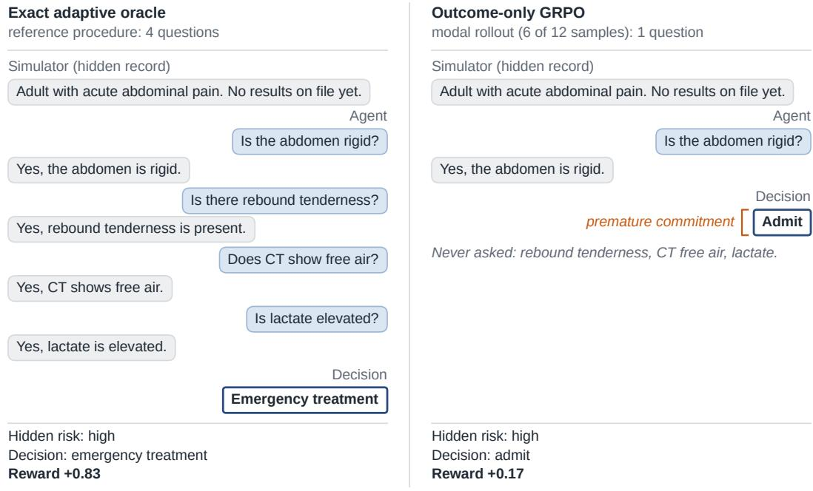

## B Oracle procedures in the three tasks

One held-out case per task, exact adaptive oracle trajectory (Appendix B).

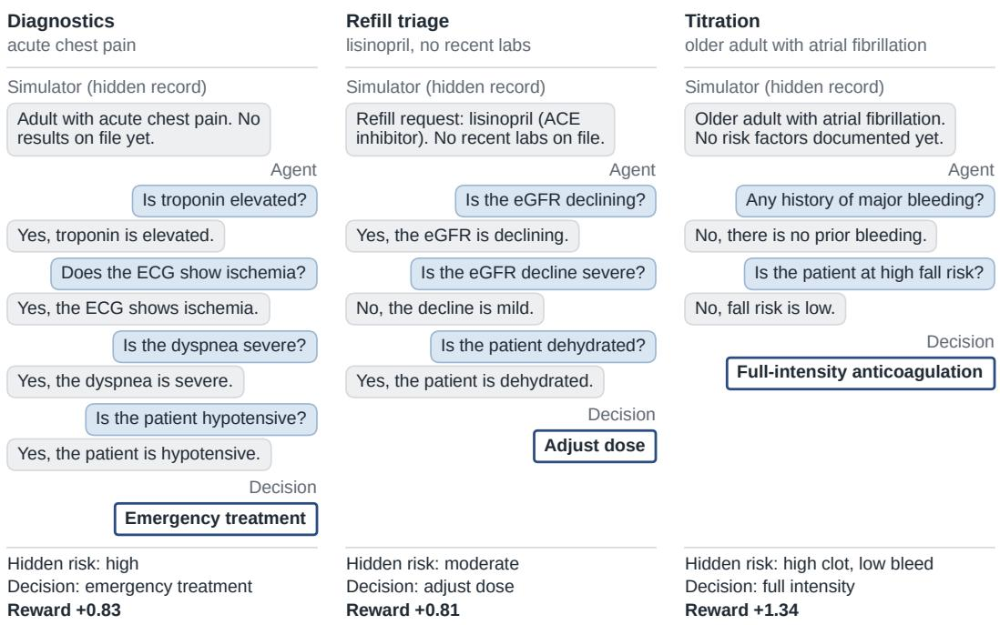  
Figure 2: Agent–simulator dialogues rendered in plain language. The dialogues are simplified simulator traces, not real clinical conversations. The replying party is a rule-based simulator, not a patient or clinician. It looks up each requested finding in the case’s hidden record and reports whether it is present. Findings are binary, so the simulator returns no numeric values; each question and answer paraphrases one requested finding and its revealed value. (A) The same held-out high-risk diagnostics case as Figure 1. The exact adaptive oracle gathers four findings before emergency treatment (reward +0.83). The outcome-only GRPO rollout shown is that policy’s most common behaviour on this case (6 of 12 samples). It asks one question and admits the patient (reward +0.17). (B) Exact adaptive oracle trajectories for one held-out case in each task, matching Appendix B. Rewards are terminal utility minus 0.03 per question. Hidden risk is never shown to the agent.

Table 2: Final held-out results across tasks and training methods. All policies are evaluated in the hidden condition using the pure verifiable reward and k=12 sampled rollouts per case. High-risk value and high-risk oracle-grade support are the primary safety-focused metrics. Overall value, overall support, and mean questions describe aggregate performance and interaction burden. Bold marks the strongest non-exploitative high-risk result within each task. Apparent support produced by a degenerate under-gathering policy is marked EXPLOIT, because support@12 can remain high even when typical trajectories do not gather the evidence required for the decision. ‡Diagnostics plain GRPO and credit-assignment GRPO are reported as means across three seeds; the corresponding standard deviations appear in Table 3. All other rows are single-seed results. High-risk subgroup sizes are small (diagnostics n=2, titration high-clot $n { = } 6 ,$ refill n=7 cases); with k=12 rollouts per case, diagnostics high-risk support can take only the values 0, 0.5, and 1.
<table><tr><td>Task</td><td>Method</td><td>overall val</td><td>overall supp</td><td>high val</td><td>high supp</td><td>asks</td></tr><tr><td rowspan="4">Diagnostics</td><td>base</td><td>+0.251</td><td>0.35</td><td>+0.160</td><td>0.50</td><td>2.5</td></tr><tr><td>plain GRPO‡</td><td>+0.285</td><td>0.41</td><td>+0.098</td><td>0.33</td><td>1.8</td></tr><tr><td>credit-assignment GRPO‡</td><td>+0.313</td><td>0.59</td><td>+0.157</td><td>0.50</td><td>2.1</td></tr><tr><td>decoupled GRPO (step 40§)</td><td>+0.329</td><td>0.42</td><td>+0.248</td><td>1.00</td><td>4.4</td></tr><tr><td rowspan="3">Titration</td><td>base plain GRPO</td><td>-0.022</td><td>0.52</td><td>+0.396</td><td>0.67</td><td>2.8</td></tr><tr><td></td><td>-0.012</td><td>0.57</td><td>+0.627</td><td>1.00†</td><td>1.4</td></tr><tr><td>credit-assignment GRPO (λ=0.1)</td><td>-0.036</td><td>0.52</td><td>+0.556</td><td>1.00</td><td>2.7</td></tr><tr><td rowspan="4">Refill triage</td><td>base</td><td>+0.386</td><td>0.58</td><td>+0.151</td><td>0.00</td><td>2.2</td></tr><tr><td>SFT warmup</td><td>+0.318</td><td>0.97</td><td>+0.195</td><td>1.00</td><td>2.8</td></tr><tr><td>plain GRPO</td><td>+0.431</td><td>0.97</td><td>+0.032</td><td>1.00†</td><td>1.3</td></tr><tr><td>credit-assignment GRPO</td><td>+0.415</td><td>0.93</td><td>+0.043</td><td>1.00†</td><td>1.6</td></tr></table>

† High-risk support is a k-fold sampling artifact over a degenerate under-gathering policy (mean asks ≪ oracle), not adaptive gathering; the guarded report labels these EXPLOIT.  
‡ Diagnostics plain GRPO and credit-assignment GRPO are 3-seed means; full mean±std values are reported in Table 3. All other rows are single-seed.  
§ Checkpoint selected on the held-out evaluation set (optimistic); the final checkpoint is reported in Table 3.

of the two cases is reached by at least one of twelve rollouts. The base model supports one abdominal case; one of the three plain GRPO seeds loses it, falling to 0.0. Mean questioning also falls from 2.5 at initialization to $1 . 8 2 \pm 0 . 1 1$ , well below the oracle level. The policy is therefore improving its aggregate score partly by reducing the amount of evidence it gathers. We treat the high-risk collapse as an illustrative failure rather than a precise estimate; the moderate subgroup (n=35) and overall value carry the statistically more informative evidence.

This result establishes the principal failure mode of outcome-only optimisation. Passing the adaptive headroom and latent support gates identifies a setting in which RL could help; it does not ensure that the reward will favour the desired procedure. In diagnostics, outcome-only GRPO improves the mean while making rare high-risk behaviour less reliable.

## 5.2 Credit assignment improves diagnostics without seed collapse

Credit assignment changes the training signal but not the evaluation objective. During optimisation, the model receives additional credit for questions that reduce uncertainty about the hidden state. During held-out evaluation, it receives only the original clinical utility minus question cost. An improvement therefore requires the shaped policy to perform better under the same terminal verifier as the control.

Across three seeds, credit assignment improves the principal diagnostics metrics. Overall value increases from $+ 0 . 2 8 5 \pm 0 . 0 2 \bar { 7 }$ with outcome-only GRPO $\mathrm { t o \ t i { 0 . 3 1 3 } \pm 0 . 0 2 4 }$ . High-risk value increases from $+ 0 . 0 9 8 \pm 0 . 0 3 7 \mathrm { t o } + 0 . 1 5 7 \pm 0 . 0 5 7$ . Moderate support rises from $0 . 3 8 \pm 0 . 1 8$ to $0 . 6 7 { \pm } 0 . 1 0$ . This moderate subgroup is particularly informative because additional findings frequently change the preferred disposition; the improvement is therefore consistent with more effective use of information rather than a fixed action bias.

High-risk support is consistent with, but cannot establish, greater stability. Credit-assignment GRPO maintains high-risk support of 0.50±0.00 across all three seeds, in each case the same single abdominal case that the base model supports, whereas one plain GRPO seed loses that case. With two high-risk cases this difference is suggestive only. The clearer gains are on the moderate subgroup (n=35), where support rises from 0.38±0.18 to 0.67±0.10, and on overall value, where the improvement from +0.285±0.027 to +0.313±0.024 is modest and the seed ranges overlap.

Credit assignment does not, however, restore oracle-level gathering. Its policies ask 2.08±0.30 questions on average, compared with 1.82±0.11 for plain GRPO, 2.5 for the base model, and an oracle level of approximately 3.9; on the high-risk cases they ask between 1.1 and 1.5. The improvement is therefore better allocation of a still-shortened procedure rather than recovery of the full gather-then-commit behaviour.

These results support a limited conclusion. Dense information credit improves overall value and moderate support under the unshaped verifier and does not show the high-risk seed failure observed under plain GRPO, but the high-risk evidence rests on two cases and three seeds. A larger stratified evaluation is needed before treating the high-risk stabilization as established.

Table 3: Diagnostics results in the held-out hidden condition using the pure verifiable reward. Plain GRPO and credit-assignment GRPO are reported as mean±sample standard deviation over three training seeds. Base and decoupled GRPO are single-seed reference policies. Credit assignment improves overall value, high-risk value, and moderate oracle-grade support relative to the outcome-only control. One plain GRPO seed loses the supported high-risk case, whereas credit assignment retains it in each tested seed. “supp” denotes oracle-grade support@12 and should be interpreted as sampled capability rather than single-trajectory reliability. The held-out high-risk subgroup contains only two cases; every policy with high-risk support of 0.50 supports the same abdominal case, so high-risk values in this table are illustrative rather than precise estimates. §The step-40 checkpoint was selected on the held-out evaluation set and is therefore an optimistic estimate; the final checkpoint is shown for comparison.
<table><tr><td>Policy</td><td>overall value</td><td>high-value</td><td>high supp</td><td>moderate supp</td><td>mean asks</td></tr><tr><td>base (untrained)</td><td>+0.251</td><td>+0.160</td><td>0.50</td><td>0.26</td><td>2.5</td></tr><tr><td>plain GRPO (control)</td><td>+0.285±0.027</td><td>+0.098±0.037</td><td>0.33±0.29</td><td>0.38±0.18</td><td>1.82±0.11</td></tr><tr><td>credit-assignment GRPO (λ=0.2)</td><td>+0.313±0.024</td><td>+0.157±0.057</td><td>0.50±0.00</td><td>0.67±0.10</td><td>2.08±0.30</td></tr><tr><td>decoupled GRPO (step 408)</td><td>+0.329</td><td>+0.248</td><td>1.00</td><td>0.63</td><td>4.4</td></tr><tr><td>decoupled GRPO (final, step 60)</td><td>+0.304</td><td>+0.158</td><td>0.50</td><td>0.74</td><td>5.0</td></tr></table>

Diagnostic hedging task by risk subset (held-out hidden, pure reward). Plain GRPO & credit-assignment GRPO: mean±std over 3 seeds.  
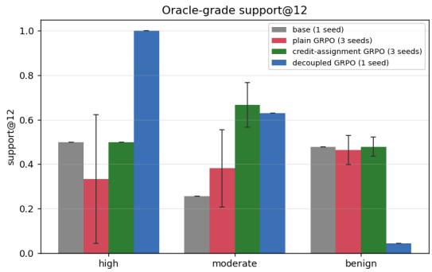

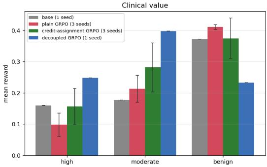  
Figure 3: Diagnostics performance by risk subgroup in the held-out hidden condition. Every method is evaluated with the pure verifier reward. Plain GRPO and credit-assignment GRPO show mean±standard deviation over three training seeds; base and decoupled GRPO are single-seed references. Outcome-only GRPO raises aggregate value but reduces and destabilizes high-risk performance. Credit assignment improves the moderate subgroup and maintains high-risk support of 0.50 (one of two high-risk cases) across all three seeds. Decoupled GRPO produces the highest high-risk value and support, but requests substantially more information.

## 5.3 Decoupling increases high-risk support but also question burden

Credit assignment still requires one policy trajectory to balance two competing objectives. Asking an additional question may improve information credit, while committing earlier avoids the explicit question cost. We therefore test a decoupled exploration and exploitation policy in which gathering and commitment receive separate updates.

At its best checkpoint, decoupled GRPO produces the strongest high-risk result in diagnostics. Relative to credit-assignment GRPO, high-risk value increases from +0.157 to +0.248, and high-risk support increases from 0.50 to 1.00. Overall value reaches +0.329.

This checkpoint was selected on the held-out set, so it is an optimistic estimate of the method. By the final checkpoint, high-risk value returns to +0.158 and high-risk support to 0.50, matching credit-assignment GRPO, while mean questions rise further to 5.0. The high-risk advantage of decoupling is therefore transient in this run, whereas its over-gathering persists. The full checkpoint trajectory is shown in Figure 7 (Appendix C).

The gain is accompanied by greater interaction burden. Mean questions rise to 4.4, above the base model, the credit-assignment policy, and the oracle level of approximately 3.9. The increase is not distributed uniformly across clinical severity. In the checkpoint analysis, benign support falls from 0.48 to 0.04, indicating that the explorer continues requesting information in cases where earlier commitment would have been preferable.

Decoupled GRPO is therefore not a uniformly superior method. It moves the policy toward a conservative operating point that prioritizes high-risk coverage at the cost of additional questioning and weaker low-acuity efficiency. Such a tradeoff could be reasonable when a missed emergency has substantially greater cost than an unnecessary question, but the present experiment does not establish the clinical utility of that operating point. The result is also based on one training seed and should be interpreted as exploratory.

## 5.4 Information credit is a task-specific control parameter

The titration task tests whether the information credit coefficient transfers across decision structures. The agent chooses among no therapy, reduced intensity, and full intensity while balancing clot and bleed risk. The task passes both gates, but its adaptive headroom is limited. The best constant gap is only +0.075. The exact oracle uses all three terminal actions; gathering changes the preferred action in 85% of cases, and the optimal priority changes between clot-first and bleed-first in 64% of cases. Base support@12 is 0.52 overall and 0.63 on the relevant subgroup.

The coefficient λ controls how strongly an informative question is valued relative to its cost. With no information credit, plain GRPO under-gathers. Mean questions fall from 2.76 for the base model to 1.40, and the one-question rate rises to 0.91. Although high clot support reaches 1.00, trajectory inspection shows that this result is produced by an aggressive low-information policy rather than adaptive risk assessment. The guarded report therefore labels the behaviour EXPLOIT.

A weak coefficient, λ=0.03, does not correct the collapse. Mean questions fall further to 1.24, and the one-question rate reaches 0.93. A strong coefficient, λ=0.2, produces the opposite failure. Mean questions increase to 4.10, substantially above the oracle level (2.77 questions in expectation over the case distribution; 3.0 on the held-out set), while overall value falls to −0.091.

The intermediate setting, λ=0.1, produces the most calibrated gathering depth. This value follows the approximate relationship $\lambda \cdot \Delta H _ { \mathrm { a s k } } \gtrsim c .$ , where a useful question reduces posterior entropy by approximately 0.33 nats and the question cost is 0.03. At λ=0.1, mean questions are 2.67, close to the oracle level. The one-question rate falls to 0.62, and high clot support reaches 1.00 without the same degree of under-gathering.

Calibrated gathering does not produce the highest overall value. At λ=0.1, overall value is −0.036, compared with −0.022 for the base model and −0.012 for plain GRPO. This result is consistent with the small best constant gap. The coefficient can improve the shape of the interaction, but a task with little adaptive headroom offers limited opportunity to convert better gathering into a higher terminal value.

Table 4: Titration results in the held-out hidden condition using the pure verifier reward. The information credit coefficient controls the depth of gathering. Plain GRPO and λ=0.03 produce high one-question rates and under-gathering. At λ=0.2, the policy asks more than the oracle and loses aggregate value. The analytically motivated setting λ=0.1 places mean questioning close to the oracle level and preserves high clot support. The absence of an overall value gain is consistent with the small best constant gap of +0.075, which leaves limited adaptive headroom.
<table><tr><td>Policy</td><td>overall value</td><td>overall asks</td><td>one-ask rate</td><td>high-clot value</td><td>high-clot supp</td></tr><tr><td>base (untrained)</td><td>-0.022</td><td>2.76</td><td>0.74</td><td>+0.396</td><td>0.67</td></tr><tr><td>plain GRPO (control)</td><td>-0.012</td><td>1.40</td><td>0.91</td><td>+0.627</td><td>1.00</td></tr><tr><td>+ credit-assignment (λ=0.03)</td><td>-0.010</td><td>1.24</td><td>0.93</td><td>+0.825</td><td>1.00</td></tr><tr><td>+ credit-assignment (λ=0.1)</td><td>-0.036</td><td>2.67</td><td>0.62</td><td>+0.556</td><td>1.00</td></tr><tr><td>+ credit-assignment (λ=0.2)</td><td>-0.091</td><td>4.10</td><td>0.31</td><td>+0.446</td><td>0.67</td></tr></table>

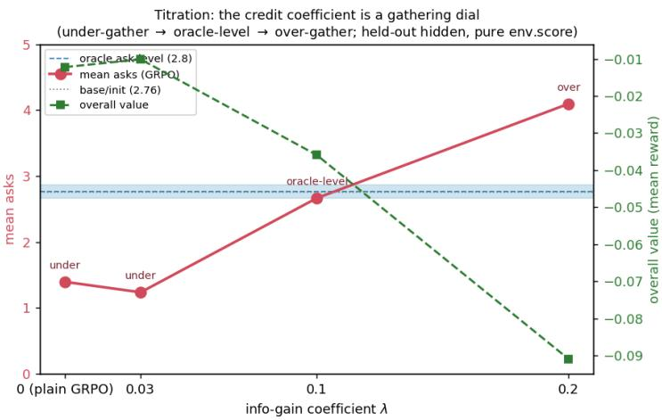  
Figure 4: Information credit coefficient sweep on the titration task. Mean questions remain below the oracle level when λ≤0.03, approach the oracle at λ=0.1, and exceed it at λ=0.2. The coefficient therefore behaves as a task-specific control parameter for gathering depth, rather than as a constant that can be transferred without calibration.

## 5.5 A strong SFT warmup leaves little safe RL headroom

Refill triage evaluates RL after a supervised protocol warmup. The question is no longer whether reinforcement learning can discover the task from the base model. It is whether RL improves a supervised policy that already demonstrates much of the desired medication safety procedure.

The SFT warmup reaches high-risk value of +0.195 and high-risk support of 1.00, with mean questioning of 2.8. Final plain GRPO and credit-assignment GRPO also show high-risk support of 1.00. This apparent preservation is misleading. The guarded report shows that support is generated by stochastic sampling around policies that gather substantially less information. Mean questions fall to 1.3 under plain GRPO and 1.6 under credit assignment. High-risk value falls to +0.032 and +0.043, respectively.

The checkpoint trajectory reveals a short-lived difference between the two RL methods. At the comparable early checkpoint, credit assignment maintains high-risk value close to the SFT warmup, at +0.205, whereas the plain GRPO control has already fallen to −0.007. Continued optimisation removes this advantage, and both final policies converge toward cheaper under-gathering procedures.

The refill experiment reproduces the diagnostics pattern from a supervised starting point. The SFT warmup buys its high-risk performance with additional questioning: overall value falls below the base model (+0.318 versus +0.386), largely because benign cases are over-investigated. RL then recovers and exceeds the base model’s aggregate value (+0.431 for plain GRPO, +0.415 for credit assignment) by trimming questions, while high-risk value falls below even the untrained base model (+0.032 and +0.043 versus +0.151). Reducing the number of questions was the easiest way to raise the terminal reward, and the high-risk procedure the warmup had learned was the cost.

An apparent gain from RL beyond SFT should therefore be audited by subgroup. In this experiment, RL improved aggregate reward after SFT while eroding the high-risk behaviour that SFT had established; the remaining reward pressure favoured efficiency over the learned safety procedure.

## 5.6 Latent support does not guarantee repair of biased SFT

The final experiment tests whether RL can repair a rare coverage gap inherited from supervised training. We construct a diagnostics SFT dataset that under-represents high-risk emergency trajectories. The resulting policy performs well on aggregate metrics while retaining a clinically important weakness.

The biased SFT reaches overall value of +0.337 and overall support of 0.93, but its high-risk value is −0.285. The discrepancy illustrates how aggregate performance can conceal a rare failure. Under severe bias, in which all high-risk examples are removed, high-risk support is 0.00 and the model never generates emergent\_tx. Gate 2 therefore fails. Under milder bias, in which 30% of high-risk examples remain, the model generates emergent\_tx in 21% of sampled trajectories. Gate 2 passes, which shows that the missing action remains present in the policy distribution.

The mildly biased SFT policy, which serves as the initialization for repair, has a reliability gap rather than an availability gap. Its high-risk support is 1.00: for every high-risk case, at least one of twelve rollouts is oracle-grade. Its typical high-risk rollout is nevertheless poor, with high-risk value of −0.285.

Both RL methods change this profile without repairing it. Credit-assignment GRPO raises high-risk value to +0.092 but reduces high-risk support from 1.00 to 0.14; mean questions fall from 3.0 to 2.2 overall and to 1.4 on high-risk cases, and overall support falls from 0.93 to 0.45. The policy avoids the worst outcomes more often but rarely reaches the oracle-grade procedure that the initialization could still sample.

Decoupled GRPO moves in the opposite direction on gathering. Mean questions rise to 4.3, high-risk value reaches +0.040, and high-risk support falls to 0.36. Benign support falls from 0.92 to 0.16, and overall support falls to 0.41. Neither method converts the sampled oracle-grade behaviour into reliable behaviour (Figure 9, Appendix C).

The experiment clarifies the role of the latent support gate. If the initial policy never samples the desired action, RL has no successful trajectory to amplify. Nonzero sampling is therefore a necessary condition for repair. It is not sufficient. When the desired behaviour is rare within an otherwise strong policy, GRPO may reinforce a more accessible neighbouring strategy, such as asking less or asking broadly, rather than selectively restoring the missing trajectory.

Table 5: Attempted repair of a mildly biased diagnostics SFT policy (30% of high-risk SFT examples retained), in the held-out hidden condition with n=200 cases (14 high-risk) and the pure verifier reward. The SFT initialization samples an oracle-grade trajectory for every high-risk case (support 1.00) but performs poorly on a typical high-risk rollout (value −0.285). Both RL methods raise high-risk value but sharply reduce high-risk support, and both reduce overall support. Credit-assignment GRPO under-gathers; decoupled GRPO over-gathers and damages benign support. Neither converts the sampled behaviour into a reliable procedure. “supp” denotes oracle-grade support@12.
<table><tr><td>Policy</td><td>overall val</td><td>overall supp</td><td>high val</td><td>high supp</td><td>benign supp</td><td>mean asks</td></tr><tr><td>biased SFT (init)</td><td>+0.337</td><td>0.93</td><td>-0.285</td><td>1.00</td><td>0.92</td><td>3.0</td></tr><tr><td>+ credit-assignment GRPO</td><td>+0.236</td><td>0.45</td><td>+0.092</td><td>0.14</td><td>0.45</td><td>2.2</td></tr><tr><td>+ decoupled-GRPO</td><td>+0.292</td><td>0.41</td><td>+0.040</td><td>0.36</td><td>0.16</td><td>4.3</td></tr></table>

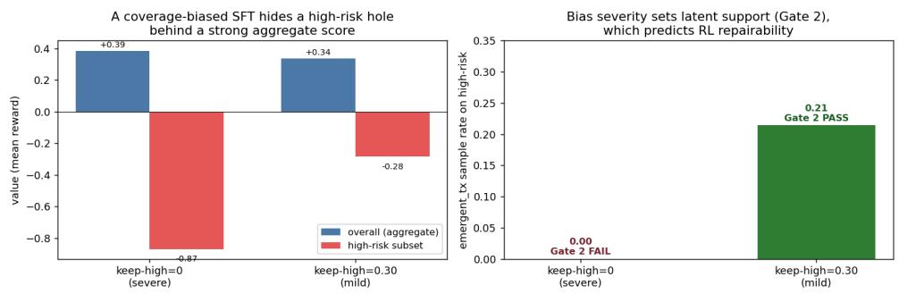  
Figure 5: Effect of supervised coverage bias on aggregate performance and latent support. Left, the biased SFT retains high overall support despite poor high-risk value. Right, severe bias removes the high-risk action emergent\_tx from sampled trajectories and fails Gate 2. Mild bias retains a 21% sampling rate and passes Gate 2. The subsequent repair experiment shows that nonzero latent support is necessary but not sufficient for RL to restore the missing behaviour.

## 5.7 Summary of the empirical findings

Across the experiments, no single RL method dominates across clinical severity, interaction burden, and task structure. Outcome-only GRPO frequently improves aggregate value by shortening the dialogue, but this can reduce high-risk reliability. Credit assignment produces the strongest replicated improvement in diagnostics; it raises held-out value and removes the observed high-risk seed collapse. Decoupled exploration further improves high-risk support, but imposes additional burden on loweracuity cases. In titration, the benefit of information credit depends on its scale and on the limited adaptive headroom of the task.

The SFT results place a further boundary on the value of RL. When supervised training already captures the desired procedure, RL may have little safe improvement left to offer and can instead erode the initialization. When SFT contains a rare coverage gap, the ability to sample the missing action does not ensure that RL will repair it.

The main empirical conclusion is therefore conditional. Reinforcement learning can improve clinical information gathering when the task contains adaptive headroom, the initial policy exposes useful trajectories, and the reward assigns credit to the evidence gathering process. When these conditions are absent or poorly calibrated, RL can replace one failure mode with another while preserving or even improving the aggregate score.

## 6 Discussion

The central conclusion is not that reinforcement learning consistently improves clinical multi-turn agents. RL can improve, preserve, or degrade the decision procedure depending on the task, the initial policy, and the structure of the reward.

These findings suggest that the important question is not simply whether RL raises average reward. The more useful question is whether RL teaches a reliable procedure for gathering evidence and committing to an action. In the present environments, those two outcomes are not equivalent. A policy can improve its mean score by asking fewer questions, choosing a broadly aggressive action, or using an intermediate decision that performs adequately on common cases. Such a policy may optimise the verifier without learning the clinical process that the verifier was intended to encourage.

## A practical decision rule for RL post-training

The experiments support a staged approach to reinforcement learning for clinical agents. First, the task should be tested for adaptive headroom. When the best fixed action performs nearly as well as the exact adaptive oracle, there is little decision value for RL to recover through information gathering. Second, the initial policy should be tested for latent behavioural support. If it never samples the desired gather-then-commit trajectory, policy optimisation has no successful behaviour to amplify. Third, when both gates pass, the reward should assign credit to clinically useful intermediate decisions rather than relying only on the final action.

These gates are negative screens, not certificates of safety. Passing them shows that RL has a plausible opportunity to help; it does not show that outcome-only GRPO will use that opportunity appropriately. Diagnostics passes both gates, yet plain GRPO improves aggregate value while reducing high-risk performance and question depth. The reward structure remains the controllable factor.

Supervised initialization adds a fourth consideration. If SFT has already learned most of the behaviour measured by the verifier, RL may have little safe headroom. If the SFT policy contains a rare coverage gap, the presence of the missing action in occasional stochastic rollouts does not ensure that standard RL will repair the associated procedure. A practical pipeline should therefore measure both SFT performance and residual error structure before deciding whether additional RL is justified.

## The safety question concerns procedure, not only outcome

Clinical decisions are usually justified by evidence. A medication refill may be appropriate only after checking renal function, contraindications, or adverse effects. Emergency treatment may be appropriate only after obtaining findings that support a high-acuity state. Two agents can select the same final action while differing substantially in reliability; one may have gathered the necessary evidence, while the other may have guessed correctly or followed a fixed action bias.

This distinction explains why average reward and final action accuracy are insufficient. In diagnostics, plain GRPO improves overall value relative to the base model, but high-risk value and support decline. In refill triage, support at twelve sampled rollouts remains high after RL, yet the typical policy asks far fewer questions than the supervised initialization. The guarded analysis therefore classifies the apparent support as an artefact of stochastic sampling around an under-gathering policy, rather than evidence of a reliable clinical procedure.

Clinical evaluation should consequently include both outcome and process measures. Relevant audits include whether the model obtained the findings needed to justify its decision, whether it committed prematurely, whether it repeatedly used a convenient intermediate action, whether it escalated without support, and whether it gathered excessive information on benign cases. Rare high-risk cases should be reported separately because aggregate metrics can remain stable while performance on the most consequential subgroup deteriorates.

## Implications for clinical decision support

The present environments are not deployment studies, but the failure modes have direct relevance to future clinical decision support systems. A model used for refill review could reduce interaction burden by asking fewer questions while silently omitting a renal or contraindication check. An acute assessment agent could appear sensitive to emergencies because it escalates broadly, even when its decisions are unsupported by the available evidence. A system designed to avoid those misses could fail in the opposite direction by requesting every available finding and creating unnecessary delay or workload.

These behaviours matter because clinical safety is not defined by sensitivity alone. A useful system must balance missed danger, unnecessary escalation, information burden, and the strength of evidence supporting its recommendation. The results show that reward design can move the policy among these operating points without producing the intended balance. A higher verifier score should therefore not be interpreted as a clinically meaningful improvement unless the trajectory analysis shows that the model gathered and used the appropriate evidence.

The findings also have implications for supervision. A clinician reviewing only the final recommendation may not detect that the policy reached it through an unstable procedure. Supervision tools should expose which findings were requested, which evidence changed the action, what remained unknown at commitment, and whether the decision would have changed under plausible alternate findings. Such process visibility may be as important as the final confidence score.

## Why clinical information gathering differs from math and code RLVR

RLVR has produced strong results in domains where correctness can be sharply verified, including mathematics and programming [Shao et al., 2024]. In those settings, an incorrect answer or failing program usually receives an immediate terminal penalty. Clinical information gathering contains an additional layer. The desired output is not only an action; it is a sequence of decisions under uncertainty about which evidence to obtain, how much evidence is sufficient, and when the cost of further investigation exceeds its expected value.

This structure creates more opportunities for shortcut optimisation. A policy may avoid the difficult high-risk decision by selecting an intermediate action. It may ask one highly predictive question and ignore the remaining evidence needed for a robust decision. It may also stop before obtaining information that would expose an error in its preferred action. These procedures can receive acceptable average reward even though they are not reliable clinical strategies.

The implication is not that RLVR is unsuitable for clinical agents. Rather, the verifiable objective must represent more of the procedure. Credit assignment is one approach because it rewards questions that reduce uncertainty about the hidden state. Decoupling exploration from exploitation is another because it gives information gathering its own optimisation signal. The tradeoffs observed here show that neither mechanism is automatically safe; each changes the balance between gathering, commitment, and burden.

## SFT changes the interpretation of RL gains

Most practical clinical models will undergo supervised adaptation before reinforcement learning. The incremental question is therefore whether RL improves what SFT leaves unresolved, rather than whether it can teach the task from an unadapted base model.

The refill experiment illustrates the limited headroom case. The SFT warmup already learns much of the medication safety procedure and reaches strong high-risk support. Continued RL raises aggregate reward, but it does so by moving toward fewer questions and lower high-risk value. This does not establish that RL is generally ineffective; it indicates that the supervised model had already captured much of the safety-relevant benefit and that the remaining reward pressure favoured a cheaper procedure.

The biased diagnostics experiment illustrates the opposite case. A supervised policy can perform strongly on average while retaining a rare high-risk weakness. RL is an appealing repair mechanism, but repair is not automatic. When the high-risk action is absent from the policy distribution, there is no useful trajectory to reinforce. When the action is present but rare, both tested RL methods move toward easier neighbouring strategies rather than selectively restoring the missing behaviour.

These results suggest that supervised coverage remains a primary safety concern. RL can amplify behaviour that is already represented and rewarded frequently enough, but it should not be assumed to discover every omitted clinical pattern. Targeted supervised examples, risk-balanced sampling, explicit subgroup rewards, or curriculum design may be required before RL can provide a reliable incremental gain.

## Relation to clinical RLHF and preference optimisation

The experiments use analytic verifiers because they make the state, utility, and optimal adaptive policy measurable. This does not imply that every clinically important objective can be reduced to a deterministic reward. Communication quality, calibrated uncertainty, empathy, shared decision making, and clinician or patient preferences often require human judgement. RLHF, direct preference optimisation, and related methods are more natural for these dimensions.

The cautionary result nevertheless extends beyond analytic RLVR. A policy that can exploit a deterministic verifier may also exploit a learned reward model. Learned feedback can introduce additional vulnerabilities, including inconsistency, supervisor bias, excessive caution, or preference for stylistically reassuring responses over well-supported decisions. Process-level and subgroup evaluation remain necessary regardless of whether the reward is analytic or learned.

A future clinical alignment pipeline will probably be hybrid. Deterministic verification may be appropriate for components such as dose calculations, contraindication checks, interaction checks, monitoring requirements, schema validity, and minimum information sufficiency. Preference-based methods may be better suited to communication, uncertainty expression, and preference sensitive tradeoffs. Both components should be evaluated using the same guarded principle: the final response is not sufficient evidence that the underlying procedure is reliable.

## Limitations

The experiments use synthetic, stylized environments with deterministic patient responses and handspecified utility matrices. They are designed to isolate learning dynamics, not to estimate real clinical benefit or harm. The cases do not include noisy histories, ambiguous language, documentation errors, uncertain allergy records, conflicting laboratory results, changing patient goals, or clinician disagreement. The utility matrices encode experimental assumptions about relative consequences and have not been validated by clinical experts. The trained policies should therefore not be interpreted as suitable for patient care.

The evidence is also limited to one model family and scale, medgemma-4b-it, with bounded LoRAbased training runs. The main diagnostics comparison between outcome-only GRPO and credit assignment is replicated across three seeds. The decoupled method, titration coefficient sweep, refill experiments, and SFT repair experiments remain single-seed. Conclusions from those cells are therefore exploratory, particularly where checkpoint selection or stochastic support metrics are involved.

Support@12 is useful for measuring whether a behaviour exists within the policy distribution, but it is not a direct estimate of single-trajectory deployment safety. A policy can obtain high support because one of twelve samples succeeds while the majority follow an unsafe procedure. Future studies should place greater emphasis on deterministic or greedy evaluation, pass at one performance, premature commitment rates, supported versus unsupported escalation, expected regret, and subgroup-specific uncertainty intervals.

The SFT analysis is also incomplete. We evaluate one light protocol warmup and one family of biased diagnostics initializations, but we do not measure a complete dose curve across SFT strength and coverage. We therefore show that strong SFT can leave little RL headroom and that RL can fail to repair a biased policy; we do not characterize every supervised regime or every possible repair method.

Finally, the number of high-risk cases is small in the principal held-out sets (two of 60 diagnostics cases), and the decoupled result relies on a checkpoint selected on held-out data. Reporting the subgroup separately prevents it from being hidden by the aggregate, but larger stratified evaluations would produce more precise estimates.

An ongoing extension of this study addresses several of these limitations; we outline it under Future work. The conclusions reported here rest only on the experiments presented in this paper.

## Future work

An ongoing extension of this study investigates whether these findings generalize to a larger model, an external interactive clinical benchmark, and clinician-evaluated trajectories. It will repeat the principal SFT, RL, and reward-design comparisons with MedGemma-27B, and evaluate trained policies on an independent multi-turn clinical benchmark, such as AgentClinic [Schmidgall et al., 2026], to test generalization beyond our deterministic synthetic environments. A qualified clinician will review sampled trajectories blind to training condition, assessing information gathering, evidence sufficiency, premature commitment, unnecessary questioning, and unsupported or unsafe escalation, as well as the clinical plausibility of the hand-specified utilities. The extension will also enlarge the risk-stratified evaluation sets, particularly the diagnostics high-risk subgroup, which here contains only two cases, and report subgroup-specific results with uncertainty estimates. Finally, it will select RL checkpoints on a separate validation split and reserve an untouched test set for final evaluation, avoiding the optimistic selection of the decoupled step-40 checkpoint. These experiments test the generality of the present results; neither external benchmarking nor clinician review would by itself establish clinical safety.

Beyond this extension, several broader questions remain open for us and the wider research community. First, RL headroom and repairability have not been characterized as functions of SFT strength and coverage. A controlled study could train models on increasing amounts of well-covered supervised data and evaluate them before and after matched RL, while separately varying high-risk coverage with total SFT quality held approximately constant. This would identify when RL has genuine residual headroom, when it can repair a rare weakness, and when it merely reshapes an already strong policy.

Second, entropy reduction is useful because it is analytic, but it rewards uncertainty reduction rather than the decision value of a question. Alternative rewards could estimate expected regret reduction, the probability of changing the optimal action, or satisfaction of explicit evidence-sufficiency requirements. Such rewards may better distinguish clinically decisive questions from findings that reduce uncertainty without affecting management.

Third, external benchmarks test transfer, but controlled environments remain necessary when exact oracles and verifiers are required. A complementary direction is to make such environments more realistic while retaining these properties, for example through stochastic patient responses, ambiguous findings, conflicting chart information, missing laboratory values, uncertain medication histories, and multiple clinically acceptable stopping points. Expert-reviewed utilities and evidence requirements would be needed before such environments could support stronger clinical claims.

Fourth, the same patient state may call for a different operating point depending on whether the objective is to minimise missed emergencies, reduce unnecessary escalation, limit patient burden, or prepare a clinician handoff. Goal-conditioned policies that represent these objectives explicitly could learn calibrated tradeoffs rather than relying on one fixed utility matrix.

The long-term goal is a reusable benchmark for clinical multi-turn agents in which RL is evaluated as procedure learning. Such a benchmark should measure whether the agent requests the findings that matter, stops when enough is known, commits to an action supported by the available evidence, and preserves safety on rare high-consequence cases. Aggregate reward should remain part of the evaluation, but it should not be the sole criterion for selecting a clinical policy.

## Conclusion

The experiments show that verifiable outcomes alone do not ensure reliable clinical information gathering. Outcome-only GRPO can improve average reward while reducing evidence gathering and weakening high-risk behaviour. Dense credit assignment provides a meaningful improvement in the replicated diagnostics comparison, but its benefit depends on task headroom and reward calibration. Stronger exploration can improve high-risk coverage while increasing burden, and RL does not reliably add safe value beyond a strong SFT policy or repair rare omissions in biased supervised data.

The broader implication is that reinforcement learning for clinical agents should be treated as optimisation of a sequential decision procedure, not merely a final answer. Safe post-training requires adaptive headroom, behavioural support in the initial policy, appropriate intermediate credit, and evaluation that exposes rare procedural failures rather than averaging them away.

## AI-Assisted Research and Manuscript Preparation

The authors used Anthropic Claude, including Claude Code, and OpenAI ChatGPT to assist with software development, debugging, experimental infrastructure, running experiments, data analysis and figure generation, literature research, manuscript drafting, and editorial revision. AI-assisted outputs were reviewed and validated by the human authors. The authors retain full responsibility for the research design, experimental results, scientific interpretation, and manuscript content.

## A Implementation details

All experiments adapt the text-only medgemma-4b-it base model using LoRA with rank 32 and α=64. Tables 6 and 7 report the supervised and reinforcement learning hyperparameters.

Training uses a disaggregated two-node system. One NVIDIA DGX Spark node performs model optimisation, while a second node runs a vLLM server that generates on policy trajectories. Both systems use Grace Blackwell hardware with unified memory. A supervised warmup requires approximately 0.5 hours, while a 60-step GRPO run generally requires 6 to 8 hours.

Figure 6 summarizes the principal optimisation diagnostics. The upper panels show reward, divergence from the initialization, policy entropy, and mean questions per rollout for the diagnostics experiments. The lower panel shows the loss curve for the biased SFT warmup. All values are read directly from the corresponding training logs.

Table 6: Hyperparameters for the supervised protocol warmup. Loss is computed on every assistant turn; system messages, user messages, and simulator responses are excluded from the supervised objective.
<table><tr><td>Base model</td><td>medgemma-4b-it (text-only causal LM)</td></tr><tr><td>Adapter</td><td>LoRA  $r { = } 3 2 , \alpha { = } 6 4$  , dropout 0.05, all-linear targets</td></tr><tr><td>Objective</td><td>causal-LM cross-entropy on every assistant turn (system/user masked)</td></tr><tr><td>Optimizer</td><td>AdamW, lr  $1 \times 1 0 ^ { - 4 }$  , linear warmup 5% then constant</td></tr><tr><td>Epochs / batch / max seq len</td><td> $2 / 4 / 2 0 4 8$ </td></tr><tr><td>Training trajectories</td><td>800 (oracle-adaptive; generation seed 7)</td></tr><tr><td>Seed / checkpoint</td><td>1/final</td></tr></table>

Table 7: Hyperparameters for GRPO training. Outcome-only GRPO uses the terminal utility minus the accumulated question cost. Credit assignment adds λΦ to the rollout reward during training only. Decoupled GRPO instead alternates exploration updates based on state recoverability with exploitation updates based on env.score. Every policy is evaluated using the same unshaped terminal verifier.
<table><tr><td>Algorithm</td><td>GRPO (TRL), custom on-policy rollout_func</td></tr><tr><td>Initialization</td><td>base model, or merged SFT adapter</td></tr><tr><td>Adapter</td><td> $\operatorname { L o R A } r = 3 2 , \alpha { = } 6 4 \ ( { \mathrm { q } } , { \mathrm { k } } , { \mathrm { v } } , \mathrm { { o } } , \mathrm { { g a t e } } , { \mathrm { u p } } , \mathrm { { d o w n } } )$ </td></tr><tr><td>Group size (rollouts/prompt)</td><td>8</td></tr><tr><td>Per-device batch / grad-accum</td><td>8/4</td></tr><tr><td>Training cases / steps / save</td><td>300 / 60 / every 20</td></tr><tr><td>Learning rate / KL β</td><td> $1 \times 1 0 ^ { - 5 } / 0 . 0 2$ </td></tr><tr><td>Rollout temperature / max tokens-per-turn</td><td> $1 . 0 / 1 2 8$ </td></tr><tr><td>Max completion length / turn cap</td><td>512 / 10-12</td></tr><tr><td>Importance-sampling correction</td><td>off (fully on-policy, ratio ≈ 1)</td></tr><tr><td>EOS token ids / token masking</td><td>{1, 106} / env_mask (model tokens only)</td></tr><tr><td>Reward</td><td> $\dot { U } [ \mu ] [ a ] ^ { \cdot } - 0 . 0 3 n _ { \mathrm { a s k s } }$  (+λΦ for credit assignment)</td></tr><tr><td>Credit assignment λ</td><td>0.2 (diagnostics/refill); swept {0, 0.03, 0.1, 0.2} (titration)</td></tr><tr><td>Seed</td><td>1 (diagnostics plain/credit assignment: 1–3)</td></tr></table>

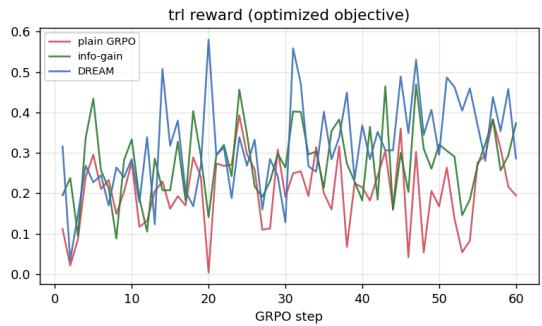

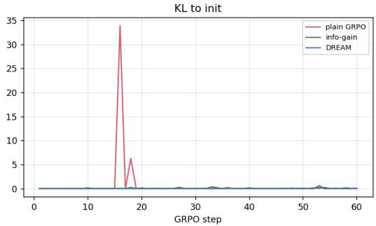

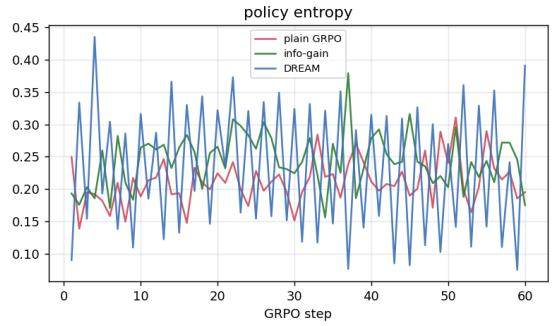

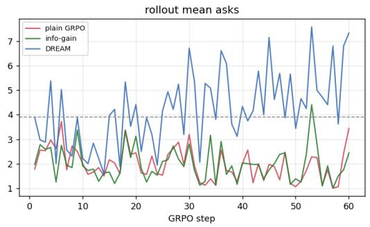

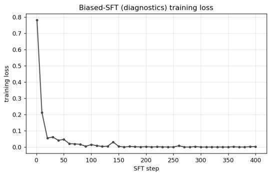  
Figure 6: Training diagnostics derived from the run logs. Top, diagnostics GRPO over 60 optimisation steps. The panels show the optimised reward, KL divergence from the initialization, policy entropy, and mean questions per rollout for outcome-only GRPO, credit-assignment GRPO, and decoupled GRPO. The question trajectory reveals the characteristic procedural differences among the methods; outcome-only GRPO and credit-assignment GRPO both settle well below the oracle gathering level of approximately 3.9, with credit assignment slightly higher, while decoupled GRPO rises above it. Bottom, training loss for the biased SFT warmup. Loss converges to approximately 0.002, showing that the supervised trajectories are closely fit before RL begins.

## B Representative oracle trajectories

The following examples illustrate the common ask-to-commit structure used across the three environments. Each trace shows one held-out case and the corresponding exact adaptive oracle trajectory. The simulator reveals only findings that the agent explicitly requests; all other findings remain hidden.

These examples are intended to clarify the experimental interface and scoring procedure. They are simplified simulator traces rather than realistic clinical conversations.

DIAGNOSTICS (deephedge) -- true latent: high (emergency); oracle: emergent\_tx   
user: Presentation: adult with acute chest pain. Chart: no results yet.   
assistant: {"action\_type":"ask","intent":"troponin\_high"} user: troponin elevated   
assistant: {"action\_type":"ask","intent":"ecg\_ischemia"} user: ECG shows ischemia   
assistant: {"action\_type":"ask","intent":"dyspnea\_severe"} user: severe dyspnea   
assistant: {"action\_type":"ask","intent":"hypotension"} user: hypotensive   
assistant: {"action\_type":"commit","decision":"emergent\_tx",...} reward = 0.83   
REFILL TRIAGE -- true latent: moderate; oracle: dose\_adjust   
user: Refill request: ACE inhibitor / ARB (lisinopril). Chart: no recent labs.   
assistant: {"action\_type":"ask","intent":"renal\_decline"} user: eGFR declining   
assistant: {"action\_type":"ask","intent":"egfr\_severe"} user: decline mild   
assistant: {"action\_type":"ask","intent":"volume\_dehydrated"} user: dehydrated   
assistant: {"action\_type":"commit","decision":"dose\_adjust",...} reward = 0.81   
TITRATION -- true latent: high clot / low bleed; oracle: high (full intensity)   
user: Patient: older adult with atrial fibrillation. Chart: none documented.   
assistant: {"action\_type":"ask","intent":"bleed\_history"} user: no prior bleeding   
assistant: {"action\_type":"ask","intent":"fall\_risk"} user: low fall risk   
assistant: {"action\_type":"commit","decision":"high",...} reward = 1.34

The diagnostics trajectory obtains four findings before selecting emergency treatment. Its terminal utility is reduced by four question costs, producing the reported reward of 0.83. The refill trajectory obtains three findings before modifying the medication dose, resulting in reward 0.81. The titration trajectory asks about two bleeding risk factors before selecting full treatment intensity.

## C Additional decoupled, refill triage, and coverage results

The following figures provide the decoupled GRPO checkpoint trajectory and additional results for the refill triage and biased SFT experiments. They complement the main results by showing how aggregate support can conceal deterioration in high-risk behaviour or excessive information gathering.

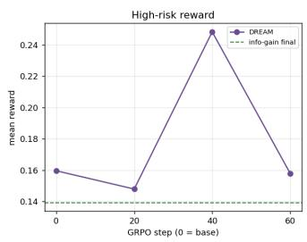

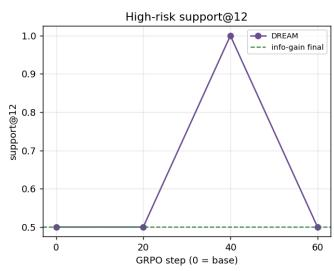

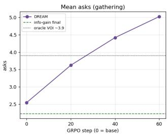  
Figure 7: Checkpoint trajectory for decoupled GRPO on diagnostics. Evaluation uses the held-out hidden condition and the pure verifier reward. High-risk oracle-grade support and high-risk value peak at checkpoint 40, reaching 1.00 and +0.248, respectively. The same checkpoint also shows increased gathering; mean questions approach and then exceed the oracle level of approximately 3.9. The trajectory illustrates the method’s central tradeoff between high-risk coverage and information burden.

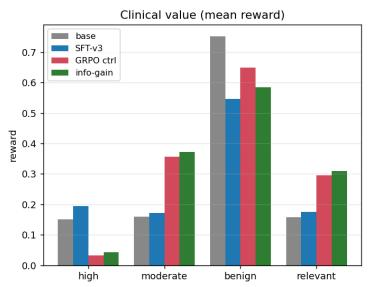

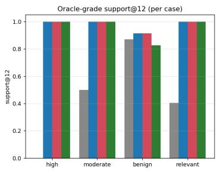

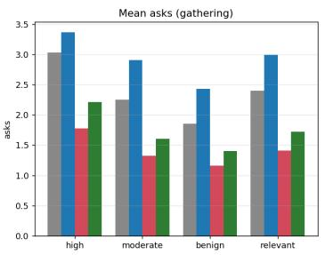  
Figure 8: Refill triage performance by risk subgroup in the held-out hidden condition, evaluated with the pure verifier reward. The figure compares the base model, the SFT v3 warmup, outcome-only GRPO, and creditassignment GRPO at their final checkpoints. The SFT warmup already achieves the strongest high-risk result. Both RL policies subsequently reduce high-risk value and move toward shorter, under-gathered trajectories, despite preserving high support under stochastic sampling.

Repairing a biased SFT's high-risk hole fails for BOTH RL variants (info-gain under-gathers, DREAM over-gathers; held-out hidden)  
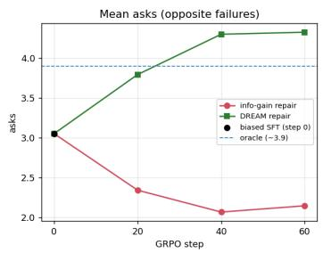

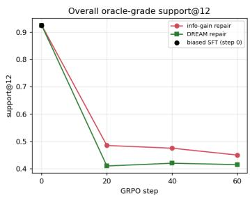

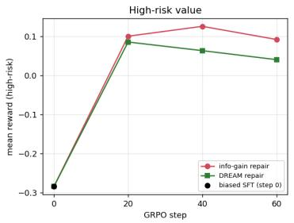  
Figure 9: Attempted reinforcement learning repair of the biased SFT policy. Credit assignment and decoupled GRPO move away from the initialization in opposite directions. Credit assignment reduces gathering and loses high-risk support; decoupled GRPO increases gathering and damages benign support. Both methods reduce the SFT policy’s strong aggregate support, and neither restores the missing high-risk procedure.

Biased-SFT high-risk hole is NOT repaired by RL: info-gain collapses support, DREAM over-gathers and damages benign/moderate (held-out hidden, n=200)  
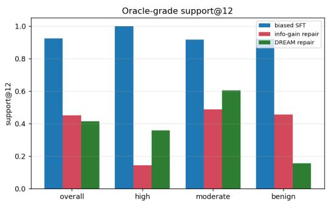

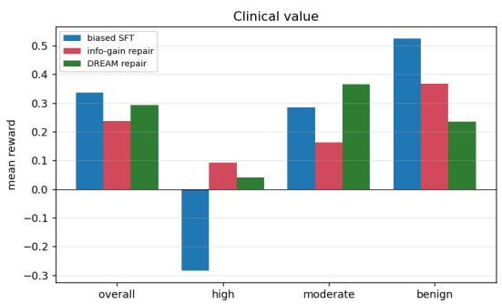  
Figure 10: Attempted repair of a mildly biased diagnostics SFT policy by risk subgroup, using the held-out hidden condition and n=200 cases. Both RL methods lose most of the initialization’s high-risk oracle-grade support; support falls from 1.00 for the SFT initialization to 0.14 with credit-assignment GRPO and 0.36 with decoupled GRPO, even as high-risk value rises. The methods fail in different directions. Credit assignment reduces gathering, while decoupled GRPO increases question burden and lowers benign support from 0.92 to 0.16. This figure complements Table 5 and Figure 9.

## Code

https://github.com/csbrendan/Safe-Reinforcement-Learning-for-Multi-Turn-Clinical-Agents

## References

Bradley Brown, Jordan Juravsky, Ryan Ehrlich, Ronald Clark, Quoc V. Le, Christopher Ré, and Azalia Mirhoseini. Large language monkeys: Scaling inference compute with repeated sampling, 2024. URL https://arxiv.org/abs/2407.21787.

Junying Chen, Zhenyang Cai, Ke Ji, Xidong Wang, Wanlong Liu, Rongsheng Wang, Jianye Hou, and Benyou Wang. HuatuoGPT-o1: Towards medical complex reasoning with LLMs. arXiv preprint arXiv:2412.18925, 2024. URL https://arxiv.org/abs/2412.18925.

Chengfeng Dou, Ying Zhang, Zhi Jin, Wenpin Jiao, Haiyan Zhao, Yongqiang Zhao, and Zhengwei Tao. Integrating physician diagnostic logic into large language models: Preference learning from process feedback. In Findings of the Association for Computational Linguistics: ACL 2024, pages 2453–2473. Association for Computational Linguistics, 2024. doi: 10.18653/v1/2024.findingsacl.144. URL https://aclanthology.org/2024.findings-acl.144/.

Yichun Feng, Jiawei Wang, Lu Zhou, Yikai Zheng, Zhen Lei, and Yixue Li. Real-world doctor agent with proactive consultation through multi-agent reinforcement learning, 2026. URL https: //arxiv.org/abs/2505.19630.

Anna Goldie, Azalia Mirhoseini, Hao Zhou, Irene Cai, and Christopher D. Manning. Synthetic data generation & multi-step rl for reasoning & tool use, 2025. URL https://arxiv.org/abs/ 2504.04736.

Jubayer Ibn Hamid, Ifdita Hasan Orney, Michael Y. Li, Omar Shaikh, Yoonho Lee, Dorsa Sadigh, Chelsea Finn, and Noah Goodman. Spiral: Learning to search and aggregate, 2026. URL https://arxiv.org/abs/2606.23595.

Edward J. Hu, Yelong Shen, Phillip Wallis, Zeyuan Allen-Zhu, Yuanzhi Li, Shean Wang, Lu Wang, and Weizhu Chen. LoRA: Low-rank adaptation of large language models. In International Conference on Learning Representations (ICLR), 2022.

Woosuk Kwon, Zhuohan Li, Siyuan Zhuang, Ying Sheng, Lianmin Zheng, Cody Hao Yu, Joseph Gonzalez, Hao Zhang, and Ion Stoica. Efficient memory management for large language model serving with PagedAttention. In Proceedings of the 29th Symposium on Operating Systems Principles, pages 611–626. Association for Computing Machinery, 2023. URL https://doi. org/10.1145/3600006.3613165.

Hunter Lightman, Vineet Kosaraju, Yura Burda, Harri Edwards, Bowen Baker, Teddy Lee, Jan Leike, John Schulman, Ilya Sutskever, and Karl Cobbe. Let’s verify step by step, 2023. URL https://arxiv.org/abs/2305.20050.

Jiacheng Lin, Zhenbang Wu, and Jimeng Sun. Training LLMs for EHR-based reasoning tasks via reinforcement learning (EHRMIND). arXiv preprint arXiv:2505.24105, 2025. URL https: //arxiv.org/abs/2505.24105.

Evan Zheran Liu, Aditi Raghunathan, Percy Liang, and Chelsea Finn. Decoupling exploration and exploitation for meta-reinforcement learning without sacrifices. In International Conference on Machine Learning (ICML), 2021.

Andrew Y. Ng, Daishi Harada, and Stuart Russell. Policy invariance under reward transformations: Theory and application to reward shaping. In International Conference on Machine Learning (ICML), 1999.

Harsha Nori, Mayank Daswani, Christopher Kelly, Scott Lundberg, Marco Tulio Ribeiro, Marc Wilson, Xiaoxuan Liu, Viknesh Sounderajah, Jonathan Carlson, Matthew P. Lungren, Bay Gross, Peter Hames, Mustafa Suleyman, Dominic King, and Eric Horvitz. Sequential diagnosis with language models, 2025. URL https://arxiv.org/abs/2506.22405.

Adam Paszke, Sam Gross, Francisco Massa, Adam Lerer, James Bradbury, Gregory Chanan, Trevor Killeen, Zeming Lin, Natalia Gimelshein, Luca Antiga, Alban Desmaison, Andreas Kopf, Edward Yang, Zachary DeVito, Martin Raison, Alykhan Tejani, Sasank Chilamkurthy, Benoit Steiner, Lu Fang, Junjie Bai, and Soumith Chintala. PyTorch: An imperative style, high-performance deep learning library. In Advances in Neural Information Processing Systems, volume 32. Curran Associates, Inc., 2019. URL https://proceedings.neurips.cc/paper\_files/paper/2019/ hash/bdbca288fee7f92f2bfa9f7012727740-Abstract.html.

Khaled Saab, Robert Carter, Aidan Hong, et al. MedGemma technical report. arXiv preprint arXiv:2507.05201, 2025. URL https://arxiv.org/abs/2507.05201.

Thomas Savage, Stephen P. Ma, Abdessalem Boukil, Ekanath Rangan, Vishwesh Patel, Ivan Lopez, and Jonathan Chen. Fine-tuning methods for large language models in clinical medicine by supervised fine-tuning and direct preference optimization: Comparative evaluation. Journal of Medical Internet Research, 27:e76048, 2025. doi: 10.2196/76048. URL https://www.jmir. org/2025/1/e76048/.

Samuel Schmidgall, Rojin Ziaei, Carl Harris, Ji Woong Kim, Eduardo Pontes Reis, Jeffrey Jopling, and Michael Moor. AgentClinic: a multimodal benchmark for tool-using clinical AI agents. npj Digital Medicine, 9:499, 2026. doi: 10.1038/s41746-026-02674-7. URL https://www.nature. com/articles/s41746-026-02674-7. Code: https://github.com/SamuelSchmidgall/ AgentClinic.

Zhihong Shao, Peiyi Wang, Qihao Zhu, Runxin Xu, Junxiao Song, Xiao Bi, Haowei Zhang, Mingchuan Zhang, Y. K. Li, Y. Wu, and Daya Guo. DeepSeekMath: Pushing the limits of mathematical reasoning in open language models. arXiv preprint arXiv:2402.03300, 2024. URL https://arxiv.org/abs/2402.03300.

Liwen Sun, Junyi Zhao, Maria Han, and Chenyan Xiong. ED-Copilot: Reduce emergency department wait time with language model diagnostic assistance. In International Conference on Machine Learning (ICML), 2024.

Tao Tu, Anil Palepu, Mike Schaekermann, Khaled Saab, Jan Freyberg, et al. Towards conversational diagnostic AI. arXiv preprint arXiv:2401.05654, 2024. URL https://arxiv.org/abs/2401. 05654.

Jonathan Uesato, Nate Kushman, Ramana Kumar, Francis Song, Noah Siegel, Lisa Wang, Antonia Creswell, Geoffrey Irving, and Irina Higgins. Solving math word problems with process- and outcome-based feedback, 2022. URL https://arxiv.org/abs/2211.14275.

Leandro von Werra, Younes Belkada, Lewis Tunstall, Edward Beeching, Tristan Thrush, Nathan Lambert, Shengyi Huang, Kashif Rasul, and Quentin Gallouédec. TRL: Transformers reinforcement learning. Software, 2020. URL https://github.com/huggingface/trl.

Huaijie Wang, Shibo Hao, Hanze Dong, Shenao Zhang, Yilin Bao, Ziran Yang, and Yi Wu. Offline reinforcement learning for LLM multi-step reasoning. In Findings of the Association for Computational Linguistics: ACL 2025, pages 8881–8893. Association for Computational Linguis tics, 2025. doi: 10.18653/v1/2025.findings-acl.464. URL https://aclanthology.org/2025. findings-acl.464/.

Peiyi Wang, Lei Li, Zhihong Shao, Runxin Xu, Damai Dai, Yifei Li, Deli Chen, Yu Wu, and Zhifang Sui. Math-shepherd: Verify and reinforce LLMs step-by-step without human annotations. In Proceedings of the 62nd Annual Meeting of the Association for Computational Linguistics (Volume 1: Long Papers), pages 9426–9439. Association for Computational Linguistics, 2024. doi: 10.18653/v1/2024.acl-long.510. URL https://aclanthology.org/2024.acl-long.510/.

Thomas Wolf, Lysandre Debut, Victor Sanh, Julien Chaumond, Clement Delangue, Anthony Moi, Pierric Cistac, Tim Rault, Remi Louf, Morgan Funtowicz, Joe Davison, Sam Shleifer, Patrick von Platen, Clara Ma, Yacine Jernite, Julien Plu, Canwen Xu, Teven Le Scao, Sylvain Gugger, Mariama Drame, Quentin Lhoest, and Alexander Rush. Transformers: State-of-the-art natural language processing. In Proceedings of the 2020 Conference on Empirical Methods in Natural Language Processing: System Demonstrations, pages 38–45. Association for Computational Linguistics, 2020. URL https://doi.org/10.18653/v1/2020.emnlp-demos.6.

Sheng Zhang et al. MED-RLVR: Emerging medical reasoning from a 3B base model via reinforcement learning. arXiv preprint arXiv:2502.19655, 2025. URL https://arxiv.org/abs/2502.19655.

Siyan Zhao, Zhihui Xie, Mengchen Liu, Jing Huang, Guan Pang, Feiyu Chen, and Aditya Grover. Self-distilled reasoner: On-policy self-distillation for large language models, 2026. URL https: //arxiv.org/abs/2601.18734.