# Speculative Self-Distillation enables Efficient Knowledge Internalization

Shayan Talaei<sup>∗</sup> Stanford University

Jonas Hübotter ETH Zürich

Agam Bhatia<sup>∗</sup> Stanford University

Amin Saberi Stanford University

Arshia Soltani Moakhar<sup>∗</sup> Stanford University

Azalia Mirhoseini Stanford University

## Abstract

Many real-world applications require language models to internalize knowledge that was absent from pretraining, to incorporate continually updated facts, or to learn new domain skills. Self-distillation has emerged as a natural approach for this task. A model conditioned on the source material acts as the teacher, and an unconditioned student is trained to reproduce the teacher’s behavior closedbook. We propose Speculative Self-Distillation (SSD), an efficient per-token mixed-policy method for self-distillation. The student generates each rollout by default, while the teacher intervenes only at positions where its next-token distribution substantially diverges from the student’s. Unlike off-policy distillation with teacher-generated prefixes, this design keeps training rollouts close to the student’s test-time behavior, while avoiding the low-signal states that fully onpolicy rollouts drift into. In effect, SSD lets the teacher steer the rollout exactly where the privileged context changes the prediction. On three closed-book QA benchmarks measuring fact recall, knowledge updates, and skill acquisition, SSD nearly matches on-policy distillation while using 38–69% fewer supervised tokens and consistently outperforms off-policy distillation on the held-out test set. On a forgetting stress test, SSD retains the most general capability while also achieving the best in-domain accuracy and using less supervision than the on-policy baseline. Overall, SSD establishes a new accuracy–efficiency–forgetting Pareto frontier for self-distillation. Project web page is available at ssd-distill.github.io.

## 1 Introduction

Practical deployments often require language models to use knowledge that was absent from pretraining, such as updated facts, new discoveries, or domain-specific information (Lewis et al., 2020; Petroni et al., 2021; Gao et al., 2024b). A common solution is in-context learning (ICL), where the relevant information is supplied in the prompt at inference time (Brown et al., 2020; Dong et al., 2024).

While effective, this approach has several limitations: it uses context space, requires careful prompt or retrieval design (Liu et al., 2022), and adds per-query inference cost. Models can also fail to use relevant evidence reliably even when it is present in the context (Liu et al., 2024; Gao et al., 2024b). Parametric learning offers a complementary approach by distilling new knowledge into the model’s weights, where it remains available without repeatedly retrieving and processing the source material at inference time.

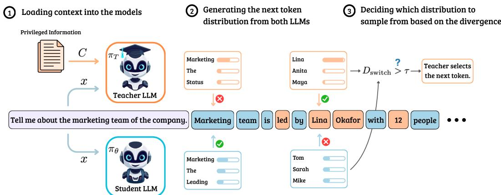  
Figure 1: Speculative Self-Distillation decoding loop. (1) The student receives the prompt x, while the teacher receives both x and the privileged context C. (2) At each rollout position, both models propose a next-token distribution conditioned on the jointly decoded prefix. (3) If the switching divergence $D _ { \mathrm { s w i t c h } }$ between the two distributions exceeds the threshold τ, the teacher samples the next token; otherwise the student does. The loop continues until the rollout termination condition is met.

A large body of work has therefore studied how to move knowledge from context into the model’s weights (Yang et al., 2025; Lin et al., 2025). Self-distillation has emerged as one powerful tool for this setting (Snell et al., 2022; Shenfeld et al., 2026a). The idea is to recast the model’s ICL capability as training signal, conditioning the same model on the source material to obtain a more informed token distribution from this teacher, and then distilling that distribution back into the unconditioned student. The central difficulty is choosing which rollout states should carry that distillation signal.

Existing self-distillation methods differ in how they generate training rollouts, creating a tradeoff between distribution match and learning signal. We make this tradeoff explicit with the supervision signal: the per-token forward Kullback–Leibler divergence between the teacher’s and student’s next-token distributions along a rollout (Kullback & Leibler, 1951). On-policy rollouts match the student’s test-time distribution, but are signal-starved: after the student commits to an early prefix, the teacher is conditioned on that prefix and can only provide a coherent continuation. Off-policy rollouts preserve stronger signal by using teacher-generated prefixes, but train the student on trajectories it will not produce at test time. Both choices therefore allocate supervision inefficiently. On-policy training spends it on positions where the teacher has little to add, whereas off-policy training spends it on states the student will not visit. This raises our central question: can we preserve the signal of off-policy rollouts while staying close to the student’s distribution?

This inefficient allocation of supervision signal motivates a method that uses teacher generation selectively while keeping rollouts close to the student. We propose Speculative Self-Distillation (SSD), a compute-efficient, per-token mixed-policy method built around inflection tokens: positions where privileged context substantially changes the teacher’s next-token distribution relative to the student’s. In SSD the student generates the rollout by default. At each token position, SSD compares the teacher’s and student’s next-token distributions. If the divergence between them exceeds a threshold τ (we use the Jensen–Shannon divergence (JSD; Lin, 1991) in most experiments), the position is marked as an inflection token and the teacher generates the next token (Figure 1). The teacher distribution and distillation loss are still evaluated at every response position; only the policy that emits the rollout token changes. The threshold τ provides a single knob that interpolates between prior approaches: small τ recovers off-policy distillation, while large τ recovers on-policy distillation (Section 4.6).

Across three closed-book QA benchmarks, SSD nearly matches on-policy accuracy while using substantially fewer supervised tokens, reducing supervised-token usage by 48%, 38%, and 69% relative to on-policy self-distillation on Company Memo, Wikipedia, and Science Q&A, respectively. SSD is 1.35 points below on-policy on Company Memo and 0.08 and 0.15 points above it on Wikipedia and Science Q&A. Across 4B, 7B, and 14B models on Science Q&A, SSD achieves at least on-policy accuracy with 23–55% fewer supervised tokens at the evaluations reported in Table 1. Crucially, this efficiency does not come at the expense of the model’s prior capabilities.

On a forgetting stress test that fine-tunes Qwen2.5-7B on a chemistry split, we measure the mean accuracy change (∆) across six broad benchmarks relative to the base model. In this setting, SSD forgets less than either baseline while also achieving the highest in-domain accuracy. Its average general performance drops by 1.4 points, compared with 4.5 points for on-policy and 6.6 points for off-policy distillation. Compared with on-policy self-distillation, SSD therefore improves all three axes of accuracy, forgetting, and efficiency at once in this experiment, rather than trading one against another. Our contributions are as follows:

• A signal-based diagnosis of the off-policy/on-policy tradeoff. Using the per-token teacher– student divergence as a diagnostic for the supervision available along a rollout, we show that on-policy self-distillation is signal-starved at later positions while off-policy rollouts carry signal throughout, accounting for on-policy training’s compute inefficiency (Section 3.1).

• Speculative Self-Distillation. We propose SSD, a per-token mixed-policy method in which the student generates by default and the teacher takes over only at inflection positions where the teacher–student divergence exceeds a threshold τ. A single τ interpolates between off-policy (τ →0) and on-policy $( \tau \to \infty )$ self-distillation (Section 3).

• On-policy accuracy at a fraction of the supervision. Across three knowledge-acquisition tasks (private documents, Wikipedia knowledge updates, and scientific Q&A), SSD nearly matches on-policy self-distillation accuracy using 38–69% fewer supervised tokens. We also show that a sweep over τ traces the accuracy–efficiency Pareto frontier between the off-policy and on-policy endpoints (Section 4).

• Reduced forgetting without sacrificing in-domain accuracy. On a forgetting stress test, SSD retains the most general capability while achieving the highest in-domain accuracy and using less supervision than the on-policy baseline (Section 4.4).

## 2 A Unified View of Self-Distillation

Let D be a distribution over pairs $( C , x )$ , where x is the prompt and C is the privileged context: a document, instruction, reference answer, or other information useful for answering x. Self-distillation defines a student $\pi _ { \boldsymbol { \theta } } ( \cdot \mid x )$ and teacher $\pi _ { T } ( \cdot \mid x , C ) : = \pi _ { \theta _ { \mathrm { r e f } } } ( \cdot \mid x , C )$ , which has the privileged information C in context and uses the initial model weights θ<sub>ref</sub>. The goal of self-distillation is to update θ so that $\pi _ { \theta }$ approximates $\pi _ { T }$ for held-out pairs $( C ^ { \prime } , x ^ { \prime } )$ , without $C ^ { \prime }$ being supplied at test time (Snell et al., 2022).

The self-distillation loss. The methods we study use the same token-level objective below and differ only in how rollouts are generated:

$$
\mathcal { L } ( \theta ) = \mathbb { E } _ { y \sim \pi _ { \mathrm { g e n } } } \bigg [ \frac { 1 } { | y | } \sum _ { t } D _ { \mathrm { l o s s } } \big ( \pi _ { T } ( \cdot \mid x , C , y _ { < t } ) \big | \big | \pi _ { \theta } ( \cdot \mid x , y _ { < t } ) \big ) \bigg ] ,\tag{1}
$$

where $\pi _ { \mathrm { g e n } }$ is the rollout policy and $D _ { \mathrm { l o s s } }$ is a divergence between the teacher and student next-token distributions. We use the forward KL divergence, ${ \bar { D } } _ { \mathrm { K L } } ( \pi _ { T } \parallel \pi _ { \theta } )$ , in our experiments. The choice of $\pi _ { \mathrm { g e n } }$ defines different methods.

Off-policy self-distillation. Setting $\pi _ { \mathrm { g e n } } ~ = ~ \pi _ { T }$ gives off-policy self-distillation. The teacher generates the response, and the student is trained to match the teacher along teacher-generated trajectories (Snell et al., 2022; Kujanpää et al., 2025; Eyuboglu et al., 2026). This approach is simple and data-efficient: every training position lies on a teacher-generated trajectory with privileged-context guidance. However, during training the student is supervised on teacher-induced states; at test time it must act on states induced by its own generations (Ross et al., 2011).

On-policy self-distillation. Setting $\pi _ { \mathrm { g e n } } ~ = ~ \pi _ { \theta }$ gives on-policy self-distillation. The student generates the response, while the teacher provides token-level supervision along the resulting student trajectory via Eq. (1) (Agarwal et al., 2024; Shenfeld et al., 2026a). This removes the train-test mismatch.

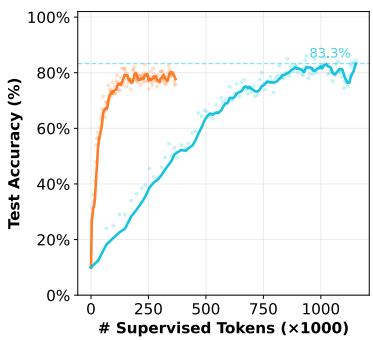

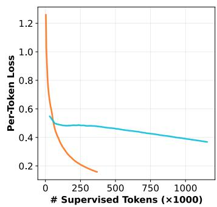  
—Off-policy Self-distillation — On-policy Self-distillation

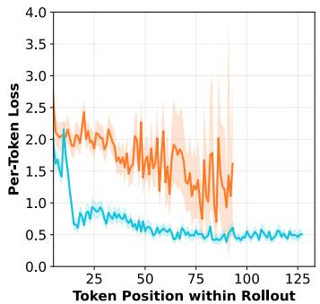  
Figure 2: Comparison of off-policy and on-policy training on the Wikipedia task described in Section 4. Left: Off-policy training converges faster than on-policy training, but saturates at lower performance. Middle: Off-policy training has a larger initial self-distillation loss than on-policy training and converges faster. Right: We measure the average per-token self-distillation loss across different token positions within a rollout. We find that a teacher conditioned on student-sampled prefixes predicts much like the student itself. This reduces the supervision signal at later positions of the rollout. Shaded bands (right panel) are 90% bootstrap intervals of the mean.

Dense supervision versus rollout intervention. Throughout this paper, every response position contributes the distillation loss in Eq. (1), regardless of whether the teacher or student emitted the corresponding rollout token. The rollout policy therefore controls the states on which dense supervision is applied; it does not decide whether the teacher is evaluated or whether the loss is present. This distinction is central to interpreting both the method and its efficiency.

## 3 Speculative Self-Distillation

We propose an alternative variant of self-distillation, called speculative self-distillation (SSD), that is more efficient than on-policy training while achieving better performance than off-policy training. We first study the tradeoff between off-policy and on-policy training in Section 3.1 before introducing SSD in Section 3.2.

## 3.1 The Inefficiency of On-Policy Self-Distillation

To study the tradeoff between off-policy and on-policy self-distillation, we compare them on the Wikipedia knowledge acquisition task described in Section 4. Figure 2 (left) shows a clear pattern: off-policy training reaches 78% accuracy with roughly 5× fewer supervised tokens than on-policy training, while on-policy training reaches better final performance (run details in Appendix C.1). This is consistent with prior work on on-policy distillation (Agarwal et al., 2024; Shenfeld et al., 2026a). The usual explanation is that on-policy training avoids train-test mismatch. We focus on the complementary question: why is off-policy training so much more compute-efficient?

1) Off-policy training gives stronger supervision. The loss in Eq. (1) measures how much the teacher and student disagree at a training state, and it also sets the size of the update. We refer to it as the supervision signal. A larger signal means a larger update, though not necessarily a more useful one (see point 2 below). Figure 2 (middle) shows that off-policy training starts with a substantially larger signal than on-policy training and also reduces it at a faster rate.

2) On-policy training spends supervision on transient states. Figure 3 illustrates a rollout containing several positions where the teacher and student strongly disagree. The prompt asks about the “marketing team of the company”. While the first few response tokens are plausible under both student and teacher, rollouts of student and teacher diverge at the fourth token. The teacher begins to discuss the leadership of the marketing team which is described in its privileged context whereas the student provides a generic description. We call such a position where student and teacher disagree strongly an inflection position:

Definition 1 (τ-inflection position). Given a rollout $y \sim \pi _ { \mathrm { g e n } }$ and $\tau > 0$ , we call the t-th position in y a τ-inflection position if

$$
\delta _ { t } : = D _ { \mathrm { s w i t c h } } \big ( \pi _ { T } ( \cdot  { | } x , C , y _ { < t } )  { | | } \pi _ { \theta } ( \cdot  { | } x , y _ { < t } ) \big ) > \tau ,\tag{2}
$$

where $D _ { \mathrm { s w i t c h } }$ is any divergence between the two next-token distributions.

At an inflection position, the distillation loss heavily pushes the student away from the original student’s next-token prediction. If the student later reaches the same prefix, it is likely to choose a different continuation. For example, in Figure 3, the student will eventually learn to discuss the “leadership of the marketing team”. Several states reached by the original student rollout after the inflection position are therefore transient: they were produced by a policy that the update is explicitly changing. Supervision on those states is consequently less useful. In contrast, off-policy sampling provides detailed information about the marketing team within a single rollout.

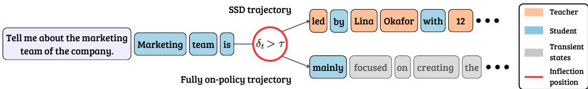  
Figure 3: Example rollout with SSD versus on-policy sampling. Both rollouts share the prefix “Marketing team is”. At the next token the teacher and student disagree strongly, which makes it an inflection position (circled in red). SSD (top) lets the teacher write this token and a few later ones (orange), and the student writes the rest (blue). The on-policy rollout (bottom) keeps the student’s token, and the tokens that follow (gray) are transient states that future rollouts are unlikely to revisit.

3) The on-policy signal decays quickly along the rollout. Figure 2 (right) shows where the supervision goes. Along on-policy rollouts, the signal is high for the first few tokens and then drops, while along off-policy rollouts it stays high throughout. The student writes without the privileged context, so after a few tokens its rollout tends to drift into generic text that the context says little about. Conditioned on such a prefix, the teacher mostly agrees with the student and has little to correct. A teacher-written rollout instead stays tied to the context, so the teacher keeps disagreeing with the student at later positions. The same pattern holds on Science Q&A (Appendix C.1): the signal in the first quarter of an on-policy rollout is 3.3× that of the last quarter, and beyond position 512 it is 17× lower than at positions 5–8. On-policy training therefore applies its loss at every position, but most of that loss falls on states where the teacher has little to teach.

## 3.2 Method: Switching to the Teacher at Inflection Positions

The previous section highlights a key tradeoff: Off-policy self-distillation is compute-efficient because teacher trajectories provide strong supervision, but it trains the student on states it may not visit at test time. On-policy self-distillation avoids this mismatch by sampling from the student, but much of its supervision is weak or spent on transient states. We want the best of both: rollouts should stay on the student’s distribution when the student is already aligned with the teacher, and switch to the teacher only where the privileged context substantially changes the next-token distribution.

This motivates speculative self-distillation (SSD): generate from the student, but let the teacher take over at inflection positions where the teacher and student strongly disagree. At an inflection position (i.e., where $\delta _ { t } > \tau )$ , the teacher generates the next token; otherwise, the student does. The switching threshold τ controls how often the teacher writes the token: lower values hand over to the teacher more often, while higher values keep rollouts closer to the student. Training uses Eq. (1) with the mixed rollout policy $\pi _ { \mathrm { g e n } } = \pi _ { \mathrm { m i x } }$ induced by this rule. The switching divergence $D _ { \mathrm { s w i t c h } }$ , together with τ, determines which model emits each token, while $D _ { \mathrm { l o s s } }$ defines the distillation loss applied at every response position. In our experiments, $D _ { \mathrm { l o s s } }$ is the forward KL divergence from teacher to student.

Crucially, the teacher distribution is computed at every response position in order to evaluate the routing test, and Eq. (1) is also applied at every response position. The switch changes only which policy emits $y _ { t }$ . It should therefore be understood as selective trajectory correction, not selective supervision.

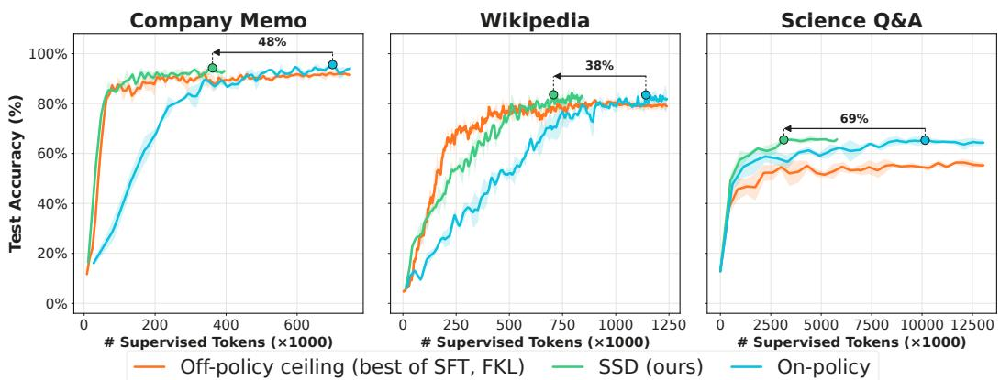  
Figure 4: SSD approaches or exceeds the on-policy plateau with a fraction of the supervised tokens. Test accuracy versus cumulative supervised tokens on Company Memo (left), Wikipedia (middle), and Science Q&A (right). Each curve is the mean over three independent training seeds; shading is ±1 sample standard deviation. Each panel compares the stronger off-policy baseline (SFT or FKL), the on-policy baseline (SDFT), and SSD. Arrows show the reduction in supervised tokens from the highest-accuracy on-policy point to the first SSD point that reaches that accuracy. For Company Memo, we use SSD’s highest-accuracy point instead.

## 4 Experiments and Results

We first describe our experimental setup (Section 4.1), then show that SSD nearly matches on-policy self-distillation accuracy while using 38–69% fewer supervised tokens (Section 4.2). We then show that these token savings shorten end-to-end training (Section 4.3) and that SSD reduces forgetting compared to both off-policy and on-policy baselines (Section 4.4). Finally, we examine how teacher intervention declines during training (Section 4.5) and how the switching threshold controls the accuracy–efficiency tradeoff (Section 4.6).

## 4.1 Experimental Setup

Tasks. The first task, Company Memo, uses a synthetic internal document about a fictional company, modeling private organizational knowledge that does not appear online. The second task, Wikipedia, uses articles about natural-disaster events that are available on the web but happened after the model’s knowledge cutoff date. The third task, Science Q&A, is built from the Chemistry Level-3 subset of SciKnowEval (Feng et al., 2025), which contains undergraduate-level chemistry questions requiring scientific reasoning. All three tasks are drawn from the experiments in SDFT (Shenfeld et al., 2026a).

Models. Unless stated otherwise, the student and the teacher are both Qwen3-4B-Instruct-2507. The forgetting study in Section 4.4 uses Qwen2.5-7B-Instruct.

Baselines. The baselines span the two ends of the self-distillation spectrum. For off-policy distillation (Snell et al., 2022; Eyuboglu et al., 2026), we evaluate SFT, which applies cross-entropy to teacher-sampled tokens, and FKL, which applies the forward KL divergence between teacher and student. For on-policy distillation, we evaluate SDFT (Shenfeld et al., 2026a). Hyperparameters for every method, including the switch and threshold of SSD, are selected on the held-out split (Appendix B.3).

Evaluation. The headline Qwen3-4B comparisons use three independent training seeds and greedy evaluation. Curves show the mean and ±1 sample standard deviation across seeds. Other experiments use the evaluation protocols specified in their captions and appendix sections.

Per-task split sizes, hyperparameter searches, prompt templates, and other implementation details are reported in Appendix B. We include a qualitative case study in Appendix D.

Table 1: The token efficiency of SSD persists across model scales on Science Q&A. Accuracy and cumulative supervised tokens for on-policy self-distillation and SSD. Reported intervals are 95% confidence intervals. For Qwen3-4B, we report the final evaluation after 8 epochs for on-policy training and 4 epochs for SSD; accuracy and token counts are averaged over three training seeds. For Qwen2.5-7B, results are based on three sampled decodes. Qwen3-14B results are from a single run. The last column is the reduction in supervised tokens relative to on-policy training at these evaluations.
<table><tr><td rowspan="2">Model</td><td colspan="2">On-policy</td><td colspan="2">SSD</td><td></td></tr><tr><td></td><td>Acc. Tokens (M)</td><td></td><td>Acc. Tokens (M)</td><td>Fewer tokens</td></tr><tr><td>Qwen3-4B</td><td> $6 4 . 6 \pm 2 . 7$ </td><td>13.19</td><td> ${ \bf 6 6 . 3 \pm 2 . 6 }$ </td><td>5.88</td><td>55%</td></tr><tr><td>Qwen2.5-7B</td><td> $7 1 . 0 \pm 0 . 8$ </td><td>2.84</td><td> ${ \bf 7 3 . 5 \pm 1 . 7 }$ </td><td>2.20</td><td>23%</td></tr><tr><td>Qwen3-14B</td><td>73.2</td><td>2.16</td><td>75.5</td><td>1.26</td><td>42%</td></tr></table>

Table 2: SSD improves Science Q&A accuracy while reducing forgetting relative to on-policy self-distillation. Forgetting evaluation on Qwen2.5-7B-Instruct after fine-tuning on the SciKnowEval Chemistry split. Hella. = HellaSwag, Human = HumanEval (pass@1), TQA1 = TruthfulQA (MC1), and Wino. = Winogrande. Avg.6 is the mean score across the six general benchmarks; ∆ is its change relative to the base model. Bold marks the best fine-tuned method (Base excluded). Reported intervals on SciQA indicate 95% confidence interval half-widths over three sampled decodes (Appendix B.6).
<table><tr><td>Method</td><td>Hella.</td><td>Human</td><td>IFEval</td><td>MMLU</td><td>TQA1</td><td>Wino.</td><td>Avg.6</td><td>∆↑</td><td>SciQA ↑</td><td>Tokens (M) ↓</td></tr><tr><td>Base</td><td>62.1</td><td>70.1</td><td>72.9</td><td>71.8</td><td>47.9</td><td>71.1</td><td>65.98</td><td></td><td>34.2± 2.5</td><td></td></tr><tr><td>Off-policy (SFT)</td><td>61.0</td><td>64.6</td><td>47.0</td><td>69.8</td><td>40.9</td><td>72.8</td><td>59.34</td><td>-6.64</td><td>65.0± 2.4</td><td>1.82</td></tr><tr><td>Off-policy (FKL)</td><td>59.6</td><td>64.0</td><td>48.4</td><td>69.4</td><td>41.1</td><td>73.4</td><td>59.33</td><td>-6.65</td><td>65.3± 3.0</td><td>1.82</td></tr><tr><td>On-policy</td><td>59.6</td><td>73.8</td><td>49.5</td><td>69.9</td><td>43.1</td><td>73.2</td><td>61.51</td><td>-4.47</td><td>71.0± 0.8</td><td>2.84</td></tr><tr><td>SSD</td><td>61.0</td><td>70.7</td><td>66.8</td><td>71.1</td><td>44.7</td><td>73.2</td><td>64.59</td><td>-1.38</td><td> $7 3 . 5 \pm 1 . 7$ </td><td>2.20</td></tr></table>

## 4.2 SSD reaches on-policy accuracy with fewer supervised tokens

We first evaluate whether per-token switching improves the accuracy–efficiency tradeoff relative to purely off-policy or on-policy self-distillation. Figure 4 reports test accuracy as a function of cumulative supervised tokens across our evaluation tasks. Supervised tokens count response positions that receive the distillation loss, summed over training (Appendix B.2). The Science Q&A curves against training time are in Figure 5. The baselines exhibit a consistent tradeoff: off-policy training improves rapidly but plateaus below SSD and on-policy on Wikipedia and Science Q&A, while on Company Memo it ends close to SSD. On-policy training reaches a higher plateau only after substantially more supervision. SSD combines the favorable parts of both regimes. On Company Memo and Science Q&A, it follows the steep early trajectory of off-policy training, and on Wikipedia and Science Q&A it continues improving into the on-policy high-accuracy regime instead of flattening at the off-policy ceiling.

Relative to on-policy training, SSD uses 48%, 38%, and 69% fewer supervised tokens on Company Memo, Wikipedia, and Science Q&A, with accuracy changes of −1.35, +0.08, and +0.15 percentage points, respectively. SSD therefore stays within 1.4 points of on-policy accuracy on every task. For both token and training-time comparisons, we use the highest accuracy on the on-policy mean curve and the first point on the SSD mean curve to reach or exceed it. If SSD never reaches that accuracy, as on Company Memo, we use its highest-accuracy point instead. We compute both accuracy differences and token savings from these pairs, with token savings measured relative to on-policy training.

This pattern is consistent with the central hypothesis behind SSD. The useful training signal is concentrated at positions where the privileged context changes the next-token distribution, while many other positions can remain student-sampled. By intervening only at those positions, SSD preserves much of the token efficiency of off-policy training while retaining the final-accuracy advantage of on-policy training.

Table 1 connects the Science Q&A result to larger models. In all three models, SSD achieves at least on-policy accuracy with 23–55% fewer total supervised tokens at the reported evaluations. On the same task, closed-book SSD also matches or exceeds retrieving solved demonstrations at inference time while producing shorter responses (Appendix C.2, Table 9).

## 4.3 SSD’s token savings translate into faster training

Section 4.2 showed that SSD nearly matches onpolicy accuracy with fewer supervised tokens. Whether this also shortens end-to-end training depends on the system around it: the trainer and inference engine, the hardware, and how teacher and student generation are scheduled. A naive implementation pays for an extra teacher forward pass at every decoding step. We instead modified vLLM to run the teacher and the student concurrently, with the teacher on a second GPU sending only its final hidden state to the student at each step (Appendix B.7). In our training runs, this joint decoding reaches about 92% of the throughput of student-only decoding, so a joint step takes about as long as a student step. With this setup, SSD and on-policy training take nearly the same wall time per million supervised tokens (Appendix B.8). Translated into end-to-end training time on Science Q&A, this means that SSD reaches the on-policy accuracy plateau after about 130 minutes, while on-policy training needs about 414 minutes, a 69% reduction (Figure 5). This shows that the token savings of SSD carry over to faster end-to-end training.

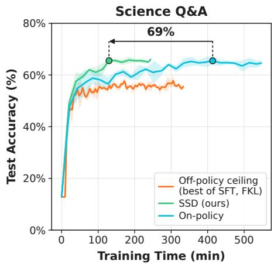  
Figure 5: SSD reaches on-policy accuracy in less training time. Test accuracy versus training time on Science Q&A. Curves show mean ±1 SD over three independent training seeds. Evaluation time is excluded. Appendix B.8 reports the training-time breakdown per supervised token.

## 4.4 SSD reduces forgetting relative to on-policy methods

Beyond accuracy and efficiency, self-distillation should preserve the student’s prior capabilities. Since on-policy self-distillation improves the accuracy–forgetting tradeoff over supervised finetuning (Shenfeld et al., 2026a), we evaluate whether SSD preserves this advantage while selectively using teacher-generated rollout tokens. We first evaluated forgetting with Qwen3-4B, but observed little separation between methods: the six-benchmark averages remained close to the base model across all training methods, which we suspect is due to heavy post-training toward these benchmarks. To study a setting where forgetting is induced, we follow Shenfeld et al. (2026a) and fine-tune Qwen2.5-7B on the SciKnowEval Chemistry split, measuring in-domain Science Q&A accuracy (SciQA) against the mean accuracy change across six general benchmarks (∆). Table 2 reproduces the off-policy vs. on-policy gap: Off-policy (SFT) and Off-policy (FKL) acquire the new skill but forget the most $( \Delta \approx - 6 . 6 )$ , while On-policy forgets less $( \Delta = - 4 . 4 7 )$ . SSD improves on this tradeoff, achieving the highest SciQA accuracy $( 7 3 . 5 \pm 1 . 7 ) $ , the lowest forgetting $( \Delta = - 1 . 3 8 )$ and fewer supervised tokens than On-policy (2.20M vs. 2.84M). This suggests that mixed-policy supervision can improve the accuracy, forgetting, and efficiency tradeoff simultaneously.

## 4.5 SSD becomes mostly on-policy during training

A desirable switching rule should not require a hand-designed schedule for how much the teacher participates. Figure 6 shows that SSD exhibits this behavior automatically. Early in training, the teacher contributes frequently, especially at lower JSD thresholds, indicating that the student and teacher disagree at many rollout positions. As training proceeds, teacher contribution decays across all thresholds. This decline shows that the switch fires less often as the student internalizes the privileged-context behavior, shifting the rollout increasingly toward the student.

The response-length dynamics follow the same adaptation. Runs with higher thresholds initially produce longer and more variable responses, reflecting the fact that the student retains control for longer, letting its draft drift further from the teacher’s distribution. As training progresses, response lengths stabilize and converge across thresholds. Thus, SSD does not only reduce teacher usage; it also changes the distribution of generated trajectories as the student improves. Overall, teacher control in SSD is high when the student lacks the relevant knowledge, then naturally recedes as the student becomes competent.

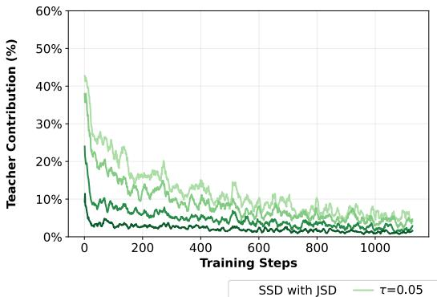

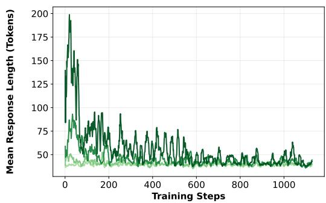  
Figure 6: Teacher contribution decays over training without an external schedule. Training dynamics of SSD on Company Memo for four JSD thresholds τ. (Left) Fraction of rollout tokens generated by the teacher, which drops from up to 43% early in training to 1–5% by the end. (Right) Mean response length, which is initially longer for higher thresholds and converges across thresholds as training proceeds.

## 4.6 SSD lies on the accuracy–efficiency Pareto frontier

In Figure 7, we evaluate whether the switching threshold $\tau$ of SSD effectively interpolates between offpolicy and on-policy self-distillation. Low thresholds $\tau  0$ lie near the off-policy endpoint: the teacher intervenes often, supervised-token usage is low, and final accuracy is limited. As τ increases, SSD becomes more student-sampled, moving toward the on-policy endpoint and improving final accuracy. When using JSD as $D _ { \mathrm { s w i t c h } }$ , this divergence is upper bounded by ln(2) ≈ 0.69, and hence, any larger τ reduces to on-policy training. We find in Figure 7 that SSD occupies a Pareto frontier: intermediate thresholds achieve higher accuracy than off-policy training while using fewer supervised tokens than on-policy training. An ablation of the switching rule itself, comparing JSD and KL switches with token-level rules from prior work, is in Appendix C.3.

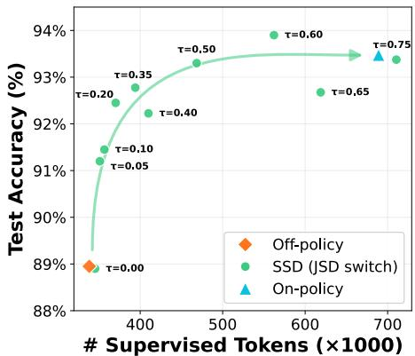  
Figure 7: SSD occupies the accuracy– efficiency Pareto frontier across switching thresholds τ. Downstream QA accuracy versus cumulative supervised tokens for Qwen3-4B on Company Memo.

## 5 Related Work

Knowledge distillation and rollout policies. Knowledge distillation trains a student model to match a teacher’s outputs (Hinton et al., 2015) and is a standard mechanism for transferring language-model capabilities (Song & Zheng, 2026). One important design choice is how training trajectories are generated. Off-policy distillation uses teacher-generated sequences, giving high-quality supervision but creating a mismatch between training prefixes and the prefixes the student will produce at test time, a form of exposure bias studied in imitation learning and sequence prediction (Ross et al., 2011; Bengio et al., 2015). On-policy distillation uses student-generated sequences and asks the teacher to supervise them (Gu et al., 2024; Lu & Thinking Machines Lab, 2025), reducing this mismatch but spending teacher supervision on many tokens where the teacher provides little new information. Mixed-policy methods trade off these costs. GKD mixes teacher and student rollouts at the sequence level (Agarwal et al., 2024), following earlier ideas from DAgger, scheduled sampling, and imitation knowledge distillation (Ross et al., 2011; Bengio et al., 2015; Lin et al., 2020). Other methods make switching decisions within a sequence: SKD lets the teacher replace student proposals that fall outside the teacher’s top-k tokens (Xu et al., 2025), AdaSwitch switches to the teacher after a sliding-window KL threshold is exceeded (Peng et al., 2026), and SWITCH applies a per-position divergence criterion (Koo et al., 2025). These works show that rollout policy is a central lever in distillation, but they study ordinary two-model distillation; we bring this mixed-policy view to privileged-context self-distillation.

Context distillation and self-distillation. In context distillation, the teacher and student share the same base model, but the teacher is given privileged context that the student will not receive at test time (Snell et al., 2022). This context may be a document, instruction, hint, or retrieved passage, and the goal is to internalize the resulting behavior into the model’s parameters. Off-policy variants train on responses generated with privileged context (Kujanpää et al., 2025; Eyuboglu et al., 2026), while on-policy variants supervise student-generated trajectories using the context-conditioned model (Shenfeld et al., 2026a; Ye et al., 2026; Zhao et al., 2026; Hübotter et al., 2026; Kleine Buening et al., 2026; Penaloza et al., 2026). Closest to our setting, GATES (Stein et al., 2026) also makes privileged-context self-distillation selective, but uses agreement among context-conditioned tutor rollouts to gate which questions and tutor trajectories are distilled, rather than which policy generates the rollout. Related work also compresses context into latent state rather than model weights: Cartridges learns compact document-specific representations, while Fast KV Compaction constructs compact KV caches that preserve the attention behavior of the full context (Eyuboglu et al., 2026; Zweiger et al., 2026). Recent on-policy self-distillation methods report better generalization to held-out questions than off-policy training (Shenfeld et al., 2026a), suggesting that staying close to the student’s test-time distribution is important for robust knowledge acquisition. However, these methods still commit to generating the full rollout from the student, even though privileged context typically changes the next-token distribution only at a small number of knowledge-bearing positions. We instead ask whether the rollout policy itself can be chosen selectively at the token level.

Selective use of privileged information. Together, these two lines of work motivate keeping selfdistillation trajectories close to the student while allowing teacher intervention where privileged context provides useful information. In knowledge acquisition, this information may be concentrated at a few knowledge-bearing positions, while many tokens express syntax, formatting, or reasoning shared by the teacher and student. Prior work exploits related forms of sparsity through tokenlevel switching (Xu et al., 2025; Peng et al., 2026; Koo et al., 2025), token-level adaptation of the distillation loss (Jung et al., 2025; Huang et al., 2025; Jang et al., 2026), and context compression that preserves prompt content most relevant to model predictions (Zweiger et al., 2026). Evidence from student-rollout distillation on unseen prompts (Agarwal et al., 2024; Shenfeld et al., 2026a) and KL-based analyses of post-training behavior (Shenfeld et al., 2026b) further supports keeping training close to the student’s distribution. These findings motivate SSD, a per-token mixed-policy method in which the student generates by default and the context-conditioned teacher intervenes when its next-token distribution differs substantially from the student’s.

## 6 Conclusion

Self-distillation for closed-book knowledge acquisition faces a tradeoff between matching the student’s test-time distribution and obtaining useful supervision from teacher-generated trajectories. We introduced SSD, which addresses this tradeoff token by token, letting the student generate by default and switching to the teacher at inflection positions. Across three closed-book QA tasks spanning private documents, knowledge updates, and scientific Q&A, SSD nearly matches on-policy accuracy while using 38–69% fewer supervised tokens. On Science Q&A, it also reaches the on-policy plateau in about 69% less training time. Varying the switching threshold τ traces an accuracy–efficiency Pareto frontier between off-policy and on-policy training, while teacher intervention declines automatically as training progresses. Together with reduced forgetting, these results support adaptive token-level rollout policies for efficient knowledge acquisition.

## Acknowledgements and Disclosures

We thank Hangoo Kang, Hermann Kumbong, Jacky Kwok, Yuzhen Mao, Jon Saad-Falcon, Idan Shenfeld, and Tarun Suresh for helpful discussions and feedback.

We gratefully acknowledge support from federal sources: NSF under No. 24-554 (AIMing) and DARPA under No. HR00112520038 (Fallingwater). This work was supported in part by the Air Force Office of Scientific Research (AFOSR) under Grant FA9550-23-1-0251 and in part by the Office of Naval Research (ONR) under Grant N00014-24-1-2164. We also gratefully acknowledge support from Stanford HAI, IBM (Code Generation), Lightspeed, Google, and Google DeepMind. This work was also partially supported by IBM and Felicis as an affiliate member of Stanford Institute for Human-centered Artificial Intelligence (HAI)’s industry program. We also gratefully acknowledge computing resources provided by Stanford’s Marlowe Computing Instrument (Kapfer et al., 2025). The authors declare no competing interests related to this work.

## References

Rishabh Agarwal, Nino Vieillard, Yongchao Zhou, Piotr Stanczyk, Sabela Ramos Garea, Matthieu Geist, and Olivier Bachem. On-policy distillation of language models: Learning from selfgenerated mistakes. In The Twelfth International Conference on Learning Representations, 2024.

Parth Asawa, Alexandros G. Dimakis, and Matei Zaharia. SIEVE: Sample-efficient parametric learning from natural language. arXiv preprint arXiv:2604.02339, 2026.

Samy Bengio, Oriol Vinyals, Navdeep Jaitly, and Noam Shazeer. Scheduled sampling for sequence prediction with recurrent neural networks. In Advances in Neural Information Processing Systems, 2015.

Tom Brown, Benjamin Mann, Nick Ryder, Melanie Subbiah, Jared D Kaplan, Prafulla Dhariwal, Arvind Neelakantan, Pranav Shyam, Girish Sastry, Amanda Askell, Sandhini Agarwal, Ariel Herbert-Voss, Gretchen Krueger, Tom Henighan, Rewon Child, Aditya Ramesh, Daniel Ziegler, Jeffrey Wu, Clemens Winter, Chris Hesse, Mark Chen, Eric Sigler, Mateusz Litwin, Scott Gray, Benjamin Chess, Jack Clark, Christopher Berner, Sam McCandlish, Alec Radford, Ilya Sutskever, and Dario Amodei. Language models are few-shot learners. In Advances in Neural Information Processing Systems, pp. 1877–1901, 2020.

Qingxiu Dong, Lei Li, Damai Dai, Ce Zheng, Jingyuan Ma, Rui Li, Heming Xia, Jingjing Xu, Zhiyong Wu, Baobao Chang, Xu Sun, Lei Li, and Zhifang Sui. A survey on in-context learning. In Proceedings of the 2024 Conference on Empirical Methods in Natural Language Processing, pp. 1107–1128, 2024.

Sabri Eyuboglu, Ryan Saul Ehrlich, Simran Arora, Neel Guha, Dylan Zinsley, Emily Ruoyu Liu, Atri Rudra, James Zou, Azalia Mirhoseini, and Christopher Re. Cartridges: Lightweight and general-purpose long context representations via self-study. In The Fourteenth International Conference on Learning Representations, 2026.

Kehua Feng, Xinyi Shen, Weijie Wang, Xiang Zhuang, Yuqi Tang, Qiang Zhang, and Keyan Ding. SciKnowEval: Evaluating multi-level scientific knowledge of large language models. arXiv preprint arXiv:2406.09098, 2025.

Leo Gao, Jonathan Tow, Baber Abbasi, Stella Biderman, Sid Black, Anthony DiPofi, Charles Foster, Laurence Golding, Jeffrey Hsu, Alain Le Noac’h, Haonan Li, Kyle McDonell, Niklas Muennighoff, Chris Ociepa, Jason Phang, Laria Reynolds, Hailey Schoelkopf, Aviya Skowron, Lintang Sutawika, Eric Tang, Anish Thite, Ben Wang, Kevin Wang, and Andy Zou. The language model evaluation harness, 2024a. URL https://zenodo.org/records/12608602.

Yunfan Gao, Yun Xiong, Xinyu Gao, Kangxiang Jia, Jinliu Pan, Yuxi Bi, Yi Dai, Jiawei Sun, Meng Wang, and Haofen Wang. Retrieval-augmented generation for large language models: A survey. arXiv preprint arXiv:2312.10997, 2024b.

Yuxian Gu, Li Dong, Furu Wei, and Minlie Huang. MiniLLM: Knowledge distillation of large language models. In The Twelfth International Conference on Learning Representations, 2024.

Geoffrey Hinton, Oriol Vinyals, and Jeff Dean. Distilling the knowledge in a neural network. arXiv preprint arXiv:1503.02531, 2015.

Haiduo Huang, Jiangcheng Song, Yadong Zhang, and Pengju Ren. SelecTKD: Selective tokenweighted knowledge distillation for LLMs. arXiv preprint arXiv:2510.24021, 2025.

Jonas Hübotter, Frederike Lübeck, Lejs Deen Behric, Anton Baumann, Marco Bagatella, Daniel Marta, Ido Hakimi, Idan Shenfeld, Thomas Kleine Buening, Carlos Guestrin, and Andreas Krause. Reinforcement learning via self-distillation. In Forty-third International Conference on Machine Learning, 2026.

Ijun Jang, Jewon Yeom, Juan Yeo, Hyunggyu Lim, and Taesup Kim. Stable on-policy distillation through adaptive target reformulation. In Findings of the Association for Computational Linguistics: ACL 2026, pp. 42217–42227, 2026.

Woogyeol Jin, Taywon Min, Yongjin Yang, Dennis Wei, Yi Zhou, Swanand Ravindra Kadhe, Nathalie Baracaldo, and Kimin Lee. Entropy-aware on-policy distillation of language models. In Forty-third International Conference on Machine Learning, 2026.

Seongryong Jung, Suwan Yoon, DongGeon Kim, and Hwanhee Lee. ToDi: Token-wise distillation via fine-grained divergence control. In Proceedings ofthe 2025 Conference on Empirical Methods in Natural Language Processing, pp. 8078–8091, 2025.

Craig Kapfer, Kurt Stine, Balasubramanian Narasimhan, Christopher Mentzel, and Emmanuel Candes. Marlowe: Stanford’s GPU-based computational instrument, 2025. URL https://zenodo.org/ doi/10.5281/zenodo.14751899.

Jeonghye Kim, Xufang Luo, Minbeom Kim, Sangmook Lee, Dohyung Kim, Jiwon Jeon, Dongsheng Li, and Yuqing Yang. Why does self-distillation (sometimes) degrade the reasoning capability of LLMs? In Third Conference on Language Modeling, 2026.

Thomas Kleine Buening, Jonas Hübotter, Barna Pásztor, Idan Shenfeld, Giorgia Ramponi, and Andreas Krause. Aligning language models from user interactions. In Third Conference on Language Modeling, 2026.

Jahyun Koo, Yerin Hwang, Yongil Kim, Taegwan Kang, Hyunkyung Bae, and Kyomin Jung. SWITCH: Studying with teacher for knowledge distillation of large language models. In Findings of the Association for Computational Linguistics: NAACL 2025, pp. 3733–3746, 2025.

Kalle Kujanpää, Pekka Marttinen, Harri Valpola, and Alexander Ilin. Efficient knowledge injection in LLMs via self-distillation. Transactions on Machine Learning Research, 2025.

S. Kullback and R. A. Leibler. On information and sufficiency. The Annals ofMathematical Statistics, 22(1):79–86, 1951.

Woosuk Kwon, Zhuohan Li, Siyuan Zhuang, Ying Sheng, Lianmin Zheng, Cody Hao Yu, Joseph Gonzalez, Hao Zhang, and Ion Stoica. Efficient memory management for large language model serving with PagedAttention. In Proceedings of the 29th Symposium on Operating Systems Principles, pp. 611–626, 2023.

Patrick Lewis, Ethan Perez, Aleksandra Piktus, Fabio Petroni, Vladimir Karpukhin, Naman Goyal, Heinrich Küttler, Mike Lewis, Wen-tau Yih, Tim Rocktäschel, Sebastian Riedel, and Douwe Kiela. Retrieval-augmented generation for knowledge-intensive NLP tasks. In Advances in Neural Information Processing Systems, pp. 9459–9474, 2020.

Alexander Lin, Jeremy Wohlwend, Howard Chen, and Tao Lei. Autoregressive knowledge distillation through imitation learning. In Proceedings of the 2020 Conference on Empirical Methods in Natural Language Processing (EMNLP), pp. 6121–6133, 2020.

J. Lin. Divergence measures based on the Shannon entropy. IEEE Transactions on Information Theory, 37(1):145–151, 1991.

Jessy Lin, Vincent-Pierre Berges, Xilun Chen, Wen-Tau Yih, Gargi Ghosh, and Barlas Oguz. Learning˘ facts at scale with active reading. arXiv preprint arXiv:2508.09494, 2025.

Jiachang Liu, Dinghan Shen, Yizhe Zhang, Bill Dolan, Lawrence Carin, and Weizhu Chen. What makes good in-context examples for GPT-3? In Proceedings of Deep Learning Inside Out (DeeLIO 2022): The 3rd Workshop on Knowledge Extraction and Integration for Deep Learning Architectures, pp. 100–114, 2022.

Nelson F. Liu, Kevin Lin, John Hewitt, Ashwin Paranjape, Michele Bevilacqua, Fabio Petroni, and Percy Liang. Lost in the middle: How language models use long contexts. Transactions of the Associationfor Computational Linguistics, 12:157–173, 2024.

Kevin Lu and Thinking Machines Lab. On-policy distillation. Thinking Machines Lab: Connectionism, 2025. URL https://thinkingmachines.ai/blog/on-policy-distillation.

Emiliano Penaloza, Dheeraj Vattikonda, Nicolas Gontier, Alexandre Lacoste, Laurent Charlin, and Massimo Caccia. Privileged information distillation for language models. In Forty-third International Conference on Machine Learning, 2026.

Jingyu Peng, Maolin Wang, Hengyi Cai, Yuchen Li, Kai Zhang, Shuaiqiang Wang, Dawei Yin, and Xiangyu Zhao. AdaSwitch: Balancing exploration and guidance in knowledge distillation via adaptive switching. arXiv preprint arXiv:2510.07842, 2026.

Fabio Petroni, Aleksandra Piktus, Angela Fan, Patrick Lewis, Majid Yazdani, Nicola De Cao, James Thorne, Yacine Jernite, Vladimir Karpukhin, Jean Maillard, Vassilis Plachouras, Tim Rocktäschel, and Sebastian Riedel. KILT: a benchmark for knowledge intensive language tasks. In Proceedings of the 2021 Conference of the North American Chapter of the Association for Computational Linguistics: Human Language Technologies, pp. 2523–2544, 2021.

Stephane Ross, Geoffrey Gordon, and Drew Bagnell. A reduction of imitation learning and structured prediction to no-regret online learning. In Proceedings of the Fourteenth International Conference on Artificial Intelligence and Statistics, pp. 627–635, 2011.

Idan Shenfeld, Mehul Damani, Jonas Hübotter, and Pulkit Agrawal. Self-distillation enables continual learning. In Forty-third International Conference on Machine Learning, 2026a.

Idan Shenfeld, Jyothish Pari, and Pulkit Agrawal. RL’s razor: Why online reinforcement learning forgets less. In The Fourteenth International Conference on Learning Representations, 2026b.

Charlie Snell, Dan Klein, and Ruiqi Zhong. Learning by distilling context. arXiv preprint arXiv:2209.15189, 2022.

Mingyang Song and Mao Zheng. A survey of on-policy distillation for large language models. arXiv preprint arXiv:2604.00626, 2026.

Alex Stein, Furong Huang, and Tom Goldstein. GATES: Self-distillation under privileged context with consensus gating. arXiv preprint arXiv:2602.20574, 2026.

Leandro von Werra, Younes Belkada, Lewis Tunstall, Edward Beeching, Tristan Thrush, Nathan Lambert, Shengyi Huang, Kashif Rasul, and Quentin Gallouédec. TRL: Transformers Reinforcement Learning, 2020. URL https://github.com/huggingface/trl.

Wenda Xu, Rujun Han, Zifeng Wang, Long Le, Dhruv Madeka, Lei Li, William Yang Wang, Rishabh Agarwal, Chen-Yu Lee, and Tomas Pfister. Speculative knowledge distillation: Bridging the teacher-student gap through interleaved sampling. In The Thirteenth International Conference on Learning Representations, 2025.

Chenxu Yang, Chuanyu Qin, Qingyi Si, Minghui Chen, Naibin Gu, Dingyu Yao, Zheng Lin, Weiping Wang, Jiaqi Wang, and Nan Duan. Self-distilled RLVR. arXiv preprint arXiv:2604.03128, 2026.

Zitong Yang, Neil Band, Shuangping Li, Emmanuel Candes, and Tatsunori Hashimoto. Synthetic continued pretraining. In The Thirteenth International Conference on Learning Representations, 2025.

Tianzhu Ye, Li Dong, Xun Wu, Shaohan Huang, and Furu Wei. On-policy context distillation for language models. arXiv preprint arXiv:2602.12275, 2026.

Siyan Zhao, Zhihui Xie, Mengchen Liu, Jing Huang, Guan Pang, Feiyu Chen, and Aditya Grover. Self-distilled reasoner: On-policy self-distillation for large language models. In Forty-third International Conference on Machine Learning, 2026.

Adam Zweiger, Xinghong Fu, Han Guo, and Yoon Kim. Fast KV compaction via attention matching. In Forty-third International Conference on Machine Learning, 2026.

## A Limitations, Future Work, and Broader Impacts

## A.1 SSD and other axes of the self-distillation pipeline

The comparisons in this paper hold several design choices of the self-distillation pipeline fixed so that the rollout policy is the only variable. Each of those choices is itself an active research direction, and how SSD composes with them remains open. For example, we treat the QA distribution D as given, whereas Asawa et al. (2026) show that document-grounded distillation becomes substantially more sample-efficient when questions target the parts of the document the student is most uncertain about. A more deliberate D would reshape the per-position signal landscape and therefore the off-/on-policy tradeoffs.

## A.2 Self-distillation for long-horizon and reasoning tasks

Recent work (Kim et al., 2026; Yang et al., 2026) has shown that on-policy self-distillation can be less effective on reasoning-type tasks. In particular, the information asymmetry between teacher and student means that supervising the student to match the teacher’s confidence at every position kills the epistemic uncertainty that the student needs to reason its way through the rollout. We hypothesize that an SSD-like idea can help with this issue by anchoring the rollout to the teacher only at the critical points of long sequential dependencies and letting the student carry the rest, where a fully on-policy method would have to learn each of those critical points one at a time. Our experiments here are limited to closed-book QA tasks with relatively short answers, which leaves the efficacy of SSD on reasoning-heavy tasks underexplored. Verifying it on these benchmarks is a natural next step.

## A.3 Broader impacts

SSD lowers the cost of internalizing new knowledge into a model’s weights. As a more efficient form of self-distillation, its broader impacts are otherwise those of the self-distillation methods it builds on.

## B Experimental Details

This section gives the details needed to reproduce our experiments. We first describe the prompt templates, the datasets, evaluation protocol and supervised-token accounting, the hyperparameter search, and the training infrastructure. We then give the settings of the larger-model scaling runs and the forgetting experiment, followed by the paired teacher–student inference engine and a breakdown of training time per supervised token.

## B.1 Prompt templates

The student and teacher both receive the same user question. The teacher additionally receives a privileged context block placed immediately before the user question. The privileged context for the teacher is the question together with its ground-truth answer. This pairing gives the teacher the complete and minimal information needed to answer the question, turning the teacher into a near-oracle whose token distribution the student can usefully imitate. The student sees only the question, so distillation transfers the answer content into the student’s weights rather than into a retrieval prompt.

Student prompt template   
[system] You are a helpful assistant. Answer the user’s question.   
[user] Question: {question}

Teacher prompt template   
[system] You are a helpful assistant. Answer the user’s question.   
You will be provided some knowledge context relevant to the   
question. Use it when answering.   
[user] Here is context we know about the question:   
<context>   
{privileged\_context}   
</context>   
Question: {question}

## B.2 Datasets, evaluation, and supervised-token accounting

For Company Memo and Wikipedia, we use the same set of Question-Answer pairs released by SDFT (Shenfeld et al., 2026a). Company Memo is a synthetic internal document about Hearthwell & Sons Cooperative, modeling private organizational knowledge that does not appear online. For Wikipedia, we use the article on Cyclone Ditwah from the SDFT-released set, on which the base model Qwen3-4B-Instruct-2507 scores below 20%, indicating that it does not possess the article’s knowledge in its weights. For Science Q&A, we use the Chemistry-L3 subset of SciKnowEval (Feng et al., 2025). This benchmark consists of undergraduate-level chemistry multiple-choice questions. The model must choose among four options and output its final answer in the format <answer>X</answer>, which is evaluated against the ground-truth choice. This setting tests whether self-distillation can internalize domain-specific scientific knowledge and apply it to closed-book questions that require short-form reasoning. Under the 1024-token generation cap used in Figure 4, the untrained Qwen3- 4B-Instruct-2507 scores 12.8% on the Science Q&A held-out set (the origin of the Science Q&A curves), whereas with a 16384-token cap it scores 49.9% (Table 9). We evaluate model answers on Company Memo and Wikipedia with Qwen3-4B-Instruct-2507 as an LLM judge, decoded greedily (temperature = 0), using the same evaluation prompt as SDFT (Shenfeld et al., 2026a). The judge is the base checkpoint, never a fine-tuned one, and it is identical for every method, so differences between methods are scored by the same fixed judge.

For the off-policy distillation methods, we augment each dataset with teacher-generated answers, sampled from the teacher prompt template (Section B.1) where the privileged context is the question together with its gold answer. Targets are sampled once per run (temperature 1.0, top-k = 20) and reused on every epoch. Their sampling time is included in the wall-clock comparison in Figure 5.

Train and held-out split sizes per task are summarized in Table 3.

Table 3: Number of Train and Test set Question-Answer pairs per task.
<table><tr><td>Task</td><td>Train</td><td>Test</td></tr><tr><td>Company Memo</td><td>1133</td><td>100</td></tr><tr><td>Wikipedia (Cyclone Ditwah)</td><td>1129</td><td>100</td></tr><tr><td>Science Q&amp;A</td><td>2674</td><td>507</td></tr></table>

Supervised tokens. We count supervised tokens across all training examples and optimizer steps, excluding prompt tokens, padding, and evaluation. For off-policy training, a reused teacher target contributes to the count on every pass. For SSD, both student- and teacher-generated response tokens count because both receive the distillation loss.

## B.3 Hyperparameter search

All runs fine-tune Qwen3-4B-Instruct-2507 with AdamW, a warmup ratio of 0.1 and a constant learning-rate schedule (cosine on Science Q&A). Weight decay is 0.01 for off-policy FKL on Science Q&A and 0 for the other Science Q&A methods. Table 4 gives the per-method search grids. We select by accuracy on the task’s held-out split (Table 3). SSD additionally selects $D _ { \mathrm { s w i t c h } }$ and τ .

Learning rate $5 \times 1 0 ^ { - 5 }$ wins for every method. Batch size 32 wins for the off-policy methods and 8 for on-policy and ${ \mathrm { S S D } } ;$ the runs in Figure 4 use batch size 8 for every method so that all curves share one step size (141 optimizer steps per epoch on Company Memo and Wikipedia, 334 on Science $\mathrm { Q } \& \mathrm { A } )$ . The selected switch is JSD with $\tau = 0 . 3 0$ on Company Memo and $\tau = 0 . 5 0$ on Wikipedia, and reverse KL with $\tau = 1 . 0$ on Science Q&A. In Figure 4 the off-policy runs iterate on their once-sampled targets for at least the SSD training time and are shown up to the on-policy token budget. Each selected configuration is trained with three seeds, and Figure 4 reports the mean.

Table 4: Hyperparameters used in our experiments. Curly braces {} indicate a sweep over the specified values. Off-policy epoch counts are computed from the last recorded optimizer step, with ranges across the three seeds rounded to one decimal place. Science Q&A runs use four epochs for SSD and eight for on-policy training.
<table><tr><td>Hyperparameter</td><td>Off-policy SD</td><td>On-policy SD</td><td>Speculative SD</td></tr><tr><td>Base model</td><td>Qwen3-4B-Instruct-2507</td><td>Qwen3-4B-Instruct-2507</td><td>Qwen3-4B-Instruct-2507</td></tr><tr><td>Loss</td><td>CE, forward-KL</td><td>forward-KL</td><td>forward-KL</td></tr><tr><td>Optimizer</td><td>AdamW</td><td>AdamW</td><td>AdamW</td></tr><tr><td>LR scheduler</td><td>Constant w. warmup (cosine on SciQA)</td><td>Constant w. warmup (cosine on SciQA)</td><td>Constant w. warmup (cosine on SciQA)</td></tr><tr><td>Warmup ratio</td><td>0.1</td><td>0.1</td><td>0.1</td></tr><tr><td>Learning rate</td><td> ${ \{ 2 \times 1 0 ^ { - 5 } , } $   $\mathsf { \tilde { 5 } } \times 1 0 ^ { - 5 } , 1 0 ^ { - 4 } \}$ </td><td> ${ \{ 2 \times 1 0 ^ { - 5 } , } $   $\mathsf { \tilde { 5 } } { \times } 1 0 ^ { - 5 } , 1 0 ^ { - 4 } \}$ </td><td> ${ \{ 2 \times 1 0 ^ { - 5 } , } $ </td></tr><tr><td>Effective batch size</td><td>{8,32}</td><td>{8, 32}</td><td> $\mathsf { \tilde { 5 } } \times 1 0 ^ { - 5 } , 1 0 ^ { - 4 } \}$  {8, 32}</td></tr><tr><td>Epochs</td><td>FKL: Memo 31, Wiki 72, SciQA 19.9–20.4 SFT: Memo 38, Wiki 92,</td><td>8</td><td>Memo/Wiki 8, SciQA 4</td></tr><tr><td>Teacher EMA rate</td><td>SciQA 29.6–30.6</td><td>{0, 0.01}</td><td>{0, 0.01}</td></tr><tr><td colspan="2">Speculative SD-only hyperparameters</td><td></td><td>reverse-KL,</td></tr><tr><td colspan="2"> $D _ { \mathrm { s w i t c h } }$ </td><td></td><td>forward-KL, JSD</td></tr><tr><td colspan="2">T</td><td></td><td>rev: {0.5, 1, 5} fwd: {0.5, 1, 5} JSD: {0.0, 0.05, . . . , 0.65}</td></tr></table>

## B.4 Training infrastructure and decoding

The experiments in Figure 4 ran on NVIDIA A100-SXM4 80 GB GPUs: one GPU for the on-policy and off-policy baselines, and a second GPU for the resident teacher worker of SSD. The remaining experiments used NVIDIA H100 80 GB GPUs, including four GPUs per run for the Qwen3-14B scaling experiment (Appendix B.5). We built our codebase on top of the SDFT codebase (http: //idanshenfeld.com/SDFT); training is implemented on top of the TRL training engine (von Werra et al., 2020), and online inference for both rollouts and judging uses vLLM (Kwon et al., 2023). For training rollouts, we set temperature = 1.0, top-k = 20, and top- $\cdot p = 1 . 0$ across all the baselines. Table 5 summarizes response-length limits and evaluation decoding by experiment.

Table 5: Response-length limits and evaluation decoding. Maximum new tokens excludes prompt tokens.
<table><tr><td>Experiment</td><td>Maximum new tokens</td><td>Evaluation decoding</td></tr><tr><td>Company Memo and Wikipedia</td><td>512</td><td>Greedy</td></tr><tr><td>Science Q&amp;A: main Qwen3-4B runs</td><td>1024</td><td>Greedy</td></tr><tr><td>Science Q&amp;A: Qwen3-14B scaling</td><td>2048</td><td>Greedy</td></tr><tr><td>Retrieval: base, BM25, and dense retrieval (4B and 14B)</td><td>16384</td><td>Greedy</td></tr><tr><td>Retrieval: SSD, Qwen3-4B</td><td>1024</td><td>Greedy</td></tr><tr><td>Retrieval: SSD, Qwen3-14B</td><td>2048</td><td>Greedy</td></tr><tr><td>Forgetting: Science Q&amp;A evaluation</td><td>2048</td><td>Three sampled decodes, T = 0.7</td></tr><tr><td>Switching-rule ablation</td><td>2048</td><td>Three sampled decodes, T = 0.3</td></tr><tr><td>Training-free JSD-routing case study</td><td>1024</td><td>Sampled</td></tr></table>

## B.5 Larger-model scaling

Table 1 asks whether the accuracy–token ordering observed with Qwen3-4B is confined to that model size. Its rows are three separate experiments rather than one sweep over model size. The Qwen3-14B comparison repeats the Science Q&A experiment with reasoning mode disabled: a single run per method (seed 42) on four H100 GPUs with FSDP full-shard and 8-bit AdamW, effective batch size 16, learning rate $5 \times 1 0 ^ { - 5 }$ , a cosine schedule with 1.5% warmup, 2 epochs (334 steps) and a frozen teacher; SSD uses a JSD switch with τ = 0.2. On-policy self-distillation reaches 73.2% after 2.16M supervised tokens, whereas SSD reaches 75.5% after 1.26M. The Qwen2.5-7B row is the forgetting run of Section 4.4, whose training settings are listed in Table 6; it differs from the Qwen3-4B runs in schedule, epoch count and the SSD learning rate.

## B.6 Forgetting experiment protocol

Setup. We fine-tune Qwen/Qwen2.5-7B-Instruct on the SciKnowEval Chemistry-L3 split used by Shenfeld et al. (2026a), consisting of 2,674 training examples and a 507-question held-out multiplechoice set for in-domain Science Q&A (SciQA). Student and teacher are initialized from the same base model. We report in-domain SciQA accuracy and general-capability forgetting, measured as the mean accuracy change across six standard benchmarks relative to the base model.

Training. All methods use the shared training configuration in Table 6. We sweep learning rate for all methods and, for SSD, the JSD routing threshold, selecting configurations by accuracy on the held-out SciQA questions. SciQA is in-domain in the sense that these questions come from the same task as the training set; the six general benchmarks are never used for selection. The methods differ in rollout source, loss, and routing. Off-policy (SFT) trains with cross-entropy on fixed teacher-generated targets, while Off-policy (FKL) uses forward KL to the frozen teacher distribution on the same targets with softmax temperature $T = 1 . 0$ . On-policy and SSD use the reasoning-prompt format, where the model emits <reasoning>. . . </reasoning> followed by <answer>. On-policy applies forward KL on student-sampled rollouts. SSD uses mixed-policy rollouts with per-token JSD switching at threshold τ = 0.2.

Table 6: Shared training configuration for the forgetting experiments.
<table><tr><td>Hyperparameter</td><td>Value</td></tr><tr><td>Epochs</td><td>2</td></tr><tr><td>Effective batch size</td><td>16</td></tr><tr><td>Learning rate schedule</td><td>cosine, 1.5% warmup</td></tr><tr><td>Gradient clipping Precision</td><td>1.0 bf16</td></tr><tr><td>Learning rate</td><td> $5 \times 1 0 ^ { - 5 }$  , except SSD uses  $3 \times 1 0 ^ { - 5 }$ </td></tr><tr><td>Completion length</td><td>2048 tokens for rollout-based methods</td></tr><tr><td>Loss-token mask</td><td>first 5 tokens for rollout-based methods</td></tr></table>

Evaluation. We evaluate general-capability retention with the EleutherAI lm-evaluationharness (Gao et al., 2024a), pinned to the SDFT-paper commit 03c44adc (Shenfeld et al., 2026a), using a vLLM backend (Kwon et al., 2023) with dtype=bfloat16, gpu\_memory\_utilization=0.85, max\_model\_len=8192, and --batch\_size auto. Table 7 lists the six forgetting benchmarks and metrics. We define Avg.6 as their unweighted mean and $\Delta = \mathrm { A v g . 6 - A v g . 6 ( b a s e ) }$ . SciQA is evaluated separately on the 507-question holdout by exact match on the extracted <answer> letter, generating up to 2048 tokens.

Table 7: Forgetting benchmarks and metrics.
<table><tr><td>Task</td><td>Metric</td><td>Scoring</td></tr><tr><td>HellaSwag</td><td>acc, not length-normalized</td><td>loglikelihood, deterministic</td></tr><tr><td>MMLU</td><td>acc</td><td>loglikelihood, deterministic</td></tr><tr><td>TruthfulQA</td><td>mc1</td><td>loglikelihood, deterministic</td></tr><tr><td>Winogrande</td><td>acc</td><td>loglikelihood, deterministic</td></tr><tr><td>HumanEval</td><td>pass@1</td><td>generative, greedy</td></tr><tr><td>IFEval</td><td>inst_level_loose_acc</td><td>generative, greedy</td></tr></table>

Confidence intervals. For SciQA, we report the mean and 95% Student’s t confidence interval across three sampled decodes at temperature $T = 0 . 7$

## B.7 Paired teacher–student inference engine

We implemented SSD with two vLLM (Kwon et al., 2023) workers, one for the teacher and one for the student, each on a separate GPU. A CPU controller admits batches and supplies the student prefix x and the teacher prefix [C; x], where C is the additional context available to the teacher. Each worker maintains its own model weights and KV cache. We use vLLM’s internal GPU worker and Model Runner V2 to run the models, with our own scheduling, routing, and sampling code. This adapter leaves the installed vLLM source unchanged. Figure 8 shows the inference data flow.

In our configuration, both workers prefill their prefixes, and then generate a shared continuation. At position t, both models condition on the same previously selected tokens $y _ { < t }$ . The teacher sends its final post-normalization hidden state $h _ { t } ^ { T }$ to the student GPU through NCCL. On the student GPU, we project $h _ { t } ^ { T }$ with a resident copy of the teacher’s output head and $\mathrm { \hat { \Pi } } h _ { t } ^ { S }$ with the student’s head. We compare the logits using the switch rule and select the model and sample one token $y _ { t }$ from the selected distribution. The student worker sends $y _ { t }$ to the teacher through NCCL, and both workers write it into vLLM’s request state on the GPU before the next forward pass.

For Qwen3-4B, sending hidden states limits the teacher-to-student transfer to 2,560 values per active request and token, compared with 151,936 values for a full logit vector. Routing, sampling, token exchange, and token-history updates stay on the GPUs. Keeping the selected tokens on the GPUs lets us launch the next decode step without waiting for those tokens to be copied back to the CPU. CPU workers prepare metadata and launch each decode step. They read back token IDs every eight steps. The parent controller receives the completed admission batch. With CUDA graphs enabled, we replay both vLLM decode bodies and the custom projection and routing head. We compile the divergence computation to fuse its elementwise operations and reductions. At admission, we reserve KV-cache pages for each prompt and its full continuation budget to avoid capacity-driven preemption, eviction, and re-prefill within the batch.

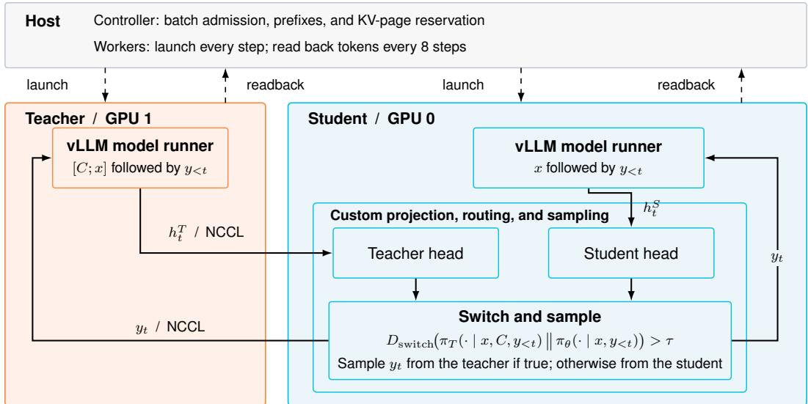  
Figure 8: Paired vLLM inference for SSD. The teacher and student run on separate GPUs with different prefixes and a shared continuation. At each token, the teacher sends its hidden state to the student GPU through NCCL. Both output heads, the switching test, and sampling run on the student GPU. The selected token is written into both models’ request histories, with NCCL carrying it back to the teacher. CPU code launches each decode step and reads back token IDs every eight steps.

In the resident training configuration, the teacher worker keeps the hidden states used to predict the generated tokens on its GPU. The trainer imports them through CUDA IPC, with one device-todevice copy per admission group into its own storage. It projects the cached states with the teacher head to compute the forward-KL targets. This avoids a second teacher forward pass and storing full-vocabulary logits for the whole sequence. With sufficient GPU memory, the student’s training weights, gradients, and optimizer state stay on the same GPU as the student vLLM worker, and both inference workers remain resident between rollout and training phases.

## B.8 Training time per supervised token

We profile Qwen3-4B on Science Q&A over three training seeds. For each seed, we divide mean phase time per step by mean supervised tokens per step, convert to minutes per million tokens, and average across seeds (Table 8). Token counts follow Appendix B.2, including each reuse of an off-policy target. GPU allocations are described in Appendix B.4.

Table 8: Training-phase wall time in minutes per million supervised tokens on Science Q&A, excluding offline target generation.
<table><tr><td>Method</td><td>Generation</td><td>Loss calculation</td><td>Backward</td><td>Update + sync</td><td>Other</td><td>Total</td></tr><tr><td>SSD</td><td>30.25</td><td>3.16</td><td>6.37</td><td>0.50</td><td>1.10</td><td>41.38</td></tr><tr><td>On-policy</td><td>28.86</td><td>5.64</td><td>5.64</td><td>0.23</td><td>1.16</td><td>41.54</td></tr><tr><td>Off-policy FKL</td><td>0.00</td><td>4.01</td><td>6.26</td><td>0.19</td><td>0.80</td><td>11.25</td></tr><tr><td>Off-policy SFT</td><td>0.00</td><td>2.47</td><td>5.41</td><td>0.15</td><td>0.67</td><td>8.71</td></tr></table>

Generation includes rollout computation and bookkeeping. Loss calculation includes training forward passes, target preparation, and loss arithmetic. Update + sync combines gradient clipping, the optimizer update, and measured weight synchronization to rollout workers, which we subtract from generation. Other is the residual step time, including unassigned data-loading, callback, and synchronization overhead. Evaluation and checkpoint saving are excluded.

SSD and on-policy training take nearly the same wall time per supervised token with these GPU allocations. SSD decodes with the teacher on its second GPU concurrently with the student and reuses cached teacher hidden states in the loss phase. The shorter loss phase offsets its higher generation and backward times per token. Reaching matched accuracy with fewer tokens therefore shortens training (Section 4.3).

Off-policy training has no in-step generation. Sampling its teacher targets once takes approximately 9.5 minutes per run, which is included separately in Figure 5. Amortized over all recorded training tokens, this adds approximately 0.33 minutes per million tokens for FKL and 0.22 for SFT. These amortized costs depend on how many times the targets are reused.

## C Additional Analyses

These experiments probe where the supervision signal goes, how SSD compares with retrieval at inference time, and how the choice of switching rule matters.

## C.1 Supervision-signal measurements

These experiments support the analysis in Section 3.1 by examining how the source of a rollout affects the supervision it provides. We ask whether teacher-generated trajectories provide stronger feedback than student-generated trajectories, and whether feedback weakens as a student rollout grows longer. The Wikipedia comparison addresses both questions, while the Science Q&A analysis checks the positional pattern on longer responses. In both experiments, we measure supervision with forward KL from the privileged teacher to the student, matching the distillation loss.

On Wikipedia, Figure 2 compares single on-policy and off-policy training runs of Qwen3-4B with a frozen teacher. Both train for eight epochs; off-policy training reuses teacher answers sampled once per question. Off-policy training reaches 78% accuracy with roughly five times fewer supervised tokens, while on-policy training reaches higher final accuracy. The positional analysis uses the untrained student on all 1,129 training questions, comparing teacher-written answers with greedy student rollouts capped at 128 tokens. On student-generated prefixes, mean per-token loss falls from roughly 1.5–2.0 at early positions to about 0.5 by position 75, while teacher-generated prefixes retain a higher signal over the plotted range. Means include only rollouts that reach each position, and shaded bands show 90% bootstrap intervals over questions.

On Science Q&A, we examine the same on-policy signal along longer responses, using 256 rollouts from the untrained student, one per question, capped at 1024 tokens. Feedback weakens later in the response: the mean signal in the first quartile is 3.3× that in the last. Beyond position 512, it falls to about one-seventeenth of its value at positions 5–8. As on Wikipedia, positional means include only rollouts that reach each position.

The concentration of teacher–student disagreement early in on-policy rollouts is consistent with the motivation for SSD: as student errors accumulate, the rollout may enter prefixes where the teacher provides weaker corrective feedback. We therefore switch to the teacher at positions of high disagreement. In standard on-policy training, later tokens still receive the dense distillation loss but provide weaker feedback. SSD applies the same dense loss, using teacher interventions to keep rollouts closer to teacher-generated trajectories and preserve stronger supervision.

## C.2 Retrieved-demonstration comparison

The main experiments ask whether self-distillation can store new knowledge in the model’s parameters so that it can answer questions without privileged context at test time. Retrieval provides a natural alternative: keep the knowledge external and supply related solved examples in the inference prompt. To contextualize the closed-book results, we compare SSD with retrieved demonstrations on Science Q&A at 4B and 14B scales.

For each evaluation question, we retrieve four training questions together with their reference answers and insert them as solved demonstrations. BM25 uses lexical similarity, while dense retrieval uses cosine similarity under Qwen3-Embedding-4B. We evaluate both retrieval methods, the unaugmented closed-book base model, and the closed-book SSD model using the same answer extraction. Generated-token counts include only the response, not the retrieved prompt.

We evaluate the final SSD checkpoints. The Qwen3-4B results average the three Science Q&A training seeds shown in Figure 5; the Qwen3-14B results use the run reported in Table 1. Generation limits are given in Appendix B.4.

Table 9: Closed-book internalization compared with retrieved demonstrations on Science Q&A. BM25 and dense retrieval supply four solved training questions; SSD receives only the test question. Base and retrieval responses are capped at 16384 tokens; SSD responses are capped at 1024 tokens for Qwen3-4B and 2048 tokens for Qwen3-14B. Mean generated-token counts cover responses only, excluding the prompt.
<table><tr><td>Model</td><td>Inference method</td><td>Accuracy</td><td>Mean generated tokens</td></tr><tr><td>Qwen3-4B</td><td>Closed-book base</td><td>49.9</td><td>2864</td></tr><tr><td>Qwen3-4B</td><td>Top-4 BM25 demonstrations</td><td>65.9</td><td>2045</td></tr><tr><td>Qwen3-4B</td><td>Top-4 dense demonstrations</td><td>61.3</td><td>2146</td></tr><tr><td>Qwen3-4B</td><td>SSD closed-book</td><td>66.3</td><td>508</td></tr><tr><td>Qwen3-14B</td><td>Closed-book base</td><td>45.2</td><td>373</td></tr><tr><td>Qwen3-14B</td><td>Top-4 BM25 demonstrations</td><td>58.4</td><td>510</td></tr><tr><td>Qwen3-14B</td><td>Top-4 dense demonstrations</td><td>55.6</td><td>465</td></tr><tr><td>Qwen3-14B</td><td>SSD closed-book</td><td>75.5</td><td>222</td></tr></table>

Retrieval improves the untrained model at both scales, confirming that relevant solved examples help on this task. Nevertheless, closed-book SSD matches or exceeds the strongest retrieved-demonstration baseline while producing much shorter responses. This comparison does not establish that parametric internalization is generally preferable to retrieval: the retriever selects solved training questions rather than raw source documents.

## C.3 Switching-rule ablation

Table 10 asks whether SSD needs to compare the full teacher and student distributions, or whether simpler token-level signals from prior work are sufficient. To isolate the switching rule, the ablation holds the model, data, loss, learning rate, schedule, and training seed fixed on Science Q&A. All ablation runs use an effective batch size of 16 and train for two epochs with a cosine learning-rate schedule and 1.5% warmup. We evaluate each run’s final checkpoint with three sampled decodes at temperature 0.3.

We compare five rules. Following Speculative Knowledge Distillation (SKD) (Xu et al., 2025), the top-k rule first samples a student proposal and lets the teacher emit the token when that proposal falls outside the teacher’s top-k candidates. The entropy rule, loosely motivated by entropy-aware onpolicy distillation (Jin et al., 2026), which uses teacher entropy to adapt the loss, switches the rollout on student entropy with threshold 2.0. The three distribution-level switches use JSD $( \tau = 0 . 2 5 )$ reverse KL $( \tau = 1 . 0 )$ , and forward KL $( \tau = 0 . 5 )$ . Because these statistics have different numerical scales, we compare the rules through the realized fraction of tokens emitted by the teacher. As in the Science Q&A runs of Figure 4, the teacher in these runs is an exponential moving average of the student with mixing rate 0.01.

Table 10: Switching-rule ablation on Science Q&A. All rows share the training configuration, seed, and forward-KL loss; only the switching rule changes. Accuracy is the mean and 95% confidence interval over three sampled decodes. Teacher-token fraction is the fraction of rollout positions generated by the teacher at the end of training.
<table><tr><td>Switching rule</td><td>Setting</td><td>Teacher-token frac.</td><td>Accuracy</td><td>Tokens (M)</td></tr><tr><td>JSD</td><td> $\tau = 0 . 2 5$ </td><td>0.7%</td><td> $6 3 . 3 \pm 3 . 4$ </td><td>4.47</td></tr><tr><td>Top-k inclusion</td><td> $k = 1$ </td><td>9.3%</td><td> $6 2 . 0 \pm 2 . 0$ </td><td>4.51</td></tr><tr><td>Entropy</td><td> $\tau = 2 . 0$ </td><td>11.5%</td><td> $5 9 . 2 \pm 1 . 2$ </td><td>5.18</td></tr><tr><td>Reverse KL,  $D _ { \mathrm { K L } } ( \pi _ { \boldsymbol { \theta } } \parallel \pi _ { T } )$ </td><td> $\tau = 1 . 0$ </td><td>1.5%</td><td> $6 5 . 2 \pm 0 . 3$ </td><td>4.02</td></tr><tr><td>Forward KL,  $D _ { \mathrm { K L } } ( \pi _ { T } \left. \pi _ { \theta } \right)$ </td><td> $\tau = 0 . 5$ </td><td>3.4%</td><td> ${ \bf 6 7 . 0 \pm 3 . 1 }$ </td><td>4.07</td></tr></table>

For the top-k rule we sweep $k \in \{ 2 0 , 5 , 1 \}$ . The student’s proposal already lies within the teacher’s top-20 candidates at 99.7% of positions and within its top-5 at 98.5%, so these two settings almost never invoke the teacher and reduce to nearly on-policy generation; Table 10 therefore reports the non-degenerate $k = 1$ setting. Even this setting and the entropy rule reach lower mean accuracy than switching on JSD, forward KL, or reverse KL, consistent with prior work using distribution-level disagreement for adaptive switching (Peng et al., 2026; Koo et al., 2025). These results suggest that the context can substantially redistribute probability mass without moving the student’s proposal outside the teacher’s top-k. The three distribution-level switches perform similarly, with overlapping intervals, and in this single-seed comparison we see no clear difference among them: the intervals are over three decodes of one training seed, and the rules fire at different teacher fractions (0.7% to 11.5%), so the rows are not matched on teacher share. We use JSD as the default because its ln 2 upper bound puts τ on a fixed, interpretable scale; the Science Q&A runs of Figure 4 use the reverse-KL switch.

## D Case Study: JSD-Routed Inference on SciKnowEval Chemistry-L3

## D.1 Setup

We evaluate offline how the JSD routing threshold qualitatively changes rollouts on the 507-question SciKnowEval Chemistry-L3 multiple-choice evaluation set. No weights are trained. Instead, at each decoding step we run two forward passes of the same Qwen3-4B-Instruct-2507 checkpoint: a student pass conditioned only on the question, and a teacher pass conditioned on the question plus privileged context containing the ground-truth answer. We then route each generated token according to the JSD between the two next-token distributions. This isolates how changing the routing threshold τ changes which tokens come from the teacher and how those interventions alter the resulting rollout. Decoding is capped at 1024 tokens, and a response that reaches the cap without an answer tag is scored as incorrect; this is why the student-only accuracy here (12.8%) is lower than the closed-book base accuracy in Table 9, which uses a 16384-token budget.

## D.2 Aggregate sweep

Table 11 summarizes the sweep.

$\mathrm { A t } \tau = 0 . 1 $ , only 15.7% of tokens per question come from the teacher on average, yet accuracy reaches 73.96%, within roughly six percentage points of the pure-teacher ceiling. This supports the central intuition behind SSD: teacher signal is often concentrated at a small number of decisive positions.

## D.3 Qualitative case study

We now show a representative synthesis question.

Table 11: JSD-routed inference on SciKnowEval Chemistry-L3. Routed decoding recovers most of the teacher’s accuracy while using only a small fraction of teacher tokens.
<table><tr><td>Strategy</td><td>Acc.</td><td>Mean resp. length</td><td>Teacher frac. (per-row)</td></tr><tr><td>Student only</td><td>12.8%</td><td>879</td><td>0.0%</td></tr><tr><td>SSD, τ = 0.6</td><td>34.12%</td><td>850</td><td>1.3%</td></tr><tr><td>SSD, τ = 0.5</td><td>51.87%</td><td>745</td><td>2.7%</td></tr><tr><td>SSD, τ = 0.3</td><td>66.07%</td><td>588</td><td>7.0%</td></tr><tr><td>SSD, τ = 0.1</td><td>73.96%</td><td>523</td><td>15.7%</td></tr><tr><td>Teacher only</td><td>80.28%</td><td>487</td><td>100.0%</td></tr></table>

Question (SciKnowEval Chemistry-L3, reference answer: B)   
Which of the following molecules is the only correct reactant used in the synthesis of the product   
OCCN1CCN(CC(F)(F)F)CC1?   
A: CC(C)[Si](OCc1cncc(C(C)(C)F)c1)(C(C)C)C(C)C   
B: CC(C)[Si](OCCN1CCN(CC(F)(F)F)CC1)(C(C)C)C(C)C   
C: CC(C)[Si](C#Cc1cc(Br)cc(N)n1)(C(C)C)C(C)C   
D: CC(C)[Si](OCC[C@H](C)OS(C)(=O)=O)(C(C)C)C(C)C

Option B contains the exact product fragment OCCN1CCN(CC(F)(F)F)CC1 attached to a TIPS silyl protecting group, so removing the silyl ether yields the product.

Table 12 summarizes the single-example behavior. In the rollouts below, coral-highlighted spans were emitted from the teacher distribution; unhighlighted text was emitted from the student distribution. Token boundaries follow the model’s BPE, and \n denotes a newline. The provenance trails come from a single-prompt deterministic rerun, so the exact routing differs slightly from the batched aggregate sweep, but the qualitative behavior is the same.

Table 12: Single-question JSD-routed rollouts. In this single-prompt rerun, only τ = 0.1 routes enough teacher tokens to escape the student’s parsing loop and produce the correct answer. The teacher count does not fall steadily as τ grows: each teacher token changes the text that every later step conditions on, so the runs see different prefixes after their first switch.
<table><tr><td>Strategy</td><td>Teacher tokens</td><td>Teacher frac.</td><td>Length</td><td>Extracted</td></tr><tr><td>Student only</td><td>0</td><td>0.0%</td><td>1024</td><td>no tag</td></tr><tr><td>SSD, τ = 0.6</td><td>11</td><td>1.1%</td><td>1024</td><td>no tag</td></tr><tr><td>SSD, τ = 0.5</td><td>4</td><td>0.4%</td><td>1024</td><td>no tag</td></tr><tr><td>SSD, τ = 0.3</td><td>9</td><td>0.9%</td><td>1024</td><td>no tag</td></tr><tr><td>SSD, τ = 0.1</td><td>75</td><td>9.0%</td><td>837</td><td>B</td></tr><tr><td>Teacher only</td><td>549</td><td>100.0%</td><td>549</td><td>B</td></tr></table>

Student-only: recursive parsing failure. The student repeatedly reparses the target SMILES string and reaches the 1024-token budget without emitting an answer.

Student-only, incorrect: no <answer> tag; length = 1024; teacher tokens = 0   
<reasoning>\n We are given a target product: "OCCN1CCN(CC(F)(F)F)CC1".\n\n Let’s first   
understand the structure of this molecule.\n\n The product is:   
O–C–C–N–1–C–C–N–(C(C(F)(F)F))–C–C–1\n\n More clearly, it is:\n\n   
O–C–C–N–(CH<sub>2</sub>)–N–(CH<sub>2</sub>)–C(C(F)(F)F)\n\n Wait –- actually, the notation   
"OCCN1CCN(CC(F)(F)F)CC1" is a condensed SMILES-like string.\n\n Let’s parse it step by   
step:\n\n - "OCC" → O–C–C\n - "N1" → a nitrogen atom with a ring closure at position 1   
[...truncated]

Moderate thresholds: small nudges are insufficient. At τ = 0.6, τ = 0.5, and τ = 0.3, the teacher fires on a small number of framing tokens. This changes the opening of the response, but in this single-prompt run it does not redirect the model enough to produce an answer before the token budget.

```matlab
JSD switch, τ = 0.6, incorrect: no <answer> tag; length = 1024; teacher tokens = 11
<reasoning>\n The target product is "OCCN1CCN(CC(F)(F)F)CC1". This is a molecular formula
that can be interpreted as a substituted amine structure. Let’s break it down:\n\n -
"OCCN1CCN(CC(F)(F)F)CC1" suggests a chain with an oxygen attached to a carbon, followed
by a nitrogen, and then a ring structure. The ring is likely a 5-membered or 6-membered
heterocycle with a nitrogen and a substituent: CC(F)(F)F, which is trifluoromethyl.
[...truncated]
```

JSD switch, τ = 0.5, incorrect: no <answer> tag; length = 1024; teacher tokens = 4   
<reasoning>\n The question asks for the only correct reactant used in the synthesis of   
the product "OCCN1CCN(CC(F)(F)F)CC1".\n\n First, let’s analyze the product:\n   
"OCCN1CCN(CC(F)(F)F)CC1"\n This is a substituted amine structure. Breaking it down:\n -   
"OCC" suggests a methoxy group or –OCH<sub>2</sub>–\n - "N1CCN" indicates a chain with a nitrogen   
atom, likely part of a cyclic amine\n - "CC(F)(F)F" is a trifluoromethyl group   
[...truncated]

JSD switch, τ = 0.3, incorrect: no <answer> tag; length = 1024; teacher tokens = 9   
<reasoning>\n The question asks for the only correct reactant used in the synthesis of   
the product "OCCN1CCN(CC(F)(F)F)CC1".\n\n First, let’s analyze the product:   
"OCCN1CCN(CC(F)(F)F)CC1". This is a substituted amine structure. The core structure   
appears to be: \n\n - O–CH<sub>2</sub>–N–CH<sub>2</sub>–N–(CH<sub>2</sub>)–CC(F)(F)F \n\n More precisely, it’s   
O–CH<sub>2</sub>–N–CH<sub>2</sub>–N–(CH<sub>2</sub>)–C(F)(F)–CH? Wait –- let’s parse it properly. [...truncated]

Low threshold: routing changes the strategy. At τ = 0.1, teacher routing covers a denser set of setup tokens. The rollout moves from recursive SMILES parsing to the correct structural-motif strategy: identify which answer choice contains the product fragment.

JSD switch, τ = 0.1, correct: extracted B; length = 837; teacher tokens = 75   
<reasoning>\n The question asks which molecule is the correct reactant in the synthesis   
of the product "OCCN1CCN(CC(F)(F)F)CC1". \n\n First, analyze the product:   
"OCCN1CCN(CC(F)(F)F)CC1" is a substituted amine structure. It contains a chain with a   
nitrogen atom and a group –CC(F)(F)F, which is a trifluoromethyl group (CF<sub>3</sub>). The   
structure suggests a diamine or amine derivative with a CF group.\n\n Now, look at the   
options. The key is to identify which reactant contains the same core structure as the   
product, especially the "OCCN1CCN(CC(F)(F)F)CC1" fragment.\n\n Option A: Contains a   
phenyl ring with a fluorinated substituent , not matching the amine [...truncated]

Teacher-only. The teacher-only rollout is correct and shorter. Since every token is generated from the privileged-context distribution, we do not highlight each token individually.

Teacher-only, correct: extracted B; length = 549; teacher tokens = 549   
All tokens in this rollout are teacher-generated.   
<reasoning>\n The question asks which molecule is the correct reactant in the synthesis   
of the product "OCCN1CCN(CC(F)(F)F)CC1".\n\n First, analyze the product:   
"OCCN1CCN(CC(F)(F)F)CC1" is a substituted amine structure. It contains a chain with a   
nitrogen atom and a group CC(F)(F)F, which is a trifluoromethyl group (CF<sub>3</sub>). The   
structure suggests a diamine or amine derivative with a CF<sub>3</sub> group.\n\n Now, look at the   
options. The key is to find which reactant contains the exact same functional group as   
the product, specifically the "OCCN1CCN(CC(F)(F)F)CC1" fragment. [...truncated]

The visible pattern is that teacher routing fires on framing and setup tokens, not on the answer letter itself. The student-only rollout opens by trying to parse the SMILES string and gets stuck in a loop. Moderate thresholds insert a few teacher tokens, such as “The”, quote marks, and small structural tokens, which weakly shift the framing but do not change the outcome. At τ = 0.1, teacher routing covers enough of the setup to move the rollout into the correct strategy: analyze the product, identify the shared structural motif, and choose the option containing that motif.