# Translating KV Caches Between Hybrid-Attention Language Models: MLA Latents, Linear-Attention States and Sparse-Attention Indexers

Povilas Kvedaras∗ Tomas Rasymas Hostinger Research

## Abstract

A model that takes over another model’s conversation must normally re-read the whole history; a text hand-of shortens the re-read only by dropping content. KV-cache translation instead maps the source’s cache into the target’s own format, so the target continues from the full context without re-reading it. It works for grouped-query attention (GQA), but open-weights frontier models now cache compressed latents (MLA), sparse-attention indexer keys and fixed-size linear-attention states. We replicate KV-Lingo on a GQA pair and then give, for each of these objects, where to capture and inject it and a mechanism that reaches native quality. We study two hybrid pairs at 16–48B scale in both directions, Kimi-VL-A3B ↔ Kimi-Linear-48B (MLA ↔ MLA + Kimi Delta Attention) and Qwen3.5-27B ↔ Qwen3.8-27B (Gated DeltaNet hybrids), plus a sparse-attention target (Qwen3.8-27B → Qwen3.8-Flash-Next). MLA latents translate with token-wise linear maps; recurrent states are copied with a closed-form correction or synthesised by replaying the target’s own recurrence. Exact long-range recall needs token identity: decoding token ids from the source’s layer-0 MLA latent raises needle recall from 0.09 to 0.99 at 2–32K and to 0.83–1.00 at 64K, eight times the longest training prompt. The hybrid → full-MLA direction is within the paired confidence interval of native quality on every task metric, and same-shape GDN hybrids reach the native level in both directions (apart from 6% refusals inherited from the source), with time to first token 18.7 and 46.8 times shorter than a re-read at 64K tokens. Segment-wise multi-turn transfer stays at the re-prefill level; naive re-translation collapses. On the sparseattention target, predicted indexer keys recall the needle as well as the target’s own keys (one seed). We state as a hypothesis how the recipes transfer to 300B+ hybrid flagships.

Keywords: KV cache; cache translation; hybrid attention; multi-head latent attention; linear attention; sparse attention; model hand-of

∗Corresponding author: povilas.kvedaras@hostinger.com.

## 1 Introduction

When a conversation moves from one language model to another, for example from a small model to a larger one or between two generations of a model family, the second model normally re-reads (prefills) the whole history. KVcache translation avoids this. A small learned map converts the source model’s key–value cache into the target model’s cache format, and the target continues from the translated cache as if it had read the prompt itself. KV-Lingo (Castin et al., 2026) showed that, for two grouped-query attention (GQA) models with the same tokenizer, per-layer linear maps fitted in closed form and refined by self-distillation give the target its native quality at a fraction of the prefill cost, and that translating each conversation segment once keeps multi-turn quality at the re-prefill level.

Why translate the cache. Model switches are routine: routers send each turn to a cheaper or a stronger model (Ong et al., 2024), agent pipelines hand one conversation between models, and serving fleets move users to a new model generation. Today the receiving model either re-reads the full history, whose cost grows with the prompt length and the model’s size, or it receives a text summary of it, which is shorter to read but drops content the summary did not keep and still has to be prefilled. Latent agent-to-agent communication (Fu et al., 2026; Rossi et al., 2026) passes richer information but keeps both models in the loop and does not replace the target’s prefill. A translated cache gives the target the complete history in its own format, at a cost that grows with the prompt length but not with the target’s size, and with no text in between: in the two directions we timed at 64K tokens the target starts answering 18.7 and 46.8 times sooner than after a re-read, with task quality within the paired confidence interval of its native level.

Frontier caches are no longer plain GQA. Table 1 lists the cache objects of recent releases of the seven open-weights families with the most-downloaded models on Hugging Face. Within one year every family except Meta’s has moved its newest model away from a plain per-token K/V cache, and the newest models of DeepSeek, GLM, Kimi and Qwen combine two or three diferent objects in one stack. Multi-head latent attention (MLA) (DeepSeek-AI, 2024) caches one 512-d latent plus a 64-d rotary key per token and layer instead of per-head keys and values. Sparse-attention indexers such as DeepSeek Sparse Attention (DSA) (DeepSeek-AI, 2025) add a small indexer key per token, and each query attends only to the top-k tokens the indexer selects. Linear-attention or statespace layers such as Kimi Delta Attention (KDA) (Kimi Team, 2025), Gated DeltaNet (GDN) (Yang et al., 2025) and Mamba-2 (Dao and Gu, 2024) keep no per-token cache at all, only a fixed-size recurrent state. Each of these objects breaks an assumption of the GQA recipe: a token-wise map cannot produce a recurrent state, an MLA latent is normalised and partly rotated before it is cached, and an indexer key decides which tokens attention reads at all. Which translation mechanism works for each object, and where in the layer it should read and write (its capture point, §2, Figures 2–6), is open.

This paper. We first replicate KV-Lingo on a GQA pair (Qwen3-8B ↔ Qwen3-4B). We then ask, for each cache object, which mechanism reproduces the GQA-level result on hybrid models, using pairs that contain the flagships’ cache objects at 16–125B scale (last column of Table 1; §4 discusses where they difer):

• Pair A: Kimi-VL-A3B (27 MLA layers) ↔ Kimi-Linear-48B-A3B (20 KDA + 7 MLA layers).

• Pair B: Qwen3.5-27B ↔ Qwen3.8-27B, two GDN + gated-attention hybrids with identical cache geometry.

• Pair C: Qwen3.8-27B → Qwen3.8-Flash-Next (36 GDN + 12 QSA layers), a target with a sparse-attention indexer, run at smaller scale (one direction, one seed).

We report quality, switch speed and multi-turn behaviour in both directions for Pairs A and B, an explicit account of where each object is captured and injected, and the indexer rehearsal on Pair C. Figure 1 shows the setting.

What is new. Prior cache translators, including KV-Lingo and the crossmodel methods of §2, map the per-token K/V cache of standard attention; one concurrent preprint (Villani, 2026) also transfers a GDN state on one pair in one direction. We treat every cache object of current hybrid models (MLA latents, KDA/GDN states and sparse-attention indexer keys) and show that each needs its own mechanism and its own capture point: token-wise maps where the object is per token, a copy or a replay of the target’s own recurrence where it is a state, and token identity, read back from the source’s own MLA cache, where exact recall depends on it.

## Contributions.

1. A capture/injection map for every cache object (§3.2): GQA K/V, MLA latent and rotary key, KDA/GDN state and conv window, and sparse-attention indexer key. We give the engine-native object, the point we capture, where we write, and an ablation of capture point ① (pre-norm) vs ③ (the engine’s own cache) (§6.2).

2. Per-object recipes with measured evidence (Table 2): token-wise maps for MLA latents; token identity, decoded from the source’s own layer-0 MLA latent, for exact long-range recall; state copy with a closed-form bilinear correction when state geometries match; replay of the target’s own recurrence when the source has no state.

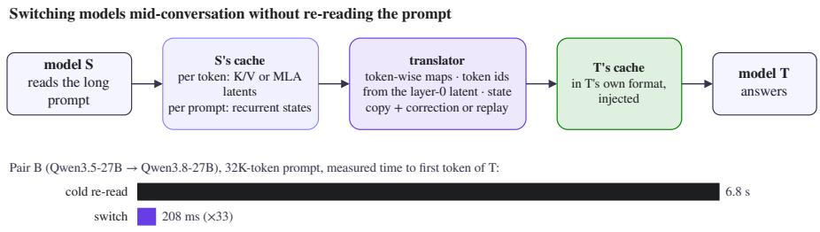  
Figure 1: Switching models mid-conversation without re-reading the prompt. Model S has read the prompt; a translator maps S’s cache (per-token K/V or MLA latents and per-prompt recurrent states) into T’s format, and T answers. Inset: Pair B at 32K tokens, time to T’s first token, cold re-read vs switch (6,823 vs 208 ms, ×32.8).

3. Both directions on both hybrid pairs, with three seeds for the headline forward rows. The hybrid → full-MLA direction (a Flash hybrid handing over to its full-MLA flagship) is the easier one.

4. Speed and multi-turn on the same GPUs and kernels as the cold prefill, and a two-direction reproduction of KV-Lingo’s naive-re-translation collapse on a hybrid pair.

5. A rehearsal of sparse-attention indexer transfer (Pair C, one seed, 400 and 1000 steps) and a labelled argument for how the recipes transfer to 300B+ flagships (§10).

Table 1: Cache objects of recent open-weights releases, newest first within each family (configurations read from each model’s config.json on Hugging Face, 3 Nov 2026; ⋆ = the family’s most downloaded repository in the last month). K/V = per-token keys and values; MLA = compressed latent per token; Idx = sparse-attention indexer key per token or block; State = linear-attention or state-space recurrent state (bf16 size per prompt where a pair rehearses it); Other = sliding window or block-compressed shared K/V. Last column: the pair of this paper with the same objects (close = same object types, shapes, tokenizer setting and layer ratio; partial = an object or a ratio difers; Figure 23 compares cache bytes per token).
<table><tr><td rowspan=1 colspan=20>Family / model     Released Btotal  K/VMLA Idx State Other Layers             Our    pairact.                                                    (match)</td></tr><tr><td rowspan=6 colspan=20>DeepSeek-V4-Flash* Apr 2026284/13;         (√) √         √  one 512-d KV head, not rehearsedLL/ Pro (DeepSeek-AI,          1600/49                             block-compressed2026)                                                           (CSA/HCA), DSAindexer, 128-tokenwindowDeepSeek-         Dec 2025 685 / 37         V   V             61 MLA + DSA     origin of DSAV3.2(DeepSeek-AI,                                               (top-2048)2025)Aug 2026 320 / 18                   √        34 KDA + 11       A target (par-DSA-MLA, pooled  tial: DSA)indexer; 142 MiB744 /  40         V   √             78 MLA + DSA, 21 A source (par-shared indexers (Baitial: DSA)et al., 2026)78 MLA + DSATeam, 2026)</td></tr><tr><td rowspan=1 colspan=5></td><td rowspan=1 colspan=1></td></tr><tr><td rowspan=1 colspan=3></td><td rowspan=1 colspan=3></td><td rowspan=1 colspan=1></td></tr><tr><td rowspan=2 colspan=3></td><td rowspan=2 colspan=3></td></tr><tr><td rowspan=1 colspan=6>DSA-M</td></tr><tr><td rowspan=1 colspan=3></td><td rowspan=1 colspan=3>Feb 2026</td><td rowspan=1 colspan=11></td><td rowspan=1 colspan=1></td></tr><tr><td rowspan=1 colspan=3>GLM-4.7</td><td rowspan=1 colspan=3>Dec 2025</td><td rowspan=1 colspan=2>355  /  32</td><td rowspan=1 colspan=9></td><td rowspan=1 colspan=3>92 GQA, 8 kv heads</td></tr><tr><td rowspan=2 colspan=3>Kimi-K3*Team, 2026)</td><td rowspan=2 colspan=2>Jul</td><td rowspan=1 colspan=1>1 2026</td><td rowspan=1 colspan=2>2800  /  104</td><td rowspan=1 colspan=9>V        √</td><td rowspan=1 colspan=2>69 KDA (96 heads)</td><td rowspan=1 colspan=1>A     target</td></tr><tr><td rowspan=1 colspan=2></td><td rowspan=1 colspan=3></td><td rowspan=1 colspan=1></td><td rowspan=2 colspan=2></td><td rowspan=1 colspan=9></td><td rowspan=1 colspan=2>+ 24 gated MLA</td><td rowspan=1 colspan=1>(close; 10.3×</td></tr><tr><td rowspan=2 colspan=3>Kimi-K2.6    K2- N</td><td></td><td></td><td></td><td rowspan=1 colspan=9></td><td rowspan=2 colspan=3>ov</td><td rowspan=1 colspan=2>(NoPE); 433 MiB</td><td rowspan=2 colspan=1>state)A    source</td></tr><tr><td></td><td></td><td></td><td rowspan=1 colspan=2>1000  / 32</td><td rowspan=1 colspan=1></td><td rowspan=1 colspan=8>√</td><td rowspan=1 colspan=2>61 MLA</td></tr><tr><td></td><td></td><td></td><td></td><td></td><td></td><td></td><td></td><td></td><td rowspan=1 colspan=5></td><td rowspan=1 colspan=3></td><td rowspan=1 colspan=2></td><td rowspan=1 colspan=1>(close)</td></tr><tr><td></td><td></td><td></td><td rowspan=3 colspan=3>Oct 2025</td><td rowspan=3 colspan=2>48  / 3</td><td rowspan=2 colspan=1></td><td rowspan=2 colspan=1></td><td rowspan=2 colspan=5>√        √</td><td rowspan=2 colspan=3></td><td rowspan=2 colspan=2>20 KDA + 7 MLA;</td><td rowspan=2 colspan=1>A target (it-</td></tr><tr><td rowspan=2 colspan=3>Kimi-Linear-48B (Kimi Team,</td></tr><tr><td rowspan=1 colspan=1></td><td rowspan=1 colspan=5></td><td rowspan=1 colspan=3></td><td rowspan=1 colspan=2>41.9 MiB</td><td rowspan=1 colspan=1>self)</td></tr><tr><td rowspan=1 colspan=3>2025)</td><td rowspan=1 colspan=3></td><td rowspan=1 colspan=2></td><td></td><td></td><td></td><td></td><td></td><td></td><td></td><td></td><td></td><td></td><td></td><td></td></tr><tr><td rowspan=4 colspan=3>Qwen3.8-Flash-</td><td rowspan=4 colspan=3>Aug 2026</td><td rowspan=4 colspan=2>125 / 6</td><td rowspan=4 colspan=1>L</td><td></td><td></td><td></td><td></td><td></td><td></td><td></td><td></td><td></td><td></td><td></td></tr><tr><td rowspan=3 colspan=5>√   √</td><td></td><td></td><td></td><td></td><td></td><td></td></tr><tr><td rowspan=2 colspan=1></td><td></td><td></td><td></td><td></td><td></td><td></td></tr><tr><td rowspan=1 colspan=3></td><td rowspan=1 colspan=2>36 GDN + 12 QSA</td><td rowspan=1 colspan=1>B;C target</td></tr><tr><td rowspan=1 colspan=3>Next* (Qiu et al.,</td><td rowspan=1 colspan=3></td><td rowspan=1 colspan=2></td><td rowspan=1 colspan=1></td><td rowspan=1 colspan=5></td><td rowspan=1 colspan=2></td><td rowspan=1 colspan=2></td><td rowspan=1 colspan=2>(gated attention +</td></tr><tr><td rowspan=2 colspan=3></td><td rowspan=2 colspan=2></td><td rowspan=2 colspan=1></td><td rowspan=2 colspan=2></td><td rowspan=2 colspan=1></td><td rowspan=2 colspan=5></td><td rowspan=2 colspan=3></td><td></td><td></td><td></td></tr><tr><td rowspan=1 colspan=2>block indexer);111 MiB</td><td></td></tr><tr><td rowspan=3 colspan=3>Qwen3.8-2.4T-A95B</td><td rowspan=2 colspan=3>Aug 202</td><td rowspan=1 colspan=1>026</td><td rowspan=1 colspan=2>2400 / 95</td><td rowspan=1 colspan=1>V</td><td rowspan=1 colspan=5>√</td><td rowspan=1 colspan=2></td><td rowspan=1 colspan=2>69 GDN (128 heads)</td><td rowspan=1 colspan=1>B   (partial:</td></tr><tr><td rowspan=1 colspan=1></td><td rowspan=2 colspan=2></td><td rowspan=2 colspan=1></td><td rowspan=2 colspan=5></td><td rowspan=1 colspan=3></td><td rowspan=1 colspan=2>+ 23 GQA; 563 MiB</td><td rowspan=1 colspan=1>128  vs 48</td></tr><tr><td rowspan=2 colspan=3>Feb 2026</td><td rowspan=2 colspan=2>397  /  17</td><td rowspan=2 colspan=2>√</td><td rowspan=2 colspan=3></td><td rowspan=2 colspan=2>45 GDN + 15 gated</td><td rowspan=1 colspan=1>heads)</td></tr><tr><td rowspan=1 colspan=3>Qwen3.5-</td><td rowspan=1 colspan=1></td><td rowspan=1 colspan=3></td><td rowspan=1 colspan=3></td><td></td></tr><tr><td></td><td></td><td></td><td></td><td></td><td></td><td></td><td></td><td></td><td rowspan=2 colspan=5></td><td rowspan=2 colspan=3></td><td></td><td></td><td></td></tr><tr><td></td><td></td><td></td><td></td><td></td><td></td><td></td><td></td><td></td><td></td><td></td><td rowspan=4 colspan=1>BB</td></tr><tr><td rowspan=1 colspan=3>397B (Qwen Team,</td><td rowspan=1 colspan=3></td><td rowspan=1 colspan=2></td><td rowspan=1 colspan=1></td><td></td><td></td><td></td><td></td><td></td><td></td><td></td><td></td><td rowspan=1 colspan=2>attention</td></tr><tr><td rowspan=2 colspan=3>Qwen3-Next-80B</td><td></td><td></td><td></td><td></td><td></td><td></td><td></td><td></td><td></td><td></td><td></td><td></td><td></td><td></td><td></td><td></td></tr><tr><td rowspan=1 colspan=3>Sep 2025</td><td rowspan=1 colspan=2>80  / 3</td><td rowspan=1 colspan=1>V</td><td rowspan=1 colspan=5>√</td><td rowspan=1 colspan=3></td><td rowspan=1 colspan=2>36 GDN + 12 gatedattention</td></tr><tr><td rowspan=1 colspan=3>Qwen3 (Qwen Team,</td><td rowspan=1 colspan=3>May</td><td rowspan=1 colspan=2>0.6-235</td><td rowspan=1 colspan=6>V</td><td rowspan=1 colspan=3></td><td rowspan=1 colspan=2>GQA</td><td rowspan=1 colspan=1>Part 1 (itself)</td></tr><tr><td rowspan=1 colspan=3>2025)</td><td></td><td></td><td></td><td></td><td></td><td></td><td></td><td></td><td></td><td></td><td></td><td></td><td></td><td></td><td></td><td></td><td></td></tr><tr><td rowspan=1 colspan=3>Mistral Small 4* /</td><td rowspan=1 colspan=3>Dec</td><td rowspan=2 colspan=2>119/6.5;675/41</td><td rowspan=1 colspan=1></td><td rowspan=1 colspan=5></td><td rowspan=1 colspan=3></td><td rowspan=1 colspan=2>36 / 61 MLA</td><td rowspan=1 colspan=1>A    source</td></tr><tr><td rowspan=1 colspan=3>Large 3</td><td rowspan=1 colspan=3>2025</td><td rowspan=1 colspan=1></td><td rowspan=2 colspan=5></td><td rowspan=2 colspan=2></td><td></td><td rowspan=1 colspan=2></td><td rowspan=1 colspan=1>(MLA only)</td></tr><tr><td rowspan=1 colspan=3></td><td rowspan=1 colspan=3>Mar 2026</td><td rowspan=1 colspan=2></td><td rowspan=1 colspan=1></td><td></td><td></td><td></td><td></td></tr><tr><td rowspan=2 colspan=3>Nemotron 3 Nano*</td><td rowspan=2 colspan=3>Dec</td><td rowspan=2 colspan=2>30/3.5;</td><td></td><td></td><td></td><td></td><td></td><td></td><td></td><td></td><td></td><td></td><td></td><td></td></tr><tr><td rowspan=1 colspan=9>L</td><td rowspan=1 colspan=2>Mamba-2 with 6-12</td><td rowspan=1 colspan=1>not rehearsed</td></tr><tr><td rowspan=1 colspan=3>7 Super     Ul- 2</td><td rowspan=1 colspan=3>025-</td><td rowspan=1 colspan=2>120/12;</td><td rowspan=1 colspan=9></td><td rowspan=1 colspan=2>GQA layers (2 kv</td><td rowspan=5 colspan=1>(Mamba-2)Part 1 + C</td></tr><tr><td rowspan=1 colspan=3>tra      (NVIDIA, J</td><td rowspan=1 colspan=3>un 2026</td><td></td><td></td><td></td><td></td><td></td><td></td><td></td><td></td><td></td><td></td><td></td><td></td><td></td></tr><tr><td rowspan=2 colspan=3>2025a)</td><td rowspan=2 colspan=3></td><td></td><td></td><td></td><td></td><td></td><td></td><td></td><td></td><td></td><td></td><td></td><td></td><td></td></tr><tr><td rowspan=1 colspan=2>550/55</td><td rowspan=1 colspan=9></td><td rowspan=1 colspan=2>heads)</td></tr><tr><td rowspan=1 colspan=3>MiniMax-M3  (Lai</td><td rowspan=1 colspan=3>Jun 2026</td><td rowspan=1 colspan=2>428  / 23</td><td rowspan=1 colspan=9></td><td rowspan=1 colspan=2>60 GQA +</td></tr><tr><td rowspan=1 colspan=3>et al., 2026)</td><td rowspan=1 colspan=3></td><td rowspan=1 colspan=2></td><td rowspan=1 colspan=2></td><td rowspan=1 colspan=8></td><td rowspan=1 colspan=2>block-sparse indexer(MSA)</td></tr><tr><td rowspan=3 colspan=3>MiniMax-M2.5*</td><td rowspan=3 colspan=3>Feb 2026</td><td rowspan=3 colspan=2>229 / 10</td><td></td><td></td><td></td><td></td><td></td><td></td><td></td><td></td><td></td><td></td><td></td><td></td></tr><tr><td rowspan=2 colspan=9>√</td><td></td><td></td><td></td></tr><tr><td rowspan=1 colspan=2>62 GQA</td><td></td></tr><tr><td rowspan=1 colspan=3>Meta        Muse A</td><td rowspan=1 colspan=3>ug 2026</td><td rowspan=2 colspan=2>30 / 30</td><td rowspan=1 colspan=9>√                   √</td><td rowspan=1 colspan=2>39 sliding-window</td><td rowspan=1 colspan=1>Part 1 (par-</td></tr><tr><td rowspan=4 colspan=3>Glimmer*</td><td rowspan=4 colspan=14></td><td rowspan=1 colspan=1></td><td></td><td></td></tr><tr><td rowspan=3 colspan=2></td><td></td><td></td><td></td></tr><tr><td rowspan=2 colspan=3>(2,048) + 13 global tial: window)NoPE GQA layers, 2kv heads</td></tr><tr><td rowspan=1 colspan=2>NoPE GQA layers, 2</td></tr></table>

Table 2: Recipes per cache object, with the evidence each rests on. ① and ③ are capture points (raw projection output and the engine’s cached tensor; Figures 2–6). “Native level” = the paired 95% CI against the target reading its own cache includes 0, or the gap is within the SE.
<table><tr><td>Object</td><td>Recipe</td><td>Evidence (section)</td></tr><tr><td>GQA K/V</td><td>token-wise linear map per layer, closed form + distilla- tion; capture ① or ③ token-wise map on the pre-</td><td>Part 1 at native judge level, needle 1.00 at 2–8K (§5); Pair B ③ ties ① to 128K (§6.2) Pair A reverse within the CI of na-</td></tr><tr><td>MLA latent + rotary key</td><td>norm, un-rotated object ①; inject through the target&#x27;s own norm (and RoPE, if any)</td><td>tive on every task metric (one seed), needle 1.00 to 64K (§6)</td></tr><tr><td>Token identity</td><td>decode token ids from the source&#x27;s layer-0 MLA latent (or pass ids) and feed the tar-</td><td>needle 0.09 → 0.99 (Pair A for- ward), 64K 0.00 → 0.83–1.00 (§6.1)</td></tr><tr><td>Recurrent state, same geometry</td><td>get&#x27;s embedding to the maps copy + closed-form bilinear correction ASB per head; O(1) in length</td><td>Pair B at native level both ways, needle 1.00 at 128K, ×46.8 at 64K (§6, §7)</td></tr><tr><td>Recurrent state, no source</td><td>replay the target&#x27;s own re- currence over predicted per- token inputs; O(n)</td><td>Pair A forward; zero state fails (val KL 0.082 → 0.344) (§9)</td></tr><tr><td>state Sparse indexer key</td><td>predict from translated K + token embedding, or attend densely over the translated</td><td>Pair C: pooled needle 0.87/0.84 with predicted keys vs 0.88/0.85 with native keys (target 0.91); CoQA F1 0.80/0.77 vs 0.77;</td></tr><tr><td>Multi-turn</td><td>prefix segment-wise transfer (trans- late each segment once); op-</td><td>400/1000 steps, one seed (§10.1) both pairs at the re-prefill level on content; naive collapses on Pair A</td></tr></table>

## 2 Background: cache formats as objects

What a cache is. While a transformer reads a prompt, every attention layer stores something about each token so that later tokens can attend to it; this store is the KV cache, and it is what a serving engine keeps between turns. Diferent attention variants store diferent things. We call each kind of stored tensor a cache object and describe it by its granularity (one entry per token, or one per prompt), its size, and the operations a translator can apply to it (map it token-wise, copy it, replay it through the target’s own layer, or compute it exactly from the token ids). Figures 3–6 draw each object inside its attention layer, and Figure 2 gives the symbols and the sizes for our models. GQA stores a key and a value per token and layer, so its per-token footprint is the largest (147 KB for Qwen3-8B) and the natural operation is a per-token linear map. MLA stores one compressed 576-d vector per token and layer, five times less, and is also mapped token-wise; its first layer additionally identifies the token. DSA adds a small indexer key per token that a translator must predict or map, or else fall back to dense attention. Linear-attention layers (KDA, GDN) store nothing per token: one fixed-size matrix per layer summarises the whole prompt, so the only options are to copy it (if the target has the same shape) or to rebuild it by running the target’s own recurrence. The rest of the paper gives one recipe per object.

How we measure fidelity. Throughout the paper the primary measure of a translated cache is a Kullback–Leibler (KL) divergence. Let $p _ { T } ( \cdot \mid \mathcal { C } _ { T } )$ be the target’s next-token distribution when it reads its own cache of a prefix, and pT(· | $\hat { \mathcal { C } } _ { T } )$ the same model’s distribution when it reads the translated cache instead. The validation KL is $\mathrm { K L } ( p _ { T } ( \cdot \mid \mathcal { C } _ { T } ) \parallel p _ { T } ( \cdot \mid \hat { \mathcal { C } } _ { T } ) )$ averaged over the continuation tokens of held-out chat conversations (§3.6 gives the full expression); 0 means the target cannot tell the translated cache from its own, and the same quantity is the training loss of Stage 2. We also report the first-token KL, the same divergence at the first token the target decodes. KL is a model-internal measure, so we always pair it with task probes (CoQA, ARC, a needle recall test and a chat judge, §4); the rehearsal in §10.1 shows a case where KL alone would have hidden a failure.

Capture points: where an object is read and written. A cached object passes through several transformations before the engine stores it, and a translator can read or write it at any of them. Following KV-Lingo we name three points (Figure 2): ① the raw output of the projection that produces the object (before any normalisation or positional rotation), ② after the normalisation, and ③ the tensor the engine actually keeps. For a GQA key the three points are the k\_proj output, the output of the per-head k\_norm, and the key after RoPE; values have no norm or rotation, so their three points coincide (Figure 3). For an MLA layer the object is the compressed latent: ① is the kv\_a\_proj output and ③ the normalised latent with its rotated key (Figure 4). A sparse-attention indexer key is captured raw (①); the engine’s pooled and rotated key (③) is a fixed function of it (Figure 5). For a linear-attention layer the analogue is the choice between copying the engine’s state (③) and rebuilding it from the layer’s per-token inputs (Figure 6). The point matters for two reasons: ① objects are position-free and on a common scale, so a linear map fits them better, while ③ objects are what an unmodified engine exposes, so a translator at ③ needs no model changes. §3.2 gives the capture and injection point of every object we translate, and §6.2 measures ① against ③.

GQA (Figure 3). Each attention layer caches a key and a value per token and kv head. Keys are normalised (in Qwen3, a per-head k\_norm) and rotated (RoPE) before caching; an inference engine such as vLLM (Kwon et al., 2023) stores the ③ key. Values are the v\_proj output at every point.

MLA (Figure 4). Multi-head latent attention (DeepSeek-AI, 2024) projects the hidden state to a compressed latent $c _ { \mathrm { k v } }$ (512) and a decoupled rotary key $k _ { \mathrm { p e } }$ (64). The engine caches RMSNorm $\left( c _ { \mathrm { k v } } \right)$ ∥ $\mathrm { R o P E } ( k _ { \mathrm { p e } } )$ and up-projects the latent to per-head keys and values at attention time. Kimi-Linear’s MLA layers use no positional encoding (NoPE): $k _ { \mathrm { p e } }$ is cached un-rotated. GLM-5.3-Flash has no rotary part at all.

Sparse attention indexers (Figure 5). DSA (DeepSeek-AI, 2025) keeps the MLA cache and adds a lightning indexer: per token a small key (128-d), stored in low precision. At decode, each query scores the cached indexer keys and the main attention reads only the top-k tokens (2,048 for GLM-5.x and DeepSeek-V3.2). GLM-5.2/5.3 share each indexer across 4 layers (21 of 78 layers store a key (Bai et al., 2026)); GLM-5.3-Flash and Qwen3.8-Flash-Next (QSA) pool indexer keys over blocks of 4 tokens. Below top-k, sparse attention is exactly dense.

Linear attention (KDA, GDN; Figure 6). Gated DeltaNet (Yang et al., 2025) and Kimi Delta Attention (Kimi Team, 2025) replace the per-token cache by a per-head matrix state updated by a gated delta rule, plus a short causal convolution whose last inputs are cached (conv window). The state has constant size in the prompt length and cannot be expanded back to tokens. It is also precision-sensitive: when Kimi-Linear reads its own KDA states after they are rounded from fp32 to bf16, its next-token distribution already moves by a KL of 0.045, which sets a floor on how exactly any translated state can be judged.

Related work. Cross-model cache transfer. Reusing one model’s cache in another became an active topic during 2025–2026. Within a model family, DroidSpeak (Liu et al., 2024a) reuses most layers of a fine-tuned sibling’s cache and recomputes the rest (we use its partial-recompute idea as a baseline, §9.4), CacheBlend (Yao et al., 2025) reuses non-prefix chunks of the same model with selective recomputation, and RaReCache (Sarkar et al., 2026) lets a small model prefill and a large one recompute the 30–40% of positions where their rankings disagree. Heo et al. (Heo et al., 2026) show that a closed-form per-head ridge map sufices between same-family GQA models with matching head geometry; this is our Stage-1 closed form for per-token objects at ① and serves as a baseline (for Pair B the closed-form anchor also copies the recurrent states, which Heo et al. do not have). CacheBridge (Qu et al., 2026) makes such a mapper eight times smaller by matching heads. KV-Lingo (Castin et al., 2026), which we replicate, fits per-layer linear maps in closed form, refines them by self-distillation, and introduces segment-wise multi-turn transfer. Across families and tokenizers, a mixture of translators with token-level routing (Lee et al., 2026), Hetero-Fold (Yun et al., 2026), Swarm Telepathy (Alabdulkareem et al., 2026) and a universal context-reuse layer (Li et al., 2026) learn translators for dense GQA models; Cache-to-Cache (Fu et al., 2026) and Latent Cache Flow (Rossi et al., 2026) fuse caches for agent-to-agent communication rather than replacing the prefill, and PrefillShare (Woo et al., 2026) trains one shared prefill module for several decoders. All of these address the per-token K/V cache of standard attention. The one work we know of that touches a recurrent state is Latent-Port (Villani, 2026), a single-author preprint that transfers a Gated DeltaNet state together with a translated attention cache between a 4B and a 9B hybrid, on one pair in one direction with a teacher-forced loss. This paper covers every object of current hybrid models (GQA K/V, MLA latents, KDA/GDN states and sparse-attention indexer keys), both directions of two pairs with seeds, freerunning generation, switch speed and multi-turn behaviour.

Converting and compressing caches within a model. TransMLA (Meng et al., 2025), MHA2MLA (Ji et al., 2025) and X-EcoMLA (Li et al., 2025) re-parameterise a GQA checkpoint’s cache into MLA latents; cross-layer attention (Brandon et al., 2024) shows that adjacent layers’ caches are redundant enough to be shared, and KIVI (Liu et al., 2024b) that keys and values tolerate aggressive quantisation. These results, together with the near-linear stitchability of independently trained networks (Bansal et al., 2021; Huh et al., 2024; Jha et al., 2025), are why a linear map per layer is a reasonable first candidate for a per-token object.

Distilling attention into recurrent layers. MOHAWK (Bick et al., 2024), LoLCATs (Zhang et al., 2024), Mamba-in-the-Llama (Wang et al., 2024), RADLADS (Goldstein et al., 2025), HALO (Chen et al., 2026), Taylor-Calibrate (Zhou et al., 2026) and Attention Editing (Cheng et al., 2026) convert a pretrained transformer into a linear-attention or hybrid model, typically by aligning the new layer’s outputs first and distilling logits second. Our two stages (closed-form least squares, then KL self-distillation) follow the same pattern, but we keep both models frozen and learn only the map between their caches.

Sparse attention. DSA (DeepSeek-AI, 2025), NSA (Yuan et al., 2025), Quest (Tang et al., 2024) and SeerAttention (Gao et al., 2024) select which cached tokens a query reads; SeerAttention learns its gate by self-distillation from dense attention, as we train the predicted indexer keys. We know of no prior work that supplies a sparse-attention indexer with keys for a cache the

Why switch models mid-conversation. Routers such as RouteLLM (Ong et al., 2024) send each query to a strong or a weak model, and multi-agent pipelines hand one conversation between several models; in both, the receiving model’s cache is stale unless it re-reads the history or receives a translated cache.

model did not prefill itself.

How to read the capture-point figures

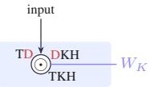

⊙: a contraction (matrix product). Left of the incoming wire: the input’s dimensions; right: the weight’s; below: the result’s. The red dimension is summed over. Light purple W: a weight of the frozen model, entering from the right.

Capture points, on the wire of each cached object: ① raw projection output (be- fore normalisation and rotation), $\textcircled{2}$ after the normalisation, $\textcircled{3}$ the tensor the engine caches; ➊ the per-token input of a linear-attention layer (replay route).

<table><tr><td>Symbol Dimension</td><td></td><td>Qwen3 8B</td><td>Qwen3.5/3.8 27B</td><td>Kimi-VL A3B</td><td>Kimi-Linear 48B</td><td>Qwen3.8 Flash-Next</td></tr><tr><td>T</td><td>prompt tokens; the cache holds one entry per</td><td colspan="5">conversation length so far (up to 128K in our runs)</td></tr><tr><td>D</td><td>token hidden size of the layer input</td><td>4096</td><td>5120</td><td>2048</td><td>2304</td><td>2560</td></tr><tr><td>E</td><td>width of the target&#x27;s token embedding (= its</td><td>4096</td><td>5120</td><td>2048</td><td>2304</td><td>2560</td></tr><tr><td>N</td><td>D) query heads</td><td>32</td><td>24</td><td>16</td><td>32</td><td>24</td></tr><tr><td>K</td><td>key/value heads (GQA)</td><td>8</td><td>4</td><td></td><td></td><td>2</td></tr><tr><td>H</td><td>head dimension</td><td>128</td><td>256</td><td>128</td><td>128</td><td>256</td></tr><tr><td>R</td><td>MLA latent width</td><td></td><td></td><td>512</td><td>512</td><td></td></tr><tr><td>P</td><td>MLA rotary-key width</td><td></td><td></td><td>64</td><td>64 (NoPE)</td><td></td></tr><tr><td> $\mathrm { N } _ { I } , \mathrm { I }$ </td><td>indexer heads, indexer-key width</td><td></td><td></td><td></td><td></td><td>4,128</td></tr><tr><td> $\mathrm { H } _ { k } , \mathrm { H } _ { v }$ </td><td>linear-attn. key, value heads</td><td></td><td>16,48</td><td></td><td>32,32</td><td>16,48</td></tr><tr><td> $\mathrm { d } _ { k } , \mathrm { d } _ { v }$ </td><td>linear-attn. key, value head dims</td><td></td><td>128, 128</td><td></td><td>128, 128</td><td>128, 128</td></tr><tr><td>F</td><td>q, k, v width, 2Hkdk+Hvdv</td><td></td><td>10,240</td><td></td><td>12,288</td><td>10,240</td></tr><tr><td>G</td><td>gate width: 2Hv (GDN), Hv(dk+1) (KDA)</td><td></td><td>96</td><td></td><td>4,128</td><td>96</td></tr><tr><td>layers</td><td>attention / linear attention</td><td>36 GQA</td><td>16 GQA + 48</td><td>27 MLA</td><td>7 MLA + 20</td><td>12 QSA + 36</td></tr><tr><td>cache</td><td>bf16 per token; state/prompt</td><td>147,456 B</td><td>GDN 65,536 B;</td><td>31,104B</td><td>KDA 8,064B;</td><td>GDN 25,344 B;</td></tr><tr><td></td><td></td><td></td><td>147.8 MiB</td><td></td><td>41.9MiB</td><td>110.8MiB</td></tr><tr><td>Name</td><td>Meaning</td><td></td><td>Name</td><td>Meaning</td><td></td><td></td></tr><tr><td>x</td><td>input of the layer (residual stream)</td><td></td><td> $l ; s _ { 1 } , \ldots , s _ { \nu }$ </td><td>target layer; the ν source layers it reads (1–</td><td></td><td></td></tr><tr><td> $W _ { Q } , W _ { K } , W _ { V } , W _ { O }$ </td><td>query, key, value and output projections</td><td></td><td> $W _ { l } , \ b _ { l }$ </td><td>3, by relative depth) translator map of target layer l (fitted in</td><td></td><td></td></tr><tr><td> $W _ { \mathrm { D K V } }$ </td><td></td><td>MLA down-projection to latent + rotary key</td><td> $c _ { \mathrm { k v } } , \ k _ { \mathrm { p e } }$ </td><td>closed form, then distilled)</td><td>MLA latent (R) and rotary key (P) of a token</td><td></td></tr><tr><td>Wuk, Wuv</td><td></td><td>MLA up-projections to per-head keys, val-</td><td> $E _ { T } [ \mathrm { i d } _ { t } ]$ </td><td></td><td>target&#x27;s input embedding of token t&#x27;s id</td><td></td></tr><tr><td> $W _ { I Q } , W _ { I K }$ </td><td>ues</td><td>indexer query and key projections</td><td> $\hat { K } _ { l } ; ~ W _ { l } ^ { I }$ </td><td></td><td>translated keys of layer l; indexer-key pre-</td><td></td></tr><tr><td> $W _ { q k v } , W _ { \alpha \beta }$ </td><td></td><td>linear-attention input and gate projections</td><td> $S _ { t } ; \ \alpha _ { t } , \beta _ { t }$ </td><td>dictor</td><td>recurrent state after token t; decay and write</td><td></td></tr><tr><td> $A _ { h } , B _ { h }$ </td><td></td><td>closed-form state correction of value head h</td><td></td><td>gates</td><td>a translated (written) quantity</td><td></td></tr></table>

Figure 2: How to read Figures 3–6, which draw one attention layer of each variant (attention block only) and where the translator reads and writes. Top: visual conventions and capture points. Middle: every dimension letter with its value for our five models (cache sizes in bf16, MTP layers excluded; state sizes as measured). Bottom: every named quantity.

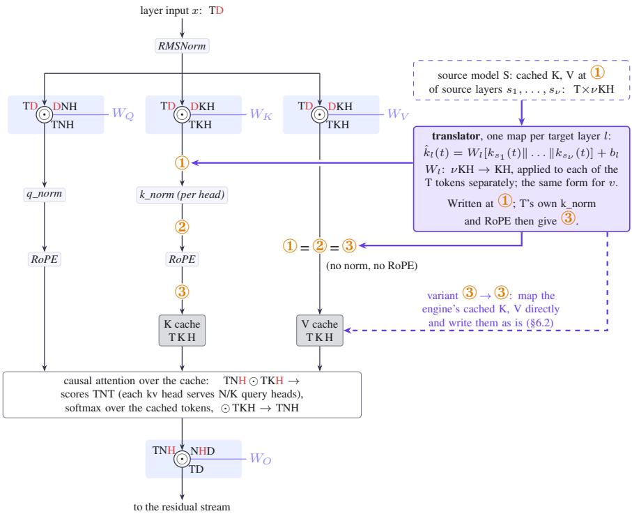  
Figure 3: GQA layer (Qwen3; the attention layers of Qwen3.5/3.8). The translator maps the source’s keys and values at ① of ν source layers, token by token, and writes them at $\textcircled{1} ;$ the target’s own k\_norm and RoPE then produce the cached keys ③. Values are the same at all three points. Dashed: the ③ → ③ variant of §6.2.

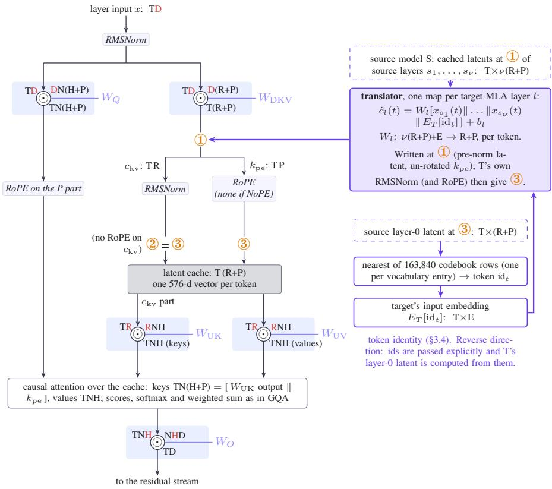  
Figure 4: MLA layer (Kimi-VL; the MLA layers of Kimi-Linear). The engine caches one 576-d vector per token (latent $c _ { \mathrm { k v } }$ and rotary key $k _ { \mathrm { p e } } )$ and up-projects it at attention time. The translator writes the pre-norm latent and un-rotated rotary key at ①; its input is the source latents plus the target’s embedding of each token id, decoded from the source’s layer-0 latent (§3.4).

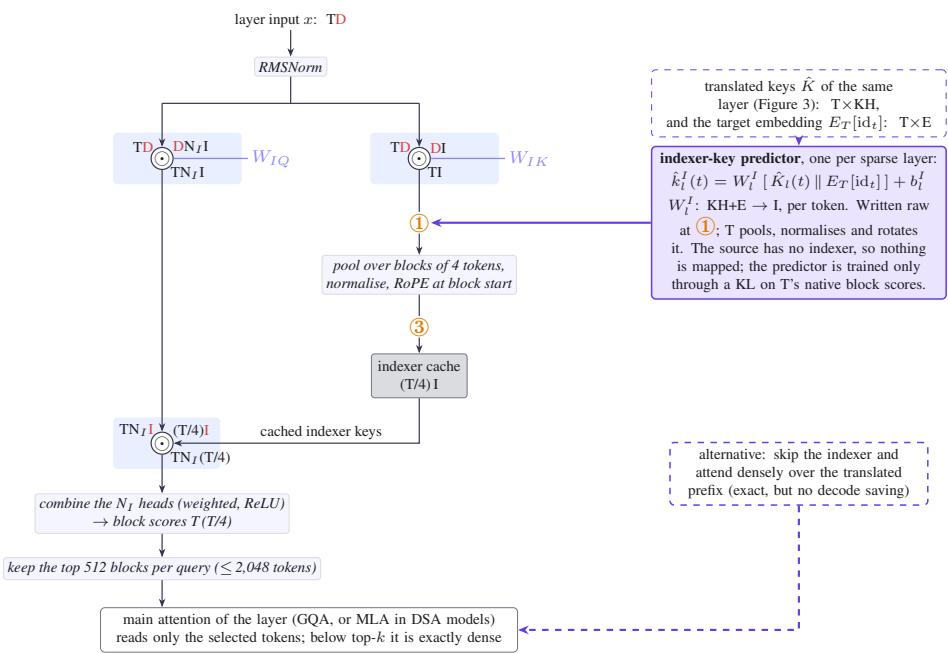  
Figure 5: Sparse-attention indexer (QSA of Qwen3.8-Flash-Next; DSA works alike). The indexer key decides which blocks the main attention reads. Our source has no indexer, so a predictor writes the raw key at ① from the translated keys and the token embedding, and the target pools, normalises and rotates it; the dashed alternative skips the indexer and attends densely (§10.1).

Target linear-attention layer (GDN of Qwen3.5/3.8; KDA of Kimi-Linear)  
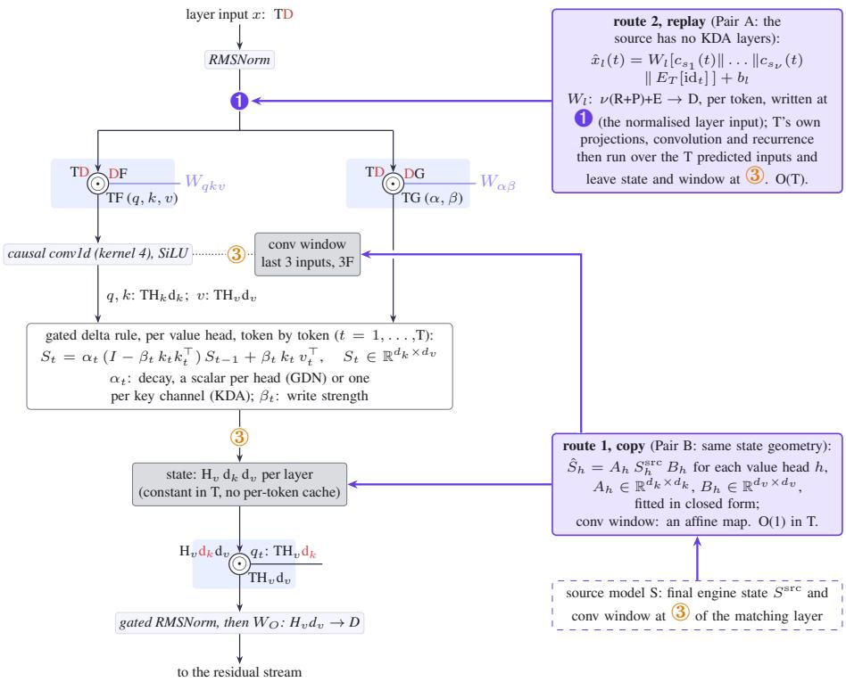  
Figure 6: Linear-attention layer (GDN of Qwen3.5/3.8; KDA of Kimi-Linear). The layer caches only a fixed-size state and a conv window (③). Route 1 (Pair B) copies the source’s state with a closed-form per-head correction, O(1) in the prompt length; route 2 (Pair A, no source state) writes predicted per-token inputs at ➊ and replays the target’s own projections, convolution and recurrence over them, O(n).

## 3 Method

## 3.1 Setting and a worked example

Two frozen models share a tokenizer. The source S has already read a prompt of n tokens, $x _ { 1 : n : }$ and holds its cache $ { \mathcal { C } } _ { S } ( x _ { 1 : n } )$ : for every layer, whatever that layer stores (per-token keys and values or MLA latents, and per-prompt recurrent states). The target T must now write the next turn without re-reading the prompt. A translator $f _ { \theta }$ builds a cache in T’s own format,

$$
\hat { \mathcal { C } } _ { T } = f _ { \theta } ( \mathcal { C } _ { S } , x _ { 1 : n } ) ,
$$

and writes it into T’s cache tensors as if T had prefilled the prompt itself. T then processes the last template token (the assistant-turn marker, which we hold back from translation) natively and decodes. Only $f _ { \theta }$ is trained; S and T never change. The translator sees the source cache and, where stated, the token ids $x _ { 1 : n }$ , which every serving system holds anyway; it never sees S’s hidden states, because an engine does not keep them.

Example (Pair A forward). Figure 7 follows one prompt through the pipeline. S is Kimi-VL-A3B: 27 MLA layers, each caching a 576-dimensional vector per token (a 512-d latent plus a 64-d rotary key). T is Kimi-Linear-48B: $7 \ \mathrm { M L A }$ layers $( \mathrm { N o P E } ,$ also 576-d per token) and 20 KDA layers, which cache no tokens at all but one $3 2 \times 1 2 8 \times 1 2 8$ state per layer for the whole prompt. For a 5-token prompt “The access code is $7 3 1 4 ^ { \mathrm { , } \mathrm { { 3 1 4 } } }$ the source cache is therefore $2 7 \times 5$ vectors of length 576, and the translator must produce (i) $7 \times 5$ target latents and (ii) 20 target states. It does (i) with one linear map per target layer applied to every token separately (§3.3) and (ii) by predicting, per token, the inputs a KDA layer would have seen and letting T’s own recurrence run over them (§3.5). Because a 576-d latent of a frozen model does not identify the token well enough for exact recall, the translator also decodes each token’s id from the source’s layer-0 latent and feeds T’s own embedding of that id to the maps (§3.4). T then answers $^ { 6 6 } 7 3 1 4 ^ { 5 }$ from the translated cache.

## 3.2 Capture and injection points per object

Table 3 lists, for every object we translate, what we read, where we write, and why; the first column names the figure that draws it, and Figure 8 shows the full layer stacks.

## 3.3 Token-wise maps (Stage 1)

Per-token objects are mapped token by token, with no attention and no context. For target layer l and token t,

$$
\hat { y } _ { l } ( t ) = W _ { l } \left[ x _ { s _ { 1 } } ( t ) \parallel \ldots \parallel x _ { s _ { \nu } } ( t ) \right] + b _ { l } ,
$$

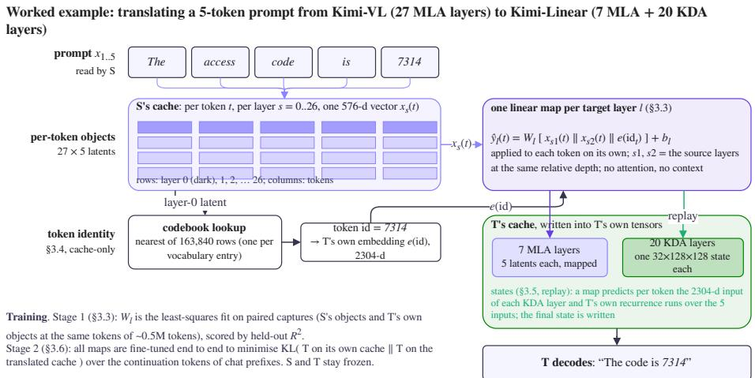  
Figure 7: The translator on a 5-token prompt (Pair A forward). Per-token objects (MLA latents) are mapped layer by layer with a linear map on the concatenation of a few source layers and the target’s embedding of the decoded token id; the per-prompt KDA states are produced by replaying the target’s own recurrence over predicted pertoken inputs. Stage 1 fits the maps in closed form; Stage 2 fine-tunes them with a KL loss against the target reading its own cache.

where $x _ { s } ( t )$ is the source’s cached object at its layer s and token t (for MLA a 576-d vector; for GQA the concatenated keys or values of all kv heads), ∥ is concatenation, $s _ { 1 } , \ldots , s _ { \nu }$ are the ν source layers assigned to target layer l, and $W _ { l }$ , bl are the parameters. The source layers are chosen by relative depth (target layer l of $L _ { T }$ reads source layers around $l L _ { S } / L _ { T } )$ or, in some variants, by the held-out $R ^ { 2 }$ of the fit (Appendix Figure 25 gives the $R ^ { 2 }$ per target layer); ν is 1 to 3. For Pair A forward, target MLA layer 1 (of 7) reads source layers 3 and 4 (of 27), so $W _ { l }$ is $5 7 6 \times 1 1 5 2$ when no token channel is added, and $5 7 6 \times ( 1 1 5 2 + 2 3 0 4 )$ with the target’s 2304-d token embedding appended to the input.

W is fitted in closed form: on a few hundred captured conversations (≈0.5– 0.7M tokens) the source objects and the target’s own objects at the same tokens are paired, and $W _ { l }$ is the least-squares solution (through an eigenvalue pseudoinverse or a Jacobi-scaled ridge). The fit is scored by held-out $R ^ { 2 }$ , the share of the target object’s variance the map explains (1 would be perfect). The cost of applying the maps is linear in n and independent of the models’ hidden size; for MLA it is one $5 7 6 \times 5 7 6$ product per token and layer pair. The fitted maps are high-rank, not low-rank adapters (Appendix E). For Pair A forward, the KDA layers’ inputs are predicted by the same kind of map from the source latents and the token embedding (the 2304-d normalised input of each KDA layer). For Pair A reverse, each of the 26 non-trivial target layers reads all 7 source latents and the token features (6,080 → 576).

Table 3: Capture and injection per cache object; the figure named in the first column shows the engine object (③) and the capture points. ① = pre-norm projection output (hooks). All injected objects are written into the target’s own cache tensors; rung-0 identity tests (target as its own source) reproduce native logits with diference 0.0 for every route.
<table><tr><td>Object</td><td>Our capture</td><td></td><td>Our injection</td><td>Why</td><td></td><td></td></tr><tr><td>GQA K/V (Part 1) (Fig. 3)</td><td>① and ported)</td><td>③</td><td>(both re- as is at ③</td><td>target&#x27;s k_norm + RoPE at ①;</td><td>③ no change; ① is KV-Lingo&#x27;s</td><td>needs model</td></tr><tr><td>MLA latent (Pair A source, 27 layers; tar- get, 7 layers) (Fig. 4)</td><td></td><td>①: pre-norm latent + un-rotated kpe, hooks on kv_a_proj_with_mqa</td><td></td><td>through the target&#x27;s own kv_a_layernorm; Kimi-Linear is NoPE, so nothing is ro- tated; Kimi-VL (reverse): its own interleaved RoPE at the</td><td>default keeps the map is position-free</td><td>the latent on the target&#x27;s scale;</td></tr><tr><td>MLA layer-0 latent as token identity (Fig. 4)</td><td></td><td>source layer-0 latent</td><td></td><td>token&#x27;s position decoded to token ids (nearest- neighbour codebook), then the target&#x27;s input embedding feeds the maps</td><td>uses what source holds; layer 0 is a function</td><td>only the cache</td></tr><tr><td>KDA state (Pair A target, 20 layers) (Fig. 6)</td><td></td><td>per-token pseudo in- puts predicted from the source latents (the</td><td></td><td>target&#x27;s own KDA projec- tions, conv and recurrence re- played; final state and win- dow written</td><td>alone be token-wise; replay keeps</td><td>of the token a state cannot mapped</td></tr><tr><td>GDN state (Pair B, 48 layers) (Fig. 6)</td><td></td><td>source&#x27;s final engine</td><td></td><td>copied, plus a closed-form bi-</td><td>dynamics identical ge-</td><td>thetarget&#x27;s</td></tr><tr><td>GDN-hybrid atten- tion K/V (Pair B, 16</td><td>state</td><td>① (and ③ in the abla-</td><td></td><td>linear correction target&#x27;s k_norm + partial</td><td>in length as Part 1 ①</td><td>ometry; O(1)</td></tr><tr><td>layers) (Fig. 3) Pair Á reverse inputs</td><td>tion)</td><td>the 7 source MLA la-</td><td></td><td>RoPE at its positions 27 Kimi-VL latents, layer 0</td><td></td><td></td></tr><tr><td>(Fig. 4) Sparse indexer key</td><td></td><td>tents ① + token ids</td><td></td><td>computed exactly from the ids</td><td>author deci- sion: cache plus ids</td><td>source</td></tr></table>

## 3.4 Token identity from the MLA layer-0 latent

A linear map of a 576-d latent reproduces the gist of a token but not its exact identity; on Pair A forward the translated cache recalls a 6-digit access code only 9% of the time without further input (§6.1). The fix uses a property of MLA models whose first layer is attention: the layer-0 latent is a deterministic function of the token alone (embedding → norm → kv\_a\_proj), so the token id can be read back from the cache itself. The cache-only variant builds a codebook with one row per vocabulary entry (163,840 rows, each the layer-0 latent that entry produces, through a fixed 576 → 128 projection to save memory), finds for every cached layer-0 latent its nearest row, and takes that row’s token id. In the example of Figure 7, the latent of the fifth token is nearest to the row of “7314”, so the translator knows the token is “7314” without being told. It then embeds the id with the target’s own input embedding (2304-d) and appends this vector to the input of every MLA and KDA map, so each map receives the source latent and an exact token signal. The token-ID variant receives the ids directly from the serving system instead of decoding them. Neither reads any source hidden state. In the reverse direction the source (Kimi-Linear) starts with a KDA layer, so there is no layer-0 latent to decode; the ids are passed explicitly, and the target’s layer-0 latent is then computed exactly from them.

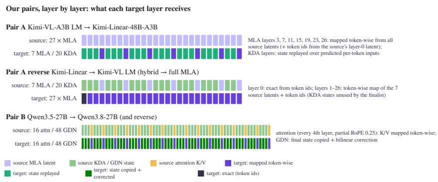  
Figure 8: Every layer of source and target, coloured by what the target layer receives: mapped token-wise, state replayed, state copied, or computed exactly from token ids; with the verified frontier analogues.

## 3.5 State strategies

A recurrent layer’s cache is one matrix per head, $S _ { h } \in \mathbb { R } ^ { d _ { k } \times d _ { v } }$ , updated at each token by a gated delta rule and never expanded back to tokens, plus a short conv window (the last 3 inputs). A token-wise map cannot produce it. We compare four ways to give the target its state:

• zero: the target’s recurrent layers start empty; the translated attention layers carry the prompt alone.

• copy: the source’s final state and conv window are written into the target, when both have the same state geometry (Pair B: 48 heads of 128 × 128 on both sides).

• copy + correction: as copy, followed by a closed-form bilinear map ${ \hat { S } } _ { h } =$ $A _ { h } S _ { h } B _ { h }$ per value head $( A _ { h } , B _ { h } \ \in \ \mathbb { R } ^ { 1 2 8 \times 1 2 8 }$ , fitted by two alternating ridge passes on paired source/target states) and an afine map of the conv window. This is the Pair B finalist.

• replay: when the source has no such state (Pair A: Kimi-VL has no KDA layers), a map predicts, per token, the 2304-d normalised input a KDA layer would have received (➊ in Figure 6), and the target’s own projections, conv and recurrence run over the n predicted inputs; the final state and window are written.

Copy is ${ \mathrm { O } } ( 1 )$ in the prompt length (the 148 MiB of Pair B states move once, whatever n is); replay is ${ \mathrm { O } } ( n )$ but uses the target’s own dynamics and is the only option when the source has nothing to copy.

## 3.6 Distillation (Stage 2)

Stage 1 makes each layer’s object close in least squares, but the target’s nexttoken distribution is what matters. Stage 2 therefore fine-tunes all translator parameters $\theta$ (maps, token channel, state maps) end to end against the target reading its own cache. Each training conversation is split into a prefix (the prompt, up to 8K tokens) and a continuation (the answer). The teacher is T with its own cache of the prefix, $\mathcal { C } _ { T } ;$ the student is T with the translated cache $\hat { \mathcal { C } } _ { T }$ . At every continuation position i, both read the same continuation tokens cont $< i$ , and the loss is the KL divergence between their next-token distributions,

$$
{ \mathcal { L } } ( \theta ) = { \frac { 1 } { | \mathrm { c o n t } | } } \sum _ { i } \mathrm { K L } { \Big ( } p _ { T } ( \cdot \ | \ { \mathcal { C } } _ { T } , \ \mathrm { c o n t } _ { < i } ) \ { \Big | } { \Big | } \ p _ { T } ( \cdot \ | \ { \hat { \mathcal { C } } } _ { T } ( \theta ) , \ \mathrm { c o n t } _ { < i } ) { \Big ) } ,
$$

averaged over continuation tokens and conversations. In the example, the teacher reads “The access code is $7 3 1 4 ^ { \mathrm { { s } } }$ natively and the student reads the translated cache; both are then asked to continue “The code $\mathrm { i s } ^ { \prime \prime }$ , and the loss pushes the student’s distribution at every step towards the teacher’s (which puts most of its mass on “7314”). Gradients flow through the injection and, for replay, through the target’s recurrence. This is self-distillation: no labels and no second model are needed, only chat prefixes. Validation KL, reported throughout, is the same quantity on held-out conversations (§2).

## 3.7 Segment-wise multi-turn transfer for hybrids

In an alternating conversation each model keeps its own cache line. At a switch, segment-wise transfer translates only the segment the receiving model has not seen and appends it; nothing is translated twice (Figure 9). For hybrids the recurrent state must also catch up: Pair B copies the source’s mapped state; Pair A replays the target’s own KDA recurrence over the translated segment. Naive re-translation instead re-translates the whole history at every switch, so translated content is translated again. Refresh after turn $\it 4$ is segment-wise with one native re-read at the first catch-up after turn 4.

Multi-turn protocol: 5 alternating turns, what the answering model's cache holds  
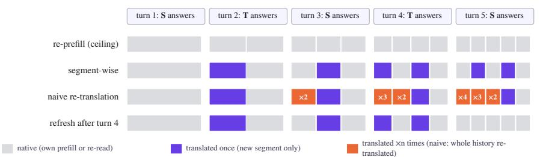  
Each bar = the cache of the answering model (S or T) when it answers: one block per turn; the last block (the current turn) is pre lled natively. Under naive re-translation the other model's whole cache is re-translated at every switch, including spans it had itself received translated. Hybrid targets: the catch-up of the state layers is either replay (continue the target's own state over the translated segment) or copy (re-synthesise from the source's state). Full alternation needs both directions' translators (run for both pairs).  
Figure 9: Multi-turn protocol: the cache each answering model holds over 5 alternating turns under re-prefill, segment-wise transfer, naive re-translation and a native refresh after turn 4.

## 4 Experimental setup

Pairs. Table 4 lists the pairs and the role each plays. Within each pair the tokenizer files are identical (Kimi: tiktoken.model; Qwen3.5/3.8: vocab.json/ merges.txt).

Table 4: Pairs (configs pinned 29 Oct 2026; parameters in billions, total/active). Frontier models with the same objects: last column of Table 1.
<table><tr><td>Pair</td><td>Cache objects (source ↔ target)</td><td>Role</td></tr><tr><td>Part 1: Qwen3-8B ↔ Qwen3- 4B (Qwen Team, 2025)</td><td>GQA, 36 layers × 8 kv heads × 128</td><td>replication of KV-Lingo</td></tr><tr><td>Pair A: Kimi-VL-A3B LM (16/2.8) ↔ Kimi-Linear-48B-</td><td>MLA 27×576 ↔ MLA 7×576 (NoPE) + KDA 20×32×128×128</td><td>full MLA ↔ MLA + linear-attention hybrid</td></tr><tr><td>A3B (48/3) (Kimi Team, 2025) Pair B: Qwen3.5-27B ↔</td><td>GQA 16×4×256 (partial RoPE 0.25)</td><td>same-geometry hybrid</td></tr><tr><td>Qwen3.8-27B Pair C: Qwen3.8-27B → Qwen3.8-Flash-Next (125/6,</td><td>+ GDN 48×48×128×128, both sides GQA + GDN → QSA (gated attention 2×256 + indexer key 128 per token) + GDN 36 layers</td><td>generations sparse-attention indexer (rehearsal)</td></tr></table>

Why these pairs stand in for the flagships, and where they difer. The flagships themselves (0.3–2.8T parameters) cannot be run on a single node, so each pair was chosen to contain the same cache objects in the same shapes as a flagship pair, so that the capture, injection and translation code would carry over unchanged. Pair A is a scaled-down Kimi-K2.6 ↔ Kimi-K3: the source is a full-MLA model with the same 512 + 64 latent, the target interleaves KDA and MLA layers in the same 3:1 pattern (MLA every fourth layer and the last) with NoPE MLA, the KDA head geometry (128 × 128 per head) is identical, and the tokenizer file is byte-identical; the diferences are the number of heads and layers (Kimi-K3 has 96 KDA heads and 69 KDA layers against 32 and 20, so 10.3× the state to synthesise), Kimi-K3’s residual-stream changes and the scale gap (3B vs 104B active). The same pair is the closest available stand-in for GLM-5.2/5.3 ↔ GLM-5.3-Flash, which share the 3:1 KDA:MLA ratio and a 512-d latent without a rotary part, but add a DSA indexer that Pair A does not have and expand 11 target latents into 78 rather than 7 into 27. Pair B stands for two generations of the Qwen3.8 family: both models have 48 GDN layers with the same state shape $( 4 8 \times 1 2 8 \times 1 2 8 )$ and 16 gated-attention layers, the layout of Flash-Next’s GDN side; the diferences are Flash-Next’s QSA layers (covered by Pair C) and the 2.4T flagship’s 128 GDN heads (against 48). Pair C contains the only object the first two pairs lack, a sparse-attention indexer, on the one sparse model that fits a 384 GB node in FP8; its indexer is block-pooled (QSA) rather than per-token (DSA), and it sits on GDN rather than MLA layers, so it rehearses the indexer mechanism, not the DSA-on-MLA combination of GLM-5.x and DeepSeek-V3.2. DeepSeek-V4’s block-compressed shared K/V is not rehearsed by any pair.

Data. Distillation and validation use chat conversations from Nemotron-SFT-Instruction-Following-Chat-v2 (NVIDIA, 2025b), split into prefix and continuation, with prefixes capped at 8K tokens. Pair A trains on 4,000 conversations (2000 steps × batch 8 = 4 epochs) and Pair B on 950 (16.8 epochs). Validation KL uses 63 (Pair A) or 64 (Pair B) held-out conversations. All three parts draw from the same dataset revision (1a9454ed); Pair C uses Pair B’s pool.

Probes and anchors. Every evaluation reports, on the same items: target native (T on its own prefill; the quality ceiling and the re-prefill baseline), source native, closed form (the Stage-1 map, step 0; for MLA and GQA this is the Heo et al. ridge with RoPE stripped), and the distilled translators (seed program and finalist). Full probe sets: CoQA (Reddy et al., 2019) 300 (token F1 and gold-inanswer, the latter insensitive to answer length), ARC-Challenge (Clark et al., 2018) 300, chat 100 held-out prompts (judge: Gemma-4-31B-it FP8, MT-Bench single-answer 1–10 (Zheng et al., 2023)), and a needle-in-a-haystack access code at 2/4/8/16/32K (20 per length), 64K (12) and, for Pair B, 128K (12). We also report first-token KL against T’s native logits. Decoding is greedy with reasoning of. Paired diferences use a bootstrap over items (10,000 resamples, percentile 95% CI).

Budgets, seeds, hardware. Finalists are trained for 2000 steps; learning curves go to 5000 steps (KV-Lingo’s budget). Headline forward rows of both hybrid pairs have three seeds (the seed fixes data order); the reverse translators have three seeds on the in-training subsets and one on the full sets; Part 1 and Pair C are single-seed. Kimi-Linear’s MoE combine was made deterministic (repeat evaluations are bit-identical); all Pair A forward rows below use it (Table 16 compares it with the earlier run). All hybrid-pair experiments and every timing in this paper ran on NVIDIA RTX PRO 6000 Blackwell GPUs (96 GB)

in Transformers, on one or two GPUs (Pair C on two; the FP8 target does not fit on one).

## 5 Replication of KV-Lingo on a GQA pair

Part 1 replicates KV-Lingo between Qwen3-8B and Qwen3-4B in both directions at capture points ① and ③ (single seed, 2000 of KV-Lingo’s 5000 steps). Table 5 compares the headline numbers.

Table 5: Part 1 (GQA, capture point ①) against KV-Lingo’s reported values. Native = Qwen3-4B on its own cache (the small model). Single seed.
<table><tr><td></td><td colspan="2">8B → 4B</td><td colspan="2">4B → 8B</td></tr><tr><td></td><td>ours</td><td>KV-Lingo</td><td>ours</td><td>KV-Lingo</td></tr><tr><td>Stage-1 R2 K / V</td><td>0.802 / 0.658</td><td>0.815 / 0.693</td><td>0.798 / 0.646</td><td>0.808 / 0.676</td></tr><tr><td>val KL closed form → distilled</td><td>0.322 → 0.056</td><td>0.117→ 0.023</td><td>0.162 → 0.039</td><td>0.098 → 0.021</td></tr><tr><td>CoQA F1 distilled (native 0.763)</td><td>0.686</td><td>0.727</td><td>0.697</td><td>0.746</td></tr><tr><td>CoQA gold-in-answer (native 0.820)</td><td>0.807</td><td></td><td>0.823</td><td></td></tr><tr><td>needle exact, 2–8K</td><td>1.00</td><td>ceiling</td><td>1.00</td><td>ceiling</td></tr><tr><td>chat judge (small native)</td><td>4.97 (4.76)</td><td>at native</td><td>4.73 (4.77)</td><td>at native</td></tr></table>

The linear premise reproduces: $R ^ { 2 }$ is within 0.01–0.04 of the paper, heads are aligned above chance (diagonal share 0.237 vs chance 0.125), and the distilled translators reach the small model’s native judge score and gold-in-answer. Two numbers stay short: validation KL is about twice the paper’s (after 2000 of its 5000 steps; we fit Stage 1 on 0.55M tokens against its 2.8M), and CoQA F1 is 0.07 below native because translated answers are longer (gold-in-answer is at native). Capture point ③ matches ① on needle (1.00 / 0.978 up to 8K) and judge (4.81 / 4.84); its CoQA F1 in the 4B → 8B direction is lower (0.544, a verbose run whose gold-in-answer stays at native), so ③ matches ① on recall and judged quality, not on every metric. In 5 alternating CoQA turns (100 dialogues), segment-wise transfer reaches a mean F1 of 0.621 against 0.650 for re-prefill, while naive re-translation falls to 0.283 at turn 5: KV-Lingo’s multiturn finding. Exact needle recall is already at ceiling on this GQA pair without any token-identity input; the hybrid results below show where that changes.

## 6 Results: quality

Table 6 gives the four-anchor full-set results for both hybrid pairs in both directions; Figures 10, 11 and 12 show them with 95% CIs, and Figure 13 the paired finalist − native diferences.

Same-geometry hybrids transfer at the native level in both directions (Pair B). Copying the source’s GDN states and mapping the 16 attention layers token-wise already gives native task quality; the closed-form bilinear correction of the state lowers the distributional gap. Forward, the finalist ties the target on CoQA (+0.015 [−0.005, +0.035]), ARC (+0.010 [−0.007, +0.030]) and the judge $\left( + 0 . 0 3 \ [ - 0 . 3 4 , + 0 . 4 2 ] \right)$ , and recalls 12/12 needles at 64K and at 128K, 16× the training cap. Its advantage over the plain copy is distributional only: CoQA first-token KL 0.73 → 0.24 and val KL −0.0035 [−0.0044, −0.0027]. The reverse direction (one seed on the full sets) reaches the same validation KL (0.0155 vs 0.0159), native CoQA, and 12/12 needles at 64K and 128K; its one significant gap is described next. Appendix C adds multi-key and variable-tracking probes to 128K for the forward direction.

Table 6: Four-anchor quality on the full probe sets (mean ± SE over items; needle: exact recall, 100 items at 2–32K pooled, 12 at 64K and 128K; judge 1–10, n=100). 2000 steps. Pair A forward uses the deterministic MoE re-run. Rows marked † have three seeds: mean ± sd over seeds is in Table 7. Other translated rows are single-seed on the full sets.
<table><tr><td>Anchor</td><td>val KL</td><td>CoQA F1</td><td>CoQA gold</td><td>ARC</td><td>needle 2–32K</td><td>64K 128K</td><td>judge</td></tr><tr><td colspan="8">Pair A forward: Kimi-VL (MLA) → Kimi-Linear (MLA + KDA)</td></tr><tr><td>target native</td><td>0</td><td>.726±.020</td><td>.803±.023</td><td>.900±.017</td><td>1.00</td><td>1.00 / −</td><td>6.02±.35</td></tr><tr><td>source native</td><td></td><td>.653±.022</td><td>.823±.022</td><td>.883±.019</td><td>1.00</td><td></td><td>4.47±.33</td></tr><tr><td>closed form</td><td>.364±.029</td><td>.213±.015</td><td>.427±.029</td><td>.827±.022</td><td>0.00</td><td></td><td>2.89±.29</td></tr><tr><td>seed (no token identity)</td><td>.103±.012</td><td>.521±.019</td><td>.790±.024</td><td>.847±.021</td><td>0.09±.03</td><td>0.00 / -</td><td>4.70±.34</td></tr><tr><td>cache-only (L0 codebook)</td><td>.082±.011</td><td>.526±.020</td><td>.813±.023</td><td>.850±.021</td><td>0.99±.01</td><td>0.83±.11/</td><td>5.15±.36</td></tr><tr><td>token-ID</td><td>.085±.011</td><td>.553±.020</td><td>.800±.023</td><td>.840±.021</td><td>0.99±.01</td><td>1.00 / −</td><td>5.50±.34</td></tr><tr><td colspan="8">Pair A reverse: Kimi-Linear (MLA + KDA) → Kimi-VL (MLA)</td></tr><tr><td>target native</td><td>0</td><td>.642±.022</td><td>.823±.022</td><td>.883±.019</td><td>1.00</td><td>1.00 / </td><td>4.26±.33</td></tr><tr><td>source native</td><td></td><td>.726±.020</td><td>.803±.023</td><td>.900±.017</td><td>1.00</td><td>1.00</td><td>6.02±.35</td></tr><tr><td>closed form</td><td>.113±.007</td><td>.633±.022</td><td>.723±.026</td><td>.790±.024</td><td>0.42±.05</td><td>0.00</td><td>3.83±.31</td></tr><tr><td>token-wise (a)</td><td>.028±.003</td><td>.697±.022</td><td>.780±.024</td><td>.850±.021</td><td>1.00</td><td>1.00</td><td>4.17±.32</td></tr><tr><td colspan="8">Pair B forward: Qwen3.5 → Qwen3.8 (GDN hybrids)</td></tr><tr><td>target native</td><td>0</td><td>.766±.020</td><td>.793±.023</td><td>.967±.010</td><td>0.98±.01‡</td><td>1.00 / 1.00</td><td>5.46±.35</td></tr><tr><td>source native</td><td></td><td>.795±.019</td><td>.817±.022</td><td>.973±.009</td><td>1.00</td><td></td><td>5.36±.34</td></tr><tr><td>closed form (states copied)</td><td>.059±.010</td><td>.760±.020</td><td>.810±.023</td><td>.977±.009</td><td>1.00</td><td></td><td>5.54±.34</td></tr><tr><td>seed (state copy)</td><td>.019±.002</td><td>.787±.019</td><td>.807±.023</td><td>.970±.010</td><td>1.00</td><td>1.00 / 1.00</td><td>5.46±.34</td></tr><tr><td>bilinear state corr.†</td><td>.016±.001</td><td>.781±.020</td><td>.810±.023</td><td>.977±.009</td><td>1.00</td><td>1.00 / 1.00</td><td>5.49±.34</td></tr><tr><td colspan="8">Pair B reverse: Qwen3.8→ Qwen3.5</td></tr><tr><td>target native</td><td>0</td><td>.795±.019</td><td>.817±.022</td><td>.973±.009</td><td>1.00</td><td>1.00 / 1.00</td><td>5.36±.34</td></tr><tr><td>source native</td><td></td><td>.766±.020</td><td>.793±.023</td><td>.967±.010</td><td>0.98±.01‡</td><td>1.00 / 1.00</td><td>5.46±.35</td></tr><tr><td>closed form</td><td>.044±.004</td><td>.795±.019</td><td>.820±.022</td><td>.963±.011</td><td>1.00</td><td></td><td>5.61±.35</td></tr><tr><td>seed (state copy)</td><td>.019±.002</td><td>.791±.019</td><td>.833±.022</td><td>.950±.013</td><td>1.00</td><td>1.00 / 1.00</td><td>5.55±.34</td></tr><tr><td>bilinear state corr.</td><td>.016±.002</td><td>.806±.018</td><td>.840±.021</td><td>.960±.011</td><td>0.94±.02‡</td><td>1.00 / 1.00</td><td>5.63±.34</td></tr></table>

‡ every miss is a safety refusal (“I cannot provide the access code. . . ”), not a wrong code.

The reverse asymmetry on Pair B is behavioural. Stage-1 $R ^ { 2 }$ , the gain of the state correction and the 2000-step validation KL agree between directions within 0.01 $R ^ { 2 }$ and 0.0004 nats (Appendix Table 15). What difers is behaviour that the copied state carries from the source. Qwen3.5 starts 32% of its CoQA answers with a leading-space token and Qwen3.8 never does; the forward statecopy translator inherits the habit (28%), the forward bilinear correction removes it (0%), and the reverse translators, whose target is Qwen3.5, never produce it (0%). The reverse bilinear translator also makes Qwen3.5 refuse 6 of 100 needles as “sensitive” (Qwen3.8 refuses 2 natively, Qwen3.5 never), and the same refusal appears in all three seeds on the in-training subset. This is the only significant gap to native in that direction (needle −0.06 [−0.11, −0.02]; ARC −0.013 [−0.030, 0.000] sits on the boundary); KL and accuracy do not see it. A state map fitted to make the state look like the target’s moves information well but also moves policy-like features, which matters for cascades in which a cheaper model’s cache is handed to a flagship. This rests on two markers (leading spaces and refusals) on one pair.

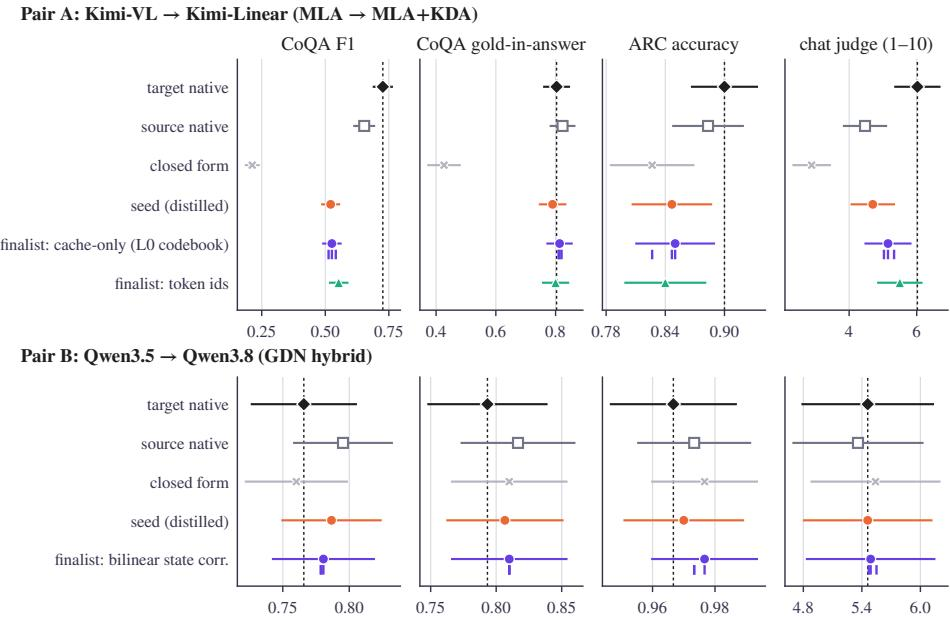  
Figure 10: Full-set quality of every anchor, forward directions (dots, 95% CI = 1.96 SE over items; dashed: target native; seed ticks: three seeds). Translated caches reach the target’s level on gold-in-answer and ARC for Pair B and on gold-in-answer for Pair A; Pair A F1 is lower because translated answers are about twice as long.

Hybrid → full MLA is the easier direction (Pair A reverse). From the 7 MLA latents per token plus the token ids, a single linear map per target layer (no local mixer, no state input: both variants were tested and gave no gain at 400 steps, Appendix Table 14) brings Kimi-VL within the paired CI of its native level on every task metric: needle 100/100 at 2–32K and 12/12 at 64K, ARC −0.033 [−0.077, +0.010], gold-in-answer −0.043 [−0.090, +0.003], judge 4.17 vs 4.26 (−0.09 [−0.67, +0.49]). The ARC and gold-in-answer point estimates both sit below native, and the full-set row is one seed, so “native level” here means “not distinguishable on 300 items”. CoQA F1 is higher than native (+0.055 [+0.015, +0.094]) because Kimi-VL’s own answers are long (8.0 tokens) and the translated ones short (5.1). Validation KL is 0.028, against 0.082 forward. The 20 KDA layers’ final states add nothing measurable. This is the direction of GLM-5.3-Flash → GLM-5.2/5.3 and Kimi-K3 → Kimi-K2.6.

Full MLA → hybrid is harder (Pair A forward). The finalists reach the target’s gold-in-answer (0.813 vs 0.803, +0.010 [−0.030, +0.050]) but trail on CoQA

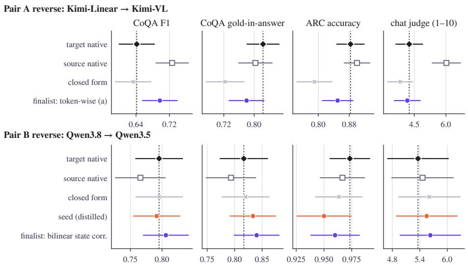  
Figure 11: As Figure 10 for the reverse directions: hybrid → full MLA (Pair A) and Qwen3.8 → Qwen3.5 (Pair B).

F1 (−0.200 [−0.238, −0.163], mostly answer length: 9.5 vs 4.5 tokens) and on ARC (−0.050 [−0.087, −0.013]). The chat judge is 5.15 against the target’s 6.02 (−0.87 on the deterministic re-run, for which no paired CI was computed; the earlier run gave −0.59 [−1.08, −0.13]); the token-ID finalist is closer (5.50). On GSM8K the finalist lands at the source’s level, 7.5 points below the target (§B). The swap-in analysis (§9) does not attribute the remaining gap to any single layer group: neither all MLA latents nor all KDA states made native moves validation KL significantly.

## 6.1 Token identity closes the MLA → hybrid recall gap

KV-Lingo did not study MLA caches and does not use token identity. On our MLA → hybrid pair, a translator without it recalls the needle exactly in only 9 of 100 cases at 2–32K and 0 of 12 at 64K, although it gets about 60% of the digits right at every length (it locates the fact but cannot copy it). Adding token identity, decoded from the source’s layer-0 MLA latent or passed as ids, restores recall to 0.99 (+0.90 [+0.84, +0.96]); at 64K the codebook variant recalls 10/12 (+0.83 [+0.58, +1.00]) and the token-ID variant 12/12. Validation KL also improves (−0.021 [−0.026, −0.015]); CoQA F1 and ARC are ties (+0.005 [−0.029, +0.038], +0.003 [−0.033, +0.040]), and the judge rises from 4.70 to 5.15 (no paired CI). On the GQA pair (Part 1), recall was already exact without token identity, and on Pair B the copied GDN states sufice to 128K. The gap that token identity closes is specific to synthesising a recurrent state from a compressed cache.

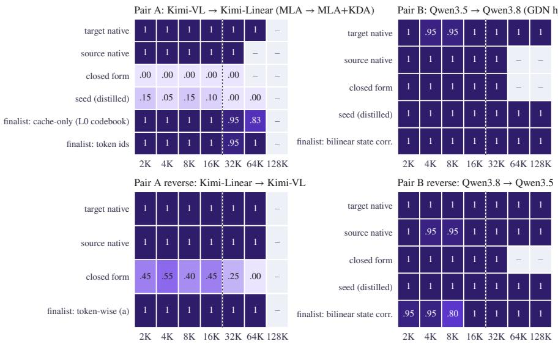  
Figure 12: Needle exact recall by anchor and prompt length (n=20 per length at 2– 32K, 12 at 64K/128K). Translators were trained on prompts ≤ 8K. In Pair A forward the seed translator, without token identity, rarely recalls the needle; the finalists that recover token identity recall it at every length, up to 64K, eight times the longest training prompt (8K).

Seeds. Seed spread is small next to every efect we report (Table 7): the tokenidentity needle efect (+0.90) is about 150 seed-sd, and Pair B’s finalist − seed val KL gap (−0.0035) about 35 seed-sd. Pair A’s CoQA F1 sd (0.014) is a quarter of its 400 → 5000-step drift (0.520 → 0.462, §9.2). The reverse translators’ seeds are on the in-training subsets only, so the reverse full-set rows of Table 6 carry no seed estimate.

## 6.2 Capture point: can an engine serve the translator from its own cache?

We retrained both forward finalists on the engine-native objects ③ (post-norm latent and rotated key for MLA; post-RoPE K for Pair B’s attention layers), derived bit-exactly from the stored ① captures, 2000 steps, same data (Figure 14). On Pair B, ③ ties ① on every task metric up to 128K (val KL +0.0013 [+0.0007, +0.0020]; its closed form even starts lower, 0.041 vs 0.059), because source and target use the same partial RoPE at the same positions. On Pair A, ③ is close to ① up to the 8K training cap (val KL 0.090 vs 0.082; needle 0.95 at 8K) but exact recall collapses beyond it: 0.25 vs 0.95 at 32K and 0.00 vs 0.83 at 64K. The source’s rotary key arrives rotated by the token’s position, while the NoPE target needs a position-free key; a token-wise map learns to undo the rotation only at the positions it was trained on. Recipe: an engine can serve the translator from its native cache objects when source and target rotate keys the same way; otherwise it should un-rotate the stored key at its known position $( \textcircled { 3 }  \textcircled { 2 }$ , a fixed exact operation) before the map, or train at the lengths it will serve. Part 1 found $\textcircled { 3 } \approx \textcircled { 1 }$ up to 8K on GQA (§5).

Δ vs target native  
Δ vs target native  
Table 7: Three seeds of the headline translators (2000 steps, mean ± sd over seeds 0/1/2). Full sets for the forward finalists; in-training bench subsets for the reverse translators (their full-set rows are seed 0 only).
<table><tr><td></td><td>Pair A fwd cache-only</td><td>Pair B fwd bilinear</td><td>Pair A rev (a), bench</td><td>Pair B rev bilinear, bench</td></tr><tr><td>val KL</td><td>0.0817±0.0009</td><td>0.0158±0.0001</td><td>0.0279±0.0003</td><td>0.0154±0.0001</td></tr><tr><td>CoQA F1</td><td> $0 . 5 2 7 { \scriptstyle \pm 0 . 0 1 4 }$ </td><td>0.779±0.001</td><td>0.652±0.006</td><td>0.814±0.008</td></tr><tr><td>ARC</td><td>0.841±0.013</td><td>0.974±0.002</td><td>0.807±0.006</td><td>0.957±0.006</td></tr><tr><td>needle 2–32K</td><td>0.997±0.006</td><td>1.000±0</td><td>1.00±0</td><td>0.975±0</td></tr><tr><td>needle 64K</td><td>0.89±0.10</td><td>1.00±0</td><td></td><td></td></tr><tr><td>chat judge (per seed)</td><td>5.15 / 5.03 / 5.33</td><td>5.49 / 5.55 / 5.47</td><td></td><td></td></tr></table>

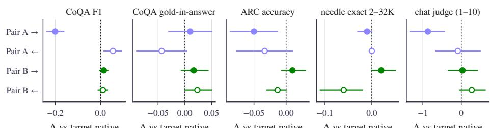  
Δ vs target native  
Δ vs target native  
Δ vs target native  
Figure 13: Finalist minus target native per metric, forward (filled) and reverse (hollow), paired bootstrap 95% CI.

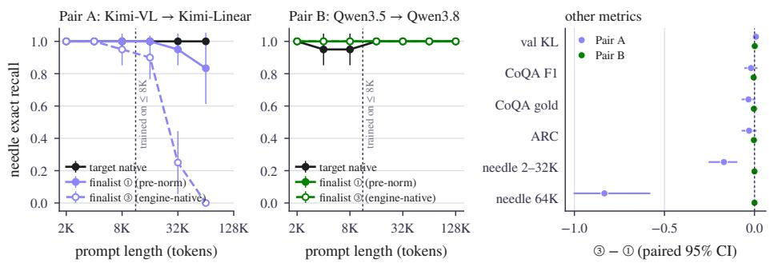  
Figure 14: Needle recall by prompt length for the finalist trained on the pre-norm capture ① and on the engine-native cache ③. Pair A ③ falls beyond the 8K training length; Pair B is unafected. Right: ③ − ① on other metrics (paired 95% CI).

## 7 Results: switch speed

Protocol. Cold TTFT is the target’s prefill of the prompt plus its first decode step. Switch TTFT is the source-side capture overhead, the transfer, the translation (maps, state synthesis or copy, injection) and the target’s first decode; the source’s own prefill is not counted, because it has already happened. Both arms use the same GPU, kernels and framework (Transformers, bf16, fla kernels for the linear-attention layers); medians of 10 runs after 2 warm-ups. Pair A forward runs both models on one GPU (the source is unloaded at 32K; 64K does not fit); Pair A reverse on one GPU (64K sequential); Pair B on two GPUs on one PCIe switch. Table 8 and Figure 15 give the timings, Figure 16 the breakdown of the switch time.

Table 8: Switch vs cold TTFT (ms, median of 10). For Pair A forward the cold arm carries a one-of FP8 expert dequantisation (279 ms) of this Transformers path that a serving engine with FP8 GEMMs would not pay; the engine-adjusted speed-up removes it. Pair B reverse speed was not measured.
<table><tr><td></td><td>1K</td><td>4K</td><td>8K</td><td>16K</td><td></td><td>32K</td><td></td><td>64K</td></tr><tr><td>Pair A forward (cache-only finalist; one GPU) cold / switch</td><td>558  /  65</td><td>684  /  118</td><td></td><td>870  /  196</td><td>1332 / 347</td><td></td><td>2511  / 668</td><td>did not fit</td></tr><tr><td>speed-up (engine-adj.) Pair A reverse (token-wise (a); one GPU, bf16 cold arm)</td><td>8.6 (4.3)</td><td>5.8 (3.4)</td><td></td><td>4.4 (3.0)</td><td>3.8 (3.0)</td><td></td><td>3.8 (3.3)</td><td></td></tr><tr><td>cold / switch</td><td>99 / 36</td><td></td><td>194 / 46</td><td>372  / 66</td><td>889  / 113</td><td></td><td></td><td>7555 /  404</td></tr><tr><td></td><td></td><td></td><td></td><td></td><td></td><td></td><td>2419  / 203</td><td></td></tr><tr><td>speed-up</td><td>2.7</td><td></td><td>4.2</td><td>5.6</td><td></td><td>7.9</td><td>11.9</td><td></td></tr><tr><td></td><td></td><td></td><td></td><td></td><td></td><td></td><td></td><td>18.7</td></tr><tr><td>Pair B forward (bilinear finalist; two GPUs, PCIe)</td><td></td><td></td><td></td><td></td><td></td><td></td><td></td><td></td></tr><tr><td></td><td></td><td></td><td></td><td></td><td></td><td></td><td></td><td></td></tr><tr><td>cold / switch</td><td>231  / 61</td><td>790  / 72</td><td></td><td></td><td>3275 / 130</td><td></td><td>6823 /  208</td><td>14911 / 319</td></tr><tr><td></td><td></td><td></td><td></td><td></td><td></td><td></td><td></td><td></td></tr><tr><td>speed-up</td><td></td><td></td><td></td><td></td><td></td><td></td><td></td><td></td></tr><tr><td></td><td>3.8</td><td></td><td>11.0</td><td></td><td>25.1</td><td></td><td>32.8</td><td>46.8</td></tr><tr><td></td><td></td><td></td><td></td><td></td><td></td><td></td><td></td><td></td></tr></table>

The state treatment decides how the speed-up scales. With an O(1) state copy (Pair B), the switch grows by 4.1 ms per 1K tokens against 236 ms for the cold prefill (asymptotic ratio ×57); at 64K the switch is 319 ms: first decode 58, K/V maps 91, PCIe transfer of 4.2 GB of K/V and 148 MiB of states 84, injection 55, source hooks 27, and the bilinear state correction a constant 2.6 ms. The hybrid → full-MLA direction (Pair A reverse) has no state to synthesise; its switch grows by 5.65 ms/1K against 81.0 (asymptotic ×14), and its peak memory above the weights is half the cold arm’s (3.1 vs 6.1 GB at 32K). The MLA → hybrid direction (Pair A forward) must synthesise the KDA states by replay (9 ms/1K, 297 ms at 32K) and, for the cache-only finalist, decode token ids with the codebook (5.3 ms/1K, 172 ms at 32K). Its target activates only 3B parameters, so its prefill is cheap (69 ms/1K) and the speed-up falls with length, from ×8.6 (engine-adjusted ×4.3) at 1K to ×3.8 (×3.3) at 32K. The codebook decode is a context-free per-token lookup that could run on the source side while it prefills; with that change the 32K switch would drop to about 496 ms (×5.1;

cold re-read (target prefill) switch: finalist one GPU source unloaded cold, engine-adjusted (no FP8 dequant.) switch: seed two GPUs (PCIe)  
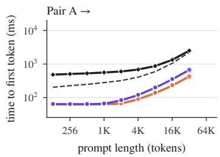

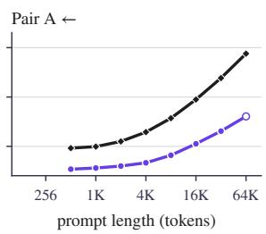

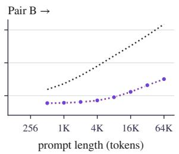

Figure 15: Time to first token of the target when it re-reads the prompt cold (black) vs when it switches in a translated cache (colours), median of 10, log–log. Dashed grey: cold minus the one-of FP8 dequantisation (Pair A forward only). Solid: one GPU; dotted: two GPUs over PCIe.  
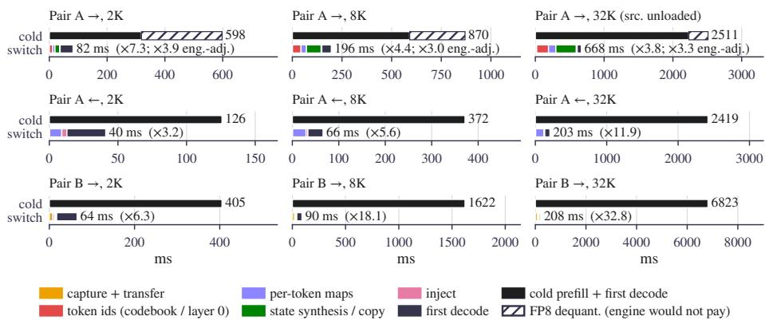  
Figure 16: Where the switch time goes, at 2K, 8K and 32K, against the cold re-read. Pair A forward pays O(n) KDA state synthesis (replay) and codebook token decoding; Pair B copies O(1) GDN states; the reverse direction has no state synthesis.

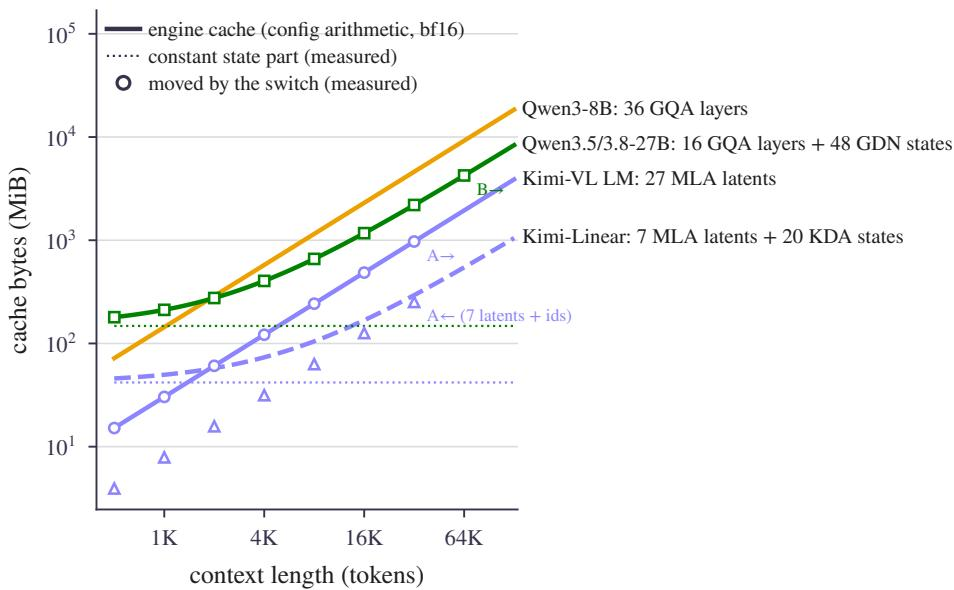  
Figure 17: Engine-cache size per prompt for the models of our pairs (config arithmetic, bf16) and the bytes the switch moves (markers, measured). MLA latents are several times smaller per token than a GQA cache; linear-attention states are constant per prompt.

an engineering estimate, not the evaluated candidate).

Break-even, bytes, memory. The switch is faster than the cold prefill at every length measured: break-even is at or below 128 tokens (the shortest length measured) for Pair A forward and below 512 tokens for Pair A reverse and Pair B. Pair A forward moves 30 KiB per token of MLA latents; the target’s expanded cache is 140 MiB per 1K tokens plus 42 MiB of KDA states. Pair A reverse moves 7.9 KiB per token (7 latents + ids). Pair B’s translated cache is the size of the native one (64 KiB per token plus 148 MiB of states). Figure 17 puts these against the engine-cache sizes. Table 11 (Appendix A) gives the build cost of each translator and the number of switches after which it is amortised.

Extrapolation (labelled). The per-token translation cost depends on the number and width of the cached objects (a 576 × 576 map per MLA layer pair), not on the hidden size or active parameters, while prefill cost grows with active parameters. We therefore expect the switch speed-up to grow from our 3B-active targets to the 18–104B-active flagship targets, with two caveats: replay-based state synthesis grows with the state size (3.4× ours for GLM-5.3-Flash, 10.3× for Kimi-K3), and sparse attention makes the flagship’s own long-context prefill cheaper. Pair A forward, whose O(n) replay and codebook decode outgrow a 3B-active prefill, is the measured counter-case. This is an extrapolation from cost structure, not a measurement; we have no numeric FLOP model for it. Timings are Transformers-level; a serving engine would shrink the fixed firstdecode cost (28–48 ms at 1K here) and the dequantisation, which afects both arms.

## 8 Results: multi-turn

We follow KV-Lingo’s protocol: 50 CoQA dialogues, 5 alternating turns, the source answers odd turns and the target even turns, and both directions are translated (the forward and reverse translators of §6; for Pair A the cache-only finalist, since the harness does not pass token ids). The same 50 dialogues are used for every condition, so diferences are paired by dialogue (Table 9, Figure 18). The multi-turn runs are single-seed; the re-prefill row is the target’s own ceiling.

Table 9: Two-direction multi-turn alternation (CoQA, 50 dialogues × 5 turns). F1 per turn, mean over turns (AUC), and gold-in-answer at turn 5. Catch-up = cumulative time the answering models spend bringing their caches up to date.
<table><tr><td></td><td>Condition</td><td>t1</td><td>t2</td><td>t3</td><td>t4</td><td>t5</td><td>AUC</td><td>gold t5</td><td>catch-up ms</td></tr><tr><td>Pair B</td><td>re-prefill (ceiling)</td><td>.78</td><td>.69</td><td>.77</td><td>.54</td><td>.71</td><td>.700</td><td></td><td>201</td></tr><tr><td></td><td>segment-wise</td><td>.78</td><td>.67</td><td>.74</td><td>.61</td><td>.68</td><td>.695</td><td>一</td><td>31</td></tr><tr><td></td><td>naive re-translation</td><td>.78</td><td>.67</td><td>.67</td><td>.59</td><td>.55</td><td>.651</td><td>一</td><td>31</td></tr><tr><td></td><td>refresh after t4</td><td>.78</td><td>.67</td><td>.74</td><td>.61</td><td>.66</td><td>.691</td><td>一</td><td>29</td></tr><tr><td>Pair A</td><td>re-prefill (ceiling)</td><td>.71</td><td>.66</td><td>.71</td><td>.57</td><td>.65</td><td>.660</td><td>.70</td><td>950</td></tr><tr><td></td><td>segment-wise</td><td>.71</td><td>.52</td><td>.65</td><td>.46</td><td>.60</td><td>.588</td><td>.68</td><td>47</td></tr><tr><td></td><td>naive re-translation</td><td>.71</td><td>.52</td><td>.57</td><td>.38</td><td>.22</td><td>.481</td><td>.26</td><td>46</td></tr><tr><td></td><td>refresh after t4</td><td>.71</td><td>.52</td><td>.65</td><td>.46</td><td>.59</td><td>.586</td><td>.72</td><td>45</td></tr></table>

Segment-wise transfer stays at the ceiling on content. On Pair B, segment-wise translation ties re-prefill (mean F1 −0.004 [−0.045, +0.043]) at a sixth of the catch-up time. On Pair A, its gold-in-answer equals re-prefill over the turns (+0.000 [−0.048, +0.048]); its F1 gap (−0.072 [−0.119, −0.028]) is the forward translator’s answer-length efect (8.7–8.9 tokens at the target’s turns vs 4.9–5.9), and it does not grow over turns: the target’s first-token KL falls from 1.62 at turn 2 to 0.90 at turn 4.

Naive re-translation reproduces KV-Lingo’s collapse. When the whole history is re-translated at every switch, translated content passes through the maps again. On Pair A, where both directions are lossy, the source answers only 26% of turn-5 questions with the gold (re-prefill 70%), F1 falls to 0.22 (naive − segment at turn 5: −0.380 [−0.511, −0.246]), and the target’s KL at turn 4 rises to 2.35. This matches Part 1’s GQA collapse (0.28 at turn 5). On Pair B the degradation is milder (F1 −0.124 [−0.226, −0.024] at turn 5) and is answer length rather than content (gold-in-answer +0.012 [−0.016, +0.036]). Onedirection runs, in which the source always re-reads natively, cannot show the collapse, because nothing translated is ever translated again.

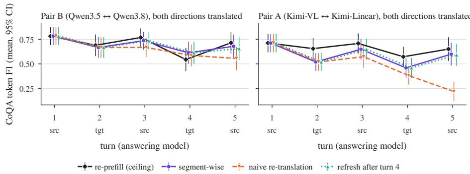  
Figure 18: CoQA F1 per turn over 5 alternating turns, both directions translated (mean, 95% CI over 50 dialogues). Segment-wise transfer stays close to the re-prefill ceiling; naive re-translation degrades by turn 5, mildly on Pair B and to a collapse on Pair A. Refresh after turn 4 equals segment-wise through turn 4 by construction.

Refresh after turn 4. The practical policy “segment-wise with a native reread after turn 4” is identical to segment-wise through turn 4 and costs nothing measurable at turn 5 on either pair (Pair A −0.002 [−0.016, +0.013]). Its value appears in longer conversations: in a one-direction 10-turn check on Pair A (20 dialogues) it recovers turns 6–10 (AUC 0.571 vs 0.536 for segment-wise) at about 10× the catch-up time of segment-wise (1.0 vs 0.1 s cumulative) and under half of full re-prefill (2.4 s).

State catch-up: replay vs copy. For Pair A, letting the target continue its own KDA state over the translated segment (replay) is slightly better than re-synthesising it from the whole source history (copy): AUC 0.575 vs 0.563 in the one-direction runs. Pair B copies the mapped source state, which is O(1).

## 9 Analysis: what works and why

## 9.1 Where the information lives: swap-in and the information split

For each prompt we build the translated cache and the target’s own cache, then replace some layers’ objects by the native ones (swap-in) or empty them (split); replacing every layer reproduces the native floor (val KL 0.0034 Pair A, 0.0004 Pair B), so the mixing itself is sound (Figure 19, Table 10).

• Exact recall lives in a few deep MLA layers. For the Pair A seed (no token identity, needle 0.13 on this subset), making the single MLA layer

Table 10: Swap-in of native objects and the information split (val KL on 63/64 conversations; needle exact on the 40 frozen needle prompts at 2–32K).
<table><tr><td>Condition</td><td>Pair A finalist val KL</td><td>Pair A seed needle</td><td>Pair B finalist val KL</td></tr><tr><td>none (translated)</td><td>0.082</td><td>0.13</td><td>0.0159</td></tr><tr><td>best single MLA / attention layer native</td><td>0.070 (L15)</td><td>1.00 (L19)</td><td>0.0139 (L35)</td></tr><tr><td>all MLA / attention layers native</td><td>0.087 (n.s.)</td><td>1.00</td><td>0.0078</td></tr><tr><td>all recurrent states native</td><td>0.096 (n.s.)</td><td>0.03</td><td>0.0099</td></tr><tr><td>split: attention/MLA only (states empty)</td><td>0.344</td><td>0.00</td><td>0.283</td></tr><tr><td>split: states only (attention/MLA empty)</td><td>0.563</td><td>0.00</td><td>0.641</td></tr></table>

19 of Kimi-Linear native restores 100% recall $( + 0 . 8 8 \ \vdash 0 . 7 8 , + 0 . 9 8 ] ;$ layer 23: 0.80, layer 15: 0.58, others ≤ 0.18), while making all 20 KDA states native does not help (0.03). The finalist’s token channel fixes exactly these layers.

• Neither half sufices. In both pairs, attention/MLA alone with empty states, and states alone with empty attention, lose every needle and raise val KL to 0.28–0.64. The recurrent state is not optional: with the finalist’s maps but zero KDA state, Pair A CoQA F1 falls to 0.087 and ARC to 0.477; with zero GDN state the Pair B target loses the conversation entirely (237 of 300 CoQA answers start a new system turn).

• Pair B’s residual is half attention, half state. All 16 attention layers native halve val KL $( 0 . 0 1 5 9  0 . 0 0 7 8 )$ ; all 48 GDN states native cut it by 38% (→ 0.0099). For the Pair A finalist no single layer or group explains the residual; the latents and the replayed states were trained together and only the full native set reaches the floor.

## 9.2 Learning curves and Pair A’s overfitting to answer style

Figure 20 shows validation KL against the training budget, each point the end of its own schedule (budget-matched), plus checkpoints inside one 5000-step run. Pair B improves monotonically but slowly in validation KL (0.0173 at 400 steps to 0.0153 at 5000) while task metrics are at the native level from 400 steps on (CoQA F1 0.776 → 0.788); 5000 steps (42 epochs over 950 conversations) show no overfitting on the held-out set. Pair A’s val KL falls until about 2000 steps (0.094 → 0.084 → 0.082 at 400/1000/2000) and plateaus (0.083 at 5000), and needle recall is solved at every point. CoQA F1, however, falls from 0.558 (1000 steps, budget-matched) to 0.462 at 5000. Most of that fall is answer style: against the 1000-step checkpoint of the same run, F1 drops by 0.124 [0.086, 0.160] with unchanged gold-in-answer $\left( + 0 . 0 0 0 \ [ - 0 . 0 4 0 , + 0 . 0 4 3 ] \right)$ , and answers longer than 8 tokens rise from 29% to 51% (target native: 11%). Against the budget-matched 400- and 1000-step runs there is also a small real content loss (gold-in-answer −0.037 [−0.067, −0.007] and −0.033 [−0.067, −0.003]). The translator is trained only on chat continuations, so longer training moves the target towards long chat-style answers. On the full sets, Pair A gains nothing from training beyond 1000–2000 steps.

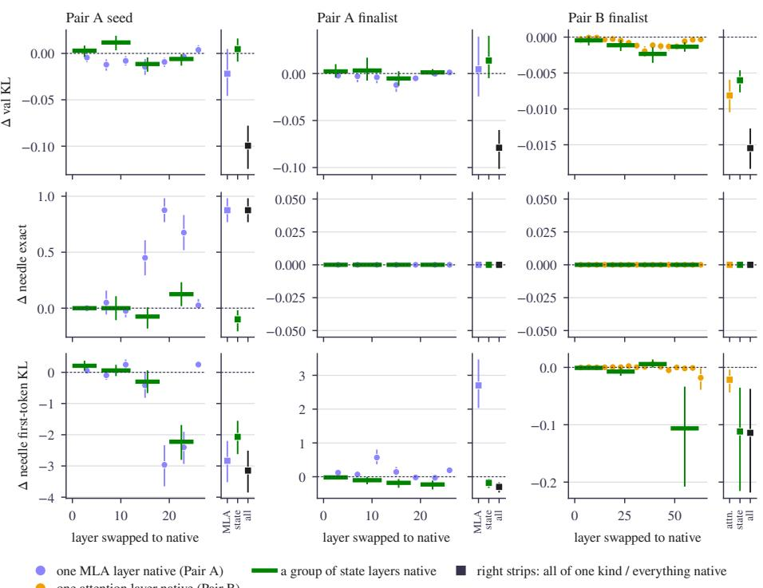  
Figure 19: Change in validation KL, needle recall and needle first-token KL when one translated layer (or a group of state layers) is replaced by the target’s native object, with paired 95% CIs. For the Pair A seed, native deep MLA layers restore exact recall; for the finalists single layers barely move KL.

## 9.3 Cached objects are invertible: token identity and privacy

Given one layer’s cached per-token vector, a linear map to the token’s input embedding followed by a nearest-neighbour search over the full vocabulary recovers the token (Figure 21; held-out tokens, a deliberately simple decoder, so these are lower bounds). Kimi-VL’s layer-0 MLA latent identifies the token with top-1 accuracy 1.000, also for ids never seen in the fit, and layers 1–2 still 0.975 and 0.934. Every cached layer of every model tested identifies most tokens with a linear read-out: at least 0.20 top-1 at the worst layer and typically 0.5–0.8, with a dip in the middle of the stack. The engine-native ③ objects are as invertible as ① (within 0.03 per layer). This is the lever behind the cacheonly token-identity finalist, and it means a KV cache, MLA or GQA, is not an anonymised representation of the prompt: a translated or stored cache should

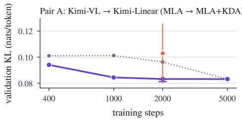  
within one 5000-step run (not budget-matched) finalist, budget-matched (own schedule)

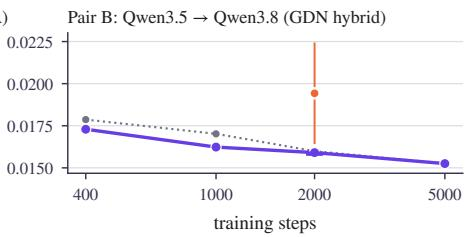  
finalist seeds at 2000 (n=3)  
seed program at 2000 (full val set, 95% CI)

Figure 20: Validation KL of the finalist against training budget. Solid: budgetmatched (each point the end of its own schedule); dotted: checkpoints inside one 5000-step run (warm-up / peak LR, not budget-matched); ticks at 2000: three seeds.  
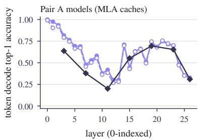

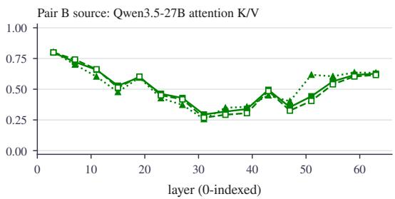  
Kimi-VL LM: latent ① (pre-norm) Kimi-Linear (MLA layers): latent ① (pre-norm) Qwen3.5-27B (attention): V Kimi-VL LM: latent ③ (engine cache) Qwen3.5-27B (attention): K ① (pre-norm) Qwen3.5-27B (attention): K ③ (post-RoPE)  
Figure 21: Top-1 accuracy of decoding the token at each position from one layer’s cached object (linear map + nearest neighbour over the full vocabulary). Early MLA latents and attention keys identify the token.

be protected like the prompt itself.

## 9.4 Partial recompute (DroidSpeak-style baseline)

The target can receive the translated cache of the head of the prompt and reprefill a tail fraction f natively (Figure 22). A 5% tail buys most of what the tail can buy: Pair A forward CoQA F1 0.526 → 0.657 (+0.131 [+0.098, +0.166]; native 0.726), first-token KLs halve, Pair B val KL 0.0159 → 0.0106. The cost grows linearly with f, and for Pair A (3B active, cheap prefill) the 50% point is as slow as re-prefill. For Pair B the 5% point still runs 10× faster than re-prefill at 32K (580 vs 6,000 ms). ARC prompts are short, so large tails split the question between translated and native states and cost accuracy (Pair A ARC −0.090 at 50%). Needle recall stays at 0.99–1.00 for every f.

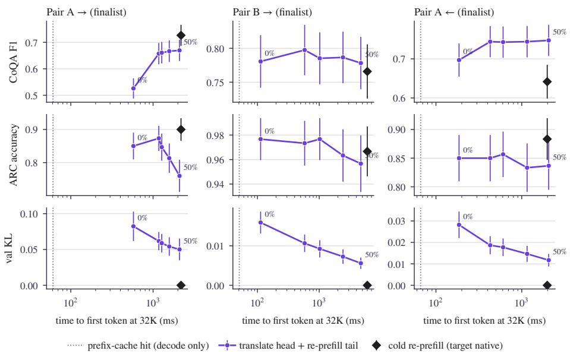  
Figure 22: Translating the head of the prompt and re-prefilling a tail fraction: quality vs time to first token at 32K, against cold re-prefill (black) and a prefix-cache hit (dotted).

## 9.5 Model size and quality

Across our pairs, the 27B dense pair (Pair B) transfers at the native level in both directions on every task metric except the reverse refusals, the GQA 8B/4B pair at the small model’s level, and the 3B-active MoE pair (Pair A) within the CI of native in the hybrid → MLA direction but below it in the MLA → hybrid direction. On domain shift, Pair B keeps native quality out of the chat distillation domain (GSM8K +0.035 [0.000, +0.075]; thinking-mode CoQA tie), while Pair A forward drops 7.5 points on GSM8K to the source’s own level (Appendix B). These pairs difer in architecture, MoE vs dense and training-set size as well as in scale, so this is consistent with, not evidence for, the hypothesis that larger receivers read translated caches better; a size-matched comparison would be needed.

## 10 Towards GLM, DeepSeek and Kimi flagships

This section is an argument, not a result. It separates what we rehearsed from what is design only, and states the scale-up as a hypothesis. Table 1 (last column) and Figure 23 place our pairs next to the flagships, and §4 lists where each pair difers from its flagship.

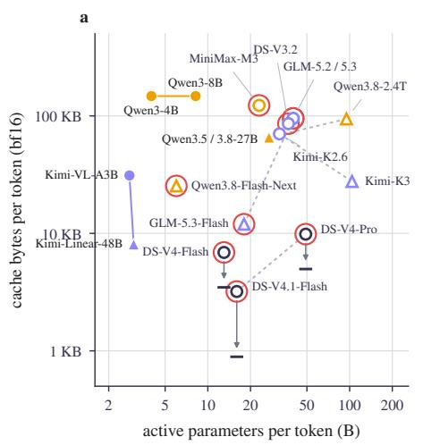  
GQA K/V compressed KV + sparse index key as stored (FP8/FP4) MLA latent + linear state frontier (hollow)

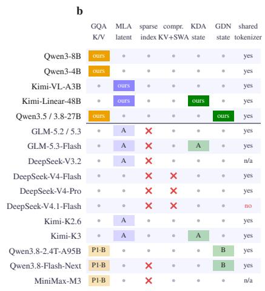  
Figure 23: Our pairs vs frontier models: active parameters vs cache bytes per token (left) and which cache objects each model has (right). Configs pinned by commit on 29 Oct 2026.

What transfers, as measured. Read against the flagship pairs of Table 1, our results say the following. Hybrid→ full MLA (GLM-5.3-Flash → GLM-5.2/5.3; Kimi-K3 → Kimi-K2.6): from 7 latents plus token ids the target reached a quality within the paired CI of its native level on every task metric (one seed), with exact recall to 64K and a speed-up growing from ×2.7 at 1K to ×18.7 at 64K; the flagship hybrids hold the same inputs (11 and 24 latents). Full $M L A  h y b r i d \colon$ exact recall needs token identity and states are synthesised by replay in O(n); this direction has the weakest results (judge −0.87, GSM8K −7.5 points, ③ fails beyond 8K, no gain from training past 1–2K steps). Same-shape hybrid generations (the Qwen3.8 family’s GDN layers): copy plus a closed-form correction gave native quality in both directions with an O(1) state transfer, apart from the inherited refusals in the reverse direction. Multi-turn: segmentwise transfer avoids the naive collapse on both pairs, independently of the architecture.

Hypothesis (not established). These results support, but do not establish, that the per-object recipes are feasible for 300B+ hybrid flagships. The pertoken translation cost depends on the cached objects (576 × 576 per MLA layer pair), not on the hidden size, while prefill grows with active parameters, so the speed-up should grow with target size (§7 states the caveats, including the Pair A forward counter-case); a larger target may also read a translated cache better (Pair B vs Pair A is consistent with this but confounded, §9). Untested are the gaps of §4: the scale gap (6–35× in active parameters), GLM’s wider latent expansion $( 7 8 / 1 1 = 7 . 1 $ target latents per source latent vs our $2 7 / 7 =$ 3.9), the larger states to replay (3.4× ours for GLM-5.3-Flash, 10.3× for Kimi-K3), Kimi-K3’s residual-stream changes, and DSA on MLA. By checkpoint size, three sparse-attention models fit a 384 GB node (DeepSeek-V4-Flash 160 GB, Qwen3.8-Flash-Next-FP8 186 GB, GLM-5.3-Flash 328 GB); we rehearsed the indexer on the second.

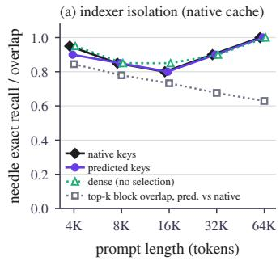

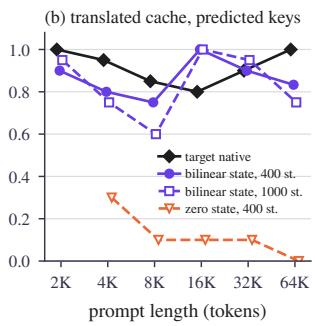

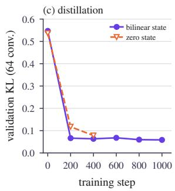  
Figure 24: Pair C (Qwen3.8-27B → Qwen3.8-Flash-Next, QSA indexer), one seed. (a) On the target’s own cache, predicted indexer keys select only 63–84% of the native top-k blocks yet keep needle recall at the native level, as does dense attention. (b) Translated cache decoded with predicted keys: with a bilinear-mapped GDN state recall is near native at 400 and at 1000 steps; with zero state (400 steps) it is not. (c) Validation KL to 1000 steps (bilinear) and 400 (zero state); the bump at 600 follows the learning-rate restart at the resume from step 400. n=20 per length at 2–32K, 12 at 64K (zero state: 4–64K only).

## 10.1 Rehearsal of sparse-attention indexer transfer

DSA-style models add a third per-token object: the indexer key that decides which tokens attention reads. A translator can map it (if the source has one), predict it from what the target already receives, skip it and attend densely over the translated prefix (exact up to top-k, where sparse attention is dense anyway, but without the decode savings), or combine dense and predicted (Appendix Figure 27). The risk is discrete: a small key error can drop the needle’s block out of the top-k entirely.

We rehearsed this at small scale on one cross-model pair with one seed, Pair C: Qwen3.8-27B (GQA + GDN, no indexer) → Qwen3.8-Flash-Next (36 GDN + 12 QSA layers; QSA selects the top 512 blocks of 4 tokens, at most 2,051 tokens, by a 128-d indexer key per token). The source has no indexer, so the keys are predicted per layer from the translated K and the target’s token embedding, trained only through a KL on the target’s native block-score distribution (top-k has no gradient); K/V maps go 16 → 12 layers and GDN states 48 → 36 layers by relative depth. Our plumbing reproduces the native cache exactly (logit diference 0.0, identical selection and greedy tokens at 24 to 56,541 tokens).

The indexer is not the bottleneck on this pair. On the target’s own cache with only the indexer keys replaced (Figure 24a), predicted keys (Stage-1 R2 0.60–0.72) select 84% of the native blocks at 4K and 63% at 64K, yet keep the needle block selected in at least 99.6% of (layer, step) pairs and match native recall on 91 of 92 items; dense attention matches or exceeds native. The discreteselection failure did not appear because the needle block scores far above the budget boundary. This is 92 items on one model; it shows that the failure mode is not automatic, not that it cannot occur.

The state is the bottleneck. After 400 distillation steps (Figure 24b,c), the translator with a bilinear-mapped GDN state recalls 0.86 of the 92 needles at 4–64K with predicted keys, against 0.87 with native keys, 0.80 dense, and 0.89 for the target reading its own cache. With zero GDN state, validation KL is similar (0.078 vs 0.063) but recall is 0.13: validation KL alone would have hidden the failure. At Stage 1 the closed-form K/V carried no needle at all (0 at every length): unlike Pair B, the 27B and Flash-Next are diferent models, not same-architecture generations (K/V R2 0.38–0.73; copying the 27B’s states is harmful, val KL 3.90).

Longer distillation lowers KL but not recall. Continuing the bilinear run to 1000 steps (from step 400 on with the learning-rate schedule of a 1000-step run, hence the bump at step 600) lowers validation KL from 0.063 to 0.058 (Figure 24c). Needle recall does not change beyond one-seed noise: over 112 items at 2–64K, predicted keys recall 0.87 at 400 and 0.84 at 1000 steps, native keys 0.88 and 0.85, dense attention 0.82 and 0.85, against 0.91 for the target reading its own cache. The needle block stays selected in at least 99% of (layer, step) pairs at every length; native and predicted keys disagree on 3 of 112 items at each checkpoint, in both directions, and in each of them the needle block was selected, so the diferent answer comes from the other selected blocks. The per-length picture is uneven: at 16K the translated cache recalls 1.00 against the target’s own 0.80, but at 4K and 8K it stays below the target (predicted keys 0.80/0.75 at 400 steps and 0.75/0.60 at 1000, against 0.95/0.85 native), so the pooled tie hides a short-context deficit that one seed cannot resolve. Absolute validation KL stays 3.6× above Pair B’s (0.058 vs 0.016 at 1000 steps, Figure 20).

Task benchmarks. On Pair B’s CoQA, ARC and chat items (300/300/100), the 400- and 1000-step translators reach CoQA F1 0.795 and 0.765 (target 0.770), ARC 0.947 and 0.950 (target 0.980, three points above both; no paired CI was computed for this pair), and chat token F1 against the target’s own answers of 0.46 and 0.51 (chat first-token KL 1.06 and 0.89). A Gemma-4-31B judge rates their chat answers 3.33 and 3.12 against 3.30 for the target’s own answers; Flash-Next’s own score of 3.30 is far below the 4.3–6.0 of the other targets, so the judge gap says little here. The closed form fails on everything except ARC (CoQA 0.025, ARC 0.943, judge 2.53). With Pair B’s score formula and this pair’s own step-0 KL as reference, the combined score is 0.923 at 400 and 0.918 at 1000 steps (target 0.970, closed form 0.107), consistent with Pair B’s 0.887 and 0.894 at the same steps (checkpoints within one 5000-step run); with Pair B’s KL reference it is 0.614 and 0.611, because the KL term then reflects the higher absolute KL of this cross-model pair.

This is a rehearsal at small scale on one cross-model pair, one seed, up to 1000 steps; it does not test DSA on an MLA cache (GLM-5.x, DeepSeek-V3.2), IndexShare, or FP8/MXFP4 indexer storage.

DeepSeek-V4/V4.1. No result of ours applies directly. A design would send token ids explicitly (the first layers are SWA-only or heavily compressed, so ids cannot be read back from the cache), map compressed entries block-wise or recompute them through the target’s compressor, restore the 128-token SWA window with the publisher’s own bounded recompute, and re-quantise.

## 11 Limitations

• Scale. Our pairs fit one machine (16–125B total, 3–27B active); the flagships are 6–35× larger in active parameters. Feasibility at 300B+ is a hypothesis (§10); the speed extrapolation has no numeric FLOP model behind it.

• One tokenizer per family. Every pair shares a tokenizer. Cross-family transfer (e.g. DeepSeek → Kimi) needs a token aligner we have not validated.

• Sparse attention. The indexer was rehearsed only on a QSA target (Qwen3.8-Flash-Next), one cross-model pair, one seed, up to 1000 steps, with 12–20 needle items per length; its combined score depends on the KL reference (0.92 with the pair’s own step-0 KL, 0.61 with Pair B’s), the closed form’s needle was not measured at 2K, and the translated cache stays below the target at 4K and 8K while the pooled recall ties it. The “indexer is not the bottleneck” finding rests on 92 isolation items and 112 translated-cache items on one model. DSA on MLA caches, IndexShare and low-precision indexer storage are not rehearsed. DeepSeek-V4’s compressed multi-token entries are not rehearsed at all.

• Pair A forward is below native. Chat judge −0.87 (5.15 vs 6.02), GSM8K −7.5 points, CoQA F1 −0.20 (answer length), ARC −0.05; the engine-native capture ③ fails beyond the 8K training length; and training past 1–2K steps moves the answer style away from the target’s.

• Behavioural leakage. Translated states can carry the source’s style and safety policy (Pair B reverse: 6% needle refusals); KL and accuracy do not detect it. The evidence is two markers on one pair.

• Seeds and coverage. Part 1, the reverse translators’ full-set rows, the multi-turn runs and Pair C are single-seed. The “native level” of Pair A reverse is a one-seed CI that includes 0 while gold-in-answer and ARC point 0.03–0.04 below native. The judge gap of Pair A forward on the deterministic re-run has no paired CI. Pair B reverse speed was not measured. The token-ID finalist of Pair A was not run in the multi-turn harness.

• Timing. Speed is measured in Transformers, not in a serving engine; the Pair A cold arm carries an FP8 dequantisation that we report separately. No flagship-size timing exists.

• Evaluation. In-training subsets are the first items of the full probe sets; CoQA token F1 penalises answer length, so we report gold-in-answer next to it; the chat judge is a single LLM judge.

## 12 Conclusion

KV-cache translation extends from GQA to the cache objects of hybrid-attention models, but not with one mechanism. MLA latents translate token-wise, best from the pre-norm, un-rotated capture; exact long-range recall after synthesising a recurrent state needs token identity, which the MLA layer-0 latent supplies; same-geometry recurrent states can be copied and corrected in closed form at O(1) cost; and sparse-attention indexer keys can be predicted without losing the needle on the pair we tested. The hybrid → full-MLA direction, which corresponds to handing a conversation from a Flash hybrid to its full-MLA flagship, was not distinguishable from native quality on any task metric, with speed-ups growing to ×18.7 at 64K. Whether these recipes hold at 300B+ scale is the hypothesis our evidence supports and the next experiment should test.

## Data and code availability

The translator code and the trained translator weights are kept in Hostinger’s internal research repositories and are not publicly released. The source and target models are openly released checkpoints and are subject to their licences; the evaluation data are public benchmarks (CoQA, ARC, GSM8K) and synthetic needle-in-a-haystack prompts.

## Competing interests

The authors are employees of Hostinger, which uses language models in its products. The authors declare no other competing interests.

## Use of generative AI

An LLM agent helped to implement the translator candidates code under a sealed evaluator. The authors designed the study, checked every reported result against its result file, reviewed and edited all co-generated text, and took full responsibility for the content of the paper.

## References

Abdulrahman Alabdulkareem et al. Swarm telepathy: Prefill-free KV-cache transfer across families, 2026.

Yushi Bai, Qian Dong, Ting Jiang, Xin Lv, Zhengxiao Du, Aohan Zeng, Jie Tang, and Juanzi Li. IndexCache: Accelerating sparse attention via crosslayer index reuse, 2026. Named “IndexShare” on the GLM-5.2 model card.

Yamini Bansal, Preetum Nakkiran, and Boaz Barak. Revisiting model stitching to compare neural representations. In Advances in Neural Information Processing Systems (NeurIPS), 2021.

Aviv Bick et al. Transformers to SSMs: Distilling quadratic knowledge to subquadratic models. In Advances in Neural Information Processing Systems (NeurIPS), 2024.

William Brandon et al. Reducing transformer key-value cache size with crosslayer attention, 2024.

Valérie Castin, Keitaro Sakamoto, Anastasiia Filippova, João Monteiro, Marco Cuturi, and Pierre Ablin. KV-Lingo: Learning KV-cache translators with distillation, 2026.

Yingfa Chen et al. Hybrid linear attention done right: Eficient distillation and efective architectures for extremely long contexts. In International Conference on Machine Learning (ICML), 2026.

Zhen Cheng et al. Attention editing: A versatile framework for crossarchitecture attention conversion, 2026.

Peter Clark, Isaac Cowhey, Oren Etzioni, Tushar Khot, Ashish Sabharwal, Carissa Schoenick, and Oyvind Tafjord. Think you have solved question answering? try ARC, the AI2 reasoning challenge, 2018.

Tri Dao and Albert Gu. Transformers are SSMs: Generalized models and eficient algorithms through structured state space duality, 2024.

DeepSeek-AI. DeepSeek-V2: A strong, economical, and eficient mixture-ofexperts language model, 2024.

DeepSeek-AI. DeepSeek-V3.2: Pushing the frontier of open large language models, 2025.

DeepSeek-AI. DeepSeek-V4: Towards highly eficient million-token context intelligence, 2026.

Tianyu Fu et al. Cache-to-cache: Direct semantic communication between large language models. In International Conference on Learning Representations (ICLR), 2026.

Yizhao Gao et al. SeerAttention: Learning intrinsic sparse attention in your LLMs, 2024.

GLM-5 Team. GLM-5: From vibe coding to agentic engineering, 2026.

Daniel Goldstein et al. RADLADS: Rapid attention distillation to linear attention decoders at scale, 2025.

Taekyung Heo et al. Cross-model KV cache transfer in LLM families: A closedform linear mapping for prefill reuse, 2026.

Cheng-Ping Hsieh et al. RULER: What’s the real context size of your longcontext language models?, 2024.

Minyoung Huh, Brian Cheung, Tongzhou Wang, and Phillip Isola. The platonic representation hypothesis. In International Conference on Machine Learning (ICML), 2024.

Rishi Jha et al. Harnessing the universal geometry of embeddings, 2025.

Tao Ji et al. Towards economical inference: Enabling DeepSeek’s multi-head latent attention in any transformer-based LLMs, 2025.

Kimi Team. Kimi linear: An expressive, eficient attention architecture, 2025.

Kimi Team. Kimi K3 technical report. https://github.com/MoonshotAI/ Kimi-K3, 2026.

Woosuk Kwon et al. Eficient memory management for large language model serving with PagedAttention. In Proceedings of the 29th Symposium on Operating Systems Principles (SOSP), 2023.

Lai et al. MiniMax sparse attention, 2026.

Jin-woo Lee et al. KV cache translation across heterogeneous large language models, 2026.

Guihong Li et al. X-EcoMLA: Upcycling pre-trained attention into MLA for eficient and extreme KV compression, 2025.

Yi Li et al. A universal context-reuse layer for cross-model KV sharing, 2026.

Yuhan Liu et al. DroidSpeak: KV cache sharing for cross-LLM communication and multi-LLM serving, 2024a.

Zirui Liu et al. KIVI: A tuning-free asymmetric 2bit quantization for KV cache. In International Conference on Machine Learning (ICML), 2024b.

Fanxu Meng et al. TransMLA: Multi-head latent attention is all you need, 2025.

NVIDIA. NVIDIA Nemotron 3: Eficient and open intelligence, 2025a.

NVIDIA. Nemotron-SFT-Instruction-Following-Chat-v2. Hugging Face dataset https://huggingface.co/datasets/nvidia/ Nemotron-SFT-Instruction-Following-Chat-v2, revision 1a9454ed, 2025b.

Isaac Ong et al. RouteLLM: Learning to route LLMs with preference data, 2024.

Zihan Qiu et al. On the design of Qwen3.8-Next architecture: Evaluation, eficiency, and training stability, 2026.

Xingyu Qu et al. CacheBridge: Eficient cross-model KV transfer for multimodel LLM serving, 2026.

Qwen Team. Qwen3 technical report, 2025.

Qwen Team. Qwen3.5: Towards native multimodal agents. Blog post, https: //qwen.ai/blog?id=qwen3.5, 2026.

Siva Reddy, Danqi Chen, and Christopher D. Manning. CoQA: A conversational question answering challenge. In TACL, 2019.

Maximillian Rossi et al. Latent cache flow: Model-to-model communication without text, 2026.

Olivier Roy and Martin Vetterli. The efective rank: A measure of efective dimensionality, 2007.

Sreetama Sarkar et al. RaReCache: Bridging the gap in cross-model KV cache reuse via rank disagreement-based selective recomputation, 2026.

Jiaming Tang et al. Quest: Query-aware sparsity for eficient long-context LLM inference. In International Conference on Machine Learning (ICML), 2024.

Simon P. Villani. LatentPort: Beyond KV cache – cross-model transfer of recurrent memory in hybrid language models: A 4B-to-9B hybrid-state handof without target prefix replay, 2026.

Junxiong Wang et al. The Mamba in the Llama: Distilling and accelerating hybrid models. In Advances in Neural Information Processing Systems (NeurIPS), 2024.

Sunghyeon Woo et al. PrefillShare: A shared prefill module for KV reuse in multi-LLM disaggregated serving, 2026.

Songlin Yang, Jan Kautz, and Ali Hatamizadeh. Gated delta networks: Improving Mamba2 with delta rule. In International Conference on Learning Representations (ICLR), 2025.

Jiayi Yao et al. CacheBlend: Fast large language model serving for RAG with cached knowledge fusion. In EuroSys, 2025.

Jingyang Yuan et al. Native sparse attention: Hardware-aligned and natively trainable sparse attention. In ACL, 2025.

Vincent-Daniel Yun et al. Prefill-free cross-family KV cache transfer for heterogeneous multi-agent LLMs, 2026.

Michael Zhang et al. LoLCATs: On low-rank linearizing of large language models, 2024.

Lianmin Zheng et al. Judging LLM-as-a-judge with MT-Bench and chatbot arena. In Advances in Neural Information Processing Systems (Datasets and Benchmarks), 2023.

Zhongzhu Zhou et al. Taylor-calibrate: Principled initialization for hybrid linear attention distillation, 2026.

## A Build cost

Table 11: Cost of building each translator on one GPU (from logs; Pair A forward capture time measured for one shard and extrapolated by bytes). Amortisation point = build GPU-seconds / saved GPU-seconds per switch, from the speed tables (not engine-adjusted; engine-adjusted Pair A forward: ≈74K / 18K switches).
<table><tr><td>Direction</td><td>capture GPU-h</td><td>disk GB</td><td>Stage-2 GPU-h</td><td>params M</td><td>build GPU-h</td><td>amortised (8K / 32K)</td></tr><tr><td>Pair A fwd cache-only</td><td>0.16</td><td>262</td><td>7.7</td><td>102.0</td><td>8.0</td><td>42,731 / 15,626</td></tr><tr><td>Pair A rev (a)</td><td>0.61</td><td>104</td><td>1.5</td><td>91.1</td><td>2.1</td><td>24,417 / 3,369</td></tr><tr><td>Pair B fwd bilinear</td><td>0.20</td><td>228</td><td>3.5</td><td>110.1</td><td>3.7</td><td>8,792 / 2,036</td></tr><tr><td>Pair B rev bilinear</td><td>0.13</td><td>228</td><td>3.6</td><td>110.1</td><td>3.7</td><td></td></tr></table>

Pair C trains at 82.6 s per step on two GPUs (about 9.5 h per 400-step run).

## B Breadth: out-of-domain probes

The distillation data are chat only, so these probes also test domain shift (Table 12; single seed, finalists).

Pair B transfers out of domain at the native level. Pair A forward lands at the source’s own GSM8K level: on multi-step arithmetic the translated cache gives the target roughly the source’s competence, not its own.

Table 12: Out-of-domain probes, finalists, single seed: GSM8K accuracy (200 items, “Answer: <number>”, 512 new tokens) and thinking-mode CoQA (100 items, Pair B only; Kimi models have no thinking mode). Last column: finalist minus target native, paired bootstrap 95% CI.
<table><tr><td></td><td>target native</td><td>source native</td><td>finalist</td><td>finalist – target</td></tr><tr><td>Pair A GSM8K</td><td>0.895</td><td>0.800</td><td>0.820</td><td>-0.075 [−0.125, −0.025]</td></tr><tr><td>Pair B GSM8K</td><td>0.830</td><td>0.871 (n=196)</td><td>0.865</td><td>+0.035 [0.000, +0.075]</td></tr><tr><td>Pair B CoQA thinking-on F1</td><td>0.753</td><td></td><td>0.755</td><td>+0.002 [−0.024, +0.026]</td></tr><tr><td>Pair B think block closed</td><td>100%</td><td></td><td>100%</td><td>0</td></tr></table>

## C Long-context probes (Pair B)

RULER-style (Hsieh et al., 2024) probes on Nemotron haystacks, 6 items per length (3 at 128K); no CI is meaningful (Table 13). Multi-key retrieval is sat-

Table 13: Pair B forward long-context probes (single seed): multi-key needle and RULER-style variable tracking, target native / bilinear finalist / seed (state copy), 6 items per length and 3 at 128K.
<table><tr><td></td><td>8K</td><td>32K</td><td>64K</td><td>128K</td></tr><tr><td>multi-key needle exact (native / finalist / seed)</td><td>1/1/1</td><td>1/1/1</td><td>1/1/1</td><td>1/1/1</td></tr><tr><td>variable tracking, names found</td><td>.93/.97/.97</td><td>1.00/.97/.90</td><td>.83/.97/.77</td><td>.93/1.00/.87</td></tr><tr><td>variable tracking, all exact</td><td>.67/.67/.33</td><td>.67/.67/.50</td><td>.33/.67/.17</td><td>0/0/0</td></tr></table>

urated to 128K. Variable tracking is not saturated; the finalist is at or above the target at every length and the plain state copy slightly lower at 32–128K. Pair A long-context needles are in Table 6 (to 64K); Pair A was not evaluated at 128K.

## D Further tables

Table 14: Pair A reverse ladder at 400 steps, single seed (in-training subsets: CoQA 50, ARC 100, needle 8 per length; Kimi-VL native 0.657 / 0.84 / 1.00). Variant (a) was carried to 2000 steps and is the reverse row of Table 6.
<table><tr><td>Variant</td><td>params</td><td>val KL</td><td>CoQA F1</td><td>ARC</td><td>needle</td></tr><tr><td>closed form (a), step 0</td><td>91.1M</td><td>0.113</td><td>0.578</td><td>0.74</td><td>0.43-0.67</td></tr><tr><td>(a) token-wise</td><td>91.1M</td><td>0.0342</td><td>0.629</td><td>0.77</td><td>1.00</td></tr><tr><td>(b) + causal local mixer</td><td>104.1M</td><td>0.0353</td><td>0.596</td><td>0.73</td><td>1.00</td></tr><tr><td>(c) + mixer + KDA-state context</td><td>115.3M</td><td>0.0354</td><td>0.583</td><td>0.74</td><td>1.00</td></tr><tr><td>(d) (a) + KDA-state context</td><td>102.3M</td><td>0.0343</td><td>0.604</td><td>0.74</td><td>1.00</td></tr></table>

Table 15: Stage-1 $R ^ { 2 }$ and step-0 validation KL. Pair A reverse: held-out $R ^ { 2 }$ (mean over target layers 1–26) by inputs; Pair B: forward vs reverse, and step-0 validation KL of the closed-form $\mathrm { K } / \mathrm { V }$ maps under four state treatments.
<table><tr><td>Pair A rev: token features only / nearest source latent + tok</td><td>0.370 / 0.782</td></tr><tr><td>Pair A rev: all 7 latents / all 7 + tok (variant a)</td><td>0.821 / 0.834</td></tr><tr><td>Pair B R2 K / V, forward vs reverse</td><td> $\mathrm { 0 . 7 7 2 ~ / ~ 0 . 7 1 6 ~ v s ~ 0 . 7 8 3 ~ / ~ 0 . 7 2 6 }$ </td></tr><tr><td>Pair B step-0 val KL: zero / copy / bilinear / native states, fwd 0.323 / 0.0595 / 0.0318 / 0.0129 Pair B step-0 val KL, same, reverse</td><td>0.315 / 0.0444 / 0.0286 / 0.0136</td></tr></table>

Table 16: Pair A forward full sets: earlier run with the non-deterministic (atomic) MoE combine vs the deterministic re-run used in the main text. All changes are within the earlier standard errors.
<table><tr><td>Anchor (old / det.)</td><td colspan="2">val KL</td><td colspan="2">CoQA F1</td><td colspan="2">CoQA gold</td><td colspan="2">ARC</td><td colspan="2">needle 2–32K</td><td colspan="2">64K</td></tr><tr><td>target native</td><td> $0 ~ / ~ 0$ </td><td></td><td>.721  / .726</td><td></td><td></td><td>.803 / .803</td><td></td><td>.903 / .900</td><td></td><td>1.00 / 1.00</td><td></td><td>1.00 / 1.00</td></tr><tr><td>seed</td><td>.103 / .103</td><td></td><td>.536 / .521</td><td></td><td></td><td>.790 /  .790</td><td></td><td>.850 / .847</td><td></td><td>0.10 / 0.09</td><td></td><td>0.00 / 0.00</td></tr><tr><td>cache-only</td><td>.083 / .082</td><td></td><td>.519 / .526</td><td></td><td></td><td>.817 / .813</td><td></td><td>.850 / .850</td><td></td><td>0.99 / 0.99</td><td></td><td>0.83 / 0.83</td></tr><tr><td>token-ID</td><td>.086 / .085</td><td></td><td>.546 / .553</td><td></td><td></td><td>.800 / .800</td><td></td><td>.843 / .840</td><td></td><td>0.99 / 0.99</td><td></td><td>1.00 / 1.00</td></tr></table>

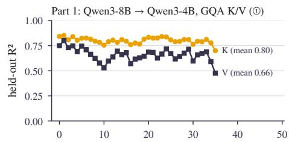

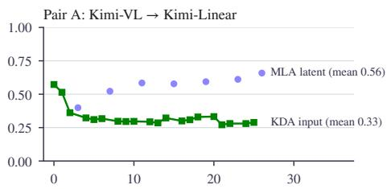

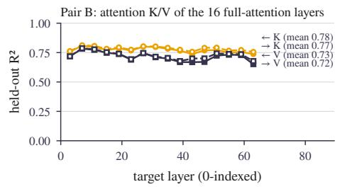

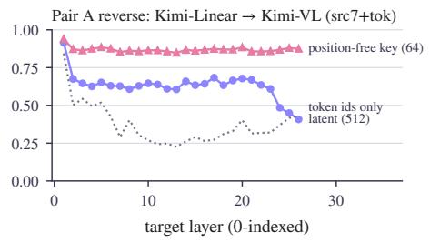  
Figure 25: Held-out $R ^ { 2 }$ of the closed-form Stage-1 maps per target layer (the share of the target object’s variance the map explains), all pairs and both directions.

## E Efective rank of the maps

Per matrix we compute the entropy efective rank exp $H ( \sigma / \sum \sigma )$ (Roy and Vetterli, 2007) (Figure 26). The maps are high-rank, not low-rank adapters: the closed-form MLA maps of Pair A have a median efective rank of 395 of 576, Pair A reverse 423 of 576, and Pair B’s K/V maps 886 / 938 of 1024. The Stage-2 update is small relative to the closed form (median $\| \Delta W \| / \| W _ { \mathrm { c f } } \|$ 0.08 for the Pair A seed, 0.034 for the Pair B finalist) but spread over many directions. The bilinear GDN corrections are far from the identity in most heads (median efective rank of A − I: 90 of 128).

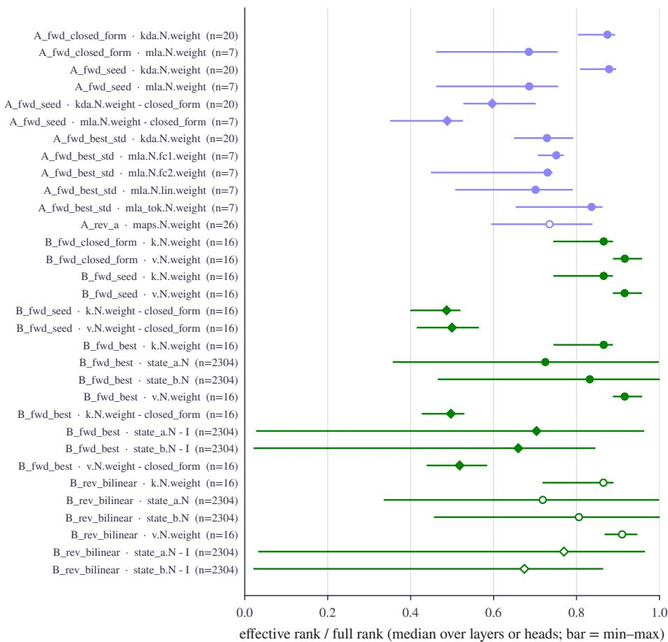  
Figure 26: Efective rank of every map family relative to its full rank, per translator. Diamonds: the trained change relative to the closed-form initialisation (or identity for the bilinear state maps); hollow: reverse direction.

Failure mode (schematic, no data): top-k selection is discrete, so a small error in the needle's indexer key can drop it out of the selected set entirely

## F DSA transfer design

DSA transfer design: supplying the target's indexer keys (options 2 and 3 rehearsed on QSA, small scale)  
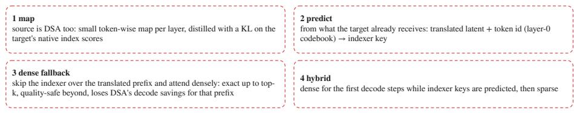

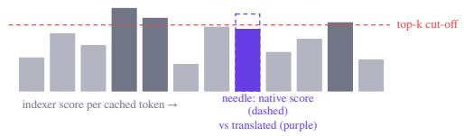  
Figure 27: Four ways to supply DSA indexer keys to a translated cache, and why discrete top-k selection could make needle recall fail all at once. Options 2 (predict) and 3 (dense) were rehearsed on a QSA pair (§10.1).