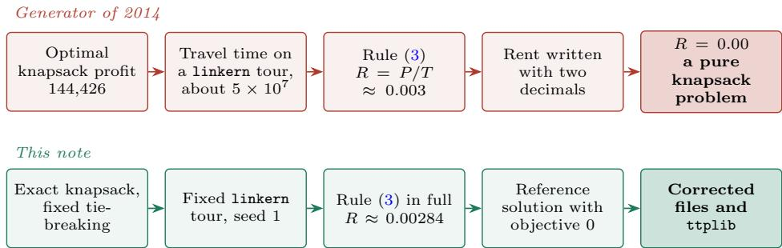
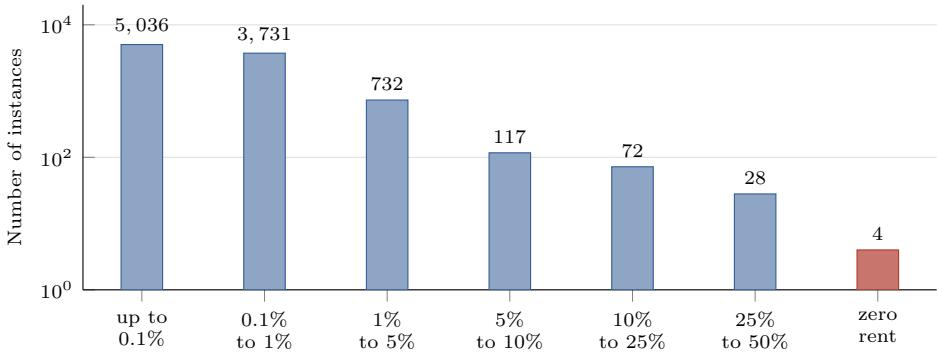
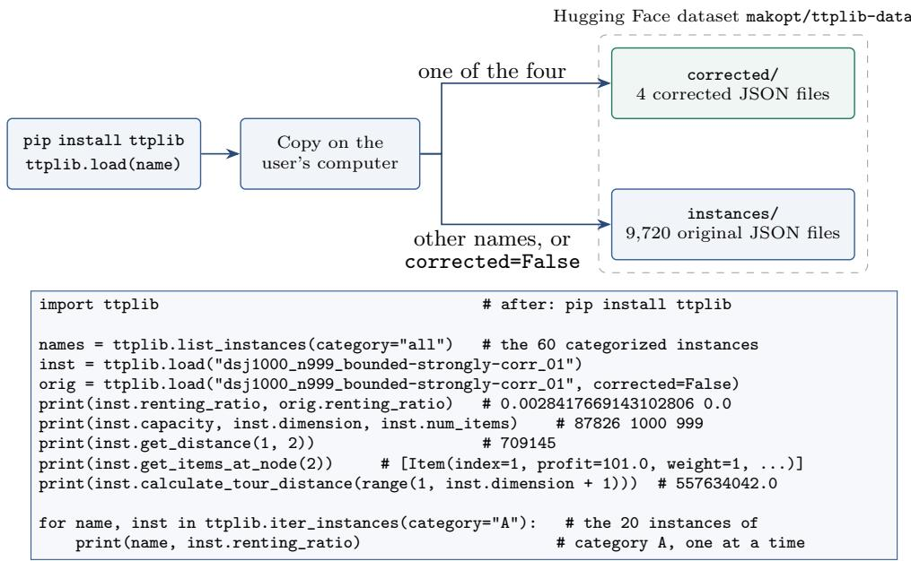

# Unmasking Four Knapsack Problems in the Traveling Thief Benchmark

Mohammed Mizan Alanazi1 and Mahdi Khemakhem 1,2,3\*

1\*Department of Computer Science, College of Computer Engineering and Sciences, Prince Sattam bin Abdulaziz University, AlKharj, 11942, Saudi Arabia.

2National School of Electronics and Telecommunications of Sfax (ENET’Com), University of Sfax, Sfax, Tunisia.

3Data Engineering and Semantics Research Unit, Faculty of Sciences of Sfax, University of Sfax, Sfax, Tunisia.

\*Corresponding author(s). E-mail(s): mahdi.khemakhem@enetcom.usf.tn;

## Abstract

The traveling thief problem (TTP) asks a thief to choose a tour and a packing together, and the benchmark of 9,720 instances of Polyakovskiy et al. (2014) is the standard test set for comparing TTP heuristics. We show that four of these instances are not TTP instances at all. Their files give a renting rate of 0.00, so the tour has no efect on the objective and each instance reduces to a 0-1 knapsack problem. One of them belongs to the 60 categorized instances on which new methods are usually compared, and on it five of nine published methods report exactly the same value. The cause is the format of the files, which keep the renting rate with two decimals, while the rule of the generator gives a rate close to 0.003 on these instances. The same rounding may shift the rate of 949 other instances by more than 1%. Since the tour and the packing used by the generator were not published, the original rates cannot be recovered. We therefore define new rates with the same rule, applied to a fully specified reference solution that we publish, and we show with a published heuristic that the corrected instances behave as TTP instances again. We also give reference results on the corrected instances and recommendations for future studies. Finally, we present ttplib, a new open-source Python library that loads any of the 9,720 instances, including the corrected ones, without downloading the whole benchmark.

Keywords: Traveling thief problem, Benchmark instances, Renting rate, Rounding error, 0-1 knapsack problem, Open-source library

## 1 Introduction

In the traveling thief problem (Bonyadi et al. 2013), a thief visits every city once and fills a knapsack with items found along the way. We use the formulation of the benchmark (Polyakovskiy et al. 2014a). An instance has n cities, numbered $0 , \ldots , n - 1$ with the depot at city 0, and m items. Item $j$ has a profit $p _ { j }$ and a weight $w _ { j } .$ , and it lies in city $a _ { j } \neq 0$ . The knapsack holds at most W, the rent is R per unit of time, and the speed of the thief falls linearly with the carried weight $c ,$

$$
v ( c ) = v _ { \mathrm { m a x } } - \nu c , \qquad \nu = \frac { v _ { \mathrm { m a x } } - v _ { \mathrm { m i n } } } { W } ,\tag{1}
$$

from $v _ { \mathrm { m a x } }$ when empty to $v _ { \mathrm { m i n } }$ when full. A solution is a tour $\pi$ that visits every city once and returns to the depot, written as the sequence of cities $\pi _ { 0 } , \pi _ { 1 } , \ldots , \pi _ { n }$ with $\pi _ { 0 } = \pi _ { n } = 0$ , together with a set S of picked items with $\textstyle \sum _ { j \in S } w _ { j } \leq W$ . Edge s of the tour goes from $\pi _ { s }$ to $\pi _ { s + 1 } ,$ for $s = 0 , \ldots , n - 1$ . We note $d _ { s }$ for its length, which is the Euclidean distance rounded up to the next integer, and $c _ { s }$ for the weight carried on it, which is the total weight of the items picked in the cities $\pi _ { 0 } , \ldots , \pi _ { s }$ . The objective, to be maximized, is the profit minus the rent paid for the travel time,

$$
Z ( \pi , S ) = P ( S ) - R T ( \pi , S ) , \qquad P ( S ) = \sum _ { j \in S } p _ { j } , \qquad T ( \pi , S ) = \sum _ { s = 0 } ^ { n - 1 } { \frac { d _ { s } } { v ( c _ { s } ) } } .\tag{2}
$$

The benchmark of Polyakovskiy et al. $\mathrm { ( 2 0 1 4 a ) ^ { 1 } }$ crosses 81 instances of the TSP library with four numbers of items per city, three types of knapsack and ten capacity levels, which gives 9,720 instances. The capacity level, from 01 to 10, is the last part of the name of an instance. It was used in the IEEE CEC 2014 competition (Polyakovskiy et al. 2014b). Since then, few studies have used the full set, and diferent studies have chosen diferent subsets (Wagner et al. 2018). The full set is too large for the usual protocol of ten runs of ten minutes per instance, which would take about 1.8 years of computing time for a single method. Most recent comparisons therefore use 60 categorized instances sampled from the 9,720, a sample introduced by El Yafrani and Ahiod (2016) following the sample instances of the CEC 2014 competition and used, for example, by El Yafrani and Ahiod (2018) and Namazi et al. (2019, 2023). This sample takes twenty TSP instances, from eil76 with 76 cities to pla33810 with 33,810 cities, so that it covers small, medium and large instances. On each of them, it takes one TTP instance of each of three categories, which represent three diferent kinds of dificulty. Category A has one item per city, a bounded strongly correlated knapsack and the smallest capacity (level 01), so few items can be picked and the tour has a large weight in the objective. Category B has five items per city, an uncorrelated knapsack with similar weights and a medium capacity (level 05). Category C has ten items per city, an uncorrelated knapsack and the largest capacity (level 10), so the packing has the most choices. Published values exist for many methods on these 60 instances, which is the main reason why new methods are compared on them. Sarkar and Rajendran (2024) survey the variants of the problem and the methods proposed for it.

The rent R links the two parts of the problem. If R is large, the travel time dominates the objective. If R is small, the profit dominates. If $R = 0$ , the second term of Eq. (2) vanishes and $Z ( \pi , S ) = P ( S )$ for every tour π. Maximizing $P ( S )$ under the capacity constraint is the 0-1 knapsack problem. Any tour can be used, and the best solution is an optimal packing of the knapsack part (Wagner et al. 2018). Some tables of instances in the literature list a rent of 0.00, for example for two of the dsj1000 instances in Ali et al. (2021), and Nikfarjam et al. (2024) left aside the first dsj1000 instances because their rent is zero, which turns them into knapsack problems. To the best of our knowledge, no study has explained where these zeros come from, listed all the instances concerned, examined the efect of the zero rent on published results, or proposed a correction.

We discovered this case while working on a new method to solve the TTP. On the instance of category A built on dsj1000, repeated runs returned exactly the same value, 144,426, which is the optimal profit of the knapsack part, and the file of this instance gives $R = 0 . 0 0$ . We also noticed that, on this instance, most of the methods compared in recent studies report values very close to this optimum, and five of them report exactly the same value. We then read all 9,720 files to find every instance with this problem, and to measure how far the way the rent is stored afects the others.

This note aims to make the problem known to the community and to give a simple way to fix it. Section 2 describes the four instances and explains why their rent is zero. Section 3 defines new rents and gives reference results on the corrected instances. Section 4 presents the corrected files and ttplib, a new library that we developed, and Section 5 concludes with recommendations.

## 2 Four instances with a zero rent

## 2.1 The four instances and their published results

We read the line RENTING RATIO of all 9,720 .ttp files. In every file, the value is written with exactly two decimals. Four files give R = 0.00 (Table 1). All four have 1,000 cities and 999 items, and the last two columns of Table 1 give the profit and the number of items of the optimal packing of the knapsack part. With $R = 0$ , the objective of any solution is the total profit of the picked items, whatever the tour. Each of the four instances is then a 0-1 knapsack problem, not a TTP instance.

Table 1 The four instances with $R = 0 . 0 0 \mathrm { { } }$
<table><tr><td>Instance</td><td>Capacity</td><td>Optimal profit</td><td>Items packed</td></tr><tr><td>dsj1000_n999_bounded-strongly-corr_01</td><td>87,826</td><td>144,426</td><td>291</td></tr><tr><td>dsj1000_n999_uncorr-similar-weights_01</td><td>91,232</td><td>85,721</td><td>90</td></tr><tr><td>dsj1000_n999_uncorr-similar-weights_02</td><td>182,464</td><td>164,663</td><td>181</td></tr><tr><td>dsj1000_n999_uncorr_01</td><td>45,302</td><td>165,552</td><td>257</td></tr></table>

The first of the four is one of the 60 categorized instances, the instance of category A built on dsj1000. Every method evaluated on the categorized instances has solved a pure knapsack problem on that instance. Its best possible value is the optimal knapsack profit, 144,426, which we computed exactly by dynamic programming and checked with Gurobi.

This instance stands out in the published results. Table 2 gives the values reported for it by nine methods that are often compared on the categorized instances. The value of $\mathrm { C o C o ^ { + } }$ is the best value over all runs of the CoCo variants, and the other values are means over ten runs. The values of MATLS, RWS and S5 are taken from Table 1 of Zhang et al. (2021). Since the rent is zero, the tour and the way distances are computed play no role, so these values can be compared directly. Five of the nine methods report exactly the same value, 144,219, which is 207 below the optimum, and only the best value of $\mathrm { C o C o ^ { + } }$ reaches 144,426. On the other 59 instances of the categorized instances, no value is shared by more than two of the nine methods, and on 55 of them all nine values difer. With a zero rent, the methods difer only in the packing they find, and the instance measures a knapsack heuristic, not the coordination of tour and packing that the TTP is meant to test. We did not find a study that points out the efect of the zero rent of this instance on the published comparisons.

Table 2 Published values on dsj1000 n999 bounded-strongly-corr 01.
<table><tr><td>Method</td><td>Source of the value</td><td>Value</td></tr><tr><td>CoCo⁺</td><td>Namazi et al. (2023)</td><td>144,426</td></tr><tr><td>CoCo</td><td>Namazi et al. (2019)</td><td>144,219</td></tr><tr><td>CS2SA</td><td>El Yafrani and Ahiod (2016)</td><td>144,219</td></tr><tr><td>MA2B</td><td>El Yafrani and Ahiod (2016)</td><td>144,219</td></tr><tr><td>CS2SA*</td><td>El Yafrani and Ahiod (2018)</td><td>144,219</td></tr><tr><td>SAVI</td><td>Nguyen et al. (2023)</td><td>144,219</td></tr><tr><td>MATLS</td><td>Mei et al. (2014), value reported by Zhang et al. (2021)</td><td>143,699</td></tr><tr><td>RWS</td><td>Zhang et al. (2021)</td><td>140,656</td></tr><tr><td>S5</td><td>Faulkner et al. (2015), value reported by Zhang et al. (2021)</td><td>137,653</td></tr></table>

Does this instance change the published rankings? We computed the mean rank of the nine methods of Table 2 on the values reported by the same sources on the 60 categorized instances, which are best values for $\mathrm { C o C o ^ { + } }$ and means for the other methods, with and without this instance. Tied values share the mean of their ranks. Over the 60 instances, the mean ranks move by at most 0.06 (for S5). The order of the methods stays the same, except for RWS and SAVI, whose mean ranks difer by less than 0.04 and change places. Over the 20 instances of category A, the mean ranks move by at most 0.26 (for S5), and the order of the nine methods stays the same. In this simple descriptive calculation, the efect of the instance is small. We did not repeat the statistical tests of the original studies.

## 2.2 The zero rents in three published studies

Three studies published in the Journal of Heuristics show how the problem appears in practice.

Wagner et al. (2018) studied 21 algorithms on all 9,720 instances and used the results to build algorithm portfolios, which choose the best algorithm for an instance from features of the instance. They describe the case R = 0 in theory and note that the best solution is then the best solution of the knapsack part, but they do not point out that four instances of the benchmark are in this case. These four instances were therefore treated as TTP instances, both to compare the 21 algorithms and to train the portfolios, although the tour plays no role in them. The rent itself is one of the instance features. In their analysis of feature importance, it is the second most important feature for choosing an algorithm, after the capacity of the knapsack. Yet this feature is zero for the four instances, and for 217 others it has a single significant digit (Section 2.4). The feature that the portfolios rely on most after the capacity is thus missing for four instances and imprecise for many more.

Namazi et al. (2023) proposed the CoCo variants, whose main idea is to coordinate the changes of the tour and of the packing, and compared them with other methods on the categorized instances. On the instance of category A built on dsj1000, this coordination cannot have any efect, since the tour does not change the value. Their Table 6 shows the consequence. Over ten runs of each method, it gives a mean of 144,219 with a standard deviation of zero for CS2SA∗, CoCoP and CoCoL, and a mean of 143,280 with a standard deviation of zero for MATLS. At its displayed precision, the table thus reports no variation over ten runs for four methods, and three of them reach exactly the same value. Their best value over all CoCo variants, 144,426 in their Table 5, is the optimal knapsack profit. For a fixed packing, the value no longer depends on the tour, so a method that reaches the same packing in every run returns the same value, whatever its tours. The zero rent does not force a method to find the same packing, but it removes the efect of the tour, which is a main source of variation between runs. On this instance, the comparison therefore ranks knapsack heuristics, not the coordination that the paper proposes. In our own experiments of Section 3.3 with CoCoP, the ten runs on each corrected file gave ten diferent values.

Chagas et al. (2021) solve the bi-objective version of the problem, which minimizes the travel time and maximizes the profit as two separate objectives. The rent does not appear in this version, and none of their nine instances is one of the four. The issue reported here therefore concerns the single-objective TTP.

## 2.3 Why the rent is zero

Polyakovskiy et al. (2014a) set the rent of each instance to

$$
R = \frac { P ( S ^ { * } ) } { T ( \pi ^ { \mathrm { l k } } , S ^ { * } ) } ,\tag{3}
$$

where $P ( S ^ { * } )$ is the profit of an optimal packing $S ^ { * }$ of the knapsack part, and the denominator is the travel time defined in Eq. (2) along a tour $\pi ^ { \mathrm { l k } }$ when the thief picks the items of $S ^ { * }$ . This tour is computed by linkern, the program of the Concorde TSP solver (Applegate et al. 2006) that implements the Chained Lin-Kernighan heuristic (Applegate et al. 2003). It is a fast local search that returns a very good TSP tour, but not necessarily an optimal one, and its result depends on a random seed. With this choice, the solution made of that tour and that packing has an objective of exactly zero. The authors of the benchmark state that the rule guarantees at least one TTP solution with zero objective. In the four files with $R = 0 ;$ the same packing has an objective equal to its positive profit. A solution with an empty knapsack still has an objective of zero, but the calibration intended by the rule, in which the reference solution with the optimal packing has an objective of zero, is lost.

The rule itself never gives zero, since the optimal profit is positive. We cannot observe the generator, but the available data point to the size of the ratio and to the way it was stored (Fig. 1, top). The cities of dsj1000 spread over about $1 . 2 \times 1 0 ^ { 6 }$ units in each direction, and a good tour has a length of about $1 . 8 7 \times 1 0 ^ { 7 }$ . The thief travels at a speed between $v _ { \mathrm { m i n } } = 0 . 1$ and $v _ { \operatorname* { m a x } } = 1$ , so the travel time is of the order of $5 \times 1 0 ^ { 7 }$ , while the optimal profit is of the order of $1 0 ^ { 5 }$ . Rule (3) then gives a rent of about 0.003. Written with two decimals, any value below 0.005 becomes 0.00.

  
Fig. 1 How the rent of dsj1000 n999 bounded-strongly-corr 01 becomes zero in the files (top), and how this note defines its new rent (bottom, Section 3.2).

The files confirm this reading (Table 3). In the benchmark, the capacity of level k, for $k = 1 , \ldots , 1 0$ , is $W = k / 1 1$ of the total weight of the items, rounded down. For example, dsj1000 n999 bounded-strongly-corr 01 has a total weight of 966,088 and a capacity of 87,826. Table 3 gives the rent in the files of the thirty instances built on dsj1000 with 999 items, for the three types of knapsack and the ten levels. A larger knapsack holds more profit, so the optimal profit in rule (3), and with it the rent, grows with the level. The four zeros, in bold, are exactly the four instances of Table 1: level 01 of the three types, and level 02 of the uncorrelated type with similar weights. They lie at the bottom of increasing sequences that reach only 0.01 or 0.02 at level 10. On this TSP instance, every rent is thus at most two hundredths, so the two decimals keep at most one significant digit, and they lose everything below 0.005.

## 2.4 How much the rounding afects the other rents

Let r be the rent stored in a file. If a positive rent was rounded to the nearest hundredth, its value before rounding lies within 0.005 of r. For $r > 0$ , we call $q = 0 . 0 0 5 / r$ the relative rounding half-width. It measures how much precision may have been lost, not the actual error, which is unknown. If the generator truncated instead, the interval has a width of 0.01. The code of the generator is not distributed, so the calculation below assumes rounding to the nearest hundredth. We computed q for all 9,720 files (Fig. 2). For 52% of the instances, $q \leq 0 . 1 \%$ . For 949 instances, $q > 1 \%$ , for 217, $q > 5 \%$ , and for $1 0 0 , q > 1 0 \%$ . Twenty-eight files have $r = 0 . 0 1$ , giving $q = 5 0 \% ,$ and another 23 have $r = 0 . 0 2$ , giving $q = 2 5 \%$ . In Fig. 2, each class contains its upper end, so the 23 files with $r = 0 . 0 2$ fall in the class 10% to 25%, and the four files with $r = 0 . 0 0$ form a separate class, where q is not defined. These small rents belong to TSP instances whose tours are very long, because their coordinates are large or their cities are many. Of the 217 instances with $q > 5 \%$ , 98 are built on dsj1000, 36 on pla7397, 28 on pla33810, 15 on pla85900 and 13 on usa13509.

Table 3 Rents in the files of dsj1000 with 999 items, by type of knapsack and capacity level.
<table><tr><td></td><td colspan="10">Capacity level</td></tr><tr><td>Type of knapsack</td><td>01</td><td>02</td><td>03</td><td>04</td><td>05</td><td>06</td><td>07</td><td>08</td><td>09</td><td>10</td></tr><tr><td>bounded strongly correlated</td><td>0.00</td><td>0.01</td><td>0.01</td><td>0.01</td><td>0.01</td><td>0.01</td><td>0.02</td><td>0.02</td><td>0.02</td><td>0.02</td></tr><tr><td>uncorrelated, similar weights</td><td>0.00</td><td>0.00</td><td>0.01</td><td>0.01</td><td>0.01</td><td>0.01</td><td>0.01</td><td>0.01</td><td>0.01</td><td>0.01</td></tr><tr><td>uncorrelated</td><td>0.00</td><td>0.01</td><td>0.01</td><td>0.01</td><td>0.01</td><td>0.01</td><td>0.01</td><td>0.01</td><td>0.01</td><td>0.01</td></tr></table>

  
Relative rounding half-width q = 0.005/r  
Fig. 2 The 9,720 instances by relative rounding half-width q (logarithmic vertical axis).

The categorized instances are also concerned. Besides the instance with $r = 0 . 0 0 ,$ eleven of its instances have $q > 1 \%$ , and four of them have $q > 5 \%$ . These four are the instances of category A built on pla7397 $( r = 0 . 0 2 , q = 2 5 \% )$ , pla33810 $( r = 0 . 0 3$ $q \approx 1 7 \% )$ and usa13509 $( r = 0 . 0 4 , q \approx 1 3 \% )$ , and the instance of category B built on dsj1000 $( r = 0 . 0 4 , q \approx 1 3 \% )$ . These instances remain proper TTP instances, so we do not change them. But the value of their rent intended by the generator, and so the weight of the tour in their objective, may difer noticeably from the stored value.

## 3 New renting rates for the four instances

## 3.1 Why the original values cannot be recovered

A correction should ideally restore the value that the generator computed before rounding. This value cannot be recovered from the files and code that Polyakovskiy et al. (2014a) published with the benchmark, for three reasons. First, rule (3) depends on the tour, and the authors of the benchmark distribute their tour only for the TSP instance a280. Their code does not contain the generator, but it contains the call to linkern and the evaluation function, and we implemented the rule with them, with the tour read from the output of linkern from the depot, the travel time computed as in Eq. (2) and the knapsack solved exactly. With their tour, the recomputed rent of the 120 instances built on a280 has a median ratio of 0.975 to the value in the file, and 90% of the ratios lie between 0.89 and 1.08. Rounded to two decimals, it equals the value in the file on only one of the 120 instances, so the same implementation is close to the files but does not reproduce them. Second, the rent changes with the tour, even among tours of almost the same length. For each of the four instances, we ran linkern with ten seeds. The ten tours difer in length by less than 1%, but with the same optimal packing the rent varies by up to 16% (Table 4), because the travel time depends on where along the tour the heavy items are picked. Third, the rent changes with the optimal packing. A knapsack can have several optimal packings with the same profit. On the bounded strongly correlated instance, two optimal packings give rents that difer by 2.0% on the same tour, and the packing chosen by the original knapsack solver (Martello et al. 1999) is not known.

Table 4 Rents given by rule (3) on ten linkern tours.
<table><tr><td>Instance</td><td>Smallest R</td><td>Largest R</td></tr><tr><td>dsj1000_n999_bounded-strongly-corr_01</td><td>0.002836</td><td>0.003295</td></tr><tr><td>dsj1000_n999_uncorr-similar-weights_01</td><td>0.001736</td><td>0.001875</td></tr><tr><td>dsj1000_n999_uncorr-similar-weights_02</td><td>0.003298</td><td>0.003683</td></tr><tr><td>dsj1000_n999_uncorr_01</td><td>0.003325</td><td>0.003540</td></tr></table>

All these values lie between 0.0017 and 0.0037. They are below 0.005, so they give 0.00 whether the generator rounded or truncated. This agrees with the explanation of Section 2.3, although it does not prove it, since the code of the generator is not available. But no single one of them is the original value, and a statistic over several tours would only be an estimate of it.

## 3.2 The new renting rates

Instead of estimating the lost values, we define new ones. We keep rule (3) and fix every choice that it leaves open, so that each new rent is fully specified and can be recomputed (Fig. 1, bottom).

1. The packing is the optimal packing returned by the dynamic program of the 0-1 knapsack problem, run over the items in the order of the file, where an item is packed only when it strictly increases the best profit. This rule breaks ties between optimal packings in a fixed way, so the same packing is returned at every run. It does not mean that the optimal packing is unique. We checked the optimal profit with Gurobi.

2. The tour is the tour of linkern, with its default settings and the random seed 1 (linkern -Q -s 1 -o output input), started at the depot as in the code of the authors of the benchmark. With our build of linkern, this command returns the same tour at every run, but another build may not. The choice of the seed is arbitrary, and another seed would give another valid rent (Table 4). For these reasons, the published tour, not the command, defines the new rent.

3. The travel time is computed as in Section 3.1, and the rent is the ratio of rule (3).

Mathematically, the new rent is the optimal profit divided by the travel time of the reference solution, and this reference solution has an objective of zero. The files store the double-precision value of this ratio in the shortest decimal form that gives back the same double, not a value rounded to a fixed number of decimals. Evaluated with the stored rent, the objective of the reference solution is zero up to floating-point rounding. We check it with an absolute tolerance of $1 0 ^ { - 8 }$ , and the observed residuals are below $4 \times 1 0 ^ { - 1 1 }$ on the four instances.

Table 5 gives the result, with the travel time of the reference solution and the rent printed with six significant digits. The tour of seed 1 has a length of 18,665,994 for the four instances, since they share the same cities. The reference solution made of this tour and this packing restores, on each corrected instance, the calibration intended by the original rule. The four reference solutions are published with the corrected files, together with a script, verify.py, that checks them with these files only (see the Code availability statement). It asserts that each reference solution is feasible, that its packing is optimal, that the rent equals the optimal profit divided by its travel time, and that its objective is zero within the tolerance. All four new rents are below 0.005, so they round to the value 0.00 of the original files.

Table 5 New rents of the four instances.
<table><tr><td>Instance</td><td>Travel time</td><td>New R</td></tr><tr><td>dsj1000_n999_bounded-strongly-corr_01</td><td>50,822,606</td><td>0.00284177</td></tr><tr><td>dsj1000_n999_uncorr-similar-weights_01</td><td>45,714,939</td><td>0.00187512</td></tr><tr><td>dsj1000_n999_uncorr-similar-weights_02</td><td>44,709,234</td><td>0.00368298</td></tr><tr><td>dsj1000_n999_uncorr_01</td><td>47,522,162</td><td>0.00348368</td></tr></table>

These new rents are not the original ones, and results obtained with them cannot be compared with results obtained on the original files. They give the four instances a positive rent of the size intended by the generator, computed by a rule that is stated in full.

## 3.3 Reference results on the corrected instances

To see how the four instances behave with and without a rent, we ran a published heuristic on the original file $( R = 0 . 0 0 )$ and on the corrected file of each instance. We chose $\mathrm { C o C o ^ { + } }$ , the method of Namazi et al. (2023) with the best published values on the categorized instances. We used the public code of its authors, algorithm 4 (CoCoP). This code seeds its random numbers with the clock, and we added an ofset that depends on the run number, so that runs started at the same time do not share their random numbers. It ran ten times on each file, with a budget of 600 seconds of wall-clock time per run, which it used in full. Each run used one core, and eight runs ran at a time on an Apple M1 Pro. Every solution was evaluated again on the .ttp file used by the run. Table 6 gives the results. On the corrected files, Min and Max are the worst and the best of the ten runs, and the last column gives the smallest and largest number of picked items. Note that the value of $\mathrm { C o C o ^ { + } }$ in Table 2 is the best over all runs of several $\mathrm { C o C o }$ variants, while the runs here use CoCoP alone.

Table 6 Results of $\mathrm { C o C o ^ { + } }$ on the original and the corrected files.
<table><tr><td></td><td>Original file</td><td colspan="5">Corrected file</td></tr><tr><td>Instance (dsj1000, 999 items)</td><td>Value</td><td>Min</td><td>Mean</td><td>Max</td><td>Std. dev.</td><td>Items picked</td></tr><tr><td>bounded strongly corr., 01</td><td>144,219</td><td>66,533</td><td>66,865</td><td>67,119</td><td>184</td><td>220 to 246</td></tr><tr><td>similar weights, 01</td><td>85,719</td><td>33,100</td><td>33,463</td><td>34,145</td><td>322</td><td>90</td></tr><tr><td>similar weights, 02</td><td>164,660</td><td>50,950</td><td>51,458</td><td>52,271</td><td>507</td><td>181</td></tr><tr><td>uncorrelated, 01</td><td>165,494</td><td>57,036</td><td>57,187</td><td>57,535</td><td>165</td><td>233 to 234</td></tr></table>

On the original files, $\mathrm { C o C o ^ { + } }$ behaves as on a knapsack problem. It returns the same value in all ten runs on each instance, slightly below the optimal knapsack profit, at 144,219 on the categorized instance, the value reported by five methods in Table 2. Since the rent is zero, the tour has no efect on the value.

On the corrected files, the picture changes. The ten runs give ten diferent values, with a standard deviation between 165 and 507. The mean values are between 31% and 46% of the optimal knapsack profit, because the travel time now has a cost. The packing also changes. On the bounded strongly correlated instance, $\mathrm { C o C o ^ { + } }$ picks 220 to 246 items instead of the 291 of the optimal knapsack, and on the uncorrelated instance 233 or 234 instead of 257. With fewer items, the thief carries less weight and travels faster. On the two instances with similar weights, every run picked 90 and 181 items, as many as the optimal knapsack packings, although up to 91 and 182 items fit in the knapsack. The profits of the packed items are lower than the optimal profit, so $\mathrm { C o C o ^ { + } }$ picked other items than the optimal knapsack, chosen together with the tour. The corrected instances behave as TTP instances again, in which the tour and the packing must be chosen together. These values, with their minimum and maximum over ten runs, can be used by the community as a reference for future comparisons on the corrected instances.

## 4 Corrected files and the library ttplib

The original instances are text files in the .ttp format, which can be downloaded from the website of the benchmark. To make them easier to use, we converted the 9,720 files to JSON, a common text format that most programming languages can read directly. Each JSON file holds the header of the instance (name, type of knapsack, number of cities and items, capacity, speeds, rent and distance type), the list of cities with their coordinates, and the list of items with their profit, weight and city. For the 60 categorized instances and the three other instances with $R = 0 . 0 0$ , we checked that the JSON files and the original files hold the same data in every field.

The corrected versions of the four instances are also JSON files. They are equal to the original instances except for the rent, keep the original names, and are stored in a separate folder, so that the two versions cannot be mixed up. A user who prefers the .ttp format can obtain a corrected file by copying the new rent of the JSON file into the line RENTING RATIO of the original .ttp file.

All these files are stored in a public dataset on Hugging Face, a website that hosts data sets and makes them freely available for download. The dataset has two folders: instances, with the 9,720 original instances, and corrected, with the four corrected instances, their reference solutions and the scripts of Section 3.2. A user can download any file from the dataset directly, without any software.

To make the instances even easier to use, we developed ttplib, a new opensource library for the Python programming language (Fig. 3). This note describes its version 0.2.2. Like most Python libraries, it is published on PyPI, the public index of Python packages, and is installed with the single command pip install ttplib. A program can then load any of the 9,720 instances by its name, for example with ttplib.load("dsj1000 n999 uncorr 01"). The library downloads the file of the instance from the dataset the first time it is used and keeps a copy on the computer of the user, so that later uses need no connection. A user therefore never has to download the whole benchmark. For the four instances with R = 0.00, the library returns the corrected version by default, and the original version with the option corrected=False.

The library also lists the instances, with filters on the TSP instance, the type of knapsack and the number of items. For example, ttplib.list instances(category="all") returns the names of the 60 categorized instances, and category="A", "B" or "C" returns the 20 instances of one category. To work on many instances, ttplib.iter instances() loads them one at a time, all 9,720 by default or those selected with the same filters, in their corrected or original version, and frees the memory as it goes. For each instance, it gives the distances between cities and the items of each city. It computes a distance only when it is needed, so that even the largest instance, pla85900, loads in a few seconds with less than 200 MB of memory. The library comes with a set of automatic tests, in the script test ttplib.py. They check the list of instances, the reading of an instance, the distances and the items, the download from the dataset and the local copy, and the corrected versions of the four instances.

Figure 3 shows how an instance is served and gives a short example of use. The README file of the library, on its GitHub page, describes all its functions with their parameters, and the data and functions of an instance. In the library, cities and items are numbered from 1, as in the files, so that city 1 is the depot. The links to the dataset, to the library on PyPI and to its source code on GitHub are given in the Data availability and Code availability statements.

  
Fig. 3 How ttplib serves an instance (top), and an example of use with its output (bottom).

## 5 Conclusion and recommendations

Four of the 9,720 instances of the standard TTP benchmark have a renting rate of 0.00 in their files. On these instances, the tour has no efect on the objective, and the problem reduces to a 0-1 knapsack problem. One of them is among the 60 categorized instances used in most comparisons of TTP heuristics, where it has measured the quality of knapsack heuristics rather than the coordination of tour and packing. The zeros are consistent with the two decimals with which the rents are stored, and the same format may remove much of the precision of the rent of many other instances, mainly those built on TSP instances with long tours. The original rents cannot be recovered from the files and code published with the benchmark, so we defined new rents for the four instances with the rule of the original generator, applied to a fully specified reference solution that is published with them. With these rents, the four instances behave as TTP instances again. The corrected instances, the reference solutions and the scripts are freely available, and the library ttplib gives access to all 9,720 instances, including the corrected ones, without downloading the whole benchmark.

We make four recommendations for future work on this benchmark.

1. Studies that compare with published results should run the four instances with the original files (R = 0.00), since the published values were obtained on them, and say so. On the categorized instance, the optimal value 144,426 is then the best possible value. They should also run these instances with the corrected files and report both results. The results on the corrected files will then build a base for comparisons on proper TTP instances in future studies, starting from the reference results of Section 3.3.

2. Studies that do not compare with published values should use the corrected files for these four instances, and state the version used.

3. Results on instances with a small rent should be read with care, since the stored rent of these instances may have lost much of its precision (Section 2.4). Among the categorized instances, this concerns four instances with a relative rounding half-width above 5%.

4. Future generators of TTP instances should store the rent with enough significant digits to give back the computed double-precision value, not with a fixed number of decimals. They should also publish the reference solution behind the rent and a tolerance for checking it. A file can then be checked by evaluating this solution, whose objective must be zero within the stated tolerance.

## Declarations

Data availability. The original instances of the benchmark of Polyakovskiy et al. (2014a) are available from the website of the benchmark (https://cs.adelaide. edu.au/∼optlog/CEC2014COMP InstancesNew/). The data generated in this study are openly available in the Hugging Face dataset makopt/ttplib-data (https: //huggingface.co/datasets/makopt/ttplib-data). The folder instances contains the 9,720 original instances converted to JSON. The folder corrected contains the corrected versions of the four instances with a zero renting rate, their reference solutions, the renting rates written in the 9,720 original files and the new renting rates. The results of the heuristic runs summarized in Table 6 are available from the corresponding author on reasonable request.

Code availability. The Python library ttplib, version 0.2.2, is open source under the MIT license. It is available from PyPI (https://pypi.org/project/ttplib/) and from GitHub (https://github.com/makopt/ttplib), together with its documentation and its test script test ttplib.py. The scripts used to compute the new renting rates (recompute R.py), to write the corrected files (write corrected.py) and to verify them (verify.py) are available in the folder corrected/scripts of the Hugging Face dataset. The runs of Section 3.3 used the public code of CoCo+ provided by Namazi et al. (2023).

Author contribution. Mohammed Mizan Alanazi made the original finding of the zero renting rate. Mahdi Khemakhem designed the study, wrote the code, carried out the experiments and wrote the manuscript. Both authors read and approved the final manuscript.

## References

Ali H, Rafique MZ, Sarfraz MS, et al (2021) A novel approach for solving travelling thief problem using enhanced simulated annealing. PeerJ Computer Science 7:e377. https://doi.org/10.7717/peerj-cs.377

Applegate D, Cook W, Rohe A (2003) Chained Lin-Kernighan for large traveling salesman problems. INFORMS Journal on Computing 15(1):82–92. https://doi.org/ 10.1287/ijoc.15.1.82.15157

Applegate DL, Bixby RE, Chv´atal V, et al (2006) The Traveling Salesman Problem: A Computational Study. Princeton University Press, Princeton, NJ, https://doi.org/ 10.1515/9781400841103

Bonyadi MR, Michalewicz Z, Barone L (2013) The travelling thief problem: The first step in the transition from theoretical problems to realistic problems. In: 2013 IEEE Congress on Evolutionary Computation, IEEE, pp 1037–1044

Chagas JB, Blank J, Wagner M, et al (2021) A non-dominated sorting based customized random-key genetic algorithm for the bi-objective traveling thief problem. Journal of Heuristics 27(3):267–301

El Yafrani M, Ahiod B (2016) Population-based vs. single-solution heuristics for the travelling thief problem. In: Proceedings of the Genetic and Evolutionary Computation Conference 2016, pp 317–324

El Yafrani M, Ahiod B (2018) Eficiently solving the traveling thief problem using hill climbing and simulated annealing. Information Sciences 432:231–244

Faulkner H, Polyakovskiy S, Schultz T, et al (2015) Approximate approaches to the traveling thief problem. In: Proceedings of the 2015 Annual Conference on Genetic and Evolutionary Computation, pp 385–392

Martello S, Pisinger D, Toth P (1999) Dynamic programming and strong bounds for the 0-1 knapsack problem. Management Science 45(3):414–424. https://doi.org/10. 1287/mnsc.45.3.414

Mei Y, Li X, Yao X (2014) Improving eficiency of heuristics for the large scale traveling thief problem. In: Asia-Pacific Conference on Simulated Evolution and Learning, Springer. Springer International Publishing, Cham, pp 631–643

Namazi M, Sanderson C, Newton M, et al (2019) A cooperative coordination solver for travelling thief problems. arXiv preprint arXiv:191103124

Namazi M, Newton MH, Sanderson C, et al (2023) Solving travelling thief problems using coordination based methods. Journal of Heuristics 29(4):487–544

Nguyen H, Le N, Tran K, et al (2023) Simulated annealing with dynamic programmingbased vertex insertion for eficiently solving the traveling thief problem. In: Proceedings of the 12th International Symposium on Information and Communication Technology, pp 165–172

Nikfarjam A, Neumann A, Neumann F (2024) On the use of quality diversity algorithms for the travelling thief problem. ACM Transactions on Evolutionary Learning and Optimization 4(2):1–22

Polyakovskiy S, Bonyadi MR, Wagner M, et al (2014a) A comprehensive benchmark set and heuristics for the traveling thief problem. In: Proceedings of the 2014 Annual Conference on Genetic and Evolutionary Computation, pp 477–484, https://doi. org/10.1145/2576768.2598249

Polyakovskiy S, Bonyadi MR, Wagner M, et al (2014b) Manual for the ieee cec 2014 competition optimisation of problems with multiple interdependent components. In: 2014 IEEE Congress on Evolutionary Computation, IEEE, pp 1–8

Sarkar T, Rajendran C (2024) Travelling thief problem: a survey of recent variants, solution approaches and future directions. International Journal of Systems Science: Operations & Logistics 11(1):2424200

Wagner M, Lindauer M, Mısır M, et al (2018) A case study of algorithm selection for the traveling thief problem. Journal of Heuristics 24(3):295–320

Zhang Z, Yang L, Kang P, et al (2021) Solving the traveling thief problem based on item selection weight and reverse-order allocation. IEEE Access 9:54056–54066