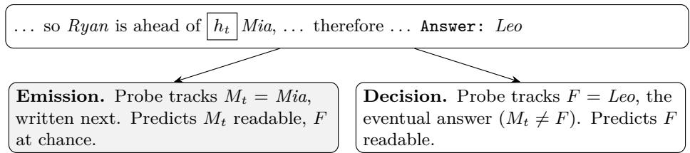
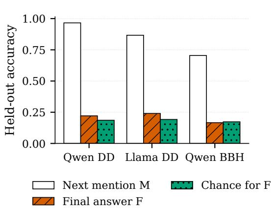
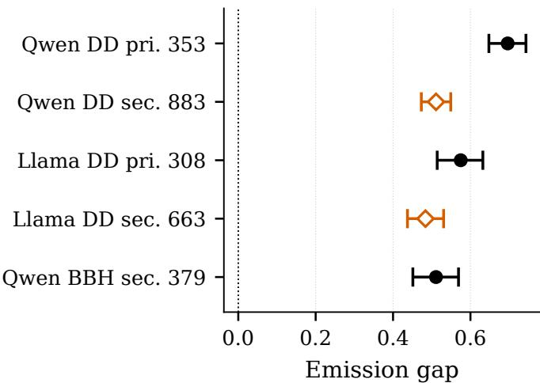
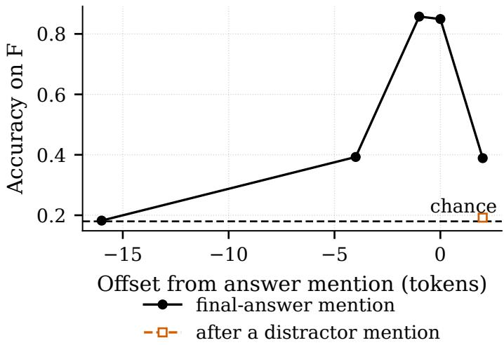
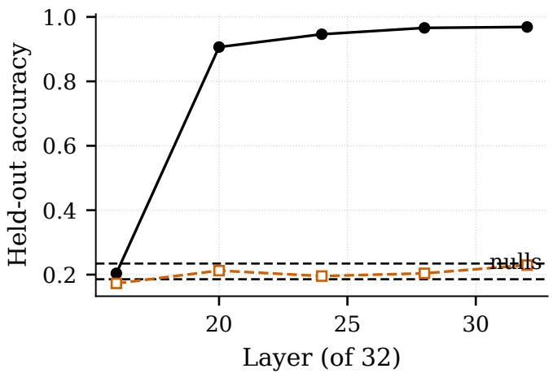
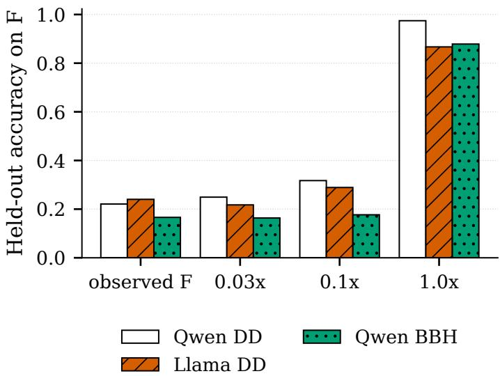
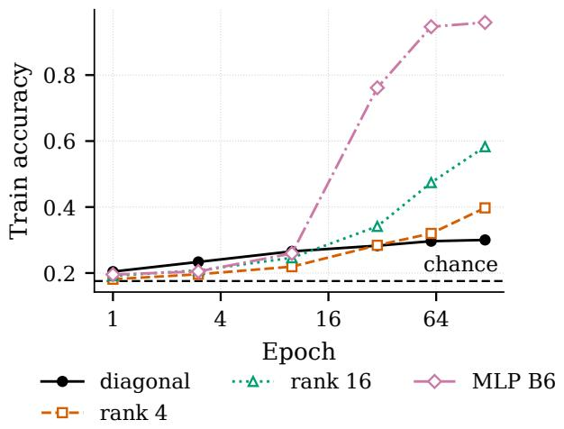
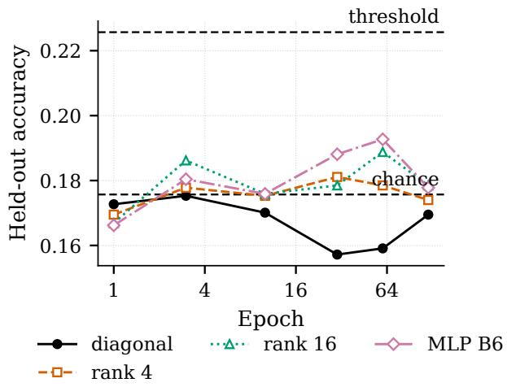

# When Answer Decodability Is Not a Decision: Separating Final-Answer and Imminent-Emission Signals in Chain-of-Thought

Hyojung Han† Jongmin Kim Seung-Hun Jeon

ThakiCloud †Corresponding author: hyojung.han@thakicloud.com

2026-11-06

## Abstract

Answer probes applied to chain-of-thought hidden states are often read as evidence that a language model has already decided its final response. This reading overlooks a competing signal, the candidate the model is about to mention. We introduce emission-controlled dual-target probing (ECDP), which fits the same low-rank reader family separately to the imminent mention and to the final answer at identical positions, with target-specific nulls and thresholds fixed before any fit. On correct DecisionDepth (DD) rollouts in which a distractor is mentioned before the final answer, Qwen3.5-4B decodes the next mention at .966 (null .234) but the final answer only at .221 (null .186), an emission gap of .696 [.648, .744]; Llama-3.1-8B gives .575 [.514, .632]. These brackets are descriptive item-bootstrap intervals from the median-gap seed among three post-hoc robustness runs; they exclude training-seed variation and are not adjusted for multiplicity. This pattern is not universal. In a pre-specified evaluation of Qwen3-8B with thinking enabled on held-out MMLU questions, using a full-prefix attention reader over every thinking position, both targets are decodable and the final answer is read far more strongly (mention-minus-answer lift −.398 [−.459, −.336] at layer 22 over 467 questions); an exploratory, post-hoc run of Qwen3.5-4B under the same protocol points the same way at layer 19. Model, task, positions, and reader change together between these settings, and an attempted matched comparison on DD produced no valid statistics because the imminent-mention probe did not train reliably, so we do not identify what reverses the order. On DD, planted-signal controls show that the reader recovers an injected final-answer signal at one tenth of full dose. Answer-candidate decodability is therefore target-relative and protocol-dependent: a strong answer readout does not by itself establish when a model commits, and a probe that fails to train is not evidence that the information is absent. ECDP is a practical control for distinguishing imminent text emission from evidence of a settled decision.

## 1 Introduction

Hidden-state probing has become a standard way to ask when a language model “knows” its answer during chain-of-thought (CoT) reasoning (Wei et al., 2022; Kojima et al., 2022). Recent work reports that final answers on easy multiple-choice questions are decodable early in the rationale and uses this for early exit (Boppana et al., 2026), and that probes reveal how far ahead a model represents its future reasoning (Xu et al., 2026). A common step in these analyses is to treat a successful answer probe as evidence of a decision state.

That step has a confound. When a rationale weighs several candidates, it writes their names. Just before a candidate’s name appears, the hidden state must carry what is needed to produce that name. An imminent-emission signal is therefore a plausible competing source of decodability whenever the candidate about to be emitted coincides with the target a probe is scored on. Whether it tracks the eventual choice is a separate question, and the usual evaluation does not separate the two.

The pattern is visible even without a control. In our rollouts the final answer is at chance sixteen tokens before it is first written in the conclusion and reaches .857 one token before it (Figure 3), so a high answer readout can arise exactly when the answer is about to be emitted. We separate the two readings by fitting one probe family to two targets at the same position: the next candidate mention $M _ { t }$ and the eventual final answer F. Because $M _ { t }$ is a distractor by construction in our main analysis, $M _ { t } \neq F$ , and a reader that tracks emission will score on $M _ { t }$ but not on F. We fixed the analysis, its nulls, controls, and decision thresholds before fitting, and recorded every amendment by commit in a time-stamped internal record; because that record is not public, we call these analyses pre-specified rather than preregistered.

Our contributions are:

• An emission-controlled probing protocol (ECDP) that fits $M _ { t }$ and F at the same position with target-specific nulls and a pre-specified emission gap $\Delta _ { \mathrm { e m i t } }$

• Evidence on DD in two model families, plus a Qwen3.5-4B result on a public reasoning task under its pre-specified fallback position set, that a probe fit before intermediate candidate mentions recovers the imminent mention far more accurately than the eventual answer (Section 4), and a pre-specified counterexample in which, under a diferent model, task, and reader, the final answer dominates (Section 8).

• An attempted matched cross-comparison, reported as incomplete together with its failure modes: on DD the imminent-mention probe did not train reliably under the full-prefix protocol in either model, which separates label validity from probe validity (Section 8.1, Appendix A).

• On DD, sensitivity controls showing that the reader recovers injected answer signals at the pre-mention positions, and a separate capacity study at the pre-rationale state finding increasing memorization without corresponding held-out gains (Section 5); and a probe-specific natural-task non-detection whose sensitivity is checked only for an injected answer-slot code (Section 6).

• A transparent account of what causal interventions did and did not establish (Section 9), and an explicit statement of the evidence tier of every result (Section 11).

Sections 4 and 5 contain the main pre-specified results and the controls that bound them. Section 8 reports the counterexample, which limits how far the main result generalizes, together with an attempted matched comparison that is incomplete and partly exploratory (Section 8.1). Sections 6, 7, and 9 are auxiliary: a natural-task null, a reasoning-model setting whose verdict is held, and causal interventions that did not pass their own checks. They are reported because they limit the interpretation, not because they add evidence for it.

We do not claim that hidden states carry no decision information. Prior work finds task-solving information in CoT hidden states (Mehrafarin et al., 2026), latent beliefs can be elicited from internal states without supervision (Burns et al., 2023), and our results are compatible with both. Our claim is narrower: a strong answer-like readout can reflect imminent lexical emission, so decodability alone is not evidence of a settled decision. Nor do we claim that imminent-emission dominance is a general property of chain-of-thought readouts; Section 8 reports a setting where it does not hold. Establishing that a decision state exists, or that it does not, requires an intervention whose apparatus has been validated; ours was not (Section 9).

  
Figure 1: Two readings of an answer probe at the token before an intermediate candidate mention. Standard answer probing does not distinguish them. Names are illustrative.

## 2 Related work

The work closest to ours decodes the final answer from chain-of-thought states and asks when it becomes readable. ECDP asks what a readout at a fixed position is reading, by fitting a second target, the candidate about to be written, at the same position with the same reader. We summarise the surrounding literature briefly.

Early answer decodability in chain of thought. Boppana et al. (2026) disentangle model beliefs from CoT, decoding final answers early on easy MMLU items and using this for early exit. Xu et al. (2026) train a low-rank lens on CoT hidden states to predict subsequent tokens and final answers, and report a myopic horizon in which precise answers become readable only one or two steps before completion. Scalena et al. (2026) estimate each step’s causal importance from answer logits, find a sharp commitment boundary that is decodable from activations, and exit early at it. Li et al. (2026) report that answers can change under adversarial pressure while the reasoning trace holds. Cox et al. (2026) decode answers that are committed before the rationale and steer them through activation directions; Mehrafarin et al. (2026) find that when CoT fails, the solution can still be recovered from hidden states. The closest probing studies among these primarily evaluate final-answer-related targets at positions inside the rationale; we do not claim that every cited study uses the same reader, target, or interpretation. We add a second target at the same position, the candidate about to be named, and ask whether the answer readout survives it. The myopic horizon of Xu et al. (2026) and the belief-versus-monitor gap of Boppana et al. (2026) are both statements about when the final answer becomes readable; the emission gap $\Delta _ { \mathrm { e m i t } }$ is a statement about what is readable at a fixed position. Our steering attempt (Section 9) did not pass its own apparatus gate, so we do not use it as evidence against the causal findings of Cox et al. (2026).

Faithfulness of chain of thought. A separate line of work asks whether the written rationale reflects the computation that produced the answer. Explanations in few-shot prompting are unreliable (Ye and Durrett, 2022); models produce plausible rationales that omit the feature that drove the answer (Turpin et al., 2023); the degree to which an answer depends on its rationale varies with model size and task (Lanham et al., 2023); and unfaithful reasoning occurs in the wild, not only under adversarial prompts (Arcuschin et al., 2025). These studies compare the rationale with the answer. We compare two readouts of the same hidden state, and our result bears on faithfulness only indirectly: a probe that tracks imminent emission reports what the rationale is about to say, which is not the same as what the model will conclude.

Probe validity. Linear probes were introduced as a way to read intermediate layers (Alain and Bengio, 2016), and the question of what a successful probe shows has been studied since. Control tasks (Hewitt and Liang, 2019) ask whether a probe reflects the representation or the probe’s own capacity; minimum-description-length probing measures how much the representation helps rather than whether a probe can fit (Voita and Titov, 2020); and surveys of probing classifiers list decodability, selectivity and causal relevance as distinct properties that a probe result does not establish together (Belinkov, 2022). Amnesic probing removes a property from the representation and tests whether behavior changes (Elazar et al., 2021; Ravfogel et al., 2020), behavioral evidence of the kind that Jacovi and Goldberg (2020) argue is needed before an explanation can be called faithful. Causal abstraction gives a formal account of when an intervention identifies a high-leve variable (Geiger et al., 2021). We follow this literature in two ways: we use planted signals, label shufles, position controls, and a capacity curve to separate what the representation carries from what the reader can fit, and we keep a strict line between decodability (Sections 4 to 6) and causal relevance (Section 9).

Reading internal states. Tuned lenses (Belrose et al., 2023) and Patchscopes (Ghandeharioun et al., 2024) read hidden states by decoding them with the model itself; latent-knowledge and self-knowledge studies find that internal states carry calibrated information about truth and about the model’s own answers (Burns et al., 2023; Azaria and Mitchell, 2023; Kadavath et al., 2022). Our reader is deliberately smaller than these tools so that its capacity can be controlled, and our question is not whether the state carries answer information at all, but which of two competing targets it carries at the positions where answer probes are usually reported. The wider CoT literature, from self-consistency and tree search (Wang et al., 2023; Yao et al., 2023) to bootstrapped and latent rationales (Zelikman et al., 2022, 2024) and step-level verification (Lightman et al., 2023), treats intermediate text as computation; our result is a caution about reading that computation of hidden states with a single-target probe.

## 3 Setup

Tasks. DecisionDepth (DD) is a synthetic multi-candidate reasoning task with three families (rule chains, conditional code-name chains, and value intervals). Candidates are generated symmetrically: each appears once in the state, in the same role, at a random slot, so no surface feature identifies the answer. We use depth-2 items. As a public task we use BIG-Bench Hard Logical Deduction, five- and seven-object subsets (Suzgun et al., 2022), converted so that candidates are object names. The three-object subset is excluded because K = 3 risks a ceiling.

Models and rollouts. We use Qwen3.5-4B and Llama-3.1-8B-Instruct with thinking disabled and a 2048-token rationale budget. The prompt explicitly asks the model to write a rationale and end with an Answer: line, so with thinking disabled the rationale is ordinary requested output text, not a hidden reasoning trace. On DD, Qwen3.5-4B is correct on .987 of 1040 rollouts (chance .180). At the prompt position, the probe recovers the final answer at .178, near its chance baseline (.180). The tested probe therefore detects no final-answer signal at that position; this does not establish that generating the rationale is causally necessary. For Llama-3.1-8B, direct answering is at .178 (chance .179) and the prompted rationale reaches .511. On BBH Logical Deduction, Qwen3.5-4B scores .580 direct and .850 with a rationale (pilot set, chance .167). We analyze correct rollouts only, so F equals the gold answer.

Representation and reader. We take the layer-32 hidden state $h _ { t }$ , center it with training-fold statistics, and apply parameter-free layer normalization. Candidates are embedded with the same model at the same layer. The reader is a rank-4 bilinear scorer $s _ { k } = ( U x ) ^ { \top } ( V a _ { k } )$ with 2rd parameters for hidden size d and rank $r = 4$ , with no projection: 20,480 for Qwen3.5-4B $( d = 2 5 6 0 )$ and 32,768 for Llama-3.1-8B (d = 4096). It is trained with five item-level folds; weight decay is chosen on a calibration slice of the training folds and the held-out fold is never used for selection. The two targets are fitted separately, with the same reader family, folds, and selection rule.

Positions and targets. For each rollout we locate every mention of a non-gold candidate in the rationale and take the token immediately before it. The primary set uses one such position per item: the first distractor mention that occurs before the gold candidate is first named, so the final answer has not yet appeared in the text. The secondary set uses the first distractor mention anywhere. At each position we fit two targets: $M _ { t } ,$ the candidate named next, and $F ,$ the final answer. All primary results are therefore conditional on correct rollouts that contain an eligible distractor mention; rollouts that never name a distractor before the gold candidate do not enter the primary analysis, and the results say nothing about them.

Nulls and the emission gap. The two targets have diferent nulls. F is uniform over K candidates, so its null is $\mathbb { E } [ 1 / K ]$ $M _ { t }$ is a non-gold candidate by construction, so a reader that only learns “not the gold one” already gets $\mathbb { E } [ 1 / ( K - 1 ) ]$ ; we use this stricter null for $M _ { t }$ . The pre-specified efect is

$$
\Delta _ { \mathrm { e m i t } } = \big [ \mathrm { A c c } ( M _ { t } ) - \mathbb { E } [ 1 / ( K - 1 ) ] \big ] - \big [ \mathrm { A c c } ( F ) - \mathbb { E } [ 1 / K ] \big ] ,\tag{1}
$$

with a nominal 95% within-seed interval from 10,000 item-level bootstrap resamples (the prespecified analysis used one reader seed; the interval does not cover training-seed variation). The verdict Emission Separated requires $\operatorname { A c c } ( M _ { t } )$ at $z \geq 3$ and at least 0.15 above its null, $\operatorname { A c c } ( F )$ below $z = 3$ (a pre-specified screening threshold, not a conventional 5% test or an equivalence criterion), $\Delta _ { \mathrm { e m i t } } \geq 0 . 1 0$ , and a lower interval bound above zero, on at least 150 items. We compute $z = ( \operatorname { A c c } - p _ { 0 } ) / \sqrt { p _ { 0 } ( 1 - p _ { 0 } ) / n }$ , where $p _ { 0 }$ is the target-specific null and n the number of held-out items; z is a pre-specified screening statistic and is not adjusted for multiplicity. Where the number of candidates $K _ { i }$ varies across items, p0 is the mean of the item-specific nulls; the item-specific binomial variance is then no larger than $p _ { 0 } ( 1 - p _ { 0 } ) / n ,$ so this pooled z is conservative. With $K _ { i } \geq 2$ an item-specific z can exceed it by a factor of at most $\sqrt { 2 ( 1 - p _ { 0 } ) }$ , which leaves every below-threshold F value reported here below $z = 3$ . Controls are a label shufle, a random non-mention position in the same item, and a planted positive control.

## 4 Imminent mentions dominate the readout

High answer readouts sit just before the answer is written. We first ask where the final answer is readable at all. Aligning positions to the first mention of the answer in the conclusion (Figure 3), the reader recovers F at .182 sixteen tokens before that mention, .393 four tokens before, and .857 one token before; it falls back to .389 two tokens after. Two tokens after a distractor mention it is at .192, at chance. At fixed fractions of the rationale the answer stays near chance until the final step (.178 at the prompt, .181 at the midpoint, .569 just before the answer line). A high answer readout therefore appears when the answer is about to be written. This is the reading the rest of the section tests: if answer probes track imminent emission, then just before a diferent candidate is written they should track that candidate instead.

  
(a) Accuracy by target

  
(b) Emission gap with bootstrap interval  
Figure 2: Same positions and reader architecture, separately fitted to two targets. (a) Held-out accuracy for the next mention M and the final answer $F$ on each setting’s pre-specified decision set; the third bar is the uniform null for F. (b) Emission gap $\Delta _ { \mathrm { e m i t } }$ with nominal 95% within-seed item-bootstrap intervals from the median-gap seed (training-seed variation is not included); filled markers are decision sets, open markers the other set. The BBH primary set $( n = 6 1 )$ is below the pre-specified 150-item floor and is omitted.

Before a distractor mention, the readout follows the distractor. Table 1 and Figure 2 give the results. The pre-specified verdicts come from the original single-seed analysis; the point estimates shown are post-hoc medians over three reader seeds, which leave those verdicts unchanged, and intervals are from the seed with the median gap. On DD with Qwen3.5-4B, at the token before the first distractor mention that precedes any mention of the answer, the reader recovers the next mention at .966 against a null of .234 $( z = 3 2 . 4 )$ . From the same states it recovers the final answer at .221 against .186 $( z = 1 . 7 0$ , below the $z = 3$ threshold). The emission gap is .696 [.648, .744]. Using every item’s first distractor mention $( n = 8 8 3 )$ , which includes positions after the answer has already been named, gives .511 [.473, .549]; here the final answer is also weakly readable (.232 against .187, $z = 3 . 4 5$ , an excess of .045), so this set is Both Readable by the pre-specified rule even though the gap stays large. In the primary set the F excess over its null is of similar size (.035) but below the $z = 3$ threshold at $n = 3 5 3 \ ( z = 1 . 7 0 )$ , so we cannot say whether excluding post-answer positions removes the weak F signal or only leaves it underpowered. Final-answer information can coexist with imminent-emission information once the answer has appeared in the trajectory; the pre-specified pre-answer primary set reduces this ambiguity and retains strong emission separation.

The same pattern holds for an independent model family. Llama-3.1-8B reads the next mention at .867 and the final answer at .240, a gap of .575 [.514, .632]. On BBH Logical Deduction, the evidence is weaker in kind: the pre-answer primary set has only 61 items and falls below our 150-item rule, so the pre-specified fallback is the secondary set, which may include positions after the answer has been named. On that set Qwen3.5-4B reads the next mention at .705 and the final answer at .166, below its uniform null, a gap of .511 [.451, .569]. The shufle and position controls sit near their nulls in every setting, so the $M _ { t }$ readout is tied to the pre-mention position rather than to anything in the window.

Not a last-layer efect. Layer 32 is the last layer of Qwen3.5-4B, where the state must predict the next token, so the separation could be specific to it. We refit the same reader at layers 16, 20, 24, and 28 on the same positions, using states from a separate teacher-forced extraction; at layer 32 this extraction reproduces the main result (gap .694). At layer 16 neither target is readable (.204 and .173). From layer 20 on, the next mention is read at .906 (layer 20), .946 (24), and .966 (28) while the final answer stays at .212, .196, and .204; F stays below $z = 3$ at every layer $( \mathrm { l a r g e s t } \ z = 2 . 1 2 )$ and every layer where $M _ { t }$ is readable is Emission Separated (Figure 4). The layer sweep was run on the primary positions only, so it says nothing about the layers at which the secondary set’s weak F signal appears.

<table><tr><td>Model</td><td>Task</td><td>Set</td><td>n</td><td> $\operatorname { A c c } _ { M }$  (null)</td><td>AccF (null)</td><td> $\Delta _ { \mathrm { e m i t } }$ </td><td>[95% boot.]</td><td></td><td>Shuffled</td><td>Position</td><td>Verdict</td></tr><tr><td>Qwen3.5-4B</td><td>DD</td><td>primary†</td><td>353</td><td>.966 (.234)</td><td>.221 (.186)</td><td></td><td>.696 [.648, .744]</td><td></td><td>.144</td><td>.204</td><td>separated</td></tr><tr><td>Qwen3.5-4B</td><td>DD</td><td>secondary</td><td>883</td><td>.776 (.236)</td><td>.232 (.187)</td><td>.511</td><td></td><td>[.473, .549]</td><td>.181</td><td>.199</td><td>both readable</td></tr><tr><td>Llama-3.1-8B</td><td>DD</td><td> $\mathrm { \ p r i m a r y ^ { \dagger } }$ </td><td>308</td><td>.867 (.244)</td><td>.240 (.192)</td><td>.575</td><td></td><td>[.514, .632]</td><td>.204</td><td>.179</td><td>separated</td></tr><tr><td>Llama-3.1-8B</td><td>DD</td><td>secondary</td><td>663</td><td>.777 (.261)</td><td>.244 (.203)</td><td>.484</td><td>[.437, .531]</td><td></td><td>.187</td><td>.208</td><td>separated</td></tr><tr><td>Qwen3.5-4B</td><td>BBH-LD</td><td>primary</td><td>61</td><td>.377 (.219)</td><td>.131 (.178)</td><td>.157</td><td></td><td>[.009, .305]</td><td>.131</td><td>.213</td><td>underpowered</td></tr><tr><td>Qwen3.5-4B</td><td>BBH-LD</td><td>secondary†</td><td>379</td><td>.705 (.211)</td><td>.166 (.173)</td><td></td><td></td><td>.511 [.451, .569]</td><td>.172</td><td>.198</td><td>separated</td></tr></table>

Table 1: Emission-controlled probing results. Nulls in parentheses: $\mathbb { E } [ 1 / ( K - 1 ) ]$ for $M , \mathbb { E } [ 1 / K ]$ for F. † marks the decision set selected by the pre-specified rule for each setting (BBH uses the secondary set because its primary set falls below 150 items). The pre-specified verdicts come from the original single-seed analysis; accuracies and z shown here are post-hoc medians over reader seeds 1–3, and applying the same decision rule to them leaves every decision-set verdict unchanged. The bracketed interval is a 10,000-resample item bootstrap for the median-gap seed; it is descriptive and does not include training-seed variation. Shufled: M labels permuted, scored against true M. Position: a random non-mention position in the same item (controls from seed 1).

  
Figure 3: Final-answer readout aligned to the first mention of the answer in the conclusion (Qwen3.5-4B, DD, all correct rollouts). The readout peaks one token before the answer is written and decays after it. The square is the readout two tokens after a distractor mention.

## 5 On DD, the reader detects planted final-answer signals along the tested direction

A low Acc(F) could mean the reader is too insensitive to a final-answer signal at these positions. We test sensitivity with planted signals at the same positions; a separate capacity test on the pre-rationale state asks whether a larger reader adds held-out accuracy. These controls rule out blindness to the tested planted direction, not general insensitivity to a native final-answer code.

  
Next mention M Final answer F  
Figure 4: Readout by layer at the primary positions (Qwen3.5-4B, DD; medians over three reader seeds). Dashed lines are the nulls for M (upper) and F (lower). The next mention becomes readable from layer 20; the final answer stays below the z = 3 threshold at every layer.

Planted signals. We add the gold candidate’s embedding to each state at doses of 1.0, 0.1, and 0.03 and refit (Figure 5; seed 1). On the Qwen DD decision set the reader recovers F at .975 at full dose, .317 at one tenth, and .249 at one thirtieth. The observed F excess over its null, .035, is below the excess at the smallest dose (.064). Llama DD gives .867, .289, and .217 against an observed .240. On BBH the full-dose plant is recovered (.879) but the one-tenth dose (.177) is at its null (.173), so the sensitivity argument below is established on DD only. We read this carefully. It shows the pipeline is not blind to answer information: on DD, a signal at one tenth of the planted dose is already recovered above the observed level in both models. It does not show that F is absent: the data are consistent with an F signal below about one thirtieth of the planted dose in Qwen and between one thirtieth and one tenth in Llama, and a native answer code need not lie along the candidate-embedding direction we plant. The comparison that matters is relative. The $M _ { t }$ readout is comparable to planting the full answer signal, while F is comparable to planting almost none.

Probe capacity. We trained four readers of increasing capacity, from a diagonal scorer to a 6.3M-parameter MLP, to read the final answer from the frozen layer-32 state representation before any rationale (mean over the state’s lines), for 120 epochs with no weight decay and no early stopping (three seeds, median). Training accuracy rises with capacity from .300 to .959 (Figure 6). Held-out accuracy stays between .157 and .193 in all 24 reader-by-checkpoint cells, never reaching the pre-specified hidden-signal threshold of .226 (null .176). This test was deliberately lenient toward finding a hidden signal, since it scans every reader and checkpoint without correction. At this before-rationale representation, added capacity increases memorization without increasing held-out accuracy; the control does not test whether a larger reader would recover F at the pre-mention positions of Table 1.

Figure 5: Final-answer accuracy with no planting (observed) and with the gold embedding added at three doses, on each setting’s decision set (seed 1).  
  
(a) Train

  
(b) Held out  
Figure 6: Readers from a diagonal scorer to a 6.3M-parameter MLP trained to convergence without early stopping (median of three seeds). Training accuracy grows with capacity, while held-out accuracy stays between .157 and .193 and never reaches the pre-specified hidden-signal threshold in any reader-by-checkpoint cell.

## 6 A natural-task non-detection with an injected-slot sensitivity control

A remaining objection is that our pipeline might fail to find early answer signals even where they exist naturally. We asked whether the prompt-point state on MMLU (Hendrycks et al., 2021) carries the eventual answer. A first attempt used candidate-text embeddings, but MMLU options are semantically close, the planted control failed its gate, and we recorded that attempt as uninformative. The one pre-specified redesign changed only the candidate representation: four fixed slot codes, one per option position, scaled to the same planted dose. This turns the reader into a low-rank answer-position probe while leaving the prompt, layer, position, data split, and thresholds

unchanged.

The sensitivity gate passed: the reader recovers a planted answer slot at 1.000 at full dose and .882 at one tenth. Opened only after that gate, the natural state yields .266 (chance .250, z = 1.26; balanced accuracy .265; majority-slot baseline .276), so the pre-specified verdict is Final-Answer Signal Not Detected (the internal pre-specification called this label “No Early Belief”; we rename it to avoid implying evidence of absence): at this position and layer, with this prompt, the final-answer signal is not detected by this probe at the pre-specified threshold. The planted control establishes sensitivity to that injected slot code, not the absence of a diferently encoded native signal, and the result is not an equivalence test. We do not take this as a contradiction of Boppana et al. (2026), whose positions, layers, prompts, and probes difer; it is a null control whose sensitivity was checked first. We also do not compare its absolute accuracy with DD, since the candidate spaces difer.

## 7 A reasoning model on lettered multiple choice (verdict held)

To test the setting where early answer decodability has been reported, we followed the protoco of Boppana et al. (2026) as closely as our resources allowed: DeepSeek-R1-Distill-Qwen-7B with thinking enabled on MMLU-Redux, four lettered options, an attention-pooling reader, and the model’s own final letter as the label, keeping incorrect rollouts. Our reader pools a 64-token window rather than the full prefix, and we use one 7B model rather than their larger ones. Of 1000 sampled items, 670 produced a final letter within 4,096 tokens (accuracy .699); on GPQA-Diamond only 15 of 198 did, too few to analyze. Because one of this setting’s pre-specified controls failed (below), none of its numbers enters the main claim; the section is reported for completeness and as background for the attempted matched comparison (Section 8.1).

Early decodability was not reproduced. A quarter of the way through the thinking trace the reader recovers the final letter at .294 against a majority null of .267 (z = 1.57), reaching .915 only at the end of the trace. By our pre-specified rule this setting does not reproduce early belief, so the rest of this section is auxiliary evidence. We do not read it as a contradiction of Boppana et al. (2026); their full-prefix probe and larger models difer from ours, and a 64-token window is a weaker reader by construction.

Before a non-final option, the readout follows that option (verdict held). At the token before the first mention of a non-final option that precedes any mention of the final one $( n = 4 3 2$ layer 21 of 28), the reader recovers the option about to be mentioned at .794 and the final letter at .303 (z = 1.69), a gap of .422 [.364, .478]; layer 14 gives .836 and .278. As on DD, once the final option has been mentioned the final letter becomes weakly readable $( . 4 0 8 , z = 7 . 7 8 )$ . One control did not behave as pre-specified: shufling the next-option labels yields .426, above the uniform null of one third, because models tend to discuss options in order and the next-option labels are not uniform. By our control rule this verdict is held. Using the shufled accuracy as the null for the next option, a post-hoc adjustment, the gap is still .332. We report this adjusted gap as a description of the data, not as a replication: a setting whose shufle control fails is not used as evidence that the separation generalizes to reasoning models.

## 8 A pre-specified counterexample: the final answer dominates on Qwen3-8B

The verdict of Section 7 was held, so we ran a follow-up whose rules were fixed before its data were generated: the same dual-target comparison on a reasoning model, this time with the attentionpooling reader of Boppana et al. (2026) over the full prefix. Two earlier attempts at this follow-up are reported rather than dropped. On DeepSeek-R1-Distill-Qwen-7B the label-permutation null failed its validity check, so that run has no statistics. On Llama-3.1-8B-Instruct the label extractor failed its validity gate before any probe was fit: the model enumerates options from A to D and states its conclusion without the letter, so the next letter mentioned follows enumeration order and does not measure a choice. We keep that outcome as a limit on where letter-mention targets are valid. The third attempt, Qwen3-8B, is therefore pre-specified for that model only, not as an independent test of the whole study. It also shares a model family with R1-Distill-Qwen, so it is a replication across generation and post-training rather than across architectures.

Design. Probes are trained on rollouts of MMLU-Redux questions and evaluated on a confirmation set of MMLU test questions that do not overlap MMLU-Redux, with thinking enabled and an empty system prompt. $F$ is the model’s own parsed answer, and correct and incorrect rollouts are both kept. $M _ { t }$ is the first option letter referenced in the next 64 tokens, found by fixed letter-reference patterns. The decision positions are every thinking position at which $M _ { t }$ is defined and difers from $F$ . This is a broader set than in Section 4, which uses only the token before a distractor’s first mention. The primary reader masks position 0 (the first chat-control token). We call this position-0 masking and do not treat it as a test of any attention-sink mechanism. Layers 22 and 31 were fixed by relative depth. Each probe is fit with three seeds, and the baseline for each target is chosen on validation data and then held fixed. For both targets it is the majority letter. The unit is the question: per-position accuracies are averaged over seeds and then within questions, and intervals are question-level bootstrap CIs at 97.5% (Bonferroni over the two layers).

Result. Every validity gate passed at both layers. Lift over the baseline is .230 [.186, .274] for $M _ { t }$ and .628 [.576, .679] for F at layer 22, and .173 [.135, .209] and .576 [.523, .629] at layer 31. The paired diference $M _ { t } - F$ is −.398 [−.459, −.336] and −.403 [−.467, −.339]. Every seed at both layers gives a diference between −.419 and −.382. Both targets are readable, and the final answer much more so. The unmasked control reader collapsed for some probes at layer 22 and is reported separately. At layer 31 it trained normally and closely matched the masked reader, so the order is not produced by masking.

Post-hoc analyses (not pre-specified). The two targets have diferent label dynamics. $F$ is constant within a rollout, while $M _ { t }$ changes (mean within-question entropy 1.18 bits). A predictor that outputs one letter per question, chosen with oracle knowledge, would reach .577 on $M _ { t }$ , whereas a single constant sufices for $F .$ . The size of the lift diference therefore cannot be read as a diference in stored information. Normalizing each lift by the headroom above its baseline leaves the order unchanged (.324 for $M _ { t } ,$ .868 for $F$ at layer 22). This is not a cross-entropy comparison, which would need the probe logits, and we did not store them. Several observations suggest that neither readout is trivial:

• The $M _ { t }$ probe tracks within-question changes. At positions where $M _ { t }$ difers from its question’s most frequent value it scores .626, against .189 for the majority letter.

• The F probe follows the model’s answer rather than the gold answer. On the 102 questions answered incorrectly, it outputs the model’s answer at .798 and the gold letter at .115.

• The F readout is present before F is written. Its lift is .402 [.321, .480] at positions before any option letter has been referenced. Within the 242 questions that have positions on both sides of $F ^ { \prime } \mathrm { s }$ first mention, F accuracy rises from .731 before that mention to .900 after it.

• Copying the most recently mentioned letter gives a lift of .175 for F and −.062 for $M _ { t } ,$ so the F readout is not a copy of recent text.

The $M _ { t }$ probe also outputs the final letter at .352 of $M _ { t } \neq F$ positions. In this setting the final answer is a strong competitor to the imminent mention, the reverse of Section 4.

What this changes. The dominance of the imminent mention on DD and BBH is a property of those settings, not a general law. Model, task, decision positions, and reader all difer between them and this section, so we cannot say which factor reverses the order. Section 8.1 reports an attempt to separate them.

## 8.1 An attempted matched cross-comparison (incomplete)

We attempted to separate model from task by crossing two models (Qwen3.5-4B and Qwen3-8B) with two tasks (DD and MMLU) under the protocol of this section: thinking enabled, every thinking position at which $M _ { t }$ is defined and difers from F, the position-0-masked full-prefix reader, layers fixed by relative depth (19 and 27 for Qwen3.5-4B), and the same gates and statistics. The Qwen3-8B MMLU cell is the result above; it was already known when the cross was designed, so it is not a new test. The design, gates, and the outcome of every cell are in Appendix A. The comparison is incomplete, and we report what it does and does not support.

DD cells: no valid statistics. For Qwen3.5-4B on DD, a check that each imminent-mention probe trains, added after the smoke runs failed and fixed before it ran, failed in a full-sample diagnostic: training loss improved for 2 of 12 imminent-mention probes and validation loss for 5. We closed this cell as an incomplete evaluation without further tuning. For Qwen3-8B on DD, the labels passed their own validity checks, but at both layers one imminent-mention seed ended with a higher training loss than it started (1.739 to 1.831 at layer 22, 1.771 to 1.905 at layer 31), so by the pre-specified rule the cell has no statistics. Across that cell’s masked imminent-mention probes the final training loss stayed between 1.80 and 1.91, at or slightly above the uniform-guess cross-entropy measured on the Qwen3.5-4B DD items (1.788), a report-only observation, while final-answer probes reached 1.00 to 1.64. We did not relax the gate for this cell or compute its accuracies. These failures show that this reader and training procedure did not reliably extract the DD imminent mention; they are not evidence that the hidden states lack it. Their cause is untested: candidates include the DD labels in combination with the reader, and the DD-specific label path (slot-index labels with a logit mask over K candidates and K-stratified baselines), which the MMLU cells never exercise and which was checked only on synthetic inputs. A cell can pass its label checks and still fail as a probe.

Qwen3.5-4B on MMLU: exploratory. The training checks that gated this cell’s main run also failed: the smoke runs, and the full-sample diagnostic added after them (fixed before it ran), in which 11 of 12 imminent-mention probes improved training loss and 12 improved validation loss; the one failure, an unmasked control-reader probe at layer 27, diverged late in training. That failure is kept on record. After seeing it we wrote a separate protocol, fixed before the C2x or C3 confirmation results were examined (the C4 results were already known), that runs the main probe unchanged and reports the original training gate without using it as a gate; all other gates and statistics are unchanged. The protocol applies only to this cell; it was sealed before C3 was opened, and C3 was scored under the original rules. Results under this protocol are post-hoc and exploratory. Both targets are decodable, and the final answer more strongly: the diference $M _ { t } - F { \mathrm { ~ i s ~ } } - . 3 5 6 ~ [ - . 4 0 3$ −.306] at layer 19 and $- . 1 0 8 \ [ - . 1 6 1 , \ : - . 0 5 6 ]$ at layer $2 7$ over 532 questions. Of 24 target probes, 21 met the validity criteria (gradient flow, validation improvement, no attention collapse). The three invalid probes are all at layer 27: two belong to the unmasked control reader, which collapsed at that layer, so the masking control is not available there, and one is the masked final-answer probe of one seed, which did not improve its validation loss; and that seed’s diference is +.345 against −.318 and −.352 for the other two; the layer-27 average should not be read on its own. As fixed in the protocol, no probe was excluded and no sensitivity analysis without it was run.

Model contrast on MMLU. In an exploratory paired contrast on the 415 confirmation questions shared by the two MMLU cells (of 532 in C2x and 467 in C4), the paired diference in $M _ { t } - F$ between Qwen3-8B (layer 22) and Qwen3.5-4B (layer 19) is −.008 [−.069, .052]. This interval does not detect a diference between the models; it does not show that they are equivalent. The deeper-layer contrast, −.263 [−.324, −.199], depends on the invalid probe described above, and we do not use it as evidence of a model diference. A model here means weights, architecture, chat template, inference engine, and activation-extraction path together.

What remains. Because neither DD cell has statistics, the task contrast within either model and the model-by-task interaction cannot be estimated. The main-section result (imminent mention dominant on DD for Qwen3.5-4B) and the MMLU results here difer in task, positions, reader, thinking mode, label definition, null, and prompt at once, so they do not identify which change reverses the order.

## 9 Causal interventions

Decodability is a property of a reader; whether the decoded variable controls behavior is a separate, causal question (Belinkov, 2022; Geiger et al., 2021). We attempted to answer it and report what happened.

Gradient steering (uninterpretable). We steered layer-20 states along the exact input-gradient of the probe’s preference for a target candidate, at a magnitude fixed on a calibration split $( \alpha = 0 . 4$ of the state norm). Replay without intervention reproduced the original next mention at .9975. The pre-specified apparatus check, steering at the answer slot toward a diferent candidate, changed the answer in none of 400 items $( \Delta = . 0 0 0 )$ . The hook did act: at distractor positions it changed the next token in 20 of 400 items. Because the apparatus gate failed, the pre-specified verdict is Uninterpretable, and we draw no causal conclusion in either direction.

Full-state interchange (exploratory). After seeing that result we ran one exploratory intervention, pre-specified as such before any code was written, with a fixed rule that the causal branch would close regardless of outcome. Within the same trajectory we replaced the layer-20 state at the position before a mention of B with the state from the position before a mention of another candidate $C ^ { \prime }$ (Table 2). The next mention became $C ^ { \prime }$ in .700 of items, against .086 when the donor was a random position in the same trajectory: a diference of .615 [.562, .667]. The reverse direction gives .547 [.496, .597]. Using a state from another mention of the same candidate B left B in place (.982), and a perturbation matched in norm did nothing (.003), so the efect follows candidate identity rather than position or perturbation size. Across these large changes in the imminent mention, the eventual answer changed in .005 of swapped items versus .003 without intervention.

<table><tr><td>Donor state</td><td> $P ( C ^ { \prime } )$  n</td><td>P(B)</td></tr><tr><td>none</td><td>397 .000</td><td>.998</td></tr><tr><td>identity</td><td>397 .000</td><td>.998</td></tr><tr><td>swap  $\left( C ^ { \prime } \mathrm { s t a t e } \right)$ </td><td>397 .700</td><td>.277</td></tr><tr><td>random position</td><td>397 .086</td><td>.524</td></tr><tr><td>same cand., other mention</td><td>162 .006</td><td>.982</td></tr><tr><td>norm-matched noise</td><td>397 .003</td><td>.990</td></tr></table>

Table 2: Exploratory full-state interchange at layer 20 (Qwen3.5-4B, DD). The state at the position before a mention of B is replaced by a donor state from the same trajectory; columns give the probability that the next mention is $C ^ { \prime }$ or B. The same-candidate control is defined only for items with a second mention of B.

We report three things from this and no more. Full-state interchange controls the imminent mention strongly. It cannot be compared with gradient steering, whose apparatus failed; if a diference between the two were ever established, distributed or nonlinear codes, of-manifold steering, or a rank-4 probe that misses part of the causal subspace would each be an untested explanation. And large changes in the imminent mention were accompanied by little observed change in the eventual answer. This last observation is exploratory and not an equivalence test: no efect bound was fixed in advance, so it cannot be read as evidence that the final answer is insensitive to the swapped state. We also note the strongest objection: the full state just before a mention necessarily carries what downstream layers need to produce the next token, so swap success on its own is close to expected. Identifying an isolated decision variable would require the stronger conditions of a causal abstraction (Geiger et al., 2021), which we do not claim to meet.

## 10 Discussion

What answer probing measures. A probe’s accuracy is a property of a target at a position, not of “the answer” in general. At positions immediately before candidate mentions, as studied here, the next emitted candidate is a strong competing target on DD and BBH, while in the MMLU setting of Section 8 (Qwen3-8B; Qwen3.5-4B exploratory), which also difers in reader, positions, and labels, the final answer dominates. Evaluations at such positions that read a high answer-probe score as a formed decision should report the imminent-mention target at the same position and show that the answer target survives it.

What this does not show. Two readings of our result are stronger than the evidence. The first is that the model has no final-answer information before it writes the answer. The planted control bounds a native signal only relative to a chosen injection direction and dose; the capacity study finds no held-out improvement among the tested readers at the pre-rationale state, and it does not rule out final-answer information encoded in another form or recoverable by a diferent reader, particularly at the pre-mention positions; and the secondary DD set shows that a weak F readout does appear once the answer has been named. In the Qwen3-8B setting a strong F readout is present before any option is written. The second is that the imminent mention is causally upstream of the decision. Our steering apparatus failed its gate, and the interchange was exploratory. The defensible statement is the one in the title: a readout that recovers an answer candidate is not, by itself, evidence that a decision has been made. At the selected DD and BBH positions, separately fitted readers recover the imminent mention much more accurately than the eventual answer. In the Qwen3-8B setting the reverse holds, and a strong final-answer readout there is still not evidence of when the model committed. Whether the competing signal explains successful final-answer probes elsewhere remains untested.

Relation to early-belief results. The early decodability reported by Boppana et al. (2026) and the commitment boundary of Scalena et al. (2026) are measured on lettered multiple-choice items with full-prefix or logit-based readers, in settings where the answer letter is rarely written before the conclusion. Our positions are chosen so that a non-answer candidate is about to be written. The two sets of findings can both hold: an answer may be readable early on easy items, and at the same time a probe placed before a candidate mention may be reading the mention. What our result changes is the inference, not the measurement. Section 8 moves partway toward a matched comparison, using their full-prefix attention reader on MMLU, and finds the final answer dominant there for Qwen3-8B (pre-specified) and, in an exploratory post-hoc evaluation at layer 19 only, for Qwen3.5-4B. It is not a matched comparison, because task changed together with the reader and the positions. The cross design that would separate these factors was attempted and is incomplete (Section 8.1).

A probe that does not train is not a null. Probe decodability depends on the validity of the readout procedure. On DD under the full-prefix protocol, our imminent-mention probes did not train reliably in either model (Section 8.1, Appendix A). We treat these failures as ones of the reader, its optimization, or their interaction with the labels, and failed probe optimization should not be interpreted as evidence that the corresponding information is absent from the model’s hidden states. Reporting it as absence of information would be the inverse of the error this paper is about: an untrained probe is no more evidence that a decision is absent than a trained one is evidence that it is present.

A practical protocol. The controls we found necessary are cheap: fit the next-mention target alongside the answer target, use target-specific nulls, include a position control and a label shufle, pre-specify the thresholds, and calibrate sensitivity with planted signals before interpreting a null. Report failed apparatus checks rather than dropping them; a probe that clears a statistical gate is not thereby a faithful account of the computation (Hewitt and Liang, 2019; Belinkov, 2022; Voita and Titov, 2020).

## 11 Limitations and evidence tiers

Evidence tiers. We distinguish five tiers. Primary pre-specified: the decision sets in Table 1 (Qwen DD primary, Llama DD primary, BBH secondary), each passing every pre-specified criterion. The primary analysis definition, not the reported numbers, is pre-specified: Table 1 reports subsequently added three-seed robustness summaries rather than the original pre-specified numerical estimates. The decision rule and the original single-seed analysis were fixed in a non-public internal record; the three-seed medians and median-gap-seed intervals reported here are robustness summaries added afterward; the auxiliary layer, planted-signal, and capacity controls have the narrower, setting-specific scopes stated in Sections 4–5. Limited: the Qwen DD secondary set, which is Both Readable by seed median; the BBH primary set, which has 61 items against a floor of 150;

and the MMLU prompt-point null, which is a null at one position and layer under one prompt. Exploratory, post-hoc: the Qwen3.5-4B MMLU cell of the matched comparison (Section 8.1), run under a protocol written after the training checks that gated its main run failed; that failure stands. Not supporting: the two DD cells of the matched comparison, which have no statistics; the reasoning-model setting (Section 7), whose shufle control failed; the gradient-steering attempt, which failed its apparatus gate; and the full-state interchange, which was exploratory and is not an equivalence test. Pre-specified for one model: the Qwen3-8B counterexample (Section 8). Its rules were fixed before its data existed, but after two failed attempts at the same follow-up, so it is not a study-level independent test. Its confound analyses are post-hoc and report-only. The abstract’s emission-gap claims come from the primary tier, its counterexample from this tier, and its Qwen3.5-4B MMLU statement from the exploratory tier; its planted-signal and capacity statements are auxiliary controls with the scopes above; its intervention statements are limitations.

Scope. Our main analysis conditions on correct rollouts, where F equals the gold answer; incorrect DD rollouts were too few to analyze, so we cannot say whether the separation holds there when the model’s eventual answer is wrong. The Qwen3-8B setting keeps incorrect rollouts (102 questions), but it uses a diferent protocol. We study four models of 4B to 8B parameters, one synthetic task, and public multiple-choice tasks; three of the models share the Qwen lineage, and the DD layer analysis covers Qwen3.5-4B only. DD candidates are symmetric by construction; on natural tasks the order in which a model discusses candidates is not uniform, as the failed shufle control in Section 7 suggests, and order-aware nulls would be needed there. The pre-specified analysis used a single reader seed; the three-seed medians reported here left every decision-set verdict unchanged but turned the Qwen DD secondary set from Emission Separated to Both Readable. The Llama DD secondary set, with an F excess of similar size, stays Emission Separated by the same rule; the verdict is sensitive to the significance threshold there. The planted control bounds the F signal only relative to planted doses along one direction.

Controls not yet run. Three experiments would strengthen or overturn the interpretation and have not been performed. (i) A complete matched cross-comparison. Our attempt (Section 8.1) has no valid DD cell, so the reversal cannot be attributed to model or to task and positions. The held-out cross-entropy reduction per target, pre-specified as a report-only item, was not computed for the cells reported here. Completing it would first require a reader and training procedure that demonstrably learns the DD imminent-mention target, fixed before the cross is rerun; reader type would be a separate axis, varied alone. A comparison with matched label dynamics, such as held-out cross-entropy against each target’s own baseline, belongs with it. (ii) Incorrect rollouts: a dificulty level fixed in advance at which enough rollouts are wrong to fit both targets, reported conditional on correctness and pooled. (iii) A causal intervention with a passing on-manifold positive control, with the change rates of the imminent mention and of the final answer reported as a paired interval against an efect bound fixed before the run. Until (iii) exists, nothing in this paper bears on whether the imminent mention causes the decision. Three further controls are smaller in scope but also not run: (iv) order-aware nulls for natural tasks, where the next-option labels are not uniform; (v) more model families and sizes, and the layer sweep on Llama and BBH; (vi) a full-prefix reader on the reasoning-model setting of Section 7, so that the 64-token window used there can be compared with the full-prefix reader used in Section 8.

## 12 Conclusion

Near intermediate candidate mentions on DecisionDepth, a probe reads the candidate about to be written far more accurately than the eventual answer in Qwen3.5-4B and Llama-3.1-8B, for a reader that detects planted answer signals at one tenth of full dose on that task; on BIG-Bench Hard the same ordering appears for Qwen3.5-4B on the broader secondary position set, while the pre-answer primary set is underpowered. In a pre-specified Qwen3-8B evaluation on MMLU with a full-prefix reader over every thinking position, the order reverses: both targets are readable, and the final answer much more so. Neither pattern is a general law of chain-of-thought readouts. Under the MMLU protocol, an exploratory, post-hoc evaluation of Qwen3.5-4B also reads the final answer more strongly at layer 19; its layer-27 average is not evidence on its own because it includes one invalid final-answer probe. Which target dominates depends on the setting; our attempted matched comparison is incomplete, because the imminent-mention probe did not train reliably on DD under that protocol, so we do not identify which factor reverses the order. A high or low answer readout is not, on its own, evidence of when a decision is made.

## References

Guillaume Alain and Yoshua Bengio. Understanding intermediate layers using linear classifier probes, 2016. arXiv:1610.01644.

Iván Arcuschin, Jett Janiak, Robert Krzyzanowski, Senthooran Rajamanoharan, Neel Nanda, and Arthur Conmy. Chain-of-thought reasoning in the wild is not always faithful, 2025. arXiv:2503.08679.

Amos Azaria and Tom Mitchell. The internal state of an LLM knows when it’s lying, 2023. arXiv:2304.13734; Findings of EMNLP 2023.

Yonatan Belinkov. Probing classifiers: Promises, shortcomings, and advances. Computational Linguistics, 48(1):207–219, 2022. arXiv:2102.12452.

Nora Belrose, Zach Furman, Logan Smith, Danny Halawi, Igor Ostrovsky, Lev McKinney, Stella Biderman, and Jacob Steinhardt. Eliciting latent predictions from transformers with the tuned lens, 2023. arXiv:2303.08112.

Siddharth Boppana, Annabel Ma, Max Loefler, Raphael Sarfati, Eric Bigelow, Atticus Geiger, Owen Lewis, and Jack Merullo. Reasoning theater: Disentangling model beliefs from chain-of-thought. In Proceedings of the 43rd International Conference on Machine Learning, volume 306 of Proceedings of Machine Learning Research, pages 9152–9177, 2026. arXiv:2603.05488.

Collin Burns, Haotian Ye, Dan Klein, and Jacob Steinhardt. Discovering latent knowledge in language models without supervision. In International Conference on Learning Representations, 2023. arXiv:2212.03827.

Kyle Cox, Darius Kianersi, and Adrià Garriga-Alonso. Post-hoc reasoning in chain of thought: Decoding and steering pre-committed answers, 2026. arXiv:2603.01437.

Yanai Elazar, Shauli Ravfogel, Alon Jacovi, and Yoav Goldberg. Amnesic probing: Behavioral explanation with amnesic counterfactuals. Transactions of the Association for Computational Linguistics, 9:160–175, 2021. arXiv:2006.00995.

Atticus Geiger, Hanson Lu, Thomas Icard, and Christopher Potts. Causal abstractions of neural networks, 2021. arXiv:2106.02997; NeurIPS 2021.

Asma Ghandeharioun, Avi Caciularu, Adam Pearce, Lucas Dixon, and Mor Geva. Patchscopes: A unifying framework for inspecting hidden representations of language models. In Proceedings of the 41st International Conference on Machine Learning, volume 235 of Proceedings of Machine Learning Research, 2024. arXiv:2401.06102.

Dan Hendrycks, Collin Burns, Steven Basart, Andy Zou, Mantas Mazeika, Dawn Song, and Jacob Steinhardt. Measuring massive multitask language understanding. In International Conference on Learning Representations, 2021. arXiv:2009.03300.

John Hewitt and Percy Liang. Designing and interpreting probes with control tasks. In Proceedings of EMNLP-IJCNLP, pages 2733–2743, 2019. arXiv:1909.03368.

Alon Jacovi and Yoav Goldberg. Towards faithfully interpretable NLP systems: How should we define and evaluate faithfulness? In Proceedings of ACL, pages 4198–4205, 2020. arXiv:2004.03685.

Saurav Kadavath, Tom Conerly, Amanda Askell, Tom Henighan, Dawn Drain, Ethan Perez, et al. Language models (mostly) know what they know, 2022. arXiv:2207.05221.

Takeshi Kojima, Shixiang Shane Gu, Machel Reid, Yutaka Matsuo, and Yusuke Iwasawa. Large language models are zero-shot reasoners. In Advances in Neural Information Processing Systems, 2022. arXiv:2205.11916.

Tamera Lanham, Anna Chen, Ansh Radhakrishnan, Benoit Steiner, Carson Denison, et al. Measuring faithfulness in chain-of-thought reasoning, 2023. arXiv:2307.13702.

Yubo Li, Ramayya Krishnan, and Rema Padman. The chain holds, the answer folds: Trace-answer dissociation in reasoning models under adversarial pressure, 2026. arXiv:2605.29087.

Hunter Lightman, Vineet Kosaraju, Yura Burda, Harri Edwards, Bowen Baker, Teddy Lee, Jan Leike, John Schulman, Ilya Sutskever, and Karl Cobbe. Let’s verify step by step, 2023. arXiv:2305.20050; ICLR 2024.

Houman Mehrafarin, Amit Parekh, and Ioannis Konstas. When chain-of-thought fails, the solution hides in the hidden states, 2026. arXiv:2604.23351.

Shauli Ravfogel, Yanai Elazar, Hila Gonen, Michael Twiton, and Yoav Goldberg. Null it out: Guarding protected attributes by iterative nullspace projection. In Proceedings of ACL, pages 7237–7256, 2020. arXiv:2004.07667.

Daniel Scalena, Sara Candussio, Luca Bortolussi, Elisabetta Fersini, Malvina Nissim, and Gabriele Sarti. Beyond the commitment boundary: Probing epiphenomenal chain-of-thought in large reasoning models, 2026. arXiv:2606.13603.

Mirac Suzgun, Nathan Scales, Nathanael Schärli, Sebastian Gehrmann, Yi Tay, Hyung Won Chung, Aakanksha Chowdhery, Quoc V. Le, Ed H. Chi, Denny Zhou, and Jason Wei. Challenging BIG-Bench tasks and whether chain-of-thought can solve them, 2022. arXiv:2210.09261.

Miles Turpin, Julian Michael, Ethan Perez, and Samuel R. Bowman. Language models don’t always say what they think: Unfaithful explanations in chain-of-thought prompting. In Advances in Neural Information Processing Systems, 2023. arXiv:2305.04388.

Elena Voita and Ivan Titov. Information-theoretic probing with minimum description length. In Proceedings of EMNLP, pages 183–196, 2020. arXiv:2003.12298.

Xuezhi Wang, Jason Wei, Dale Schuurmans, Quoc V. Le, Ed H. Chi, Sharan Narang, Aakanksha Chowdhery, and Denny Zhou. Self-consistency improves chain of thought reasoning in language models. In International Conference on Learning Representations, 2023. arXiv:2203.11171.

Jason Wei, Xuezhi Wang, Dale Schuurmans, Maarten Bosma, Brian Ichter, Fei Xia, Ed H. Chi, Quoc V. Le, and Denny Zhou. Chain-of-thought prompting elicits reasoning in large language models. In Advances in Neural Information Processing Systems, 2022. arXiv:2201.11903.

Liyan Xu, Mo Yu, Fandong Meng, and Jie Zhou. How far ahead do LLMs plan? uncovering the latent horizon in chain-of-thought reasoning, 2026. arXiv:2602.02103; ICML 2026.

Shunyu Yao, Dian Yu, Jefrey Zhao, Izhak Shafran, Thomas L. Grifiths, Yuan Cao, and Karthik Narasimhan. Tree of thoughts: Deliberate problem solving with large language models. In Advances in Neural Information Processing Systems, 2023. arXiv:2305.10601.

Xi Ye and Greg Durrett. The unreliability of explanations in few-shot prompting for textual reasoning. In Advances in Neural Information Processing Systems, 2022. arXiv:2205.03401.

Eric Zelikman, Yuhuai Wu, Jesse Mu, and Noah D. Goodman. STaR: Bootstrapping reasoning with reasoning. In Advances in Neural Information Processing Systems, 2022. arXiv:2203.14465.

Eric Zelikman, Georges Harik, Yijia Shao, Varuna Jayasiri, Nick Haber, and Noah D. Goodman. Quiet-STaR: Language models can teach themselves to think before speaking, 2024. arXiv:2403.09629.

## A Matched cross-comparison: design, gates, and outcome

Design. Two models (Qwen3.5-4B, Qwen3-8B) were crossed with two tasks (DD depth-2 and MMLU, the latter using the item pool and splits of Section 8). Every cell used the protocol of Section 8: thinking enabled, labels extracted deterministically from the model’s own rollout (F the parsed final answer, $M _ { t }$ the first candidate referenced in the next 64 tokens), decision positions at every thinking position with $M _ { t }$ defined and $M _ { t } \neq F _ { \cdot }$ a full-prefix attention reader with position 0 masked as the primary reader and an unmasked reader as a control, three seeds, and layers at relative depths 17/28 and 24/28. Rules, item sets, and hashes were fixed in an internal record before rollouts were generated; amendments are recorded there by commit.

Gates. A cell receives statistics only if all of the following pass at a layer. (V1) Every masked $M _ { t }$ and F probe trains: the median gradient norm of the reader query is at least 10−3, the mean training loss of the final epoch is below the loss at the first step, and the final-epoch mean of the largest attention weight is below 0.9. (V2) Within a seed, initializations are identical across all targets, including nulls, and both readers. (V3) The label-permutation null does not exceed the majority baseline by more than 0.05. Driver checks on the extraction must also pass. Before a cell’s main run, probe smoke runs (24, then 128 items) required the three V1 conditions for all 16 heads of each cell, including nulls and the unmasked reader. After they failed, a full-sample diagnostic was added, with its rule fixed before it ran: every $M _ { t }$ head of both readers (12 per cell) had to lower a fixed-sample training loss at its best-validation epoch and at the end, and lower validation loss at its

best epoch. These two pre-main checks were not in the original pre-specification, which treated the probe smoke run as non-decisive. The baseline for each target and layer is the larger of the null and the majority letter on validation data, then held fixed. The primary statistic is the diference of lifts $M _ { t } - F$ on confirmation questions with $M _ { t } \neq F$ at a 64-token horizon, best-validation checkpoint, with question-level bootstrap intervals at 97.5% (Bonferroni over two layers). The model contrast on MMLU is a paired bootstrap over the confirmation questions shared by the two MMLU cells, fixed before either cell was scored.
<table><tr><td>Cell</td><td>Model × task</td><td>Outcome</td><td>Role here</td></tr><tr><td>C1</td><td> $\mathrm { Q w e n 3 . 5 - 4 B \times D D }$ </td><td>incomplete:  $M _ { t }$  probes did not train (2/12)</td><td>optimization failure</td></tr><tr><td>C2x</td><td> $\mathrm { Q w e n 3 . 5 – 4 B \times M M L U }$ </td><td>both readable, F stronger (post-hoc)</td><td>exploratory support</td></tr><tr><td>C3</td><td> $\mathrm { Q w e n 3 - 8 B \times D D }$ </td><td>no statistics: V1 failed at both layers</td><td>validity failure</td></tr><tr><td>C4</td><td> $\mathrm { Q w e n 3 - 8 B \times M M L U }$ </td><td>both readable, F stronger (Section 8)</td><td>main result (already read)</td></tr></table>

Table 3: Outcome of each cell of the attempted matched comparison. C2x is the Qwen3.5-4B MMLU cell scored under a protocol written after the training checks that gated its main run failed; that failure is retained.

C1. Smoke and full-sample diagnostics both failed: 2 of 12 imminent-mention probes improved training loss and 5 improved validation loss. The cell was closed without changing the learning rate, initialization, or any other setting. No main probe was run. For both Qwen3.5-4B cells, activation extraction ran without gradient tracking through the reference (non-fused) implementation after the first attempt ran out of memory; this was a post-hoc infrastructure decision, accepted only after hidden states and logits matched the original path bit for bit on a fixed set of inputs.

C3. Label validity checks passed. The main probe ran, and V1 failed at both layers because one imminent-mention seed ended above its first-step training loss (Section 8.1); V2 and V3 passed. No accuracies were computed. A post-hoc rescoring with V1 reported but not enforced was considered and not performed: with the imminent-mention probes near the uniform-guess loss, an accuracy computed that way would be hard to interpret as a diference between the two targets, and it was not approved.

C2x. The post-hoc protocol changes one rule: V1 is reported and not enforced. V2, V3, the baseline rule, the checkpoint rule, seeds, and statistics are unchanged, all three seeds are kept, and each of the 48 probes (two layers, two readers, three seeds, four targets including nulls) is recorded for gradient flow, validation improvement over its initial loss, and attention collapse. It was written and fixed before the C3 or C2x confirmation results were examined. Under the original V1, recomputed on the main run, both layers pass; the earlier failures were in the smoke and diagnostic runs that gated the main run. The cell’s evidence grade is unchanged by this.