# ARE-bench: Benchmarking Agents’ Research Ability in Real-World Researcher Sessions and Workspaces

Shanghai Artificial Intelligence Laboratory, Fudan University, East China Normal University, Shanghai Jiao Tong University, Renmin University of China, Peking University

Core Contributor: Jiahang Lin†, Wanying Ren†, Wanghan Xu†, Huayu Sha, Yang Shu, Zhonghang Lu, Chengjun Pan, Yi Dong

Contributor: Shichun Liu, Yuyang Hu, Shihan Dou, Honglin Guo, Huijie Lv , Pujun Zheng, Zhe Sun, Yuankai Ying, Yiding Wang, Jiahao Chen, Zhixiong Yang

Advisor: Dingbo Yuan, Yicheng Zou, Zhecan Wang, Guoxiu He, Xiaoyu Xing ,Qi Zhang#, Tao Gui#, Xuanjing Huang

† Project leaders. # Corresponding authors.

Research agents achieve increasingly strong benchmark scores, yet these scores do not necessarily translate into reliable delivery in ongoing research projects. Many research-agent benchmarks emphasize standalone tasks and relatively self-contained workflows in clean or curated workspaces. However, researchers ask agents to complete one step within an ongoing project, where requests depend on earlier session decisions and workspaces contain unfinished files, outdated versions, and failed attempts. We introduce ARE-bench to evaluate whether research agents advance ongoing projects while respecting prior decisions and existing workspace state, grounded in real session context and in-progress workspaces. ARE-bench includes 75 tasks built on agent sessions and full workspaces from recruited researchers’ own projects, spanning seven research stages, 33 requirements, and 150 sub-requirements, with 1,173 binary checklist items in total. Each task is anchored at a real user request, preserves its requirements, and summarizes the earlier requests still in efect as background. The complete workspace is replayed to that boundary without cleanup, preserving artifacts from earlier turns. Each checklist is compiled from an intent-aligned rubric and credits any valid solution. Across seven frontier models, the strongest passes every checklist item on only 66.2% of tasks, and Design and Execution rank among the hardest stages for every model. Three models pass about 69% of tasks when only delivery contracts and general norms are checked, but just 28.4% to 40.0% once historical and material or workspace requirements are also checked. Evaluating delivery without these contextual requirements can therefore overestimate research agents and mask diferences between them.

z Date: November 11, 2026 € Project Page: https://arebench.com

## 1 Introduction

High research-agent benchmark scores can give an incomplete picture of reliable delivery in real research projects. For example, Qwen reports a score of 93.0% for Qwen3.8-Max on PaperBench Code-Dev (Qwen Team, 2026). This variant assesses code development without checking execution or whether the paper’s empirical results are reproduced (Starace et al., 2025). Even a near-ceiling score on this assessment therefore leaves important aspects of research delivery untested.

Many established research-agent benchmarks emphasize standalone objectives, such as Kaggle competitions (Chan et al., 2024), research engineering (Wijk et al., 2024), or full paper replication (Starace et al., 2025). In ongoing projects, researchers also ask agents to handle an individual request, such as repairing a script after a failed run or adding a table to a paper. Success then depends on both the requested change and the prior session decisions and workspace artifacts that the change must respect. Standalone objectives and curated starting states can leave this ability to advance an existing project underexamined, even when they rigorously assess their intended outcomes. We therefore evaluate whether research agents advance ongoing projects while respecting prior decisions and existing workspace state, along two dimensions, real session context and in-progress workspaces.

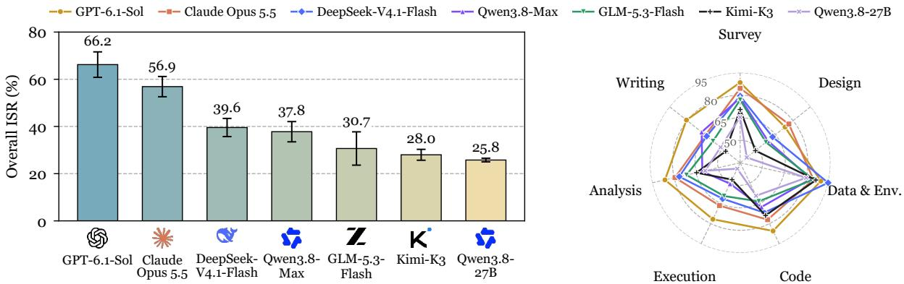  
Figure 1 ISR of seven models on 75 tasks, averaged over three rounds. Left: overall ISR, with error bars for the sample standard deviation across rounds. Right: ISR by research stage, with the radial axis from 35% to 95%.

First, real session context supports evaluating whether agents carry earlier decisions into the current delivery. Real research sessions switch between task types (Slinko et al., 2026), returning to literature review after experiments or adding experiments during paper writing (Figure 2, top). A request to fix a failed experiment may still require preserving methodological choices established during an earlier design discussion. Summarizing still-efective earlier requests as Background makes these constraints available for evaluating whether the agent integrates them with the current request.

Second, in-progress workspaces support evaluating whether agents change existing artifacts while preserving their scientific meaning. Clean or curated starting states simplify this setting, whereas ongoing projects can contain temporary files, outdated versions, and failed attempts that require checking which artifacts and conventions remain applicable (Figure 2, bottom). For example, in our CylindFormer repair task, two executions both resume training with nonzero loss and parameter updates, yet pass 20/20 and 16/20 checklist items, respectively. The latter changes coordinate handling, overlap labels, and matching losses required by the reference paper in the workspace (Figure 7). Restoring execution alone therefore does not establish that a repair preserves the research method.

Recent benchmarks also incorporate real developer sessions (Lv et al., 2026; Jha et al., 2026) or fine-grained research tasks (Wang et al., 2026a). Our focus is on jointly evaluating the still-efective requirements of a real research request and the in-progress workspace in which that request arose.

We introduce ARE-bench to evaluate this ability. ARE-bench includes 75 tasks spanning seven research stages (Survey, Design, Data & Env., Code, Execution, Analysis, and Writing), 33 requirements, and 150 sub-requirements, with 1,173 binary checklist items in total. We collect agent sessions and full workspaces from recruited researchers’ own projects. For session context, we select a real user request as the task boundary, retain its requirements, and use the Background section to summarize the earlier requests still in efect, covering 10.3 earlier requests on average. For in-progress workspaces, we replay the complete workspace to that boundary without cleaning, preserving 41.1 files per task on average, with agent-written files from earlier turns in 65.3% of tasks. The actor receives only the instruction and workspace, and an intent-aligned rubric compiles into the checklist that credits any valid solution.

We evaluate seven frontier models with three rollouts per task by instance success rate (ISR), the fraction of tasks whose checklist items all pass. GPT-6.1-Sol and Claude Opus 5.5 reach 66.2% and 56.9% ISR, while the other five models stay below 40% and Qwen3.8-27B reaches only 25.8% (Figure 1, left). Checklist item success rate (CSR), which gives partial credit, spans only 13.1 points across models, whereas ISR spans 40.4 points, so models satisfy most items but difer in meeting all of them. For the same actor deliveries, DeepSeek-V4.1-Flash, GLM-5.3-Flash, and Kimi-K3 each reach about 69% ISR when only delivery contracts and general norms are checked. Including historical and material or workspace requirements lowers their ISR to 40.0%, 31.6%, and 28.4%. Under the full checklist, the gap between DeepSeek-V4.1-Flash and Kimi-K3 grows from 0.44 to 11.56 points, showing that contextual requirements reveal delivery gaps masked by narrower checks. For session context, real sessions move between research stages, but stage ability is uneven across models. Kimi-K3 ranks third on Code but last on Writing, Qwen3.8-Max ranks fourth overall but second on Writing, and Claude Opus 5.5 and DeepSeek-V4.1-Flash lead Design and Data & Env., so an evaluation covering a single stage would rank models diferently. Design and Execution rank among the three hardest stages for every model, where the best and worst models difer by 35.8 and 37.4 points, compared with 15.0 points on the easiest stage, Data & Env. (Figure 1, right). Claude Opus 5.5 also costs 2.6 times as much per run as GPT-6.1-Sol yet trails it by 9.3 points in ISR.

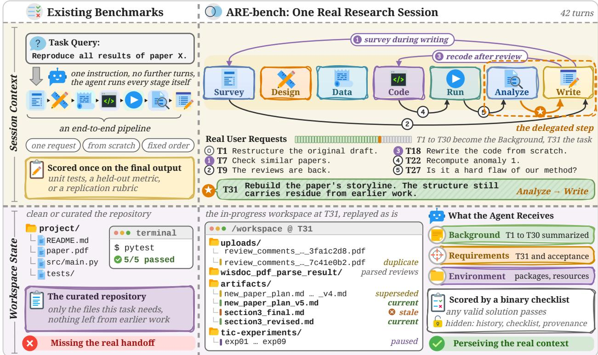  
Figure 2 An illustrative contrast between a standalone research task and one real research session in ARE-bench. Top: the standalone task has an end-to-end objective, while the real session moves back and forth between research stages. The task is cut at request T31, with still-efective requests from T1 to T30 summarized in Background. Bottom: a clean or curated starting repository is contrasted with the replayed in-progress workspace, including superseded drafts, misleadingly named files, and paused runs.

## Our contributions are:

• We introduce ARE-bench to evaluate whether research agents advance ongoing projects while respecting prior decisions and existing workspace state, with 75 tasks drawn from real researcher sessions and paired with replayed in-progress workspaces.

• We map each checklist item to one of 207 sub-requirements across seven stages, covering 150 of them and all 33 requirements, and aggregate these labels into a requirement profile for each task.

• We evaluate seven frontier models and find that the strongest reaches only 66.2% ISR, that requirements carried over from the session and workspace expose failures and model diferences hidden by checks limited to delivery contracts and general norms, and that stage rankings diverge from overall rankings.

## 2 Related Work

Research-agent benchmarks. Research-agent benchmarks cover scientific work at diferent scopes, with success defined by the outcomes each task requires. For specialized research activities, RE-Bench and MLE-bench assess research-engineering and competition performance (Wijk et al., 2024; Chan et al., 2024); ScienceAgentBench and SWE-bench Science evaluate scientific programming and software tasks (Chen et al., 2024; Xu et al., 2026c), while SUPER and ResearchEnvBench target repository execution and runtime preparation (Bogin et al., 2024; Wang et al., 2026b). AARRI-Bench evaluates granular research scenarios involving drafts, logs, and other research artifacts (Wang et al., 2026a). These settings tie acceptance to a specified engineering or research deliverable. Broader coverage includes AstaBench’s heterogeneous scientific suite, including literature-query tasks drawn from user logs, with member-specific metrics (Bragg et al., 2025), alongside benchmarks organized around reproduction or experimental outcomes. PaperBench and CORE-Bench assess paper replication and computational reproduction (Starace et al., 2025; Siegel et al., 2024); ResearchGym evaluates research outcomes against baselines, while EXP-Bench assesses experiment execution and conclusions (Garikaparthi et al., 2026; Kon et al., 2025). For scientific-output evaluation, ResearchClawBench anchors rubric-based judgments to a hidden reference study (Xu et al., 2026b). Together, these benchmarks move from specialized research activities to broader scientific workflows while retaining task-specific acceptance targets. ARE-bench takes the current research delegation as its acceptance boundary, compiling requested deliverables and applicable inherited scientific constraints into a checklist. Compared with full-experiment or reference-study targets, this scope supports diagnosing unmet requirements and accepting alternative valid implementations without requiring completion of the surrounding study.

Stateful and interaction-derived benchmarks. An evaluation’s starting point determines which prior work an agent must continue. Existing benchmarks provide several forms of task state: some Terminal-Bench tasks start with task-specific repository changes (Merrill et al., 2026); OSWorld configures application and file states, while τ -bench evaluates tool-mediated conversations against database goals (Xie et al., 2024; Yao et al., 2024). LongDS-Bench accumulates analytical state across notebook-derived dialogues (Xu et al., 2026a). For usage-derived tasks, the additional question is how a recorded request and its surrounding work become the evaluation input. SWE-bench pairs issue reports with repository snapshots (Jimenez et al., 2023). At session entry, K-Bench samples real first-turn scientific requests, while SWE-Together starts from a coding session’s initial request (Brueckner et al., 2026; Wu et al., 2026). Other benchmarks reconstruct the starting point: RealClawBench rewrites requests into standalone instructions with sanitized standalone workspaces (Lv et al., 2026), and REAP backs out accepted solution changes from a current monorepo (Jha et al., 2026). DuMateBench most directly addresses historical continuation by selecting a local objective, retaining visible history, and restoring recoverable pre-cutof files; it combines deterministic checks with artifact rubrics (Niu et al., 2026). ARE-bench focuses on subsequent requests in real research projects, pairing recovered in-progress workspaces with Background summaries of still-valid prior context, current Requirements, and Environment. Compared with DuMateBench’s general-workflow setting, its research-specific requirements and mapping of checklist items to experiment execution, result analysis, and writing support diagnosis of unmet work by research activity.

Positioning. Table 1 summarizes these comparisons. The table separates a genuine work request from its provenance in a recorded session, then distinguishes inherited workspace progress from the broader researchworkflow scope. ARE-bench combines all four binary properties: each task is a real research request selected from a recorded session, starts from an in-progress workspace, and belongs to a benchmark covering the full research lifecycle. Its rubric scoring translates the active delegation into deliverable checks, linking completion to requested outcomes and locating unmet requirements by research activity

<table><tr><td>Benchmark</td><td>Real request</td><td>Session-derived</td><td>In-progress workspace</td><td>Research workflow</td><td>Scoring</td></tr><tr><td>SWE-bench (Jimenez et al., 2023)</td><td></td><td>x</td><td>x</td><td>x</td><td>Tests</td></tr><tr><td>Terminal-Bench (2.0) (Merrill et al., 2026)</td><td></td><td></td><td></td><td>×××</td><td>Varies</td></tr><tr><td>OSWorld (Xie et al., 2024)</td><td></td><td></td><td></td><td></td><td>Varies</td></tr><tr><td>τ-bench (Yao et al., 2024)</td><td></td><td></td><td></td><td></td><td>Varies</td></tr><tr><td>MLE-bench (Chan et al., 2024)</td><td>x</td><td></td><td>x</td><td>x</td><td>Task metric</td></tr><tr><td>ScienceAgentBench (Chen et al., 2024)</td><td>××××&gt;</td><td>xxxxxxxxxxx&gt;xxxx</td><td></td><td>x</td><td>Varies</td></tr><tr><td>PaperBench (Starace et al., 2025)</td><td></td><td></td><td>××&gt;V××××&gt;×V&gt;V××××</td><td>×××V××&gt;×××V×</td><td>Rubric</td></tr><tr><td>RE-Bench (Wijk et al., 2024)</td><td></td><td></td><td></td><td></td><td>Task metric</td></tr><tr><td>CORE-Bench (Siegel et al., 2024)</td><td></td><td></td><td></td><td></td><td>Answer check</td></tr><tr><td>AARRI-Bench (Wang et al., 2026a)</td><td></td><td></td><td></td><td></td><td>Varies</td></tr><tr><td>ResearchGym (Garikaparthi et al., 2026)</td><td>××</td><td></td><td></td><td></td><td>Task metric</td></tr><tr><td>EXP-Bench (Kon et al., 2025)</td><td></td><td></td><td></td><td></td><td>Rubric + Answer check + Tests</td></tr><tr><td>AstaBench (Bragg et al., 2025)</td><td></td><td></td><td></td><td></td><td>Varies</td></tr><tr><td>SWE-bench Science (Xu et al., 2026c)</td><td></td><td></td><td></td><td></td><td>Tests</td></tr><tr><td>SUPER (Bogin et al., 2024)</td><td>××</td><td></td><td></td><td></td><td>Varies</td></tr><tr><td>ResearchEnvBench (Wang et al., 2026b)</td><td></td><td></td><td></td><td></td><td>Tests</td></tr><tr><td>ResearchClawBench (Xu et al., 2026b)</td><td>X</td><td></td><td></td><td></td><td>Rubric</td></tr><tr><td>K-Bench (Brueckner et al., 2026)</td><td></td><td></td><td></td><td></td><td>Rubric</td></tr><tr><td>DuMateBench (Niu et al., 2026)</td><td></td><td></td><td></td><td>x</td><td>Varies</td></tr><tr><td>SWE-Together (Wu et al., 2026)</td><td></td><td></td><td></td><td></td><td>Rubric</td></tr><tr><td>RealClawBench (Lv et al., 2026)</td><td></td><td></td><td></td><td>×××</td><td>Tests</td></tr><tr><td>REAP/Harvest (Jha et al., 2026)</td><td></td><td></td><td></td><td></td><td>Tests</td></tr><tr><td>LongDS-Bench (Xu et al., 2026a) ARE-bench</td><td></td><td></td><td></td><td>x</td><td>Answer check</td></tr></table>

Table 1 Comparison of benchmark designs for research-project continuation. Real request denotes a documented genuine work need, regardless of source. Session-derived denotes a task or request whose provenance is an actual recorded work session; earlier conversation transfer is optional. In-progress workspace denotes task-relevant files or application state containing prior activity or intermediate progress available when evaluation starts; a base repository, raw data, dependency environment, or empty scafold alone does not qualify. Research workflow denotes suite-level coverage of Survey, Design, Data & Environment, Code, Execution, Analysis, and Writing. Scoring names the primary acceptance basis: Tests, State check, Answer check, Task metric, Rubric, a stable combination written with $\cdot _ { + } \cdot$ , or Varies when mechanisms difer across tasks or sub-benchmarks. A tick marks a documented feature and a cross means it is not established under these definitions.

## 3 ARE-bench

## 3.1 Task Formulation

Each task is anchored at a user request in an ongoing research session. At cut point $c ,$ the raw task is

$$
\tau _ { c } = ( q _ { c } , H _ { < c } , W _ { c } ) ,\tag{1}
$$

where $q _ { c }$ is the current request, $H _ { < c }$ is the history of earlier user requests, and $W _ { c }$ is the workspace immediately before the agent responds. Construction maps $\tau _ { c }$ to the released task

$$
b _ { c } = ( I _ { c } , W _ { c } , R _ { c } ) ,\tag{2}
$$

where $I _ { c }$ is the instruction and $R _ { c }$ is the rubric and provenance added during construction. The benchmark is $B = \left\{ b _ { c } \right\}$

We define the instruction as three sections,

$$
I _ { c } = \big ( I _ { c } ^ { \mathrm { b g } } , I _ { c } ^ { \mathrm { r e q } } , I _ { c } ^ { \mathrm { e n v } } \big ) ,\tag{3}
$$

with Background derived from the request history as

$$
I _ { c } ^ { \mathrm { b g } } = \mathrm { C o m p r e s s } ( H _ { < c } ) ,\tag{4}
$$

where Compress retains context relevant to $q _ { c }$ that remains valid at cut point c and rewrites it as a state summary. Requirements $I _ { c } ^ { \mathrm { r e q } }$ preserves $q _ { c }$ and specifies delivery paths and acceptance conditions. Environment $I _ { c } ^ { \mathrm { e n v } }$ describes available resources and execution limits.

The actor receives only $I _ { c }$ and $W _ { c }$ and produces a delivery $y _ { c }$ . The rubric compiles into binary checklist items aligned with user intent. Let $K _ { c }$ be the set of verifiable checklist items, excluding non-triggered conditional ones, and $r _ { c , k } \in \{ 0 , 1 \}$ indicate whether checklist item k is satisfied.

## 3.2 Benchmark Construction

Figure 3 shows the three construction roles. The Curator selects researcher sessions, the Builder turns a request in a selected session into a task, and the Validator tests each task before release.

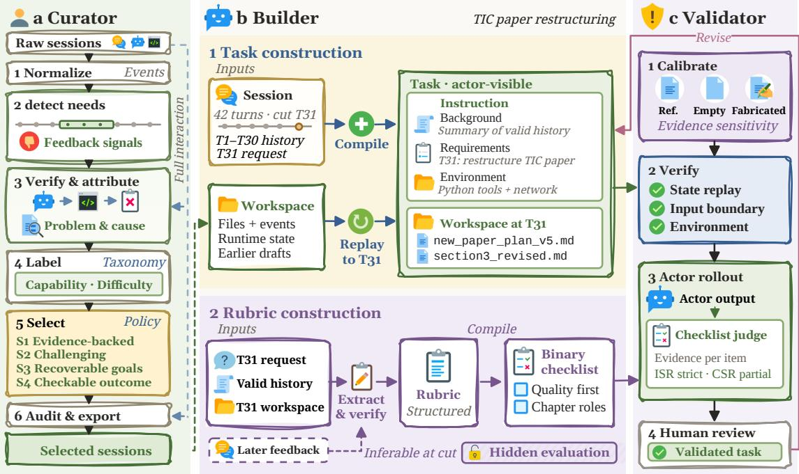  
Figure 3 Overview of ARE-bench construction, illustrated by a paper restructuring task cut at request T31 of a 42-turn session. (a) The Curator normalizes raw researcher sessions, verifies requirements against the full interaction, labels them with the requirement taxonomy, and selects sessions by rules S1 to S4. (b) The Builder compiles the target request and still-valid history into the actor-visible instruction, replays the workspace to that request, and compiles a hidden rubric into a binary checklist. (c) The Validator calibrates the judge, verifies the task package, runs actors, and sends each task to human review, which returns failing tasks to the Builder.

## 3.2.1 Curator

The Curator filters raw researcher sessions in six steps. It normalizes each session into ordered turns and events that keep their source positions. Reading user turns alone, it splits the session into episodes, recovers goals and requirements with their revisions, and flags feedback signals such as rejections or requests to redo work. It then verifies each requirement against the full interaction, including agent replies, tool results, and produced files, and attributes each confirmed problem to its cause. Verified requirements are labeled with the research requirement taxonomy of Appendix B and rated for dificulty, and each label cites quoted evidence. After schema and evidence prechecks, an episode is selected only if it satisfies four rules:

1. S1 Evidence-backed: at least one primary requirement label is supported by evidence.

2. S2 Challenging: the task has medium or high dificulty.

3. S3 Recoverable goals: the goals and requirements can be recovered coherently from the session.

4. S4 Checkable outcome: completion criteria can be checked from the record, whether or not the original agent succeeded.

Episodes with an unresolved rule are held for review, and other failing episodes are rejected. A final audit checks every quote against the source session and exports each session that contains a selected episode.

## 3.2.2 Builder

Task construction. The Builder picks a target request $q _ { c }$ at a turn where a core requirement of the selected episode is carried out. Background summarizes earlier requests still in efect as the state at cut point c. It takes facts from earlier agent turns but omits their unexecuted plans, which would reveal solutions. Requirements retains $q _ { c }$ with its delivery paths and explicit acceptance conditions, and Environment states the available tools and network access. The workspace is reconstructed by replaying the platform event stream A up to the cut point,

$$
W _ { c } = \mathrm { R e p l a y } ( A , c ) ,\tag{5}
$$

and cross-checked against the transcript and the final disk state. A cut point is discarded if it falls inside a file write, if replay disagrees with the transcript, or if a required dependency cannot be recovered. The environment contains the platform baseline and the packages available at the cut point, and it keeps network access when the source environment had it.

Rubric construction. The rubric follows the user’s intended outcome rather than the original agent’s output. The Builder extracts intent from $q _ { c } ,$ the still-valid history, and the workspace at the cut point. Later user feedback often reveals requirements the user held without stating, so the Builder uses it to sharpen such requirements and keeps an item only if a competent researcher could infer it at the cut point. Requirements raised only in later turns and personal preferences are excluded. Each item checks one deliverable or acceptance condition with a binary decision rule and an evidence requirement. Items do not prescribe implementation paths, so any valid alternative passes. Items stated by the user appear in Requirements, while items a competent researcher would infer stay out of the instruction so that it does not become an answer checklist. Each item also receives one sub-requirement label from the taxonomy, and a task’s requirement profile is the union of the parent requirements of its items. The rubric and a provenance package holding raw wording, source turns, path mappings, replay logs, and anonymization decisions form the hidden evaluation set. Appendix E walks through a complete task.

## 3.2.3 Validator

The Validator tests each task in four steps and returns failing tasks to the Builder for revision. Calibration scores three deliveries with the checklist judge. The original agent’s output, when available, tests whether each verdict cites evidence present in the delivery. It calibrates the judge rather than serving as an answer key, because later turns often show that it fell short. An empty delivery should score near zero, and a fabricated delivery that looks complete but contains false content should score clearly below actor runs. Verification then confirms three properties. The replayed state matches the audited state for every file the task uses, the instruction and workspace contain no information from after the cut point, and the released environment installs and imports the required dependencies. In the actor rollout, an agent runs the task and the judge scores each item with cited evidence, yielding ISR and CSR. When every item passes, the Builder rechecks rubric coverage and strictness but does not add uninferable items to lower the score. In human review, the task author checks every failed item. A task proceeds to peer review only when each failure is a valid item that the actor genuinely missed. Otherwise the instruction or rubric is revised and the task is rerun.

## 3.3 Benchmark Statistics

Table 18 summarizes ARE-bench. Each of the 75 tasks compiles into 15.6 checklist items on average. Three properties distinguish the task distribution. First, every task starts from an in-progress workspace: the replayed workspace holds 41.1 files on average, 65.3% of tasks contain agent-written files from earlier turns, and the Background section compresses 36.0 earlier user turns into a state summary that cites on average 10.3 earlier requests still in efect. Second, each task is a single local step with 2.5 deliverables on average. Third, the checklist items span all seven research stages.

These tasks contain 1,173 checklist items covering 150 sub-requirements and all 33 requirements. Table 2 summarizes this coverage across the seven research stages, and Table 14 in Appendix B presents the corresponding requirement hierarchy. A task can contribute to multiple stages, so the task counts across rows overlap.

<table><tr><td>Research stage</td><td>Requirements</td><td>Sub-requirements</td><td>Checklist items</td><td>Tasks</td></tr><tr><td>Survey</td><td>2</td><td>20</td><td>111</td><td>26</td></tr><tr><td>Design</td><td>3</td><td>25</td><td>268</td><td>41</td></tr><tr><td>Data &amp; Env.</td><td>5</td><td>16</td><td>45</td><td>20</td></tr><tr><td>Code</td><td>5</td><td>23</td><td>217</td><td>32</td></tr><tr><td>Execution</td><td>7</td><td>26</td><td>173</td><td>33</td></tr><tr><td>Analysis</td><td>4</td><td>13</td><td>92</td><td>34</td></tr><tr><td>Writing</td><td>7</td><td>27</td><td>267</td><td>31</td></tr><tr><td>Total</td><td>33</td><td>150</td><td>1,173</td><td>75</td></tr></table>

Table 2 Observed requirement coverage across the 75 tasks. Tasks count distinct tasks within each stage, and the total counts their union.

## 3.4 Evaluation Protocol

For each task, an actor receives the instruction and the restored workspace, works under the declared tool and time limits, and submits a delivery $y _ { c }$ containing the artifacts listed in the instruction. The checklist evaluator reads $y _ { c }$ and the minimum input source needed to verify a claimed change. It then assigns each $r _ { c , k }$ using the checklist item’s evidence rule. Missing artifacts, unresolvable claims, and unsupported conclusions receive zero for the afected checklist item.

The evaluation preserves both the request context and the project’s in-progress state. Background carries forward earlier user requests that remain in efect, Requirements specifies the current deliverables and acceptance conditions, and Environment states the available resources and limits. The restored workspace retains unfinished artifacts, outdated versions, and prior failed attempts, requiring the actor to interpret the current request against existing project materials. Checklist items and provenance remain hidden from the actor and support scoring and audit.

Each model runs three rollouts per task, and we report the mean and sample standard deviation of each metric across the three rounds. Each run records its model identifier, actor harness, task resources, and time limit. A run that reaches its time limit is scored on the artifacts delivered by then.

## 3.5 Metrics

Following the checklist-based definitions of Ding et al. (2026), let $N = | B |$ and $n _ { c } = | K _ { c } | .$ , with $K _ { c }$ and $r _ { c , k }$ as defined above. The Instance Success Rate (ISR) is strict: a task is successful only when every verifiable checklist item passes.

$$
\mathrm { I S R } = \frac { 1 } { N } \sum _ { c \in { \cal B } } { \bf 1 } \left[ \bigwedge _ { k \in K _ { c } } ( r _ { c , k } = 1 ) \right] .\tag{6}
$$

The Checklist Item Success Rate (CSR) gives partial credit at checklist-item level:

$$
\mathrm { C S R } = \frac { 1 } { N } \sum _ { c \in B } \frac { 1 } { n _ { c } } \sum _ { k \in K _ { c } } r _ { c , k } .\tag{7}
$$

ISR captures holistic satisfaction under conjunctions of heterogeneous requirements, whereas CSR diagnoses which requirements are most often violated. We report peak context and estimated API cost per run separately. Tasks with no verifiable checklist items are invalid construction outputs and are reported as construction errors rather than assigned a score.

## 4 Experiments

## 4.1 Experimental Setup

We evaluate agents on continuing user requests in real research workspaces under the protocol in Section 3.4. Actors receive the instruction and restored workspace, and deliveries are scored against task-specific binary

checklists.

Tasks and evaluated models. The main evaluation comprises 75 tasks: 67 CPU tasks, 8 GPU tasks. Its 1,173 checklist items cover the seven research stages defined above: Survey, Design, Data & Env., Code, Execution, Analysis, and Writing. We evaluate the seven models in Table 3 using the actor harness recorded for each model in the archive.
<table><tr><td>Evaluated model</td><td>Archived model identifier</td><td>Actor harness</td></tr><tr><td>GPT-6.1-Sol</td><td>gpt-6.1-sol</td><td>Codex</td></tr><tr><td>Claude Opus 5.5</td><td>claude-opus-5-5</td><td>Claude Code</td></tr><tr><td>DeepSeek-V4.1-Flash</td><td>deepseek-v4.1-flash</td><td>Claude Code</td></tr><tr><td>Qwen3.8-Max</td><td>qwen3.8-max</td><td>Claude Code</td></tr><tr><td>GLM-5.3-Flash</td><td>glm-5.3-flash</td><td>Claude Code</td></tr><tr><td>Kimi-K3</td><td>kimi-k3</td><td>Claude Code</td></tr><tr><td>Qwen3.8-27B</td><td>qwen3.8-27b</td><td>Claude Code</td></tr></table>

Table 3 Evaluated models and actor harnesses. Model identifiers follow the main evaluation archive. The specific historical GLM deployment identifiers are retained in individual run records.

Execution environments and compute resources. CPU tasks run in E2B sandboxes or Docker containers, while GPU and research tasks use Docker. Table 4 reports the declared task resources and actor time limits recorded for each batch. Resources are configured per task to support the existing workspace and its dependencies. GPU and research batches use Codex 0.118.0 or Claude Code 2.1.283.
<table><tr><td>Task batch</td><td>Tasks</td><td>CPUs</td><td>Memory (MB)</td><td>GPUs</td><td>Configured actor time limit</td></tr><tr><td>CPU tasks</td><td>67</td><td>2-16</td><td>4,096-49152</td><td>0</td><td>30 minutes–6 hours</td></tr><tr><td>GPU tasks</td><td>8</td><td>8-32</td><td>32,768–262,144</td><td>1-4</td><td>2, 3, 4, 6, or 48 hours, depending on the task</td></tr></table>

Table 4 Declared task resources and configured time limits. CPU, memory, and GPU counts come from the task configuration bound to each selected source. Time limits are calculated from overrides and multipliers in the run configuration and specify the actor execution budget. The physical hosts and GPU models remain to be verified.

Rollouts and metrics. Each model performs three rollouts per task, with each rollout scored independently against the checklist. A GLM-5.3 judge issues the verdicts. Following the preceding definitions, Instance Success Rate (ISR) requires all applicable checklist items for a task to pass. Checklist Item Success Rate (CSR) first computes the fraction of passing items within each task and then averages equally across tasks. The main table computes ISR and CSR separately for each round and reports the three-round mean and sample standard deviation, corresponding to single-attempt pass@1 evaluation.

The experiments address the following questions.

RQ1: Can current models fully complete user tasks in real research workspaces?   
Integrating the current request with historical context and workspace requirements   
RQ2: Why do agents fail to complete research deliveries in real research workspaces?   
Correctness bottlenecks and omissions of historical, material, and workspace requirements   
RQ3: Which research stages are most difficult?   
Stage dificulty and the distribution of model capabilities   
RQ4: Do larger contexts and higher costs correspond to greater strict success?   
The relationship between resource use and success   
RQ5: How does changing the LLM judge affect binary verdicts and model comparisons?   
Item agreement and ranking sensitivity

## 4.2 Main Results

4.2.1 RQ1: Can current models fully complete user tasks in real research workspaces?
<table><tr><td rowspan=1 colspan=3>Model                     $\mathrm { O v e r a l l ~ I S R ~ } \uparrow$       Overall CSR ↑</td></tr><tr><td rowspan=1 colspan=1>GPT-6.1-Sol</td><td rowspan=1 colspan=1> $6 6 . 2 2 \pm 5 . 3 9$ </td><td rowspan=1 colspan=1> $9 2 . 7 2 \pm 2 . 0 8$ </td></tr><tr><td rowspan=1 colspan=1>Claude Opus 5.5</td><td rowspan=1 colspan=1> $5 6 . 8 9 \pm 4 . 2 9$ </td><td rowspan=1 colspan=1> $9 0 . 2 0 \pm 1 . 8 3 $ </td></tr><tr><td rowspan=2 colspan=1>DeepSeek-V4.1-FlashQwen3.8-Max</td><td rowspan=1 colspan=1> $3 9 . 5 6 \pm 3 . 8 5$ </td><td rowspan=1 colspan=1> $8 9 . 2 6 \pm 1 . 7 2 $ </td></tr><tr><td rowspan=1 colspan=1> $3 7 . 7 8 \pm 4 . 2 9$ </td><td rowspan=1 colspan=1> $8 5 . 4 5 \pm 0 . 9 0$ </td></tr><tr><td rowspan=1 colspan=1>GLM-5.3-Flash</td><td rowspan=1 colspan=1> $3 0 . 6 7 \pm 7 . 0 6$ </td><td rowspan=1 colspan=1> $8 6 . 6 6 \pm 0 . 6 8$ </td></tr><tr><td rowspan=1 colspan=1>Kimi-K3</td><td rowspan=1 colspan=1> $2 8 . 0 0 \pm 2 . 3 1$ </td><td rowspan=1 colspan=1> $8 5 . 3 3 \pm 0 . 5 0$ </td></tr><tr><td rowspan=1 colspan=1>Qwen3.8-27B</td><td rowspan=1 colspan=1> $2 5 . 7 8 \pm 0 . 7 7$ </td><td rowspan=1 colspan=1> $7 9 . 6 6 \pm 0 . 2 4$ </td></tr></table>

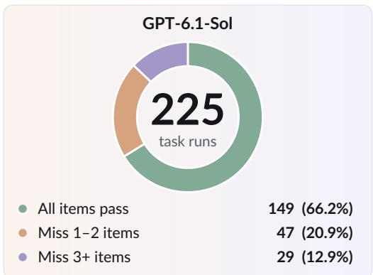  
Table 5 Overall performance of seven models on 75 tasks. ISR and CSR are percentages, reported as the three-round mean sample standard deviation, with higher values indicating better performance. Darker blue indicates higher percentages on a shared quadratic scale.  
Figure 4 Breakdown of GPT-6.1-Sol outcomes. The unit is a task run, and a run may fail multiple checklist items.

Current models remain unreliable at completing research requests in real workspaces. As Table 5 shows, even the strongest model, GPT-6.1-Sol, achieves only about 66.2% strict task success, leaving roughly one-third of runs unable to satisfy all task requirements. Claude Opus 5.5 reaches 56.9%, all remaining models stay below 40%, and Qwen3.8-27B achieves only about 25.8%. Real research requests build on prior work. Background summarizes earlier requests still in efect, and Requirements specifies the current delivery and acceptance conditions, whose project-specific meaning must be interpreted through the restored code, papers, configurations, and logs. Full completion therefore requires models to situate the current request within its project context and identify the requirements that the current changes must continue to satisfy.

CSR exceeds overall ISR for every model, ranging from 79.66% to 92.72%. Qwen3.8-Max’s higher ISR but lower CSR than GLM-5.3-Flash is consistent with these definitions: ISR measures fully successful deliveries, while CSR measures average checklist completion across tasks, so the metrics need not rank models identically. The per-run failure distribution clarifies this gap: of GPT-6.1-Sol’s 76 failed runs, 47 miss only one or two checklist items, accounting for 61.84%, and this share ranges from 53.09% to 72.06% across the seven models. Many failures therefore occur after the model has made progress and satisfied most checklist items. Full delivery requires models to jointly address the current request and project requirements still in effect. Even after resolving the most prominent issue in the current turn, overlooking prior agreements in Background or methodological requirements carried by the workspace can leave critical gaps. RQ2 examines how these gaps manifest in archived deliveries. Figure 4 breaks down the strongest model’s failures.

4.2.2 RQ2: Why do agents fail to complete research deliveries in real research workspaces?
<table><tr><td rowspan=1 colspan=5>Model                          Completeness ISR Correctness ISR   Constraint          Failed runs withcompliance ISR     correctness errors</td></tr><tr><td rowspan=1 colspan=1>GPT-6.1-Sol</td><td rowspan=1 colspan=1> $8 3 . 1 1 \pm 5 . 3 9$ </td><td rowspan=1 colspan=1> $7 1 . 1 1 \pm 5 . 0 5$ </td><td rowspan=1 colspan=1> $9 3 . 7 8 \pm 0 . 7 7$ </td><td rowspan=1 colspan=1>65/76 (85.5%)</td></tr><tr><td rowspan=1 colspan=1>Claude Opus 5.5</td><td rowspan=1 colspan=1> $8 7 . 5 6 \pm 3 . 0 8$ </td><td rowspan=1 colspan=1> $6 2 . 6 7 \pm 3 . 5 3$ </td><td rowspan=1 colspan=1> $8 9 . 3 3 \pm 4 . 6 2$ </td><td rowspan=1 colspan=1>84/97 (86.6%)</td></tr><tr><td rowspan=1 colspan=1>DeepSeek-V4.1-Flash</td><td rowspan=1 colspan=1> $8 2 . 6 7 \pm 2 . 6 7$ </td><td rowspan=1 colspan=1> $4 7 . 1 1 \pm 1 . 5 4$ </td><td rowspan=1 colspan=1> $8 8 . 8 9 \pm 5 . 0 5$ </td><td rowspan=1 colspan=1>119/136 (87.5%)</td></tr><tr><td rowspan=1 colspan=1>Qwen3.8-Max</td><td rowspan=1 colspan=1> $7 9 . 1 1 \pm 2 . 0 4$ </td><td rowspan=1 colspan=1> $4 3 . 5 6 \pm 8 . 5 7$ </td><td rowspan=1 colspan=1> $8 4 . 8 9 \pm 0 . 7 7$ </td><td rowspan=1 colspan=1>127/140 (90.7%)</td></tr><tr><td rowspan=1 colspan=1>GLM-5.3-Flash</td><td rowspan=1 colspan=1> $8 0 . 4 4 \pm 0 . 7 7$ </td><td rowspan=1 colspan=1> $3 9 . 1 1 \pm 3 . 0 8$ </td><td rowspan=1 colspan=1> $8 1 . 7 8 \pm 1 . 5 4$ </td><td rowspan=1 colspan=1>137/156 (87.8%)</td></tr><tr><td rowspan=1 colspan=1>Kimi-K3</td><td rowspan=1 colspan=1> $7 6 . 4 4 \pm 1 . 5 4$ </td><td rowspan=1 colspan=1> $3 4 . 2 2 \pm 2 . 0 4$ </td><td rowspan=1 colspan=1> $8 3 . 5 6 \pm 1 . 5 4$ </td><td rowspan=1 colspan=1>148/162 (91.4%)</td></tr><tr><td rowspan=1 colspan=1>Qwen3.8-27B</td><td rowspan=1 colspan=1> $7 2 . 0 0 \pm 1 . 3 3$ </td><td rowspan=1 colspan=1> $3 1 . 1 1 \pm 0 . 7 7$ </td><td rowspan=1 colspan=1> $7 9 . 1 1 \pm 2 . 0 4$ </td><td rowspan=1 colspan=1>155/167 (92.8%)</td></tr></table>

Table 6 ISR by completeness, correctness, and constraint compliance. Each dimension requires all its applicable checklist items to pass. The final column reports the count and share of failed runs containing correctness errors. Error categories can overlap. Darker blue indicates higher ISR on a shared quadratic percentage scale; darker orange indicates a greater share of failures with correctness errors.

RQ2.1: Which checklist items most often block full delivery? Table 6 identifies correctness as the lowest-scoring dimension for all seven models. Correctness ISR ranges from 31.11% to 71.11%, compared with 72.00%–87.56% for completeness and 79.11%–93.78% for constraint compliance. The same pattern holds for CSR, with correctness lowest for every model. At the run level, 85.5%–92.8% of failures include an unmet correctness item. DeepSeek-V4.1-Flash reaches 93.16% completeness CSR but only 47.11% correctness ISR and 39.56% overall ISR, illustrating the gap between delivery coverage and content reliability.

Research requirements must hold throughout implementation and validation, as local functional recovery can still lose methodological meaning. RQ1 concerns whether models integrate the context needed for a task, while Table 6 shows the dificulty of accurately realizing its requirements in research artifacts. The current request may ask only for training repair or framework adaptation, but the model must also preserve the original method and engineering conventions using Background and the papers, code, and design documents in the workspace. The archived examples in Table 7 show the consequences of failing to implement these requirements. The CylindFormer repair retains the KPConv name but omits neighborhood and kernel-point aggregation, while the Graph RAG adaptation implements a local workflow without isolating indexes across datasets. Delivering files or code can satisfy some completeness requirements while deviations between the method and its implementation fail correctness items.

These examples illustrate the dificulty of full delivery through method preservation, requirement implementation, and evidence checking. Models must interpret Background and Requirements together and verify that the requirements still hold against existing workspace artifacts after making changes. For example, resuming training also requires checking the original method’s key computations, and adapting a framework requires checking its behavior across datasets. Reliable continuation means advancing the current work while maintaining the project’s existing requirements.

<table><tr><td>Failure manifestation</td><td>Effect on research delivery</td><td>Archived example</td></tr><tr><td>Task degradation</td><td>A simpler implementation replaces the original method,</td><td>In the round 1 DeepSeek repair of CylindFormer, the backbone named KPConv applies only Linear, retaining its name while changing LayerNorm, and ReLU to individual points, without neighborhood or kernel-point aggregation, failing O4</td></tr><tr><td>Insufficient investigation and evidence checking</td><td>the required capability Cited work does not support the mechanism or subject discussed, leaving conclusions without reliable evidence</td><td>In the round 1 Qwen3.8-27B revision of a cuproptosis review, ferroptosis-resistance research is described as a cuproptosis mechanism and cancer subtypes are conflated, failing O6</td></tr><tr><td>Requirement omission</td><td>Existing constraints are not use despite local functional</td><td>In the round 2 DeepSeek adaptation of Graph RAG, implemented, affecting subsequent datasets share a global index directory instead of isolated indexes, failing O11</td></tr><tr><td>Inadequate validation design</td><td>progress Missing comparison rules prevent attribution of improvements to the factor under study</td><td>t In the round 1 GLM-5.3-Flash plan for 4D spacetime tubes, costs are recorded but executable rules for matching inference budgets across comparison arms are</td></tr><tr><td>Conclusions exceeding the evidence</td><td>A limited diagnostic result is extended into an untested causal explanation</td><td>absent, failing O6 In the round 2 GLM-5.3-Flash diagnosis of network-security generalization, adversarial validation is treated as a test of conditional distributions, and a failure to detect differences is attributed to a single</td></tr></table>

Table 7 Failure manifestations and archived examples. These selected qualitative examples explain why checklist items fail. They do not constitute a uniform classification or frequency analysis of all failures.

RQ2.2: What delivery gaps are revealed by historical and material or workspace requirements? Real research requests often briefly describe only the current work, leaving some requirements and constraints implicit in prior agreements and project materials rather than restating them in the current turn. In ARE bench, Background summarizes historical constraints, while papers, code, configurations, and existing results in the workspace clarify the specific meaning of methods and acceptance conditions. The agent must therefore interpret the current request within the project context and identify requirements that its changes must continue to respect. To examine these gaps, we hold actor deliveries and item-level judge verdicts fixed and change only the checklist items included in ISR. We first check delivery contracts and general professional norms, then add historical and material or workspace requirements, and finally check the complete checklist. Table 8 contrasts three models with similar scores under the first scope.

<table><tr><td>Model</td><td>Delivery contracts + general norms</td><td>Add historical and material or workspace requirements</td><td>Full checklist</td></tr><tr><td>DeepSeek-V4.1-Flash</td><td>69.33</td><td>40.00</td><td>39.56</td></tr><tr><td>GLM-5.3-Flash</td><td>69.33</td><td>31.56</td><td>30.67</td></tr><tr><td>Kimi-K3</td><td>69.78</td><td>28.44</td><td>28.00</td></tr></table>

Table 8 ISR (%) as the scope of checklist evaluation expands. Every model covers the same 75 tasks with three rollouts per task, and values are three-round means. Each column requires all applicable items within its scope to pass, reusing the same deliveries and item verdicts. Delivery contracts and general norms correspond to contract + norm. The second scope adds inherited + anchored, while the full checklist also includes latent items discovered through subsequent rework but inferable at the task cut point. Darker blue indicates higher ISR on a shared quadratic percentage scale.

As Table 8 shows, all three models achieve approximately 69% ISR when only delivery contracts and general norms are checked. Adding historical and material or workspace requirements reduces DeepSeek, GLM, and Kimi to 40.00%, 31.56%, and 28.44%, respectively. Among runs passing the first group of checks, 66, 85, and

93 still fail at least one historical or material or workspace requirement, accounting for 48.5%, 54.5%, and 57.4% of each model’s total failed runs. DeepSeek and Kimi difer by only 0.44 percentage points under the first scope, compared with 11.56 points under the full checklist.

An important bottleneck in real research delivery is satisfying implicit requirements that remain binding through project context but are not restated in the current turn. Roughly half of the failed runs for these three models satisfy delivery contracts and general norms yet are blocked by historical or material or workspace requirements. Thus, even a model that performs the action described in the current request may fail to deliver a usable result because it departs from prior research agreements, material-grounded methods, or the computations the project requires. Reliable research continuation requires the agent to integrate these distributed constraints and preserve them throughout modification and validation.

This capability requirement connects back to the distinction in task granularity and starting state established earlier. Compared with a setting that pursues a standalone end-to-end objective from an initial state, ARE-bench starts at a user request within an ongoing real project, retaining historical agreements still in efect in Background and existing artifacts in the cut-point workspace. Evaluation concerns both achieving the current objective and maintaining the project’s existing research requirements while doing so. Table 8 shows that this dimension reveals capability diferences that are dificult to observe when only delivery contracts and general norms are checked.

## 4.3 Stage Analysis

## 4.3.1 RQ3: Which research stages are most difficult?

<table><tr><td rowspan=1 colspan=8>Model                  Survey      Design   Data &amp; Env.    Code     Execution    Analysis     Writing</td></tr><tr><td rowspan=1 colspan=1>GPT-6.1-Sol</td><td rowspan=1 colspan=1> $8 8 . 4 6 \pm 6 . 6 6$ </td><td rowspan=1 colspan=1> $7 3 . 1 7 \pm 4 . 8 8$ </td><td rowspan=1 colspan=1> $9 0 . 0 0 \pm 0 . 0 0$ </td><td rowspan=1 colspan=1> $8 5 . 4 2 \pm 9 . 5 5$ </td><td rowspan=1 colspan=1> $7 6 . 7 7 \pm 7 . 0 0$ </td><td rowspan=1 colspan=1> $8 6 . 2 7 \pm 6 . 1 2$ </td><td rowspan=1 colspan=1> $8 0 . 6 5 \pm 5 . 5 9$ </td></tr><tr><td rowspan=1 colspan=1>Claude Opus 5.5</td><td rowspan=1 colspan=1> $8 4 . 6 2 \pm 3 . 8 5$ </td><td rowspan=1 colspan=1> $7 6 . 4 2 \pm 2 . 8 2$ </td><td rowspan=1 colspan=1> $8 5 . 0 0 \pm 5 . 0 0$ </td><td rowspan=1 colspan=1> $7 7 . 0 8 \pm 7 . 8 6$ </td><td rowspan=1 colspan=1> $6 6 . 6 7 \pm 3 . 0 3$ </td><td rowspan=1 colspan=1> $7 9 . 4 1 \pm 2 . 9 4$ </td><td rowspan=1 colspan=1> $6 4 . 5 2 \pm 1 1 . 6 3$ </td></tr><tr><td rowspan=1 colspan=1>DeepSeek-V4.1-Flash</td><td rowspan=1 colspan=1> $7 9 . 4 9 \pm 4 . 4 4$ </td><td rowspan=1 colspan=1> $6 2 . 6 0 \pm 2 . 8 2$ </td><td rowspan=1 colspan=1> $9 5 . 0 0 \pm 0 . 0 0$ </td><td rowspan=1 colspan=1> $7 1 . 8 8 \pm 5 . 4 1$ </td><td rowspan=1 colspan=1> $6 1 . 6 2 \pm 4 . 6 3$ </td><td rowspan=1 colspan=1> $7 6 . 4 7 \pm 0 . 0 0$ </td><td rowspan=1 colspan=1> $6 3 . 4 4 \pm 6 . 7 2$ </td></tr><tr><td rowspan=1 colspan=1>Qwen3.8-Max</td><td rowspan=1 colspan=1> $7 8 . 2 1 \pm 4 . 4 4$ </td><td rowspan=1 colspan=1> $5 8 . 5 4 \pm 7 . 3 2$ </td><td rowspan=1 colspan=1> $8 3 . 3 3 \pm 1 2 . 5 8$ </td><td rowspan=1 colspan=1> $6 7 . 7 1 \pm 6 . 5 1$ </td><td rowspan=1 colspan=1> $5 0 . 5 1 \pm 4 . 6 3$ </td><td rowspan=1 colspan=1> $6 0 . 7 8 \pm 1 . 7 0$ </td><td rowspan=1 colspan=1> $6 7 . 7 4 \pm 5 . 5 9$ </td></tr><tr><td rowspan=1 colspan=1>GLM-5.3-Flash</td><td rowspan=1 colspan=1> $7 6 . 9 2 \pm 3 . 8 5$ </td><td rowspan=1 colspan=1> $5 6 . 9 1 \pm 6 . 1 4$ </td><td rowspan=1 colspan=1> $8 5 . 0 0 \pm 5 . 0 0$ </td><td rowspan=1 colspan=1> $6 3 . 5 4 \pm 1 . 8 0$ </td><td rowspan=1 colspan=1> $5 9 . 6 0 \pm 1 . 7 5$ </td><td rowspan=1 colspan=1> $7 1 . 5 7 \pm 6 . 1 2$ </td><td rowspan=1 colspan=1> $5 8 . 0 6 \pm 5 . 5 9$ </td></tr><tr><td rowspan=1 colspan=1>Kimi-K3</td><td rowspan=1 colspan=1> $7 0 . 5 1 \pm 4 . 4 4$ </td><td rowspan=1 colspan=1> $4 7 . 9 7 \pm 2 . 8 2$ </td><td rowspan=1 colspan=1> $8 6 . 6 7 \pm 7 . 6 4$ </td><td rowspan=1 colspan=1> $7 3 . 9 6 \pm 4 . 7 7$ </td><td rowspan=1 colspan=1> $4 7 . 4 7 \pm 3 . 5 0$ </td><td rowspan=1 colspan=1> $6 4 . 7 1 \pm 0 . 0 0$ </td><td rowspan=1 colspan=1> $4 7 . 3 1 \pm 3 . 7 2$ </td></tr><tr><td rowspan=1 colspan=1>Qwen3.8-27B</td><td rowspan=1 colspan=1> $6 5 . 3 8 \pm 6 . 6 6$ </td><td rowspan=1 colspan=1> $4 0 . 6 5 \pm 2 . 8 2$ </td><td rowspan=1 colspan=1> $8 0 . 0 0 \pm 5 . 0 0$ </td><td rowspan=1 colspan=1> $5 9 . 3 8 \pm 5 . 4 1$ </td><td rowspan=1 colspan=1> $3 9 . 3 9 \pm 0 . 0 0$ </td><td rowspan=1 colspan=1> $5 8 . 8 2 \pm 2 . 9 4$ </td><td rowspan=1 colspan=1> $5 1 . 6 1 \pm 0 . 0 0$ </td></tr></table>

Table 9 ISR across seven research stages. A task passes a stage only if all its applicable checklist items in that stage pass. Tasks without items in the stage are excluded from its denominator. Values are three-round means sample standard deviations, and one task may involve multiple stages. Darker blue indicates higher ISR on a shared quadratic percentage scale.
<table><tr><td>Research stage</td><td>Tasks covered</td><td>Checklist items</td><td>Seven-model mean stage ISR</td><td>Best-to-worst model gap</td></tr><tr><td>Survey</td><td>26</td><td>111</td><td>77.66</td><td>23.08</td></tr><tr><td>Design</td><td>41</td><td>268</td><td>59.47</td><td>35.77</td></tr><tr><td>Data &amp; Env.</td><td>20</td><td>45</td><td>86.43</td><td>15.00</td></tr><tr><td>Code</td><td>32</td><td>217</td><td>71.28</td><td>26.04</td></tr><tr><td>Execution</td><td>33</td><td>173</td><td>57.43</td><td>37.37</td></tr><tr><td>Analysis</td><td>34</td><td>92</td><td>71.15</td><td>27.45</td></tr><tr><td>Writing</td><td>31</td><td>267</td><td>61.90</td><td>33.33</td></tr></table>

Table 10 Stage coverage and descriptive dificulty. The seven-model mean weights models equally, and the best-to-worst gap is in percentage points. Task counts indicate stage coverage in the benchmark, while efective denominators follow the scored records in each round. Darker blue indicates higher mean ISR, and darker orange indicates larger model gaps, on a shared quadratic percentage scale.

Tables 9 and 10 show that Design and Execution are among the three most dificult stages for every model. The seven-model mean ISR is 86.43% for Data & Env. and 71.28% for Code, falling to 59.47% for Design and 57.43% for Execution. Design and Execution also show the largest gaps between models, at 35.77 and 37.37 percentage points, respectively. Stage strengths difer: GPT-6.1-Sol leads five stages, Claude Opus 5.5 leads Design, and DeepSeek-V4.1-Flash leads Data & Env. Kimi-K3 ranks third on Code at 73.96%, but its Execution and Writing scores are only 47.47% and 47.31%, ranking second-last and last, respectively.

Strength in code implementation does not yet ensure effective research work. Dependency installation and code executability provide relatively direct verification feedback. Design and Execution additionally require judging whether an experiment can answer the research question and taking appropriate action based on existing scripts, logs, and checkpoints. These stage diferences indicate that implementation strength must be assessed separately in subsequent execution, validation, and reporting. A single score cannot capture this capability distribution. Stages come from naturally occurring research sessions, so this interpretation concerns the evaluated task distribution. Future ablations can further distinguish the contributions of context and workspace state.

## 4.4 Session Position and Cut-Point Selection

4.4.1 Supplementary question: Are tasks near the session midpoint more challenging than those at adjacent positions?
<table><tr><td>Position relative to the complete session midpoint</td><td>CSR (%)</td></tr><tr><td>Before the midpoint, original segment 2</td><td>95.92</td></tr><tr><td>Near the midpoint, original segment 3</td><td>91.63</td></tr><tr><td>After the midpoint, original segment 4</td><td>97.66</td></tr></table>

Table 11 CSR at and around the midpoint of the complete session. Each of 10 sessions is divided into five consecutive segments by user-turn count. We show the original segments 2–4, each containing 10 tasks, for 30 tasks in total. GLM-5.3 runs on the instruction and restored workspace at each cut point, and results weight tasks equally. Blue intensity is scaled over the displayed CSR range, with darker cells indicating higher values.

As Table 11 shows, CSR near the midpoint is 91.63%, lower than the preceding and following segments by 4.29 and 6.03 percentage points, respectively. Within these three adjacent segments, tasks in the middle of the session are more challenging. Models can already use the state summary in Background and artifacts in the restored workspace, but must still determine how earlier decisions constrain the current request and advance the research accordingly.

The midpoint of a complete session provides candidate cut points that remain challenging despite the available research state. This observation gives empirical support to the construction practice of typically seeking candidate requests near the complete user session’s midpoint. Candidates come from sessions that pass Curator rules S1 to S4 and must also pass the Builder’s replay checks. After selection, earlier requests still in efect are summarized in Background, the current request and delivery and acceptance conditions are retained in Requirements, and the workspace is replayed to the cut point. The experiment therefore examines an in-progress research state consistent with the construction procedure.

## 4.5 Cost Analysis

## 4.5.1 RQ4: Do larger contexts and higher costs correspond to greater strict success?

Figure 5 shows that neither peak context nor cost aligns with strict success across models. DeepSeek-V4.1- Flash reaches a peak context of 132.55K, close to the 142.87K of GPT-6.1-Sol, but achieves 39.56% ISR compared with 66.22%. Claude Opus 5.5 and Qwen3.8-27B reach similar peak contexts of 104.71K and 108.02K, yet their ISR difers by 31.11 percentage points. Under the frozen prices, GPT-6.1-Sol costs about USD 2.17 per run and Claude Opus 5.5 about USD 5.69, roughly 2.62 times as much for an ISR lower by 9.33 percentage points. GLM-5.3-Flash and DeepSeek-V4.1-Flash ofer 30.67% and 39.56% ISR at approximately USD 0.20 and USD 0.53, respectively.

Larger contexts and higher costs do not automatically produce more reliable research deliveries. Under this task distribution and these frozen prices, GLM-5.3-Flash, DeepSeek-V4.1-Flash, and GPT-6.1-Sol form the cost-success Pareto frontier, ofering choices at diferent cost levels. The additional resources spent on longer trajectories constitute progress only when they satisfy research requirements. These results suggest that the value of resource use lies in helping models check constraints, complete validation, and resolve remaining errors. Cross-model comparisons reveal this eficiency diference, while the benefit of increasing a single model’s budget requires a separate experiment.

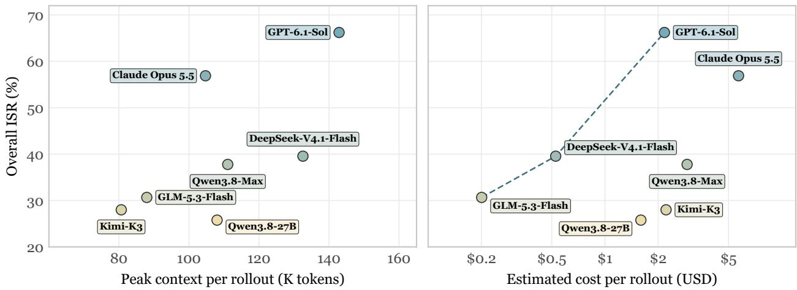  
Figure 5 Mean peak context, estimated cost, and ISR per run. Peak context is the largest single API call input within a run, and K denotes thousands. Estimates apply the manuscript’s frozen prices dated 2026-11-02 to the measured uncached input, cache reads, cache writes, and output tokens of every call, covering model API charges. Cache writes use the ordinary input price, except that Claude Opus 5.5 uses its cache-write price of USD 5 per million tokens. DeepSeek’s context and cost use 222 runs with token records, while its ISR uses all 225 scored runs. Other models use their available records.

## 4.6 Judge Agreement and Result Sensitivity

4.6.1 RQ5: How does changing the LLM judge affect binary verdicts and model comparisons?
<table><tr><td>DeepSeek verdict / Qwen verdict</td><td>Pass</td><td>Fail</td><td>Total</td></tr><tr><td>Pass</td><td>8,043</td><td>67</td><td>8,110</td></tr><tr><td>Fail</td><td>648</td><td>1,116</td><td>1,764</td></tr><tr><td>Total</td><td>8,691</td><td>1,183</td><td>9,874</td></tr></table>

Table 12 DeepSeek and Qwen binary verdicts on matched inputs and checklist items. Starting from 657 matched scoring pairs, matching checklist-item IDs and content hashes yields 9,874 paired binary verdicts. The judges are deepseek-v4.1-flash-1017 and qwen3.8-flash. These results cover a subset of tasks. Darker blue indicates larger joint counts; marginal totals use neutral shading.

On the same 20-task common-coverage subset, we compare cross-judge ranking agreement for ISR and CSR. The mean Spearman correlation across the three judge pairs is 0.9524 for CSR, exceeding 0.9028 for ISR, so Figure 6 uses CSR ranks. Correlations preserve ISR ties rather than arbitrarily ordering models with equal scores.

Table 12 contains 9,159 agreeing binary verdicts, giving 92.76% agreement and Cohen’s κ of 0.717 after adjustment for chance agreement using marginal pass rates. Of 715 disagreements, 648, or 90.63%, are DeepSeek fail and Qwen pass, indicating a directional diference in acceptance. In Figure 6, GPT-6.1-Sol ranks first under all three scoring sources. Spearman rank correlation is 0.9643 between DeepSeek and Qwen, and 0.9286 and 0.9643 between the historical reference and the two judges, respectively. Rank changes mainly involve adjacent models.

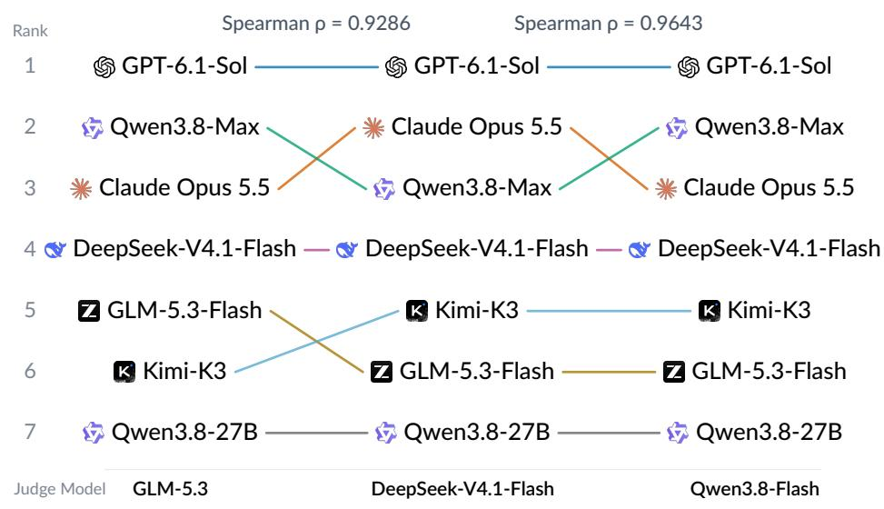  
Figure 6 Cross-judge CSR ranks on the 20-task common-coverage subset. The columns show the historical default GLM reference, DeepSeek judge, and Qwen judge. Nodes use model logos and short names, and the same actor model is linked by the same color. More stable ranks produce more horizontal lines. The subset contains 147 actor trajectories, 21 per model. Scores first average included rounds within each task and then weight tasks equally. Current DeepSeek and Qwen inputs match, while historical default scores are a reference only. Tasks have diferent numbers of included rounds, and the subset retains the stage package’s source selection and policy of deferring low-scoring sources.

Changing the judge preserves most binary verdicts and the model ranking. Disagreements concentrate in one direction and mainly reorder adjacent models. Independent human annotations are the next step for attributing disagreements and completing the evidence on judge reliability.

## 4.7 Case Study

4.7.1 Case question: Does resuming training mean that a research repair is complete?
<table><tr><td>Evaluation aspect</td><td>Successful execution, 20/20</td><td>Execution with unmet items, 16/20</td></tr><tr><td>Training progress</td><td>Sustained nonzero loss and parameter updates</td><td>Also sustained training, nonzero loss, and parameter updates</td></tr><tr><td>O7, fusion coordinates</td><td>Projection indexes agree with the actual feature grid</td><td>Inconsistent coordinates clip some samples to boundary columns</td></tr><tr><td>O9, overlap labels</td><td>Separate 2D and 3D overlap checks retain positive, negative, and ignored regions</td><td>A single projection ratio replaces independent 2D and 3D overlap tests</td></tr><tr><td>O11, coarse matching loss</td><td>L2 distance, overlap weights, and specified settings are retained</td><td>Squared distance replaces L2 without corresponding boundary-parameter changes, and weights are altered</td></tr><tr><td></td><td>O12, fine matching loss Bidirectional loss and the coarse/fine loss combination are retained</td><td>The changed distance and weight expressions are reused</td></tr><tr><td>Training and delivery items</td><td>Archived review accepts checkpoints, limited validation, and the report</td><td>The other 16 items pass, including training recovery, checkpoints, validation, and the report</td></tr></table>

Table 13 Two executions of the CylindFormer training-repair task. The task ID is cylindformer-training-repair. Both executions start at the same repair boundary and must resume training according to the reference paper. Scores follow the archived review. Appendix E contains the complete inputs, restored workspace, and 20-item checklist.

In Table 13, both executions resume image-to-point-cloud registration training with nonzero loss and parameter updates, but pass 20/20 and 16/20 checklist items, respectively. The execution with unmet items has four methodological deviations in projection and feature-grid coordinates, 2D/3D overlap labels, coarse matching loss, and fine matching loss. The successful execution resumes training while preserving the paper’s method. Figure 7 connects their shared execution progress to their diferent methodological validity.

Program recovery and faithful repair of the research method are distinct outcomes that require separate verification. Nonzero loss and training progress provide evidence of execution recovery, while checking coordinates, labels, and objectives establishes whether the repair preserves methodological meaning. This comparison grounds RQ2’s correctness bottleneck in specific failures and shows how restored workspaces and retained research constraints jointly support evaluation of requests within ongoing research.

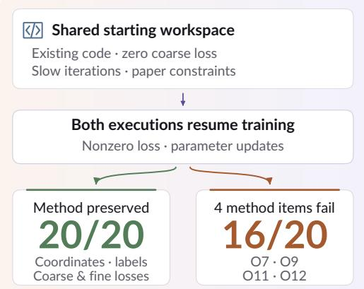  
Figure 7 Divergent executions of the same training repair request. The comparison concerns method consistency during recovery. Diferences in final registration accuracy still require separate measurement.

## 5 Conclusion

ARE-bench evaluates the next research action inside an evolving project. Every task starts from the replayed mid-session workspace with unfinished files and failed attempts preserved, while its task brief gives the actor a self-contained and auditable specification. The ISR and CSR checklist metrics expose strict completion and partial compliance, while separate cost metrics expose eficiency trade-ofs. Replay checks and anonymization make the benchmark suitable for comparing research agents without treating an original trajectory as a gold answer. The release protocol supports filling the result schema as model runs become available while keeping the benchmark definition fixed.

## Limitations

The source sessions may overrepresent particular projects, tools, or researcher populations. Cut-point sampling from existing sessions does not guarantee coverage of all research workflows. Replay and dependency recovery can lose context that was available to the original researcher, and anonymization can remove clues needed for faithful interpretation. Rubric writing remains a human judgment process, and a checklist evaluator can still miss evidence or over-credit a plausible claim. GPT-6.1-Sol runs with the Codex harness and the other models with Claude Code, so cross-model diferences reflect the model and harness together. The benchmark therefore publishes provenance records for audit, but its scores should be interpreted as evidence about the released task distribution rather than as a universal measure of scientific ability.

## Ethics Statement

Session data must be collected under an appropriate authorization or consent arrangement. Before release, identifiers, private paths, credentials, unpublished data, and organization-specific metadata are removed or replaced with stable aliases. The provenance package is access-controlled and is not included in actor inputs. We release only the minimum workspace content needed to reproduce each task and document residual disclosure risks, withdrawal procedures, and the scope of permitted reuse.

## Appendix

## A Task and Rubric Example

A task contains an instruction with Background, Requirements, and Environment sections. A representative requirements block asks the agent to update an existing analysis, save the result to an absolute path, preserve a named preprocessing choice, and report the command used to reproduce the artifact. Its rubric compiles into one binary checklist item for each deliverable, required transformation, preservation constraint, and reproducibility condition. The actor never sees the rubric text.

## B Research Requirement Taxonomy

We use a research requirement taxonomy to characterize the kinds of work researchers request from agents. The taxonomy serves as a reference for benchmark construction and organizes research work into 33 requirements and 207 sub-requirements, grouped into seven research stages. Requirements describe broader areas of work, such as literature review, experiment design, and code testing. Sub-requirements specify individual user needs using action–object descriptions, such as searching for relevant literature or writing unit tests. Table 14 presents the portion of this taxonomy represented in our benchmark: 150 sub-requirements covering all 33 requirements.

The table organizes research requirements into three levels: research stage, requirement, and sub-requirement. Two additional attributes characterize each sub-requirement. Capability primitives are drawn from the cognitive process dimension of the revised Bloom’s taxonomy (Anderson and Krathwohl, 2001; Krathwohl, 2002) and describe the cognitive operations involved, such as diferentiating under Analyze, checking under Evaluate, and planning under Create. Work object identifies the material these operations act on, such as code, data, or research documents.

Each checklist item is associated with one sub-requirement, which identifies its parent requirement and research stage. A task can therefore involve several requirements and stages through its checklist items.

Table 14 Research requirement taxonomy represented in the benchmark. Each row describes a sub-requirement, its parent requirement and research stage, and the associated capability primitives and work object.
<table><tr><td>Research stage</td><td>Requirement</td><td>Sub-requirement</td><td>Capability primitives</td><td>Work object</td></tr><tr><td colspan="3">Survey</td><td>Apply: implement; Analyze: differentiate</td><td>Evidence</td></tr><tr><td rowspan="8"></td><td rowspan="8"></td><td>Verify bibliographic information</td><td>Evaluate: critique</td><td>Evidence</td></tr><tr><td>Extract key points from literature</td><td>Analyze: differentiate; Understand:</td><td>Evidence</td></tr><tr><td>Verify literature content</td><td>summarize Evaluate: check</td><td>Evidence</td></tr><tr><td>Assess literature quality</td><td>Evaluate: critique</td><td>Evidence</td></tr><tr><td>Literature review Establish evidence traceability</td><td>Analyze: organize; Evaluate: check</td><td>Evidence</td></tr><tr><td>Synthesize external evidence</td><td>Understand: summarize; Understand: compare; Analyze: organize</td><td>Evidence</td></tr><tr><td>Revise research questions</td><td>Apply: implement; Understand:</td><td>Questions</td></tr><tr><td>Assess method applicability</td><td>explain; Analyze: organize Evaluate: critique</td><td>Methods</td></tr><tr><td></td><td>Write a literature review report</td><td>Understand: summarize; Understand: explain; Analyze: organize</td><td>Documents</td></tr><tr><td rowspan="10"></td><td rowspan="10"></td><td>Generate candidate research questions</td><td>Create: generate; Understand: explain</td><td>Questions</td></tr><tr><td>Define core concepts</td><td>Understand: explain; Understand: exemplify; Analyze: organize</td><td>Questions</td></tr><tr><td>Define research variables</td><td>Understand: explain; Analyze: organize; Create: plan</td><td>Questions</td></tr><tr><td>Identify problem assumptions</td><td>Understand: infer; Analyze: attribute; Analyze: differentiate</td><td>Questions</td></tr><tr><td>Formulate research hypotheses</td><td>Understand: infer; Create: generate</td><td>Questions</td></tr><tr><td>Assess research novelty</td><td>Understand: compare; Analyze: differentiate; Evaluate: critique</td><td>Questions</td></tr><tr><td>Assess research feasibility</td><td>Analyze: differentiate; Evaluate: critique</td><td>Questions</td></tr><tr><td>Identify research ethics risks</td><td>Understand: classify; Evaluate: critique Questions Remember: recall; Understand: classify; Projects</td><td></td></tr><tr><td>Identify research constraints</td><td>Analyze: differentiate</td><td></td></tr><tr><td>Write a problem definition document</td><td>Understand: summarize; Understand: explain; Analyze: organize</td><td>Documents</td></tr><tr><td rowspan="9"></td><td rowspan="6">Resource estimation</td><td>Identify resource requirements</td><td>Understand: classify; Analyze: differentiate; Analyze: organize</td><td>Plans</td></tr><tr><td>Estimate data needs and costs</td><td>Apply: implement; Apply: execute; Understand: infer</td><td>Plans</td></tr><tr><td>Estimate compute needs and costs</td><td>Apply: implement; Apply: execute; Understand: infer</td><td>Plans</td></tr><tr><td>Estimate the research timeline</td><td>Apply: implement; Understand: infer</td><td>Plans</td></tr><tr><td>Plan research execution</td><td>Create: plan</td><td>Plans</td></tr><tr><td>Define experimental subjects and units of analysis Operationalize experimental</td><td>Understand: explain; Analyze: organize Plans</td><td></td></tr><tr><td rowspan="9"></td><td>variables</td><td>Understand: explain; Analyze: organize; Create: plan</td><td>Plans</td></tr><tr><td>Design experimental controls</td><td>Analyze: differentiate; Create: plan</td><td>Plans</td></tr><tr><td>Design ablation experiments</td><td>Analyze: differentiate; Create: plan</td><td>Plans</td></tr><tr><td>Design repeated experiments</td><td>Analyze: organize; Create: plan</td><td>Plans</td></tr><tr><td>Define evaluation metrics</td><td>Analyze: organize; Create: plan</td><td>Plans</td></tr><tr><td>Define research acceptance criteria</td><td>Analyze: organize; Create: plan</td><td>Plans</td></tr><tr><td>Design sensitivity analyses</td><td>Understand: compare; Analyze: differentiate; Create: plan</td><td>Plans</td></tr><tr><td>Design experimental procedures Design experiment recording</td><td>Analyze: organize; Create: plan Analyze: organize; Create: plan</td><td>Plans Plans</td></tr><tr><td>standards Design experiment stopping rules</td><td>Analyze: organize; Evaluate: check;</td><td>Plans</td></tr><tr><td></td><td></td><td>Create: plan</td><td></td></tr><tr><td></td><td>Identify threats to experimental validity</td><td>Understand: classify; Understand: infer; Analyze: differentiate</td><td>Plans</td></tr><tr><td rowspan="8">Design (cont.)</td><td rowspan="3">Experiment design (cont.)</td><td>Assess experiment design feasibility</td><td>Analyze: differentiate; Evaluate: critique</td><td>Plans</td></tr><tr><td>Verify experiment designs</td><td>Evaluate: check; Analyze: organize</td><td>Plans</td></tr><tr><td>Write an experiment design document</td><td>Understand: summarize; Understand: explain; Analyze: organize</td><td>Documents</td></tr><tr><td rowspan="5">Method evaluation</td><td>Select experiment evaluation metrics</td><td>Analyze: differentiate; Evaluate: critique</td><td>Plans</td></tr><tr><td>Design method evaluation protocols</td><td>Create: plan</td><td>Plans</td></tr><tr><td>Implement experiment evaluation Apply: implement metrics</td><td></td><td>Code</td></tr><tr><td></td><td>Configure controlled experiments Analyze: organize; Apply: implement</td><td>Experiments</td></tr><tr><td>Configure cross-model experiments</td><td>Analyze: organize; Apply: implement</td><td>Experiments</td></tr><tr><td colspan="3"></td><td>Apply: implement</td><td>Environment</td></tr><tr><td rowspan="10">Data &amp; Env.</td><td rowspan="3">Environment setup</td><td>Install project dependencies Resolve dependency conflicts</td><td>Apply: implement; Evaluate: check</td><td>Environment</td></tr><tr><td>Verify the computing environment</td><td>Evaluate: check</td><td>Environment</td></tr><tr><td></td><td></td><td></td></tr><tr><td rowspan="3">Resource acquisition</td><td>Acquire model assets</td><td>Apply: execute Apply: execute</td><td>Assets</td></tr><tr><td>Acquire research data Verify research data identity</td><td>Evaluate: check</td><td>Data</td></tr><tr><td>Acquire compute resources</td><td>Evaluate: critique; Apply: implement</td><td>Data Environment</td></tr><tr><td rowspan="3">Data analysis</td><td></td><td></td><td></td></tr><tr><td>Analyze data structures Assess data quality</td><td>Analyze: organize Evaluate: critique</td><td>Data</td></tr><tr><td>Assess statistical power</td><td>Evaluate: critique</td><td>Data</td></tr><tr><td rowspan="4">Data preprocessing</td><td></td><td></td><td>Plans</td></tr><tr><td>Convert data formats</td><td>Understand: explain; Apply: execute</td><td>Data</td></tr><tr><td>Handle missing values Handle outliers</td><td>Apply: implement; Evaluate: check</td><td>Data</td></tr><tr><td>Create training, validation, and test splits</td><td>Apply: implement; Evaluate: check Analyze: organize</td><td>Data Data</td></tr><tr><td>Feature engineering</td><td>Extract data features Compare features across groups</td><td>Analyze: differentiate</td><td>Data</td></tr><tr><td rowspan="3">Code</td><td></td><td>Understand: compare</td><td></td><td>Data</td></tr><tr><td rowspan="2">Repository comprehension</td><td>Analyze code implementations Verify code modules</td><td>Analyze: organize Evaluate: check</td><td>Code Code</td></tr><tr><td>Verify code completeness</td><td>Evaluate: check</td><td>Code</td></tr><tr><td rowspan="10"></td><td rowspan="10"></td><td>Derive research methods</td><td>Create: plan</td><td>Methods</td></tr><tr><td>Adapt research methods</td><td>Apply: implement</td><td>Methods</td></tr><tr><td>Implement experiment scaffolding</td><td>Apply: implement</td><td>Code</td></tr><tr><td>Design model architectures</td><td>Create: plan</td><td>Methods</td></tr><tr><td>Design algorithm mechanisms</td><td>Create: plan</td><td>Methods</td></tr><tr><td>Design loss functions</td><td>Create: plan</td><td>Methods</td></tr><tr><td>Design code implementations and Create: plan boundaries</td><td></td><td>Code</td></tr><tr><td>Add experiment instrumentation Apply: implement logs</td><td></td><td>Code</td></tr><tr><td>Implement algorithm modules</td><td>Apply: implement</td><td>Code</td></tr><tr><td>Implement algorithm variants</td><td>Apply: implement</td><td>Code</td></tr><tr><td rowspan="3">Algorithm implementation</td><td>Integrate open-source components</td><td>Analyze: organize; Apply: implement</td><td>Code</td></tr><tr><td>Verify algorithm implementation equivalence</td><td>Evaluate: check</td><td>Code</td></tr><tr><td>Manage code version changes</td><td>Apply: execute; Analyze: organize</td><td>Code</td></tr><tr><td rowspan="5">Code change management</td><td>Modify code across modules</td><td>Analyze: organize; Apply: implement</td><td>Code</td></tr><tr><td>Refactor code</td><td>Analyze: organize; Apply: implement</td><td>Code</td></tr><tr><td>Verify code changes</td><td>Evaluate: check</td><td>Code</td></tr><tr><td>Write unit tests</td><td>Analyze: differentiate; Apply: implement</td><td>Code</td></tr><tr><td>Write integration tests</td><td>Analyze: organize; Apply: implement</td><td>Code</td></tr><tr><td rowspan="5"></td><td>Write end-to-end tests</td><td>Analyze: organize; Apply: implement</td><td>Code</td></tr><tr><td>Run regression tests</td><td>Apply: execute; Evaluate: check</td><td>Code</td></tr><tr><td>Summarize experiment</td><td>Understand: summarize; Analyze:</td><td>Experiments</td></tr><tr><td>configurations Summarize training code</td><td>organize Understand: summarize</td><td>Code</td></tr><tr><td>Configure experiment runs</td><td>Apply: implement</td><td>Experiments</td></tr><tr><td rowspan="5">Execution</td><td>Execution scheduling</td><td>Run experiments</td><td>Apply: execute</td><td>Experiments</td></tr><tr><td></td><td>Resume experiment runs</td><td>Remember: recall; Apply: implement;</td><td>Experiments</td></tr><tr><td rowspan="4">Run management and monitoring</td><td>Organize model checkpoints</td><td>Evaluate: check Analyze: organize; Apply: execute</td><td>Experiments</td></tr><tr><td>Record experiment metrics</td><td>Apply: execute</td><td>Experiments</td></tr><tr><td>Record experiment logs</td><td>Apply: execute</td><td>Experiments</td></tr><tr><td>Organize experiment artifacts</td><td>Analyze: organize</td><td>Experiments</td></tr><tr><td rowspan="10">Experiment diagnosis</td><td rowspan="10"></td><td>Describe training trends</td><td>Understand: summarize; Understand: infer</td><td>Experiments</td></tr><tr><td>Verify experiment run status</td><td>Evaluate: check</td><td>Experiments</td></tr><tr><td>Compare performance across data slices</td><td>Understand: compare</td><td>Results</td></tr><tr><td>Compare effects of experiment settings</td><td>Understand: compare</td><td>Results</td></tr><tr><td>Diagnose method failures</td><td>Analyze: differentiate; Understand: infer</td><td>Experiments</td></tr><tr><td>Diagnose experiment anomalies</td><td>Analyze: differentiate; Understand: infer</td><td>Experiments</td></tr><tr><td>Diagnose experiment performance bottlenecks</td><td>Analyze: differentiate; Understand: infer; Understand: compare</td><td>Experiments</td></tr><tr><td>Diagnose code defects</td><td>Analyze: differentiate; Understand: infer</td><td>Code</td></tr><tr><td>Recommend when to stop experiments</td><td>Evaluate: critique</td><td>Experiments</td></tr><tr><td>Fix code defects</td><td>Apply: implement; Evaluate: check</td><td>Code</td></tr><tr><td rowspan="3">repair</td><td>Verify experiment retry results</td><td>Evaluate: check</td><td>Experiments</td></tr><tr><td>Assess experiment repair plans</td><td>Evaluate: critique</td><td>Experiments</td></tr><tr><td>Identify data contamination</td><td>Understand: classify; Analyze: differentiate</td><td>Data</td></tr><tr><td rowspan="3">Experiment tuning</td><td>Search hyperparameter</td><td>Apply: implement; Evaluate: critique</td><td>Experiments</td></tr><tr><td>combinations Run ablation experiments</td><td>Apply: implement; Evaluate: check</td><td>Experiments</td></tr><tr><td>Run sensitivity analyses</td><td>Apply: implement; Evaluate: check</td><td>Experiments</td></tr><tr><td rowspan="2">verification</td><td>Verify experiment reproducibility</td><td>Evaluate: check</td><td>Experiments</td></tr><tr><td>Compute descriptive statistics</td><td>Apply: execute</td><td>Results</td></tr><tr><td rowspan="9"></td><td rowspan="3">Result statistics</td><td>Compute statistical test results</td><td>Apply: execute</td><td>Results</td></tr><tr><td>Compute effect sizes</td><td>Apply: execute</td><td>Results</td></tr><tr><td>Estimate result uncertainty</td><td>Apply: execute; Understand: infer</td><td>Results</td></tr><tr><td>Result comparison</td><td>Evaluate algorithm variants</td><td>Evaluate: critique</td><td>Results</td></tr><tr><td rowspan="3"></td><td>Compare research methods</td><td>Understand: compare</td><td>Results</td></tr><tr><td>Explain model decision</td><td>Understand: explain; Understand: infer Results</td><td></td></tr><tr><td>mechanisms Verify research hypotheses</td><td>Evaluate: check</td><td>Results</td></tr><tr><td rowspan="4">Result interpretation</td><td>Verify the limits of research conclusions</td><td>Evaluate: check; Evaluate: critique</td><td>Results</td></tr><tr><td>Report negative results</td><td>Understand: summarize; Evaluate: critique</td><td>Results</td></tr><tr><td>Define the scope of research applicability</td><td>Analyze: organize; Create: plan</td><td>Results</td></tr><tr><td>Generate result tables</td><td>Analyze: organize; Apply: execute</td><td>Results</td></tr><tr><td>Result visualization</td><td>Visualize research results</td><td>Understand: explain; Apply: implement</td><td>Results</td></tr></table>

Table 14 Research requirement taxonomy (continued).
<table><tr><td>Research stage</td><td>Requirement</td><td>Sub-requirement</td><td>Capability primitives</td><td>Work object</td></tr><tr><td></td><td>Paper structure</td><td>Verify paper argumentation</td><td>Evaluate: check</td><td>Documents</td></tr><tr><td rowspan="8"></td><td>planning</td><td>Plan paper outlines</td><td>Create: plan</td><td>Documents</td></tr><tr><td>Related work</td><td>Write reference lists</td><td>Apply: implement</td><td>Documents</td></tr><tr><td>writing</td><td>Format citations</td><td>Apply: execute</td><td>Documents</td></tr><tr><td rowspan="5">Methods and experiments writing</td><td>Write methods sections</td><td>Understand: explain; Analyze: organize</td><td>Documents</td></tr><tr><td>Write experiment setup sections</td><td>Understand: explain; Analyze: organize</td><td>Documents</td></tr><tr><td>Verify consistency of method descriptions</td><td>Evaluate: check</td><td>Documents</td></tr><tr><td>Verify consistency between notation and implementation</td><td>Evaluate: check</td><td>Documents</td></tr><tr><td>Write result analyses</td><td>Understand: summarize; Analyze: organize</td><td>Documents</td></tr><tr><td></td><td>Figure and table</td><td>Generate paper tables</td><td>Analyze: organize; Apply: execute</td><td>Documents</td></tr><tr><td rowspan="8">Writing Paper revision</td><td>preparation</td><td>Annotate paper figures and tables</td><td>Understand: explain</td><td>Documents</td></tr><tr><td rowspan="7"></td><td>Revise academic paragraphs</td><td>Apply: implement</td><td>Documents</td></tr><tr><td>Integrate external evidence</td><td>Analyze: organize; Apply: implement</td><td>Documents</td></tr><tr><td>Adjust paper length</td><td>Apply: implement</td><td>Documents</td></tr><tr><td>Add factual content</td><td>Analyze: organize; Apply: implement</td><td>Documents</td></tr><tr><td>Merge paper revisions</td><td>Analyze: organize; Apply: implement</td><td>Documents</td></tr><tr><td>Align paper sections</td><td>Analyze: organize</td><td>Documents</td></tr><tr><td>Verify paper cross-references</td><td>Evaluate: check</td><td>Documents</td></tr><tr><td rowspan="6"></td><td></td><td>Verify consistency of result statements</td><td>Evaluate: check</td><td>Documents</td></tr><tr><td></td><td>Verify research evidence chains</td><td>Evaluate: check</td><td>Documents</td></tr><tr><td>Reviewer response</td><td>Revise content addressing review comments</td><td>Apply: implement</td><td>Documents</td></tr><tr><td></td><td>Write reviewer responses</td><td>Understand: explain; Apply: implement</td><td>Documents</td></tr><tr><td>Organize submission materials</td><td>Verify submission formatting</td><td>Evaluate: critique</td><td>Documents</td></tr><tr><td rowspan="5">Research release</td><td>Write research reproduction</td><td>Analyze: organize Understand: explain; Analyze: organize</td><td>Assets</td><td>Documents</td></tr><tr><td>documentation</td><td></td><td></td><td></td></tr><tr><td></td><td>Package research assets</td><td>Analyze: organize; Apply: execute</td><td>Assets</td></tr><tr><td>Verify research assets</td><td></td><td>Evaluate: check; Evaluate: critique</td><td>Assets</td></tr><tr><td></td><td></td><td></td><td></td></tr></table>

## C Starting Workspace State by Research Stage

Table 15 lists the workspace content that a task cut at each research stage typically carries over from earlier turns. Every listed state is replayed from the source session rather than authored for the task, so a task cut inside Execution inherits run scripts and logs rather than a clean environment, and a task cut inside Writing inherits an existing draft rather than a blank document.

<table><tr><td>Research stage</td><td>Representative starting workspace state  $W _ { c }$ </td></tr><tr><td>Survey</td><td>Partial reading notes and a candidate research question, with no experiment code yet written</td></tr><tr><td>Design</td><td>An existing problem statement and prior baseline results that the new design must extend or contrast</td></tr><tr><td>Data &amp; Env.</td><td>A partially installed environment and raw or partially downloaded data left from an earlier setup attempt</td></tr><tr><td>Code</td><td>A repository with a partial implementation, stub functions, and tests that do not yet pass</td></tr><tr><td>Execution</td><td>Configured run scripts together with logs or checkpoints from an interrupted or failed run</td></tr><tr><td>Analysis Writing</td><td>Raw experiment outputs and an unfinished or outdated analysis script</td></tr><tr><td></td><td>A paper draft with existing sections, figures, or reviewer comments that the current request must incorporate</td></tr></table>

Table 15 Representative starting workspace state $W _ { c }$ for a task cut at each research stage. Every state is replayed from the source session rather than authored for the task, so earlier work is present regardless of stage.

## D Cut-Point Selection, Replay, and Anonymization

The builder records the source episode, user-turn index, file-event range, process-event range, dependency snapshot, and validation hash. Replay is accepted only when the reconstructed tree matches the audited state for all files declared relevant to the task. Paths, usernames, hostnames, keys, and dataset identifiers are replaced by deterministic aliases. A second reviewer checks that the replacement preserves references used in the instruction and does not leak the source project.

## E Case Study: Repairing an Interrupted Training Experiment

This case follows a request to repair an unfinished image–point-cloud registration experiment, which matches photographs to a three-dimensional scene to estimate camera pose. Training has started, but the coarsematching loss stays at zero and each iteration takes about 28 seconds. The repair must preserve the supplied paper’s method.

From a conversation to a task boundary. Figure 8 shows the real session. We cut after the fourth user turn, the repair request. Earlier decisions supply Background; the implementation at this boundary supplies the repair starting point. Figure 9 separates the complete task instruction from the restored workspace and prepared execution resources. Assessment material is shown separately from actor input.

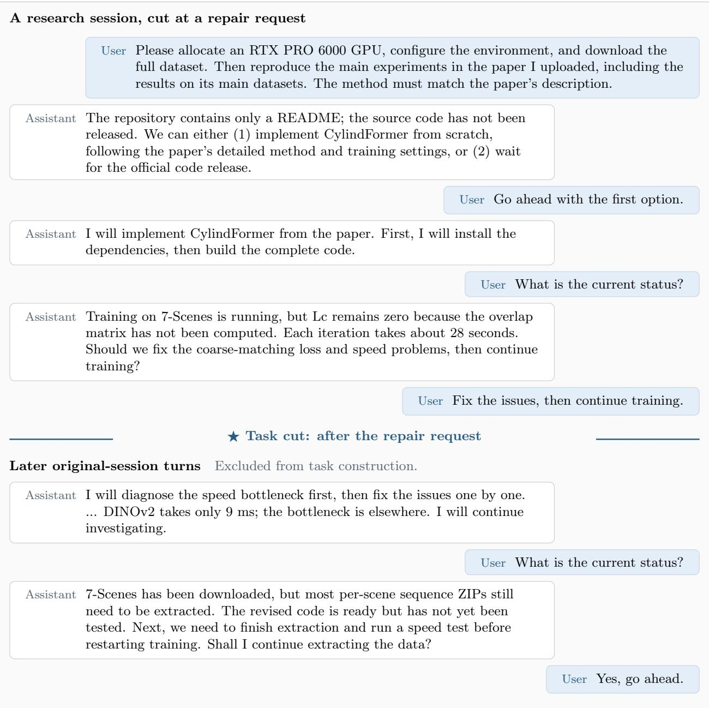  
Figure 8 Session with all six user turns and brief assistant excerpts. The star marks the cut after the repair request. Later turns appear below the boundary and are excluded from task construction.

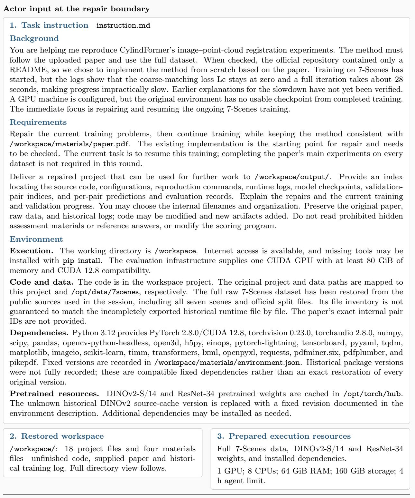  
Assessment Separate from actor input. tests/rubric.json: 20 outcome checks, listed in full in the outcome rubric table. Detailed method checks also use the supplied paper.  
Figure 9 Task inputs and assessment. Background, Requirements, and Environment form instruction.md; the other two input regions describe the provided files and execution resources. Paths are normalized. The complete outcome rubric appears in Table 16.

Constructing the task input. Recorded file operations restore the unfinished data-loading, model, loss, and training code. The paper defines the method to preserve; the diagnostic log records the observed failure. Public data and pretrained weights are restored separately, with compatible dependencies. Figure 10 shows every recovered project and materials file and the prepared resource directories.

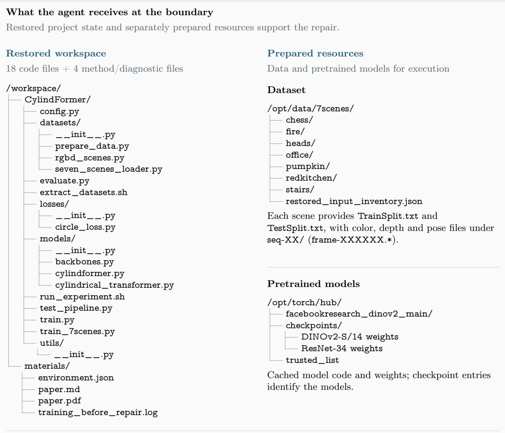

Agent-generated source, configuration, reproduction commands, logs, checkpoints, validation pairs, predictions and an index.

Figure 10 Directory view of the starting inputs: all 18 project files and four materials files, plus separately prepared data and model resources. Repeated raw-data samples use a filename pattern; weight entries name their models. The output directory is the requested handof destination.

Comparing two executions. Both executions continue training, but progress alone does not establish a faithful repair. Figure 11 connects the repairs and recorded behavior to the archived outcome assessments. The successful execution passes all 20 checks. The failed execution passes 16, including training recovery, but fails four method checks involving feature coordinates, overlap labels, and loss computation.

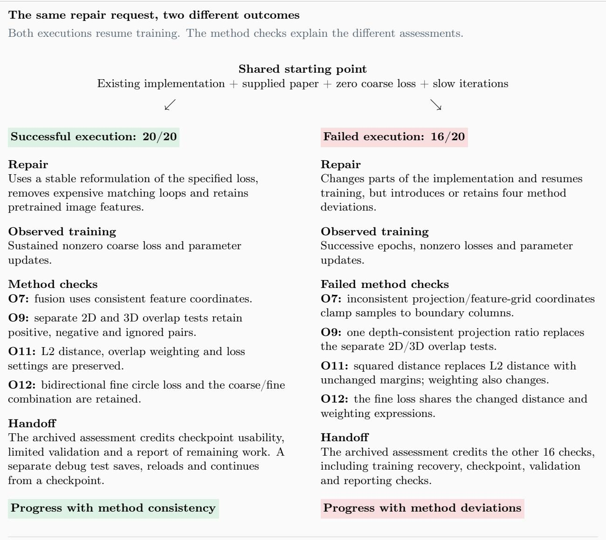  
Reading the comparison Outcome scores are archived assessments, not new experiments. The failed run demonstrates method deviations despite training progress; these records do not measure a resulting drop in final registration accuracy.  
Figure 11 Two independent executions of the same task. Green and red backgrounds mark the decisive findings. The scores summarize archived outcome assessments; the comparison establishes method consistency or deviation, rathe than a measured change in final registration accuracy.

What the comparison shows. Restoring the existing code makes the short repair request a continuation of an unfinished experiment. The successful case shows that a usable repair can preserve its method while moving training forward. The failed case shows why observing training is insuficient: the experiment runs, but parts of the method no longer match the paper. Retaining both the project state and the research constraints makes this distinction assessable.

Complete outcome rubric. The outcome rubric checks a usable handof, data and method implementation, actual training, and evidence-linked validation. Its source labels distinguish explicit requirements from checks inferred using the paper, prior context, or ordinary research and usability expectations. Detailed method checks draw on the supplied paper and are not all individually enumerated in Requirements.

Table 16 Complete outcome rubric. Each item is a binary check; source labels identify explicit or inferred grounding.
<table><tr><td>ID</td><td>Criterion</td><td>Source</td></tr><tr><td>01</td><td>Deliver a reusable repaired project in /workspace/output/, with an index locating source code, configuration, and reproduction entry points. Internal filenames and project organization are unrestricted.</td><td>Explicit; Requirements</td></tr><tr><td>O2</td><td>Construct image-point-cloud training pairs with real relative poses and filter them using the paper's at-least-50% overlap rule. Pairing only an image with its own back-projected depth, or declaring min_overlap without computing and applying it, does not meet this check. Verifiable equivalent pairing is accepted; unavailable</td><td>Inferred; paper</td></tr><tr><td>O3</td><td>paper-internal pair IDs need not be restored. Separate training and evaluation according to the official 7-Scenes sequence splits. Validation must not train the model or select it using test performance. When the paper's internal validation pairs are unavailable, an independent validation set</td><td>Inferred; paper</td></tr><tr><td>04</td><td>constructed from training sequences is accepted if its scope is explained The point-cloud backbone must aggregate neighborhood features using kernel points and produce multiscale coarse and fine features, consistent with the paper's three-stage indoor KPConv-FPN. A per-point MLP merely named KPConv does not meet this check. Correct open-source components or equivalent reimplementations are accepted.</td><td>Inferred; paper</td></tr><tr><td>05</td><td>Retain the paper's ResNet-FPN and DINOv2 image-feature paths. DINOv2 must load pretrained weights and contribute to model output; disabling it or silently replacing it with image average pooling does not meet this check. Freezing or caching unchanged pretrained features is accepted.</td><td>Inferred; prior context and paper</td></tr><tr><td>O6</td><td>Cylindrical self-attention must enhance the key with local fusion information, implementing the paper's Q(K+L)-transpose attention semantics. Disconnected local information or plain self-attention does not meet this check. Tensor implementations with the same mathematical meaning are accepted.</td><td>Inferred; paper</td></tr><tr><td>07</td><td>Cross-modal fusion must pass information through cylindrical-projection local aggregation, adaptive fusion with global features, and cross-attention. Coordinates and indices must match the actual feature layout. An unused fusion module does not meet this check; perspective projection for supervision does not replace cylindrical projection inside the model.</td><td>Inferred; paper</td></tr><tr><td>08</td><td>Fine matching must use local image and point-cloud patches selected by coarse correspondences and generate pixel-point matches using mutual top-k. Ignoring coarse matches and directly matching the full image against all points does not preserve the coarse-to-fine method</td><td>Inferred; paper</td></tr><tr><td>09</td><td>Coarse positive and negative labels must use ground-truth geometry to compute both Inferred; paper 2D and 3D patch overlap. A pair is positive when both exceed 30%, negative when both are below 20%; the intermediate region must not be treated as negative. Learned feature similarity or grids near a single projected point do not replace patch overlap.</td><td></td></tr><tr><td>O10</td><td>Fine labels must follow real pixel-point geometry: positive when the 3D distance is below 3.75 cm and 2D distance below 8 px; negative when the 3D distance exceeds 10 cm or 2D distance exceeds 12 px. Coordinate transforms, camera intrinsics, and pixel scales must agree with the data.</td><td>Inferred; paper</td></tr><tr><td>011</td><td>Coarse supervision must implement bidirectional overlap-aware circle loss with feature Inferred; paper L2 distance, overlap weighting, gamma=40, and positive/negative margins 0.1/1.4. Numerically stable equivalent expressions are accepted. Similarity mean-squared error, constants, or a custom anti-collapse objective cannot substitute merely to produce nonzero loss. Where the paper's formula and prose are ambiguous, a self-consistent interpretation supported by the materials is accepted.</td><td></td></tr><tr><td>O12</td><td>Fine supervision must implement bidirectional standard circle loss with gamma=24 and positive/negative margins 0.1/1.4, combined with coarse supervision using beta=1. Numerically stable rewriting is accepted; replacing the training objective is not.</td><td>Inferred; paper</td></tr><tr><td>O13</td><td>A training batch with valid geometric supervision must propagate loss gradients to the Inferred; research trainable descriptors and matching heads actually used at inference, and update those expectations parameters. Adding requires grad to an unrelated constant, bypassing an untrained matching head, or detaching the entire path does not meet this check. Individual batches without valid positives or negatives may be explicitly skipped; loss need not be</td><td></td></tr><tr><td>O14</td><td>Remove the performance bottleneck blocking continued training. Measured full-step time must improve substantially under comparable hardware, input size, and training responsibilities, with evidence identifying the removed overhead. Omitting supervision, reducing task scope, or timing only a forward pass is insufficient. No fixed speed or improvement factor from later historical work is required.</td><td>Inferred; prior context</td></tr><tr><td>015</td><td>Resume repaired 7-Scenes training on the GPU, process successive traceable real pairs, Inferred; prior update parameters, and retain progress from this run. Code alone, a launch command, context or one random-tensor forward pass is insufficient. This checks training recovery; completing all 30 epochs or the RGB-D Scenes V2 main experiment is not required.</td><td></td></tr><tr><td>O16</td><td>The delivered checkpoint from this training must be compatible with the repaired model, restore learned parameters, and support continued training. Silently falling back to random initialization after a load failure is insufficient. Any appropriate state-saving format is accepted; no framework or internal filename is mandated.</td><td>Inferred; usability expectations</td></tr><tr><td>O17</td><td>The repaired inference path must generate pixel-point matches from learned descriptors and use PnP-RANSAC to estimate the transform from point-cloud coordinates to the image camera frame. Ground-truth poses may supervise or evaluate the model, but must not replace inference estimates.</td><td>Inferred; paper</td></tr><tr><td>O18</td><td>Compute registration metrics with the paper's meanings: IR is the fraction of correspondences with 3D distance below 0.05 m after the ground-truth transform; FMR is the fraction of pairs with IR above 0.1; RR is the fraction with predicted/ground-truth transform RMSE below 0.1 m. Keep failed pairs in denominators. Placeholders or validation loss alone are insufficient. Small-scale recovery validation is accepted but must not be called full paper-test-set reproduction.</td><td>Inferred; paper</td></tr><tr><td>O19</td><td>Deliver this run's logs, checkpoint, validation-pair index, per-pair predictions and evaluation records, and reproduction commands. Records must link validation results to the current model and actual data. Any readable organization is accepted; checkpoints may be binary.</td><td>Explicit; Requirements</td></tr><tr><td>O20</td><td>The repair report must describe completed training and validation stages consistently Inferred; research with delivered evidence, distinguishing program recovery, method consistency, and full main-experiment reproduction. Nonzero loss or completion of a few epochs alone does not establish the paper's registration results.</td><td>expectations</td></tr></table>

## F Judge Prompt

The evaluator prompt states the task requirements, the checklist item, the evidence available to inspect, and the binary decision rule. It requires a short evidence citation for every decision and forbids inferring an unobserved result from a claimed completion.

## G Full Results and Hyperparameters

The machine-readable release stores one record per task and rollout with the model identifier, score vector, delivery manifest status, wall-clock time, token counts, tool calls, and steps. Aggregate tables are generated by grouping these records by model, checklist dimension, and research stage. The run manifest is versioned with the task manifest so that a later model evaluation cannot silently alter the benchmark denominator.

<table><tr><td>Setting</td><td>Value</td></tr><tr><td>Actor harness</td><td>Codex for GPT-6.1-Sol, Claude Code for other models</td></tr><tr><td>Harness version</td><td>Codex 0.118.0 or Claude Code 2.1.283 on RJob, varying by run on E2B</td></tr><tr><td>Judge</td><td>GLM-5.3 (GLM-5.3-Flash for a small subset of runs), one call per checklist item</td></tr><tr><td>Execution backend</td><td>E2B for 920 CPU runs, RJob/Docker for the other 655 runs</td></tr><tr><td>Harbor version</td><td>0.23.0 in the 650 readable run protocols</td></tr><tr><td>Rollouts per task</td><td>3</td></tr><tr><td>Time limit</td><td>1.5 × task timeout for 920 CPU runs, task-specific overrides otherwise</td></tr><tr><td>Infrastructure retry</td><td>up to 2, actor timeout not retried</td></tr></table>

Table 17 Run configuration.

<table><tr><td>Metric</td><td>Value</td></tr><tr><td>Tasks</td><td>75</td></tr><tr><td>Checklist items</td><td>1,173</td></tr><tr><td>Avg. checklist items per task</td><td>15.6</td></tr><tr><td>Research stages covered Avg. earlier requests in Background</td><td>7</td></tr><tr><td>Avg. workspace files at cut point</td><td>10.3</td></tr><tr><td></td><td>41.1</td></tr><tr><td>Avg. deliverables per task Avg. instruction length (characters)</td><td>2.5 1,677</td></tr></table>

Table 18 Overall statistics of ARE-bench.

## References

Lorin W. Anderson and David R. Krathwohl, editors. 2001. A Taxonomy for Learning, Teaching, and Assessing: A Revision of Bloom’s Taxonomy of Educational Objectives, complete edition. Longman, New York.

Ben Bogin, Kejuan Yang, Shashank Gupta, Kyle Richardson, Erin Bransom, Peter Clark, Ashish Sabharwal, and Tushar Khot. 2024. SUPER: Evaluating agents on setting up and executing tasks from research repositories. arXiv preprint arXiv:2409.07440.

Jonathan Bragg, Mike D’Arcy, Nishant Balepur, Dan Bareket, Bhavana Dalvi, Sergey Feldman, Dany Haddad, Jena D. Hwang, Peter Jansen, Varsha Kishore, Bodhisattwa Prasad Majumder, Aakanksha Naik, Sigal Rahamimov, Kyle Richardson, Amanpreet Singh, Harshit Surana, Aryeh Tiktinsky, Rosni Vasu, Guy Wiener, and 20 others. 2025. AstaBench: Rigorous benchmarking of AI agents with a scientific research suite. arXiv preprint arXiv:2510.21652.

Aubrey M. Brueckner, Darshil Patel, Yuhuan He, and Timothy Kassis. 2026. K-Bench: Measuring model performance on real scientific agent requests. arXiv preprint arXiv:2608.21601v2.

Jun Shern Chan, Neil Chowdhury, Oliver Jafe, James Aung, Dane Sherburn, Evan Mays, Giulio Starace, Kevin Liu, Leon Maksin, Tejal Patwardhan, Lilian Weng, and Aleksander Mądry. 2024. MLE-bench: Evaluating machine learning agents on machine learning engineering. arXiv preprint arXiv:2410.07095.

Ziru Chen, Shijie Chen, Yuting Ning, Qianheng Zhang, Boshi Wang, Botao Yu, Yifei Li, Zeyi Liao, Chen Wei, Zitong Lu, Vishal Dey, Mingyi Xue, Frazier N. Baker, Benjamin Burns, Daniel Adu-Ampratwum, Xuhui Huang, Xia Ning, Song Gao, Yu Su, and Huan Sun. 2024. ScienceAgentBench: Toward rigorous assessment of language agents for data-driven scientific discovery. arXiv preprint arXiv:2410.05080.

Deming Ding, Shichun Liu, Enhui Yang, Jiahang Lin, Ziying Chen, Shihan Dou, Honglin Guo, Weiyu Cheng, Pengyu Zhao, Chengjun Xiao, Qunhong Zeng, Qi Zhang, Xuanjing Huang, Qidi Xu, and Tao Gui. 2026. OctoBench: Benchmarking scafold-aware instruction following in repository-grounded agentic coding. arXiv preprint arXiv:2601.10343.

Aniketh Garikaparthi, Manasi Patwardhan, and Arman Cohan. 2026. ResearchGym: Evaluating language model agents on real-world AI research. arXiv preprint arXiv:2602.15112.

Smriti Jha, Matteo Paltenghi, Chandra Maddila, Vijayaraghavan Murali, Shubham Ugare, and Satish Chandra. 2026. REAP: Automatic curation of coding agent benchmarks from interactive production usage. arXiv preprint arXiv:2604.01527.

Carlos E. Jimenez, John Yang, Alexander Wettig, Shunyu Yao, Kexin Pei, Ofir Press, and Karthik Narasimhan. 2023. SWE-bench: Can language models resolve real-world GitHub issues? arXiv preprint arXiv:2310.06770.

Patrick Tser Jern Kon, Jiachen Liu, Xinyi Zhu, Qiuyi Ding, Jingjia Peng, Jiarong Xing, Yibo Huang, Yiming Qiu, Jayanth Srinivasa, Myungjin Lee, Mosharaf Chowdhury, Matei Zaharia, and Ang Chen. 2025. EXP-Bench: Can AI conduct AI research experiments? arXiv preprint arXiv:2505.24785.

David R. Krathwohl. 2002. A revision of Bloom’s taxonomy: An overview. Theory Into Practice, 41(4):212–218.

Zongwei Lv, Yaoming Li, Zhewen Tan, Yilun Yao, Yuxuan Tian, Lin Sun, Xiangzheng Zhang, Weihong Lin, Tong Yang, and Guangxiang Zhao. 2026. RealClawBench: Live OpenClaw benchmarks from real Developer-Agent sessions. arXiv preprint arXiv:2606.03889.

Mike A. Merrill, Alexander G. Shaw, Nicholas Carlini, Boxuan Li, Harsh Raj, Ivan Bercovich, Lin Shi, Jeong Yeon Shin, Thomas Walshe, E. Kelly Buchanan, Junhong Shen, Guanghao Ye, Haowei Lin, Jason Poulos, Maoyu Wang, Marianna Nezhurina, Jenia Jitsev, Di Lu, Orfeas Menis Mastromichalakis, and 66 others. 2026. Terminal-Bench: Benchmarking agents on hard, realistic tasks in command line interfaces. arXiv preprint arXiv:2601.11868.

Zechun Niu, Yukun Zhao, Jiaxin Zhang, Xu Shen, Jinhua Si, Han Tian, Can Xu, Yunfan Song, Jiaxin Mao, Yansong Gao, Yuchen Li, Jianmin Wu, Lingyong Yan, Shuaiqiang Wang, and Dawei Yin. 2026. DuMateBench: Evaluating autonomous agents in complex real-world workflows. arXiv preprint arXiv:2608.26546v1.

Qwen Team. 2026. Qwen3.8-Max model card. https://huggingface.co/Qwen/Qwen3.8-2.4T-A95B-FP8. Accessed November 6, 2026. PaperBench evaluated in BasicAgent Code-Dev mode.

Zachary S. Siegel, Sayash Kapoor, Nitya Nadgir, Benedikt Stroebl, and Arvind Narayanan. 2024. CORE-Bench: Fostering the credibility of published research through a computational reproducibility agent benchmark. arXiv preprint arXiv:2409.11363.

Igor Slinko, Yaroslav Golubev, and Sergey Titov. 2026. Coding-Agent benchmarks should match their users’ task flows. arXiv preprint arXiv:2610.09633.

Giulio Starace, Oliver Jafe, Dane Sherburn, James Aung, Jun Shern Chan, Leon Maksin, Rachel Dias, Evan Mays, Benjamin Kinsella, Wyatt Thompson, Johannes Heidecke, Amelia Glaese, and Tejal Patwardhan. 2025. PaperBench: Evaluating AI’s ability to replicate AI research. arXiv preprint arXiv:2504.01848.

Jiayu Wang, Weijiang Lv, Bowen Fu, Jing Fu, Jiayi Song, Lingyu Zhang, Lanxuan Xue, Luodi Chen, Zepeng Xin, Kaiyu Li, and Xiangyong Cao. 2026a. Act as a real researcher: A suite of benchmarks evaluating frontier LLMs and agentic harnesses in research lifecycle. arXiv preprint arXiv:2606.07462.

Yubang Wang, Chenxi Zhang, Bowen Chen, Zezheng Huai, Zihao Dai, Xinchi Chen, Yuxin Wang, Yining Zheng, Jingjing Gong, and Xipeng Qiu. 2026b. ResearchEnvBench: Benchmarking agents on environment synthesis for research code execution. arXiv preprint arXiv:2603.06739.

Hjalmar Wijk, Tao Lin, Joel Becker, Sami Jawhar, Neev Parikh, Thomas Broadley, Lawrence Chan, Michael Chen, Josh Clymer, Jai Dhyani, Elena Ericheva, Katharyn Garcia, Brian Goodrich, Nikola Jurkovic, Holden Karnofsky,

Megan Kinniment, Aron Lajko, Seraphina Nix, Lucas Sato, and 4 others. 2024. RE-Bench: Evaluating frontier AI R&D capabilities of language model agents against human experts. arXiv preprint arXiv:2411.15114.

Yifan Wu, Zhuokai Zhao, Songlin Li, Ho Hin Lee, Jiacheng Zhu, Shirley Wu, Tianhe Yu, Serena Li, Lizhu Zhang, Xiangjun Fan, and Shengzhi Li. 2026. SWE-Together: Evaluating coding agents in interactive user sessions. arXiv preprint arXiv:2606.29957.

Tianbao Xie, Danyang Zhang, Jixuan Chen, Xiaochuan Li, Siheng Zhao, Ruisheng Cao, Toh Jing Hua, Zhoujun Cheng, Dongchan Shin, Fangyu Lei, Yitao Liu, Yiheng Xu, Shuyan Zhou, Silvio Savarese, Caiming Xiong, Victor Zhong, and Tao Yu. 2024. OSWorld: Benchmarking multimodal agents for open-ended tasks in real computer environments. arXiv preprint arXiv:2404.07972.

Kewei Xu, Xiaoben Lu, Shuofei Qiao, Zihan Ding, Haoming Xu, Lei Liang, and Ningyu Zhang. 2026a. LongDS-Bench: On the failure of long-horizon agentic data analysis. arXiv preprint arXiv:2605.30434v3.

Wanghan Xu, Shuo Li, Tianlin Ye, Qinglong Cao, Yixin Chen, Hengjian Gao, Yiheng Wang, Qi Li, Kun Li, Sheng Xu, Shengdu Chai, Fangchen Yu, Xiangyu Zhao, Zhangrui Zhao, Weijie Ma, Zijie Guo, Koutian Wu, Haoyu Zhou, Haoxiang Yin, and 32 others. 2026b. ResearchClawBench: A benchmark for end-to-end autonomous scientific research. arXiv preprint arXiv:2606.07591.

Zhipeng Xu, Jiahao Lu, Yining Zheng, Yuxin Wang, and Xipeng Qiu. 2026c. SWE-bench Science: Can coding agents resolve engineering tasks in science? arXiv preprint arXiv:2608.19799.

Shunyu Yao, Noah Shinn, Pedram Razavi, and Karthik Narasimhan. 2024. τ-bench: A benchmark for tool-agent-user interaction in real-world domains. arXiv preprint arXiv:2406.12045.