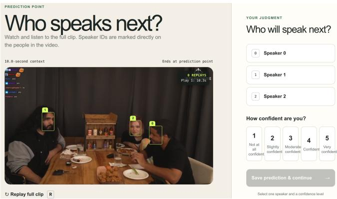
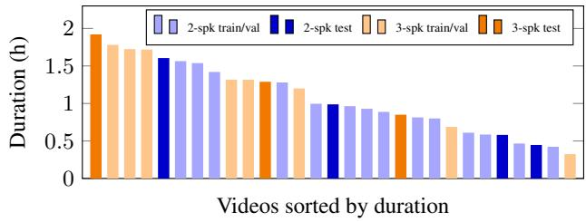
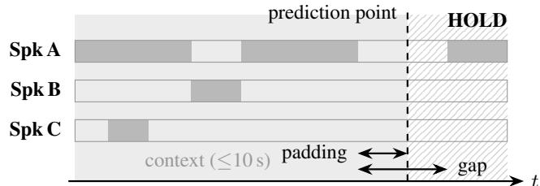
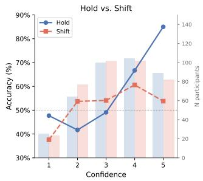
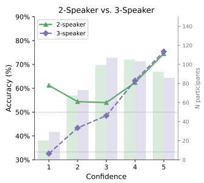

# AVCC: AUDIO-VISUAL CONVERSATION CORPUS FOR TURN-TAKING PREDICTION WITH A HUMAN BENCHMARK

Haotian Qi and Gabriel Skantze

Department of Speech, Music and Hearing, KTH Royal Institute of Technology, Stockholm

## ABSTRACT

Predicting who will speak next, and when, is a prerequisite for conversational agents and social robots that take turns without waiting for silence. Multiparty next-speaker prediction (NSP) has been studied on corpora with per-speaker sensors, each with its own event definitions. No public benchmark covers the single camera and microphone a robot has, and no model has been compared against how well people perform the same prediction. We turn AVCC, a 31-hour audio-visual corpus of two- and three-speaker online conversation recorded with a single static camera and microphone, into a public NSP benchmark. We add a speaker-disjoint seven-video test partition with 865 hold and 865 shift events at mutual-silence gaps, word-level forced-aligned transcripts for the whole corpus, and a human reference benchmark collected at the same events. We score an audio-only Role-Relative VAP model (RoleVAP) and the multimodal MuVAP model. Labels, transcripts, per-response human data, and the scripts that reproduce every number are released.

Index Terms— Turn-taking, next-speaker prediction, multimodal, human evaluation, corpus

## 1. INTRODUCTION

Speaker transitions in conversation take about 200 ms on average [1], less than the time needed to plan an utterance, so listeners must detect turn boundaries and even project the end of the current turn before it arrives [2, 3]. They draw on prosody, syntax and lexical content, gaze, and mouth and head movement [4–7]. In groups of three or more, the same moment holds a second decision: who among several candidates will take the floor [8]. Conversational agents and social robots that take turns at a human pace face both decisions and cannot wait for silence to resolve them [9]. We refer to the combined task as next-speaker prediction (NSP), and to the coarser question of whether the current speaker will continue or yield as the hold/shift decision.

Computational models of turn taking have followed two lines. One predicts the next speaker in multiparty conversation from gaze, head pose, mouth movement, and respiration [10–14] , typically on meeting or laboratory corpora recorded with eye trackers, close-talk microphones, or a camera per participant, and each study defines and evaluates its own set of turn events. The other treats turn taking as continuous prediction from the speech signal, from end-of-turn detection at silences through acoustic and lexical models [15, 16] to Voice Activity Projection (VAP) [17], which predicts the future voice activity of every speaker at every frame; this line is trained and evaluated on dyadic telephone corpora such as Switchboard [18], Fisher [19], and Switchboard-NXT [20], with one clean channel per speaker. The lines have begun to meet: VAP has been extended to three speakers [21], combined with gaze from head-worn sensors [22], and reformulated to map any number of speakers onto a current and a next floor holder so that one model applies to groups of any size [23]. Neither line has a public benchmark for the setting most social robots work in: one camera and one microphone for the whole group. Nor is there a shared set of prediction points on which systems can be compared, or a measure of how well people perform the same prediction. Without that measure we cannot tell whether a model at 65% accuracy is far from or close to what the signal allows.

Table 1. Corpora relevant to multiparty NSP. Spk: speakers per recording. Sns.: sensors, S = one camera at most and one audio channel, M = per-speaker microphones or several cameras. Mod.: modality, A = audio, V = video. Trans.: transcripts. NSP: hold/shift or next-speaker labels. Hum.: human NSP reference. ∼ = partial.
<table><tr><td colspan="4">Corpus</td><td colspan="3">Annotations</td><td rowspan="2"></td></tr><tr><td>Name</td><td>Spk Hrs</td><td></td><td></td><td></td><td></td><td>Sns. Mod. Trans. NSP Hum. Year</td></tr><tr><td>Switchboard [18]</td><td>2</td><td>260</td><td>M</td><td>A</td><td>√</td><td>一 1</td><td>1992</td></tr><tr><td>Fisher [19]</td><td>2</td><td>2000</td><td>M</td><td>A</td><td>√</td><td>1</td><td>2004</td></tr><tr><td>AMI [24]</td><td>3-5</td><td>100</td><td>M</td><td>A+V</td><td>√</td><td>一</td><td>2006</td></tr><tr><td>NoXi [25]</td><td>2</td><td>27</td><td>M</td><td>A+V</td><td>√</td><td>I</td><td>2017</td></tr><tr><td>AVA-AS [26]</td><td>2+</td><td>38</td><td>S</td><td>A+V</td><td>I</td><td>一 I</td><td>2020</td></tr><tr><td>MultiMediate [27] 3-4</td><td></td><td>16</td><td>M</td><td>A+V</td><td></td><td>~ 1</td><td>2021</td></tr><tr><td>MSDWild [28]</td><td>2+</td><td>32</td><td>S</td><td>A+V</td><td>一</td><td>一 一</td><td>2022</td></tr><tr><td>CANDOR [29]</td><td>2</td><td>850</td><td>M</td><td>A+V</td><td>√</td><td>一 一</td><td>2023</td></tr><tr><td>EgoCom [30]</td><td>3</td><td>38.5</td><td>M</td><td>A+V</td><td>√</td><td>2 一</td><td>2023</td></tr><tr><td>WASD [31]</td><td>2+</td><td>30</td><td>S</td><td>A+V</td><td>1</td><td>1 1</td><td>2024</td></tr><tr><td>TurnBench [32]</td><td>2</td><td>30</td><td>S</td><td>A</td><td>√</td><td>√ 一</td><td>2026</td></tr><tr><td>AVCC (ours)</td><td>2-3</td><td>31</td><td>S</td><td>A+V</td><td>√</td><td>√ √</td><td>2026</td></tr></table>

Existing audio-visual corpora do not close the gap (Table 1). AMI [24] records meetings with close-talk microphones and a camera array; EgoCom [30] uses one egocentric camera per participant and provides segment-level speaking labels rather than events at gap boundaries; CANDOR [29] records dyadic video calls with one stream per participant. NoXi [25], AVA-ActiveSpeaker (AVA-AS) [26], MSDWild [28], WASD [31], and MultiMediate [27] target active-speaker detection or group behavior and contain neither hold/shift events nor a human NSP reference. TurnBench [32] evaluates end-of-turn detection across six audio-only dyadic domains, with no video, no multiparty data, and no human reference. None of these combines the single camera and single microphone that most social robots have with multiparty data, transcripts for models that use lexical cues, event labels at prediction points, and a human reference measured at those same points.

AVCC1, the corpus used here, was introduced in [23] together with MuVAP: 31 hours of unscripted two- and three-speaker conversation from 29 online videos, each recorded without cuts from one static camera and one monaural track, released with hand-corrected voice activity labels and face tracks. That release was designed for training: it has a training and a validation partition but no held-out test data, its hold/shift events served to fit and validate a probe on the validation partition rather than to compare systems, it has no transcripts, and there is no measure of how well people perform the same task, so a new model can be trained on AVCC but not compared with other systems or human observers. This paper turns AVCC into a benchmark. Following [23], a turn event is a mutual-silence gap between two segments of speech, labeled shift when the floor changes speaker and hold when the same speaker continues. We contribute:

  
Fig. 1. The study interface. Participants watch a clip of up to 10 s with face labels (0, 1, 2 for three-speaker clips) drawn on every frame, then choose the next speaker and rate their confidence.

• Test partition and transcripts: a speaker-disjoint seven-video test partition with 865 hold and 865 shift events, word-level forced-aligned transcripts for the whole corpus, and the scripts that produce them and every number in this paper.

• Human benchmark: a study with 154 participants (Fig. 1) who predicted the next speaker from up to 10 s of audio-visual context, with a confidence rating per prediction, at exactly the prediction points used for models.

• Baselines and analysis: an audio-only RoleVAP model [17, 23], and the multimodal MuVAP model [23], scored on the same events under next-speaker identity and hold/shift scoring and compared with the participants by speaker count and by confidence.

## 2. AVCC: CORPUS AND ANNOTATIONS

## 2.1. Corpus Overview

AVCC contains 31 hours of unscripted conversation from 29 publicly available online videos (Table 2, Fig. 2). Videos were selected for continuous, unedited recording from one static camera with all speakers normally in view, and one monaural audio track; there are no cuts, no per-speaker microphones, and no camera motion. Long videos are stored as several contiguous files (segments); an event’s context window never crosses a segment boundary. The videos are podcast interviews, roundtable discussions, and gaming commentary. We count as speakers the people who produce at least 5% of the speech in a video; by this rule 18 videos have two speakers and 11 have three (one video includes a third person who speaks for about 1% of the time; nine videos also contain a bystander, labelled B, who is heard but not seen and is excluded from all counts). Partitions are assigned at the video level, so no speaker in the test partition appears in training or validation. The seven test videos, four with two speakers and three with three, cover all three genres and hold 417 hold and 417 shift events from two-speaker videos and 448 of each from three-speaker videos. Events are unevenly distributed over videos: one two-speaker video contributes 283 of the 417 two-speaker pairs and one three-speaker video 229 of the 448 three-speaker pairs.

  
Fig. 2. Duration of each of the 29 videos by speaker count and partition (longest 1 h 55 min, shortest 20 min, median 59 min).

Table 2. AVCC corpus overview. Durations are measured from the video files and rounded to the minute.
<table><tr><td>Subset</td><td>Videos</td><td>Duration</td></tr><tr><td>2-speaker</td><td>18</td><td>16h52m</td></tr><tr><td>3-speaker</td><td>11</td><td>14h07m</td></tr><tr><td>Training</td><td>17</td><td>20h39m</td></tr><tr><td>Validation</td><td>5</td><td>2h41m</td></tr><tr><td>Test</td><td>7</td><td>7h41m</td></tr><tr><td>Total</td><td>29</td><td>31h00m</td></tr></table>

From the corrected voice activity labels, the floor changes 14.3 times per minute in two-speaker videos and 16.4 times per minute in three-speaker videos. The most talkative speaker produces a median of 58% of the speech in two-speaker videos and 50% in three-speaker videos. These statistics, the durations in Table 2, and Fig. 2 are produced by a released script from the annotation files.

## 2.2. Annotation Pipeline

Face tracking. Faces are detected and identified per frame with InsightFace [33, 34]: SCRFD detection, ArcFace identity embeddings, and Hungarian assignment [35] to per-video speaker identities. All tracks were checked by hand for identity swaps between overlapping faces, tracks lost across segment boundaries, and detections on photographs.

Voice activity. Speech labels were initialized with TalkNet [36] at its default confidence threshold, after which every segment was corrected with our own annotation tool.

Transcripts and alignment. Each speaker turn was transcribed with Voxtral [37]. We inspected all utterance-level transcripts by hand, marking non-English speech as [foreign] and unintelligible speech as [unk]; laughter is not transcribed. Words were then force aligned with the Montreal Forced Aligner [38] (English acoustic model, CMU dictionary), constrained to the transcribed segment, then all errors were corrected by hand.

Turn events (Fig. 3). Words of the same speaker separated by at most 0.1 s are merged into inter-pausal units, which are regrouped into utterances. A candidate event is a mutual-silence gap that satisfies all of the following: the raw gap is shorter than 3.0 s; after 0.1 s of padding at least 0.1 s of silence remains; the next speaker produces at least 1.0 s of speech in the 2.0 s after the gap and is the only active speaker in the first 1.0 s; and the gap contains no laughter or other vocal noise. Holds outnumber shifts, so holds were down-sampled at random to match, giving 865 shift and 865 hold events on the test partition.

  
Fig. 3. A turn event at a mutual-silence gap hold. The dashed line is the prediction point, 0.1 s of padding after the previous speaker’s last word. Up to 10 s of context precede it (shaded). The rest of the gap (at most 3 s) and the following speech (hatched) are withheld.

## 3. HUMAN BENCHMARK AND EVALUATION

## 3.1. Participants

Participants were recruited through two channels: 85 people from the authors’ personal network and 103 participants on Prolific [39]. In total 188 people answered at least one of the 30 main-study trials. Participation was voluntary and informed consent was obtained before the task. Each participant rated their own English proficiency once on a five-level scale (native, near-native, advanced, intermediate, beginner). The retained sample contains 82 native, 40 near-native and 32 advanced speakers.

## 3.2. Task and Interface

Each trial presents one clip: the audio and video from 10 s before the gap onset up to the gap onset. Face boxes labeled 0, 1, and 2 are drawn on every frame from the corpus face tracks (Fig. 1). Each trial shows one clip of one event. The response buttons appear only after the clip has played to the end once. Participants may replay the clip as often as they wish, then pick the face they expect to speak next and rate their confidence from 1 (“not at all confident”) to 5 (“very confident”).

Each participant judged 30 events in three rounds of ten, each round containing five hold and five shift events, so that every complete participant saw 15 events of each type. Two events from the same segment less than 10 s apart were never given to the same participant.

## 3.3. Quality Filtering

Participants are excluded by three rules, applied by the released script and listed here with the number of participants each rule removes (rules overlap). R1: self-reported proficiency below advanced (13). R2: automatic flags: fewer than 4 saved trials, three or more skipped clips (18). R3: Prolific submissions that were returned or timed out (6). Partial sessions of at least 4 trials are kept, because per-participant accuracy is a mean over that participant’s own responses and does not require equal counts. Of the 188 people, 34 are removed by at least one rule and 154 are retained. Four of them took part in short follow-up runs on events with tied votes; their responses are treated like every other response.

## 3.4. Evaluation

Human-Ind, RoleVAP, and MuVAP are measured on the same 1,730 test events. Human-Maj is measured on the events with an untied plurality (1,479 events under NSP scoring, 1,526 under hold/shift scoring). Hold/shift scoring collapses a response to hold when the chosen face is the previous speaker and to shift otherwise. RoleVAP predicts a current and a next role and cannot name the next speaker from monaural audio, so it is scored on hold/shift only. For both models the hold/shift decision is read out by a logistic regression fitted on the model’s embedding at the prediction point, using the AVCC training partition (probe). MuVAP is also scored on NSP. It names the current floor holder from its own output; on a probe decision of hold it predicts that speaker, on shift the most probable other speaker. The hold/shift row scores the probe decision alone, the NSP row the named speaker, which also depends on identifying the floor holder. We report balanced accuracy, the mean of hold and shift accuracy, overall and per speaker count. Human-Ind is the mean over participants of their hold and shift accuracy in a cell. Human-Maj assigns each event the label with the most votes and drops ties.

Table 3. Accuracy (%) on the 1,730 AVCC test events (865 hold / 865 shift). Left: balanced accuracy by scoring and speaker count. Right: hold and shift accuracy by class. Human-Ind: mean per-participant accuracy (N=154). Human-Maj: plurality label per event, ties excluded (251 under NSP scoring, 204 under hold/shift); the model rows beneath it are scored on the same retained events. Random Baseline: expected accuracy of a uniform guess over the faces (NSP) or over hold and shift, weighted by the events in each cell. Human-Maj baseline is 41.5. Scoring and the probe readout as in Sec. 3.4.
<table><tr><td rowspan="3"></td><td colspan="6">Balanced accuracy</td><td colspan="4">Per class</td></tr><tr><td colspan="3">NSP</td><td colspan="3">Hold/shift</td><td colspan="2">NSP</td><td colspan="2">Hold/shift</td></tr><tr><td>2-spk 3-spk</td><td></td><td>All</td><td>2-spk 3-spk</td><td></td><td>All</td><td>hold</td><td>shift</td><td>hold</td><td>shift</td></tr><tr><td>All events</td><td></td><td></td><td></td><td></td><td></td><td></td><td></td><td></td><td></td><td></td></tr><tr><td>Random Baseline</td><td>50.0</td><td>33.3</td><td>41.4</td><td>50.0</td><td>50.0</td><td>50.0</td><td>41.4</td><td>41.4</td><td>50.0</td><td>50.0</td></tr><tr><td>Human-Ind</td><td>63.1</td><td>57.0</td><td>59.5</td><td>63.1</td><td>65.1</td><td>64.0</td><td>63.6</td><td>55.4</td><td>63.6</td><td>64.4</td></tr><tr><td>RoleVAP (probe) [23]</td><td></td><td></td><td></td><td>65.2</td><td>67.7</td><td>66.5</td><td></td><td></td><td>54.9</td><td>78.2</td></tr><tr><td>MuVAP (probe) [23]</td><td>67.5</td><td>59.4</td><td>63.3</td><td>66.7</td><td>69.0</td><td>67.9</td><td>62.8</td><td>63.8</td><td>58.7</td><td>77.0</td></tr><tr><td>Non-tied events</td><td></td><td></td><td></td><td></td><td></td><td></td><td></td><td></td><td></td><td></td></tr><tr><td>Human-Maj</td><td>67.6</td><td>67.8</td><td>67.7</td><td>67.6</td><td>72.3</td><td>70.1</td><td>72.5</td><td>62.9</td><td>70.2</td><td>70.1</td></tr><tr><td>RoleVAP (probe)</td><td></td><td></td><td></td><td>65.9</td><td>68.6</td><td>67.3</td><td></td><td></td><td>55.4</td><td>79.2</td></tr><tr><td>MuVAP (probe)</td><td>68.1</td><td>59.8</td><td>63.9</td><td>67.4</td><td>70.5</td><td>69.1</td><td>63.8</td><td>64.0</td><td></td><td>59.4 78.7</td></tr></table>

## 4. RESULTS

Under NSP scoring in Table 3, the mean participant reaches 59.5%, with 63.1% on two-speaker and 57.0% on three-speaker events, a loss of 6.1 points; the majority vote reaches 67.7% on the 1,479 untied events. MuVAP reaches 63.3%, 3.8 points above the mean participant and 4.4 points below the majority vote, and loses 8.1 points from twoto three-speaker events (67.5% and 59.4%). On two-speaker events its NSP accuracy higher than its hold/shift accuracy (66.7%) because a misidentified floor holder and a wrong turn decision can cancel and still name the right face.

Under hold/shift scoring where RoleVAP can be measured on, the mean participant reaches 64.0% and the majority vote 70.1% on 1,526 untied events. RoleVAP reaches 66.5%, 2.5 points above the mean participant and 3.6 points below the majority vote; MuVAP reaches 67.9%, 1.4 points above the audio-only model. Both models gain with the number of speakers under this scoring (65.2% and 67.7% for RoleVAP, 66.7% and 69.0% for MuVAP), as do the participants when they need not name the speaker (63.1% and 65.1%).

Participants find holds easier than shifts when they must name the speaker: the majority vote reaches 72.5% on holds and 62.9% on shifts under NSP scoring, while under hold/shift scoring the two are level. Both models show the opposite balance under hold/shift scoring, RoleVAP 54.9% on holds and 78.2% on shifts, MuVAP 58.7% and 77.0%, so their lead over the mean participant comes from shifts that people miss, and they lose on holds that people get right. Under NSP scoring MuVAP’s hold and shift accuracy are level (62.8% and 63.8%); on three-speaker shifts it names the incoming speaker in 57.4% of events.

  
Fig. 4. Per-participant accuracy by self-reported confidence. Left: hold (blue) vs. shift (orange). Right: two-speaker (green) vs. threespeaker (purple) clips. Bars give the number of participants contributing to each point; dotted lines mark chance (50% and 33%).

Fig. 4 splits per-participant accuracy by confidence. Hold accuracy rises from 43.2% at confidence 1 to 85.0% at confidence 5, while shift accuracy stays between 51.5% and 60.1% at ratings 2 to 5 and peaks at rating 4, not 5. Speaker count shows a different pattern: at confidence 1, three-speaker accuracy (35.6%) and two-speaker accuracy (52.8%) both sit close to their chance levels where at confidence 5 both exceed 75%.

## 5. DISCUSSION

The human reference gives two anchors: either treating each judgement as a datapoint (Human-Ind) or only keeping events where there was a plurality (Human-Maj). Human-Maj is defined on fewer events, so the models are compared to it on the same retained events (lower block of Table 3); comparisons to Human-Ind use all events. On balanced accuracy both models fall between the two anchors. On the hold/shift decision RoleVAP is 2.5 points above the mean participant and 2.8 below the crowd; MuVAP is 3.9 above and 1.0 below. On NSP, MuVAP is 3.8 above the mean participant and 3.8 below the crowd. Adding video to audio buys 1.4 points on hold/shift. The per-class columns show where the gap is: both models predict shift too often, scoring above the crowd on shifts but below the mean participant on holds. A current model already beats one person watching the clip; the 1 to 4 points to the crowd, mostly on holds, are the remaining headroom.

Going from two to three speakers costs participants 6.1 points on NSP and nothing on hold/shift, where they gain 2.0. MuVAP behaves the same way, 8.1 points down on NSP and 2.3 up on hold/shift, and RoleVAP gains 2.5. The extra speaker does not make the change harder to detect shift or hold but it makes the next speaker harder to pin point exactly who will take the turn. For MuVAP the floor holder is not the problem: it is identified in 93.4% of events, and on those events alone NSP accuracy rises only from 63.3% to 64.4%. The loss is in choosing between the two candidates, where MuVAP names the right one in 57.4% of three-speaker shifts.

Fig. 4 shows that participants know when a hold is coming: hold accuracy rises from 43.2% to 85.0% across the five ratings. For shifts confidence carries almost no information, with accuracy between 51.5% and 60.1% and a peak at rating 4. At the lowest rating both two- and three-speaker accuracy sit at chance, so low confidence is well calibrated. The released ratings thus mark the events people themselves cannot decide, and those are shifts.

Votes tie on 251 events under NSP scoring; 151 of them are shifts and 145 come from three-speaker videos, so a tie is most often a multiparty shift. Many of these are barge-ins or open questions put to the group: neither the audio nor the preceding context singles out a speaker, and the only cue is visual, the incoming speaker starting to move just before the gap.

Limitations. Participants were third-party observers of clips of at most 10 s, and they answered at the gap onset without seeing or hearing the gap itself. Any cue that appears inside the gap is therefore lost to them, including the fast visual cues an incoming speaker gives just before starting to talk. This makes short gaps easier than long ones: when the gap is short, the prediction point lies close to the next turn, so more of the next speaker’s cues falls inside the visible context.

## 6. CONCLUSION

We have extended AVCC, a corpus of two- and three-party conversation recorded with a single camera and a single audio channel, together with a speaker-disjoint test partition of 865 shift and 865 hold events, word-level transcripts, and a crowdsourced human bench mark collected at the same prediction points used to evaluate models. With a readout fitted on the AVCC training partition, an audio-only Role-Relative VAP model scores 66.5% on the hold/shift decision, against 64.0% for the mean participant and 70.1% for the plurality vote, and the multimodal MuVAP model reaches 67.9%, and 63.3% when it has to name the next speaker. Scored on next-speaker identity, participants drop 6.1 points from two to three speakers while their hold/shift accuracy does not, so the third speaker makes it harder to name the incoming speaker, not to detect the change; MuVAP loses 8.1 points on the same step and names the incoming speaker in 57.4% of three-speaker shifts. Participants predict holds better than shifts when naming the speaker, both models the reverse on the hold/shift decision, and participants’ shift accuracy barely increases with their confidence. In three-party shifts the next speaker has to be picked out of the group. Neither audio alone nor a single observer does this reliably, and that is where we expect the benchmark to be most useful.

## 7. ACKNOWLEDGMENT

This work was supported by the Wallenberg AI, Autonomous Systems and Software Program (WASP) funded by the Knut and Alice Wallenberg Foundation (KAW). The computations and data handling were enabled by the Berzelius resource provided by the Knut and Alice Wallenberg Foundation at the National Supercomputer Centre. The authors have no relevant financial or nonfinancial interests to disclose. Generative AI tools were used only to edit the text for grammar; they generated no scientific content, figures, or code.

## 8. COMPLIANCE WITH ETHICAL STANDARDS

The human benchmark study followed the principles of the Declaration of Helsinki. It involved no physical intervention, no method intended to affect participants, no risk of harm, and no sensitive personal data, so under the Swedish Ethics Review Act (2003:460) it did not require approval by the Swedish Ethical Review Authority. Participants were informed of the purpose of the study, gave informed consent before the task, could withdraw at any time, and Prolific participants were paid at the platform’s recommended rate. The corpus consists of publicly available online videos.

## 9. REFERENCES

[1] Tanya Stivers et al., “Universals and cultural variation in turntaking in conversation,” Proc. Natl. Acad. Sci. USA, vol. 106, no. 26, pp. 10587–10592, 2009.

[2] Stephen C. Levinson and Francisco Torreira, “Timing in turntaking and its implications for processing models of language,” Frontiers in Psychology, vol. 6, pp. 731, 2015.

[3] Jan P. de Ruiter, Holger Mitterer, and Nick J. Enfield, “Projecting the end of a speaker’s turn: A cognitive cornerstone of conversation,” Language, vol. 82, no. 3, pp. 515–535, 2006.

[4] Starkey Duncan, “Some signals and rules for taking speaking turns in conversations,” J. Pers. Soc. Psychol., vol. 23, no. 2, pp. 283–292, 1972.

[5] Starkey Duncan and Donald W. Fiske, Face-to-Face Interaction: Research, Methods, and Theory, Lawrence Erlbaum Associates, 1977.

[6] Adam Kendon, “Some functions of gaze direction in social interaction,” Acta Psychologica, vol. 26, pp. 22–63, 1967.

[7] Agust´ın Gravano and Julia Hirschberg, “Turn-taking cues in task-oriented dialogue,” Comput. Speech Lang., vol. 25, no. 3, pp. 601–634, 2011.

[8] Harvey Sacks, Emanuel A. Schegloff, and Gail Jefferson, “A simplest systematics for the organization of turn-taking for conversation,” Language, vol. 50, no. 4, pp. 696–735, 1974.

[9] Gabriel Skantze, “Turn-taking in conversational systems and human-robot interaction: A review,” Comput. Speech Lang., vol. 67, pp. 101178, 2021.

[10] Kristiina Jokinen, Hirohisa Furukawa, Masafumi Nishida, and Seiichi Yamamoto, “Gaze and turn-taking behavior in casual conversational interactions,” ACM Trans. Interact. Intell. Syst., vol. 3, no. 2, pp. 12:1–12:30, 2013.

[11] Ryo Ishii, Shiro Kumano, and Kazuhiro Otsuka, “Analyzing mouth-opening transition pattern for predicting next speaker in multi-party meetings,” in Proc. ICMI, 2016, pp. 209–216.

[12] Ryo Ishii, Kazuhiro Otsuka, Shiro Kumano, and Junji Yamato, “Using respiration to predict who will speak next and when in multiparty meetings,” ACM Trans. Interact. Intell. Syst., vol. 6, no. 2, pp. 20:1–20:20, 2016.

[13] Usman Malik, Julien Saunier, Kotaro Funakoshi, and Alexandre Pauchet, “Who speaks next? Turn change and next speaker prediction in multimodal multiparty interaction,” in Proc. IEEE ICTAI, 2020, pp. 349–354.

[14] Dan Bohus and Eric Horvitz, “Decisions about turns in multiparty conversation: From perception to action,” in Proc. ICMI, 2011, pp. 153–160.

[15] Matthew Roddy, Gabriel Skantze, and Naomi Harte, “Investigating speech features for continuous turn-taking prediction using LSTMs,” in Proc. Interspeech, 2018, pp. 1926–1930.

[16] Erik Ekstedt and Gabriel Skantze, “TurnGPT: A transformerbased language model for predicting turn-taking in spoken dialog,” in Proc. EMNLP (Findings), 2020, pp. 2981–2990.

[17] Erik Ekstedt and Gabriel Skantze, “Voice activity projection: Self-supervised learning of turn-taking events,” in Proc. Interspeech, 2022, pp. 236–240.

[18] John J. Godfrey, Edward C. Holliman, and Jane McDaniel, “SWITCHBOARD: Telephone speech corpus for research and development,” in Proc. ICASSP, 1992, pp. 517–520.

[19] Christopher Cieri, David Miller, and Kevin Walker, “The Fisher corpus: A resource for the next generations of speech-to-text,” in Proc. LREC, 2004, pp. 69–71.

[20] Sasha Calhoun et al., “The NXT-format Switchboard corpus: A rich resource for investigating the syntax, semantics, pragmatics and prosody of dialogue,” Lang. Resour. Eval., vol. 44, pp. 387–419, 2010.

[21] Mikey Elmers et al., “Triadic multi-party voice activity projection for turn-taking in spoken dialogue systems,” in Proc. Interspeech, 2025, pp. 3015–3019.

[22] Seonguk Heo et al., “Gaze-enhanced multimodal turn-taking prediction in triadic conversations,” in Proc. Interspeech, 2025, pp. 1068–1072.

[23] Haotian Qi and Gabriel Skantze, “MuVAP: Multimodal multiparty voice activity projection for turn-taking prediction in the wild,” arXiv preprint arXiv:2606.16731, 2026.

[24] Jean Carletta et al., “The AMI meeting corpus: A preannouncement,” in Proc. MLMI, 2006, pp. 28–39.

[25] Angelo Cafaro et al., “The NoXi database: Multimodal recordings of mediated novice-expert interactions,” in Proc. ACM ICMI, 2017, pp. 350–359.

[26] Joseph Roth et al., “AVA-ActiveSpeaker: An audio-visual dataset for active speaker detection,” in Proc. ICASSP, 2020, pp. 4492–4496.

[27] Philipp Muller et al., “MultiMediate: Multi-modal group be-¨ haviour analysis for artificial mediation,” in Proc. ACM Multimedia, 2021, pp. 4878–4882.

[28] Tao Liu et al., “MSDWild: Multi-modal speaker diarization dataset in the wild,” in Proc. Interspeech, 2022, pp. 1476–1480.

[29] Andrew Reece et al., “The CANDOR corpus: Insights from a large multimodal dataset of naturalistic conversation,” Science Advances, vol. 9, no. 13, pp. eadf3197, 2023.

[30] Curtis G. Northcutt et al., “EgoCom: A multi-person multimodal egocentric communications dataset,” IEEE Trans. Pattern Anal. Mach. Intell., vol. 45, no. 6, pp. 6783–6793, 2023.

[31] Tiago Roxo and Hugo Proenc¸a, “WASD: A wilder active speaker detection dataset,” IEEE Trans. Pattern Anal. Mach. Intell., vol. 46, no. 12, pp. 8431–8443, 2024.

[32] Fei Jiang et al., “TurnBench: A multi-domain benchmark for turn-taking dynamics in spoken dialogue,” arXiv preprint arXiv:2608.25218, 2026.

[33] Jiankang Deng et al., “ArcFace: Additive angular margin loss for deep face recognition,” in Proc. CVPR, 2019, pp. 4690– 4699.

[34] Jia Guo et al., “Sample and computation redistribution for efficient face detection,” in Proc. ICLR, 2022.

[35] Harold W. Kuhn, “The Hungarian method for the assignment problem,” Nav. Res. Logist. Q., vol. 2, no. 1–2, pp. 83–97, 1955.

[36] Ruijie Tao et al., “Is someone speaking? exploring long-term temporal features for audio-visual active speaker detection,” in Proc. ACM Multimedia, 2021, pp. 3927–3935.

[37] Alexander H. Liu et al., “Voxtral,” arXiv preprint arXiv:2507.13264, 2025.

[38] Michael McAuliffe et al., “Montreal forced aligner: Trainable text-speech alignment using Kaldi,” in Proc. Interspeech, 2017, pp. 498–502.

[39] Prolific Academic Ltd., “Prolific: A platform for recruiting online research participants,” https://www.prolific. com, 2014.