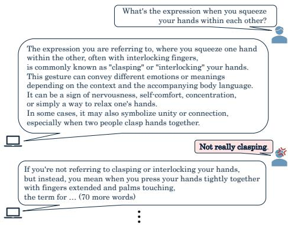
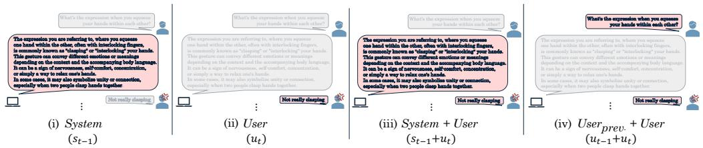
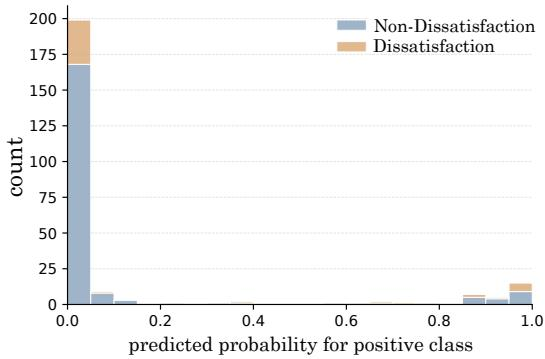
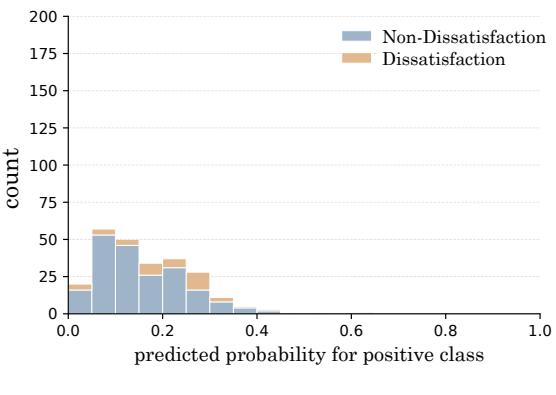
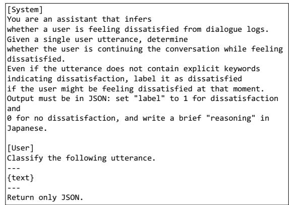

# Beyond Fluent Responses: Finding User Dissatisfaction in Human–AI Interactions

Yuka Saito1, Ikumi Numaya1, Jun Suzuki1,2,3, Reina Akama1,2,4 1Tohoku University, 2RIKEN, 3NII LLMC, 4NINJAL is-failab-research@grp.tohoku.ac.jp

## Abstract

As large language models generate increasingly high-quality responses, recent work on response evaluation has moved beyond response-centered criteria, such as correctness and coherence, toward user-centered criteria, including user preferences and perceived usefulness. This shift is fundamentally important for developing technologies that are truly useful to real-world users. While conventional response evaluation quantifies the quality of the response itself, users satisfaction in real conversations also depends on their subjective preferences and perceptions of usefulness, which do not necessarily align with response quality. This study investigates whether such user-centered signals can be detected from conversational text. Specifically, we analyze user utterances with self-reported dissatisfaction labels to examine whether user dissatisfaction in text can be detected. In English interaction, models using user utterances exceeded the 17.8% dissatisfaction label prevalence in AUPRC by up to 15 percentage points. These results suggest that user utterances reveal cues to implicit dissatisfaction. Furthermore, changes from the immediately preceding user utterance may improve dissatisfaction detection, with anomaly detection methods appearing particularly efective.

## 1 Introduction

Recent advances in large language models (LLMs) have enabled increasingly fluent and sophisticated response generation, leading to their growing use in chat-based text interactions, such as Chat-GPT1 (Chatterji et al., 2025). Iterative dialogue between users and LLMs has now become commonplace, and LLMs are increasingly being positioned as communication partners in contexts conventionally dominated by human–human interaction (Yang et al., 2024; Tanguy et al., 2025; Flathmann et al., 2025). With the continued expansion of their social use, opportunities for interaction with non-human agents are expected to grow further, raising the standards users expect from such interactions.

  
Figure 1: Data format for dissatisfaction detection. Given a user utterance after a system response, the task is to detect whether it reflects user dissatisfaction, using self-reported labels as ground truth.

Traditionally, the evaluation of model-generated responses has focused primarily on the responses themselves, with an emphasis on correctness and coherence (Lowe et al., 2017; Zheng et al., 2023; Lin and Chen, 2023; Mendonça et al., 2024). In recent years, response-centered evaluations have demonstrated strong performance (Zhang et al., 2020; Lin and Chen, 2023). However, users’ evaluations of system responses are shaped not only by response qualities, but also by subjective factors such as user preferences (Dybkjær and Bernsen, 2001; Fu et al., 2025). Indeed, prior work has shown that human preferences do not always align with response correctness or objective quality (Li et al., 2024; Sharma et al., 2024). These findings suggest that, as generated responses become more fluent and sophisticated, LLMs need to look beyond correctness and account for users’ preferences and intentions (Lin et al., 2024; Liu et al., 2025). Recent studies have therefore estimated user emotions or satisfaction from observable textual signals, such as user utterances, and used them to evaluate system responses (Ghazarian et al., 2022). These approaches implicitly assume that users’ afective states are reflected, at least to some extent, in their utterances and can be detected by third-party annotators or models. However, even when users experience specific emotions, these internal afective states are not always explicitly expressed in text (Katada et al., 2024; Koga et al., 2024). Moreover, user satisfaction is not simply positive or negative sentiment, as it depends on whether users’ needs, goals, or preferences are fulfilled (Deng et al., 2022). Precisely because response generation quality has substantially improved, it is now important to understand satisfaction- or dissatisfaction-related user states from conversational interactions.

In this study, we investigate to what extent user dissatisfaction can be detected from subsequent user utterances in text-based chat interactions. We treat dissatisfaction as an afective reaction that arises when a system response is perceived as failing to meet the user’s intent, preferences, or needs. As illustrated in Figure 1, we formulate this as an utterance-level detection task using real ChatGPT dialogues. We test multiple input conditions based on user utterances, including conditions that incorporate preceding system response or user utterance. Using binary classification and anomaly detection, we further evaluate dissatisfaction detectability and explore how user dissatisfaction tends to appear in text. The results indicate that user dissatisfaction can be detected to some extent, and suggest that behavioral and stylistic deviations from a prior state may provide informative cues for detecting dissatisfaction, particularly in anomaly detection.

## 2 Related Work

## 2.1 System Evaluation in Interaction with AI

Prior studies on human–AI interaction have widely adopted automatic evaluation methods that focus on system responses. Such methods include automatic evaluators trained on human judgments (Lowe et al., 2017) and LLM-as-a-judge approaches (Zheng et al., 2023; Lin and Chen, 2023). In addition to evaluating positive aspects such as response quality, recent work has highlighted the importance of incorporating negative aspects such as dissatisfaction (Abolghasemi et al., 2024), and datasets annotated with users’ own dissatisfaction have also been introduced (Kim et al., 2024). Several recent studies have further explored user utterances as signals of user reactions, because they often contain requests and emotions directed toward system responses (Ghazarian et al., 2022; Liu et al., 2025). Building on this line of research, this study focuses on dissatisfaction latent in user utterances.

## 2.2 Emotion Estimation

To improve dialogue quality, extensive research has been conducted on estimating emotions at the utterance level. Representative methods include DialogueRNN (Majumder et al., 2019), fine-tuned models such as BERT and RoBERTa (Qin et al., 2023), and more recent LLM-based methods (Feng et al., 2024; Hernandez Caralt et al., 2025). Many of these studies rely on emotion labels provided by third-party annotators rather than by the users themselves (Busso et al., 2008; Poria et al., 2019; Li et al., 2017; Sun et al., 2021; See and Manning, 2021). On the other hand, it has been reported that emotions perceived by third-party annotators often do not match users’ actual emotions (Truong et al., 2012; Komatani et al., 2023; Numaya et al., 2025; Kajiwara et al., 2021). Since this study focuses on users’ reactions to system responses rather than the correctness of the responses, we examine dissatisfaction detection within the framework of emotion estimation using self-reported labels.

## 2.3 Emotional Expression in Human–AI Interaction

Prior research in psychology suggests that communication with non-human agents may exhibit characteristics distinct from human–human interaction (Gero et al., 2023; Mysore et al., 2025), including the facilitation of negative emotion externalization (Ho et al., 2018). This property may provide clearer and more interpretable cues for analyzing negative efects, such as dissatisfaction, arising during dialogue with AI.

## 3 Experimental Setup

## 3.1 Dissatisfaction Detection

In this study, dissatisfaction is treated as an afective reaction that arises when a system response is perceived as failing to suficiently meet the user’s intent or preferences. We investigate the extent to which such dissatisfaction can be detected from subsequent user utterances in text-based chat interactions. Specifically, we used user utterances as input and treated labels derived from users’ self-reported dissatisfaction with the immediately preceding system responses as the ground truth.

  
Figure 2: The four conditions used in the experiment. By examining these input conditions, we evaluate the efectiveness of detecting dissatisfaction using user utterances.

## 3.2 Dataset

To analyze dissatisfaction at the level of individual user utterances, we used the ChatGPT Dissatisfaction Dataset (Kim et al., 2024), specifically its English subset, containing the largest number of annotated instances. The dataset comprises interactions in which users labeled system responses from ChatGPT as dissatisfying. In this study, a user utterance was labeled as dissatisfied when it immediately followed a system response that the user had self-reported as dissatisfying, because such utterances could potentially reflect latent dissatisfaction; otherwise, it was labeled as non-dissatisfied. To ensure reliability, we conducted a preprocessing step to remove incomplete instances. The final dataset contains 107 dialogues and 824 utterances, of which approximately 17.8% are labeled as dissatisfied2. Given the limited dataset size, five random splits were created, partitioning the data into training, validation, and test sets with a 6:1:3 ratio3.

## 3.3 Input Settings

Let $u _ { t }$ denote the user utterance at turn t in a dialogue of length L (total turns), and $s _ { t }$ denote the corresponding system response. The dialogue is represented as a sequence of utterance pairs $\{ ( u _ { t } , s _ { t } ) \} _ { t = 1 } ^ { L }$ . For dissatisfaction detection centered on $u _ { t } .$ , four input conditions were defined, as illustrated in Figure 2. The System uses only the immediately preceding system response $s t { - 1 } .$ , for the comparison with conventional response-based methods (Lowe et al., 2017; Zheng et al., 2023; Lin and Chen, 2023). The User uses only $u _ { t } ,$ to examine how much dissatisfaction is inferred from the user utterances. The System+User incorporates both $s _ { t - 1 }$ and $u _ { t }$ to interpret $u _ { t }$ as a reaction to the preceding system response (Ghazarian et al., 2022;

Liu et al., 2025). The $U s e r _ { p r e \nu . } + U s e r$ uses the pair of $u _ { t } .$ −1 and $u _ { t }$ to investigate whether dissatisfaction manifests as the change in user utterances.

## 3.4 Methods and Output

To evaluate the extent to which dissatisfaction can be detected from user utterances, two approaches were employed: binary classification, commonly used for emotion estimation (Mahato et al., 2024; Kubo et al., 2025), and anomaly detection, which is suited to imbalanced data (Barrett et al., 2022).

Binary Classification. In the binary classification setting, each $u _ { t }$ was classified as either dissatisfied or non-dissatisfied. Both BERT-based and GPT-based models, widely used in prior work, were adopted. For BERT-based models, given the limited dataset size, which may be insuficient for fine-tuning large models (Turc et al., 2019; Zhang et al., 2024; Grießhaber et al., 2020), compact variants—BERT-small4 and BERT-mini5—were fine-tuned (Bhargava et al., 2021; Wasserblat et al., 2020). These models output the probability of the dissatisfied class on the test set. For GPT-based models, GPT-5.1 was used with prompting-based approaches, specifically zero-shot and two-shot settings, to classify utterances without additional training (Mahato et al., 2024; Kubo et al., 2025)6.

Anomaly Detection. Given the class imbalance, with a relatively small proportion of dissatisfied utterances, anomaly detection was additionally performed by treating dissatisfied utterances as anomalies. Specifically, inputs were converted into embeddings, and anomaly scores were computed in the resulting vector space. For embedding models, bert-base-uncased7 (BERT) and text-embeddi $\mathtt { n 9 - 3 - 1 a r g e } ^ { 8 }$ (GPT) were used, following recent findings that embedding-based anomaly detection methods are efective in NLP and that both BERT-based and OpenAI embeddings achieve competitive performance (Li et al., 2025). We used Local Outlier Factor (LOF) (Breunig et al., 2000), LUNAR (Unifying Local Outlier Detection Methods via Graph Neural Networks) (Goodge et al., 2022), Autoencoder (AE) (Aggarwal, 2017), and Variational Autoencoder (VAE) (Kingma and Welling, 2013; Burgess et al., 2018)9. During evaluation, anomaly scores were assigned to the test set.

<table><tr><td rowspan="2">Category</td><td rowspan="2">Method</td><td colspan="4">Input setting</td></tr><tr><td> $S y s t e m$   $\left( { { s _ { t - 1 } } } \right)$ </td><td> $U s e r$   $\left( { { u } _ { t } } \right)$ </td><td> $S y s t e m + U s e r$   $\left( s _ { t - 1 } + u _ { t } \right)$ </td><td> $U s e r _ { p r e \nu . } + U s e r$   $\left( u _ { t - 1 } + u _ { t } \right)$ </td></tr><tr><td rowspan="4">Binary Classification</td><td>BERT-small BERT-mini</td><td> $3 2 . 0 \pm 6 . 9$ </td><td> $3 3 . 1 \pm 2 . 7$ </td><td> $3 3 . 0 \pm 6 . 3 ( - 0 . 1 )$ </td><td> $3 3 . 2 \pm 3 . 1 \ : ( + 0 . 1 )$ </td></tr><tr><td></td><td> $3 1 . 1 \pm 6 . 2$ </td><td> $3 0 . 9 \pm 2 . 9$ </td><td> $3 0 . 3 \pm 7 . 3 \ : ( - 0 . 6 )$ </td><td> $2 6 . 4 \pm 3 . 2 \ : ( - 4 . 5 )$ </td></tr><tr><td>GPT-5.1 (zero-shot)</td><td> $2 0 . 3 \pm 2 . 4$ </td><td> $2 5 . 9 \pm 2 . 5$ </td><td> $1 9 . 9 \pm 0 . 7 \ : ( - 6 . 0 )$ </td><td> $2 3 . 7 \pm 2 . 0 \dot { ( } - 2 . 2 \dot { ) }$ </td></tr><tr><td>GPT-5.1 (two-shot)</td><td> $1 8 . 9 \pm 1 . 1$ </td><td> $2 6 . 1 \pm 2 . 8$ </td><td> $2 0 . 7 \pm 0 . 9 ( - 5 . 4 )$ </td><td> $2 6 . 0 \pm 3 . 1 \dot { ( - 0 . 1 ) }$ </td></tr><tr><td rowspan="7">Anomaly Detection</td><td>LOF (BERT)</td><td> $2 4 . 3 \pm 2 . 0$ </td><td> $2 1 . 2 \pm 4 . 2$ </td><td> $2 5 . 5 \pm 4 . 2 ( + 4 . 3 )$ </td><td> $2 2 . 0 \pm 3 . 4 ( + 0 . 8 )$ </td></tr><tr><td>LOF (GPT)</td><td> $2 6 . 2 \pm 1 . 2$ </td><td> $2 0 . 0 \pm 2 . 1$ </td><td> $2 7 . 5 \pm 2 . 5 ( + 7 . 5 )$ </td><td> $3 2 . 8 \pm 4 . 6 \check { ( + 1 2 . 8 ) }$ </td></tr><tr><td>LUNÀR (BERT)</td><td> $2 1 . 4 \pm 2 . 0$ </td><td> $2 1 . 5 \pm 2 . 9$ </td><td> $2 2 . 6 \pm 2 . 8 \mathrm { { \dot { ( + 1 . 1 ) } } }$ </td><td> $2 4 . 0 \pm 3 . 4 ( + 2 . 5 )$ </td></tr><tr><td>LUNAR (GPT)</td><td> $2 5 . 3 \pm 3 . 6$ </td><td> $2 0 . 1 \overset { } { \pm } 3 . 4$ </td><td> $2 8 . 6 \pm 3 . 7 \ : \mathrm { \dot { ( + 8 . 5 ) } }$ </td><td></td></tr><tr><td>AE (BERT)</td><td> $2 1 . 1 \pm 1 . 6$ </td><td> $2 2 . 7 \pm 5 . 0$ </td><td> $2 2 . 7 \pm 1 . 2 \ : ( \pm 0 . 0 )$ </td><td> $2 9 . 6 \pm 7 . 8 \ : ( + 9 . 5 )$ </td></tr><tr><td>AE (GPT)</td><td> $2 5 . 9 \pm 2 . 3$ </td><td> $2 0 . 5 \pm 1 . 7$ </td><td> $2 5 . 9 \pm 2 . 1 \ \mathring { ( + 5 . 4 ) }$ </td><td> $2 3 . 4 \pm 2 . 1 \ ( + 0 . 7 )$   $2 9 . 1 \pm 3 . 6 \ : ( + 8 . 6 )$ </td></tr><tr><td>VAÊ (BERT)</td><td> $2 0 . 4 \pm 2 . 1$ </td><td> $2 0 . 2 \pm 4 . 1$ </td><td> $2 3 . 3 \pm 1 . 8 ( + 3 . 1 )$ </td><td> $2 1 . 2 \pm 2 . 2 \AA ( + 1 . 0 )$ </td></tr><tr><td></td><td>VAE (GPT)</td><td> $2 1 . 5 \pm 1 . 1$ </td><td> $1 9 . 1 \pm 2 . 0$ </td><td> $2 2 . 0 \pm 2 . 9 \AA ( + 2 . 9 )$ </td><td> $2 3 . 3 \pm 2 . 4 ( + 4 . 2 )$ </td></tr></table>

Table 1: AUPRC for dissatisfaction detection (mean ± standard deviation over five random splits, %). Values in parentheses indicate diferences from the User condition. For anomaly detection, the embedding model is shown in parentheses. The random baseline is 17.8%, equal to the prevalence of dissatisfied utterances in the test data.

## 3.5 Evaluation Metric

Given the class imbalance, the area under the precision–recall curve (AUPRC) was adopted. For AUPRC, the positive class prevalence corresponds to the expected performance of a random baseline (Saito and Rehmsmeier, 2015). Because dissatisfied utterances account for 17.8% of the dataset used in this study, 17.8% was used as the reference value for interpreting AUPRC.

## 4 Results and Analysis

Using the methods described in Section 3, we examined whether user dissatisfaction can be detected from user utterances and analyzed which input conditions facilitate such detection. Each method was evaluated on all five random stratified splits. Table 1 reports the mean and standard deviation of the AUPRC across the five splits.

## 4.1 Dissatisfaction Detection Performance

The results in the User column of Table 1 show the score of dissatisfaction detection when only $u _ { t }$ was used as input. Across all binary classification and anomaly detection methods, AUPRC consistently exceeded the dissatisfaction prevalence. These findings indicate that user dissatisfaction can be detected to some extent. However, overall performance remained moderate, suggesting that user utterances do not consistently reflect users’ latent afective states in a detectable form.

The System column in Table 1 reports scores when only $s t { - 1 }$ was used as input. In the binary classification setting, User outperformed System across all models except BERT-mini, and the diference was statistically significant for the GPT-based models10. This suggests that directly modeling user reactions can be generally more useful for dissatisfaction detection than relying solely on system responses. In contrast, in anomaly detection, User yielded lower scores than System for many methods, indicating that the efectiveness of User inputs depends on the modeling approach.

## 4.2 Efect of Adding System Response

The System+User column in Table 1 reports scores when $s t { - 1 }$ was added to $u _ { t }$ as input. The System+User condition was often comparable to or better than the System condition, perticularly in anomaly detection. This suggests that information contained in user utterances contributes to efective dissatisfaction detection. In the binary classification setting, AUPRC scores were lower than those of the User condition, which used only $u _ { t } .$ , with larger and statistically significant declines observed for the GPT-based models. To examine this effect, Table 2 presents an example in which only the System+User condition incorrectly classified a non-dissatisfied utterance as dissatisfied in GPTbased models. In this example, $u _ { t }$ lacks contextual coherence with $s _ { t - 1 }$ , and the resulting topic shift may be misinterpreted as a signal of dissatisfaction. This interpretation is consistent with prior findings that dissatisfied users shift topics or change request types during interactions with LLMs (Kim et al., 2024). However, as this example illustrates, natural topic shifts can also occur without dissatisfaction. These findings suggest that while incorporating preceding context can provide useful cues for dissatisfaction detection, it may also introduce errors for certain utterances.

<table><tr><td colspan="2">Interaction</td></tr><tr><td>St-1</td><td>To implement the search() method on the client side, you&#x27;ll need to communicate with the server ...</td></tr><tr><td> $u _ { t }$ </td><td>displaySearchResults(results)</td></tr></table>

Table 2: Example of a non-dissatisfied utterance that is incorrectly classified as dissatisfied under System+User in binary classification setting.

## 4.3 Efect of the Previous User Utterance

The $U s e r _ { p r e \nu . } + U s e r$ column in Table 1 reports scores when $u _ { t - 1 }$ was added to $u _ { t }$ . In the binary classification setting, AUPRC scores were lower than those of the User, but remained higher than the System condition, with statistically significant diferences observed for the GPT-based models. In anomaly detection, $U s e r _ { p r e \nu . } + U s e r$ achieved the highest scores among almost all input settings, with statistically significant diferences observed for several comparisons. At the same time, incorporating the preceding user utterance did not improve performance in the binary classification setting. These results suggest that, particularly for anomaly detection, certain signals of dissatisfaction are dificult to detect from $u _ { t }$ alone but become more detectable when changes relative to $u _ { t - 1 }$ are considered. Based on this finding, Section 5 focuses on dissatisfied utterances that are more readily detected under the $U s e r _ { p r e \nu . } + U s e r$ condition and analyzes their characteristics.

<table><tr><td>Metric</td><td>Context- advantaged</td><td>Consistently high-scoring</td></tr><tr><td>Utterance length (ut)</td><td>10.4</td><td>27.6</td></tr><tr><td>Style vector</td><td></td><td></td></tr><tr><td>Cosine similarity</td><td>0.741</td><td>0.932</td></tr><tr><td> $\Delta L _ { 2 }$ </td><td>10.56</td><td>5.84</td></tr></table>

Table 3: Comparison of utterance length and style features. High-scored in $u _ { t - 1 } + u _ { t }$ cases (left) vs. consistently detectable dissatisfaction utterances (right).

## 5 Discussion: Why Previous User Utterances Help Detect Dissatisfaction

## 5.1 Comparison Setup

Hypotheses. Based on the results in Section 4, anomaly detection with GPT-based embeddings shows larger improvement when using $U s e r _ { p r e \nu . } + U s e r$ compared with User. Two possible explanations are considered: (i) even when dissatisfaction is expressed in $u _ { t } ,$ the information of $u _ { t }$ alone may be insuficient to fully capture its context; and (ii) dissatisfaction may become more detectable when changes in user behavior between $u _ { t }$ and $u _ { t - 1 }$ are taken into account. To examine these hypotheses, utterance length is analyzed as a proxy for the amount of information contained in each utterance (Section 5.2), and changes in style vectors are analyzed to capture behavioral shifts (Section 5.3).

Subsets for Hypothesis Testing. To test these hypotheses, we picked up two subsets of dissatisfied utterances under the following conditions and compared them to identify patterns for which incorporating the previous user utterance is particularly efective in detecting dissatisfaction. The first set, context-advantaged, consists of dissatisfied utterances that fall within the top 20% of anomaly scores under $U s e r _ { p r e \nu . } + U s e r$ and whose anomaly scores exceed those under User. The second set, consistently high-scoring, consists of dissatisfied utterances that fall within the top 20% of anomaly scores across User, System+User, and $U s e r _ { p r e \nu . } + U s e r$ . The first set contains 30 dissatisfied utterances, and the second set contains 24 dissatisfied utterances.

## 5.2 Utterance Length

To examine Hypothesis (i), diferences in the word length of $u _ { t }$ were analyzed. As shown in Table 3 (utterance length), the average length of $u _ { t }$ in the context-advantaged set was 10.4 words, which was shorter than the average of 27.6 words in the consistently high-scoring set. This diference was statistically significant according to the Mann-Whitney U test (Mann and Whitney, 1947; Aldihan et al., 2022; Dawkins et al., 2025) $( p < 0 . 0 5 )$ . Table 4 presents an example in which dissatisfaction becomes easier to detect under the $U s e r _ { p r e \nu . } + U s e r$ condition, particularly when $u _ { t }$ is short. In this case, $u _ { t }$ alone conveyed limited information; however, incorporating $u _ { t - 1 }$ provided contextual cues that facilitate interpretation of $u _ { t }$ as expressing dissatisfaction with the preceding response or as an additional request. These findings suggest that, for dissatisfied utterances correctly identified as anomalies when $u _ { t - 1 }$ is included, the standalone utterance $u _ { t }$ may lack suficient cues, and the inclusion of $u _ { t - 1 }$ compensates by providing contextual information.

<table><tr><td colspan="2">Interaction</td></tr><tr><td> $u _ { t - 1 }$ </td><td>INSTAGRAM BIO FOR A APPLE WATCH SHOP&#x27;S INSTGRAM</td></tr><tr><td> $s _ { t - 1 }$ </td><td>Timekeepers of Innovation Your destination for all things Apple Watch! Discover the perfect ..</td></tr><tr><td> $u _ { t }$ </td><td>SHORTER</td></tr></table>

Table 4: Example of a dissatisfied utterance with a short $u _ { t } ,$ which improves detection under $U s e r _ { p r e \nu . } + U s e r$ compared to other conditions.

## 5.3 Stylistic Changes

To examine Hypothesis (ii), changes in the user style between $u _ { t - 1 }$ and $u _ { t }$ were analyzed using word style vectors (Akama et al., 2018), which represent stylistic properties in an embedding space. Specifically, an utterance-level style vector was computed by averaging the word style vectors within each utterance. Style changes were then quantified using cosine similarity and the L2 norm of the diference vector between $u _ { t - 1 }$ and $u _ { t }$

As shown in Table 3 (style vector), the contextadvantaged set exhibited lower cosine similarity and larger $\Delta L _ { 2 }$ than the consistently high-scoring set. These diferences were statistically significant according to the Mann-Whitney U test (cosine similarity: $p < 0 . 0 5 , \Delta L _ { 2 } \colon p < 0 . 0 5 )$ . These results indicate that the context-advantaged set is characterized by greater stylistic shifts between consecutive user utterances. This suggests that capturing such behavioral changes contributes to dissatisfaction detection, and that anomaly detection methods may be particularly well-suited to capturing these signals.

Table 5 presents an example in which dissatisfaction becomes easier to detect under the $U s e r _ { p r e \nu . }$ +User condition, accompanied by a change in user style. In this case, $u _ { t }$ exhibited stylistic shifts, such as lexical omission, relative to $u _ { t - 1 }$ , and the cosine similarity (0.49) was lower than the corresponding values reported in Table 3. This suggests that modeling behavioral changes between $u _ { t - 1 }$ and $u _ { t }$ facilitates interpretation of the utterance as expressing dissatisfaction with the preceding system response.

<table><tr><td>Interaction</td><td> $u _ { t - 1 }$ </td><td>How do i uninstall wgcebas from my pc</td></tr><tr><td></td><td> $s t - 1$ </td><td>I&#x27;m not familiar with a program called &quot;wgcebas,&quot; so I can&#x27;t provide specific instructions  $f o r$  uninstalling it. However, I can give you general guidance on how to uninstall software from your</td></tr><tr><td></td><td> $P C .$   $u _ { t }$ </td><td>Isnt there other way to delete it</td></tr><tr><td>Scores</td><td colspan="2">Cosine similarity:  $0 . 4 9 , \Delta L _ { 2 } \mathrm { { ; } }$  15.59</td></tr></table>

Table 5: Example of a dissatisfied utterance with observable stylistic changes between $u _ { t - 1 }$ and $u _ { t } .$ , which improves detection under $U s e r _ { p r e \nu . }$ +User compared to other conditions.

<table><tr><td rowspan="2">Interaction</td><td rowspan="2"> $u _ { t - 1 }$   $s _ { t - 1 }$ </td><td>10 more Certainly! Here are ten more</td></tr><tr><td>unusual uses for a brick:1. DIY stepping stones: Use bricks as molds for creating custom stepping stones...</td></tr><tr><td> $u _ { t }$  Scores</td><td colspan="2">5 more Cosine similarity: 0.96, ∆L2: 2.60</td></tr></table>

Table 6: Example of a dissatisfied utterance that receives a low anomaly score in anomaly detection but is correctly detected by binary classification, where dissatisfaction is expressed as repetition of similar requests.

## 5.4 Challenges of Stylistic Change

As discussed above, stylistic changes between consecutive user utterances can contribute to dissatisfaction detection, particularly in anomaly detection. In contrast, dissatisfaction may also appear without clear stylistic changes, making it dificult to detect using anomaly detection. In this subsection, we analyze such cases under the $U s e r _ { p r e \nu . } + U s e r$ condition by comparing with binary classification.

Table 6 presents an example in which dissatisfaction was dificult to detect using anomaly detection, but was correctly identified by binary classification. In this case, similar requests are repeated in $u _ { t - 1 }$ and $u _ { t } ,$ and the cosine similarity was high (0.96), indicating highly similar utterance styles. Prior work has shown that users can signal dissatisfaction by repeatedly rephrasing the same query (Lin et al., 2024; Kim et al., 2024). In this example, dissatisfaction is expressed through repetition rather than stylistic change, making it dificult to detect by anomaly detection. Consequently, anomaly detection methods that rely on deviations from the previous utterance, as discussed in Section 5.3, fail to capture dissatisfied utterances with minimal change. These findings suggest that dissatisfaction can be expressed in multiple forms, including those that rely on cues beyond stylistic changes.

<table><tr><td>Language</td><td>Dialogues</td><td>Utterances</td><td>Dissatisfied Utterances (%)</td></tr><tr><td>English</td><td>107</td><td>824</td><td>147 (17.8)</td></tr><tr><td>Polish</td><td>20</td><td>152</td><td>20 (13.2)</td></tr><tr><td>Spanish</td><td>6</td><td>29</td><td>6 (20.7)</td></tr><tr><td>Jâpanese</td><td>26</td><td>192</td><td>50 (26.1)</td></tr></table>

Table 7: Statistics of the multilingual datasets.

## 6 Evaluation in Multilingual Settings

The expression of user dissatisfaction may vary across languages and cultural contexts. As an exploratory analysis, we therefore examine how the English-based findings in Section 4 appear in three additional languages, Polish, Spanish and Japanese.

Experimental Setup. In the ChatGPT Dissatisfaction Dataset, we selected Polish and Spanish as additional non-English languages, as they were among the largest available subsets after English. In addition, to increase linguistic diversity in the multilingual setting beyond languages written primarily in the Latin alphabet, we newly collected Japanese dialogue data11 following the original data collection procedure and annotated them with self-reported dissatisfaction labels. All languages were preprocessed using the same steps as the English data. Dataset statistics are shown in Table 7. As the datasets for each language are smaller than the English dataset and insuficient for training, anomaly detection using LOF was applied only at test time to examine the expression of dissatisfaction. For BERT-based embeddings, we used language-specific pretrained BERT models for Polish, Spanish, and Japanese12, while we used text-embedding-3-large for GPT-based embeddings, following the English experiments13.

<table><tr><td></td><td colspan="4">Input setting</td></tr><tr><td></td><td>System</td><td></td><td>User System+User</td><td>Userprev.+User</td></tr><tr><td>Polish</td><td></td><td></td><td></td><td></td></tr><tr><td>BERT</td><td>31.4</td><td>16.8</td><td>30.0 (+13.2)</td><td>15.9 (−0.9)</td></tr><tr><td>GPT</td><td>32.8</td><td>15.9</td><td>37.5 (+21.6)</td><td>16.7 (+0.8)</td></tr><tr><td>Spanish</td><td></td><td></td><td></td><td></td></tr><tr><td>BERT</td><td>55.2</td><td>38.5</td><td>44.2 (+5.7)</td><td>23.5 (−15.0)</td></tr><tr><td>GPT</td><td>34.5</td><td>25.6</td><td>41.0 (+15.4)</td><td>30.6(+5.0)</td></tr><tr><td>Japanese</td><td></td><td></td><td></td><td></td></tr><tr><td>BERT</td><td>35.9</td><td>30.5</td><td>35.8 (+5.3)</td><td>26.2 (−4.3)</td></tr><tr><td>GPT</td><td>33.3</td><td>31.7</td><td>35.4 (+3.7)</td><td>30.7 (−1.0)</td></tr></table>

Table 8: AUPRC for multilingual dissatisfaction detection using LOF under each condition and embedding model (%). Values in parentheses indicate diferences from the User condition. The random baseline is 13.2% for Polish, 20.7% for Spanish, and 26.1% for Japanese.

Results and Discussion. Table 8 reports the performance of dissatisfaction detection on multilingual datasets. The advantage of the $U s e r _ { p r e \nu . } + U s e r$ condition observed in the English experiments was not evident in the multilingual setting. In contrast, the User condition yielded relatively lower performance in the multilingual settings, and the System+User conditions achieved higher scores. Additionally, Polish and Spanish showed the similar tendency across conditions. These results suggest that the expression of dissatisfaction may vary across languages and cultures. While changes relative to ut−1 provided useful cues in English, such cues may be less accessible from user utterances in these languages. These findings underscore the need for careful analysis when extending dissatisfaction detection to other languages. Future work should begin by developing larger multilingual datasets. This would make it possible to apply the same training-based anomaly detection used in the English experiments to other languages, allowing comparisons under more consistent methodological conditions. It would also help distinguish the efects of dataset size and methodology from languageand culture-related diferences in dissatisfaction detection.

Qualitative Analysis. In anomaly detection, Userprev.+User achieved the best performance in English, but not in the multilingual conditions. For the qualitative analysis, we focus on Polish and Japanese, which constitute the two largest non-English datasets in this study. To examine whether cues observed in English difer across languages, the analysis focused on repeated similar requests, which served as a cue for dissatisfaction in the English dataset, as discussed in Section 5.4. Examples with similar characteristics were analyzed in the Polish and Japanese datasets.

<table><tr><td colspan="2">Interaction</td></tr><tr><td>ut-1</td><td>oblicz liczbe dostanych mandatow uzywajac tych danych: Partia A = 720, Partia B = 300, Paria C = 480 uzywajac metody d’hondta (Calculate the number of seats received using these data: Party A = 720, Party B = 300, Party C = 480 using the d&#x27;Hondt method)</td></tr><tr><td>St-1</td><td>D&#x27;Hondta jest metodą wyborczą, która służy do podziału mandatów między partiami lub kandydatami w wyborach. Aby obliczyć liczbę mandatów ... (The D&#x27;Hondt method is an electoral method used to allocate seats between parties or candidates in elections. To calculate the number of seats...)</td></tr><tr><td>ut</td><td>oblicz liczbe dostanych mandatow uzywajac tych danych: Partia A = 720, Partia B = 300, Partia C = 480 (Calculate the number of seats received using these data: Party A = 720, Party B = 300, Party C</td></tr></table>

Table 9: Example of a dissatisfied utterance with similar content to the preceding utterance in the Polish dataset. English translations are provided in parentheses.

Table 9 shows an example from the Polish data in which the dissatisfied utterance u was not correctly detected. In this case, the user repeats nearly the same request, suggesting dissatisfaction with the system response not matching the user’s intent. It also illustrates that diacritical marks present in the system response were omitted in the user utterance, as shown in the boldfaced parts of Table 9. Such orthographic variation has been reported in user-generated utterances in many languages that use diacritics (Adali and Eryiğit, 2014; Ljubešić et al., 2016; Krstev et al., 2018), and may hinder dissatisfaction detection (Gorman and Pinter, 2025). Furthermore, another possible reason for the difficulty in detecting dissatisfaction is that Polish is known to be morphologically complex and relatively low-resource (Wołk, 2021; Mroczkowski et al., 2021).

Table 10 shows an example from the Japanese data in which a similar interaction pattern does not necessarily indicate dissatisfaction depending on the user. This example illustrates that userutterance patterns that can function as cues to dissatisfaction in English do not necessarily correspond to dissatisfaction in the Japanese dataset. One possible interpretation is that dissatisfaction may be expressed less explicitly in Japanese, given reports that Japanese speakers tend to show lower self-disclosure than English speakers (Kito, 2005). Overall, while the repetition of utterances serves as a cue for dissatisfaction, these findings suggest that the efectiveness of this feature may vary across linguistic and cultural contexts. They also leave open the possibility that individual-level factors may afect how such cues appear in user utterances. More systematic analyses are therefore needed to examine these possibilities in future work.

<table><tr><td colspan="2">Interaction</td></tr><tr><td>Ut-1</td><td>地上波だよ (Terrestrial television)</td></tr><tr><td>St-1</td><td>調べたけど、2025年時点では「美しい彼 (うつくしい彼）」は地上波での定期再放 送予定が確認されていない、という情報が 出ています。…全話無料視聴できるサブス クサービスー覧.. (I checked, and it seems that as of 2025, there are no confirmed plans for regular rebroadcasts of “Utsukushii Kare&quot; (Beautiful Man) on terrestrial television. ... List of subscription services where</td></tr><tr><td>Ut</td><td>you can watch all episodes for free ...) 違うよ現在地上波で放送中のやつだよ (No, that&#x27;s the one currently airing on terrestrial television.)</td></tr></table>

Table 10: Example of a non-dissatisfied utterance with similar content to the preceding utterance in the Japanese dataset. English translations are provided in parentheses.

## 7 Conclusion

This study investigated whether user dissatisfaction in human–AI interactions can be detected from user utterances. We formulated dissatisfaction detection as a task using self-reported dissatisfaction labels as ground truth, then examined it with both binary classification and anomaly detection. The results indicate that user utterances contain informative cues for dissatisfaction detection, while also suggesting that such dissatisfaction is not always explicitly stated. Moreover, our analysis suggests that incorporating the immediately preceding user utterance can improve detection performance, particularly for anomaly detection in English. This finding indicates that changes relative to a user’s prior expression can provide useful signals beyond the current utterance alone. Furthermore, experimental results in multilingual settings indicate that informative cues for dissatisfaction detection vary across languages, highlighting the importance of accounting for language-specific and culture-specific characteristics.

First, the scale of the data used for analysis is limited. This constraint partly reflects the relatively recent emergence of LLMs as collaborative agents in human-centered tasks, and the corresponding lack of well-developed research resources. Moreover, dialogue datasets in which speakers annotate their own utterances with emotions or dissatisfaction at the utterance level remain scarce. Given the limited dataset size, we used utterance-level random splits rather than dialogue-level splits. Each instance uses only the current and at most one immediately preceding utterance, which limits direct leakage of extended dialogue context across splits. However, utterances from the same dialogue may still appear in diferent splits. With a larger dataset, future work could adopt dialogue-level splits to provide a stricter evaluation of generalization to unseen dialogues. This limitation is particularly pronounced in the multilingual analysis, where the non-English datasets were substantially smaller than the English dataset and were therefore used as a preliminary case study. As a result, the present study does not fully disentangle whether the diferences observed across languages reflect languageand culture-related diferences or the efects of dataset size.

Second, the notion of “dissatisfaction” examined in this study is inherently subjective and dependent on individual users, making it dificult to define and operationalize in a uniform manner. Even when identical system responses are presented, users may difer in whether they perceive them as dissatisfying. Furthermore, there is substantial variation in the extent to which users explicitly verbalize their emotions in text. Consistent with this, the dataset used in this study includes instances where utterances with highly similar content are annotated as expressing dissatisfaction in some cases, while being judged as non-dissatisfaction in others. Note that dissatisfied utterances in this study are not restricted to cases in which dissatisfaction is explicitly expressed in the text.

Finally, this study focuses on open-ended human– LLM communication, primarily based on the Chat-GPT Dissatisfaction Dataset. As such, the findings derived from this specific setting may not necessarily generalize directly to task-oriented dialogue systems or other conversational environments.

## Ethical Considerations

One experiment in this study involved human participants. To collect Japanese-language data for multilingual evaluation, native Japanese speakers were recruited via a crowdsourcing platform, Yahoo! Crowdsourcing. Prior to participation, participants received detailed instructions describing the task structure and procedures. Informed consent was obtained for data collection, research use, and potential future public release of the dataset. Participants also agreed to share their dialogue data in accordance with the applicable terms of service governing their use of ChatGPT. Task completion required approximately 10 minutes. Compensation was set to the legally mandated minimum wage in Tokyo (JPY 1,226 per hour), and each participant received JPY 205 for completing the task.

The collected data may include potentially sensitive content, such as opinions related to political preferences or social values; however, all data were used exclusively for dialogue evaluation analysis. Appropriate measures were taken to protect participant privacy and to ensure compliance with relevant ethical guidelines.

## Acknowledgments

This research was supported in part by JSPS KAK-ENHI Grant Number JP25K21263, JP26H02511, JST BOOST Grant Number JPMJBY24A1, JST Moonshot R&D Program Grant Number JPMJMS2011-35 (fundamental research), and the “R&D Hub Aimed at Ensuring Transparency and Reliability of Generative AI Models” project of the Ministry of Education, Culture, Sports, Science and Technology.

## References

Amin Abolghasemi, Zhaochun Ren, Arian Askari, Mohammad Aliannejadi, Maarten de Rijke, and Suzan Verberne. 2024. CAUSE: Counterfactual Assessment of User Satisfaction Estimation in Task-Oriented Dialogue Systems. In Findings ofthe Association for Computational Linguistics: ACL 2024, pages 14623– 14635.

Kübra Adali and Gülşen Eryiğit. 2014. Vowel and Diacritic Restoration for Social Media Texts. In Proceedings ofthe 5th Workshop on Language Analysis for Social Media, pages 53–61.

Charu C. Aggarwal. 2017. An Introduction to Outlier Analysis, pages 1–34. Springer International Publishing.

Reina Akama, Kento Watanabe, Sho Yokoi, Sosuke Kobayashi, and Kentaro Inui. 2018. Unsupervised Learning of Style-sensitive Word Vectors. In Proceedings of the 56th Annual Meeting of the Association for Computational Linguistics, page 572–578.

Hesah Aldihan, Robert Gaizauskas, and Susan Fitzmaurice. 2022. A Pilot Study on the Collection and Computational Analysis of Linguistic Diferences Amongst Men and Women in a Kuwaiti Arabic WhatsApp Dataset. In Proceedings ofthe Seventh Arabic Natural Language Processing Workshop, pages 372– 380.

Leslie Barrett, Robert Kingan, Alexandra Ortan, and Madhavan Seshadri. 2022. A Lightweight Yet Robust Approach to Textual Anomaly Detection. In Proceedings of the Third Workshop on Threat, Aggression and Cyberbullying, pages 62–67.

Prajjwal Bhargava, Aleksandr Drozd, and Anna Rogers. 2021. Generalization in NLI: Ways (Not) To Go Beyond Simple Heuristics. arXiv preprint arXiv:2110.01518.

Markus M. Breunig, Hans-Peter Kriegel, Raymond T. Ng, and Jörg Sander. 2000. LOF: Identifying Density-Based Local Outliers. In Proceedings of the 2000 ACM SIGMOD International Conference on Management ofData, page 93–104.

Christopher P. Burgess, Irina Higgins, Arka Pal, Loic Matthey, Nick Watters, Guillaume Desjardins, and Alexander Lerchner. 2018. Understanding disentangling in β-VAE. arXiv preprint arXiv:1804.03599.

Carlos Busso, Murtaza Bulut, Chi-Chun Lee, Abe Kazemzadeh, Emily Mower, Samuel Kim, Jeannette N. Chang, Sungbok Lee, and Shrikanth S. Narayanan. 2008. IEMOCAP: interactive emotional dyadic motion capture database. Language Resources and Evaluation, 42(4):335–359.

Aaron Chatterji, Tom Cunningham, David Deming, Zoë Hitzig, Christopher Ong, Carl Shan, and Kevin Wadman. 2025. How People Use ChatGPT. Technical report, OpenAI.

Bingkun Chen, Shaobing Dai, Shenghua Zheng, Lei Liao, and Yang Li. 2021. DSBERT:Unsupervised Dialogue Structure learning with BERT. arXiv preprint arXiv:2111.04933.

Hillary Dawkins, Kathleen C Fraser, and Svetlana Kiritchenko. 2025. When Detection Fails: The Power of Fine-Tuned Models to Generate Human-Like Social Media Text. In Findings of the Association for Computational Linguistics: ACL 2025, pages 13494– 13527.

Yang Deng, Wenxuan Zhang, Wai Lam, Hong Cheng, and Helen Meng. 2022. User Satisfaction Estimation with Sequential Dialogue Act Modeling in Goaloriented Conversational Systems. In Proceedings of the ACM Web Conference 2022, page 2998–3008.

Laila Dybkjær and Niels Ole Bernsen. 2001. Usability Evaluation in Spoken Language Dialogue Systems. In Proceedings oftheACL 2001 Workshop on Evaluation Methodologiesfor Language and Dialogue Systems.

Shutong Feng, Guangzhi Sun, Nurul Lubis, Wen Wu, Chao Zhang, and Milica Gasic. 2024. Afect Recognition in Conversations Using Large Language Models. In Proceedings of the 25th Annual Meeting of the Special Interest Group on Discourse and Dialogue.

Christopher Flathmann, Nathan J. McNeese, Subhasree Sengupta, and Ethan Johnson. 2025. Exploring trust, acceptance, and behavioral diferences when humans collaborate with large language models as tools and teammates. ACM Trans. Interact. Intell. Syst., 15(4).

Yahui Fu, Zi Haur Pang, and Tatsuya Kawahara. 2025. Minority-Aware Satisfaction Estimation in Dialogue Systems via Preference-Adaptive Reinforcement Learning. In Proceedings ofthe 14th International Joint Conference on Natural Language Processing and the 4th Conference of the Asia-Pacific Chapter of the Association for Computational Linguistics, pages 3235–3249.

Katy Ilonka Gero, Tao Long, and Lydia B Chilton. 2023. Social Dynamics of AI Support in Creative Writing. In Proceedings ofthe 2023 CHIConference on Human Factors in Computing Systems, pages 1–15.

Sarik Ghazarian, Behnam Hedayatnia, Alexandros Papangelis, Yang Liu, and Dilek Hakkani-Tur. 2022. What is wrong with you?: Leveraging User Sentiment for Automatic Dialog Evaluation. In Findings of the Associationfor Computational Linguistics: ACL 2022.

Adam Goodge, Bryan Hooi, See-Kiong Ng, and Wee Siong Ng. 2022. LUNAR: Unifying Local Outlier Detection Methods via Graph Neural Networks. In Proceedings ofthe AAAI conference on artificial intelligence, volume 36, pages 6737–6745.

Kyle Gorman and Yuval Pinter. 2025. Don’t Touch My Diacritics. In Proceedings ofthe 2025 Conference of the Nations oftheAmericas Chapter oftheAssociation for Computational Linguistics: Human Language Technologies, pages 285–291.

Daniel Grießhaber, Johannes Maucher, and Ngoc Thang Vu. 2020. Fine-tuning BERT for Low-Resource Natural Language Understanding via Active Learning. In Proceedings of the 28th International Conference on Computational Linguistics.

Mireia Hernandez Caralt, Ivan Sekulic, Filip Carevic, Nghia Khau, Diana Nicoleta Popa, Bruna Guedes, Victor Guimaraes, Zeyu Yang, Andre Manso, Meghana Reddy, Paolo Rosso, and Roland Mathis. 2025. “Stupid robot, I want to speak to a human!” User Frustration Detection in Task-Oriented Dialog Systems. In Proceedings of the 31st International Conference on Computational Linguistics: Industry Track.

Annabell Ho, Jef Hancock, and Adam S Miner. 2018. Psychological, Relational, and Emotional Efects of Self-Disclosure After Conversations With a Chatbot. Journal ofCommunication, 68(4):712–733.

Tomoyuki Kajiwara, Chenhui Chu, Noriko Takemura, Yuta Nakashima, and Hajime Nagahara. 2021. WRIME: A New Dataset for Emotional Intensity Estimation with Subjective and Objective Annotations. In Proceedings ofthe 2021 Conference ofthe North American Chapter of the Association for Computational Linguistics: Human Language Technologies, pages 2095–2104.

Shun Katada, Kiyoaki Shirai, and Shogo Okada. 2021. Incorporation of Contextual Information into BERT for Dialog Act Classification in Japanese. In 2021 16th International Joint Symposium on Artificial Intelligence and Natural Language Processing.

Shun Katada, Ryu Takeda, and Kazunori Komatani. 2024. Collecting Human-Agent Dialogue Dataset with Frontal Brain Signal toward Capturing Unexpressed Sentiment. In Proceedings ofthe 2024 Joint International Conference on Computational Linguistics, Language Resources and Evaluation, pages 3518– 3528.

Yoonsu Kim, Jueon Lee, Seoyoung Kim, Jaehyuk Park, and Juho Kim. 2024. Understanding Users’ Dissatisfaction with ChatGPT Responses: Types, Resolving Tactics, and the Efect of Knowledge Level. In Proceedings of the 29th International Conference on Intelligent User Interfaces.

Diederik P Kingma and Max Welling. 2013. Autoencoding Variational Bayes. arXiv preprint arXiv:1312.6114.

Mie Kito. 2005. Self-Disclosure in Romantic Relationships and Friendships Among American and Japanese College Students. The Journal of Social Psychology, 145(2):127–140.

Yurie Koga, Shunsuke Kando, and Yusuke Miyao. 2024. Forecasting implicit emotions elicited in conversations. In Proceedings ofthe 17th International Natural Language Generation Conference, pages 145–152.

Kazunori Komatani, Ryu Takeda, and Shogo Okada. 2023. Analyzing Diferences in Subjective Annotations by Participants and Third-party Annotators in Multimodal Dialogue Corpus. In Proceedings of the 24th Annual Meeting of the Special Interest Group on Discourse and Dialogue.

Cvetana Krstev, Ranka Stanković, and Duško Vitas. 2018. Knowledge and Rule-Based Diacritic Restoration in Serbian. In Proceedings of the Third International Conference on Computational Linguistics in Bulgaria, pages 41–51.

Yunosuke Kubo, Ryo Yanagimoto, Mikio Nakano, Kenta Yamamoto, Ryu Takeda, and Kazunori Komatani. 2025. Developing Classifiers for Afirmative and

Negative User Responses with Limited Target Domain Data for Dialogue System Development Tools. In Proceedings ofthe 15th International Workshop on Spoken Dialogue Systems Technology, pages 309– 317.

Junlong Li, Fan Zhou, Shichao Sun, Yikai Zhang, Hai Zhao, and Pengfei Liu. 2024. Dissecting Human and LLM Preferences. In Proceedings of the 62nd Annual Meeting of the Association for Computational Linguistics, pages 1790–1811.

Yanran Li, Hui Su, Xiaoyu Shen, Wenjie Li, Ziqiang Cao, and Shuzi Niu. 2017. DailyDialog: A Manually Labelled Multi-turn Dialogue Dataset. In Proceedings ofthe Eighth International Joint Conference on Natural Language Processing.

Yuangang Li, Jiaqi Li, Zhuo Xiao, Tiankai Yang, Yi Nian, Xiyang Hu, and Yue Zhao. 2025. NLP-ADBench: NLP Anomaly Detection Benchmark. In Findings of the Association for Computational Linguistics: EMNLP 2025, pages 2464–2474.

Yen-Ting Lin and Yun-Nung Chen. 2023. LLM-Eval: Unified Multi-Dimensional Automatic Evaluation for Open-Domain Conversations with Large Language Models. In Proceedings ofthe 5th Workshop on NLP for Conversational AI.

Ying-Chun Lin, Jennifer Neville, Jack Stokes, Longqi Yang, Tara Safavi, Mengting Wan, Scott Counts, Siddharth Suri, Reid Andersen, Xiaofeng Xu, Deepak Gupta, Sujay Kumar Jauhar, Xia Song, Georg Buscher, Saurabh Tiwary, Brent Hecht, and Jaime Teevan. 2024. Interpretable User Satisfaction Estimation for Conversational Systems with Large Language Models. In Proceedings of the 62nd Annual Meeting of the Associationfor Computational Linguistics.

Yuhan Liu, Michael JQ Zhang, and Eunsol Choi. 2025. User Feedback in Human-LLM Dialogues: A Lens to Understand Users But Noisy as a Learning Signal. In Proceedings ofthe 2025 Conference on Empirical Methods in Natural Language Processing.

Nikola Ljubešić, Tomaž Erjavec, and Darja Fišer. 2016. Corpus-Based Diacritic Restoration for South Slavic Languages. In Proceedings ofthe Tenth International Conference on Language Resources and Evaluation, pages 3612–3616.

Ryan Lowe, Michael Noseworthy, Iulian Vlad Serban, Nicolas Angelard-Gontier, Yoshua Bengio, and Joelle Pineau. 2017. Towards an Automatic Turing Test: Learning to Evaluate Dialogue Responses. In Proceedings of the 55th Annual Meeting of the Association for Computational Linguistics (Volume 1: Long Papers).

Andrew L. Maas, Raymond E. Daly, Peter T. Pham, Dan Huang, Andrew Y. Ng, and Christopher Potts. 2011. Learning Word Vectors for Sentiment Analysis. In Proceedings of the 49th Annual Meeting of the Associationfor Computational Linguistics: Human Language Technologies, pages 142–150.

Moushumi Mahato, Avinash Kumar, Kartikey Singh, Javaid Nabi, Debojyoti Saha, and Krishna Singh. 2024. Exploring User Dissatisfaction: Taxonomy of Implicit Negative Feedback in Virtual Assistants. In Proceedings ofthe 21st International Conference on Natural Language Processing (ICON), pages 230– 242.

Navonil Majumder, Soujanya Poria, Devamanyu Hazarika, Rada Mihalcea, Alexander Gelbukh, and Erik Cambria. 2019. DialogueRNN: An Attentive RNN for Emotion Detection in Conversations. In Proceedings of the AAAI Conference on Artificial Intelligence.

H. B. Mann and D. R. Whitney. 1947. On a test of whether one of two random variables is stochastically larger than the other. The Annals of Mathematical Statistics, 18(1):50–60.

John Mendonça, Alon Lavie, and Isabel Trancoso. 2024. On the Benchmarking of LLMs for Open-Domain Dialogue Evaluation. In Proceedings ofthe 6th Workshop on NLPfor Conversational AI, pages 1–12.

Robert Mroczkowski, Piotr Rybak, Alina Wróblewska, and Ireneusz Gawlik. 2021. HerBERT: Eficiently Pretrained Transformer-based Language Model for Polish. In Proceedings ofthe 8th Workshop on Balto-Slavic Natural Language Processing, pages 1–10.

Sheshera Mysore, Debarati Das, Hancheng Cao, and Bahareh Sarrafzadeh. 2025. Prototypical Human-AI Collaboration Behaviors from LLM-Assisted Writing in the Wild. In Proceedings ofthe 2025 Conference on Empirical Methods in Natural Language Processing, pages 16830–16857.

Ikumi Numaya, Shoji Moriya, Shiki Sato, Reina Akama, and Jun Suzuki. 2025. How Stylistic Similarity Shapes Preferences in Dialogue Dataset with User and Third Party Evaluations. In Proceedings ofthe 26th Annual Meeting of the Special Interest Group on Discourse and Dialogue, pages 192–205.

Soujanya Poria, Devamanyu Hazarika, Navonil Majumder, Gautam Naik, Erik Cambria, and Rada Mihalcea. 2019. MELD: A Multimodal Multi-Party Dataset for Emotion Recognition in Conversations. In Proceedings of the 57th Annual Meeting of the Associationfor Computational Linguistics.

Xiangyu Qin, Zhiyu Wu, Tingting Zhang, Yanran Li, Jian Luan, Bin Wang, Li Wang, and Jinshi Cui. 2023. BERT-ERC: Fine-Tuning BERT Is Enough for Emotion Recognition in Conversation. In Proceedings of the AAAI Conference on Artificial Intelligence.

Takaya Saito and Marc Rehmsmeier. 2015. The Precision-Recall Plot Is More Informative than the ROC Plot When Evaluating Binary Classifiers on Imbalanced Datasets. PloS one, 10(3):e0118432.

Elvis Saravia, Hsien-Chi Toby Liu, Yen-Hao Huang, Junlin Wu, and Yi-Shin Chen. 2018. CARER: Contextualized Afect Representations for Emotion Recognition. In Proceedings of the 2018 Conference on

Empirical Methods in Natural Language Processing, pages 3687–3697.

Abigail See and Christopher Manning. 2021. Understanding and predicting user dissatisfaction in a neural generative chatbot. In Proceedings ofthe 22ndAnnual Meeting ofthe Special Interest Group on Discourse and Dialogue.

Mrinank Sharma, Meg Tong, Tomasz Korbak, David Duvenaud, Amanda Askell, Samuel R. Bowman, Esin DURMUS, Zac Hatfield-Dodds, Scott R Johnston, Shauna M Kravec, Timothy Maxwell, Sam Mc-Candlish, Kamal Ndousse, Oliver Rausch, Nicholas Schiefer, Da Yan, Miranda Zhang, and Ethan Perez. 2024. Towards Understanding Sycophancy in Language Models. In The Twelfth International Conference on Learning Representations.

Weiwei Sun, Shuo Zhang, Krisztian Balog, Zhaochun Ren, Pengjie Ren, Zhumin Chen, and Maarten De Rijke. 2021. Simulating User Satisfaction for the Evaluation of Task-oriented Dialogue Systems. In Proceedings ofthe 44th International ACM SIGIR Conference on Research and Development in Information Retrieval, pages 2499–2506.

Cazalets Tanguy, Ruben Janssens, Tony Belpaeme, and Joni Dambre. 2025. Human alignment: How much do we adapt to LLMs? In Proceedings ofthe 63rd Annual Meeting of the Association for Computational Linguistics (Volume 2: Short Papers), pages 603–613.

Khiet P Truong, David A Van Leeuwen, and Franciska MG De Jong. 2012. Speech-based recognition of self-reported and observed emotion in a dimensional space. Speech communication, 54(9):1049– 1063.

Iulia Turc, Ming-Wei Chang, Kenton Lee, and Kristina Toutanova. 2019. Well-Read Students Learn Better: On the Importance of Pre-training Compact Models. arXiv preprint arXiv:1908.08962.

Moshe Wasserblat, Oren Pereg, and Peter Izsak. 2020. Exploring the Boundaries of Low-Resource BERT Distillation. In Proceedings of SustaiNLP: Workshop on Simple and Eficient Natural Language Processing, pages 35–40.

Krzysztof Wołk. 2021. Real-Time Sentiment Analysis for Polish Dialog Systems Using MT as Pivot. Electronics, 10(15):1813.

Chien-Sheng Wu, Steven C.H. Hoi, Richard Socher, and Caiming Xiong. 2020. TOD-BERT: Pre-trained Natural Language Understanding for Task-Oriented Dialogue. In Proceedings ofthe 2020 Conference on Empirical Methods in Natural Language Processing.

Diyi Yang, Sherry Tongshuang Wu, and Marti A. Hearst. 2024. Human-AI Interaction in the Age of LLMs. In Proceedings ofthe 2024 Conference ofthe North American Chapter of the Association for Computational Linguistics: Human Language Technologies (Volume 5: Tutorial Abstracts), pages 34–38.

Biao Zhang, Zhongtao Liu, Colin Cherry, and Orhan Firat. 2024. When Scaling Meets LLM Finetuning: The Efect of Data, Model and Finetuning Method. In The Twelfth International Conference on Learning Representations.

Yizhe Zhang, Siqi Sun, Michel Galley, Yen-Chun Chen, Chris Brockett, Xiang Gao, Jianfeng Gao, Jingjing Liu, and Bill Dolan. 2020. DIALOGPT : Large-Scale Generative Pre-training for Conversational Response Generation. In Proceedings ofthe 58th Annual Meeting ofthe Associationfor Computational Linguistics: System Demonstrations.

Lianmin Zheng, Wei-Lin Chiang, Ying Sheng, Siyuan Zhuang, Zhanghao Wu, Yonghao Zhuang, Zi Lin, Zhuohan Li, Dacheng Li, Eric P. Xing, Hao Zhang, Joseph E. Gonzalez, and Ion Stoica. 2023. Judging LLM-as-a-judge with MT-bench and Chatbot Arena. In Proceedings ofthe 37th International Conference on Neural Information Processing Systems.

## A Details of Dataset

## A.1 Preprocess

To ensure the reliability of the analysis, the following preprocessing steps were applied to the data used in this study:

1. Removal of incomplete data. Dialogues in which all utterances were masked, as well as instances with missing dialogue logs, were excluded from the dataset.

2. Removal of task-incompatible data. Because the target of analysis is dissatisfaction with system responses, cases in which no user utterance followed a system response labeled as dissatisfying and the dialogue ended immediately after that response were excluded. Such cases accounted for 50 of 157 dialogues in English and 7 of 27 dialogues in Polish.

3. Securing contextual information. Because some input settings required utterances preceding $u _ { t }$ , first-turn utterances without relevant prior context were excluded.

<table><tr><td>System</td><td>I apologize for the confusion. . . .</td></tr><tr><td>User</td><td>It&#x27;s longer than the original.</td></tr><tr><td>System + User</td><td>[ASSISTANT] I apologize for the confusion. [USER] It&#x27;s longer than the original.</td></tr><tr><td>User- Previous + User</td><td>[PREV] That is even longer in terms of charac- ters.</td></tr><tr><td></td><td>[CUR] It&#x27;s longer than the original.</td></tr></table>

Table 11: Example of four conditions.

## A.2 Input Formatting and Examples

For the BERT-based models, the input text was tokenized with a maximum length of max\_length. In addition, to preserve information from the $u _ { t }$ placed at the end of the input sequence, the truncation direction was set to the left (truncation\_side=left). Experiments were conducted under four diferent input settings. In System+User, to make speaker boundaries explicit, [ASSISTANT] was inserted before $s _ { t - 1 }$ and [USER] before $u _ { t }$ . In $U s e r _ { p r e \nu . } + U s e r ,$ to capture inter-utterance relations using special tokens (Wu et al., 2020; Katada et al., 2021; Chen et al., 2021), [PREV] was inserted before $u _ { t - 1 }$ and [CUR] before $u _ { t }$ . Examples are shown in Table 11.

## B Details of Binary Classification

## B.1 Model Selection

Scaling laws suggest that performance depends on both model size and data size, and that under data-constrained settings, larger models are not necessarily optimal (Zhang et al., 2024). It has also been shown that compact BERT-based models, when fine-tuned after pretraining, can achieve performance comparable to that of larger models (Turc et al., 2019). Furthermore, fine-tuning is expected to be dificult when the number of training instances is fewer than 1,000 (Grießhaber et al., 2020).

As shown in Table 7 in the main text, the dataset used in this study is relatively small. We therefore examined whether training could be conducted appropriately on this dataset across multiple models with diferent numbers of parameters. Here, Figures 3 and 4 show the behavior of predicted probabilities on the validation data for the relatively large RoBERTa-base and the more lightweight BERTsmall, respectively. As shown in Figure 3, when binary classification was performed using RoBERTabase, the predicted probabilities on the validation data were concentrated near 0 for almost all instances, indicating that the model failed to learn efectively. In contrast, as shown in Figure 4, the predicted probabilities produced by BERT-small were more dispersed. Therefore, in this study, BERT-small and BERT-mini were used for dissatisfaction expression detection, taking the dataset size into account.

  
(a) RoBERTa-base  
Figure 3: Distribution of predicted probabilities for binary classification with RoBERTa-base.

  
(b)BERT-small  
Figure 4: Distribution of predicted probabilities for binary classification with BERT-small.

## B.2 Prompts Used for GPT-based Models

Figure 5 shows the zero-shot User prompt used in these experiments. To extend the conditions, only the description provided as input was changed, and for the two-shot setting, input examples were additionally included. The prompt instructed the model to classify an utterance as dissatisfaction even when dissatisfaction was not explicitly expressed in words, as long as it can be inferred that the user is feeling dissatisfied. The reasoning field was requested in Japanese only for internal inspection and was not used for classification.

  
Figure 5: Prompt used for GPT-5.1 (zero-shot) under the User setting.

## C Details of Anomaly Detection

For the implementation of anomaly detection, the publicly available code of NLP-ADBench (Li et al., 2025), a benchmark for anomaly detection in natural language processing, was used. In selecting the methods, particular emphasis was placed on results obtained on datasets in NLP-ADBench whose properties are relatively similar to the utterances targeted in this study. Specifically, rather than datasets involving surface-level or lexical anomalies such as spam, settings involving anomalies with contextual dependency and subjectivity were considered more relevant. Therefore, we primary referred to the anomaly detection results on the Emotion (Saravia et al., 2018) and MovieReview (Maas et al., 2011) datasets in NLP-ADBench. After a comprehensive examination of the AUPRC scores on these datasets, LUNAR (Unifying Local Outlier Detection Methods via Graph Neural Networks) (Goodge et al., 2022), LOF (Local Outlier Factor) (Breunig et al., 2000), AE (AutoEncoder) (Aggarwal, 2017), and VAE (Variational AutoEncoder) (Kingma and Welling, 2013; Burgess et al., 2018) were selected for evaluation.

A brief description of each method is provided below. LUNAR enhances traditional local outlier detection by incorporating graph neural networks. LOF detects anomalies by measuring deviations in local density. AE identifies anomalous instances based on reconstruction errors. VAE extends this reconstruction-based approach with a probabilistic latent-variable formulation and detects anomalies through reconstruction probabilities or latent deviations.

## D Results of Pairwise Significance Tests

Table 12 presents the results of pairwise significance tests between input settings for each method reported in Section 4, based on t-tests with a significance threshold of $p < 0 . 0 5 ;$ ; An asterisk mark indicates a statistically significant diference between the two conditions. This table supplements Table 1 in the main text. These test results confirm the existence of statistically significant diferences in several related discussions in Section 4.1, Section 4.2, and Section 4.3.

## E Multilingual Adaptation

For the evaluation of LOF on the English data, we constructed the reference neighborhood structure for LOF using the train set and computed the anomaly score of each sample in the test set with respect to that structure. In contrast, the data for each language used in the multilingual experiments are small in scale, making it dificult to divide them into independent training and test sets. Therefore, in the multilingual experiments, the data were not split; instead, the LOF neighborhood structure was constructed using the entire test set, and anomaly scores were computed based on relative deviations in local density within the same set.

<table><tr><td>Group</td><td>System vs User vs System+User vs Userprev.+User vs System+User vs</td><td>System</td><td>System</td><td>User</td><td>User  $U s e r _ { p r e \nu . } + U s e r$ </td><td>System+User VS  $U s e r _ { p r e \nu . } + U s e r$ </td></tr><tr><td>Binary Classification</td><td></td><td></td><td></td><td></td><td></td><td></td></tr><tr><td>BERT-based models</td><td></td><td></td><td></td><td></td><td></td><td></td></tr><tr><td>GPT-based models</td><td>*</td><td></td><td>*</td><td>*</td><td></td><td>*</td></tr><tr><td>Anomaly Detection</td><td></td><td></td><td></td><td></td><td></td><td></td></tr><tr><td></td><td></td><td>*</td><td></td><td></td><td>*</td><td></td></tr><tr><td>BERT embeddings GPT embeddings</td><td>*</td><td></td><td>*</td><td>*</td><td>*</td><td>*</td></tr></table>

Table 12: Pairwise significance test results grouped based on model families or embedding types. Asterisks indicate statistically significant diferences between the two conditions based on a t-test $( p < 0 . 0 5 )$

To verify the validity of this test-only setting for multilingual evaluation, LOF anomaly scores obtained under separate train-test and test-only settings were compared using the English data. As a result, Spearman’s rank correlation coeficient was 0.80 for BERT embeddings and 0.82 for GPT embeddings. These results indicate that the two settings produce similar tendencies in anomaly scores, and the test-only setting was therefore adopted for the multilingual experiments.