# Blurring the Block Boundaries: Overlapping Block Denoising for Efficient Diffusion Language Models

Amir Mann1, Jonathan Fhima2, Shaked Brody2, Or Avitan2, Asif Zamir2, Shahar Tsiper2, Niv Nayman2

## Abstract

Diffusion Language Models (DLMs) have emerged as effective alternatives to autoregressive models for latency-critical tasks, enabling faster token generation. Recent advances employ block diffusion with self-editing capabilities, where each block refines tokens iteratively before advancing to the next one. Yet each block is only as fast as its slowest token, and the next block cannot start before it. We suggest Blurring the Block Boundaries (B3), a novel method with which two blocks are refined in parallel within a shared forward pass. B3 calibrates itself on the fly, opening the next block only once the model is ready to start generating it. It is a training-free and hyperparameterfree acceleration method which seamlessly integrates within any self-editing block diffusion model. Evaluated on state-of-the-art DLMs across 10 diverse datasets spanning varied tasks and difficulty levels, B3 results in on par generation quality and 11.5–14.5% speedup compared to the base model, pushing the Pareto frontier for latency–quality trade-offs in DLM inference.

## 1 Introduction

Discrete Diffusion Language Models (DLMs) (Campbell et al., 2022; Gat et al., 2024; Holderrieth and Erives, 2026; Nie et al., 2025; Zhu et al., 2025; Ye et al., 2025; Bie et al., 2025) decode multiple tokens in parallel at each forward pass, offering substantially faster generation than autoregressive (AR) models (Song et al., 2025; DiffusionGemma Team, 2026; Wang et al., 2026c).

Early DLMs denoised the whole output within a single canvas with bidirectional attention (Austin et al., 2021; Lou et al., 2024). Since the canvas length is fixed, every forward pass contains all positions regardless of how many tokens need updating, and generation cannot extend beyond the canvas boundary. Block diffusion (Arriola et al., 2025) addresses this by splitting the canvas into blocks decoded sequentially: each forward pass refines only the current block, new blocks can be appended as needed, and each block attends causally to the previous blocks via a KV cache. This approach is widely used in recent large-scale DLMs (Bie et al., 2025; Wu et al., 2026a; Cheng et al., 2025; Song et al., 2025; Wang et al., 2026c). State-of-the-art block DLMs (DiffusionGemma Team, 2026; Bie et al., 2026) learn to self-edit from uniform-state corruption (Austin et al., 2021), and may spend further forward passes refining a block before moving

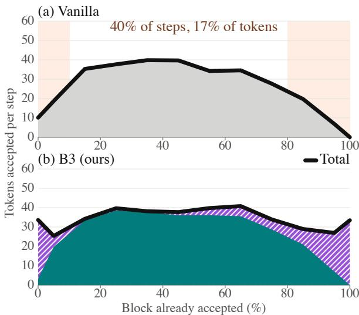  
Figure 1: Tokens accepted per denoising step against the share of the block already accepted, for DiffusionGemma 26B on HumanEval+. (a) Vanilla decoding: the orange bands mark low-acceptance regions at the block’s boundaries, which take 40% of the steps but yield only 17% of the tokens. (b) B3: forward passes shared with the neighbouring block (purple) keep the tokens accepted per step consistent across the block.

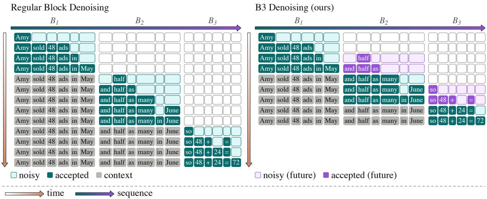  
Figure 2: Schematic of B3. Each row is one forward pass. Left: vanilla decoding denoises one block at a time. Right: B3 starts the next block early, sharing forward passes with the current block, and finishes in fewer passes.

## on to the next.

A key observation of ours is that this artificial split into blocks carries an inherent inefficiency at block boundaries. Tokens are not equally easy to predict: some settle in a step or two, others need many more, and a block is not finalized until its slowest token is accepted. A forward pass over a block has the same computational cost regardless of how many tokens are accepted. At the end of a block’s denoising process, the model accepts its last few tokens or self-edits earlier ones, while the next block’s easy to predict tokens wait behind them, untouched. We show empirically that the number of tokens accepted per forward pass drops sharply near the block boundaries (Figure 1(a)), consistently across models and datasets (Appendix C).

In this work we present Blurring the Block Boundaries (B3), a novel approach that reduces this loss in token throughput by blurring the artificial block boundaries. Once the current block is settled enough, the next block is drafted in a shared forward pass, conditioned on the current block’s evolving state, parallelizing the end of the current block generation and the beginning of the next one (Figure 1(b)). Attention stays blockcausal, so the current block’s predictions are left unchanged. Once the draft becomes the current block, self-editing corrects any errors it carries from being initialised before the previous block had fully converged. The spawning time of the next block is dynamically determined from statistics of the predicted tokens in previous blocks, making B3 training-free and hyperparameter-free, thus requiring no adaptation to integrate into existing models.

Evaluated on DiffusionGemma 26B (DiffusionGemma Team, 2026), LLaDA 2.1 mini 16B, and LLaDA 2.1 flash 100B (Bie et al., 2026) across 10 diverse datasets, B3 delivers 11.5–14.5% speedup at on par generation quality without any training or hyperparameter tuning, advancing the latency–quality Pareto frontier of DLM inference.

To summarise, our key contributions are:

• Identifying an inefficiency of block diffusion, where the number of tokens accepted per forward pass drops near the block boundaries.

• Introducing B3, a novel approach which denoises two consecutive blocks in shared forward passes.

• Designing a self-calibrating spawning criterion that requires no training or hyperparameter tuning.

• Extensive evaluation of B3 on three selfediting state-of-the-art block DLMs and 10 benchmarks.

## 2 Related Work

Diffusion language models. Diffusion language models denoise either continuous token embeddings (Li et al., 2022; Gulrajani and Hashimoto, 2023; Chen et al., 2026) or discrete tokens. Discrete diffusion models are characterised by their corruption process, which determines whether generation can revise its own tokens. Masked diffusion replaces tokens with an absorbing [MASK] state (Sahoo et al., 2024; Ou et al., 2025; Nie et al.,

2025; Ye et al., 2025), so generation progressively unmasks positions while revealed tokens are not revisited. Uniform-state diffusion replaces them with random vocabulary tokens (Austin et al., 2021; Sahoo et al., 2025; Ye et al., 2026; DiffusionGemma Team, 2026), so every position is re-predicted at every step. Hybrid models mix both (von Rütte et al., 2025; Bie et al., 2026). Masked models can be extended with self-editing through remasking (Wang et al., 2025) or self-correction objectives (Schiff et al., 2026; Wang et al., 2026b). Block DLMs (Arriola et al., 2025), adapted from pretrained AR models (Wu et al., 2026a; Fu et al., 2026) or scaled to 100B parameters (Bie et al., 2025), now underlie most recent large-scale DLMs.

Accelerating DLM inference. Block diffusion (Arriola et al., 2025) decodes the sequence block by block, so the clean prefix is cached exactly rather than approximated as in full-canvas DLMs (Wu et al., 2026b; Ma et al., 2025; Hu et al., 2026; Liu et al., 2026; Jiang et al., 2026). Within each block, sampling strategies accept more tokens per step via confidence thresholds (Wu et al., 2026b; Bie et al., 2025), entropy bounds (Ben-Hamu et al., 2025) and adaptive parallel decoding (Israel et al., 2025).

Multi-block decoding. Orthogonally to these accelerations, multi-block methods change which blocks share a forward pass, and therefore run on top of the model’s native sampler. For DLMs trained without blocks, sliding and adaptive schemes reshape the block imposed by the sampler at inference (Luo et al., 2026; Zhang et al., 2026; Lu et al., 2026; Wang et al., 2026a; Wan et al., 2026; Zou et al., 2026). Concurrently to our work, Flow-Block (Tian et al., 2026) and MBD-LMs (Jin et al., 2026) overlap consecutive blocks of block DLMs, advancing to the next block at a tuned progress threshold. In contrast, B3 is hyperparameter-free and achieves a better latency–quality trade-off than both (Table 2). B3 also applies to USDMs, to which others are not adapted.

## 3 Method

## 3.1 Preliminaries

Discrete diffusion language models generate a sequence $\boldsymbol { x } = ( x ^ { 1 } , \dots , x ^ { L } )$ by learning to reverse a token-level corruption process. At noise level $t \in [ 0 , 1 ]$ , from clean $( t = 0 )$ to fully corrupted $( t = 1 )$ , each position $\ell \in \{ 1 , \ldots , L \}$ of the noisy sequence $x _ { t }$ independently either keeps token $x _ { t } ^ { \ell }$ or is replaced by a token drawn from a corruption distribution $\pi _ { i }$ , with the replacement probability increasing in t. A denoiser $p _ { \theta } ( x ^ { \ell } \mid x _ { t } )$ predicts the clean token at every position ℓ. For MDMs, π always yields a special [MASK] token. For USDMs, π is uniform over the vocabulary, so any token may be corrupted and $p _ { \theta }$ learns to re-predict every position, enabling self-editing. Hybrid models (Bie et al., 2026; von Rütte et al., 2025) mix the two corruption distributions at train time, and so inherit the self-editing capabilities of the USDM component.

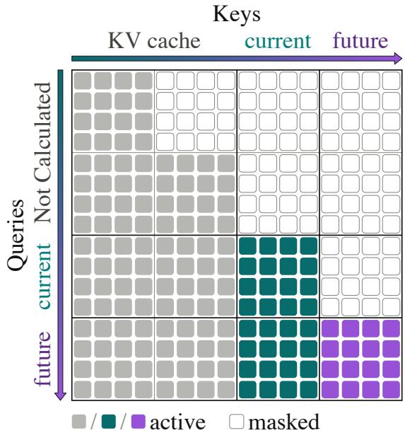  
Figure 3: B3 attention mask of a shared forward pass; the current block never attends to the future block.

At inference, every position is initialised from $\pi$ and $p _ { \theta }$ is applied iteratively. Each denoising step is one forward pass of $p _ { \theta }$ that predicts tokens at all $L$ positions. A sampler selects a subset of these predicted tokens to retain in the sequence for the next denoising step by using a confidence threshold (Wu et al., 2026b; Bie et al., 2025) or an entropy bound (Ben-Hamu et al., 2025). Retained tokens accumulate over denoising steps until the whole sequence is complete.

Block diffusion models (Arriola et al., 2025) split the sequence into bidirectional blocks and generate them causally. We write $x ^ { b }$ for the tokens in the b-th block $B _ { b } \subset \{ 1 , \ldots , L \} , x ^ { < b }$ for tokens in all preceding blocks, and $\ell \in B _ { b }$ for a position ℓ in block b. The sampler runs only within the current block $b ,$ and each step denoises the block’s noisy state $\boldsymbol { x } _ { t _ { b } } ^ { b }$ at noise level $t _ { b } .$ conditioned on the

clean prefix:

$$
p _ { \theta } ( x ^ { b } \mid x ^ { < b } , x _ { t _ { b } } ^ { b } )\tag{1}
$$

Once $x ^ { b }$ meets the sampler’s convergence criterion, $x ^ { b }$ is finalized and moved into the context, and block $b + 1$ is initialised from π, unless an EOS has been generated in $x ^ { b }$ . Attention is block-causal: a position $\ell \in B _ { b }$ attends only to blocks $1 , \ldots , b ,$ , so each forward pass processes only block b, reading $x ^ { < b }$ from an exact KV cache.

## 3.2 Blurring the Block Boundaries

As block diffusion turns every block boundary into a synchronisation barrier, no position in block $b + 1$ may start until the entire block b has been finalized. Empirical analysis (Section 4.5) identifies a significant efficiency drop in token generation around those artificial boundaries.

Rather than waiting for the current block to be finalized before initialising the next one, B3 starts denoising the future block simultaneously with the current block (Figure 2) when approaching the boundaries: once the current block b is settled enough according to our proposed criterion (Section 3.3), the future block $b + 1$ is initialised and both blocks are denoised together until $b$ is finalized. Concretely, both blocks share a single forward pass through pθ:

$$
p _ { \theta } ( x ^ { b } , x ^ { b + 1 } \mid x ^ { < b } , x _ { t _ { b } } ^ { b } , x _ { t _ { b + 1 } } ^ { b + 1 } )\tag{2}
$$

Because attention is block-causal (Figure 3), no position in block b attends to $\boldsymbol { x } _ { t _ { b + 1 } } ^ { b + 1 }$ , so the predictions for $x ^ { b }$ are identical to those of the vanilla forward pass of eq. (1).

Each block keeps its own sampler, with separate noise levels $t _ { b }$ and $t _ { b + 1 } ,$ , so block b is denoised exactly as in standard block decoding. The future block, however, is conditioned on $\boldsymbol { x } _ { t _ { b } } ^ { b }$ , which may still contain tokens sampled from π, that can mislead its early predictions. Self-editing lets the sampler of block $b + 1$ revise already accepted tokens of $x ^ { b + 1 }$ after $x ^ { b }$ converges. Once $x ^ { b }$ is finalized, block $b + 1$ becomes the current block and continues its denoising conditioned on the clean prefix $x ^ { < b + 1 }$

## 3.3 Future Block Spawning

During training, different blocks are denoised disjointly. On the one hand, waiting for the current block to fully converge at inference time spawns the next block too late and prevents the desired overlap. On the other hand, spawning the future block too early conditions it on a still evolving current block, which may cause inference to deviate too far from training. Hence, the future block should be spawned once the tokens of the current block are settled enough.

The model entropy is a well-established (Ben-Hamu et al., 2025; Zhang et al., 2026) measure of how settled a token is,

$$
\begin{array} { c } { { H _ { i } ^ { \ell } = - \displaystyle \sum _ { v \in \mathcal { V } } p _ { \theta } \big ( { x } ^ { \ell } = v \mid { x } ^ { < b } , { x } _ { t _ { b } } ^ { b } \big ) \cdot } } \\ { { \log p _ { \theta } \big ( { x } ^ { \ell } = v \mid { x } ^ { < b } , { x } _ { t _ { b } } ^ { b } \big ) } } \end{array}\tag{3}
$$

at position $\ell \in B _ { b }$ on forward pass i of the denoising process at the corresponding noise level $t _ { b } .$ with the vocabulary set V. The future block is then spawned once the entropy of every token in the current block b is at most a threshold τ,

$$
\operatorname* { m a x } _ { \ell \in B _ { b } } H _ { i } ^ { \ell } \leq \tau\tag{4}
$$

For the method to remain hyperparameter-free, the remaining question is how to set τ without tuning it per model or task.

Intuitively, eq. (4) asks whether the tokens of $B _ { b }$ are settled enough for the model to start accepting tokens in $B _ { b + 1 }$ . We wish to estimate an entropy level sufficient for this decision from the model’s own acceptances within $B _ { b }$ . Since $B _ { b + 1 }$ attends to $B _ { b }$ causally, we look for steps within $B _ { b }$ on which the generation advances approximately causally. Let $I _ { i } \subseteq \{ 1 , \ldots , L \}$ be the set of positions accepted over the generation up to forward pass i, accumulated across blocks.1 We call its rightmost position, $r _ { i } = \operatorname* { m a x } I _ { i }$ , the generation frontier. Whenever the frontier advances, $r _ { i } > r _ { i - 1 }$ , the newly accepted token at $r _ { i }$ has, like the first token of $B _ { b + 1 }$ , all of its accepted context to its left. The maximum entropy $H _ { i - 1 } ^ { \ell }$ of the tokens at positions $\{ \ell \ | \ \ell < \ r _ { i } \}$ on the previous pass is therefore a candidate for τ that was sufficient for advancing the frontier to $r _ { i }$

$$
\tau _ { i } ^ { \mathrm { { c a n d i d a t e } } } = \operatorname* { m a x } _ { \ell \in { \cal B } _ { b } , \ell < r _ { i } } H _ { i - 1 } ^ { \ell }\tag{5}
$$

where $r _ { i }$ itself is excluded, just as the first token of $B _ { b + 1 }$ is excluded from eq. (4). The positions $\{ \ell \ | \ \ell < \ r _ { i } \}$ and $r _ { i }$ in eq. (5) thus play the roles of $B _ { b }$ and $B _ { b + 1 }$ in eq. (4). The one-step lag is also the same, since the gate evaluates the entropies of pass i to decide whether tokens of $B _ { b + 1 }$ may be accepted from pass $i + 1$ on.

<table><tr><td></td><td></td><td></td><td colspan="3">TPS</td><td colspan="3">TPF</td><td colspan="3">Quality</td></tr><tr><td>Model</td><td>Benchmark</td><td>n</td><td>Base</td><td>B3 (ours)</td><td>∆%</td><td>Base</td><td>B3 (ours)</td><td>∆%</td><td>Base</td><td>B3 (ours)</td><td> $\Delta p p$ </td></tr><tr><td rowspan="9">Dita Dis6a</td><td>GSM8K</td><td>1319</td><td>136.1</td><td>150.8</td><td>+10.8</td><td>28.74</td><td>33.69</td><td>+17.2</td><td>95.75</td><td>96.13</td><td>+0.38</td></tr><tr><td>MATH500</td><td>500</td><td>139.9</td><td>156.0</td><td>+11.6</td><td>28.69</td><td>34.16</td><td>+19.1</td><td>95.80</td><td>92.40</td><td>-3.40</td></tr><tr><td>AIME26</td><td>30</td><td>101.0</td><td>121.6</td><td>+20.3</td><td>20.61</td><td>25.48</td><td>+23.6</td><td>73.33</td><td>76.67</td><td>+3.33</td></tr><tr><td>Omni-MATH</td><td>4428</td><td>107.6</td><td>118.0</td><td>+9.6</td><td>21.70</td><td>25.10</td><td>+15.7</td><td>61.50</td><td>60.68</td><td>-0.81</td></tr><tr><td>GPQA-D</td><td>198</td><td>94.4</td><td>107.1</td><td>+13.4</td><td>19.18</td><td>22.88</td><td>+19.3</td><td>73.74</td><td>71.72</td><td>-2.02</td></tr><tr><td>IFEval</td><td>541</td><td>103.4</td><td>119.9</td><td>+16.0</td><td>21.08</td><td>26.61</td><td>+26.3</td><td>95.80</td><td>95.44</td><td>-0.36</td></tr><tr><td>HumanEval+</td><td>164</td><td>148.9</td><td>160.7</td><td>+7.9</td><td>30.77</td><td>37.53</td><td>+22.0</td><td>91.46</td><td>89.63</td><td>-1.83</td></tr><tr><td>MBPP+</td><td>378</td><td>136.4</td><td>149.6</td><td>+9.7</td><td>28.39</td><td>33.40</td><td>+17.6</td><td>80.69</td><td>82.28</td><td>+1.59</td></tr><tr><td>BBEH LCB</td><td>4520 342</td><td>116.2 108.0</td><td>126.6 119.2</td><td>+8.9 +10.4</td><td>24.16 22.11</td><td>28.53</td><td>+18.1</td><td>36.72 70.47</td><td>37.01</td><td>+0.29</td></tr><tr><td></td><td></td><td></td><td></td><td></td><td></td><td></td><td>25.59</td><td>+15.7</td><td></td><td>69.30</td><td>-1.17 -0.40</td></tr><tr><td rowspan="7">L  0B</td><td>Average</td><td></td><td>119.2</td><td>132.9</td><td>+11.5</td><td>24.54</td><td>29.30</td><td>+19.4</td><td>77.53</td><td>77.13</td><td></td></tr><tr><td>GSM8K MATH500</td><td>1319 500</td><td>90.7 106.6</td><td>98.5 123.1</td><td>+8.5 +15.5</td><td>5.58 6.56</td><td>6.37 7.55</td><td>+14.0 +15.1</td><td>94.01 95.20</td><td>93.56 94.60</td><td>-0.45 -0.60</td></tr><tr><td>AIME26</td><td>30</td><td>75.4</td><td>82.0</td><td>+8.7</td><td>4.71</td><td>5.21</td><td>+10.4</td><td>66.67</td><td>76.67</td><td>+10.00</td></tr><tr><td>Omni-MATH</td><td>4428</td><td>77.2</td><td>84.9</td><td>+10.1</td><td>4.73</td><td>5.24</td><td>+10.8</td><td>59.94</td><td>59.49</td><td>-0.45</td></tr><tr><td>GPQA-D</td><td>198</td><td>52.9</td><td>53.6</td><td>+1.2</td><td>3.25</td><td>3.43</td><td>+5.7</td><td>66.67</td><td>68.18</td><td>+1.52</td></tr><tr><td>IFEval</td><td>541</td><td>26.2</td><td>27.8</td><td>+5.9</td><td>1.62</td><td>1.71</td><td>+5.9</td><td>88.85</td><td>89.21</td><td>+0.36</td></tr><tr><td></td><td></td><td>211.1</td><td></td><td>+20.4</td><td>13.20</td><td></td><td></td><td>85.37</td><td></td><td></td></tr><tr><td rowspan="5"></td><td>HumanEval+</td><td>164</td><td></td><td>254.3</td><td></td><td></td><td>16.40</td><td>+24.2</td><td></td><td>84.76</td><td>-0.61</td></tr><tr><td>MBPP+</td><td>378 4520</td><td>131.7</td><td>157.5</td><td>+19.6</td><td>8.16 4.07</td><td>9.90</td><td>+21.4</td><td>76.72</td><td>74.34 14.16</td><td>-2.38</td></tr><tr><td>BBEH LCB</td><td>342</td><td>66.2 87.9</td><td>71.6 98.2</td><td>+8.2 +11.7</td><td>5.49</td><td>4.48 6.21</td><td>+10.2 +13.1</td><td>12.48 41.52</td><td>40.06</td><td>+1.67</td></tr><tr><td></td><td></td><td></td><td></td><td></td><td></td><td></td><td></td><td></td><td></td><td>-1.46</td></tr><tr><td>Average</td><td></td><td>92.6</td><td>105.2</td><td>+13.6</td><td>5.74</td><td>6.65</td><td>+15.9</td><td>68.74</td><td>69.50</td><td>+0.76</td></tr><tr><td rowspan="10">L 6B</td><td>GSM8K</td><td>1319</td><td>114.2</td><td>124.8</td><td>+9.3</td><td>4.88</td><td>5.49</td><td>+12.5</td><td>90.90</td><td>89.84</td><td>-1.06</td></tr><tr><td>MATH500 AIME26</td><td>500</td><td>160.4</td><td>186.1</td><td>+16.0</td><td>6.85</td><td>8.14</td><td>+18.9</td><td>92.80</td><td>91.80</td><td>-1.00</td></tr><tr><td></td><td>30</td><td>113.7</td><td>125.9</td><td>+10.7</td><td>4.92</td><td>5.46</td><td>+11.0</td><td>46.67</td><td>50.00</td><td>+3.33</td></tr><tr><td>Omni-MATH</td><td>4428</td><td>115.5</td><td>127.8</td><td>+10.7</td><td>4.91</td><td>5.55</td><td>+13.0</td><td>46.39</td><td>45.93</td><td>-0.45</td></tr><tr><td>GPQA-D</td><td>198</td><td>69.5</td><td>73.8</td><td>+6.1</td><td>3.02</td><td>3.26</td><td>+8.0</td><td>52.53</td><td>52.02</td><td>-0.51</td></tr><tr><td>IFEval</td><td>541</td><td>31.1</td><td>32.4</td><td>+4.2</td><td>1.35</td><td>1.40</td><td>+4.3</td><td>86.45</td><td>85.97</td><td>-0.48</td></tr><tr><td>HumanEval+</td><td>164</td><td>247.2</td><td>301.4</td><td>+21.9</td><td>10.94</td><td>13.69</td><td>+25.2</td><td>83.54</td><td>81.71</td><td>-1.83</td></tr><tr><td>MBPP+</td><td>378</td><td>163.6</td><td>194.2</td><td>+18.7</td><td>7.16</td><td>8.57</td><td>+19.6</td><td>69.84</td><td>69.05</td><td>-0.79</td></tr><tr><td>BBEH LCB</td><td>4520</td><td>69.4</td><td>73.5</td><td>+5.8 +15.9</td><td>2.98 5.10</td><td>3.22</td><td>+7.8 +14.3</td><td>6.91</td><td>5.94</td><td>-0.96</td></tr><tr><td></td><td>342</td><td>113.7</td><td>131.8</td><td></td><td></td><td>5.83</td><td></td><td>25.73</td><td>26.61</td><td>+0.88</td></tr><tr><td>Average</td><td></td><td></td><td>119.8</td><td>137.2</td><td>+14.5</td><td>5.21</td><td>6.06</td><td>+16.3</td><td>60.17</td><td>59.89</td><td>-0.28</td></tr></table>

Table 1: Per-benchmark results for B3 on DiffusionGemma 26B, LLaDA 2.1 flash 100B, and LLaDA 2.1 mini 16B.

Candidates are collected over the generation at hand, on the forward passes on which the frontier advances. Passes with an active future block are excluded, as the frontier then lies in $B _ { b + 1 }$ rather than in $B _ { b }$ , giving

$C _ { \tau } = \{ i \mid r _ { i } > r _ { i - 1 } , B _ { b + 1 }$ is not active at i}.

Averaging the candidates of $C _ { \tau }$ gives the threshold,

$$
\tau = \frac { 1 } { | C _ { \tau } | } \sum _ { i \in C _ { \tau } } \tau _ { i } ^ { \mathrm { c a n d i d a t e } } .\tag{6}
$$

Finally, to avoid spawning future blocks past the end of the sequence, spawning is also gated on the current block not predicting an EOS.

## 4 Experiments

Models. We evaluate B3 on DiffusionGemma 26B (DiffusionGemma Team, 2026), LLaDA 2.1 flash 100B and LLaDA 2.1 mini 16B (Bie et al., 2026), using their public checkpoints and Hugging Face implementations. DiffusionGemma uses its shipped decoding defaults. For both LLaDA variants we use block size 64 instead of the default 32, as it is faster at comparable accuracy (Figure 5). This choice favors the baseline, as it lowers the relative speedup of B3 from 20% to 15%. Hardware and other technical details in Appendix A.

Metrics. We report Tokens per Second (TPS) calculated as output tokens divided by generation time in seconds, and Tokens per Forward (TPF) calculated as output tokens divided by model forward passes. We compute TPS and TPF for every input sample and report the mean over the benchmark. $\Delta \%$ compares these means, $( T _ { m e t h o d }$ $T _ { b a s e } ) / T _ { b a s e }$ . In the Average row, we first average TPS (or TPF) over benchmarks and then take ∆%. For a measure of quality we report Accuracy, defined as is common per dataset, and for ease of comparison we report also ∆pp measuring the difference in absolute performance (accuracy is already scaled as a unitless fraction) $\Delta p p = A _ { m e t h o d } - A _ { b a s e }$ . For all relative metrics we mark in teal improvements over the baseline and in vermilion degradation over it.

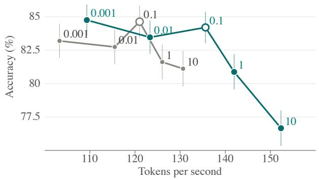

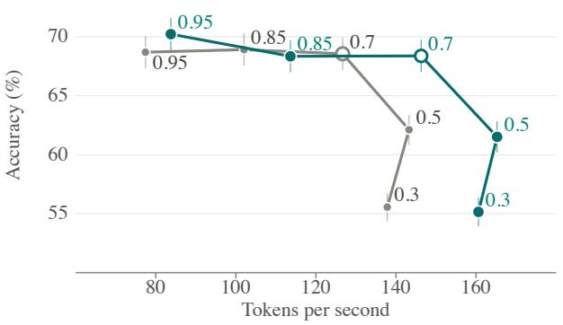  
Figure 4: Sweep of the acceptance criterion. Error bars denote ±1 standard error of the average accuracy due to question sampling, combined from per-benchmark binomial standard errors.

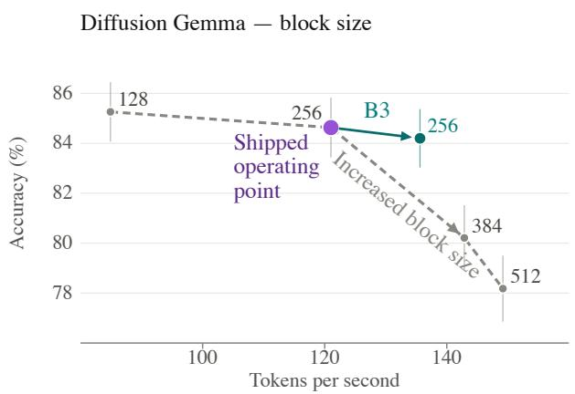

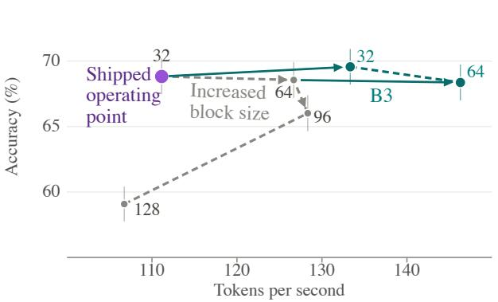  
Figure 5: B3 shows a preferable accuracy/speed trade-off compared to increasing the block size. At each shipped operating point, it is better to use B3 instead of increasing the block size.

Datasets. We use the full test sets of 10 benchmarks, zero-shot except for 8- shot GSM8K (Using gsm8k\_cot of lm-evaluation-harness; Gao et al., 2024), all with their common metrics.

• Math: GSM8K (Cobbe et al., 2021), MATH500 (Hendrycks et al., 2021; Lightman et al., 2024), AIME 2026 (Balunovic et al.´ , 2025) and Omni-MATH (Gao et al., 2025), scored by exact match of the final answer, checked for mathematical equivalence with Hugging Face Math-Verify2 on MATH500 and

Omni-MATH.

• Science: GPQA Diamond (Rein et al., 2024).

• Reasoning: BBEH (Kazemi et al., 2025), scored by adjusted harmonic mean of task accuracy.

• Instruction following: IFEval (Zhou et al., 2023), loose instruction-level accuracy.

• Code: HumanEval+ and MBPP+ (Liu et al., 2023) and LiveCodeBench (Jain et al., 2025), scored as pass@1.

Since B3 is hyperparameter-free, no validation sets are used for tuning. Due to compute constraints, ablations and multi-block comparisons (Sections 4.2 and 4.3) exclude Omni-MATH and BBEH (4428 and 4520 examples) and report averages over the remaining eight, referred to as the light benchmarks.

## 4.1 Results

Table 1 reports results on DiffusionGemma, LLaDA 2.1 flash and LLaDA 2.1 mini, spanning two model families and 16B to 100B parameters. Averaged over benchmarks, B3 raises TPS by 11.5– 14.5% and TPF by 15.9–19.4%, while average accuracy changes only by –0.40 to +0.76 pp. The acceleration is consistent: B3 improves both TPS and TPF on every one of the 30 model–benchmark pairs, without any per-model or per-task tuning.

<table><tr><td>Block Size</td><td>Method</td><td>TPS</td><td>TPF</td><td>Acc</td></tr><tr><td rowspan="4">32</td><td>Base</td><td>111</td><td>4.83</td><td>68.8</td></tr><tr><td>FlowBlock</td><td> $1 3 2 ( + 1 8 \% )$ </td><td>5.77 (+20%)</td><td> $6 7 . 9 \ ( - 1 . 0 )$ </td></tr><tr><td>MBD-LMs</td><td> $1 3 1 \ : ( + 1 8 \% )$ </td><td>5.95 (+23%)</td><td> $6 7 . 4 \ ( - 1 . 4 )$ </td></tr><tr><td>B3</td><td> $1 3 3 ( + 2 0 \% )$ </td><td> $5 . 8 8 ~ ( + 2 2 \% )$ </td><td> ${ \bf 6 9 . 6 } _ { ( + 0 . 7 ) }$ </td></tr><tr><td rowspan="4">64</td><td>Base</td><td>127</td><td>5.53</td><td>68.6</td></tr><tr><td>FlowBlock</td><td> $1 3 2 ( + 4 \% )$ </td><td> $5 . 8 9 \ : ( + 7 \% )$ </td><td> $6 8 . 3 \ ( . 0 . 3 )$ </td></tr><tr><td>MBD-LMs</td><td> $1 4 2 \ : ( + 1 2 \% )$ </td><td> $6 . 4 0 \ : ( + 1 6 \% )$ </td><td> $6 5 . 3 \ ( - 3 . 2 )$ </td></tr><tr><td>B3</td><td> $1 4 6 ( + 1 5 \% )$ </td><td> ${ \bf 6 . 4 8 _ { \mathrm { \ ( + 1 7 \% ) } } }$ </td><td> ${ \bf 6 8 . 4 } \left( - 0 . 2 \right)$ </td></tr></table>

Table 2: LLaDA 2.1 mini 16B: B3 vs. concurrent interblock methods on the eight light benchmarks described in Section 4.2.

## 4.2 Comparison with Other Multi-Block Methods

Table 2 compares B3 with FlowBlock and MBD-LMs (training-free variant) on LLaDA 2.1 mini, using each method’s published hyperparameters on a per-dataset basis.3 Averaged over the eight light benchmarks at LLaDA 2.1’s default block size of 32, B3 is the fastest method, raising TPS by 2% more than both baselines, while being 1.7 pp and 2.1 pp more accurate than FlowBlock and MBD-LMs, respectively. At the faster block size of 64, B3 again leads on both axes: it is 11% faster than Flow-Block at comparable accuracy, and 3.0 pp more accurate than MBD-LMs at 3% higher TPS. Perdataset results are in Table 7.

## 4.3 Latency–Quality Trade-off

Two axes control the latency–quality trade-off in block diffusion models: the sampler acceptance criterion and the block size. We ablate both with and without B3, using each baseline’s native parameters (entropy bound for DiffusionGemma and confidence threshold for LLaDA 2.1) as the control variable. LLaDA 2.1 is evaluated using the mini model rather than flash due to compute constraints; full per-benchmark results are shown in Tables 5 and 6.

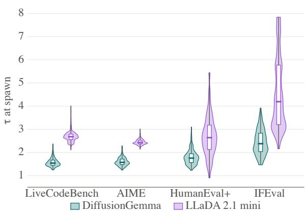  
Figure 6: τ selected by the self-calibrating gate at each spawn, per benchmark and model. Violin: P1–P99; box: P25–P75; line: median.

Sampler threshold. Figure 4 sweeps the acceptance criterion with and without B3. In the highquality regime, B3 raises TPS at comparable quality, shifting the frontier, for example gaining +11% TPS at –0.2 pp for LLaDA 2.1 mini at threshold 0.95. At the shipped defaults, B3 is faster than every baseline configuration in the sweep by 3.8% over the fastest DiffusionGemma baseline, which is 3.1 pp less accurate, and by 4.3% over the fastest LLaDA baseline, which is 10.3 pp less accurate.

Block size. Figure 5 varies the block size with and without B3. For DiffusionGemma, B3 raises TPS by 12% at block size 256, a speed the baseline matches only at 384 or larger, at a cost of at least 4.0 pp quality, while B3 itself loses only $0 . 4 \mathrm { p p }$ . For LLaDA 2.1 mini, blocks beyond 64 give negligible speedup and lose quality, while B3 raises TPS by 20% at block size 32 and 15% at 64 with comparable quality, the latter being faster than every baseline configuration. Enlarging the block therefore does not recover the speedup of B3 at comparable quality.

## 4.4 Ablation on Future Block Spawning Criteria

Figures 7 and 8 ablate the spawn gate on HumanEval+. Spawning once a fixed fraction $\theta _ { \mathrm { { s p a w n } } }$ of the current block is accepted does not match the accuracy of our gate on either model.

A fixed entropy threshold τ is no easier to set. The τ selected by our gate varies across benchmarks and models (Figure 6; see Appendix D for a breakdown by dataset and block index). Accuracy is also sensitive to the fixed value chosen (Figure 7): τ = 1 beats our gate on LLaDA 2.1 mini but is the least accurate fixed setting on DiffusionGemma. A fixed τ would therefore need tuning per model and dataset, which B3 avoids.

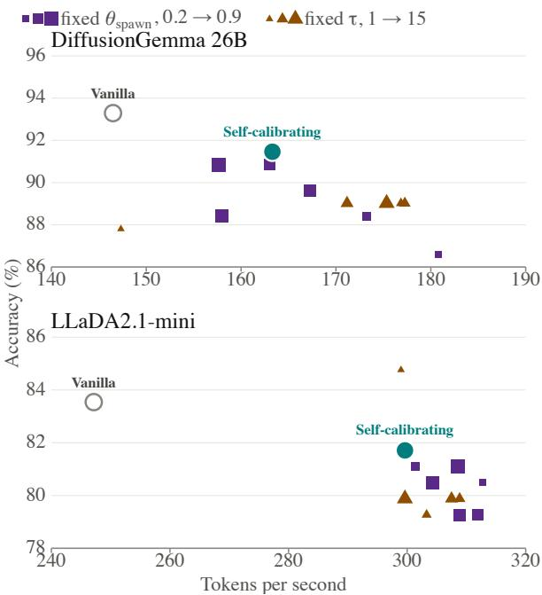  
Figure 7: Ablation on HumanEval+ for our selfcalibrating spawning threshold vs. spawning at a fixed fraction of acceptance, $\theta _ { \mathrm { s p a w n } } ,$ , and at a fixed max entropy gate of $\tau .$ Top right is preferable.

Finally, Figure 8 changes one design choice of the gate at a time. This includes how the entropies left of $r _ { i }$ are reduced to a candidate (AGG; ours: max, eqs. (4) and (5)) and how the candidates are combined into τ (COMBINE; ours: mean, eq. (6)). All variants land close to ours in speed and accuracy, and none improves on it consistently across both models.

## 4.5 Inefficiency at the Block Boundary

Figure 1 illustrates the slow finish of a block unfider vanilla decoding: acceptance falls as the block nears completion. For DiffusionGemma on HumanEval+, the last 20% of a block takes 22% of the steps but yields only 10% of the tokens (first and last block excluded). This holds for both models on HumanEval+ and GPQA Diamond. The ratio of token share to step share in the last 20% (1 being parity) is 0.35–0.71 for DiffusionGemma and 0.05–0.62 for LLaDA 2.1 mini (Figure 11). With B3, the next block accepts tokens on the same forward passes, raising the ratio to 0.67–1.39 and 0.71–1.25. Appendix C breaks this down by block index for DiffusionGemma.

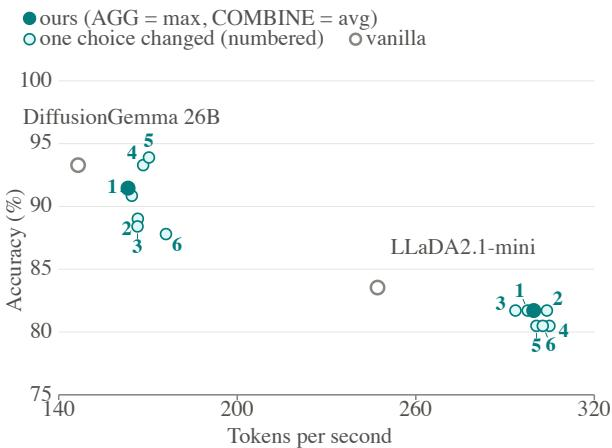  
Figure 8: Design choices of the spawn gate on HumanEval+. Each numbered point changes one choice of ours (AGG = max, COMBINE = avg, Cτ carried across blocks): (1) $C _ { \tau }$ resets every block, (2) AGG = avg, (3) AGG = sum, (4) COMBINE = avg + std, (5) COM-BINE = max, (6) COMBINE = max (corrected). AGG and COMBINE are defined in Section 4.4.

## 5 Conclusion

We introduced B3, a training-free and without hyperparameters acceleration method for self-editing block diffusion language models. B3 exploits a structural property of these models: late denoising steps of a block accept few tokens, so the next block can start early on the same forward passes. An entropy-based gate calibrates the spawning point from the model’s own acceptance behaviour.

Experiments on three models spanning two diffusion families, hybrid (LLaDA 2.1 mini 16B and flash 100B) and USDM (DiffusionGemma 26B), and 10 diverse benchmarks show that B3 consistently improves TPS by 11.5–14.5% and TPF by 15.9–19.4%, with an average accuracy change of +0.03 pp over the three models, without any permodel or per-task tuning. On LLaDA 2.1 mini, B3, as a plug-and-play addition, also achieves a better latency–quality trade-off than concurrent multiblock methods with tuned thresholds.

Spawning the next block too late forfeits the speedup, while spawning it too early conditions it on a still evolving prefix that can mislead its predictions. The TPS gains suggest that the gate opens early enough to exploit the low-acceptance tail of each block. The preserved accuracy suggests that it also opens late enough for the settled tokens of the current block to provide reliable context for the next one. If any errors do slip past the gate, self-editing appears to correct them.

## Limitations

B3 relies on self-editing for having low-acceptance forwards to exploit, as well as to correct future block tokens drafted on an unfinished prefix, so masked DLMs without an editing mechanism fall outside its scope. The state-of-the-art models we evaluate, in both diffusion families, self-edit by design. The spawning gate also assumes semi leftto-right generation at parts of the generation, which both evaluated models exhibit (Appendix E).

Unlike verification-based speculative decoding, B3 does not guarantee outputs identical to vanilla decoding, although average accuracy changes by only −0.40 to +0.76 pp. Its speedup is bounded by the low-acceptance tail of each block. The resulting 11.5–14.5% TPS gain is moderate.

Wall-clock speedups are measured on one inference stack per model and may differ in other serving regimes, such as large-batch inference. Due to compute constraints, ablations and comparisons with concurrent methods use LLaDA 2.1 mini and a subset of benchmarks. The evaluation focuses on English only text only tasks.

## References

Marianne Arriola, Aaron Gokaslan, Justin T. Chiu, Zhihan Yang, Zhixuan Qi, Jiaqi Han, Subham Sekhar Sahoo, and Volodymyr Kuleshov. 2025. Block diffusion: Interpolating between autoregressive and diffusion language models. In International Conference on Learning Representations.

Ali Asaria, Tony Salomone, and Deep Gandhi. 2026. Neither parallel nor sequential: How DiffusionGemma actually commits tokens. Preprint, arXiv:2606.14620.

Jacob Austin, Daniel D. Johnson, Jonathan Ho, Daniel Tarlow, and Rianne van den Berg. 2021. Structured denoising diffusion models in discrete state-spaces. In Advances in Neural Information Processing Systems.

Mislav Balunovic, Jasper Dekoninck, Ivo Petrov, Nikola´ Jovanovic, and Martin Vechev. 2025.´ MathArena: Evaluating LLMs on uncontaminated math competitions. In Advances in Neural Information Processing Systems, Datasets and Benchmarks Track.

Heli Ben-Hamu, Itai Gat, Daniel Severo, Niklas Nolte, and Brian Karrer. 2025. Accelerated sampling from masked diffusion models via entropy bounded unmasking. In Advances in Neural Information Processing Systems.

Tiwei Bie et al. 2025. LLaDA2.0: Scaling up diffusion language models to 100B. Preprint, arXiv:2512.15745.

Tiwei Bie et al. 2026. LLaDA2.1: Speeding up text diffusion via token editing. Preprint, arXiv:2602.08676.

Andrew Campbell, Joe Benton, Valentin De Bortoli, Tom Rainforth, George Deligiannidis, and Arnaud Doucet. 2022. A continuous time framework for discrete denoising models. In Advances in Neural Information Processing Systems, volume 35, pages 28266–28279.

Yuxin Chen, Chumeng Liang, Hangke Sui, Ruihan Guo, Chaoran Cheng, Jiaxuan You, and Ge Liu. 2026. LangFlow: Continuous diffusion rivals discrete in language modeling. arXiv preprint arXiv:2604.11748.

Shuang Cheng, Yihan Bian, Dawei Liu, Linfeng Zhang, Qian Yao, Zhongbo Tian, Wenhai Wang, Qipeng Guo, Kai Chen, Biqing Qi, and Bowen Zhou. 2025. SDAR: A synergistic diffusion-autoregression paradigm for scalable sequence generation. arXiv preprint arXiv:2510.06303.

Karl Cobbe, Vineet Kosaraju, Mohammad Bavarian, Mark Chen, Heewoo Jun, Lukasz Kaiser, Matthias Plappert, Jerry Tworek, Jacob Hilton, Reiichiro Nakano, Christopher Hesse, and John Schulman. 2021. Training verifiers to solve math word problems. Preprint, arXiv:2110.14168.

DiffusionGemma Team. 2026. DiffusionGemma technical report. Preprint, arXiv:2608.00146.

Yonggan Fu, Lexington Whalen, Zhifan Ye, Xin Dong, Shizhe Diao, Jingyu Liu, Chengyue Wu, Hao Zhang, Enze Xie, Song Han, Maksim Khadkevich, Jan Kautz, Yingyan Celine Lin, and Pavlo Molchanov. 2026. Efficient-DLM: From autoregressive to diffusion language models, and beyond in speed. In International Conference on Machine Learning.

Bofei Gao et al. 2025. Omni-MATH: A universal olympiad level mathematic benchmark for large language models. In International Conference on Learning Representations.

Leo Gao, Jonathan Tow, Baber Abbasi, Stella Biderman, et al. 2024. The language model evaluation harness. Version v0.4.3.

Itai Gat, Tal Remez, Neta Shaul, Felix Kreuk, Ricky T. Q. Chen, Gabriel Synnaeve, Yossi Adi, and Yaron Lipman. 2024. Discrete flow matching. In Advances in Neural Information Processing Systems, volume 37, pages 133345–133385.

Ishaan Gulrajani and Tatsunori B. Hashimoto. 2023. Likelihood-based diffusion language models. In Advances in Neural Information Processing Systems (NeurIPS).

Dan Hendrycks, Collin Burns, Saurav Kadavath, Akul Arora, Steven Basart, Eric Tang, Dawn Song, and Jacob Steinhardt. 2021. Measuring mathematical problem solving with the MATH dataset. In Advances in Neural Information Processing Systems.

Peter Holderrieth and Ezra Erives. 2026. An introduction to flow matching and diffusion models. Preprint, arXiv:2506.02070. MIT 6.S184 course notes.

Kai Syun Hou and James Kwok. 2026. Rethinking the generation order of block diffusion language models. Preprint, arXiv:2607.24306.

Zhanqiu Hu, Jian Meng, Yash Akhauri, Mohamed S. Abdelfattah, Jae sun Seo, Zhiru Zhang, and Udit Gupta. 2026. FlashDLM: Accelerating diffusion language model inference via efficient KV caching and guided diffusion. In International Conference on Learning Representations.

Daniel Israel, Guy Van den Broeck, and Aditya Grover. 2025. Accelerating diffusion LLMs via adaptive parallel decoding. In Advances in Neural Information Processing Systems (NeurIPS). Spotlight.

Naman Jain, King Han, Alex Gu, Wen-Ding Li, Fanjia Yan, Tianjun Zhang, Sida Wang, Armando Solar-Lezama, Koushik Sen, and Ion Stoica. 2025. Live-CodeBench: Holistic and contamination free evaluation of large language models for code. In International Conference on Learning Representations.

Yuchu Jiang, Yue Cai, Xiangzhong Luo, Jiale Fu, Jiarui Wang, Chonghan Liu, and Xu Yang. 2026. d2Cache: Accelerating diffusion-based LLMs via dual adaptive caching. In International Conference on Learning Representations.

Yijie Jin, Jiajun Xu, Yuxuan Liu, Chenkai Xu, Yi Tu, Jiajun Li, Dandan Tu, Xiaohui Yan, Kai Yu, Pengfei Liu, and Zhijie Deng. 2026. Multi-block diffusion language models. Preprint, arXiv:2606.29215.

Mehran Kazemi et al. 2025. BIG-Bench extra hard. In Proceedings ofthe Annual Meeting ofthe Association for Computational Linguistics.

Maurice G. Kendall. 1938. A new measure of rank correlation. Biometrika, 30(1-2):81–93.

Maurice G. Kendall. 1945. The treatment of ties in ranking problems. Biometrika, 33(3):239–251.

Jaeyeon Kim, Kulin Shah, Vasilis Kontonis, Sham Kakade, and Sitan Chen. 2025. Train for the worst, plan for the best: Understanding token ordering in masked diffusions. In International Conference on Machine Learning.

Woosuk Kwon, Zhuohan Li, Siyuan Zhuang, Ying Sheng, Lianmin Zheng, Cody Hao Yu, Joseph E. Gonzalez, Hao Zhang, and Ion Stoica. 2023. Efficient memory management for large language model serving with PagedAttention. In Proceedings ofthe ACM Symposium on Operating Systems Principles, pages 611–626.

Xiang Lisa Li, John Thickstun, Ishaan Gulrajani, Percy Liang, and Tatsunori B. Hashimoto. 2022. Diffusion-LM improves controllable text generation. In Advances in Neural Information Processing Systems (NeurIPS).

Hunter Lightman, Vineet Kosaraju, Yura Burda, Harri Edwards, Bowen Baker, Teddy Lee, Jan Leike, John Schulman, Ilya Sutskever, and Karl Cobbe. 2024. Let’s verify step by step. In International Conference on Learning Representations.

Jiawei Liu, Chunqiu Steven Xia, Yuyao Wang, and Lingming Zhang. 2023. Is your code generated by Chat-GPT really correct? rigorous evaluation of large language models for code generation. In Advances in Neural Information Processing Systems.

Zhiyuan Liu, Yicun Yang, Yaojie Zhang, Junjie Chen, Chang Zou, Qingyan Wei, Shaobo Wang, Yichen Zhu, and Linfeng Zhang. 2026. dLLM-Cache: Accelerating diffusion large language models with adaptive caching. In International Conference on Machine Learning.

Aaron Lou, Chenlin Meng, and Stefano Ermon. 2024. Discrete diffusion modeling by estimating the ratios of the data distribution. In International Conference on Machine Learning (ICML).

Guanxi Lu, Hao Mark Chen, Yuto Karashima, Zhican Wang, Daichi Fujiki, and Hongxiang Fan. 2026. AdaBlock-dLLM: Semantic-aware diffusion LLM inference via adaptive block size. In International Conference on Learning Representations.

Lizhuo Luo, Shenggui Li, Yonggang Wen, and Tianwei Zhang. 2026. DSB: Dynamic sliding block scheduling for diffusion LLMs. In International Conference on Machine Learning.

Xinyin Ma, Runpeng Yu, Gongfan Fang, and Xinchao Wang. 2025. dKV-Cache: The cache for diffusion language models. In Advances in Neural Information Processing Systems.

Shen Nie, Fengqi Zhu, Zebin You, Xiaolu Zhang, Jingyang Ou, Jun Hu, Jun Zhou, Yankai Lin, Ji-Rong Wen, and Chongxuan Li. 2025. Large language diffusion models. In Advances in Neural Information Processing Systems.

Jingyang Ou, Shen Nie, Kaiwen Xue, Fengqi Zhu, Jiacheng Sun, Zhenguo Li, and Chongxuan Li. 2025. Your absorbing discrete diffusion secretly models the conditional distributions of clean data. In International Conference on Learning Representations.

David Rein, Betty Li Hou, Asa Cooper Stickland, Jackson Petty, Richard Yuanzhe Pang, Julien Dirani, Julian Michael, and Samuel R. Bowman. 2024. GPQA: A graduate-level google-proof Q&A benchmark. In Conference on Language Modeling.

Subham Sekhar Sahoo, Marianne Arriola, Yair Schiff, Aaron Gokaslan, Edgar Marroquin, Justin T Chiu, Alexander Rush, and Volodymyr Kuleshov. 2024. Simple and effective masked diffusion language models. In Advances in Neural Information Processing Systems.

Subham Sekhar Sahoo, Justin Deschenaux, Aaron Gokaslan, Guanghan Wang, Justin Chiu, and Volodymyr Kuleshov. 2025. The diffusion duality. In International Conference on Machine Learning.

Yair Schiff, Omer Belhasin, Roy Uziel, Guanghan Wang, Marianne Arriola, Gilad Turok, Ran Zilberstein, Michael Elad, and Volodymyr Kuleshov. 2026. Learn from your mistakes: Self-correcting masked diffusion models. Preprint, arXiv:2602.11590.

Yuxuan Song et al. 2025. Seed diffusion: A large-scale diffusion language model with high-speed inference. Preprint, arXiv:2508.02193.

Bing Tian, Haikun Liu, Xiaocheng Zhong, Zhuohui Duan, Zhaokai Luo, Huayi Jin, Zhiyong Wang, and Xiaofei Liao. 2026. FlowBlock: Wavefront-parallel decoding for self-correcting diffusion language models. Preprint, arXiv:2607.17652.

Dimitri von Rütte, Janis Fluri, Yuhui Ding, Antonio Orvieto, Bernhard Schölkopf, and Thomas Hofmann. 2025. Generalized interpolating discrete diffusion. In International Conference on Machine Learning.

Lipeng Wan, Junjie Ma, Jianhui Gu, Zeyang Liu, Xuyang Lu, and Xuguang Lan. 2026. GeoBlock: Inferring block granularity from dependency geometry in diffusion language models. Preprint, arXiv:2603.26675.

Danny Wang, Ruihong Qiu, and Zi Huang. 2026a. When to commit? towards variable-size selfcontained blocks for discrete diffusion language models. Preprint, arXiv:2604.23994.

Guanghan Wang, Yair Schiff, Subham Sekhar Sahoo, and Volodymyr Kuleshov. 2025. Remasking discrete diffusion models with inference-time scaling. In Advances in Neural Information Processing Systems.

Linxuan Wang, Ziyi Wang, Yikun Bai, Wei Deng, Guang Lin, and Qifan Song. 2026b. Generalized discrete diffusion with self-correction. In International Conference on Machine Learning.

Xu Wang, Chenkai Xu, Yijie Jin, Jiachun Jin, Hao Zhang, and Zhijie Deng. 2026c. Diffusion LLMs can do faster-than-AR inference via discrete diffusion forcing. In International Conference on Learning Representations (ICLR).

Chengyue Wu, Hao Zhang, Shuchen Xue, Shizhe Diao, Yonggan Fu, Zhijian Liu, Pavlo Molchanov, Ping Luo, Song Han, and Enze Xie. 2026a. Fast-dLLM v2: Efficient block-diffusion LLM. In International Conference on Learning Representations.

Chengyue Wu, Hao Zhang, Shuchen Xue, Zhijian Liu, Shizhe Diao, Ligeng Zhu, Ping Luo, Song Han, and Enze Xie. 2026b. Fast-dLLM: Training-free acceleration of diffusion LLM by enabling KV cache and parallel decoding. In International Conference on Learning Representations.

Jiacheng Ye, Zhihui Xie, Lin Zheng, Jiahui Gao, Zirui Wu, Xin Jiang, Zhenguo Li, and Lingpeng Kong. 2025. Dream 7B: Diffusion large language models. Preprint, arXiv:2508.15487.

Mengyu Ye, Keito Kudo, Wataru Ikeda, Ryosuke Matsuda, Keisuke Sakaguchi, and Jun Suzuki. 2026. Sumi: Open uniform diffusion language model from scratch. Preprint, arXiv:2606.19005.

Yu Zhang, Xinchen Li, Jialei Zhou, Hongnan Ma, Zhongwei Wan, Yiwei Shi, Duoqian Miao, Qi Zhang, and Longbing Cao. 2026. Swordsman: Entropydriven adaptive block partition for efficient diffusion language models. In International Conference on Machine Learning.

Jeffrey Zhou, Tianjian Lu, Swaroop Mishra, Siddhartha Brahma, Sujoy Basu, Yi Luan, Denny Zhou, and Le Hou. 2023. Instruction-following evaluation for large language models. Preprint, arXiv:2311.07911.

Fengqi Zhu, Rongzhen Wang, Shen Nie, Xiaolu Zhang, Chunwei Wu, Jun Hu, Jun Zhou, Jianfei Chen, Yankai Lin, Ji-Rong Wen, and Chongxuan Li. 2025.

LLaDA 1.5: Variance-reduced preference optimization for large language diffusion models. Preprint, arXiv:2505.19223.

Shun Zou, Yong Wang, Zehui Chen, Lin Chen, Chongyang Tao, Feng Zhao, and Xiangxiang Chu. 2026. Breaking block boundaries: Anchor-based history-stable decoding for diffusion large language models. In Proceedings ofthe Annual Meeting ofthe Associationfor Computational Linguistics.

Anthropic. 2026a. Claude. https://www. anthropic.com/claude. Accessed October 2026.

Anthropic. 2026b. Claude Code. https://www. anthropic.com/claude-code. Accessed October 2026.

## A Hardware and Technical Implementation Details

Hardware. DiffusionGemma runs on 2 A100 40GB GPUs, LLaDA 2.1 flash on 2 H200 141GB GPUs, and LLaDA 2.1 mini on 1 A100 40GB GPU. Generation is capped only by each model’s recommended context size: 32K total tokens for DiffusionGemma and 16K output tokens for LLaDA 2.1.

Inference implementation for LLaDA 2.1. We fix two inefficiencies in LLaDA 2.1’s shipped Hugging Face inference code. First, we replace the MoE forward pass with the fused MoE kernel of vLLM (Kwon et al., 2023), as the public implementation uses a plain for loop to iterate experts, reducing GPU utilization to near 0 in our setup. We also implement KV caching of finalized blocks. This does not affect the mini model generation speed but without it runtimes for the flash checkpoint are quadratic in length. Both these changes were unrelated to our method, and we report all results (ours and baselines) over these changes.

## B Per-Benchmark Results

We detail per-benchmark performance, for the tables and figures which present only averages in Tables 3 to 7.

## C Block Boundary Inefficiency by Block Index and Dataset

Figures 9 and 10 break Figure 1 down by block index for DiffusionGemma on HumanEval+ and GPQA Diamond. Each row plots the tokens accepted per denoising step against the share of the block already accepted, for vanilla decoding (a, left) and for B3 (b, right), on a scale shared by all rows. The shaded region is the block’s last 20%: the steps taken while more than 80% of the block is accepted. Its label gives the share of vanilla’s steps that fall there and the share of tokens those steps accept. At every block index, vanilla spends 19–24% of its steps there for 10–13% of the tokens. The last block of each generation is excluded, and the first row also excludes the first block, as in Figure 1.

Figure 11 summarises this statistic for both models: the share of a block’s tokens accepted in its last 20%, divided by the share of its steps spent there, by the block’s position in the generation. A value of 1 means the end of the block yields tokens in proportion to the steps it costs. Vanilla decoding stays below 1 throughout, at 0.35–0.71 for DiffusionGemma and 0.05–0.62 for LLaDA 2.1 mini. With B3 the ratio is 0.67–1.39 and 0.71–1.25, since the next block accepts tokens on the same forward passes.

LLaDA 2.1 mini on HumanEval+ has the lowest ratio because LLaDA 2.1 forces editing steps once a block is fully accepted, and these accept no new tokens: 39% of its first block’s steps run on a fully accepted block.

## D Spawn Points of the Self-Calibrating Gate

Figures 12 to 16 show where the gate of Section 3.3 opens the future block, for DiffusionGemma and LLaDA 2.1 mini on HumanEval+ and GPQA Diamond. For every spawn, the top row gives the share of the current block already accepted, and the bottom row the threshold τ at that step. Gray bars count blocks that finished without spawning a successor. Spawns at the start of a generation, before τ has any candidate, have no τ and are left out of the bottom row.

The spawn point differs per dataset. DiffusionGemma spawns at a median of 84.0% of the block accepted on HumanEval+ and 89.5% on GPQA Diamond, at a median τ of 1.76 and 1.61. Across block indices its medians stay within 85– 90%; blocks 5 and later come mostly from the longer GPQA Diamond generations. LLaDA 2.1 mini spawns close to the end of the block, at a median of 100% on HumanEval+ and 96.9% on GPQA Diamond.

## E Frontier Advance within a Block

Section 3.3 treats each advance of the frontier ri as a stand-in for spawning: in eq. (5), the token at $r _ { i }$ plays the first token of $B _ { b + 1 }$ and the positions $\ell < r _ { i }$ play $B _ { b } .$ This requires only two properties of the commitment order within a block:

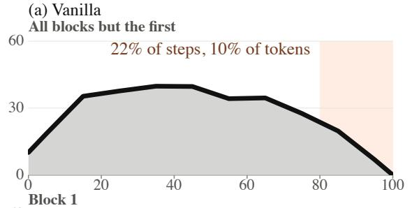

(b) B3 (ours)  
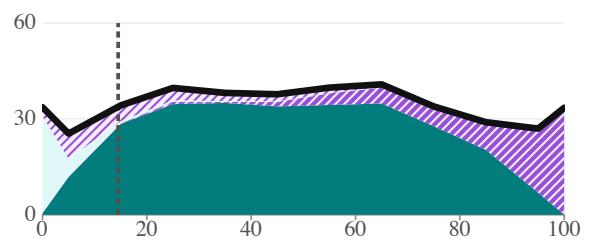

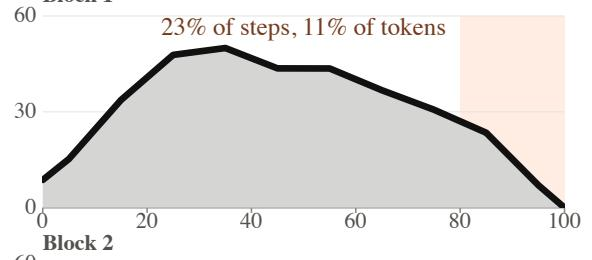

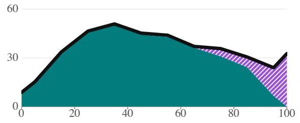

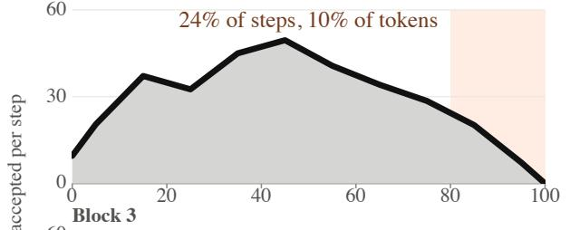

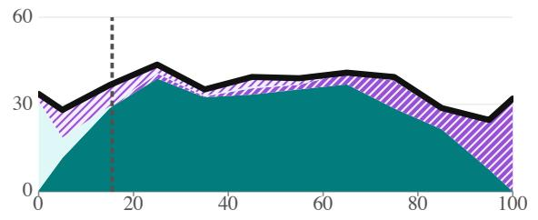

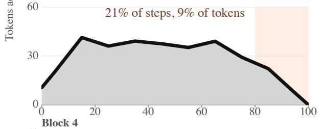

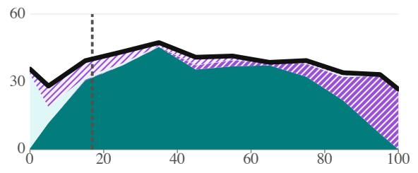

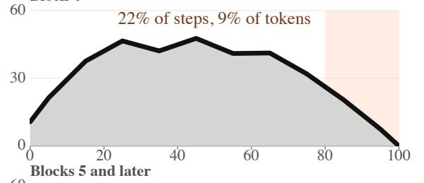

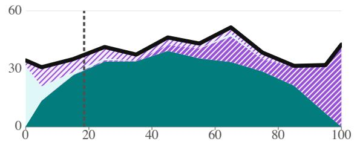

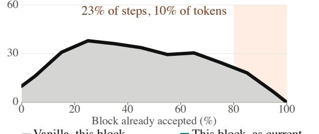

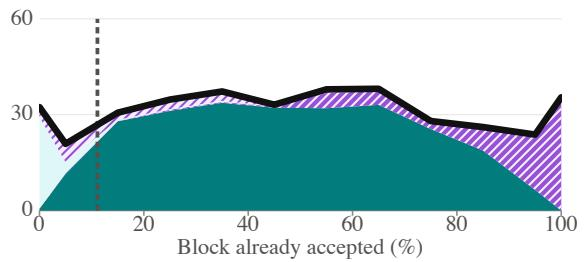  
Figure 9: DiffusionGemma on HumanEval+: tokens accepted per step by block index. Vanilla left, B3 right.

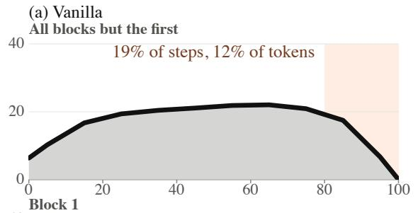

(b) B3 (ours)  
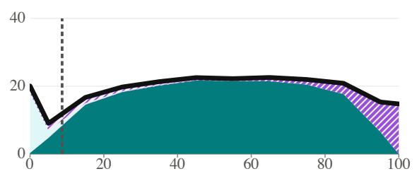

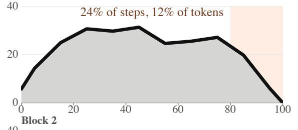

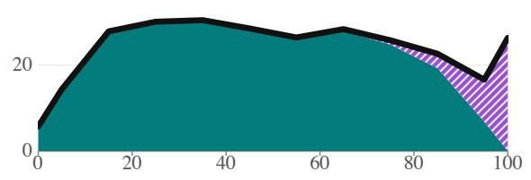

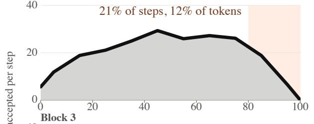

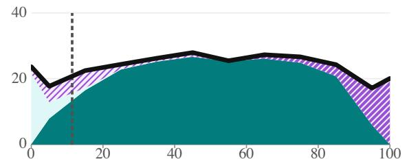

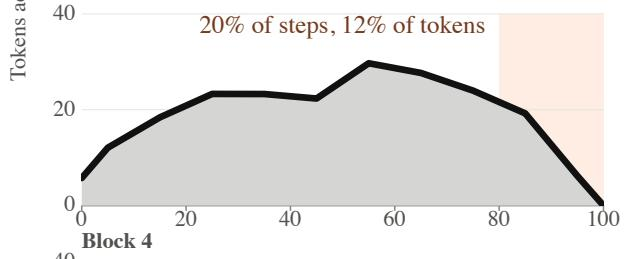

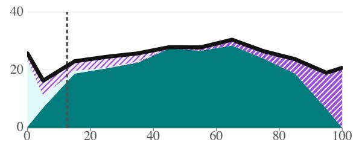

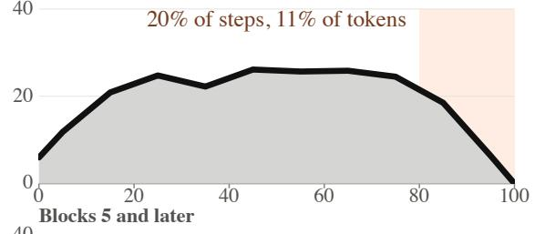

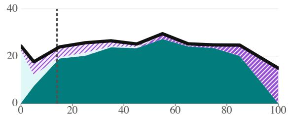

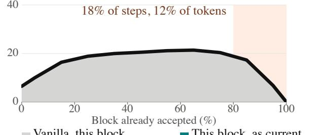

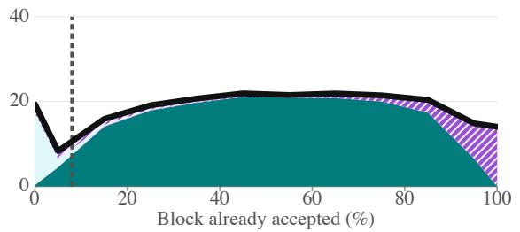  
Figure 10: DiffusionGemma on GPQA Diamond: tokens accepted per step by block index. Vanilla left, B3 right.

<table><tr><td>Entropy bound</td><td colspan="2">0.001</td><td colspan="2">0.01</td><td colspan="2">0.1</td><td colspan="2">1</td><td colspan="2">10</td></tr><tr><td>Method</td><td>Base</td><td>B3</td><td>Base</td><td>B3</td><td>Base</td><td>B3</td><td>Base</td><td>B3</td><td>Base</td><td>B3</td></tr><tr><td colspan="9">TPS</td><td></td></tr><tr><td>GSM8K</td><td>113.5</td><td>119.2</td><td>131.1</td><td>141.0</td><td>136.1</td><td>150.8</td><td>142.3</td><td>160.6</td><td>145.2</td><td>167.7</td></tr><tr><td>MATH500</td><td>125.2</td><td>125.1</td><td>137.3</td><td>142.9</td><td>139.9</td><td>156.0</td><td>144.0</td><td>161.2</td><td>147.0</td><td>171.4</td></tr><tr><td>AIME26</td><td>93.8</td><td>97.7</td><td>99.9</td><td>108.2</td><td>101.0</td><td>121.6</td><td>114.6</td><td>120.0</td><td>119.5</td><td>129.6</td></tr><tr><td>GPQA-D</td><td>76.8</td><td>84.8</td><td>86.3</td><td>96.2</td><td>94.4</td><td>107.1</td><td>99.4</td><td>114.2</td><td>103.6</td><td>121.5</td></tr><tr><td>IFEval</td><td>79.5</td><td>92.3</td><td>93.9</td><td>108.8</td><td>103.4</td><td>119.9</td><td>108.9</td><td>128.8</td><td>117.1</td><td>139.7</td></tr><tr><td>HumanEval+</td><td>128.5</td><td>131.8</td><td>141.9</td><td>151.5</td><td>148.9</td><td>160.7</td><td>143.6</td><td>173.8</td><td>157.6</td><td>186.0</td></tr><tr><td>MBPP+</td><td>121.2</td><td>128.4</td><td>130.1</td><td>130.4</td><td>136.4</td><td>149.6</td><td>142.6</td><td>152.9</td><td>139.0</td><td>166.9</td></tr><tr><td>LCB</td><td>87.9</td><td>95.3</td><td>103.7</td><td>107.5</td><td>108.0</td><td>119.2</td><td>113.0</td><td>124.1</td><td>116.2</td><td>135.8</td></tr><tr><td>Average</td><td>103.3</td><td>109.3</td><td>115.5</td><td>123.3</td><td>121.0</td><td>135.6</td><td>126.0</td><td>142.0</td><td>130.6</td><td>152.3</td></tr><tr><td colspan="9">TPF</td><td></td></tr><tr><td>GSM8K</td><td>23.69</td><td>26.95</td><td>27.11</td><td>30.91</td><td>28.74</td><td>33.69</td><td>30.04</td><td>36.44</td><td>31.07</td><td>38.72</td></tr><tr><td>MATH500</td><td>25.24</td><td>27.37</td><td>27.57</td><td>31.25</td><td>28.69</td><td>34.16</td><td>29.76</td><td>36.69</td><td>30.65</td><td>39.65</td></tr><tr><td>AIME26</td><td>18.38</td><td>19.59</td><td>21.11</td><td>22.76</td><td>20.61</td><td>25.48</td><td>22.92</td><td>25.69</td><td>23.86</td><td>27.83</td></tr><tr><td>GPQA-D</td><td>15.47</td><td>17.82</td><td>17.63</td><td>20.42</td><td>19.18</td><td>22.88</td><td>20.14</td><td>24.66</td><td>21.18</td><td>27.78</td></tr><tr><td>IFEval</td><td>16.14</td><td>19.97</td><td>19.22</td><td>23.66</td><td>21.08</td><td>26.61</td><td>22.47</td><td>28.71</td><td>24.11</td><td>31.69</td></tr><tr><td>HumanEval+</td><td>27.02</td><td>29.92</td><td>30.01</td><td>34.39</td><td>30.77</td><td>37.53</td><td>32.18</td><td>40.59</td><td>33.39</td><td>43.65</td></tr><tr><td>MBPP+</td><td>24.71</td><td>27.48</td><td>27.03</td><td>30.16</td><td>28.39</td><td>33.40</td><td>29.75</td><td>35.79</td><td>30.64</td><td>38.20</td></tr><tr><td>LCB</td><td>18.12</td><td>20.04</td><td>20.95</td><td>23.24</td><td>22.11</td><td>25.59</td><td>23.05</td><td>27.90</td><td>23.80</td><td>30.46</td></tr><tr><td>Average</td><td>21.10</td><td>23.64</td><td>23.83</td><td>27.10</td><td>24.95</td><td>29.92</td><td>26.29</td><td>32.06</td><td>27.34</td><td>34.75</td></tr><tr><td colspan="9">Accuracy</td><td></td><td></td></tr><tr><td>GSM8K</td><td>96.4</td><td>96.4</td><td>96.1</td><td>95.5</td><td>95.8</td><td>96.1</td><td>96.0</td><td>95.8</td><td>94.9</td><td>95.0</td></tr><tr><td>MATH500</td><td>96.8</td><td>96.4</td><td>95.8</td><td>95.6</td><td>95.8</td><td>92.4</td><td>95.0</td><td>91.2</td><td>94.8</td><td>89.8</td></tr><tr><td>AIME26</td><td>63.3</td><td>76.7</td><td>60.0</td><td>66.7</td><td>73.3</td><td>76.7</td><td>53.3</td><td>56.7</td><td>60.0</td><td>40.0</td></tr><tr><td>GPQA-D</td><td>69.7</td><td>68.2</td><td>71.2</td><td>71.7</td><td>73.7</td><td>71.7</td><td>70.2</td><td>71.7</td><td>74.2</td><td>70.2</td></tr><tr><td>IFEval</td><td>96.4</td><td>96.4</td><td>97.0</td><td>96.4</td><td>95.8</td><td>95.4</td><td>95.6</td><td>95.1</td><td>95.9</td><td>93.8</td></tr><tr><td>HumanEval+</td><td>92.1</td><td>93.3</td><td>90.2</td><td>92.7</td><td>91.5</td><td>89.6</td><td>91.5</td><td>89.0</td><td>84.1</td><td>82.3</td></tr><tr><td>MBPP+</td><td>80.4</td><td>79.4</td><td>82.3</td><td>81.0</td><td>80.7</td><td>82.3</td><td>81.7</td><td>79.1</td><td>79.6</td><td>79.6</td></tr><tr><td>LCB</td><td>70.5</td><td>71.3</td><td>69.3</td><td>68.1</td><td>70.5</td><td>69.3</td><td>69.6</td><td>68.4</td><td>65.2</td><td>62.6</td></tr><tr><td>Average</td><td>83.2</td><td>84.8</td><td>82.7</td><td>83.5</td><td>84.6</td><td>84.2</td><td>81.6</td><td>80.9</td><td>81.1</td><td>76.7</td></tr></table>

Table 3: DiffusionGemma 26B, per-benchmark results for Figure 4.

(i) Gradual advance. $r _ { i }$ moves through the block in small steps. An early jump to the block’s end would yield one candidate over a mostly unsettled block and then freeze $r _ { i } .$ , so the block would contribute no further candidates.

(ii) Left context drives the frontier. The token at $r _ { i }$ is accepted mainly on the basis of the partly settled region to its left, as $B _ { b + 1 }$ is conditioned on $B _ { b }$

Commitment in positional order, one token per step, or with all of $\{ \ell < r _ { i } \}$ accepted is not required; eq. (5) takes the maximum over all positions left of $r _ { i } ,$ as eq. (4) does over $B _ { b }$ . Self-editing behind the frontier is allowed.

Evidence in the literature. Confidence- and entropy-based samplers accept the most certain tokens first, inducing a task-dependent, easy-first order (Kim et al., 2025). On text, this order is commonly found to correlate with position. Sumi (Ye et al., 2026), a uniform-state DLM trained from scratch without blocks, shows a left-to-right commitment gradient on three of four tasks under confidence sampling, but not under ancestral sampling, so the gradient emerges at inference rather than being imposed by training. For DiffusionGemma, Asaria et al. (2026) report a partial left-to-right bias in commitment order on prose, code and math. Hou and Kwok (2026) find unmasking concentrated near the diagonal both for the block model SDAR and for the full-canvas LLaDA.

Measurements on the evaluated models. Figure 17 plots $r _ { i }$ against the share of the block committed after step i, for DiffusionGemma and LLaDA 2.1 mini under vanilla decoding on HumanEval+ and GPQA Diamond. An early jump of the frontier would lie far above the diagonal. LLaDA 2.1 mini stays within 3.4 points of it, and DiffusionGemma runs ahead by 6–8 points on average and at most 11.4, so in both models $r _ { i }$ advances gradually, satisfying (i). The drop in the last bin comes from steps on an almost complete block, where the remaining acceptances can fall anywhere. The last block of each generation is excluded.

<table><tr><td>Confidence threshold</td><td colspan="2">0.3</td><td colspan="2">0.5</td><td colspan="2">0.7</td><td colspan="2">0.85</td><td colspan="2">0.95</td></tr><tr><td>Method</td><td>Base</td><td>B3</td><td>Base</td><td>B3</td><td>Base</td><td>B3</td><td>Base</td><td>B3</td><td>Base</td><td>B3</td></tr><tr><td>TPS</td><td></td><td></td><td></td><td></td><td></td><td></td><td></td><td></td><td></td><td></td></tr><tr><td>GSM8K</td><td>128.1</td><td>146.1</td><td>133.5</td><td>150.1</td><td>114.2</td><td>124.8</td><td>84.5</td><td>91.9</td><td>58.6</td><td>61.5</td></tr><tr><td>MATH500</td><td>160.6</td><td>186.5</td><td>171.2</td><td>199.5</td><td>160.4</td><td>186.1</td><td>126.5</td><td>139.3</td><td>95.2</td><td>102.9</td></tr><tr><td>AIME26</td><td>109.6</td><td>115.8</td><td>131.3</td><td>149.9</td><td>113.7</td><td>125.9</td><td>92.6</td><td>92.9</td><td>70.6</td><td>72.1</td></tr><tr><td>GPQA-D</td><td>65.6</td><td>66.2</td><td>79.8</td><td>87.1</td><td>69.5</td><td>73.8</td><td>54.4</td><td>56.1</td><td>42.8</td><td>44.4</td></tr><tr><td>IFEval</td><td>46.5</td><td>49.5</td><td>37.6</td><td>40.0</td><td>31.1</td><td>32.4</td><td>26.8</td><td>27.8</td><td>23.8</td><td>24.0</td></tr><tr><td>HumanEval+</td><td>271.7</td><td>345.3</td><td>271.3</td><td>327.6</td><td>247.2</td><td>301.4</td><td>213.9</td><td>251.5</td><td>168.5</td><td>192.7</td></tr><tr><td>MBPP+</td><td>184.2</td><td>218.0</td><td>183.7</td><td>214.9</td><td>163.6</td><td>194.2</td><td>124.4</td><td>148.5</td><td>91.2</td><td>99.3</td></tr><tr><td>LCB</td><td>136.2</td><td>157.4</td><td>137.8</td><td>153.0</td><td>113.7</td><td>131.8</td><td>93.2</td><td>101.0</td><td>68.6</td><td>73.3</td></tr><tr><td>Average</td><td>137.8</td><td>160.6</td><td>143.3</td><td>165.3</td><td>126.7</td><td>146.3</td><td>102.0</td><td>113.6</td><td>77.4</td><td>83.8</td></tr><tr><td>TPF</td><td></td><td></td><td></td><td></td><td></td><td></td><td></td><td></td><td></td><td></td></tr><tr><td>GSM8K</td><td>5.61</td><td>6.42</td><td>5.74</td><td>6.58</td><td>4.88</td><td>5.49</td><td>3.65</td><td>3.98</td><td>2.55</td><td>2.69</td></tr><tr><td>MATH500</td><td>6.90</td><td>8.27</td><td>7.36</td><td>8.78</td><td>6.85</td><td>8.14</td><td>5.41</td><td>6.22</td><td>4.08</td><td>4.59</td></tr><tr><td>AIME26</td><td>4.62</td><td>5.04</td><td>5.68</td><td>6.59</td><td>4.92</td><td>5.46</td><td>3.88</td><td>4.12</td><td>3.05</td><td>3.12</td></tr><tr><td>GPQA-D</td><td>2.84</td><td>2.90</td><td>3.46</td><td>3.85</td><td>3.02</td><td>3.26</td><td>2.36</td><td>2.49</td><td>1.86</td><td>1.93</td></tr><tr><td>IFEval</td><td>2.03</td><td>2.21</td><td>1.66</td><td>1.77</td><td>1.35</td><td>1.40</td><td>1.15</td><td>1.19</td><td>1.02</td><td>1.04</td></tr><tr><td>HumanEval+</td><td>12.36</td><td>15.60</td><td>12.01</td><td>14.97</td><td>10.94</td><td>13.69</td><td>9.32</td><td>11.38</td><td>7.40</td><td>8.85</td></tr><tr><td>MBPP+</td><td>7.88</td><td>9.63</td><td>8.04</td><td>9.52</td><td>7.16</td><td>8.57</td><td>5.55</td><td>6.54</td><td>3.96</td><td>4.43</td></tr><tr><td>LCB</td><td>5.96</td><td>7.02</td><td>6.09</td><td>6.83</td><td>5.10</td><td>5.83</td><td>4.01</td><td>4.47</td><td>3.03</td><td>3.24</td></tr><tr><td>Average</td><td>6.02</td><td>7.14</td><td>6.26</td><td>7.36</td><td>5.53</td><td>6.48</td><td>4.42</td><td>5.05</td><td>3.37</td><td>3.74</td></tr><tr><td>Accuracy</td><td></td><td></td><td></td><td></td><td></td><td></td><td></td><td></td><td></td><td></td></tr><tr><td>GSM8K</td><td>81.6</td><td>79.9</td><td>88.6</td><td>87.6</td><td>90.9</td><td>89.8</td><td>91.5</td><td>91.1</td><td>91.3</td><td>91.1</td></tr><tr><td>MATH500</td><td>85.8</td><td>84.8</td><td>89.6</td><td>87.6</td><td>92.8</td><td>91.8</td><td>91.2</td><td>93.2</td><td>92.6</td><td>93.2</td></tr><tr><td>AIME26</td><td>16.7</td><td>20.0</td><td>26.7</td><td>30.0</td><td>46.7</td><td>50.0</td><td>46.7</td><td>40.0</td><td>43.3</td><td>53.3</td></tr><tr><td>GPQA-D</td><td>37.4</td><td>34.3</td><td>40.9</td><td>46.5</td><td>52.5</td><td>52.0</td><td>51.0</td><td>50.5</td><td>47.5</td><td>49.0</td></tr><tr><td>IFEval</td><td>84.1</td><td>83.1</td><td>86.6</td><td>85.6</td><td>86.5</td><td>86.0</td><td>87.1</td><td>87.3</td><td>86.7</td><td>86.9</td></tr><tr><td>HumanEval+</td><td>64.6</td><td>67.1</td><td>78.0</td><td>72.0</td><td>83.5</td><td>81.7</td><td>85.4</td><td>83.5</td><td>85.4</td><td>84.8</td></tr><tr><td>MBPP+</td><td>57.4</td><td>57.7</td><td>66.4</td><td>62.4</td><td>69.8</td><td>69.0</td><td>70.4</td><td>73.0</td><td>73.5</td><td>73.0</td></tr><tr><td>LCB</td><td>17.0</td><td>14.3</td><td>20.2</td><td>20.5</td><td>25.7</td><td>26.6</td><td>28.1</td><td>28.1</td><td>29.2</td><td>30.4</td></tr><tr><td>Average</td><td>55.6</td><td>55.2</td><td>62.1</td><td>61.5</td><td>68.6</td><td>68.4</td><td>68.9</td><td>68.3</td><td>68.7</td><td>70.2</td></tr></table>

Table 4: LLaDA 2.1 mini 16B, per-benchmark results for fig. 4.

Figure 18 plots, for every position in a block, the step of its first acceptance as a share of the block’s steps that accept at least one token. Per block, we measure the rank correlation between position and first-acceptance step with Kendall’s τb (Kendall, 1938, 1945) (unrelated to the threshold τ), which handles ties from tokens accepted on the same step. Its median is 0.76 and 0.84 for DiffusionGemma on HumanEval+ and GPQA Diamond, and 0.62 and 0.90 for LLaDA 2.1 mini. It is positive in 99% of blocks in every case, yet clearly below 1 with a wide spread across positions: commitment is correlated with position without being sequential, consistent with (ii). Positions never accepted (0.4% of DiffusionGemma’s) are left out.

## F Self-Editing of Drafted Tokens

The future block is drafted while the current block is still being denoised, so it is conditioned on a prefix that may still hold noise (Section 3). Selfediting is what lets the sampler revise those early guesses once the prefix settles. Table 8 measures how often this happens. For every token of a block that is finalised, it compares the token accepted first with the token the block finalises with, on all 164 HumanEval+ problems. The vanilla rows count tokens accepted in the current block, the only kind vanilla decoding has; the B3 rows count tokens accepted while their block was still the future block.

Tokens drafted in the future block are edited more often: 1.98% against 0.27% for DiffusionGemma, and 4.29% against 2.80% for LLaDA 2.1 mini. These are the small mistakes introduced by drafting on an unfinished previous block, and self-editing corrects them before the block is finalised. They stay few: 98.0% and 95.7% of the drafted tokens are kept unchanged.

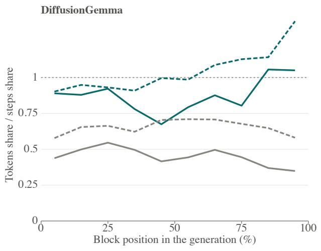

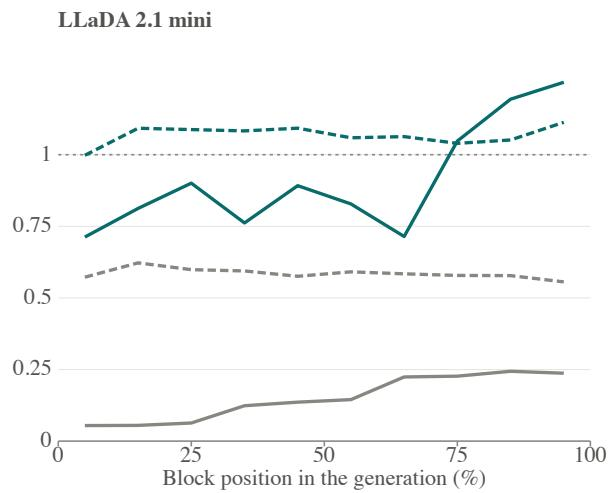  
Vanilla B3 (ours) HumanEval+ GPQA Diamond

Figure 11: Share of a block’s tokens accepted in its last 20% (more than 80% of the block accepted), divided by the share of its denoising steps taken there, by the block’s position in the generation (first block 0%, last 100%; 10 bins). Below 1: the end of the block yields fewer tokens than the steps it costs. Solid: HumanEval+; dashed: GPQA Diamond. Dotted: parity.  
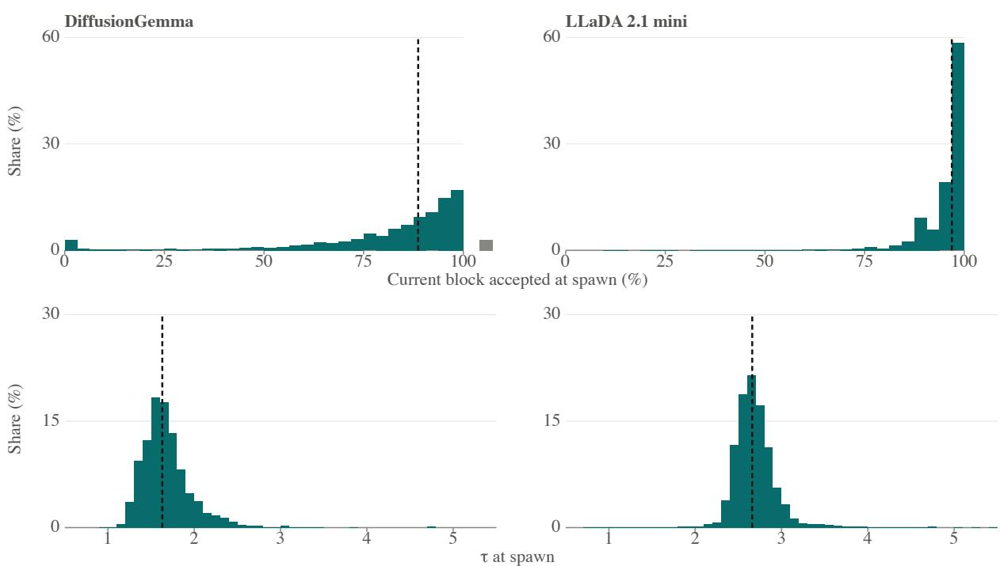  
Figure 12: Spawn points of B3, pooled over HumanEval+ and GPQA Diamond. Top: share of the current block accepted when the next block spawns; gray: blocks that finished without a spawn. Bottom: τ at spawn. Dashed: median.

## G DiffusionGemma Notation Clarifications

Two implementation details of DiffusionGemma (DiffusionGemma Team, 2026) differ slightly from the general description of block diffusion in Section 3.3. Neither changes the notation or the method.

Revoked acceptances. In DiffusionGemma, an accepted token can in principle be unaccepted on a later forward pass. Its position is then removed from the set of accepted positions and its token is replaced by noise drawn from $\pi$ for the next forward pass. The set $I _ { i }$ of accepted positions, and hence the frontier $r _ { i } =$ max $I _ { i }$ , are therefore not guaranteed to be monotone in i. This is a very rare occurrence, and the definitions of $I _ { i } , \ r _ { i }$ and $C _ { \tau }$

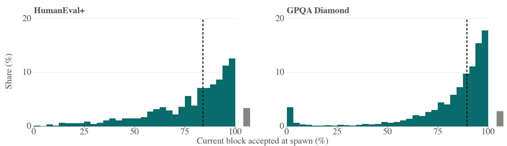

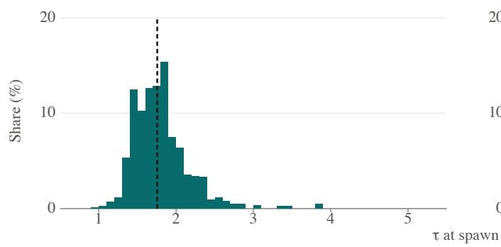

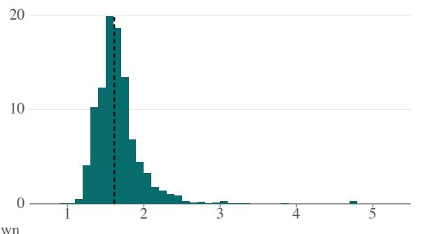  
Figure 13: DiffusionGemma: spawn points per dataset. Top: share of the current block accepted at spawn; gray: blocks that finished without a spawn. Bottom: τ at spawn. Dashed: median.

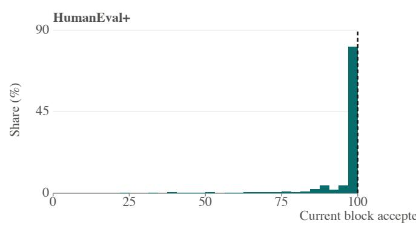

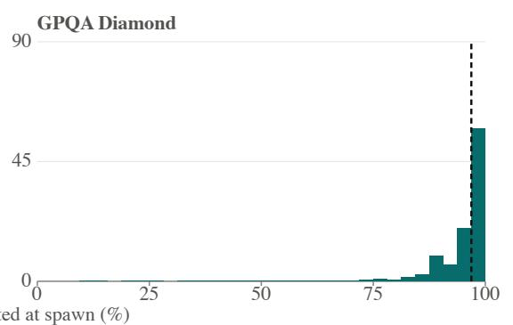

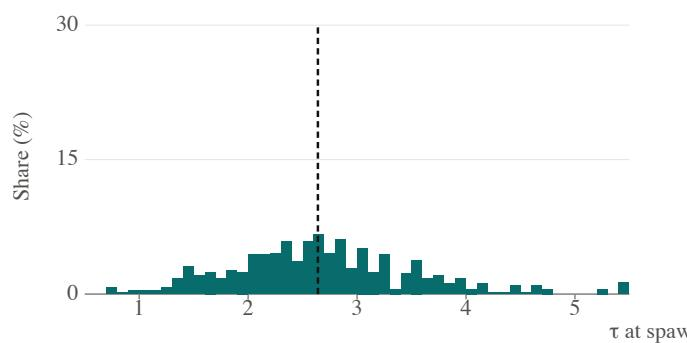

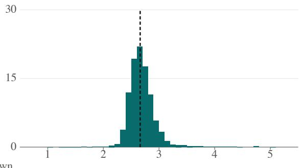  
Figure 14: LLaDA 2.1 mini: spawn points per dataset. Top: share of the current block accepted at spawn; gray: blocks that finished without a spawn. Bottom: τ at spawn. Dashed: median.

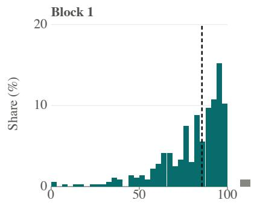

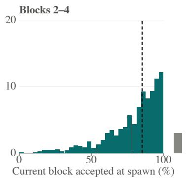

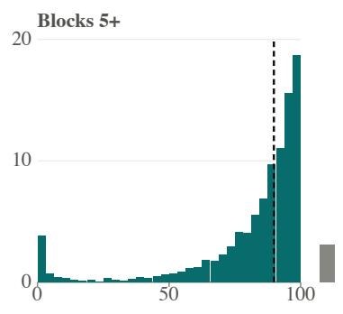

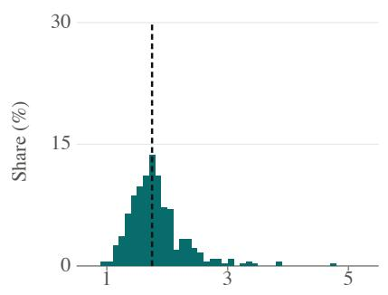

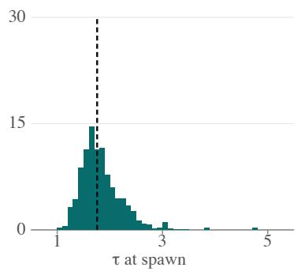

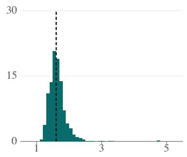  
Figure 15: DiffusionGemma: spawn points per block index, pooled over datasets. Top: share of the current block accepted at spawn; gray: blocks that finished without a spawn. Bottom: τ at spawn. Dashed: median.

  
Figure 16: LLaDA 2.1 mini: spawn points per block index, pooled over datasets. Top: share of the current block accepted at spawn; gray: blocks that finished without a spawn. Bottom: τ at spawn. Dashed: median.

  
HumanEval+ GPQA Diamond Left to right

Figure 17: Rightmost position accepted on a denoising step against the share of the block committed after it, vanilla decoding. Lines: mean; bands: P25–P75; dashed: strictly left-to-right.  

  
HumanEval+ GPQA Diamond Diagonal  
Figure 18: Step at which each position is first accepted, as a share of the block’s denoising steps that accept at least one token, against its position in the block, vanilla decoding. Lines: mean; bands: P25–P75; dashed: diagonal. Kendall $\tau _ { b } \colon$ median over blocks of the rank correlation between position and first-acceptance step, and the share of blocks where it is positive.

apply unchanged.

Causal history. DiffusionGemma encodes its history with fully causal attention, which does not change the forward pass of B3. Our method operates on DiffusionGemma’s token-level causal KV cache, and only the current and future blocks attend block-causally (Figure 3). Once the current block is finalized (committed, in DiffusionGemma’s terminology), it is re-encoded with token-level causal attention and pushed to the history, exactly as in the regular DiffusionGemma inference stack.

## H LLM Use in Research

We used Claude Code (Anthropic, 2026b) for assistance with code writing and code reviewing, as well as LaTeX writing and figure generation. We also used Claude Chat (Anthropic, 2026a) for text drafting and as a reviewer of the paper.

<table><tr><td>Block</td><td>128</td><td>256</td><td>256 B3</td><td>384</td><td>512</td></tr><tr><td>TPS</td><td></td><td></td><td></td><td></td><td></td></tr><tr><td>GSM8K</td><td>90.9</td><td>136.1</td><td>150.8</td><td>171.0</td><td>177.8</td></tr><tr><td>MATH500</td><td>96.6</td><td>139.9</td><td>156.0</td><td>167.8</td><td>171.1</td></tr><tr><td>AIME26</td><td>86.7</td><td>101.0</td><td>121.6</td><td>118.9</td><td>112.6</td></tr><tr><td>GPQA-D</td><td>70.4</td><td>94.4</td><td>107.1</td><td>106.0</td><td>104.8</td></tr><tr><td>IFEval</td><td>66.1</td><td>103.4</td><td>119.9</td><td>123.0</td><td>135.9</td></tr><tr><td>HumanEval+</td><td>99.9</td><td>148.9</td><td>160.7</td><td>172.3</td><td>188.8</td></tr><tr><td>MBPP+</td><td>90.5</td><td>136.4</td><td>149.6</td><td>165.2</td><td>183.7</td></tr><tr><td>LCB</td><td>78.1</td><td>108.0</td><td>119.2</td><td>118.7</td><td>118.8</td></tr><tr><td>Average</td><td>84.9</td><td>121.0</td><td>135.6</td><td>142.9</td><td>149.2</td></tr><tr><td>TPF</td><td></td><td></td><td></td><td></td><td></td></tr><tr><td>GSM8K</td><td>18.59</td><td>28.74</td><td>33.69</td><td>36.62</td><td>40.96</td></tr><tr><td>MATH500</td><td>19.47</td><td>28.69</td><td>34.16</td><td>35.15</td><td>38.15</td></tr><tr><td>AIME26</td><td>16.43</td><td>20.61</td><td>25.48</td><td>24.55</td><td>24.70</td></tr><tr><td>GPQA-D</td><td>13.43</td><td>19.18</td><td>22.88</td><td>22.04</td><td>22.95</td></tr><tr><td>IFEval</td><td>13.53</td><td>21.08</td><td>26.61</td><td>26.67</td><td>30.54</td></tr><tr><td>HumanEval+</td><td>20.15</td><td>30.77</td><td>37.53</td><td>38.34</td><td>42.98</td></tr><tr><td>MBPP+</td><td>18.01</td><td>28.39</td><td>33.40</td><td>35.66</td><td>40.65</td></tr><tr><td>LCB</td><td>15.41</td><td>22.11</td><td>25.59</td><td>25.04</td><td>26.12</td></tr><tr><td>Average</td><td>16.88</td><td>24.95</td><td>29.92</td><td>30.51</td><td>33.38</td></tr><tr><td>Accuracy</td><td></td><td></td><td></td><td></td><td></td></tr><tr><td>GSM8K</td><td>95.5</td><td>95.8</td><td>96.1</td><td>95.8</td><td>95.5</td></tr><tr><td>MATH500</td><td>96.4</td><td>95.8</td><td>92.4</td><td>94.6</td><td>93.2</td></tr><tr><td>AIME26</td><td>73.3</td><td>73.3</td><td>76.7</td><td>43.3</td><td>43.3</td></tr><tr><td>GPQA-D</td><td>73.2</td><td>73.7</td><td>71.7</td><td>73.7</td><td>65.7</td></tr><tr><td>IFEval</td><td>96.3</td><td>95.8</td><td>95.4</td><td>96.2</td><td>93.9</td></tr><tr><td>HumanEval+</td><td>94.5</td><td>91.5</td><td>89.6</td><td>90.9</td><td>91.5</td></tr><tr><td>MBPP+</td><td>81.7</td><td>80.7</td><td>82.3</td><td>79.1</td><td>80.4</td></tr><tr><td>LCB</td><td>71.1</td><td>70.5</td><td>69.3</td><td>68.1</td><td>62.0</td></tr><tr><td>Average</td><td>85.3</td><td>84.6</td><td>84.2</td><td>80.2</td><td>78.2</td></tr></table>

Table 5: DiffusionGemma 26B, per-benchmark results for Figure 5.

<table><tr><td>Block</td><td>32</td><td>32 B3</td><td>64</td><td>64 B3</td><td>96</td><td>128</td></tr><tr><td>TPS</td><td></td><td></td><td></td><td></td><td></td><td></td></tr><tr><td>GSM8K</td><td>101.5</td><td>122.8</td><td>114.2</td><td>124.8</td><td>113.5</td><td>91.7</td></tr><tr><td>MATH500</td><td>133.9</td><td>163.9</td><td>160.4</td><td>186.1</td><td>159.7</td><td>148.5</td></tr><tr><td>AIME26</td><td>103.6</td><td>118.5</td><td>113.7</td><td>125.9</td><td>121.3</td><td>105.4</td></tr><tr><td>GPQA-D</td><td>65.8</td><td>73.4</td><td>69.5</td><td>73.8</td><td>70.5</td><td>62.9</td></tr><tr><td>IFEval</td><td>32.8</td><td>35.4</td><td>31.1</td><td>32.4</td><td>28.8</td><td>25.3</td></tr><tr><td>HumanEval+</td><td>204.2</td><td>257.0</td><td>247.2</td><td>301.4</td><td>249.6</td><td>188.4</td></tr><tr><td>MBPP+</td><td>142.3</td><td>173.4</td><td>163.6</td><td>194.2</td><td>168.3</td><td>138.6</td></tr><tr><td>LCB</td><td>105.1</td><td>122.3</td><td>113.7</td><td>131.8</td><td>115.1</td><td>93.0</td></tr><tr><td>Average</td><td>111.1</td><td>133.3</td><td>126.7</td><td>146.3</td><td>128.3</td><td>106.7</td></tr><tr><td>TPF</td><td></td><td></td><td></td><td></td><td></td><td></td></tr><tr><td>GSM8K</td><td>4.36</td><td>5.32</td><td>4.88</td><td>5.49</td><td>4.86</td><td>4.05</td></tr><tr><td>MATH500</td><td>5.82</td><td>7.16</td><td>6.85</td><td>8.14</td><td>7.02</td><td>6.45</td></tr><tr><td>AIME26</td><td>4.41</td><td>5.12</td><td>4.92</td><td>5.46</td><td>5.10</td><td>4.46</td></tr><tr><td>GPQA-D</td><td>2.80</td><td>3.18</td><td>3.02</td><td>3.26</td><td>3.03</td><td>2.71</td></tr><tr><td>IFEval</td><td>1.41</td><td>1.52</td><td>1.35</td><td>1.40</td><td>1.24</td><td>1.09</td></tr><tr><td>HumanEval+</td><td>9.14</td><td>11.52</td><td>10.94</td><td>13.69</td><td>10.93</td><td>8.33</td></tr><tr><td>MBPP+</td><td>6.14</td><td>7.73</td><td>7.16</td><td>8.57</td><td>7.37</td><td>6.16</td></tr><tr><td>LCB</td><td>4.53</td><td>5.45</td><td>5.10</td><td>5.83</td><td>5.02</td><td>4.17</td></tr><tr><td>Average</td><td>4.83</td><td>5.88</td><td>5.53</td><td>6.48</td><td>5.57</td><td>4.68</td></tr><tr><td>Accuracy</td><td></td><td></td><td></td><td></td><td></td><td></td></tr><tr><td>GSM8K</td><td>90.1</td><td>90.4</td><td>90.9</td><td>89.8</td><td>89.7</td><td>80.7</td></tr><tr><td>MATH500</td><td>91.6</td><td>92.4</td><td>92.8</td><td>91.8</td><td>90.2</td><td>85.8</td></tr><tr><td>AIME26</td><td>46.7</td><td>56.7</td><td>46.7</td><td>50.0</td><td>46.7</td><td>30.0</td></tr><tr><td>GPQA-D</td><td>52.5</td><td>50.5</td><td>52.5</td><td>52.0</td><td>46.5</td><td>45.5</td></tr><tr><td>IFEval</td><td>90.6</td><td>89.3</td><td>86.5</td><td>86.0</td><td>86.2</td><td>78.3</td></tr><tr><td>HumanEval+</td><td>82.9</td><td>81.7</td><td>83.5</td><td>81.7</td><td>75.6</td><td>61.0</td></tr><tr><td>MBPP+</td><td>70.4</td><td>69.6</td><td>69.8</td><td>69.0</td><td>68.8</td><td>70.9</td></tr><tr><td>LCB</td><td>25.7</td><td>26.0</td><td>25.7</td><td>26.6</td><td>24.6</td><td>20.5</td></tr><tr><td>Average</td><td>68.8</td><td>69.6</td><td>68.6</td><td>68.4</td><td>66.0</td><td>59.1</td></tr></table>

Table 6: LLaDA 2.1 mini 16B, per-benchmark results for Figure 5.

<table><tr><td>Block</td><td colspan="4">32</td><td colspan="4">64</td></tr><tr><td>Method</td><td>Base</td><td>FlowBlock</td><td>MBD-LMs</td><td>B3</td><td>Base</td><td>FlowBlock</td><td>MBD-LMs</td><td>B3</td></tr><tr><td colspan="9">TPS</td></tr><tr><td>GSM8K</td><td>101.5</td><td>153.2</td><td>119.9</td><td>122.8</td><td>114.2</td><td>153.8</td><td>119.3</td><td>124.8</td></tr><tr><td>MATH500</td><td>133.9</td><td>207.1</td><td>161.8</td><td>163.9</td><td>160.4</td><td>210.8</td><td>176.6</td><td>186.1</td></tr><tr><td>AIME26</td><td>103.6</td><td>143.6</td><td>116.4</td><td>118.5</td><td>113.7</td><td>147.7</td><td>114.0</td><td>125.9</td></tr><tr><td>GPQA-D</td><td>65.8</td><td>91.1</td><td>74.2</td><td>73.4</td><td>69.5</td><td>83.4</td><td>69.7</td><td>73.8</td></tr><tr><td>IFEval</td><td>32.8</td><td>26.5</td><td>35.1</td><td>35.4</td><td>31.1</td><td>24.1</td><td>31.4</td><td>32.4</td></tr><tr><td>HumanEval+</td><td>204.2</td><td>227.9</td><td>253.3</td><td>257.0</td><td>247.2</td><td>236.0</td><td>299.7</td><td>301.4</td></tr><tr><td>MBPP+</td><td>142.3</td><td>118.7</td><td>167.8</td><td>173.4</td><td>163.6</td><td>116.9</td><td>195.5</td><td>194.2</td></tr><tr><td>LCB</td><td>105.1</td><td>85.1</td><td>120.5</td><td>122.3</td><td>113.7</td><td>86.0</td><td>128.6</td><td>131.8</td></tr><tr><td>Average</td><td>111.1</td><td>131.7</td><td>131.1</td><td>133.3</td><td>126.7</td><td>132.3</td><td>141.8</td><td>146.3</td></tr><tr><td colspan="9">TPF</td></tr><tr><td>GSM8K</td><td>4.36</td><td>6.66</td><td>5.32</td><td>5.32</td><td>4.88</td><td>6.74</td><td>5.33</td><td>5.49</td></tr><tr><td>MATH500</td><td>5.82</td><td>9.06</td><td>7.32</td><td>7.16</td><td>6.85</td><td>9.55</td><td>8.03</td><td>8.14</td></tr><tr><td>AIME26</td><td>4.41</td><td>6.27</td><td>5.18</td><td>5.12</td><td>4.92</td><td>6.51</td><td>5.06</td><td>5.46</td></tr><tr><td>GPQA-D</td><td>2.80</td><td>3.92</td><td>3.27</td><td>3.18</td><td>3.02</td><td>3.67</td><td>3.14</td><td>3.26</td></tr><tr><td>IFEval</td><td>1.41</td><td>1.15</td><td>1.55</td><td>1.52</td><td>1.35</td><td>1.04</td><td>1.38</td><td>1.40</td></tr><tr><td>HumanEval+</td><td>9.14</td><td>10.24</td><td>11.72</td><td>11.52</td><td>10.94</td><td>10.62</td><td>13.70</td><td>13.69</td></tr><tr><td>MBPP+</td><td>6.14</td><td>5.20</td><td>7.74</td><td>7.73</td><td>7.16</td><td>5.24</td><td>8.69</td><td>8.57</td></tr><tr><td>LCB</td><td>4.53</td><td>3.67</td><td>5.46</td><td>5.45</td><td>5.10</td><td>3.78</td><td>5.87</td><td>5.83</td></tr><tr><td>Average</td><td>4.83</td><td>5.77</td><td>5.95</td><td>5.88</td><td>5.53</td><td>5.89</td><td>6.40</td><td>6.48</td></tr><tr><td colspan="9"></td></tr><tr><td>Accuracy GSM8K</td><td>90.1</td><td>90.4</td><td>90.4</td><td>90.4</td><td>90.9</td><td>91.1</td><td>88.2</td><td>89.8</td></tr><tr><td>MATH500</td><td>91.6</td><td>91.8</td><td>90.0</td><td>92.4</td><td>92.8</td><td>91.6</td><td>88.6</td><td>91.8</td></tr><tr><td>AIME26</td><td>46.7</td><td>36.7</td><td>40.0</td><td>56.7</td><td>46.7</td><td>40.0</td><td>40.0</td><td>50.0</td></tr><tr><td>GPQA-D</td><td>52.5</td><td>49.0</td><td>50.0</td><td>50.5</td><td>52.5</td><td>50.0</td><td>41.4</td><td>52.0</td></tr><tr><td>IFEval</td><td>90.6</td><td>90.5</td><td>89.3</td><td>89.3</td><td>86.5</td><td>85.1</td><td>84.4</td><td>86.0</td></tr><tr><td>HumanEval+</td><td>82.9</td><td>84.1</td><td>82.9</td><td>81.7</td><td>83.5</td><td>84.1</td><td>79.9</td><td>81.7</td></tr><tr><td>MBPP+</td><td>70.4</td><td>72.0</td><td>71.2</td><td>69.6</td><td>69.8</td><td>74.6</td><td>72.8</td><td>69.0</td></tr><tr><td>LCB</td><td>25.7</td><td>28.4</td><td>25.4</td><td>26.0</td><td>25.7</td><td>29.8</td><td>27.5</td><td>26.6</td></tr><tr><td>Average</td><td>68.8</td><td>67.9</td><td>67.4</td><td>69.6</td><td>68.6</td><td>68.3</td><td>65.3</td><td>68.4</td></tr></table>

Table 7: LLaDA 2.1 mini 16B, per-benchmark results for Table 2.

<table><tr><td>Accepted in</td><td>Tokens</td><td>Edited later</td><td>Share</td></tr><tr><td>DiffusionGemma</td><td></td><td></td><td></td></tr><tr><td>Vanilla</td><td>237,496</td><td>633</td><td>0.27%</td></tr><tr><td>B3 (future block)</td><td>42,426</td><td>839</td><td>1.98%</td></tr><tr><td>LLaDA 2.1 mini</td><td></td><td></td><td></td></tr><tr><td>Vanilla</td><td>51,520</td><td>1,441</td><td>2.80%</td></tr><tr><td>B3 (future block)</td><td>26,250</td><td>1,125</td><td>4.29%</td></tr></table>

Table 8: Tokens edited after their first acceptance, on HumanEval+.