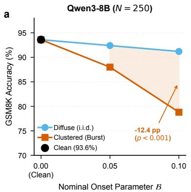
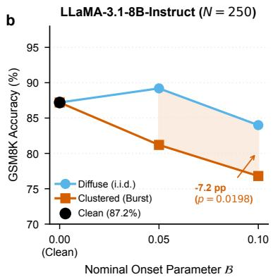
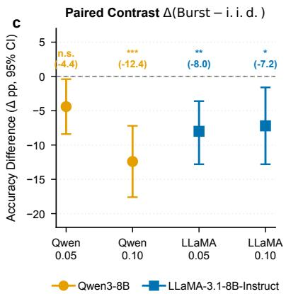
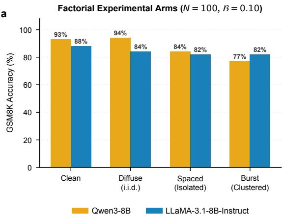
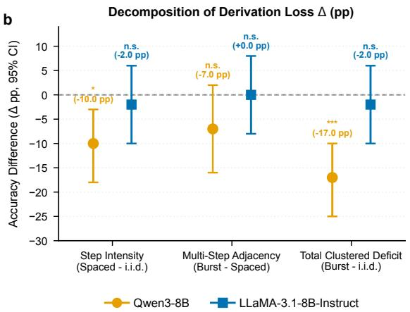

# Breakdown of Autoregressive Multi-Step Reasoning Under Concentrated vs. Difuse Attention Head Dropout

Karol Struniawski∗

## Abstract

Institute of Information Technology, Warsaw University of Life Sciences – SGGW Warsaw, Poland

During extended wakefulness, mammalian neocortical networks experience localized periods of transient neuronal silence termed of-states. Here, we examine how analogous spatiotemporally concentrated disruptions afect sequential reasoning in autoregressive Large Language Models (LLMs). Evaluating 250 paired derivations on the GSM8K benchmark across two 8B models (Qwen3-8B and LLaMA-3.1-8B-Instruct), we contrast clustered bursts of attention head masking against budget-matched difuse i.i.d. dropout. Concentrated bursts induce substantial reasoning degradation: at onset parameter $B = 0 . 1 0$ (scheduling ∼ 5.7% of vulnerable head-token volume), Qwen3-8B accuracy drops from 91.2% under difuse noise to 78.8% under burst dropout $( \Delta = - 1 2 . 4 $ percentage points [pp], exact McNemar $p = 5 . 5 { \times } 1 0 ^ { - 6 } )$ while LLaMA-3.1-8B-Instruct drops from 84.0% to 76.8% (∆ = −7.2 pp, $p \ = \ 0 . 0 1 9 8 )$ Conversely, dispersing the identical cumulative budget uniformly across generation steps via stratified quintile matching yields substantially milder degradation (retaining 91.2% in Qwen and 84.0% in LLaMA). In an exploratory factorial dissociation (N = 100), single-step dropout density is associated with an acute drop in a single schedule draw (−10.0 pp on Qwen, $p _ { \mathrm { h o l m } } = 0 . 0 4 2 5 )$ , while multi-token continuity exhibits an inconclusive compounding trend $( - 7 . 0 \ \mathrm { p p } , \ p _ { \mathrm { h o l m } } = 0 . 1 8 9 2 )$ . Error analysis reveals that Qwen failures reflect derivation errors within formatted responses (conditional accuracy drop $\mathrm { o f \ - 1 1 . 4 \ p p } )$ , whereas in LLaMA 22.2% of discordant losses lack a final answer format line (conditional gap narrows to −5.0 pp). These findings demonstrate that autoregressive reasoning chains are particularly vulnerable to concentrated structural disruptions, providing empirical benchmarks for fault tolerance in transformer architectures.

## Introduction

In biological neuroscience, the classical view of sleep as an exclusively global brain state mediated solely by subcortical arousal nuclei has been revised following the discovery of local sleep in awake neocortical networks [1–3]. Under extended wakefulness and sleep deprivation, individual cortical columns and localized neuronal assemblies spontaneously undergo transient periods of neuronal silence and slow-wave electrophysiological activity, termed cortical of-states or microsleeps, even as the organism remains awake and active [1, 4]. In awake humans, these intruding localized of-states predict cognitive lapses during tasks that require continuous, sequential mental operations [2, 5].

In artificial intelligence, Large Language Models (LLMs) parameterized by deep transformer architectures have proven efective at solving multi-step logical tasks [6–8]. In Chain-of-Thought (CoT) reasoning, complex problems are decomposed into sequential token trajectories. Intermediate arithmetic calculations, variable groundings, and inferential deductions are generated autoregressively and appended to the context history [9–11]. Attention heads act as dynamic routing channels, reading relevant historical representations from the Key–Value (KV) cache to compute successive tokens [12, 13].

While the fault tolerance of transformer attention has been analyzed in the context of post-training structural pruning [14, 15], isotropic weight degradation, and uniform pre-training dropout [16], dynamic runtime noise models commonly adopt an independent and identically distributed (i.i.d.) perturbation schedule. Under uniform i.i.d. perturbations, omissions are dispersed uniformly at random across the spatio-temporal volume of the network. However, autoregressive computation exhibits an unrolled temporal dependency structure, where the output token generated at step t conditions all subsequent representations at steps $t + 1 , t + 2 , \ldots , T$

This structural asymmetry raises two practical questions regarding the robustness of autoregressive reasoning: first, whether spatiotemporally concentrated attention head failure (co-activating head omissions across layers and successive tokens) inflicts a more severe reasoning breakdown than an equal cumulative budget of difuse (i.i.d.) noise, and second, whether the resulting impairment is driven primarily by instantaneous per-step intensity (dense head loss within a single token) or by temporal multi-token continuity (sustained disruption over consecutive tokens).

To evaluate these questions with paired experimental control, we conduct confirmatory evaluations (N = 250 items) and an exploratory factorial dissociation experiment (N = 100) on two modern 8-billion-parameter open-weight models: Qwen3-8B [17] and LLaMA-3.1-8B-Instruct [18] on the GSM8K benchmark [9]. We show that concentrated bursts trigger significant derivation impairment $( \Delta = - 1 2 . 4 $ pp on Qwen, $\Delta = - 7 . 2$ pp on LLaMA at nominal onset parameter $B = 0 . 1 0 )$ , while matched budgets of difuse i.i.d. noise result in comparatively modest losses. Furthermore, we evaluate instantaneous per-step density and multi-token continuity, finding that single-step concentration produces an acute drop in that draw (−10.0 pp on Qwen, $p _ { \mathrm { h o l m } } = 0 . 0 4 2 5 )$ , with multi-token continuity acting as a suggestive compounding trend.

## Results

## Confirmatory Evaluation: The Clustered Deficit

In the confirmatory evaluation across $N = 2 5 0$ paired GSM8K derivations, we evaluated Qwen3- 8B and LLaMA-3.1-8B-Instruct across onset parameters $B \in \{ 0 . 0 5 , 0 . 1 0 \}$ (Fig. 1, Table 1).

  
Figure 1: Derivation breakdown under concentrated attention head dropout contrasted with difuse noise resilience $( N = 2 5 0$ paired GSM8K derivations). a, Qwen3-8B derivation accuracy under clean baseline (93.6%, black), difuse i.i.d. noise (sky blue), and clustered burst dropout (vermilion) across nominal onset parameters $B = 0 . 0 5$ and $B = 0 . 1 0$ $\mathrm { A t } ~ \boldsymbol { B } = 0 . 1 0$ , burst dropout drops accuracy to 78.8%, whereas difuse noise remains at 91.2%. b, LLaMA-3.1-8B-Instruct derivation accuracy under identical experimental conditions (Clean 87.2% → i.i.d. 84.0% vs. Burst 76.8%). c, Paired diference contrast $\Delta ( \mathrm { B u r s t } - \mathrm { i . i . d . } )$ in percentage points (pp) with 95% bootstrap confidence intervals. For Qwen3-8B at $B = 0 . 0 5$ the bootstrap CI excludes zero $( [ - 8 . 4 \mathrm { ~ p p } , - 0 . 4 \mathrm { ~ p p } ] )$ whereas the exact McNemar test yields $p _ { \mathrm { h o l m } } = 0 . 0 6 1 4$ (discordant pairs: 20 vs. 9). Asterisks denote family-wise Holm-Bonferroni significance: $^ { * * * } p _ { \mathrm { h o l m } } < 0 . 0 0 1 , ^ { * * } p _ { \mathrm { h o l m } } < 0 . 0 1 , ^ { * } p _ { \mathrm { h o l m } } < 0 . 0 5$ , n.s.: not significant.

Qwen3-8B Derivations Under unperturbed clean inference, Qwen3-8B achieves an accuracy of 93.6% (234/250). Difuse i.i.d. dropout introduces minor disruption, with accuracy dropping slightly to 92.4% at $B = 0 . 0 5$ (−1.2 pp) and 91.2% at $B = 0 . 1 0$ (−2.4 pp).

Table 1: Confirmatory Results across $N = 2 5 0$ paired derivations on GSM8K. Performance metrics, realized head-token budgets, answer completion rates, raw task accuracy, accuracy conditional on emitting a final answer line, discordant pairs $( b , c )$ where $b = \mathrm { i . i . d . ^ { + } }$ Burst− and $c = \mathrm { B u r s t ^ { + } i . i . d . ^ { - } }$ , exact McNemar p-values, Holm-corrected $p _ { \mathrm { h o l m } }$ , and 95% bootstrap confidence intervals.
<table><tr><td>Model</td><td>Arm</td><td>Budget B</td><td>Realized Heads</td><td>Answer Rate</td><td>Raw Acc</td><td>Cond Acc</td><td>Paired ∆</td><td>Discordant (b, c)</td><td>PMcNemar</td><td>Pholm</td><td>95% Bootstrap CI</td></tr><tr><td>Qwen3-8B</td><td>Clean</td><td>0.00</td><td>0.0</td><td>99.6%</td><td>93.6%</td><td>94.0%</td><td>Baseline</td><td></td><td></td><td></td><td></td></tr><tr><td></td><td>i.i.d.</td><td>0.05</td><td>4,969.8</td><td>98.4%</td><td>92.4%</td><td>93.5%</td><td></td><td></td><td></td><td></td><td></td></tr><tr><td></td><td>Burst</td><td>0.05</td><td>4,868.6</td><td>98.8%</td><td>88.0%</td><td>88.7%</td><td> $- 4 . 4 \ \mathrm { p p }$ </td><td>(20,9)</td><td>0.0614</td><td>0.0614</td><td> $[ - 8 . 4 ~ \mathrm { p p } , - 0 . 4 ~ \mathrm { p p } ]$ </td></tr><tr><td></td><td>i.i.d.</td><td>0.10</td><td>8,631.3</td><td>98.8%</td><td>91.2%</td><td>91.9%</td><td></td><td></td><td></td><td></td><td></td></tr><tr><td></td><td>Burst</td><td>0.10</td><td>8,897.3</td><td>96.4%</td><td>78.8%</td><td>80.5%</td><td>-12.4 pp</td><td>(39,8)</td><td> $5 . 5 \times 1 0 ^ { - 6 }$ </td><td> $1 . 1 \times 1 0 ^ { - 5 }$ </td><td> $[ - 1 7 . 6 ~ \mathrm { p p } , - 7 . 2 ~ \mathrm { p p } ]$ </td></tr><tr><td>LLaMA-3.1-8B-Instruct</td><td>Clean</td><td>0.00</td><td>0.0</td><td>98.8%</td><td>87.2%</td><td>87.9%</td><td>Baseline</td><td></td><td></td><td></td><td></td></tr><tr><td></td><td>i.i.d.</td><td>0.05</td><td>3,826.2</td><td>96.0%</td><td>89.2%</td><td>90.0%</td><td></td><td></td><td></td><td></td><td></td></tr><tr><td></td><td>Burst</td><td>0.05</td><td>3,986.0</td><td>92.4%</td><td>81.2%</td><td>84.0%</td><td> $- 8 . 0 \ \mathrm { p p }$ </td><td>(29,9)</td><td>0.0017</td><td>0.0033</td><td> $[ - 1 2 . 8 ~ \mathrm { p p } , - 3 . 6 ~ \mathrm { p p } ]$ </td></tr><tr><td></td><td>i.i.d.</td><td>0.10</td><td>6,437.2</td><td>94.0%</td><td>84.0%</td><td>85.1%</td><td></td><td></td><td></td><td></td><td></td></tr><tr><td></td><td>Burst</td><td>0.10</td><td>6,626.4</td><td>90.4%</td><td>76.8%</td><td>80.1%</td><td> $- 7 . 2 \ \mathrm { p p }$ </td><td>(36, 18)</td><td>0.0198</td><td>0.0198</td><td> $- 1 2 . 8 ~ \mathrm { p p , - 1 . 6 ~ p p } ]$ </td></tr></table>

Under concentrated burst dropout, Qwen3-8B exhibits clear vulnerability. At $B = 0 . 0 5$ accuracy declines to $8 8 . 0 \% ( \Delta = - 4 . 4 \ \mathrm { p p }$ , exact McNemar $p = 0 . 0 6 1 4$ , $p _ { \mathrm { h o l m } } = 0 . 0 6 1 4$ , 95% CI: $[ - 8 . 4 ~ \mathrm { p p } , - 0 . 4 ~ \mathrm { p p } ] \rangle$ . Here, the unadjusted bootstrap CI excludes zero while the exact McNemar test yields $p = 0 . 0 6 1 4$ . This divergence occurs because the percentile bootstrap resamples paired item diferences with replacement, whereas the exact McNemar test evaluates the binomial probability under $\textstyle H _ { 0 } : p = 0 . 5$ on the 29 discordant pairs (20, 9). At $B = 0 . 1 0$ , accuracy drops to 78.8% (197/250), establishing a significant paired deficit of $\Delta = - 1 2 . 4$ pp relative to difuse noise (discordant pairs: 39 vs. 8, exact McNemar $p = 5 . 5 \times 1 0 ^ { - 6 }$ 2 $p _ { \mathrm { h o l m } } = 1 . 1 \times 1 0 ^ { - 5 }$ , 95% CI: $[ - 1 7 . 6 \ \mathrm { p p } , - 7 . 2 \ \mathrm { p p } ] )$ ). Answer completion remains high (96.4% under Burst vs. 98.8% under i.i.d.), and accuracy conditional on emitting an answer line drops from 91.9% to 80.5% $( \Delta = - 1 1 . 4 \mathrm { p p } )$ confirming that the deficit predominantly represents errors within derivations that still reach a formatted answer line rather than format omissions.

LLaMA-3.1-8B-Instruct Derivations Starting from a clean baseline of 87.2% (218/250), difuse i.i.d. noise yields 89.2% at $B = 0 . 0 5$ and 84.0% at $\textstyle B = 0 . 1 0$ . Subjecting LLaMA to clustered bursts produces significant impairments: at $B = 0 . 0 5$ , accuracy drops to 81.2% $( \Delta = - 8 . 0 ~ \mathrm { p p }$ McNemar $p = 0 . 0 0 1 7$ $p _ { \mathrm { h o l m } } = 0 . 0 0 3 3 )$ . At $B = 0 . 1 0$ , accuracy falls to 76.8% $( \Delta = - 7 . 2 ~ \mathrm { p p }$ McNemar $p = 0 . 0 1 9 8$ $p _ { \mathrm { h o l m } } = 0 . 0 1 9 8$ , 95% CI: [−12.8 pp, −1.6 pp]).

In LLaMA at $B = 0 . 1 0$ , the answer completion rate drops from 94.0% (i.i.d.) to 90.4% (Burst). Because the scorer falls back to the last numeric value when an explicit Answer: line is absent, 11 items under Burst were scored correct without a final answer line. Among the 36 items where LLaMA succeeded under i.i.d. but failed under Burst, 8 items (22.2%) lacked an explicit answer line. When evaluating accuracy strictly conditional on emitting an answer line, the performance gap narrows from −7.2 pp (raw) to −5.0 pp (80.1% vs. 85.1%, Supplementary Table S3).

Realized Head-Token Budgets and Conditional Dose Asymmetry Because derivations terminate upon generating EOS tokens, derivations complete in an inferred mean of ∼ 221–273 tokens (estimated from the ratio of realized to scheduled budgets over $T _ { \mathrm { m a x } } = 5 1 2 )$ , realizing ≈ 43%–53% of scheduled budgets. In aggregate across all items, mean realized budgets between Burst and i.i.d. match closely: on Qwen $( B = 0 . 1 0 )$ , 8, 897.3 vs. 8, 631.3, while on LLaMA $( B = 0 . 1 0 )$ , 6, 626.4 vs. 6, 437.2.

However, a conditional dose asymmetry is observed: at $B = 0 . 1 0$ on items where Burst failed, derivations ran longer, realizing +511.1 (Qwen) and +826.6 (LLaMA) more head-tokens than the paired i.i.d. arm. On items where Burst succeeded at $B = 0 . 1 0$ , realized dose diferences were markedly smaller (+200.1 on Qwen, −3.4 on LLaMA). At lower dose B = 0.05 on Qwen, failed items averaged −681.0 head-tokens relative to i.i.d., demonstrating that post-treatment length variation depends on disruption severity and that budget equality holds strictly at the aggregate population level.

## Exploratory Factorial Dissociation

To explore instantaneous per-step density and multi-token temporal continuity, we analyzed the four-arm factorial dissociation experiment at N = 100 paired items $( B = 0 . 1 0 )$ comparing Clean, Difuse i.i.d., Spaced (isolated steps with $\alpha = 0 . 4 0 )$ , and Burst (consecutive steps with $\alpha = 0 . 4 0 )$ (Fig. 2, Table 2).

Table 2: Factorial Dissociation Experiment (N = 100 paired derivations, $ { B } = 0 . 1 0 )$ . Accuracy, realized head budgets, discordant pairs $( b , c )$ where $b = \mathrm { A r m _ { 2 } ^ { + } A r m _ { 1 } ^ { - } }$ and $c = \mathrm { A r m _ { 1 } ^ { + } A r m _ { 2 } ^ { - } }$ for the paired contrast $\left( \mathrm { A r m } _ { 1 } - \mathrm { A r m } _ { 2 } \right)$ , exact McNemar p-values, and Holm-corrected pholm across planned contrasts.
<table><tr><td>Model</td><td>Arm</td><td>Accuracy</td><td>Realized Heads</td><td>Contrast</td><td>∆ (pp)</td><td>Discordant (b, c)</td><td>pMcNemar</td><td>Pholm</td></tr><tr><td>Qwen3-8B</td><td>Clean</td><td>93.0%</td><td>0.0</td><td>Baseline</td><td></td><td></td><td></td><td></td></tr><tr><td></td><td>i.i.d.</td><td>94.0%</td><td>7,485.9</td><td>Baseline i.i.d.</td><td></td><td></td><td></td><td></td></tr><tr><td></td><td>Spaced</td><td>84.0%</td><td>7,585.4</td><td>Spaced vs. i.i.d.</td><td>-10.0 pp</td><td>(13,3)</td><td>0.0213</td><td>0.0425</td></tr><tr><td></td><td>Burst</td><td>77.0%</td><td>7,700.4</td><td>Burst vs. Spaced</td><td>−7.0 pp</td><td>(14, 7)</td><td>0.1892</td><td>0.1892</td></tr><tr><td></td><td></td><td></td><td></td><td>Burst vs. i.i.d.</td><td>-17.0 pp</td><td>(17,0)</td><td>1.5 × 10−5</td><td>4.6 × 10−5</td></tr><tr><td>LLaMA-3.1-8B-Instruct</td><td>Clean</td><td>88.0%</td><td>0.0</td><td>Baseline</td><td></td><td></td><td></td><td></td></tr><tr><td></td><td>i.i.d.</td><td>84.0%</td><td>5,722.1</td><td>Baseline i.i.d.</td><td></td><td></td><td></td><td></td></tr><tr><td></td><td>Spaced</td><td>82.0%</td><td>5,719.5</td><td>Spaced vs. i.i.d.</td><td>−2.0 pp</td><td>(10,8)</td><td>0.8145</td><td>1.0000</td></tr><tr><td></td><td>Burst</td><td>82.0%</td><td>5,811.8</td><td>Burst vs. Spaced</td><td>0.0 pp</td><td>(8,8)</td><td>1.0000</td><td>1.0000</td></tr><tr><td></td><td></td><td></td><td></td><td>Burst vs. i.i.d.</td><td>−2.0 pp</td><td>(10, 8)</td><td>0.8145</td><td>1.0000</td></tr></table>

  
Figure 2: Factorial dissociation of instantaneous step intensity versus multi-step temporal continuity $( N = 1 0 0$ paired derivations, nominal onset parameter $ { B } = 0 . 1 0 )$ a, Factorial arm accuracy on GSM8K across Clean baseline $( M \equiv 1 )$ , Difuse i.i.d. noise, Spaced gapped dropouts (interleaved isolated steps with $\alpha = 0 . 4 0 )$ , and Burst consecutive dropouts (consecutive steps $t , t + 1 , t + 2$ with $\alpha = 0 . 4 0 )$ . b, Decomposition of derivation loss $\Delta$ (percentage points) with 95% bootstrap confidence intervals. Instantaneous step intensity (Spaced − i.i.d.) shows a drop of −10.0 pp on Qwen3-8B in this schedule draw $( p _ { \mathrm { h o l m } } = 0 . 0 4 2 5 )$ . Multi-step adjacency (Burst − Spaced) accounts for an additional −7.0 pp on Qwen, but is statistically inconclusive at $N = 1 0 0 \ \mathrm { ( p _ { h o l m } = 0 . 1 8 9 2 }$ , CI includes zero). Total clustered deficit $\left( \mathrm { B u r s t - i . i . d . } \right)$ confirms loss in this draw $\left( - 1 7 . 0 \mathrm { ~ p p } \right.$ $p _ { \mathrm { h o l m } } ~ = ~ 4 . 6 \times 1 0 ^ { - 5 } )$ Asterisks: $^ { * * * } p _ { \mathrm { h o l m } } \ < \ 0 . 0 0 1$ $^ { * } p _ { \mathrm { h o l m } } < 0 . 0 5$ , n.s.: not significant.

Exploratory Contrast in Qwen3-8B On Qwen3-8B, compressing omissions into isolated single tokens with $\alpha = 0 . 4 0$ density (Spaced arm) reduces accuracy from 94.0% (i.i.d.) to 84.0% (84/100), generating an acute drop of −10.0 pp (discordant pairs: 13 vs. 3, exact McNemar $p = 0 . 0 2 1 3$ 2 $p _ { \mathrm { h o l m } } = 0 . 0 4 2 5$ , 95% CI: $[ - 1 8 . 0 \ \mathrm { p p , - 3 . 0 \ p p } ] )$ . Chaining masks across consecutive tokens $( t , t + 1 , t + 2$ in Burst) further reduces accuracy from 84.0% to 77.0% $( \Delta { } ( \mathrm { B u r s t - S p a c e d } ) = - 7 . 0 ~ \mathrm { p p } )$ . However, this contrast does not reach statistical significance after Holm-Bonferroni correction (discordant pairs: 14 vs. 7, McNemar $p = 0 . 1 8 9 2$ , $p _ { \mathrm { h o l m } } = 0 . 1 8 9 2$ 95% CI: $[ - 1 6 . 0 \ \mathrm { p p } , + 2 . 0 \ \mathrm { p p } ] )$ . Because the confidence interval spans zero, multi-token temporal continuity cannot be claimed as an established independent factor at N = 100.

Schedule Diferences and Inconclusive Findings on LLaMA-3.1-8B-Instruct We explicitly disclose that the dissociation experiment difered from the confirmatory runs in two important respects. First, the generator used a 10-step jump instead of a 7-step jump, scheduling ∼ 13% lower total head budget on the identical 100 items. Second, because of this algorithmic change, random mask placement diverged from the confirmatory run: on these 100 items, Qwen i.i.d. scored 94% (compared to 86% in the confirmatory run on the same items), and 25% of items flipped correctness under Burst between runs.

Crucially, on these identical 100 items under the confirmatory schedule, the reference contrast was Burst−i.i.d. = −6.0 pp on Qwen3-8B (discordant pairs: 12 vs. 6, exact McNemar p = 0.2379) and −5.0 pp on LLaMA-3.1-8B-Instruct (discordant pairs: 13 vs. 8, exact McNemar $p = 0 . 3 8 3 3 )$ . In contrast, the specific schedule draw in the dissociation experiment yielded −17.0 pp on Qwen and −2.0 pp on LLaMA. Because each item was tested with a single random schedule realization, standard bootstrapping treats the schedule assignment as fixed, omitting scheduledraw variance. Consequently, the observed single-step density efect (−10.0 pp, pholm = 0.0425) must be interpreted strictly as an exploratory, draw-specific finding.

Furthermore, in LLaMA-3.1-8B-Instruct, the reference contrast (Burst − i.i.d.) failed to reach statistical significance in this N = 100 draw (−2.0 pp, McNemar $p = 0 . 8 1 4 5$ $p _ { \mathrm { h o l m } } = 1 . 0 0 0 \AA )$ Because the reference contrast did not replicate in this specific draw, the equivalence between Spaced and Burst (82.0% vs. 82.0%) cannot be interpreted as mechanistic invariance. Rather, this run was underpowered to detect structural decomposition in LLaMA.

## Discussion

## Residual Stream Bufering and Density Diferences

Our findings show a clear distinction between difuse and concentrated attention head dropouts. When omissions are dispersed uniformly across generation steps as low-density noise, the models exhibit comparatively modest degradation, with Qwen losing 2.4 pp and LLaMA losing 3.2 pp relative to clean baseline accuracy at $B = 0 . 1 0$

However, when head loss concentrates spatiotemporally, performance declines sharply. Silencing 40% of attention heads in the upper layers simultaneously appears to exceed the compensatory capacity of surviving channels, resulting in invalid derivations or missing answer lines.

## The Autoregressive Attractor Trap Hypothesis

To conceptually interpret how transient bursts may trigger persistent derivation errors, we formulate the Autoregressive Attractor Trap Hypothesis as a multi-stage process.

Multi-step mathematical reasoning naturally forms a sequential dependency graph in which each downstream deduction conditions upon prior tokens. During an attention burst, representational starvation induces disruption through two distinct channels: first, discrete token commitment, where the decoder emits an erroneous intermediate token or premature conclusion into the context history, and second, continuous representational contamination, where perturbed residual stream vectors $x _ { t } ^ { ( l ) }$ generate corrupted Key and Value vectors in all subsequent layers $l ^ { \prime } > l ,$ which are written permanently into the KV cache.

Because autoregressive decoders append both emitted tokens and Key–Value vectors permanently into memory, these corrupted representations become immutable conditioning context [10]. Upon recovery of full attention capacity, subsequent unperturbed heads attend to this corrupted context, trapping the forward trajectory in an erroneous attractor basin from which greedy decoding cannot escape. We emphasize that this mechanism is framed strictly as an interpretative model rather than a proven causal theorem, as surgical KV-cache state rollback was not performed.

## Architectural Divergence and Derivation Lengths

Qwen3-8B and LLaMA-3.1-8B-Instruct exhibit distinct vulnerability profiles. Qwen3-8B features 36 layers and generates longer Chain-of-Thought derivations on GSM8K, yielding higher realized head-token volumes (8, 897.3 vs. 6, 626.4 at $ { B } = 0 . 1 0 )$ . We hypothesize post hoc that longer derivation trajectories ofer a larger temporal target surface for corrupting omissions, potentially explaining Qwen’s steeper decline at $B = 0 . 1 0$ and its acute vulnerability to single-step concentration (∆t = 1). Conversely, LLaMA-3.1-8B-Instruct produces more concise derivations, with a notable fraction of its deficit reflecting format and answer omissions.

## Computational Neuroscience Analogies: Biological vs. Artificial Networks

These results provide a conceptual parallel to cortical dynamics during sleep deprivation. In awake mammals, sleep deprivation triggers localized cortical of-states in isolated neuronal assemblies [1, 2]. In humans, these intrusions predict cognitive lapses during tasks that require continuous, sequential attention [5].

Artificial autoregressive networks exhibit a functionally related vulnerability: they are resilient to difuse, unstructured noise, but vulnerable to concentrated disruptions that sever sequential reasoning chains. However, this biological analogy is operational rather than physiological. Artificial attention heads perform dot-product associative routing across token vectors, distinct from electrochemical synaptic transmission and spiking dynamics in biological cortical columns.

## Methods

## Multi-Head Attention and Grouped-Query Formulation

Let $x _ { t } ^ { ( l ) } \in \mathbb { R } ^ { d }$ denote the residual stream vector at layer $l \in \{ 0 , \ldots , L - 1 \}$ and generation step $t \in \{ 1 , \dots , T _ { \operatorname* { m a x } } \}$ , with pre-layer normalization $\bar { x } _ { t } ^ { ( l ) }$ = RMSNorm $\begin{array} { r } { ( x _ { t } ^ { ( l ) } ) = \frac { x _ { t } ^ { ( l ) } } { \sqrt { \frac { 1 } { d } \sum _ { i = 1 } ^ { d } ( x _ { t , i } ^ { ( l ) } ) ^ { 2 } + \epsilon } } \odot \gamma ^ { ( l ) } } \end{array}$ [19], where $\gamma ^ { ( l ) } \in \mathbb { R } ^ { d }$ is a learnable gain parameter and $\epsilon = 1 0 ^ { - 6 }$ prevents numerical division by zero. Both models implement Grouped-Query Attention [20] with H = 32 query heads sharing $H _ { K V } = 8 ~ \mathrm { K e y – V a l u e }$ head pairs $\left( g ( h ) = \lfloor h / 4 \rfloor \right)$ . Attention dot products are computed across prompt tokens and prior decode steps $\tau \in \{ 1 , \dots , P + t \} \mathrm { ~ a s ~ } ( q _ { t } ^ { ( l , h ) } ) ^ { \top } k _ { \tau } ^ { ( l , g ( h ) ) }$ , followed by causal masking and softmax scaling. Layer updates follow standard pre-norm transformer residual connections:

$$
\widetilde { x } _ { t } ^ { ( l ) } = x _ { t } ^ { ( l ) } + \widetilde { \mathrm { M H A } } ^ { ( l ) } ( x _ { \leq t } ) = x _ { t } ^ { ( l ) } + \sum _ { h = 0 } ^ { H - 1 } M _ { l , h , t } W _ { O } ^ { ( l , h ) } \mathrm { A t t n } ^ { ( l , h ) } ( \bar { x } _ { \leq t } ) ,\tag{1}
$$

$$
\boldsymbol { x } _ { t } ^ { ( l + 1 ) } = \tilde { \boldsymbol { x } } _ { t } ^ { ( l ) } + \mathrm { F F N } ^ { ( l ) } ( \mathrm { R M S N o r m } ( \tilde { \boldsymbol { x } } _ { t } ^ { ( l ) } ) ) ,\tag{2}
$$

where $\widetilde { \mathrm { M H A } } ^ { ( l ) }$ denotes the masked multi-head attention operator and $\mathrm { F F N } ^ { ( l ) }$ denotes the feedforward network. Rotary Position Embeddings (RoPE) [21] and QK-Norm are omitted from notation for clarity.

## Target Layer Subspace and Attention Mask Operator

Evaluations targeted the upper half of layers in Qwen3-8B $( L = 3 6 , H = 3 2 , L _ { \mathrm { v u l n } } = 1 8 , N _ { \mathrm { v u l n } } =$ 576, layers $\mathcal { L } _ { \mathrm { v u l n } } ~ = ~ \{ 1 8 , . . . , 3 5 \} )$ and LLaMA-3.1-8B-Instruct $( L \ = \ 3 2 , H \ = \ 3 2 , L _ { \mathrm { v u l n } } \ =$ $1 6 , N _ { \mathrm { v u l n } } = 5 1 2$ , layers $\mathcal { L } _ { \mathrm { v u l n } } = \{ 1 6 , \dots , 3 1 \} )$ . Head dropouts were implemented via forward hooks on output projection weights $W _ { O } ^ { ( l , h ) }$ during autoregressive generation $( M _ { l , h , t } \equiv 1$ for $l \notin \mathcal { L } _ { \mathrm { v u l n } } )$ Silencing head outputs at layer $l \geq { l _ { { \mathrm { m i n } } } }$ perturbs the residual stream $x _ { t } ^ { ( l + 1 ) }$ . Consequently, Key and Value projections at subsequent layers $l ^ { \prime } > l \ ( k _ { t } ^ { ( l ^ { \prime } , j ) } , v _ { t } ^ { ( l ^ { \prime } , j ) }$ for all $j \in \{ 0 , \ldots , H _ { K V } - 1 \} ,$ ) are computed from perturbed representations and stored in the KV cache. Crucially, while past cache entries $( \tau < t )$ are never retroactively overwritten, any corrupted KV entry written during a burst step persists irrevocably in cache memory and continues to influence attention lookups at all subsequent decode steps $\tau ^ { \prime } > t$

## Intervention Schedules and Quintile Matching

The nominal onset parameter B governs the per-step burst-onset probability at non-refractory steps:

$$
P ( { \mathrm { s t a r t } } \mid { \mathrm { n o t ~ r e f r a c t o r y } } ) = { \mathrm { m i n } } \left( 1 . 0 , { \frac { 2 \mathcal { B } } { \Delta t } } \right) .
$$

The generation horizon was set to $T _ { \mathrm { m a x } } = 5 1 2$ tokens. Difuse i.i.d. controls were generated via stratified quintile matching across 5 temporal bins, guaranteeing matched marginal temporal distributions of dropout events between conditions across planned strata.

## Inference and Prompt Specification

Reasoning was evaluated on GSM8K [9] using a standardized zero-shot user prompt template without a separate system prompt or few-shot exemplars under deterministic greedy decoding (temperature = 0.0, do\_sample = False, max\_new\_tokens = 512). For Qwen3-8B, enable\_thinking=False was configured. Executions ran on Windows 11 with an NVIDIA GeForce RTX 4090 GPU under PyTorch 2.8.0 [22] and Hugging Face Transformers (version $\geq 4 . 5 1$ , unrecorded in run manifests) [23]. Run manifests recorded $\mathtt { g i t \_ d i r t y }$ : true.

## Statistical Analysis

Significance was tested using exact McNemar tests on paired discordant outcomes $( b , c ) \ [ 2 4 ]$ with step-down Holm-Bonferroni correction [25], two-sided permutation tests [26], and non-parametric bootstrap resampling (10,000 resamples for 95% CIs) [27].

## Protocol Registration and Disclosures

This study was executed following a dated protocol registered before data collection. We disclose all adaptations and deviations: (1) an initial revision of the pre-test specification had already replaced the original candidate models with Qwen3-8B, and the shift from base to instructiontuned checkpoints specifically applied to LLaMA (Llama-3.1-8B-Instruct) to support zero-shot multi-step reasoning without few-shot prompting, (2) the primary endpoint shifted from perstep recovery latency to end-to-end derivation accuracy, with pairing via 5-quintile stratified marginal position matching, (3) primary sample size allocation of N = 250 focused on core doses $B \in \{ 0 . 0 5 , 0 . 1 0 \}$ and $N = 6 0$ on exploratory ablations, (4) reporting exact two-sided McNemar binomial tests on discordant pairs, (5) pre-registered threshold was $\alpha = 0 . 0 1$ (LLaMA achieved $p = 0 . 0 1 9 8 )$ , (6) LLaMA under Burst showed 9.6% answer format omissions against a registered 2% threshold (a threshold also exceeded in the i.i.d. control arms, which exhibited 4.0% at $B = 0 . 0 5$ and 6.0% at $B = 0 . 1 0$ , as well as 7.6% under Burst at $ { B } = 0 . 0 5 )$ , (7) replacement of cache rollback surgery with the factorial Spaced dissociation design, and (8) non-monotonic response on $\mathrm { Q w e n 3 - 8 B }$ at $B = 0 . 2 0$ as analyzed in Section and Supplementary Note 1.

## Limitations

We discuss several methodological considerations and constraints of our experimental design.

First, regarding budget realization and schedule stochasticity, scheduled budgets were planned across the nominal horizon of $T _ { \mathrm { m a x } } = 5 1 2$ tokens. Because GSM8K derivations terminate early upon emitting EOS tokens (averaging an estimated ∼ 221–273 tokens based on realized-toscheduled ratios), realized budgets represented 43%–53% of scheduled budgets. Furthermore, generating mask schedules via stochastic Bernoulli trials induces item-level variance. The dissociation experiment utilized a 10-step refractory jump rather than the 7-step jump of confirmatory runs, altering scheduled dose by $\sim 1 3 \%$ . On the identical 100 items, the confirmatory schedule yielded a reference contrast of −6.0 pp on Qwen and −5.0 pp on LLaMA, whereas the dissociation draw yielded −17.0 pp and −2.0 pp, indicating that single-draw evaluations carry substantial schedule variance.

Second, regarding error taxonomy, in LLaMA-3.1-8B-Instruct, 8 of the 36 discordant losses (22.2%) at $B = 0 . 1 0$ lacked an explicit answer format line, indicating that part of the deficit reflects formatting collapse rather than derivation error. In the duration ablation sweep, the refractory step increment was coupled to $\Delta t + g _ { \mathrm { m i n } }$ , so mean scheduled budget scaled with duration. Despite receiving the lowest scheduled dose (13.2k heads), compressing omissions into instantaneous spikes $( \Delta t = 1 )$ induced a pronounced deficit on Qwen3-8B $( \Delta = - 2 1 . 7$ pp, $p _ { \mathrm { h o l m } } = 0 . 0 0 0 7 $ , but produced zero observable deficit on LLaMA-3.1-8B-Instruct $( \Delta = 0 . 0$ pp, $p _ { \mathrm { h o l m } } \geq 0 . 2 1 0 )$ At elevated budgets $( B \in \{ 0 . 1 5 , 0 . 2 0 \} )$ , exploratory sweeps showed non-monotonic responses on Qwen3-8B $( B = 0 . 1 5  \Delta = - 2 3 . 3$ pp, $p _ { \mathrm { h o l m } } = 0 . 0 0 2 6$ and $B = 0 . 2 0  \Delta = - 1 5 . 0 ~ \mathrm { p p }$ $p _ { \mathrm { h o l m } } = 0 . 0 2 2 5 )$ . At $N = 6 0$ , this plateau cannot be statistically distinguished from schedule-draw stochasticity (where Burst rose from $4 0 / 6 0$ to $4 4 / 6 0$ correct while i.i.d. stayed at $5 4 / 6 0$ and 53/60). Independently, empirical records show that failed derivations run substantially longer (at $B = 0 . 2 0$ , fail items under Burst realized +1, 678.1 additional head-tokens compared to paired i.i.d. derivations), reflecting prolonged derivation trajectories before emitting an EOS token.

Third, regarding mechanistic and architectural scope, in the Spaced control, interleaved tokens were masked using the identical sampled subset of heads across the burst window, while a control resampling fresh heads at each step was not evaluated. In addition, our masking operator intervenes on the output projection $W _ { O }$ , zeroing query contextual contributions to the residual stream without performing surgical KV cache state manipulation. While past unmasked tokens retain unperturbed cache vectors, Key and Value projections for current step t in all subsequent layers $l ^ { \prime } > l { } ( k _ { t } ^ { ( l ^ { \prime } , j ) } , v _ { t } ^ { ( l ^ { \prime } , j ) } )$ are computed from the perturbed residual stream and stored in cache, persisting across all future decoding steps. Finally, reasoning was evaluated zero-shot with thinking disabled on a single mathematical benchmark (GSM8K), and full generation transcripts were not written to disk during evaluation runs.

## Data and Code Availability

In accordance with double-blind peer review policies, all code, anonymized run manifests, and canonical summary files will be made openly available via an archived public repository upon publication. Plotting scripts reproduce all manuscript figures directly from canonical data.

## References

[1] Vyazovskiy, V. V. et al. Local sleep in awake rats. Nature 472, 443–447 (2011).

[2] Nir, Y. et al. Selective neuronal lapses precede human cognitive lapses following sleep deprivation. Nature Medicine 23, 1474–1480 (2017).

[3] Tononi, G. & Cirelli, C. Sleep and the price of plasticity: from synaptic and cellular homeostasis to memory consolidation and integration. Neuron 81, 12–34 (2014).

[4] Krueger, J. M. et al. Sleep as a fundamental property of neuronal assemblies. Nature Reviews Neuroscience 9, 910–919 (2008).

[5] Andrillon, T., Burns, A., Mackay, T., Windt, J. & Tsuchiya, N. Predicting lapses of attention with sleep-like slow waves through the prism of local sleep. Nature Communications 12, 2497 (2021).

[6] Vaswani, A. et al. Attention is all you need. In Advances in Neural Information Processing Systems, vol. 30, 5998–6008 (2017).

[7] Wei, J. et al. Chain-of-thought prompting elicits reasoning in large language models. In Advances in Neural Information Processing Systems, vol. 35, 24824–24837 (2022).

[8] Kojima, T., Gu, S. S., Reid, M., Matsuo, Y. & Iwasawa, Y. Large language models are zeroshot reasoners. In Advances in Neural Information Processing Systems, vol. 35, 22199–22213 (2022).

[9] Cobbe, K. et al. Training verifiers to solve math word problems. arXiv preprint arXiv:2110.14168 (2021).

[10] Dziri, N. et al. Faith and fate: Limits of transformers on compositionality. In Advances in Neural Information Processing Systems, vol. 36, 70287–70311 (2023).

[11] Wang, X. et al. Self-consistency improves chain of thought reasoning in language models. In International Conference on Learning Representations (2023).

[12] Olsson, C. et al. In-context learning and induction heads. Transformer Circuits Thread (2022).

[13] Elhage, N. et al. A mathematical framework for transformer circuits. Transformer Circuits Thread (2021).

[14] Michel, P., Levy, O. & Neubig, G. Are sixteen heads really better than one? In Advances in Neural Information Processing Systems, vol. 32, 14014–14024 (2019).

[15] Voita, E., Talbot, D., Moiseev, F., Sennrich, R. & Titov, I. Analyzing multi-head selfattention: Specialized heads to do the heavy lifting, the rest can be pruned. In Proceedings of the 57th Annual Meeting of the Association for Computational Linguistics, 5797–5808 (2019).

[16] Srivastava, N., Hinton, G., Krizhevsky, A., Sutskever, I. & Salakhutdinov, R. Dropout: a simple way to prevent neural networks from overfitting. The Journal of Machine Learning Research 15, 1929–1958 (2014).

[17] Qwen Team. Qwen3 technical report. arXiv preprint arXiv:2505.09388 (2025).

[18] Dubey, A. et al. The llama 3 herd of models. arXiv preprint arXiv:2407.21783 (2024).

[19] Zhang, B. & Sennrich, R. Root mean square layer normalization. In Advances in Neural Information Processing Systems, vol. 32, 12360–12371 (2019).

[20] Ainslie, J. et al. GQA: Training generalized multi-query transformer models from multihead checkpoints. In Proceedings of the 2023 Conference on Empirical Methods in Natural Language Processing, 4895–4901 (2023).

[21] Su, J. et al. RoFormer: Enhanced Transformer with Rotary Position Embedding. Neurocomputing 568, 127063 (2024).

[22] Paszke, A. et al. PyTorch: An imperative style, high-performance deep learning library. In Advances in Neural Information Processing Systems, vol. 32, 8024–8035 (2019).

[23] Wolf, T. et al. Transformers: State-of-the-art natural language processing. In Proceedings of the 2020 Conference on Empirical Methods in Natural Language Processing: System Demonstrations, 38–45 (2020).

[24] McNemar, Q. Note on the sampling error of the diference between correlated proportions or percentages. Psychometrika 12, 153–157 (1947).

[25] Holm, S. A simple sequentially rejective multiple test procedure. Scandinavian Journal of Statistics 6, 65–70 (1979).

[26] Good, P. Permutation tests: a practical guide to resampling methods for testing hypotheses (Springer Science & Business Media, 2013).

[27] Efron, B. & Tibshirani, R. J. An introduction to the bootstrap (CRC press, 1994).

## Supplementary Material

## A Supplementary Note 1: Exploratory High-Dose Sweeps $( N =$ 60)

To explore whether reasoning degradation scales monotonically at elevated intervention intensities, we conducted exploratory sweeps at elevated nominal onset parameters $B \in \{ 0 . 1 5 , 0 . 2 0 \}$ across $N = 6 0$ paired items for both Qwen3-8B and LLaMA-3.1-8B-Instruct (Table 3).

Table 3: Exploratory High-Dose Sweeps $( N = 6 0$ paired GSM8K derivations). Performance across elevated nominal onset parameters $B \in \{ 0 . 1 5 , 0 . 2 0 \}$ . Columns report: model, experimental arm, nominal onset parameter B, mean scheduled head budget, mean realized head budget, GSM8K accuracy, count, paired efect size contrast $\Delta ( \mathrm { B u r s t - i . i . d . } )$ , discordant pairs $( b , c )$ where $b = \mathrm { i . i . d . ^ { + } B u r s t ^ { - } }$ and $c = \mathrm { B u r s t ^ { + } i . i . d . ^ { - } }$ , exact McNemar $p _ { \mathrm { M c N e m a r } } .$ , and Holm-Bonferroni corrected $p _ { \mathrm { h o l m } }$
<table><tr><td>Model</td><td>Arm</td><td>Budget B</td><td>Mean Sched</td><td>Mean Realized</td><td>Accuracy</td><td>Count</td><td>Paired ∆</td><td>Discordant (b, c)</td><td>pMcNemar</td><td>pholm</td></tr><tr><td>Qwen3-8B</td><td>Clean</td><td>0.00</td><td>0.0</td><td>0.0</td><td>90.0%</td><td>54/60</td><td>Baseline</td><td></td><td></td><td></td></tr><tr><td></td><td>i.i.d.</td><td>0.15</td><td>21,666</td><td>11,353.8</td><td>90.0%</td><td>54/60</td><td></td><td></td><td></td><td></td></tr><tr><td></td><td>Burst</td><td>0.15</td><td>21,666</td><td>11,381.2</td><td>66.7%</td><td>40/60</td><td> $- 2 3 . 3 \ \mathbf { p p }$ </td><td>(16,2)</td><td>0.0013</td><td>0.0026</td></tr><tr><td></td><td>i.i.d.</td><td>0.20</td><td>25,921</td><td>13,508.2</td><td>88.3%</td><td>53/60</td><td></td><td></td><td></td><td></td></tr><tr><td></td><td>Burst</td><td>0.20</td><td>25,921</td><td>14,463.2</td><td>73.3%</td><td>44/60</td><td>-15.0 pp</td><td>(11,2)</td><td>0.0225</td><td>0.0225</td></tr><tr><td>LLaMA-3.1-8B-Instruct</td><td>Clean</td><td>0.00</td><td>0.0</td><td>0.0</td><td>90.0%</td><td>54/60</td><td>Baseline</td><td></td><td></td><td></td></tr><tr><td></td><td>i.i.d.</td><td>0.15</td><td>19,803</td><td>8,610.5</td><td>86.7%</td><td>52/60</td><td></td><td></td><td></td><td></td></tr><tr><td></td><td>Burst</td><td>0.15</td><td>19,803</td><td>8,801.3</td><td>78.3%</td><td>47/60</td><td> $- 8 . 3 \ \mathrm { p p }$ </td><td>(8,3)</td><td>0.2266</td><td>0.3591</td></tr><tr><td></td><td>i.i.d.</td><td>0.20</td><td>23,339</td><td>9,695.0</td><td>85.0%</td><td>51/60</td><td></td><td></td><td></td><td></td></tr><tr><td></td><td>Burst</td><td>0.20</td><td>23,339</td><td>10,584.8</td><td>75.0%</td><td>45/60</td><td>-10.0 pp</td><td>(10,4)</td><td>0.1796</td><td>0.3591</td></tr></table>

Non-Monotonicity on Qwen3-8B On Qwen3-8B, the paired contrast peaks at $B = 0 . 1 5$ with an observed deficit of $\Delta = - 2 3 . 3$ pp $( p _ { \mathrm { h o l m } } = 0 . 0 0 2 6$ , accuracy dropping from 90.0% to 66.7%). However, at $B = 0 . 2 0$ , the observed deficit contracts to $\Delta = - 1 5 . 0$ pp $( p _ { \mathrm { h o l m } } = 0 . 0 2 2 5$ accuracy 73.3%). Rather than premature EOS truncation, analysis of realized budgets reveals that derivations on items where Burst failed ran substantially longer: at $B = 0 . 2 0$ , failed items under Burst averaged 18, 213.1 realized head-tokens compared to 16, 535.1 on the paired i.i.d. arm (an excess of +1, 678.1 head-tokens per failed derivation). This indicates that severe disruption leads to prolonged derivation trajectories before emitting an EOS token, rather than premature token truncation.

Response Profile on LLaMA-3.1-8B-Instruct On LLaMA-3.1-8B-Instruct, the paired efect sizes remain modest: $\Delta = - 8 . 3 ~ \mathrm { p p }$ at $B = 0 . 1 5$ and $\Delta = - 1 0 . 0 \ \mathrm { p p }$ at $B = 0 . 2 0$ . At $N = 6 0$ neither contrast reaches family-wise statistical significance after Holm-Bonferroni correction $( p _ { \mathrm { h o l m } } = 0 . 3 5 9 1 )$ . We caution that this lack of significance should not be interpreted as evidence of complete representational invariance, as the statistical power at $N = 6 0$ is insuficient to detect moderate efect sizes.

## B Supplementary Note 2: Duration Ablation $( \Delta t \in \{ 1 , 2 , 5 \} )$

To examine how the temporal extent of individual of-state events afects reasoning, we performed an exploratory ablation across burst durations $\Delta t \in \{ 1 , 2 , 5 \}$ tokens at nominal onset parameter $\beta = 0 . 1 0 ~ ( N = 6 0$ paired items, Table 4).

Table 4: Burst Duration Ablation Sweep $( N = 6 0$ paired GSM8K derivations, $\boldsymbol { B } =$ 0.10). Evaluating temporal duration of individual episodes $\Delta t \in \{ 1 , 2 , 5 \}$ tokens. Columns report: model, duration $\Delta t .$ mean scheduled heads, mean realized heads for Burst (B) and i.i.d. (I), observed accuracy, paired efect size contrast $\Delta ( \mathrm { B u r s t } - \mathrm { i . i . d . } )$ , discordant pairs $( b , c )$ where $b = \mathrm { i . i . d . ^ { + } B u r s t ^ { - } }$ and $c = \mathrm { B u r s t ^ { + } i . i . d . ^ { - } }$ , exact McNemar $p _ { \mathrm { M c N e m a r } }$ , and Holm-Bonferroni corrected $p _ { \mathrm { h o l m } }$ (evaluated per model across the 3 duration contrasts).
<table><tr><td>Model</td><td>Duration ∆t</td><td>Mean Sched</td><td>Realized (B)</td><td>Realized (I)</td><td>Burst Acc</td><td>i.i.d. Acc</td><td>Paired ∆</td><td>Discordant (b, c)</td><td>pMcNemar</td><td>Pholm</td></tr><tr><td>Qwen3-8B</td><td>∆t = 1</td><td>13,214</td><td>7,122.3</td><td>6,699.9</td><td>71.7%</td><td>93.3%</td><td>−21.7 pp</td><td>(13, 0)</td><td>0.0002</td><td>0.0007</td></tr><tr><td></td><td>∆t = 2</td><td>15,502</td><td>7,969.5</td><td>7,990.1</td><td>78.3%</td><td>90.0%</td><td>-11.7 pp</td><td>(9,2)</td><td>0.0654</td><td>0.1309</td></tr><tr><td></td><td>∆t = 5</td><td>18,323</td><td>9,644.7</td><td>9,267.1</td><td>75.0%</td><td>85.0%</td><td>−10.0 pp</td><td>(10,4)</td><td>0.1796</td><td>0.1796</td></tr><tr><td>LLaMA-3.1-8B-Instruct</td><td>∆t = 1</td><td>11,709</td><td>5,217.2</td><td>5,125.5</td><td>85.0%</td><td>85.0%</td><td>0.0 pp</td><td>(4,4)</td><td>1.0000</td><td>1.0000</td></tr><tr><td></td><td>∆t = 2</td><td>14,104</td><td>6,225.2</td><td>6,074.3</td><td>80.0%</td><td>90.0%</td><td>−10.0 pp</td><td>(7,1)</td><td>0.0703</td><td>0.2109</td></tr><tr><td>∆t = 5</td><td></td><td>15,290</td><td>6,662.5</td><td>6,434.1</td><td>88.3%</td><td>95.0%</td><td>−6.7 pp</td><td>(6,2)</td><td>0.2891</td><td>0.5781</td></tr></table>

Single-Step Concentration vs. Duration Confounding In Qwen3-8B, compressing omissions into single-step instantaneous spikes $( \Delta t = 1 )$ produced the sharpest observed contrast: accuracy dropped to 71.7% under Burst versus 93.3% under i.i.d. $( \Delta = - 2 1 . 7 \mathrm { p p }$ , exact McNemar $p = 0 . 0 0 0 2 , p _ { \mathrm { h o l m } } = 0 . 0 0 0 7 )$ . In LLaMA-3.1-8B-Instruct, the $\Delta t = 1$ contrast was exactly zero (85.0% vs. $8 5 . 0 \%$ 2 $\Delta = 0 . 0$ pp, $p _ { \mathrm { h o l m } } = 1 . 0 0 0 0 \AA )$ , while contrasts at $\Delta t \in \{ 2 , 5 \}$ did not achieve statistical significance after multiple testing correction $( p _ { \mathrm { h o l m } } \geq 0 . 2 1 0 )$

Importantly, we disclose a methodological limitation of this ablation. In this run, the schedule generator advanced by $\Delta t + g _ { \mathrm { m i n } }$ steps after each burst (with $g _ { \mathrm { m i n } } = 4 )$ . Because $\Delta t$ directly modified the refractory step increment, the empirical mean scheduled heads rose across duration conditions (in Qwen: 13.2k at $\Delta t = 1$ , 15.5k at $\Delta t = 2$ $1 8 . 3 \mathrm { k }$ at $\Delta t = 5 )$ . Consequently, duration was partially confounded with total scheduled dose in this run. In addition, post-treatment realized length diferences meant that under $\Delta t = 1 \mathrm { o n } \mathrm { Q w e n }$ , mean realized Burst dose slightly exceeded i.i.d. by ∼ 6% (7, 122 vs. 6, 700 heads), and under $B = 0 . 2 0$ by 7%–9%, consistent with prolonged derivation paths upon disruption.

## C Supplementary Note 3: Quantitative Analysis of Derivation Completion and Error Modes

Data Logging Disclosure In the experimental pipeline, full token-by-token generation transcripts were not written to disk. Instead, structured metadata records capturing itemlevel derivation characteristics were logged directly to results.jsonl. To evaluate the nature of reasoning failures without relying on reconstructed or synthetic transcripts, Table 5 presents an audited breakdown of final-answer presence (has\_final\_answer), raw accuracy, and conditional accuracy defined as:

$$
\mathrm { A c c _ { c o n d } = { \cal P } ( c o r r e c t \mid h a s \_ f i n a l \_ a n s w e r ) } = { \frac { \sum ( c o r r e c t \wedge h a s \_ f i n a l \_ a n s w e r ) } { \sum h a s _ { - } f i n a l \_ a n s w e r } } .\tag{3}
$$

Table 5: Derivation Completion and Answer Presence Across Experimental Arms. Audited metrics computed directly from recorded results.jsonl files. Columns report: model, evaluation suite, experimental arm, nominal onset parameter B, sample size N, final answer emission rate (has\_final\_answer), raw task accuracy, and accuracy conditional on emitting a final answer line.
<table><tr><td>Model</td><td>Experiment</td><td>Arm</td><td>Budget B</td><td>N</td><td>Final Answer Rate</td><td>Raw Acc</td><td>Conditional Acc</td></tr><tr><td>Qwen3-8B</td><td>Confirmatory</td><td>Clean</td><td>0.00</td><td>250</td><td>99.6%</td><td>93.6%</td><td>94.0%</td></tr><tr><td></td><td>Confirmatory</td><td>i.i.d.</td><td>0.05</td><td>250</td><td>98.4%</td><td>92.4%</td><td>93.5%</td></tr><tr><td></td><td>Confirmatory</td><td>Burst</td><td>0.05</td><td>250</td><td>98.8%</td><td>88.0%</td><td>88.7%</td></tr><tr><td></td><td>Confirmatory</td><td>i.i.d.</td><td>0.10</td><td>250</td><td>98.8%</td><td>91.2%</td><td>91.9%</td></tr><tr><td></td><td>Confirmatory</td><td>Burst</td><td>0.10</td><td>250</td><td>96.4%</td><td>78.8%</td><td>80.5%</td></tr><tr><td></td><td>Dissociation</td><td>Clean</td><td>0.00</td><td>100</td><td>100.0%</td><td>93.0%</td><td>93.0%</td></tr><tr><td></td><td>Dissociation</td><td>i.i.d.</td><td>0.10</td><td>100</td><td>99.0%</td><td>94.0%</td><td>93.9%</td></tr><tr><td></td><td>Dissociation</td><td>Spaced</td><td>0.10</td><td>100</td><td>100.0%</td><td>84.0%</td><td>84.0%</td></tr><tr><td></td><td>Dissociation</td><td>Burst</td><td>0.10</td><td>100</td><td>96.0%</td><td>77.0%</td><td>80.2%</td></tr><tr><td>LLaMA-3.1-8B-Instruct</td><td>Confirmatory</td><td>Clean</td><td>0.00</td><td>250</td><td>98.8%</td><td>87.2%</td><td>87.9%</td></tr><tr><td></td><td>Confirmatory</td><td>i.i.d.</td><td>0.05</td><td>250</td><td>96.0%</td><td>89.2%</td><td>90.0%</td></tr><tr><td></td><td>Confirmatory</td><td>Burst</td><td>0.05</td><td>250</td><td>92.4%</td><td>81.2%</td><td>84.0%</td></tr><tr><td></td><td>Confirmatory</td><td>i.i.d.</td><td>0.10</td><td>250</td><td>94.0%</td><td>84.0%</td><td>85.1%</td></tr><tr><td></td><td>Confirmatory</td><td>Burst</td><td>0.10</td><td>250</td><td>90.4%</td><td>76.8%</td><td>80.1%</td></tr><tr><td></td><td>Dissociation</td><td>Clean</td><td>0.00</td><td>100</td><td>99.0%</td><td>88.0%</td><td>87.9%</td></tr><tr><td></td><td>Dissociation</td><td>i.i.d.</td><td>0.10</td><td>100</td><td>92.0%</td><td>84.0%</td><td>85.9%</td></tr><tr><td></td><td>Dissociation</td><td>Spaced</td><td>0.10</td><td>100</td><td>91.0%</td><td>82.0%</td><td>83.5%</td></tr><tr><td></td><td>Dissociation</td><td>Burst</td><td>0.10</td><td>100</td><td>94.0%</td><td>82.0%</td><td>83.0%</td></tr></table>

Separation of Formatting Derailment from Derivation Discrepancy The data in Table 5 demonstrate two distinct response characteristics across models:

1. Qwen3-8B Derivations: In Qwen3-8B at $B = 0 . 1 0$ , answer emission rates remain high (96.4% under Burst vs. 98.8% under i.i.d.). The conditional accuracy drops from 91.9% to $8 0 . 5 \% ( \Delta = - 1 1 . 4 \ \mathrm { p p } )$ , closely mirroring the raw task accuracy decline of −12.4 pp. This confirms that in Qwen, reasoning failure predominantly reflects derivation errors within completed derivation chains rather than format omissions.

2. LLaMA-3.1-8B-Instruct Derivations: In LLaMA-3.1-8B-Instruct at $B = 0 . 1 0$ , the answer emission rate declines from 94.0% (i.i.d.) to 90.4% (Burst). Because the GSM8K scorer falls back to the last numerical value when an explicit Answer: line is absent, 11 items under Burst were scored correct without a final answer line. Among the 36 items where LLaMA succeeded under i.i.d. but failed under Burst, 8 items (22.2%) lacked an explicit answer line. When conditioning on answer presence, the performance drop narrows from −7.2 pp (raw) to −5.0 pp (80.1% vs. 85.1%). A similar pattern occurs at $B = 0 . 0 5$ where 8 of the 29 discordant losses (27.6%) likewise lacked an answer format line, indicating consistent susceptibility to formatting derailment in LLaMA.

## D Supplementary Note 4: Experimental Battery & Prompt Specification

## D.1 Standardized Zero-Shot Prompt Template

All mathematical reasoning evaluations utilized the standardized zero-shot user prompt template without a separate system prompt:

Solve the following grade-school math problem. Work through it step by

step, then end with a final line of the form "Answer: <number>", where

<number> is just the number (no units).

Problem: {question}

The evaluation framework avoids few-shot exemplars, evaluating zero-shot reasoning directly. For Qwen3-8B, decoding was executed with enable\_thinking=False.

## D.2 Response Scoring and Answer Parsing

Responses are scored numerically using standard GSM8K evaluation rules:

1. The response is parsed with a regular expression targeting explicit answer declarations:

$$
\mathtt { a n s w e r ( 7 : \backslash s + i s \backslash b ) > 7 [ \backslash s : = * _ { - } { \varepsilon _ { ( \Upsilon [ \updownarrow \setminus \oint \leqslant ] * ( [ - \Upsilon \mu _ { 2 2 1 2 } ) \daleth \lor d [ \setminus d , ] * ( \ref { s a m e r e t } ) } _ { = 0 } )  ( \Upsilon \mu _ { 2 }  2 \AA _ { - } \Upsilon d + \Upsilon \mu _ { 2 }  2 \AA _ { - } ) ] } }
$$

2. If no match is found, the scorer searches for boxed LaTeX expressions:

$$
\setminus \setminus \mathsf { b o x e d } \{ [ \setminus \mathsf { s } \setminus \setminus \Phi ] \ast ( [ - \setminus \mathsf { u } 2 2 1 2 ] \uparrow \setminus \mathsf { d } [ \setminus \mathsf { d } , ] \ast ( \uparrow : \setminus \lfloor \mathsf { d } + ) \ ? ) \}
$$

3. If neither marker is found, the scorer falls back to the last numerical value in the generated sequence.

4. The extracted float is compared against the gold reference target extracted from the GSM8K test split. An exact match within absolute tolerance of 10−6 is scored as 1.0, and 0.0 otherwise.

## D.3 Hardware, Software Environment and Versioning

• Host System: Dedicated workstation running Windows 11 (build 10.0.26200-SP0).

• GPU Hardware: NVIDIA GeForce RTX 4090 (24GB GDDR6X VRAM).

• Software Stack: Python 3.12.5, PyTorch 2.8.0+cu129, Hugging Face Transformers (version ≥ 4.51, unrecorded in run manifests).

• Precision: Native bfloat16 tensor execution.

• Decoding Configuration: Deterministic greedy decoding with parameters: temperature = 0.0, do\_sample = False, and max\_new\_tokens = 512.

• Seed Invariance: Evaluation items are paired across experimental conditions with identical problem-level random seeds (seed = 42 + item\_idx \* 1000).

• Manifest Versioning: In all run manifests, git\_dirty: true was recorded, reflecting active local development of intervention hooks during execution.