# Coding Agent Memory Post-Training II: Unlocking the Memory Potential of Pre-trained File Operations for Long-Horizon Tasks via On-Policy Distillation

Lirui Luo<sup>1</sup>, Kelong Mao<sup>2</sup>, Xinwei Yang<sup>3</sup>, Rongqing Li<sup>4</sup>, Luyu Chen<sup>5</sup>, Kieran Wong<sup>2</sup>, Yudong Guo<sup>2</sup>, Xinrui Wang<sup>2</sup>, Jiayin Zhu<sup>6</sup>, Gu Simiu<sup>2</sup>, Sulong Xu<sup>2</sup>, Cong Fang<sup>1</sup>

1Peking University, 2JD.com, 3Sichuan University, 4Beijing Institute of Technology, 5Renmin University of China, 6The Hong Kong University of Science and Technology

## Abstract

Language-model agents increasingly tackle long-horizon tasks whose interaction histories exceed the model’s active context. They must therefore decide what to write down and what to read back, and when to do either. Recent work has begun to use on-policy distillation (OPD) to make memory control part of the policy, relying on memory tools and compaction protocols that lie outside either model’s pre-training. However, this weakens the distillation on both sides: the teacher cannot give useful guidance on an interface it has never used, and the student samples too few meaningful memory actions for that guidance to take efect. To study this problem, we introduce Coding Agent Memory Gym II (CAMG-II), a suite of long-horizon agentic-RL environments spanning Shop, Coding, AutoResearch, General, and Visual. Alongside each environment’s native task interface, CAMG-II provides ordinary Bash access and an episode-persistent workspace, enabling the policy to create, revise, search, and reuse files as memory across context replacements. We also introduce Coding Agent Memory Post-Training II (CAMP-II), which trains a single policy jointly across all five environments with fully asynchronous OPD to learn this file-based memory behavior directly from a frozen teacher with a prior for file operations. On CAMG-II, CAMP-II obtains 2.97 times the gain of the strongest OPD baseline. The memory behavior CAMP-II learns generalizes to two external benchmarks, Terminal-Bench 2.1 and SWE-Bench Pro V2, with improved success rates.

## 1 Introduction

Language-model agents increasingly tackle long-horizon tasks that unfold through repeated tool use and environment interaction [19, 65]. As these interactions accumulate, information needed for later decisions can fall out of the model’s active context. A website-building agent, for example, may need to recall why an earlier visual correction was rejected after that exchange has left the prompt (Fig. 1).

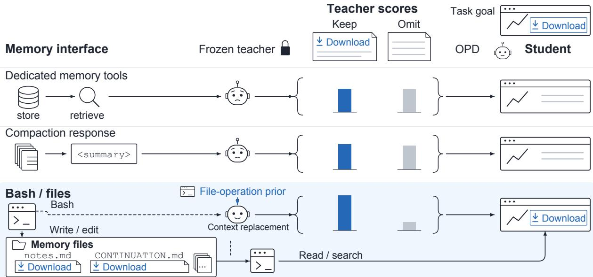  
Figure 1 File-operation priors improve supervision for memory distillation. A frozen teacher scores studentgenerated memory responses that retain (Keep) or omit (Omit) the same Download requirement. Compared with dedicated memory tools and context-compaction protocols, ordinary Bash/file operations draw on the teacher’s exist ing prior, yielding a clearer preference for retaining task-critical information and thus more efective supervision. The student’s general notes and bounded continuation file persist across context replacements, so it can recover the saved Download requirement through Bash.

Recent work applies on-policy distillation (OPD) to memory control through dedicated memory tools and compaction protocols [10, 27, 28, 34, 79]. However, this weakens the distillation on both sides: the teacher cannot give useful guidance on an interface it has never used, and the student samples too few meaningful memory actions for that guidance to take efect [13]. Moreover, unfamiliarity with the tool produces the negative-advantage problem: the teacher’s scores push the student away from the memory behavior being taught without indicating the behavior that should take its place, which leaves training unstable [16, 80]. This raises a question: can a teacher teach a smaller model to control memory through operations that both the teacher and the student already have a prior for?

To study this question, we introduce Coding Agent Memory Gym II (CAMG-II), a suite of long-horizon agentic RL environments spanning Shop, Coding, AutoResearch, General, and Visual. Across all five environments, CAMG-II pairs each native task interface with ordinary Bash access and an episode-persistent workspace. Agents can therefore create, revise, search, and reuse files as memory throughout an episode.

We also introduce Coding Agent Memory Post-Training II (CAMP-II), which trains a single policy jointly across all five environments with fully asynchronous OPD to learn this file-based memory behavior directly from a frozen teacher with a prior for file operations. Task-reward training of file-based memory asks one question, whether the student’s pre-training prior makes the behavior reachable by exploration. Distillation asks two. The student has to emit meaningful memory operations, and the frozen teacher has to judge what those operations write. A shared interface prior answers both at once. We train CAMP-II-4B and CAMP-II-9B from Qwen3.5 models of matching size. On CAMG-II, CAMP-II obtains 2.97 times the gain of the strongest OPD baseline, and the memory behavior it learns generalizes to two external benchmarks, Terminal-Bench 2.1 and SWE-Bench Pro V2, with improved success rates.

Our contributions are threefold.

• A two-sided interface prior for memory distillation. We identify what an interface has to provide for OPD to teach memory at all, coverage of the action on the student side and supervision quality on the teacher side, and we show that a shared file-operation prior supplies both.

• An on-policy distillation method that uses it. We introduce CAMP-II, which learns this file-based memory behavior by on-policy distillation from a teacher that needs no memory-specific adaptation, and reaches the highest average success rate across the five test environments.

• A long-horizon agentic-RL environment suite. We introduce CAMG-II with five environments that require memory across context boundaries, each pairing native task interfaces with ordinary Bash access and an episode-persistent workspace.

## 2 Related Work

Agentic RL for Memory. These methods use reinforcement learning to improve how agents retain and recover task information. Existing work optimizes state consolidation and summary retention [26, 86], while other approaches train agents to use dedicated memory operations [79]. Context compaction is also learned from downstream outcomes [28], and agents are trained to manage their own context proactively through folding [75]. Other work uses task rewards to train agents to maintain state through ordinary filesystem actions, including bounded continuation-file compression [37]. These methods spend much of their exploration on invalid calls and failed executions [10], which makes a denser target attractive. CAMP-II also trains the policy, but the signal is token-level teacher targets rather than task reward.

Memory Systems for LLM Agents. These systems preserve interaction history under a bounded active context through diferent representations and memory-management architectures. Deployed frameworks give an agent persistent memory outside its window: a long-term store maintained by an extraction and update pipeline [6], hierarchical memory edited under an operating-system abstraction [42], a note collection that links and revises itself as the task proceeds [68], and an interaction history organized as a temporal knowledge graph [47]. All four are inference-time layers: the agent queries a store that sits outside the weights, and the task policy itself is never trained for the memory behavior. CAMP-II trains the task policy itself, and its memory is kept in ordinary files that the teacher can read as well.

On-Policy Distillation for Agent Memory. OPD supervises student-generated prefixes with teacher predictions [1]. For memory-dependent execution, existing approaches reconstruct the compact-memory invocation state the student acted in [34], annotate trajectories before distilling [27], or train a separate memory controller or writer through OPD followed by RL [10, 30]. Each aligns the two models on the state or on the trajectory and leaves the memory interface as given. That interface is a compact-invocation protocol or a learned writer that neither model has practiced. CAMP-II instead selects the interface from the prior the teacher and the student share, and supervises memory content through it from a general teacher without memory-specific adaptation.

## 3 Preliminaries

Multi-turn interaction. We consider finite-horizon, partially observable tasks. Given the instruction and visible context $h _ { t }$ , the student samples response $a _ { t } .$ . The environment executes the response and returns an observation for the next invocation. A trajectory τ contains $T _ { \tau } \leq H$ invocations, where H is the horizon. Response $a _ { t }$ contains $L _ { t }$ tokens, and $a _ { t , < j }$ is its prefix before token j. Write $s _ { t , j } = ( h _ { t } , a _ { t , < j } )$ for the context of that token prediction.

On-policy distillation. OPD trains on contexts and prefixes reached by the student [1]. For a sampled token x at prefix $s ,$ let $p _ { \theta } ( x \mid s )$ and $q ( x \mid s )$ be its probabilities under the current student and frozen teacher. Sampling from the student makes the reverse-KL gradient a policy gradient whose per-token signal is the teacher–student log-ratio,

$$
\begin{array} { r l } & { A _ { \theta } ^ { \mathrm { O P D } } ( s , x ) = \operatorname { s g } [ \log q ( x \\mid s ) - \log p _ { \theta } ( x \mid s ) ] , } \\ & { \qquad \mathcal { L } _ { \mathrm { P G } } ( \theta ) = - \mathbb { E } _ { ( s , x ) \sim \pi _ { \theta } } \left[ A _ { \theta } ^ { \mathrm { O P D } } ( s , x ) \ \log p _ { \theta } ( x \mid s ) \right] . } \end{array}\tag{1}
$$

Here sg stops gradients through its argument.

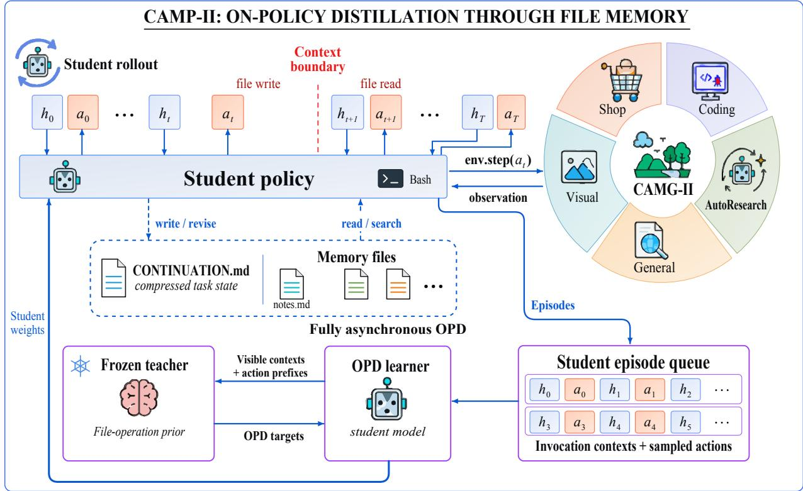  
Figure 2 CAMP-II distils file-based memory across five environments. Top: the student acts in the environment and writes and revises memory files. At each context boundary it compresses its state into the continuation file, which a later read restores. Bottom: completed episodes enter the queue, a frozen teacher scores the tokens the student actually sampled, and the OPD learner updates the student weights from the teacher–student log-probability gap, closing the loop back to the rollout.

## 4 Coding Agent Memory Gym II

To train agents to use files as memory, we construct CAMG-II as a suite of five long-horizon environments (Fig. 2) that extends CAMG’s environments [37] with enterprise knowledge work and visually grounded website development, drops DeepResearch, an environment that is heavy to run and hard to optimize with reinforcement learning, and refines the reward design and the tool format. Each environment combines verifiable tasks with ordinary Bash access and an episode-persistent workspace. Their tasks require agents to reuse information accumulated earlier in the episode.

Every environment shares one interface. The workspace persists for the whole episode and the active context does not: when the context approaches its budget, it is cleared, so anything the next steps need has to have been written down. Before that replacement the policy writes a bounded continuation file carrying the task state, the replacement proceeds once that write is valid, and the context that follows contains only that file’s path. The state therefore survives a replacement when the policy writes it and reads it back afterwards.

## 4.1 Constructing Five Long-Horizon Environments

Shop. Shop tests whether an agent can retain customer requirements and earlier purchase decisions across a sequence of dependent purchases. We generate six-session tasks from 720 verified WebShop products [74]. Between sessions the environment clears the active session transcript, so later purchases depend on what the policy retains.

Coding. Coding tests whether an agent can complete a software repair whose diagnosis, repository edits, and test evidence may span multiple active contexts. We draw issue–repository pairs and test-defined repair objectives from SWE-smith [70]. We exclude non-executable tasks and those whose reference repairs fail their tests, retaining 11,218 tasks from 93 repositories.

AutoResearch. AutoResearch tests whether an agent can preserve hypotheses and validation evidence across iterative model development. We use public OpenMLE task packages with datasets, executable submissions, and native metrics [71]. We exclude tasks that cannot run or whose reference pipelines fail, retaining 931 tasks from 804 task families.

General. General tests whether an agent can reconcile and retain evidence across business documents and system interactions. We adapt MiMo’s enterprise tasks [66], with rubric-based judging of the answer, deliverables, and applicable system state. The adaptation also fixes incomplete tool signatures by exposing all declared arguments and distinguishing required from optional inputs.

Visual. Visual tests whether an agent can retain design requirements and visual inspection findings during website construction. We adapt MiMo’s website briefs and visual grading [66]. The vision-capable agent builds a static site, inspects rendered previews, and revises the delivery. The delivered site receives an absolute rubric score for visual quality, brief fulfillment, and asset quality.

## 4.2 A Shared File-Memory Interface

Across the five environments, CAMG-II standardizes an executable filesystem interface for using files as memory while retaining each environment’s native task interaction and outcome evaluation. Following the minimal, shell-only interface of mini-swe-agent [69], the shared filesystem action is a single bash entry, which can create, inspect, search, modify, and execute files, so the policy can preserve and revise task-relevant evidence and intermediate state in the workspace. Let $\mathcal { A } _ { d } ^ { \mathrm { t a s k } }$ denote environment $d \mathrm { { s } }$ native task-action set and $\mathcal { A } ^ { \mathrm { f s } }$ the shared filesystem-action set. The CAMG-II action space is

$$
\mathcal { A } _ { d } = \mathcal { A } _ { d } ^ { \operatorname { t a s k } } \cup \mathcal { A } ^ { \mathrm { f s } } , \qquad a _ { t } \in \mathcal { A } _ { d } .\tag{2}
$$

One bash entry can produce both native-task and filesystem efects, so the two sets may overlap. Appendix A.2 specifies the common interface. Figure 2 summarizes how this common interface connects task interaction and file use to the learning pipeline described next.

## 5 CAMP-II: File-Memory Distillation

Section 4 gives every task an episode-persistent workspace and a single shared bash action. This section uses that workspace to distill memory for long-horizon tasks, so that task state survives a context boundary. Figure 2 traces one turn: at turn t the student samples a response $a _ { t } \sim \pi _ { \theta } ( \cdot \mid h _ { t } )$ from the visible context $h _ { t }$ , with $a _ { t } \in \mathcal A _ { d }$ as defined in Eq. 2, and the teacher scores every token the student sampled, including the tokens of the file write that carries memory. Let i run over sampled response tokens across invocations and episodes, with $x _ { i }$ the token and $s _ { i }$ its recorded prefix, and write $p _ { \theta , i } = \pi _ { \theta } ( x _ { i } \mid s _ { i } ) , q _ { i } = \pi _ { T } ( x _ { i } \mid s _ { i } )$ and $\mu _ { i } = \pi _ { \theta ^ { - } } ( x _ { i } \mid s _ { i } )$ for the current student, the frozen teacher, and the same student at the weights that sampled the token. A write is part of ${ { a } _ { t } } ,$ so its tokens carry the same supervision as task tokens. After a context replacement only the path of the file the student wrote earlier is supplied, and the student reads it back to recover that state. The per-token signal is

$$
A _ { i } ^ { \mathrm { O P D } } = \mathrm { s g } [ \log q _ { i } - \log p \theta , i ] .\tag{3}
$$

The rollout workers generate with the last published weights $\theta ^ { - }$ while the learner updates $\theta ,$ so episodes from all five environments reach the learner after later weights are published. The update is corrected by the

<table><tr><td></td><td colspan="5">Task success (%)</td><td></td></tr><tr><td>Method</td><td>Shop</td><td>Coding</td><td>AutoResearch</td><td>General</td><td>Visual</td><td>Avg.↑</td></tr><tr><td>Frozen control</td><td></td><td></td><td></td><td></td><td></td><td></td></tr><tr><td>Qwen3.5-4B</td><td>77.3</td><td>27.3</td><td>46.1</td><td>39.8</td><td>36.0</td><td>45.3</td></tr><tr><td>Qwen3.5-9B</td><td>90.6</td><td>26.6</td><td>56.2</td><td>60.9</td><td>36.5</td><td>54.2</td></tr><tr><td>Frozen teacher (Qwen3.8-27B)</td><td>100.0</td><td>63.3</td><td>83.6</td><td>93.0</td><td>40.3</td><td>76.0</td></tr><tr><td>Learned-memory methods</td><td></td><td></td><td></td><td></td><td></td><td></td></tr><tr><td>MemOPD</td><td>0.0</td><td>0.0</td><td>0.0</td><td>0.0</td><td>0.0</td><td>0.0</td></tr><tr><td>MemOPD (w/ SFT)</td><td>93.0</td><td>27.3</td><td>39.1</td><td>62.5</td><td>37.3</td><td>51.8</td></tr><tr><td>CompactOPD</td><td>93.8</td><td>24.2</td><td>37.5</td><td>61.7</td><td>23.6</td><td>48.2</td></tr><tr><td>ACM</td><td>94.5</td><td>21.9</td><td>11.7</td><td>59.4</td><td>8.5</td><td>39.2</td></tr><tr><td>HELM</td><td>87.5</td><td>0.0</td><td>9.4</td><td>53.1</td><td>33.1</td><td>36.6</td></tr><tr><td>HELM (single-model)</td><td>87.5</td><td>29.7</td><td>46.9</td><td>46.9</td><td>38.0</td><td>49.8</td></tr><tr><td>Hy-Memory</td><td>92.2</td><td>27.3</td><td>35.9</td><td>63.3</td><td>25.8</td><td>48.9</td></tr><tr><td>CAMP-I</td><td>85.2</td><td>32.0</td><td>38.3</td><td>68.8</td><td>46.5</td><td>54.2</td></tr><tr><td>CAMP-II</td><td>100.0</td><td>37.5</td><td>64.1</td><td>81.2</td><td>40.2</td><td>64.6</td></tr><tr><td>CAMP-II-9B</td><td>100.0</td><td>36.7</td><td>73.4</td><td>82.0</td><td>40.2</td><td>66.5</td></tr></table>

Table 1 CAMP-II attains the highest average success rate across the CAMG-II test set. Among the 4B systems it outperforms CAMP-I, every memory-learning baseline, and the frozen student. The largest gain lands in General, and Shop saturates. Scaling the same recipe to a 9B student lifts the average further.  
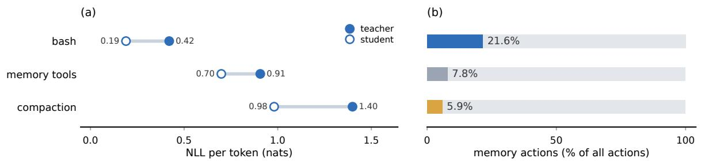  
Figure 3 Both the teacher and the student are most familiar with the file interface, and that interface carries the most memory reads and writes. (a) Surprisal, the mean negative log-likelihood per generated token, over the five environments under the three memory interfaces. (b) Memory actions as a share of all actions. The file interface draws roughly three times the share of the dedicated tools.

importance ratio $\rho _ { i } = p _ { \theta , i } / \mu _ { i }$ , taken against the clipped value $\bar { \rho } _ { i } = \mathrm { c l i p } ( \rho _ { i } , 1 - \epsilon , 1 + \epsilon )$ . Over the sampled response tokens ${ \boldsymbol { B ^ { m } } }$ of an optimizer minibatch, the objective is

$$
\mathcal { L } _ { \mathrm { O P D } } ^ { m } ( \theta ) = - \frac { 1 } { | \mathcal { B } ^ { m } | } \sum _ { i \in \mathcal { B } ^ { m } } \operatorname* { m i n } \big \{ \rho _ { i } A _ { i } ^ { \mathrm { O P D } } , ~ \bar { \rho } _ { i } A _ { i } ^ { \mathrm { O P D } } \big \} ,\tag{4}
$$

where ${ \boldsymbol { B } } ^ { m }$ excludes instructions, observations and padding, and m indexes the memory interface in the controlled comparisons. Equation 4 is the clipped form of the surrogate in Eq. 1. Algorithm 1 in Appendix C gives the procedure the workers and the learner run.

The prefix $s _ { i }$ is taken from the invocation the student actually produced: its visible context, token positions and causal mask [34], including invocations after a context replacement, together with the read observations the student recorded.

## 6 Experiments

We first compare CAMP-II with baselines on the five-domain test set and explain why file memory makes efective use of pre-training. We then measure external transfer and ablate the content of a write. Finally,

we isolate the causal role of saved memory and follow one write from record to readback.

## 6.1 Experimental Setup

Training. All trainable methods use fresh Qwen3.5-4B and Qwen3.5-9B students [46] for 100 learner opti mizer updates with 64 episodes per update, totaling 6,400 episodes per training run, under the equal mixture over Shop, Coding, AutoResearch, General, and Visual, trained with fully asynchronous OPD and no task rewards. Appendix C gives the remaining training details.

Baselines. We compare against four trainable memory-learning systems: compact memory with invocation reconstruction for MemOPD [34], context editing and retrieval of ofloaded history for ACM [27], a hierarchical memory with provenance and validity checks for HELM [30], and a separate writer with a persistent bank for Hy-Memory [10]. For HELM we report both the published architecture, which pairs a learned memory controller with a separate task reasoner, and a single-model adaptation in which one policy fills both roles. For MemOPD we report the recipe without and with the paper’s SFT cold start. As the task-reward reference, we additionally retrain the predecessor CAMP-I [37], which keeps the same file memory and learns from task rewards instead of the teacher’s supervision. Every system except CAMP-I is trained by common reverse-KL OPD from the shared frozen Qwen3.8-27B teacher, so the systems difer only in how they keep memory.

Ablations. We compare CAMP-II with several variants to validate its components. The variant compaction keeps its memory through the compaction protocol instead of files. The variant memory tools keeps its memory through the six dedicated tool calls instead of files. The variant gradient masked removes the loss on the tokens the policy writes into memory and keeps it on the task-action and answer tokens.

Evaluation. We report per-domain success rates and their average, with the success definitions in Ap pendix A. Trainable methods are trained using the CAMG-II train split and evaluated using the CAMG-II test set, and all methods use the same 128 test tasks per domain, giving 640 tasks in total. We measure external transfer on the network-free task subsets of Terminal-Bench 2.1 and SWE-Bench Pro V2 [7, 39].

## 6.2 Results

File-operation priors improve the task success of memory distillation. To test whether file memory is the most task-friendly form of agent memory, we compare CAMP-II against the baselines of Section 6.1 (Table 1). CAMP-II attains the highest average success rate, 64.6% versus 54.2% for CAMP-I, and the same comparison holds across five training seeds, where the five-domain mean is 64.9 with a standard deviation of 0.5 (Table 8), and only two domains reach the frozen teacher’s level, Visual at 40.2% against 40.3% and Shop at 100% for both. We attribute the margin to the training signal: the teacher’s token-level targets supervise each memory write as it is sampled, whereas CAMP-I must assign credit for memory operations across the long horizon, and task-reward training, as Fei et al. [10] analyze, spends much of its exploration on invalid calls and failed executions.

The memory-learning baselines fall further behind, because their channels are protocols the student must first learn, while CAMP-II’s is ordinary file use. MemOPD shows what the protocol costs. Without its SFT cold start it scores zero in every domain: the every-step memory rewrite runs, but the student never submits a successful answer, and on-policy distillation cannot supervise behavior that is never sampled. With the cold start restored, MemOPD becomes the strongest memory-learning baseline. HELM shows what separation costs: its published design puts a learned memory controller in a second model, and the adaptation in which one policy fills both roles gains 13.2 points, 49.8% against 36.6%. Scaling the same recipe to a 9B student lifts the average to 66.5%, closing 63% of the student–teacher gap. Appendix C reports training dynamics for CAMP-II and CAMP-I.

The teacher and the student pay least on the file interface. To understand why training on the file interface works best, we test whether that interface lies inside what the teacher and the student already know. We measure how surprising the action each interface calls for is to the frozen teacher and to the initial student, the mean negative log-likelihood of the generated tokens in nats per token (Fig. 3a). The file interface costs the teacher a third of what compaction costs it, and the student a fifth, with the tool block in between. The teacher pays more at every one of them, so a stronger model does not bring these interfaces any closer. The interface also decides how finely the teacher’s preference separates memory writes. Given two writes from one interface and two task contexts, the teacher ranks the write that carries the prefix’s own task above the foreign one in 76.5% of decisions on the file interface, against 70.0% and 63.8% on the other two. The ordering holds when the key information of a single note is replaced by another task’s (Appendix D.3).

Task: Build a fitness-product showcase A static gallery with product cards, collections, comparisons and customer reviews.  
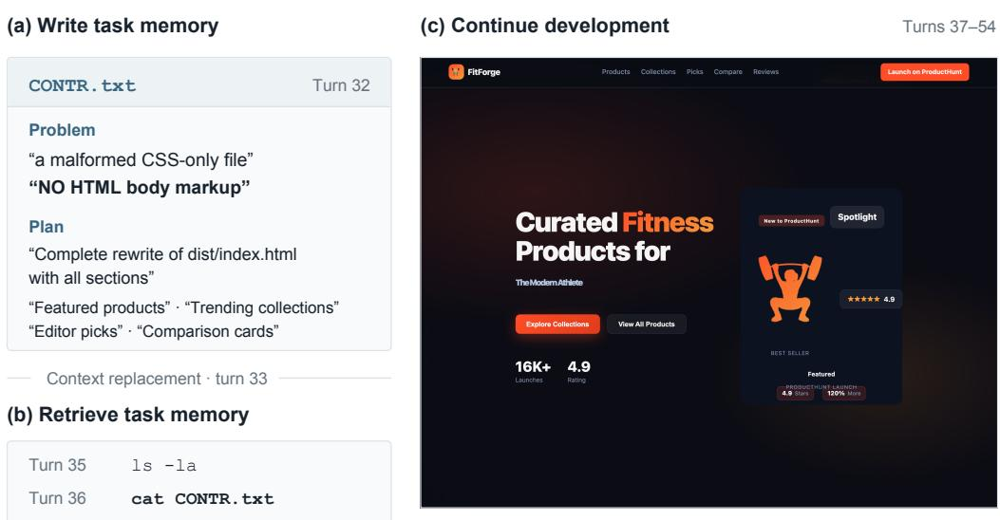  
Figure 4 A Visual episode continues from its own saved file. We follow one episode from a late training update on the fitness-product showcase task. In (a) the student writes down what is wrong with the page and how it will rewrite it, before its context is replaced. In (b) it lists the workspace afterwards and reads that note back. In (c) it delivers a page that carries the sections the note listed.

The student reaches for memory most often on the file interface. To see whether that prior also governs what the distillation has to work with, we count the memory actions the student takes under each interface. They are 21.6% of all actions on the file interface, against 7.8% with the six dedicated tools and 5.9% under compaction (Fig. 3b). The file interface is therefore the one interface where the teacher’s target is cheapest and the student already emits the action it has to be taught, which is why training there pays of. Appendix B turns that coverage into the cost of teaching the action.

The negative advantage is strongest on the unfamiliar interfaces. Once training runs, the per-token advan tage can point either way. We score the memory actions the student produces under each interface and average the negative advantage, which roughly doubles from the file interface to compaction, on interface decisions and on content tokens alike (Fig. 5). The push against what the student wrote is therefore strongest where the interface is least familiar, and it supplies no target to replace what it removes. Prior work reports that a strong negative advantage destabilises on-policy distillation [16, 80].

The quality of the memory content determines task success. To test whether the quality of the memory is what carries CAMP-II’s gain, we intervene on it directly, and we also ablate the supervision that reaches it. At the first context replacement we continue the same episode three ways, with the memory it wrote, with another episode’s memory, or with none of it, and nothing else difers between them (Fig. 6). Success follows the content. The episode that keeps its own memory completes the sequence, the one given another episode’s memory recovers part of it, and the one whose memory is emptied recovers less. When we mask the loss on the tokens the policy writes into memory and keep it on the task-action and answer tokens, the gain from distillation largely disappears (Fig. 7). Masking the same number of tokens at random instead leaves it almost intact, at 63.3 against 64.6, so the loss comes from the supervision on memory content rather than from the smaller budget. The improvement therefore lives in learning what to write into memory, which is what CAMP-II trains.

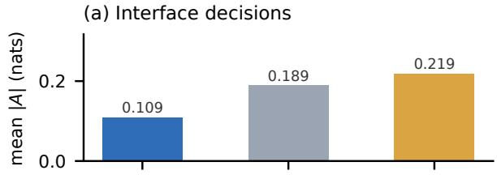

(b) Content tokens  
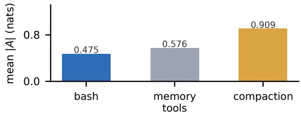  
Figure 5 The negative-advantage problem worsens as the interface becomes less familiar. We score every token of the memory actions the student produces under each interface, with the teacher and the student. The mean size of the negative advantage rises from the file interface through the memory tools to compaction, (a) on interface decisions and (b) on content tokens.

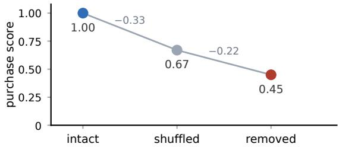  
Figure 6 An episode’s later success is caused by the memory it wrote. We continue each episode three ways at its first context replacement, leaving the file memory intact, installing another episode’s memory, or emptying it, so the runs difer only in the memory that crosses the boundary.

Ablating the interface. To see which part of CAMP-II carries the gain, we ablate the memory interface, replacing it with the dedicated memory tools and with compaction in turn. Either substitution costs 16 to 17 points, and both lie outside the prior of Fig. 3 (Fig. 7), so the choice of interface decides most of the gain.

Case study. We showcase the memory mechanism CAMP-II learns in a training rollout on the fitness-product showcase task. The page it has produced is a CSS-only file with no HTML body markup. Before its context is replaced, the policy records both findings and the rewrite it plans: a complete rewrite of dist/index.html with featured products, trending collections, editor picks and comparison cards. The replacement leaves nothing else of that reasoning. The behaviour does not depend on the requirement to write. Evaluated with the requirement removed, the trained policy scores 62.6, and retrained in that environment it scores 64.0 (Appendix D.4).

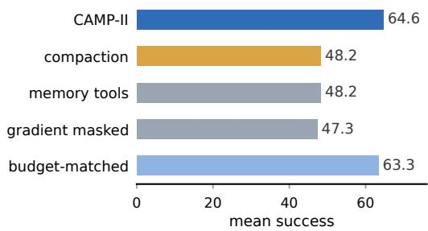  
Figure 7 Each component of CAMP-II is necessary. On the CAMG-II test set we compare the mean success of CAMP-II with that of variants that (i) replace the file interface by compaction, (ii) replace the file interface by the dedicated memory tools, (iii) mask the loss on the memory tokens, and (iv) mask the same number of tokens at random. Every variant that touches the memory supervision loses most of the gain, and matching the masked budget does not.

The learned memory behavior transfers outside CAMG-II. We evaluate the initial students, larger same generation models, and the trained CAMP-II policies at 4B and 9B on Terminal-Bench 2.1 and SWE-Bench Pro V2 (Table 2). Both trained policies exceed the models they start from on both suites, the 4B policy by 6.9 points on each. Both also average above a larger model, CAMP-II-4B above the 9B model and CAMP-II-9B above the 35B one, and CAMP-II-9B holds the highest score in the table on both suites.

Table 2 Both trained policies beat a larger same-generation model on the average, with fewer parameters. Success rate on Terminal-Bench 2.1 and SWE-Bench Pro V2 for the initial students, same-generation larger models, and the trained policies.
<table><tr><td>Policy</td><td>TB 2.1 SWE-Bench Pro V2</td><td>Avg.</td></tr><tr><td>Qwen3.5-4B</td><td>23.1</td><td>11.2</td></tr><tr><td>Qwen3.5-9B</td><td>23.1</td><td>23.1 23.1</td></tr><tr><td>Qwen3.5-35B-A3B</td><td>33.8</td><td>27.4 30.6</td></tr><tr><td>CAMP-II-4B</td><td>30.0</td><td>18.1 24.1 30.1</td></tr><tr><td>CAMP-II-9B</td><td>38.0</td><td>34.1</td></tr></table>

## 7 Conclusion

We investigate how the shared pre-training priors of teachers and students afect memory-oriented on-policy distillation. Unlike task-reward RL, memory OPD requires both a student that can generate meaningful memory actions and a teacher that can provide reliable supervision over their content. To study this two sided requirement, we introduce CAMG-II, a suite of five long-horizon agentic environments, and CAMP-II, which trains one policy across them with fully asynchronous OPD over ordinary file operations.

Our experiments show that the file interface improves both student memory-action coverage and the teacher’s ability to distinguish task-relevant memory content. Memory interventions and supervision ablations further establish the role of learned memory content in downstream task performance. CAMP-II achieves 2.97 times the gain of the strongest OPD baseline on CAMG-II and generalizes to Terminal-Bench 2.1 and SWE Bench Pro V2, where CAMP-II-9B outperforms the larger Qwen3.5-35B-A3B on both benchmarks. Shared interface priors are therefore a design consideration for memory OPD, complementary to improving distillation objectives or teacher guidance.

Limitations. The study covers students up to Qwen3.5-9B and a single frozen teacher. Whether the gains persist at larger scales or carry over to multi-teacher OPD remains untested.

## LLM Usage Statement

Large language model assistants (OpenAI GPT-6.1 Sol in Codex and DeepSeek-V4.1-Flash-1017 in the DeepSeek Harness) were used to polish the writing, write experiment code, and help polish the figures and tables. All model outputs were reviewed by the authors.

## References

[1] Rishabh Agarwal, Nino Vieillard, Yongchao Zhou, Piotr Stanczyk, Sabela Ramos, Matthieu Geist, and Olivier Bachem. On-Policy Distillation of Language Models: Learning from Self-Generated Mistakes. In International Conference on Learning Representations (ICLR), 2024.

[2] Yang Cai, Xiangyu Liu, Argyris Oikonomou, and Kaiqing Zhang. Provable Partially Observable Reinforcement Learning with Privileged Information. In Advances in Neural Information Processing Systems, 2024.

[3] Chishui Chen, Yaoyou Fan, Te Sun, Yi Yang, Chenghao Sun, Delin Mao, Hongbo Qiao, Zuowei Zhang, Junxi Wang, Chenxing Sun, Yangen Hu, Lu Pan, Xuyang Liu, and Linfeng Zhang. Look Ahead Before You Dis till: Future Trajectory Validation of Teacher Guidance for Agentic On-Policy Distillation. arXiv preprint arXiv:2608.01953, 2026.

[4] Yunmeng Chen, Kunyu Wang, Peihan Li, Yi Wang, Shuyin Xia, Yi Liu, Xinyong Cheng, Dehui Wang, Xiangyong Zhai, Yanxing Liu, and Song Liu. SCOPE-OPSD: Fisher-Conditioned Privileged Subspaces for On-Policy Self Distillation. arXiv preprint arXiv:2609.12579, 2026.

[5] Zhisheng Chen, Bingfan Zeng, Bangde Cao, Zhengwei Xie, Yuxuan Li, Jinhan Li, Zheng Lu, Xiangchen Guan, Zikai Xiao, Rui Qian, and Jingwei Song. MemPrism: Task-Conditioned Relational Memory Views for Long Horizon Agents. arXiv preprint arXiv:2608.06745, 2026.

[6] Prateek Chhikara, Dev Khant, Saket Aryan, Taranjeet Singh, and Deshraj Yadav. Mem0: Building production ready ai agents with scalable long-term memory. arXiv preprint arXiv:2504.19413, 2025.

[7] Soham Dan, Jef Da, Sanyam Bhutani, Miguel Romero Calvo, et al. SWE-Bench Pro V2: A cleaner, harder-togame coding benchmark. arXiv preprint arXiv:2610.24206, 2026.

[8] Ken Ding. HDPO: Hybrid Distillation Policy Optimization via Privileged Self-Distillation. arXiv preprint arXiv:2603.23871, 2026.

[9] Sabri Eyuboglu, Ryan Ehrlich, Simran Arora, Neel Guha, Dylan Zinsley, Emily Liu, Atri Rudra, James Zou, Azalia Mirhoseini, and Christopher Ré. Cartridges: Lightweight and general-purpose long context representations via self-study. In International Conference on Learning Representations (ICLR), 2026.

[10] Tianxiang Fei, Jiazheng Kang, Mao Zheng, Xingyan He, and Xiang Yu. Hy-Memory-30B-A3B: Attributed Reinforcement Learning for Long-Term Memory Writing. arXiv preprint arXiv:2610.22196, 2026.

[11] Yangyang Feng, Zhuoyan Feng, and Junlan Chen. PAST: Privileged Adaptation from Complete Student Trajectories for On-Policy Self-Distillation. arXiv preprint arXiv:2608.08726, 2026.

[12] Jingchu Gai, Adam Block, and Andrej Risteski. Understanding the benefits of scafolds through computational separations. arXiv preprint arXiv:2610.27157, 2026.

[13] Sarthak Harne, Chinmay Karkar, Yash Pandya, Ahmed Awadallah, and Akshay Nambi. Privileged, but Biased: How PI-Conditioned Teachers Break Self-Distillation. arXiv preprint arXiv:2608.04794, 2026.

[14] Jonas Hübotter, Frederike Lübeck, Lejs Behric, Anton Baumann, Marco Bagatella, Daniel Marta, Ido Hakimi, Idan Shenfeld, Thomas Kleine Buening, Carlos Guestrin, and Andreas Krause. Reinforcement Learning via Self-Distillation. In International Conference on Machine Learning (ICML), 2026.

[15] Yuki Ichihara, Naoto Iwase, Mohammad Atif Quamar, and Junpei Komiyama. Privileged Solutions or Context Induced Teacher Behavior? Dissecting On-Policy Self-Distillation. arXiv preprint arXiv:2608.09228, 2026.

[16] Nan Jia, Haojin Yang, Xing Ma, Jiesong Lian, Shuailiang Zhang, Weipeng Zhang, Ke Zeng, Xunliang Cai, and Zequn Sun. Asymmetric on-policy distillation: Bridging exploitation and imitation at the token level. arXiv preprint arXiv:2605.06387, 2026.

[17] Li Jiang, Haoran Xu, Yichuan Ding, and Amy Zhang. Trajectory-Refined Distillation. arXiv preprint arXiv:2606.08432, 2026.

[18] Shuli Jiang, Zhaoyang Zhang, Yi Zhang, Shuo Yang, Wei Xia, and Stefano Soatto. Asymmetric Actor–Critic for Multi-turn LLM Agents. arXiv preprint arXiv:2604.00304, 2026.

[19] Carlos E Jimenez, John Yang, Alexander Wettig, Shunyu Yao, Kexin Pei, Ofir Press, and Karthik Narasimhan. SWE-bench: Can Language Models Resolve Real-world Github Issues? In International Conference on Learning Representations (ICLR), 2024.

[20] Minki Kang, Jongwon Jeong, Seanie Lee, Jaewoong Cho, and Sung Ju Hwang. Distilling LLM Agent into Small Models with Retrieval and Code Tools. In Advances in Neural Information Processing Systems, 2025.

[21] Minki Kang, Wei-Ning Chen, Dongge Han, Huseyin A. Inan, Lukas Wutschitz, Yanzhi Chen, Robert Sim, and Saravan Rajmohan. ACON: Optimizing Context Compression for Long-horizon LLM Agents. In Proceedings of the 43rd International Conference on Machine Learning, 2026.

[22] Rasul Khanbayov and Hasan Kurban. The gradient that top-k distillation never computes. arXiv preprint arXiv:2610.15589, 2026.

[23] Taeil Kim, Kangsan Kim, and Sung Ju Hwang. Agent Memory Distillation: Empowering Small LLM Agents with Hierarchical Teacher Memory. arXiv preprint arXiv:2608.07169, 2026.

[24] Yujin Kim, Nathaniel Chin, Arnav Vasudev, and Sanjiban Choudhury. Distilling Realizable Students from Unrealizable Teachers. In IEEE/RSJ International Conference on Intelligent Robots and Systems, 2025.

[25] Qizhen Lan, Xi Xiao, Xiangchen Guan, Mengchen Fan, Moule Lin, Jung Im Choi, and Lijing Zhu. Trust Is Not Enough: Influence Calibration for On-Policy Self-Distillation in Agentic RL. arXiv preprint arXiv:2608.14945, 2026.

[26] Ruoran Li, Xinghua Zhang, Haiyang Yu, Shitong Duan, Xiang Li, Wenxin Xiang, Chonghua Liao, Xudong Guo, Yongbin Li, and Jinli Suo. MemPO: Self-Memory Policy Optimization for Long-Horizon Agents. In Findings of the Association for Computational Linguistics: ACL 2026, 2026.

[27] Xiaochuan Li, Ryan Ming, Meng Chu, Shuai Shao, Rong Jin, and Chenyan Xiong. Acm: Agentic context management for long horizon tasks. arXiv preprint arXiv:2607.23809, 2026.

[28] Yujiang Li, Zhenyu Hou, Yi Jing, Jie Tang, and Yuxiao Dong. Compactionrl: Reinforcement learning with context compaction for long-horizon agents. arXiv preprint arXiv:2607.05378, 2026.

[29] Yaxuan Li, Yuxin Zuo, Bingxiang He, Jinqian Zhang, Chaojun Xiao, Cheng Qian, Tianyu Yu, Huan-ang Gao, Wenkai Yang, Zhiyuan Liu, and Ning Ding. Rethinking On-Policy Distillation of Large Language Models: Phe nomenology, Mechanism, and Recipe. In ICML 2026 Workshop on Foundations of Deep Generative Models: Understanding Memorization, Generalization, and Reasoning, 2026.

[30] Jialong Liu, Yuling Shi, Zuchao Li, and Ping Wang. HELM: Steering Long-Horizon Agents with Learned Hierarchical Memory and Epistemic Governance. OpenReview manuscript, 2026.

[31] Xiao Liu, Hao Yu, Hanchen Zhang, Yifan Xu, Xuanyu Lei, Hanyu Lai, Yu Gu, Hangliang Ding, Kaiwen Men, Kejuan Yang, Shudan Zhang, Xiang Deng, Aohan Zeng, Zhengxiao Du, Chenhui Zhang, Sheng Shen, Tianjun Zhang, Yu Su, Huan Sun, Minlie Huang, Yuxiao Dong, and Jie Tang. AgentBench: Evaluating LLMs as Agents. In International Conference on Learning Representations (ICLR), 2024.

[32] Xiaogeng Liu, Xinyan Wang, Yingzi Ma, Yechao Zhang, and Chaowei Xiao. When Are Teacher Tokens Reliable? Position-Weighted On-Policy Self-Distillation for Reasoning. In Advances in Neural Information Processing Systems, 2026.

[33] Ye Liu, Srijan Bansal, Bo Pang, Yang Li, Zeyu Leo Liu, Yifei Ming, Zixuan Ke, Shafiq Joty, and Semih Yavuz. Procedural Memory Distillation: Online Reflection for Self-Improving Language Models. In Advances in Neural Information Processing Systems, 2026.

[34] Zhiyuan Liu, Tinghong Ye, Chenghao Liu, Yizhuo Li, and Songfang Huang. Memopd: On-policy distillation through memory state alignment for long-horizon agents. arXiv preprint arXiv:2608.07068, 2026.

[35] David Lopez-Paz, Léon Bottou, Bernhard Schölkopf, and Vladimir Vapnik. Unifying Distillation and Privileged Information. In International Conference on Learning Representations (ICLR), 2016.

[36] Zhengxi Lu, Zhiyuan Yao, Zhuowen Han, Zi-Han Wang, Jinyang Wu, Qi Gu, Xunliang Cai, Weiming Lu, Jun Xiao, Yueting Zhuang, and Yongliang Shen. Self-Distilled Agentic Reinforcement Learning. arXiv preprint arXiv:2605.15155, 2026.

[37] Lirui Luo, Kelong Mao, Heming Xia, Rongqing Li, Xinwei Yang, Luyu Chen, Kieran Wong, Yudong Guo, Xinrui Wang, Jiayin Zhu, Simiu Gu, Sulong Xu, and Cong Fang. Coding agent memory post-training: Unlocking the memory potential of pre-trained file operations for long-horizon tasks via reinforcement learning. arXiv preprint arXiv:2609.34422, 2026.

[38] Yuanjie Lyu, Chengyu Wang, Jun Huang, and Tong Xu. Student-Centered Distillation Narrows the Agentic Gap Between Small and Large LLMs. In International Conference on Machine Learning (ICML), 2026.

[39] Mike A. Merrill, Alexander G. Shaw, Nicholas Carlini, Boxuan Li, Harsh Raj, Ivan Bercovich, et al. Terminal bench: Benchmarking agents on hard, realistic tasks in command line interfaces. arXiv preprint arXiv:2601.11868, 2026.

[40] Xuan-Phi Nguyen, Zeyu Leo Liu, Yang Li, Shrey Pandit, Yiran Zhao, Anurag Koul, and Shafiq Joty. Privileged Likelihood Is Not Automatically Value: Three Checks for Token Credit in On-Policy Self-Distillation. arXiv preprint arXiv:2608.09263, 2026.

[41] Andrei Liviu Nicolicioiu, Mohammad Pezeshki, and Aaron Courville. On-Policy Self-Distillation with Sampled Demonstrations Reduces Output Diversity. In COLM 2026 Workshop on Scientific Understanding of Foundation Models, 2026.

[42] Charles Packer, Sarah Wooders, Kevin Lin, Vivian Fang, Shishir G. Patil, Ion Stoica, and Joseph E. Gonzalez. Memgpt: Towards llms as operating systems. arXiv preprint arXiv:2310.08560, 2023.

[43] Tianjun Pan, Yuan Li, Hongda Wang, Linbo Jin, Mengfei Song, Lei Gao, Qiming Shi, Shaokang Fu, Jiarong Zhao, Chengyu Wang, and Chengfu Huo. Bidirectional Context Self-Distillation for Reinforcement Learning of Skill-Based LLM Agents. arXiv preprint arXiv:2608.09555, 2026.

[44] Emiliano Penaloza, Dheeraj Vattikonda, Nicolas Gontier, Alexandre Lacoste, Laurent Charlin, and Massimo Caccia. Privileged Information Distillation for Language Models. In International Conference on Machine Learning (ICML), 2026.

[45] Keqin Peng, Chen Li, Yuanxin Ouyang, Yancheng Yuan, and Liang Ding. Diagnosing and Mitigating Thinking Collapse in On-Policy Self-Distillation. arXiv preprint arXiv:2607.10805, 2026.

[46] Qwen Team. Qwen3.5: Towards native multimodal agents, 2026. Qwen3.5 family release, February 2026; https: //qwen.ai/blog?id=qwen3.5.

[47] Preston Rasmussen, Pavlo Paliychuk, Travis Beauvais, Jack Ryan, and Daniel Chalef. Zep: A temporal knowledge graph architecture for agent memory. arXiv preprint arXiv:2501.13956, 2025.

[48] Andrei A. Rusu, Sergio Gómez Colmenarejo, Caglar Gülcehre, Guillaume Desjardins, James Kirkpatrick, Razvan Pascanu, Volodymyr Mnih, Koray Kavukcuoglu, and Raia Hadsell. Policy Distillation. In International Conference on Learning Representations (ICLR), 2016.

[49] Mahdi Sabbaghi, George Pappas, Hamed Hassani, and Adel Javanmard. When to follow the teacher: Advantage based on-policy distillation. arXiv preprint arXiv:2610.31563, 2026.

[50] John Schulman, Philipp Moritz, Sergey Levine, Michael I. Jordan, and Pieter Abbeel. High-Dimensional Continuous Control Using Generalized Advantage Estimation. In International Conference on Learning Representations (ICLR), 2016.

[51] Bing Shao, Jiazheng Zhang, Long Ma, Yujiong Shen, Senjie Jin, Xin Guo, Yuming Yang, Mingxu Chai, Zhiheng Xi, Boyang Liu, Junlin Shang, Peixin Wang, Qi Zhang, Tao Gui, Qi Zhang, and Xuanjing Huang. A token-level analysis of sampled-token reverse-kl on-policy distillation. arXiv preprint arXiv:2608.25643, 2026.

[52] Zhanming Shen, Jintao Tong, Shaotian Yan, Chen Shen, Hao Chen, Wentao Ye, Xiaomeng Hu, Rui Miao, Haobo Wang, Junbo Zhao, Gang Chen, and Jieping Ye. Purified OPSD: On-Policy Self-Distillation Without Losing How to Think. arXiv preprint arXiv:2607.02234, 2026.

[53] Idan Shenfeld, Mehul Damani, Jonas Hübotter, and Pulkit Agrawal. Self-Distillation Enables Continual Learning. In International Conference on Machine Learning (ICML), 2026.

[54] Samyak Shrestha and Alexander Tessier. Rethinking Privileged Information in On-Policy Self-Distillation. arXiv preprint arXiv:2608.18271, 2026.

[55] Yuda Song, Dhruv Rohatgi, Aarti Singh, and J. Andrew Bagnell. To Distill or Decide? The Algorithmic Trade-of in Partially Observable Reinforcement Learning. In Advances in Neural Information Processing Systems, 2025.

[56] Alex Stein, Furong Huang, and Tom Goldstein. GATES: Self-Distillation under Privileged Context with Consen sus Gating. arXiv preprint arXiv:2602.20574, 2026.

[57] Theodore R. Sumers, Shunyu Yao, Karthik Narasimhan, and Thomas L. Grifiths. Cognitive architectures for language agents. Transactions on Machine Learning Research, 2024.

[58] Songjun Tu, Chengdong Xu, Qichao Zhang, Yiwen Ma, Yaocheng Zhang, Linjing Li, Dong Li, Xiangyuan Lan, and Dongbin Zhao. UCOB: Learning to Utilize and Evolve Agentic Skills via Credit-Aware On-Policy Bidirectional Self-Distillation. arXiv preprint arXiv:2606.29502, 2026.

[59] Hao Wang, Guozhi Wang, Han Xiao, Yufeng Zhou, Yue Pan, Jichao Wang, Ke Xu, Yafei Wen, Xiaohu Ruan, Xiaoxin Chen, and Honggang Qi. Skill-SD: Skill-Conditioned Self-Distillation for Multi-turn LLM Agents. In Advances in Neural Information Processing Systems, 2026.

[60] Meng Wang, Haohan Zhao, Wenzhuo Liu, Lu Yang, Geng Liu, Haiyang Guo, Guo-Sen Xie, Gaofeng Meng, Hongbin Liu, and Fei Zhu. Denser = Better: Limits of On-Policy Self-Distillation for Continual Post-Training. arXiv preprint arXiv:2607.01763, 2026.

[61] Xun Wang, Ruishuo Chen, Zhuoran Li, Yu Chen, and Longbo Huang. When Context Returns: Toward Robust Internalization in On-Policy Distillation. arXiv preprint arXiv:2606.11627, 2026.

[62] Jinyang Wu, Shuo Yang, Zhengxi Lu, Fan Zhang, Yuhao Shen, Lang Feng, Haoran Luo, Zheng Lian, Shuai Zhang, Zhengqi Wen, and Jianhua Tao. SEED: Self-Evolving On-Policy Distillation for Agentic Reinforcement Learning. arXiv preprint arXiv:2607.14777, 2026.

[63] Taiqiang Wu, Chaofan Tao, Jiahao Wang, Runming Yang, Zhe Zhao, and Ngai Wong. Rethinking kullback-leibler divergence in knowledge distillation for large language models. arXiv preprint arXiv:2404.02657, 2024.

[64] Xixi Wu, Kuan Li, Yida Zhao, Liwen Zhang, Litu Ou, Huifeng Yin, Zhongwang Zhang, Xinmiao Yu, Dingchu Zhang, Yong Jiang, Pengjun Xie, Fei Huang, Minhao Cheng, Shuai Wang, Hong Cheng, and Jingren Zhou. ReSum: Unlocking Long-Horizon Search Intelligence via Context Summarization. arXiv preprint arXiv:2509.13313, 2025.

[65] Zhiheng Xi, Jixuan Huang, Chenyang Liao, Baodai Huang, Jiaqi Liu, Honglin Guo, Yajie Yang, Rui Zheng, Junjie Ye, Jiazheng Zhang, Wenxiang Chen, Wei He, Yiwen Ding, Guanyu Li, Zehui Chen, Zhengyin Du, Xuesong Yao, Yufei Xu, Jiecao Chen, Tao Gui, Zuxuan Wu, Qi Zhang, Xuanjing Huang, and Yu-Gang Jiang. AgentGym-RL: An Open-Source Framework to Train LLM Agents for Long-Horizon Decision Making via Multi-Turn RL. In International Conference on Learning Representations (ICLR), 2026.

[66] Xiaomi LLM-Core Team. Mimo-v2.6: Scaling reinforcement learning towards self-improvement. arXiv preprint arXiv:2610.11959, 2026.

[67] Haolei Xu, Xiaowen Xu, Haiwen Hong, Zixuan Ni, Hongxing Li, Yiwen Qiu, Weiming Lu, and Yongliang Shen. Pass the Baton: Trajectory-Relayed On-Policy Distillation. arXiv preprint arXiv:2607.26057, 2026.

[68] Wujiang Xu, Zujie Liang, Kai Mei, Hang Gao, Juntao Tan, and Yongfeng Zhang. A-mem: Agentic memory for llm agents. arXiv preprint arXiv:2502.12110, 2025.

[69] John Yang, Carlos E. Jimenez, Alexander Wettig, Kilian Lieret, Shunyu Yao, Karthik Narasimhan, and Ofir Press. SWE-agent: Agent-computer interfaces enable automated software engineering. In Advances in Neural Information Processing Systems, 2024.

[70] John Yang, Kilian Lieret, Carlos E. Jimenez, Alexander Wettig, Kabir Khandpur, Yanzhe Zhang, Binyuan Hui, Ofir Press, Ludwig Schmidt, and Diyi Yang. SWE-smith: Scaling data for software engineering agents. In Advances in Neural Information Processing Systems, Datasets and Benchmarks Track, 2025.

[71] Junlin Yang, Che Jiang, Yu Fu, Tianwei Luo, Can Ren, Weizhi Wang, Kaikai Zhao, Hongyi Liu, Yuxin Zuo, Yuru Wang, Yuchen Fan, Kai Tian, Zhenzhao Yuan, Xiaojian Lin, Li Sheng, Rushi Qiang, Guoli Jia, Xingtai Lv, Ermo Hua, Dianqiao Lei, Youbang Sun, Ning Ding, Bowen Zhou, and Kaiyan Zhang. Frontis-MA1: Training an AI4AI model towards recursive self-improvement in machine learning engineering. arXiv preprint arXiv:2607.28568, 2026.

[72] Shuo Yang, Jinyang Wu, Zhengxi Lu, Yuhao Shen, Fan Zhang, Lang Feng, Shuai Zhang, Haoran Luo, Zheng Lian, Zhengqi Wen, and Jianhua Tao. OPID: On-Policy Skill Distillation for Agentic Reinforcement Learning. arXiv preprint arXiv:2606.26790, 2026.

[73] Yongkang Yang, Zhezheng Hao, Hong Zhang, Yi Liu, Xiankun Lin, Wence Ji, Fanjunduo Wei, Jiarui Yu, Qiang Lin, Xiaoyun Liang, and Hande Dong. Matching Supervision to the Student’s Learning Capacity: A Unified Framework for On-Policy Self-Distillation. arXiv preprint arXiv:2608.08176, 2026.

[74] Shunyu Yao, Howard Chen, John Yang, and Karthik Narasimhan. WebShop: Towards scalable real-world web interaction with grounded language agents. In Advances in Neural Information Processing Systems, 2022.

[75] Rui Ye, Zhongwang Zhang, Kuan Li, Huifeng Yin, Zhengwei Tao, Yida Zhao, Liangcai Su, Liwen Zhang, Wen biao Yin, Zile Qiao, Xinyu Wang, Pengjun Xie, Fei Huang, Jingren Zhou, Siheng Chen, and Yong Jiang. Agent-Fold: Long-Horizon Web Agents with Proactive Context Folding. In International Conference on Learning Representations (ICLR), 2026.

[76] Tianzhu Ye, Li Dong, Qingxiu Dong, Xun Wu, Shaohan Huang, and Furu Wei. Online Experiential Learning for Language Models. arXiv preprint arXiv:2603.16856, 2026.

[77] Tianzhu Ye, Li Dong, Xun Wu, Shaohan Huang, and Furu Wei. On-Policy Context Distillation for Language Models. arXiv preprint arXiv:2602.12275, 2026.

[78] Yan Yu, Zhengxi Lu, Yizhou Liu, Yichen Pan, Aozhe Wang, Qipeng Chen, Hua Yang, Wenqi Zhang, Qianglong Chen, and Yongliang Shen. RetireOPD: Self-Retiring On-Policy Distillation for Agentic Reinforcement Learning. arXiv preprint arXiv:2609.20784, 2026.

[79] Yi Yu, Liuyi Yao, Yuexiang Xie, Qingquan Tan, Jiaqi Feng, Yaliang Li, and Libing Wu. Agentic memory: Learning unified long-term and short-term memory management for large language model agents. In Proceedings of the 64th Annual Meeting of the Association for Computational Linguistics (Volume 1: Long Papers), 2026.

[80] Zichao Yu, Chengzhi Yu, Shengze Xu, Yujin Han, Bingqing Jiang, Xu Wang, and Difan Zou. Mismatch matters: On-policy distillation beyond token agreement. arXiv preprint arXiv:2608.09836, 2026.

[81] Guibin Zhang, Xun Xu, Yanwei Yue, Zikun Su, Wangchunshu Zhou, Xiaobin Hu, and Shuicheng Yan. OPD-Evolver: Cultivating Holistic Agent Evolver via On-Policy Distillation. arXiv preprint arXiv:2606.17628, 2026.

[82] XiuYu Zhang, Wei Chow, Junfeng Fang, Xingyu Zhu, Zhenkai Liang, and Tat-Seng Chua. What Does Privileged Information Add to On-Policy Self-Distillation? arXiv preprint arXiv:2609.20612, 2026.

[83] Shu Zhao and Tan Yu. Capable teacher, myopic scorer: Reward-free teacher repair for agentic on-policy distilla tion. arXiv preprint arXiv:2610.28586, 2026.

[84] Siyan Zhao, Yonggan Fu, Jindong Jiang, Shih-Yang Liu, Song Bian, Byung-Kwan Lee, Sharath Turuvekere Sreenivas, Wenliang Dai, Hanrong Ye, Aditya Grover, and Pavlo Molchanov. When do we need on-policy distillation? distilling on ofline student rollouts is often better. arXiv preprint arXiv:2610.11291, 2026.

[85] Siyan Zhao, Zhihui Xie, Mengchen Liu, Jing Huang, Guan Pang, Feiyu Chen, and Aditya Grover. Self-Distilled Reasoner: On-Policy Self-Distillation for Large Language Models. In International Conference on Machine Learning (ICML), 2026.

[86] Zijian Zhou, Ao Qu, Zhaoxuan Wu, Sunghwan Kim, Alok Prakash, Daniela Rus, Bryan Kian Hsiang Low, and Paul Pu Liang. MEM1: Learning to Synergize Memory and Reasoning for Eficient Long-Horizon Agents. In International Conference on Learning Representations (ICLR), 2026.

## Appendix

## Appendix Contents

A CAMG-II Environment Details 16   
A.1 Environment Construction 16   
A.2 Shared Agent Interface . 19   
A.3 Task Examples 19   
A.4 Filesystem-Memory Trajectory Examples 22   
A.5 Code Availability 26   
B A Cost Model for Interface Supervision 26   
B.1 The cost law 26   
B.2 The interface as a design variable 29   
C CAMP-II Training Details 30   
C.1 Training Procedure 30   
C.2 Training Configuration 30   
C.3 Across training seeds 33   
C.4 Training dynamics 33   
D Additional Experiments 33   
D.1 Teacher–student agreement before training 34   
D.2 Correction induced by each interface 34   
D.3 Teacher preference over memory content 35   
D.4 Memory writes without a required checkpoint 37   
D.5 Writes and read-backs across a replacement 37   
E Extended Related Work 37

## A CAMG-II Environment Details

CAMG-II contains five environments built around long-horizon tasks in which information obtained early can matter after the active context is replaced. Shop composes new multi-session tasks from WebShop products. Coding, AutoResearch, General, and Visual select executable tasks from SWE-smith, public OpenMLE task packages, and MiMo’s enterprise and website collections, respectively [37, 66, 70]. Each environment preserves its domain interaction and definition of task success. CAMG-II adds a bounded active context and an episode-private workspace that persists across context replacement.

## A.1 Environment Construction

## A.1.1 Shop

Shop turns six WebShop purchases into one episode [74]. A later request can depend on a preference, constraint, or clarification established in an earlier session, so the policy must retain the relevant customer state across browser resets. It builds on CAMG’s verified catalog catalog and six-session task generator [37]. Catalog admission checks unique normalized titles, search reachability, product identifiers, attributes, and purchase prices. The generator fixes a customer, request sequence, candidate order, dependency branch, and total budget so that exactly one six-purchase sequence satisfies the requirements. The total budget alone does not reveal the intended sequence. Table 3 lists the eight task families. Later requests can depend on an earlier choice even when their visible wording and candidate order are unchanged.

The interaction itself remains WebShop’s native search–browse–purchase sequence: search[keywords], prod uct selection through click[ASIN], inspection of product pages and options, and click[Buy Now]. The task does not disclose which product identifiers constitute the correct purchase sequence. Each purchase is checked against the task. An incorrect purchase terminates the episode, retaining earlier earned rewards but prevent ing subsequent purchases and the full-sequence outcome. A correct purchase leads to a continuation boundary before the next request. Browser state, cart, page trace, and active messages reset. Customer identity, purchase history, cumulative budget, and the episode workspace persist. The native success predicate requires the complete valid sequence. CAMG-II retains CAMG’s 720 verified Shop products [37].

<table><tr><td>Dependency family</td><td>Information needed later</td></tr><tr><td>Attribute chain</td><td>An earlier product attribute constrains another category.</td></tr><tr><td>Latent preference</td><td>Earlier choices reveal an unstated later preference.</td></tr><tr><td>Recency override</td><td>A new preference replaces an earlier value.</td></tr><tr><td>Distractor robustness</td><td>Relevant state is mixed with stale or unrelated records.</td></tr><tr><td>Compositional recall</td><td>Two earlier relations jointly identify the target.</td></tr><tr><td>Negative constraint</td><td>Earlier exclusions determine the admissible option.</td></tr><tr><td>Intent clarification</td><td>A clarified value must be reused in a later session.</td></tr><tr><td>Selective memory use</td><td>Stored preferences matter when the current request omits them.</td></tr></table>

Table 3 Shop’s eight dependency families, inherited from CAMG. Paired variants change earlier state while keeping the later request and candidates fixed.

## A.1.2 Coding

One Coding episode asks the policy to resolve a SWE-smith issue in a specified repository revision [70]. Diag nosis, code edits, and test results can span several context windows. The repository and episode workspace therefore persist when the active messages are replaced, allowing later actions to reuse earlier evidence. We draw issue–repository pairs from CAMG’s executable collection [37]. An admitted task has a complete issue, reconstructible repository revision and runtime, an executable hidden grader, and a reference repair that passes the declared tests. The policy receives the issue and repository, with ordinary shell access for inspection, edits, reproduction, and local tests. Hidden evaluation materials remain outside the acting workspace. The retained collection contains 11,218 executable tasks from 93 repositories [37].

An explicit submission ends the repair attempt. An ordinary explanation does not itself constitute submission. The native shell submission sentinel is COMPLETE\_TASK\_AND\_SUBMIT\_FINAL\_OUTPUT. The grader evaluates the submitted repository changes against issue and regression tests. Persisted edits retain the candidate repair across context replacement, while notes can retain why the repair was chosen, which alternatives failed, and which tests still need to run. This distinction lets memory interventions preserve the patch while changing the evidence used to continue verification.

## A.1.3 AutoResearch

One AutoResearch episode gives the policy a public OpenMLE task package containing data, a task description, and a sample submission [71]. The policy inspects the data, writes and runs code, and uses public feedback to improve a candidate solution. Earlier observations, experimental choices, and intermediate results can be preserved in the workspace across context replacement. A submit action sends the final submission to the private grader and ends the episode. We use CAMG’s lightweight OpenMLE packages [37]. A package contains a task description, public training data, test inputs, a sample submission, and the native metric. Admission checks nonempty data, a usable prediction target, compatible submission rows, a reproducible metric, and a reference pipeline that finishes fitting and prediction under the runtime limits. Provenance and task-specific licensing accompany the package. Package variants from the same source remain one source family.

The policy inspects data, writes and executes model-development code, and uses public local-validation feedback. One terminal submit action sends the candidate file to an independent private grader. Private test labels and grader state are inaccessible to both the acting policy and its file tools. A well-formed submission and successful code execution are recorded separately from native-metric improvement over the task’s baseline. Model code and output files persist. Notes preserve data problems, attempted features, validation evidence, and reasons for selecting the final candidate. The retained collection contains 931 task packages from 804 source families [37].

## A.1.4 General

General uses the enterprise-task packages within MiMo’s broader General data release. Each package combines a user request with ofice documents and task-specific business systems. Documents can include spread sheets, presentations, word-processing files, and PDFs. Task-specific tools expose simulated enterprise systems backed by task-local state. For example, an accounting task may require reconciling a controlled spreadsheet with operational records before explaining a discrepancy. Other tasks require an authorized system update and subsequent confirmation.

The agent sees the public workspace and advertised tool schemas. System databases and verifier materials remain outside that workspace. Interactions with business state pass through the task’s tools. The native verifier evaluates the final response, delivered files, and applicable post-action system state. Required rule checks act as gates, and graded criteria use the task’s weighted rubric. Text criteria are judged against task specific requirements. Full rubric satisfaction determines native acceptance. Grader credentials and reference material are evaluator inputs.

Package admission requires resolvable public documents, discoverable task tools, compatible permissions, and verifier support for every required rubric criterion. Packages with unsupported agent or vision criteria are excluded rather than graded on a reduced rubric. Task-specific read-only restrictions on source documents and business systems remain in force. Private memory has its own authorized namespace. Useful memory records source identities, entity mappings, inclusion rules, units, dates, and unresolved conflicts. A fluent final answer without that evidence need not satisfy the rubric.

Tool-interface correction. We correct a mismatch in the General adapter between the released tool schemas and their policy-visible signatures. Query fields can be individually optional while the implementation still requires at least one filter. A required-only listing hid these fields and presented parameterized tools as taking no arguments. General now displays every declared argument, marks required inputs, and instructs the policy to include required arguments while selecting optional filters as needed. For example, cash-movement search exposes its counterparty, date, and status filters instead of an empty signature. The correction changes tool descriptions and invocation instructions.

## A.1.5 Visual

Visual adapts MiMo’s static website tasks. A public brief specifies the site’s audience, required sections, visual style, and front-end interactions. The policy creates and revises source files and assets, produces a static delivery tree with an index.html entry, and can inspect rendered previews before finishing. Preview images reach the vision-capable policy as images, rather than as base64 text. Context replacement preserves the site files but removes earlier visual observations from active context. The policy can record the inspection findings it needs for the next revision.

Endpoint evaluation uses the absolute single-site visual-grading path. MiMo’s group-relative training ranking is a distinct signal and is not an endpoint score. The published absolute rubric evaluates layout integrity, typography, color harmony, whitespace, and content richness. Their mean forms the visual component. The overall score is the equally weighted mean of this visual component, visible query fulfillment, and asset quality. The rendering configuration, rubric, and judge are common across evaluated methods. We report the absolute score as well as task success under a fixed acceptance threshold $\theta _ { \mathrm { { V } } }$ , selected on development tasks and held constant across methods and seeds. Empty or visibly broken pages fail the visual criteria. Functional requirements not observable from a screenshot require separate declared checks. A visual score alone does not certify JavaScript behavior.

In the main results the five domains are not reported the same way. Shop, Coding and AutoResearch are task success rates over the held-out panels. General is a rate as well, but its success is a judge decision: the rubric is reduced to accept or reject before the episode is counted. The Visual column keeps the score itself, multiplied by 100 and averaged over the whole panel, with an episode that ends without a submission counting as zero. A visual episode ends with a delivered page that the rubric grades rather than with a binary outcome, and counting an absent page as zero keeps the column comparable across policies that finish at diferent rates, since a policy cannot gain by being graded only on the pages it chose to deliver.

Admission checks a complete brief, an executable web runtime, a renderable delivery format, and an available evaluator. Design requirements are task inputs, while grader instructions are kept out of the acting conversation. Memory may retain the requested design system, which components are implemented, preview findings, and remaining repairs.

## A.2 Shared Agent Interface

File actions. All five environments retain their native task interactions and expose the same single filesystem tool, following the minimal, shell-only interface of mini-swe-agent [69]. bash takes exactly one parameter, a command string, runs every command from the workspace root, and can create, inspect, search, modify, and execute files. Multi-line file content is written with one quoted here-document. At each step, the policy produces one complete response. The environment executes that response once and returns an observation, task reward, and terminal state. Each response is sampled once, executed once, and trained as one RL step, and it consumes one action slot. A compound shell command remains one response even when it starts several processes or changes both task files and memory files.

Each episode receives a fresh private workspace that remains mounted across policy responses and context replacement. Only regular files below .agent\_memory/ count as policy memory. Repository edits, generated models, temporary files, and caches are not counted as policy memory. A rendered preview is an observation, and its useful findings enter memory only when the policy records them. When one response changes both task files and memory files, both changes remain part of that response. The workspace therefore lets the policy preserve information outside the active context, following the distinction used in language-agent memory architectures [57].

Context replacement. The environment decides when context pressure or a declared subepisode boundary triggers a replacement. At that point, the policy must create or update .agent\_memory/CONTINUATION.md through an ordinary filesystem response. This response consumes one action slot and is sampled and trained like every other policy response. The environment confirms that the write succeeded, the target is a nonempty regular file, and its size remains within the configured byte limit. An invalid write returns an error and leaves the boundary pending.

After a valid write, the environment replaces the active message history with the fixed task and tool instructions plus a neutral instruction naming the continuation path. It does not insert the file contents into the new context. The workspace remains mounted. The policy can recover selected information through a later ordinary file read. It may also maintain other files under .agent\_memory/ and refer to them from the continuation file. The distillation teacher scores the invocation the student actually produced, so private labels, hidden rubric answers, and unread workspace contents never enter it.

Execution isolation. Each episode runs in a network-isolated Linux sandbox with a separate writable root and fixed limits on processes, execution time, output size, file count, and writable bytes. Public task inputs are mounted read-only. Private credentials and grader state remain outside the sandbox. Episode termination removes the writable workspace and processes owned by that episode.

## A.3 Task Examples

Figure 8 gives a compact view of one task from each environment. The listings that follow show the corresponding task inputs and interactions in detail.

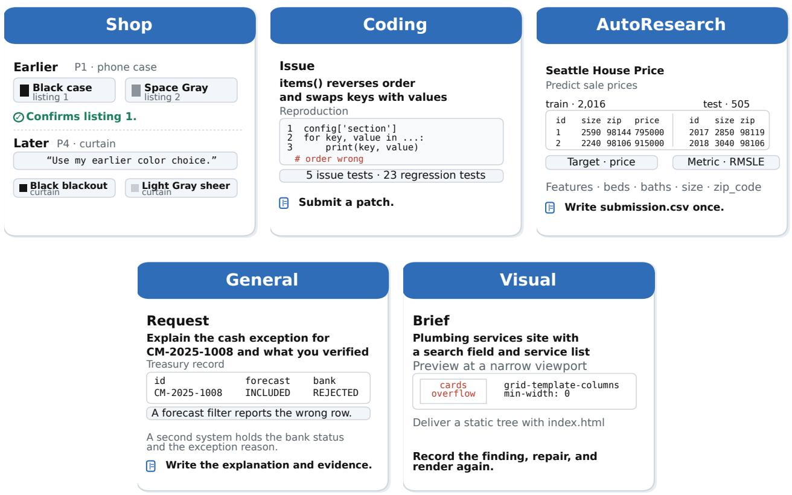  
Figure 8 The policy solves every CAMG-II task across a context replacement. Each panel shows one task input and the interaction available to the policy.

## A.3.1 Shop

This example asks the policy to reuse a color preference established in the first purchase during a later shopping session.

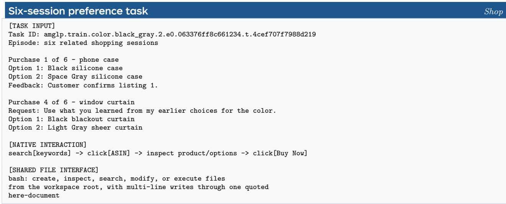

## A.3.2 Coding

This example pairs a concrete iniconfig issue with the tests used to verify a repair.

Repository issue and tests   
[TASK INPUT]   
Instance: pytest-dev\_\_iniconfig.16793ead.combine\_file\_\_mntnwwxj   
Repository: pytest-dev/iniconfig   
Issue:   
SectionWrapper.items() reverses items and swaps keys with values.   
Minimal reproduction:   
section = config['section']   
for key, value in section.items():   
print(key, value) # current output is reversed and swapped   
[VERIFICATION]   
Issue tests: 5   
Regression tests: 23   
Goal: submit a repository patch that passes all hidden tests.   
[SHARED FILE INTERFACE]   
bash operates on the executable repository and policy-authored   
notes throughout the episode, from the workspace root.

## A.3.3 AutoResearch

This example asks the policy to develop a tabular model, produce submission.csv, and submit it once to the private grader.

## Public task package Public task package

[TASK INPUT]   
Task ID: house-price-prediction-seattle@1   
Title: Seattle House Price Prediction   
Metric: RMSLE (lower is better)   
Budget: 30 policy actions   
Public files:   
train.csv - 2,016 rows, target column: price   
test.csv - 505 rows   
Features include beds, baths, size, lot\_size, and zip\_code.   
Example public rows:   
Id,size,zip,price   
1,2590,98144,795000   
2,2240,98106,915000   
Goal:   
Inspect the data, write and revise code, run local validation,   
create submission.csv, and invoke submit once when ready.   
Submit sends the final file to the private grader.

AutoResearch

## A.3.4 General

This example asks the policy to explain a cash exception that two systems report diferently.

## Enterprise reconciliation task

General

[TASK INPUT]   
Task ID: mte.kyriba.cash-review.3k0802   
Request: Hanover Re (Bermuda) USD cash outlook,   
1 Oct to 30 Jan 2025. Explain the exceptions   
and record what you verified.   
Source: cash\_movements, counterparty records   
State: CM-2025-1008 forecast INCLUDED,   
bank status REJECTED   
[NATIVE INTERACTION]   
business-system tools: queries, updates,   
confirmation of the applied change   
[SHARED FILE INTERFACE]   
bash: create, inspect, search, modify, or execute files   
from the workspace root, with multi-line writes through   
one quoted here-document

## A.3.5 Visual

This example asks the policy to build a site brief and repair what a preview reveals.

Static website task Visual   
[TASK INPUT]   
Task ID: mte.webdev.plumbing.2451   
Brief: plumbing services site with a search field,   
a service list, and a contact block   
Deliver: static tree with index.html and assets   
Checks: layout, typography, color, whitespace   
[NATIVE INTERACTION]   
render the page and inspect a preview image   
at a narrow viewport   
[SHARED FILE INTERFACE]   
bash: create, inspect, search, modify, or execute files   
from the workspace root, with multi-line writes through   
one quoted here-document

## A.4 Filesystem-Memory Trajectory Examples

One resolved episode per environment appears below, drawn from learner steps 1 and 50 of the training run and quoted at the round numbers the logger recorded. Every episode carries at least one message replacement, and in every case an action after the replacement uses what the policy wrote before it. The listings show the write, the replacement, the read, and the action that depends on it.

## A.4.1 Shop

This training episode runs 54 rounds and resolves with return 0.98. Session 1 confirms an upholstery material. After the boundary the policy derives the later requirement from the note it wrote, and the choice in session 2 follows that record rather than the session prompt.

A recorded attribute decides a later session Shop   
[TASK INPUT]   
webshop:agentmemory\_5, coordinated living-room furnishing, six sessions   
[NATIVE INTERACTION] session 1   
r1 search["MAKLAINE Contemporary Cream Velvet Down Filled Modular Sectional Sofa"]   
r2 click[b09jt3nb6d]   
r3 bash: mkdir -p .agent\_memory && cat > .agent\_memory/session1\_note.md <<'EOF'   
+Confirmed upholstery material: velvet   
EOF   
r4 click[buy now] reward +0.143   
[FILE-MEMORY WRITE, then OBSERVATION] r5   
bash: cat > .agent\_memory/CONTINUATION.md <<'EOF'   
objective: SESSION\_2\_OF\_6 - Select mood/hanging lighting. ...   
observation: Purchase recorded. The next shopping session is ready.   
Task family: bundled\_shopping Progress: 1/6   
the session prompt names no earlier attribute   
[READ BACK] r6-r10   
r6 bash: rg --hidden -n '^Confirmed ' . 2>/dev/null | timeout 10000 cat   
r7 bash: cat .agent\_memory/CONTINUATION.md   
r8 bash: timeout 10000 rg --hidden -n '^Confirmed ' . empty   
r9 bash: cat .agent\_memory/session1\_note.md   
r10 bash: cat .agent\_memory/CONTINUATION.md | grep -A5 "Session 1 complete"   
[DERIVED REQUIREMENT] r11   
bash: echo "Velvet -> choose leather"   
r13 bash: cat .agent\_memory/session1\_note.md reward -0.01   
r15 bash: cat .agent\_memory/CONTINUATION.md | grep "upholstery material"   
r18 bash: cat .agent\_memory/session1\_note.md | grep "upholstery"   
[REWRITE REJECTED, then ACCEPTED] r20-r21   
r20 bash: cat > .agent\_memory/session2\_note.md <<'EOF'   
+Confirmed selected product: OJM Foot Stools Footrest PU L...   
observation: Filesystem checkpoint was not accepted (checkpoint\_not\_changed).   
Your write was byte-identical to the existing file; change at

least one field value before rewriting it.   
r21 bash: mkdir -p .agent\_memory && cat > .agent\_memory/CONTINUATION.md <<'AGENT\_MEMORY\_EOF'   
objective: SESSION\_2\_OF\_6 ..   
[NATIVE INTERACTION] session 2, r23-r25   
r23 search["OJM Foot Stools Footrest PU Leather Footstool ..."]   
r24 click[b09q12wybp]   
r25 click[buy now] reward +0.143   
[NATIVE OUTCOME]   
Sessions 3-6 continue the loop. r46 records the rug color, r53 the   
curtain material, and r54 closes the sixth purchase. The episode   
resolves with return 0.98.

## A.4.2 Coding

This training episode runs 72 rounds and resolves with full return. The checkpoint records the function under repair, the suspected condition, and the file location. The environment replaces the messages twice, and after each replacement the policy reads the checkpoint and continues from the recorded line.

A repair checkpoint and a re-run test after two replacements Coding   
[TASK INPUT]   
Repair the persistent repository in /testbed for the reported issue   
[NATIVE INTERACTION] r1-r16   
r1 bash: ls /testbed && echo "---" && ls /testbed/astroid 2>/dev/null | head -40   
r1 bash: grep -rn "get\_module\_files" /testbed/astroid/\*.py ... | head -20   
r16 bash: sed -n '490,530p' /testbed/astroid/modutils.py   
[FILE-MEMORY WRITE, then CONTEXT REPLACEMENT] r17   
bash: cat > .agent\_memory/CONTINUATION.md <<'AGENT\_MEMORY\_EOF'   
objective: Fix get\_module\_files() in /testbed/astroid/modutils.py which   
returns an empty list when scanning directories.   
evidence:   
- get\_module\_files at line 442, has a bug on the line that uses   
if not list\_all or {"\_\_init\_\_.py", "\_\_init\_\_.pyi"}.issubset(filenames):   
dirnames[:] = ()   
- bug locati... replace\_messages   
[READ BACK] r18-r19   
r18 bash: cat .agent\_memory/CONTINUATION.md   
r19 bash: sed -n '450,475p' astroid/modutils.py   
[REJECTED WRITE, then REPLACEMENT] r37-r38   
r37 bash: cd /testbed && python3 -c "import tempfile, os   
from astroid import modutils ..." reward -0.1   
observation: Filesystem checkpoint was not accepted (checkpoint\_not\_changed).   
r38 bash: cat > .agent\_memory/CONTINUATION.md <<'AGENT\_MEMORY\_EOF'   
objective: Fix get\_module\_files() in /testbed/astroid/modutils.py ...   
replace\_messages   
r39 bash: cat .agent\_memory/CONTINUATION.md   
[NATIVE OUTCOME] r57   
The policy fixes the condition and reports that all tests pass, with the   
file, the line, and the failing condition named. Return 1.0.

## A.4.3 AutoResearch

This training episode runs 34 rounds and resolves above full return. The checkpoint carries the task identifier, the metric direction, the row counts, and the state of the validation, and the environment replaces the messages twice.

[TASK INPUT]   
Task ID: nvidia-stock-historical-data@2   
Native metric: NVDAIntradayRangeMetrics (lower is better)   
[NATIVE INTERACTION] r1-r6   
r1 bash: cat TASK.md; cat data/description.txt; head -5 data/train.csv;   
head -5 data/test.csv; wc -l data/train.csv data/test.csv ...   
r2 bash: python -c "import pandas as pd, numpy as np

tr = pd.read\_csv('data/train.csv'); te = pd.read\_csv('data/test.csv') ..."   
[FILE-MEMORY WRITE, then CONTEXT REPLACEMENT] r7   
bash: mkdir -p .agent\_memory && cat > .agent\_memory/CONTINUATION.md <<'AGENT\_MEMORY\_EOF'   
objective=Predict NVDA intraday range metric (NVDAIntradayRangeMetrics,   
lower is better) for 117 test rows (2023-12-29 to 2024-06-17) from 6275   
training rows. Output submission.csv with columns row\_id,target.   
measured\_validation\_or\_failure=validation: not measured yet.   
replace\_messages   
r8 bash: cat .agent\_memory/CONTINUATION.md   
[REWRITE AFTER VALIDATION, then REPLACEMENT] r23   
bash: mkdir -p .agent\_memory && cat > .agent\_memory/CONTINUATION.md <<'AGENT\_MEMORY\_EOF'   
objective=Predict NVDA intraday range metric ... replace\_messages   
r24 bash: cat .agent\_memory/CONTINUATION.md   
[NATIVE OUTCOME] r31   
bash: submit   
The submission is scored at 0.969 on the native metric, and the episode   
resolves with return 1.02.

## A.4.4 General

This training episode runs 33 rounds and resolves with return 0.6. The environment replaces the active messages in r8-r9 and again in r17. Between them the policy recovers its checkpoint and goes on to query the business system with the identifiers it recorded before the boundary.

A checkpoint that carries case identifiers across two replacements General   
[TASK INPUT]   
Epic Games legal and finance quarterly review, September 30 2025:   
reconcile the risk system against the case-progress workbook   
[NATIVE INTERACTION] r1-r7   
r1 bash: ls -la && echo "---" && cat .agent\_memory/CONTINUATION.md 2>/dev/null   
|| echo "no memory file"   
r3 bash: python3 -c "import docx; doc = docx.Document(   
'Epic\_Google\_Q3\_2025\_Litigation\_Risk\_Memorandum.docx') ..."   
r7 bash: python3 -c "import openpyxl; wb = openpyxl.load\_workbook(   
'Epic\_Google\_Q3\_2025\_Case\_Progress\_and\_Fee\_Ledger.xlsx') ..."   
[FILE-MEMORY WRITE, then CONTEXT REPLACEMENT] r8-r9   
r8 bash: cat > .agent\_memory/CONTINUATION.md <<'EOF'   
# EPIC-GOOGLE Q3 2025 RECONCILIATION - CONTINUATION   
## Objective   
Create a mana... replace\_messages   
r9 bash: mkdir -p .agent\_memory && cat > .agent\_memory/CONTINUATION.md <<'AGENT\_MEMORY\_EOF'   
objective: Reconcile ServiceNow IRM for... replace\_messages   
[READ BACK, then TOOL QUERIES] r10-r19   
r10 bash: cat .agent\_memory/CONTINUATION.md   
r12 bash: python3 -c "import openpyxl; wb = openpyxl.load\_workbook(   
'Epic\_Google\_Q3\_2025\_Case\_Progress\_and\_Fee\_Ledger.xlsx') ..."   
r13 mcp\_\_servicenow\_irm\_\_search\_risk\_matters(member\_case\_number=3:20-cv-05671-JD)   
r15 mcp\_\_servicenow\_irm\_\_list\_exposure\_forecasts(   
risk\_matter\_id=RSK-EPGGL-2025Q3-CUR, period\_start=2025-01-01)   
r17 bash: cat > .agent\_memory/CONTINUATION.md <<'EOF' replace\_messages   
r18 bash: cat .agent\_memory/CONTINUATION.md   
r19 mcp\_\_servicenow\_irm\_\_calculate\_forward\_exposure(   
matter\_id=MAT-EPIC-GOOGLE-2020-05671, forecast\_period\_start=2025-...)   
[VERIFICATION] r23   
The policy states that the relevant data is verified and retrieves the   
prior-quarter stored summary to confirm the stale-summary gap:   
exposure\_summary\_usd\_cents = 312640000, prior\_overdue\_control\_count = 1   
[NATIVE OUTCOME]   
The episode resolves in r33 with return 0.6.

## A.4.5 Visual

This training episode runs 76 rounds and resolves. The environment replaces the messages four times, and after each replacement the policy reads its snapshot and resumes the build. The finding that decides the final revision is a rendered preview, so the policy has to write down what it saw.

A site snapshot rewritten at every replacement Visual   
[TASK INPUT]   
PROJECT BRIEF - EcoStay Rooms: a static marketing landing page for an   
eco-friendly hotel-booking platform, delivered under dist/ with   
dist/index.html as the entry point, no backend   
[NATIVE INTERACTION] r1-r2   
r1 bash: mkdir -p dist/assets && ls -la /workspace   
r2 the policy writes one index.html with embedded CSS and JS and inline   
SVG assets, so no external request is needed   
[FILE-MEMORY WRITE, then CONTEXT REPLACEMENT] r3   
bash: mkdir -p .agent\_memory && cat > .agent\_memory/CONTINUATION.md <<'EOF'   
# EcoStay Rooms - Continuation Snapshot   
## Objective   
Build a static marketing landing page for "EcoStay Rooms" ...   
## Status   
- Workspace: ... replace\_messages   
r4 bash: cat .agent\_memory/CONTINUATION.md   
[SECOND WRITE, then REPLACEMENT] r8-r9   
r8 bash: cat > /workspace/.agent\_memory/CONTINUATION.md <<'EOF' ...   
replace\_messages   
r9 bash: cat .agent\_memory/CONTINUATION.md   
[THIRD AND FOURTH REPLACEMENTS] r22-r23 and r46-r47   
Each pair rewrites the snapshot with the sections already delivered and   
reads it back, so the build resumes at the next section.   
[NATIVE OUTCOME] r64   
The policy reports that the page is delivered under dist/index.html with   
all eleven required sections present. Return 0.35.

## A.4.6 A memory decision from write to use

Consider the Visual plumbing-site task in Appendix A.3. Its brief specifies a responsive, static site with local search. During development, a narrow-viewport preview may reveal that the plumber cards overflow. The site files preserve the current implementation, but do not by themselves record which preview exposed the defect, the proposed explanation, or whether a repair has been checked. These are the memory decisions on which OPD must provide useful targets.

Scoring the written content. The student can keep the detailed inspection and the pending-work summary in separate files. The following abbreviated actions show their diferent roles:

```shell
mkdir -p .agent_memory
cat > .agent_memory/design-review.md <<'EOF'
Narrow preview: plumber cards overflow.
Hypothesis: card min-width or grid columns.
Repair has not been visually verified.
EOF
cat > .agent_memory/CONTINUATION.md <<'EOF'
Local search is implemented on mock data.
Mobile card overflow remains unresolved.
Read design-review.md, inspect CSS, re-render.
EOF
```

At the continuation write, the teacher and the student see the earlier preview and inspection observations. A content-target probe contrasts this record with one claiming that the mobile layout was checked. Both writes are executable. Only the first preserves the unresolved defect. Token-level teacher scores distinguish them in the file content written through Bash. We compare that preference with subsequent native task outcomes rather than assume that higher likelihood implies better memory.

Content-target probes. At a fixed invocation, candidate writes retain or omit the same task-critical observation or requirement. The candidates have the same executable structure, matched content-token length, and identical information before the changed span. We compare teacher log likelihood per written-content token under each candidate’s own prefix, excluding shared command syntax from the content score. Functional retention labels come from the task specification or a blinded content annotation, not from the teacher’s preference. Appendix D.3 reports the measurement.

Recovering state after replacement. After the accepted continuation write, the wrapper removes the earlier interaction history and preserves both files. It supplies the continuation-file path without inserting either file’s contents. The student’s next recovery can be:

```batch
cat .agent_memory/CONTINUATION.md
cat .agent_memory/design-review.md
grep -nE 'min-width|grid-template' site.css
```

The first two reads recover the unresolved defect and its diagnostic hypothesis. The third locates the implementation to inspect. The policy then edits the relevant CSS and requests a new preview. Whether the repair worked is decided by the new image and by the native grading of the final site.

What the case tests. This walkthrough links a teacher-scored write to a memory-dependent action. Detailed notes and bounded continuations coexist. Neither must compress the other. A trained-policy case records the task, write/read invocations, reset, post-read action, new verification, and native outcome. A matched post-reset fork removes the defect description while preserving website files to test its efect on recovery. The paired content intervention measures the efect of the defect description, and this walkthrough shows the interface that carries it.

## A.5 Code Availability

Code will be released with the camera-ready version.

## B A Cost Model for Interface Supervision

## B.1 The cost law

Teaching one action takes $N \propto 1 / ( Q u )$ supervised occurrences while the student rarely emits it, where Q is the probability the student emits it and u the teacher’s preference for it. The derivation starts from two published facts. The per-token reverse-KL logit gradient has $\ell _ { 1 }$ norm equal to twice the teacher–student log-probability gap times a student-side factor that grows as the emitted token becomes less likely under the student [51]. And the student’s deficiency on the teacher’s support splits into misallocation plus a coverage term log Q, where $\begin{array} { r } { Q = \sum _ { v \in \mathcal { K } } p _ { \theta } ( v \mid s ) } \end{array}$ is the student’s mass on the teacher’s top-K set , with the coverage term invisible to the sampled advantage [80].

Definition 1 fixes the reduction, Lemma 1 gives the movement per supervised occurrence, Proposition 1 combines the two sampling outcomes into a drift, Theorem 1 integrates the drift into the cost, Corollary 1 reads it as the two-factor law, and Remark 2 extends the form from one token to the teacher’s top-K support.

Definition 1 (Two-token reduction). Fix one prefix s and reduce it to two tokens, u preferred by the teacher and y not. Write $\begin{array} { r } { z = \log { \frac { p _ { \theta } ( u \vert s ) } { p _ { \theta } ( y \vert s ) } } } \end{array}$ for the student’s log-odds and $z ^ { * }$ for the teacher’s, so $Q = \sigma ( z ) = p _ { \theta } ( u \mid s )$ with initial value $Q _ { 0 }$ and target $Q ^ { * } = \sigma ( z ^ { * } )$ , and let

$$
D = \log \frac { q ( u \mid s ) } { p _ { \theta } ( u \mid s ) } , \qquad E = \log \frac { p _ { \theta } ( y \mid s ) } { q ( y \mid s ) } ,\tag{5}
$$

so that D is the teacher–student gap on the preferred token, E its magnitude on the other, and $D + E = z ^ { * } - z$ at every point. Write $u _ { 0 } = D _ { 0 } + E _ { 0 }$ for the initial value of the gap. Let λ be the efective logit step per supervised occurrence, let N count supervised occurrences of the prefix’s tokens, not optimizer steps, and call the token learned once $z ^ { * } - z$ has closed to a fraction $\rho$ of $u _ { 0 }$

The derivation works at the level of this prefix’s logits, not its parameters: what the parameters couple across prefixes, together with repeated supervision within a round and the optimizer’s normalized step, is absorbed into $\lambda ,$ which is not the learning rate. The result is a proportionality: it fixes which quantities sit in the numerator and which in the denominator, and λ only scales it.

Lemma 1 (Per-occurrence movement). One supervised occurrence of a token x moves the log-odds z by $2 \lambda A ^ { \mathrm { O P D } } ( s , x ) { \big ( } 1 - p _ { \theta } ( x \mid s ) { \big ) }$

Proof. This is the softmax identity of Shao et al. [51] in the two-token reduction, where z is the diference of the two logits and the update touches only those logits. □

Which token the student samples decides the sign of the movement. Proposition 1 averages the two cases into a contraction on the gap.

Proposition 1 (Both outcomes teach). Sampling u gives $\Delta z = 2 \lambda D ( 1 - Q )$ . Sampling y gives $\Delta z = 2 \lambda E Q$ because the score of y is negative and its own mass is pushed onto u. Both outcomes move z toward $z ^ { * }$ , and

$$
\begin{array} { r } { \mathbb { E } \big [ \Delta D \big ] = - 2 \lambda Q ( 1 - Q ) ^ { 2 } \left( z ^ { * } - z \right) + O ( \lambda ^ { 2 } ) , } \end{array}\tag{6}
$$

a rate of $2 \lambda Q ( 1 - Q ) ^ { 2 }$ times the full log-odds gap. The relation is first order in the efective logit step, which is the drift the continuum limit below integrates.

Proof. The Q factor on the second outcome appears together with the $1 - Q$ frequency of that outcome, so the two contributions are of the same order in $Q ,$ not of the same order in D. Using $\mathrm { d } D / \mathrm { d } z = - ( 1 - Q )$ and $\Delta z = 2 \lambda ( 1 - Q )$ times the score of whichever token was sampled (Lemma 1) gives (6). Expanding $D ( z + \Delta z )$ about z leaves a second-order term in λ, which is what the $O ( \lambda ^ { 2 } )$ records and what vanishes when the recursion becomes the diferential equation below. Sampling u alone would have given $2 \lambda Q ( 1 - Q ) ^ { 2 } D$ which is slower by the factor $( D + E ) / D$ □

Theorem 1 (Cost). Under Definition 1, write $u = z ^ { * } - z$ for the gap and let N count the supervised occurrences that close it to the fraction $\rho .$ Separating variables in the drift (6) gives the exact mean-field cost

$$
N = \frac { 1 } { 2 \lambda } \int _ { \rho u _ { 0 } } ^ { u _ { 0 } } \frac { \mathrm { d } v } { v Q ( v ) \left( 1 - Q ( v ) \right) } , \qquad Q ( v ) = \sigma ( z ^ { * } - v ) ,\tag{7}
$$

from which three statements follow in their own ranges.

While the coverage stays at or below one half along the trajectory the drift gives the bound

$$
N \leq \frac { \log ( 1 / \rho ) } { \lambda Q _ { 0 } } ,\tag{8}
$$

which uses only the initial coverage. In the rare-action regime, where the student rarely emits the token throughout, so that $Q ( v ) \ll 1$ and $1 - Q ( v ) \approx 1$ on the whole interval,

$$
N = \frac { 1 + o ( 1 ) } { 2 \lambda Q _ { 0 } u _ { 0 } } , \qquad Q _ { 0 } \to 0 \ w i t h \ Q ^ { * } \ a n d \rho \ f i x e d ,\tag{9}
$$

and the gap enters as a factor. When the coverage instead stays near a constant ${ \bar { Q } } ,$ which is the regime of a student that already emits the action, the same drift integrates to

$$
N \approx { \frac { \log ( 1 / \rho ) } { 2 \lambda \bar { Q } ( 1 - \bar { Q } ) } } ,\tag{10}
$$

and $u _ { 0 }$ enters only through the starting point, not as a factor. The two regimes are limits $o f \left( 7 \right)$ , not extensions of one another: the second holds for a policy already close to the teacher, where $\bar { Q } \approx Q ^ { * }$

Proof. Read (6) as a recursion in the log-odds and pass to the continuum: N draws move z by

$$
\frac { \mathrm { d } z } { \mathrm { d } n } = 2 \lambda Q ( 1 - Q ) ( z ^ { * } - z ) , \qquad Q = \sigma ( z ) .\tag{11}
$$

With $u = z ^ { * } - z$ this is ${ \mathrm { d } } u / { \mathrm { d } } n = - 2 \lambda Q ( 1 - Q ) u$ , and separating variables gives (7) directly, without any approximation on $Q$

For $( 8 ) , Q ( 1 - Q ) \geq Q / 2$ while $\begin{array} { r } { Q \le \frac { 1 } { 2 } } \end{array}$ , and $Q$ is non-decreasing along the trajectory, so $\mathrm { d } z / \mathrm { d } n \ge \lambda Q _ { 0 } ( z ^ { * } - z )$ 2 which integrates to the stated bound.

For (9), the sigmoid identity $\left\lceil Q ( v ) ( 1 - Q ( v ) ) \right\rceil ^ { - 1 } = e ^ { v - z ^ { * } } + 2 + e ^ { z ^ { * } - v }$ turns (7) into

$$
N = \frac { 1 } { 2 \lambda } \int _ { \rho u _ { 0 } } ^ { u _ { 0 } } \frac { e ^ { v - z ^ { * } } + 2 + e ^ { z ^ { * } - v } } { v } \mathrm { d } v ,
$$

and the outer two terms stay bounded as $Q _ { 0 } \to 0$ while the first grows, so

$$
N = \frac { e ^ { - z ^ { * } } } { 2 \lambda } \int _ { \rho u _ { 0 } } ^ { u _ { 0 } } \frac { e ^ { v } } { v } \mathrm { d } v ( 1 + o ( 1 ) ) .
$$

With $Q ^ { * }$ held fixed and $Q _ { 0 } \to 0 , u _ { 0 } \to \infty$ and the integral is carried by its upper limit, the exponential integral satisfying $\begin{array} { r } { \mathrm { E i } ( u _ { 0 } ) - \mathrm { E i } ( \rho u _ { 0 } ) = \frac { e ^ { u _ { 0 } } } { u _ { 0 } } ( 1 + o ( 1 ) ) } \end{array}$ . Hence

$$
N = \frac { e ^ { u _ { 0 } - z ^ { * } } } { 2 \lambda u _ { 0 } } ( 1 + o ( 1 ) ) = \frac { 1 - Q _ { 0 } } { 2 \lambda Q _ { 0 } u _ { 0 } } ( 1 + o ( 1 ) ) ,
$$

because $e ^ { u _ { 0 } - z ^ { * } } = ( 1 - Q _ { 0 } ) / Q _ { 0 }$ exactly, the odds ratio of the two initial probabilities. Dropping the $1 - Q _ { 0 }$ factor, which tends to one, leaves (9).

For $( 1 0 ) , Q ( v ) \to { \bar { Q } }$ uniformly on $\left[ \rho u _ { 0 } , u _ { 0 } \right]$ as the starting point approaches the teacher, so the integrand of (7) is $\left\lceil 2 \lambda \bar { Q } ( 1 - \bar { Q } ) v \right\rceil ^ { - 1 }$ to leading order and the integral is $\log ( 1 / \rho )$ over that factor. □

Corollary 1 (Two factors in the rare-action regime). In the branch (9), the cost has two factors, and they are the two axes the interface shares. Coverage $Q _ { 0 }$ is how seldom the student emits the action on its own. The initial gap $u _ { 0 } = \log \mathrm { i t } ( Q ^ { * } ) - \log \mathrm { i t } ( Q _ { 0 } )$ is how far the student’s distribution starts from the teacher’s, which sets the size of the correction the supervision has to deliver. Once the student emits the action often enough for that branch to end, (10) governs the rest of the way and the gap stops multiplying the cost.

The gap is a discrepancy between the two policies, not a measure of how strongly the teacher prefers the action. A teacher at $Q ^ { * } = 0 . 5 1$ against a student at $Q _ { 0 } = 0 . 0 0 1$ has $u _ { 0 } \approx 6 . 9 5$ while barely distinguishing the two tokens, and a teacher at $Q ^ { * } = 0 . 9 9$ against a student at $Q _ { 0 } = 0 . 9 8$ has $u _ { 0 } \approx 0 . 7 0$ while preferring one of them decisively. For a fixed relative contraction, a smaller gap means both a weaker push and less distance to cover, which is why $u _ { 0 }$ leaves the cost altogether in (10). A gap of the other sign, $Q ^ { * } < Q _ { 0 }$ , reverses the drift in (6) and moves the student away from u. Whether the teacher prefers the right action is a separate question, which the two-token dynamics do not settle and Appendix D.3 measures directly.

Remark 1 (Numerical check). A direct simulation of the two-token recursion reproduces the constant in (9) to within 30% across three orders of magnitude in $Q _ { 0 } .$ , for $u _ { 0 } > 0$ . A separate run with $u _ { 0 } < 0$ , where (9) is not claimed since its right-hand side would be negative, confirms the reversed direction of the drift. Replacing the single token by a support of two tokens out of six reproduces the same scaling, with the ratio of measured to predicted draws between three and four over a fortyfold range of $Q _ { 0 }$ . The constant is of order one and grows with the size of the support.

Table 4 evaluates (7) and the rare-action form (9) side by side. The two agree where the regime hypothesis holds, which is a small student coverage under a teacher that is confident, and they part company once the teacher is nearly as rare as the student or the required relative contraction is small, exactly the cases the theorem excludes.

<table><tr><td> $Q _ { 0 }$ </td><td>Q*</td><td>ρ</td><td>(7)</td><td>(9)</td></tr><tr><td>0.001</td><td>0.5</td><td>0.5</td><td>82.7</td><td>72.4</td></tr><tr><td>10-5</td><td>0.5</td><td>0.5</td><td>4780.0</td><td>4342.9</td></tr><tr><td>0.001</td><td>0.0012</td><td>0.5</td><td>329.9</td><td>2739.4</td></tr><tr><td>0.001</td><td>0.5</td><td>0.95</td><td>21.7</td><td>72.4</td></tr></table>

Table 4 Where the rare-action form holds. The two columns are λN from the exact integral and from the asymptotic form, for a student that rarely emits the token under a confident teacher, under a teacher nearly as rare as the student, and under a small relative contraction.
<table><tr><td></td><td>teacher prefers it</td><td>teacher does not</td></tr><tr><td>student emits it</td><td>supervision: the intersection</td><td>excess: negative advantage, growing with the gap</td></tr><tr><td>student does not</td><td>deficit: no direct supervision of the ungenerated action</td><td>empty: absent from the loss</td></tr></table>

Table 5 Interface supervision has four cells. Rows split by whether the student emits the action, columns by whether the teacher prefers it. Only the intersection provides direct supervision on the desired action and its content. Eq. 12 prices it.

The cost law of Sec. B.2 is stated at the level of the teacher’s top-K support, not a single token.

Remark 2 (Extension to the teacher’s support). Replacing the single token by the set preserves the two factor form: D becomes the deficit score of [80], whose coverage term  log Q responds to mass entering exactly as log Q did here, both derivatives being (1 Q) with respect to the logit pushed into Q, and the misallocation term inside contracts by the argument of Proposition 1 applied to the renormalized distributions. The simulation of Remark 1 confirms that only the constant changes.

This is an extension of the form, not a proof of it at arbitrary support. Split the vocabulary into and its complement and the reverse KL separates into a Bernoulli term in the mass Q plus two conditional terms, $D _ { \mathrm { K L } } ( p \| q ) = D _ { \mathrm { K L } } \big ( \mathrm { B e r n } ( Q ) \| \mathrm { B e r n } ( Q ^ { * } ) \big ) + Q D _ { \mathrm { K L } } ( p _ { K } \| q _ { K } ) + ( 1 - Q ) D _ { \mathrm { K L } } ( p _ { \bar { K } } \| q _ { \bar { K } } )$ , and the conditional terms let mass move inside the support without following the single-token dynamics we integrated. The two-token cost law applies to as a whole with the same two factors and an order-one constant; a claim that it holds verbatim for every K would need that separation carried through, which we do not do here.

Section 6.2 reports the pre-training cost of supervision on each interface. The algebra fixes what that cost depends on.

## B.2 The interface as a design variable

The objective sets the estimator and the teacher is frozen. The one design variable left is the interface the supervision passes through. Supervision arrives only inside an intersection: the action must be one the student emits on its own and one whose consequence the teacher can judge. Outside it the failures difer in kind (Table 5): an action the student never emits (when to call, which key to use) or an emitted action the teacher scores uninformatively (argument order, a key schema). An action the student never emits still moves under the drift of Proposition 1, since a sampled alternative pushes probability toward it, but the teacher then never supervises that action’s own structure or content. The state axis has already answered the same question. OPD is valid only when the teacher scores the state the student actually acted in, and reconstructing that state is what makes compact-memory distillation work [34]. The interface axis is the one still open.

What the intersection constrains is the action, not what is written. What to retain and what to recover, and when to do either, can all be behavior neither model has. The intersection is necessary but not suficient: the chosen action must also leave state that persists beyond the active context and can be read back, which is why we do not supervise ordinary turns of dialogue.

In the rare-action, large-discrepancy regime of Theorem 1, teaching one action takes

$$
\underbrace { \vphantom { \biggl | } N _ { \mathrm { { u p d a t e s \ t o } } } } _ { \mathrm { { l e a r n \ i t } } } \propto \underbrace { \vphantom { \biggl | } Q _ { 0 } } _ { \mathrm { s t u d e n t \ e m i t s \ i t } } \underbrace { u _ { 0 } } _ { \mathrm { { i n i t i a l \ g a p } } } .\tag{12}
$$

The deficit leaves the action itself unsupervised: the sampled advantage compares the two distributions only where the student went [80], so an action the student never emits receives no direct supervision of its own structure or content, only the indirect movement that Proposition 1 gives it. The excess is destructive: an action the teacher scores below the student’s own probability receives a negative advantage that grows as the gap widens. The probability it frees returns to actions the student already prefers rather than to the one the teacher would have chosen [16, 80]. The empty cell never enters the loss, so the interface is never learned. A weak or wrong preference has two causes: a next-token score is myopic about the outcome even for a capable teacher [49, 83] — hence token-level reweighting (Sec. 2) — and unfamiliarity, the one an interface can remove.

Dedicated memory tools fall outside the intersection twice over. A protocol call is a handful of tokens in which one error forfeits the entire action, so every teacher error is expensive. Its correctness also follows a convention the visible context does not reveal, which is exactly what a general teacher can be wrong about [13], so teacher errors are frequent as well. The weighting compounds it: reverse KL spends its early signal on the tail. The head is already matched [63], sampled-token objectives give improbable tokens disproportionate gradient mass [51] (none under a renormalized top-k view [22]), and the teacher’s least reliable positions receive the most weight.

CAMP-II is built on this. Memory goes through actions the teacher and the student already perform, so the teacher scores content it can judge. We transfer the judgment of what to retain. What a harness computes across calls stays in the harness [12]. The two models agree on the interface before training starts, because we choose it.

## C CAMP-II Training Details

## C.1 Training Procedure

Training is asynchronous: rollout replicas generate episodes with the published weights while the learner continues to update, so an episode can enter an optimizer minibatch several weight publications after it was sampled. Completed episodes enter a persistent queue, from which the learner assembles minibatches without waiting for the slowest episode of a batch (Algorithm 1). Each token retains the behavior log-probability recorded at generation, the denominator of the importance ratio in Eq. 4. Weights are published to the replicas after every learner round.

Algorithm 1 lists the complete procedure, with the collection steps that the rollout replicas run and the learning steps that the queue feeds.

## C.2 Training Configuration

Table 6 gives the shared configuration: model roles, the objective and its clamps, the schedule with the per-environment observation budgets, the optimizer, batching, and runtime, and records the single training seed. The teacher is frozen and receives the same visible text and image observations as the student. The objective rows instantiate Eq. 4, with the clamps and the dual-clip bound as numerical safeguards. A file read is itself a sampled action, so the contents it returns are observations and a write is not supervised a second time. There is no per-episode reweighting, so long episodes contribute proportionally more tokens. The task reward is $\begin{array} { r } { R ( \tau ) = \bar { \sum _ { t = 1 } ^ { T } } r _ { t } , } \end{array}$ where $r _ { t }$ is nonzero only at the events of each environment’s native reward contract (Table 7). With optional task rewards, $\mathcal { L } _ { \mathrm { P P O } } ^ { m }$ is added to $\beta \mathcal { L } _ { \mathrm { O P D } } ^ { m }$ using the same current-to-behavior student ratio. The 100 learner rounds consume 6,400 episode exposures, 1,280 per domain under balanced interleaving. These are exposures, not unique task counts. Failed native tasks remain training episodes, and infrastructure retries retain their logical task identity and enter compute accounting.

Algorithm 1 CAMP-II: file-memory OPD   
Input: initial student weights $\theta _ { 0 } ,$ step size $\eta ,$ frozen teacher $\pi _ { T } ,$ , actions $\{ \mathcal { A } _ { d } \}$ , learner rounds R, episodes per round $N ,$   
horizon H, episode queue $\bar { \mathcal { Q } } ,$ memory interface m   
Output: θ   
Init: $\theta  \theta _ { 0 } , \mathcal { Q }  \emptyset , \theta ^ { - }  \theta$ for all rollout workers   
1: for $r = 1 , \ldots , R$ do ▷ one learner round   
2: for each task k assigned to a worker do ▷ rollout   
3: $h _ { 1 } \gets$ initial context in a fresh episode-private workspace   
4: for $t = 1 , \dots , H$ until the episode terminates do   
5: $a _ { t } \sim \pi _ { \theta ^ { - } } ( \cdot \mid h _ { t } )$ ▷ $\theta ^ { - } ;$ current worker weights   
6: record $( x _ { i } , s _ { i } , \log \mu _ { i } )$ for every token of $a _ { t }$   
7: o<sub>t</sub> ← observation the environment returns for a<sub>t</sub>   
8: $h _ { t + 1 } $ the next visible context after $a _ { t }$   
9: if the context is replaced then   
10: $h _ { t + 1 } $ workspace path of the continuation file   
11: end if   
12: end for   
13: $q _ { i }  \pi _ { T } ( x _ { i } \mid s _ { i } )$ for every recorded token ▷ frozen teacher   
14: enqueue the episode with its $( x _ { i } , s _ { i } , \mu _ { i } , q _ { i } )$ and outcome   
15: end for   
16: $\mathcal { D }  N$ episodes dequeued from $\mathcal { Q }$ ▷ learner   
17: $\theta \gets \theta - \eta \operatorname { A d a m W } \big ( \nabla _ { \theta } \mathcal { L } _ { \mathrm { O P D } } ^ { m } ( \theta ) \big )$ ▷ Eq. 4, clipped at 1 ± ϵ   
18: publish $\theta ,$ and $\theta ^ { - }  \theta$ for all rollout workers   
19: end for

Compute. Training CAMP-II-4B took about 250 GPU-hours on eight GPUs, four training the policy, two generating rollouts and two serving the frozen teacher, across the 100 learner rounds.

Conditional objective. When task rewards are included, GAE runs over the concatenated sampled-token axis of each trajectory [50]. A call’s native reward is placed on the final token of its response row, and preceding tokens receive zero immediate reward. At a row boundary the recursion continues at the next row’s first sampled-token state, including across context replacement. Terminal task outcomes are counted once, and mechanical resets add no token or reward-bearing row. For token position $n ,$ with $r _ { n }$ the sparse reward and $d _ { n }$ indicating trajectory termination, and with the critic fixed during target computation,

$$
\begin{array} { c } { { \delta _ { n } = r _ { n } + \gamma ( 1 - d _ { n } ) V _ { n + 1 } - V _ { n } , } } \\ { { { \cal A } _ { n } = \delta _ { n } + \gamma \lambda ( 1 - d _ { n } ) { \cal A } _ { n + 1 } . } } \end{array}
$$

The return target is $G _ { n } = A _ { n } + V _ { n }$ with zero bootstrap at native terminal and task-budget termination. Task actor advantages are centred within each route, scaled by a shared factor, and weighted by valid-token counts so routes carry equal weight; critic returns are unchanged. Each actor or critic minibatch accumulates its own microbatches before its optimizer step. These task advantages are distinct from the detached distillation signal $A _ { i } ^ { \mathrm { { O P D } } }$ . The pure-OPD realization disables the task-reward loss and the learned critic, so task-return statistics do not enter its actor gradient.

Table 6 also fixes the shared sequence budgets, extending the shared runtime of CAMG [37]. The budgets distinguish policy responses, environment calls, and context replacement: an episode allows 64 policy responses, and a response containing up to ten tool calls consumes one response budget unit. The calls execute in order and each produces an observation. File writes and reads consume the same response budget as task actions. A mechanical reset consumes no policy response, and Shop’s six purchases share one episode budget. Native command timeouts, evaluator limits, and task-artifact capacities remain attached to the source task package.

Length accounting. The prompt ceiling is 65,536 tokens and the response ceiling is 32,768 tokens, within a 98,304-token sequence envelope. Declared observation envelopes are 8,192 tokens for Shop, Coding, and AutoResearch, and 12,288 for General and Visual. Continuation pressure uses a bounded ordinary-observation allowance of up to 4,096 tokens, or 5,120 on the larger- observation routes, further limited by available headroom. The wrapper also reserves the next response, control-message framing, a bounded continuation write, and one bounded retry. It requests continuation before that projection reaches the efective prompt capacity, provided enough actions remain to write, read, and continue. The request point therefore depends on framing and retry reserves, rather than a single fixed prompt threshold. Counting uses the actual chat template and processor-expanded multimodal prompt. Visual previews remain image inputs for both teacher and student. Base64 image payloads are never tokenized as ordinary text. Candidate prompt lengths are checked before serving. Reserving space alone does not guarantee that a returned observation fits. A response length cap does not automatically make a task an infrastructure failure.

<table><tr><td>Group</td><td>Hyperparameter</td><td>Value</td></tr><tr><td rowspan="2">Models</td><td>Student (full parameters)</td><td>Qwen3.5-4B</td></tr><tr><td>Frozen external teacher</td><td>Qwen3.8-27B</td></tr><tr><td rowspan="10">Objective</td><td>Signal</td><td>Sampled reverse KL (k1)</td></tr><tr><td>Teacher target support</td><td>Student-sampled token</td></tr><tr><td>Target temperature</td><td>1</td></tr><tr><td>Supervised positions</td><td>Full sampled response 1</td></tr><tr><td>Sampled-token loss weight</td><td></td></tr><tr><td>Loss weight (inputs, observations, padding)</td><td></td></tr><tr><td>PPO clip</td><td>0 0.2</td></tr><tr><td>Negative-signal dual clip</td><td>3</td></tr><tr><td>Signal clamp</td><td>±10</td></tr><tr><td>Log-ratio clamp Task-PPO loss</td><td>±20</td></tr><tr><td></td><td></td><td>Off</td></tr><tr><td>Learned critic</td><td></td><td>Off</td></tr><tr><td>Entropy coefficient Auxiliary KL coefficient</td><td></td><td>0 0</td></tr><tr><td></td><td></td><td>100</td></tr><tr><td>Schedule</td><td>Learner rounds</td><td>64</td></tr><tr><td></td><td>Episodes per learner round</td><td>1</td></tr><tr><td></td><td>Passes per episode batch</td><td></td></tr><tr><td></td><td>Domain mixture</td><td>Equal, balanced interleaving</td></tr><tr><td></td><td>Training seed Data-loader seed</td><td>1 4096</td></tr><tr><td>Optimizer</td><td>Optimizer</td><td></td></tr><tr><td></td><td>Learning rate</td><td>AdamW 10−⁶ (constant)</td></tr><tr><td></td><td>AdamW (β1, β2)</td><td>(0.9, 0.999)</td></tr><tr><td></td><td>AdamW ∈</td><td>10-8</td></tr><tr><td></td><td>Weight decay</td><td>0.01</td></tr><tr><td></td><td></td><td></td></tr><tr><td></td><td>Warmup updates Gradient norm limit</td><td>0 1.0</td></tr><tr><td>Batching</td><td></td><td>≤ 8</td></tr><tr><td></td><td>Responses per GPU microbatch Tokens per GPU microbatch</td><td>≤ 98, 304</td></tr><tr><td></td><td>Gradient accumulation</td><td>One step per optimizer minibatch</td></tr><tr><td></td><td>Rows per optimizer minibatch</td><td>512</td></tr><tr><td>Runtime</td><td>Precision</td><td>BF16</td></tr><tr><td></td><td>Sharding</td><td>FSDP2</td></tr><tr><td></td><td>Gradient checkpointing</td><td>On</td></tr><tr><td></td><td></td><td></td></tr><tr><td>Sequence</td><td>Prompt + sampled response</td><td>98,304 tokens</td></tr><tr><td></td><td>Prompt ceiling</td><td>65,536 tokens</td></tr><tr><td></td><td>Response ceiling</td><td>32,768 tokens</td></tr><tr><td></td><td>Route observation envelope</td><td>8,192 (Shop, Coding, AutoResearch), 12,288</td></tr></table>

Table 6 Training configuration.

If a nonterminal candidate exceeds a hard prompt or sequence ceiling, the wrapper terminates the episode for context-budget exhaustion without serving the invalid prompt. It counts as an unsuccessful task-budget termination, retains earned native rewards and valid sampled actions, and is not retried or excluded as infrastructure failure. Already terminal native outcomes are preserved. Budget termination has no future continuation value. All interfaces follow the same rule.

Two file roles, one workspace. The 8,192-byte continuation limit applies only to the designated file written before context replacement. Other memory files, such as task notes, remain freely organized in the persistent workspace within its native capacity. The policy need not create these notes before writing the continuation file or derive the continuation file from them. The wrapper validates the continuation write and clears active context. It supplies the file path without injecting its contents. The subsequent policy-authored read consumes an ordinary response. Interface controls preserve these budgets and state transitions, changing only the declared memory interface.

Environment Reward   
Shop $\begin{array} { r } { r _ { t } = \frac { 1 } { 7 } } \end{array}$ per correct purchase of the session target under the cumulative budget; a wrong purchase   
pays 0.5 and terminates the episode with earlier payments retained. Success requires the full   
six-session sequence.   
Coding R = 1[hidden tests pass on the submitted repository change] at the submission sentinel;   
r<sub>t</sub> = 0.01 per recoverable invalid action and at horizon failure.   
AutoResearch R = max(0, m) + 0.05 1[first execution] + 0.10 1[first validation], where m is the private grader’s   
native-metric score of the submitted file and milestone payments are capped at 0.15 per episode;   
$r _ { t } = - 0 . 0 1$ at action-budget exhaustion or wall-clock termination, and invalid submissions pay 0.   
General $R = \mathbf { w } ^ { \top } \mathbf { r } ,$ a weighted rubric over the final answer, delivered files, and post-action system state,   
paid once at finish with required rule checks as gates; $r _ { t } = - 0 . 1$ per invalid action and 0.01   
when the budget is exhausted without a submission.   
Visual R = mean(r<sub>rubric</sub>, r<sub>fulfilment</sub>, r<sub>assets</sub>), an absolute rubric over screenshots of the delivered page at   
finish (layout, typography, color, whitespace, content), averaged with query fulfilment and asset   
quality; invalid actions pay 0.

Table 7 Task rewards.
<table><tr><td>Seed</td><td>Shop</td><td>Coding</td><td>AutoResearch</td><td>General</td><td>Visual</td><td>Avg.</td></tr><tr><td>1</td><td>100.0</td><td>37.5</td><td>64.1</td><td>81.2</td><td>40.2</td><td>64.6</td></tr><tr><td>2</td><td>100.0</td><td>39.1</td><td>65.6</td><td>82.0</td><td>41.0</td><td>65.5</td></tr><tr><td>3</td><td>100.0</td><td>38.3</td><td>63.3</td><td>80.5</td><td>39.7</td><td>64.4</td></tr><tr><td>4</td><td>100.0</td><td>36.7</td><td>64.8</td><td>82.8</td><td>40.5</td><td>65.0</td></tr><tr><td>5</td><td>100.0</td><td>38.3</td><td>66.4</td><td>81.2</td><td>40.0</td><td>65.2</td></tr><tr><td>Mean ± Std.</td><td> $1 0 0 . 0 \pm 0 . 0$ </td><td> $3 8 . 0 \pm 0 . 9$ </td><td> $6 4 . 8 \pm 1 . 2$ </td><td> $8 1 . 5 \pm 0 . 9$ </td><td> $4 0 . 3 \pm 0 . 5$ </td><td> $6 4 . 9 \pm 0 . 5$ </td></tr></table>

Table 8 Five training seeds of CAMP-II-4B. Task success on the CAMG-II held-out panels, one row per seed, with the mean and the standard deviation over seeds. Seed 1 is the run the main text reports. The average column weights the five domains equally, and the Visual column follows the paper’s definition of that column.

## C.3 Across training seeds

Table 8 repeats the full CAMG-II evaluation for five training seeds of CAMP-II-4B. The spread is small and the ordering of the domains is stable, so the comparison in the main text does not rest on one draw.

## C.4 Training dynamics

Figs. 9 and 10 report measured online task success for CAMP-I (task rewards, no distillation teacher) and CAMP-II (file-memory distillation teacher, no task rewards): temperature-1 sampling on the training task pools, 64 episodes per learner round, one training run per configuration under one seed. An update denotes one learner round, not a single optimizer-minibatch step. Lines are five-update centered bucket means and points are per-round values. Visual reports the mean judged grade rather than a binary success rate. The remaining panels and the average use episode success. These are training-pool measurements and are not comparable to the test-set evaluation of Table 1.

## D Additional Experiments

This appendix reports five measurements of the memory interface that the experiments in the main text leave out. Three are taken before training, on how closely the teacher and the student already agree on memory content, how much correction each interface asks of the student, and whether the teacher prefers the write that carries the task’s information. Two come from the trained policy, on whether the memory behaviour needs the requirement to write at a boundary and on where the policy writes and reads its state around a replacement.

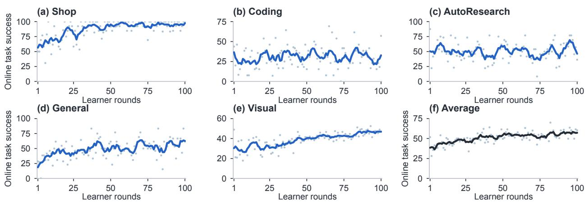  
Figure 9 CAMP-I training dynamics. The average in panel (f) weights the five domains equally.

## D.1 Teacher–student agreement before training

Before any training, the teacher and the student already organize memory content alike, and they do so most closely under the file interface. To test whether an interface’s notes fall inside what both models already represent, we take the initial Qwen3.5-4B checkpoint and compare the teacher’s and the student’s similarity structure over the notes each interface writes. Each interface writes its memory in one of three forms: a file, a stored record for the memory tools, and a context summary for compaction. We call the text of any of them a note. The student produces a note by receiving that interface’s prompt with the call already opened and completing the text, and each interface yields 160 notes. We compare the two models on memory-content tokens, the tokens of the note body, leaving out the syntax that frames the write, the wrapper of the call and the labels of its arguments. The frozen teacher (Qwen3.8-27B) and the student read the identical student written sequence. For each note we average the last-layer states of its content tokens into one vector, and from those vectors we build the teacher’s and the student’s 160 160 cosine-similarity matrices over the notes. We compare the two matrices by the rank correlation of their 12,720 note pairs.

The rank correlation is 0.927 for the file interface, 0.868 for the memory tools and 0.864 for compaction (Fig. 11d), with delete-half jackknife intervals over the notes [0.905, 0.945], [0.841, 0.893] and [0.837, 0.888]. As a null control we shufle the note identities of one matrix before correlating, and the correlation falls below 0.09 under all three interfaces. The file interface is therefore the one whose representation of the notes the student already shares: the two checkpoints agree on which notes resemble which, while under the memory tools and compaction the student organizes the same content more loosely.

## D.2 Correction induced by each interface

The file interface asks for the least correction of the three, and that correction is the most independent. We measure the correction as the norm of the gradient the distillation loss gives the parameters of the initial checkpoint when the loss is fitted to the notes of one interface, per supervised token. This probe uses twelve notes per interface. Applying the loss of Eq. 4 to those notes and restricting it to the memory-content tokens, the gradient norm is 0.36 for the file interface, 1.79 for the memory tools and 1.14 for compaction (Fig. 12a). The norm tracks the teacher–student probability gap on the same tokens (Fig. 12b), because the loss weights

CAMP-II run: training dynamics (measured, one run)

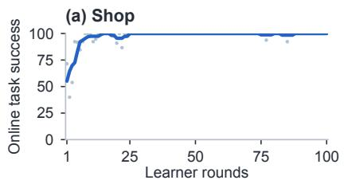

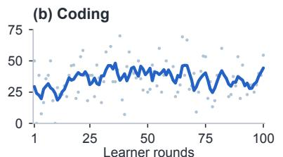

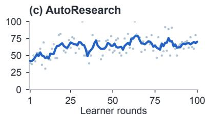

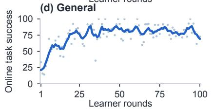

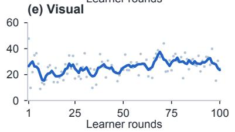

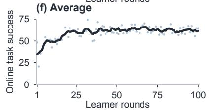

Figure 10 CAMP-II training dynamics. Panel y-axes match Fig. 9 for a common scale. The average in (f) weights the five domains equally.  
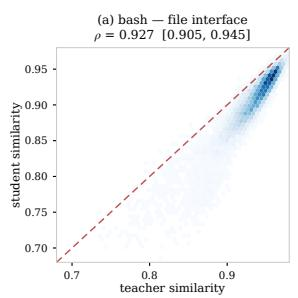

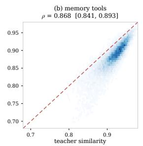

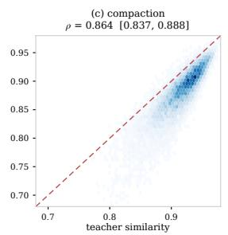

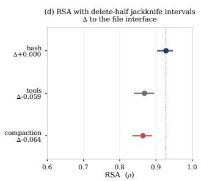  
Figure 11 The file interface keeps the teacher’s organization of memory content. Each interface writes its own note (160 notes per interface, initial Qwen3.5-4B). Panels (a)–(c) plot the similarity the teacher assigns to a note pair against the similarity the student assigns, over the 12,720 pairs of each interface, so a pair on the dashed line is one the two checkpoints treat alike. Panel (d) gives the rank correlation of the two similarity matrices with delete-half jackknife intervals over the notes, highest for the file interface.

each token by that gap. On file-interface notes the teacher’s probability for the student’s own tokens is close to the student’s, so little correction remains, while under the memory tools and compaction the gap is about 1.6 times larger than under the file interface. Per layer the three interfaces follow one profile and difer only in scale (Fig. 12c). Note-level gradients can also repeat each other, and repeated directions teach the student little that is new, so the probe measures a second quantity, how independent they are: for the MLP gate projection of layers 8, 16 and 23 we build the Gram matrix of the twelve note-level gradients and take the participation ratio of its spectrum, which measures how many nearly independent directions the notes move the student along, with one direction per note as the ceiling. The file interface reaches 9.3 efective directions, the memory tools 7.3 and compaction 7.0 (Fig. 12d), so its note gradients span nearly independent directions, while those of the other two interfaces span fewer independent ones.

## D.3 Teacher preference over memory content

The teacher prefers the write that carries the task’s own information, and it does so most often under the file interface. We measure the preference at two granularities, with the whole note and with the segment of it that carries the task’s information. For each interface we first pair two notes written by the same writer under that interface for diferent task contexts. Under either context’s prefix the note written for that context carries the task’s information and the other does not, so the pair isolates whether the content matches the task. We score both notes under that prefix with the frozen teacher, as the mean log-probability per memory-content token, and count a decision as correct when the teacher ranks the matching note above the foreign one. A teacher that cannot tell the two apart reaches 0.5 by construction.

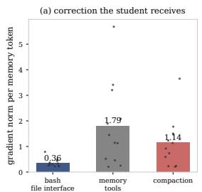

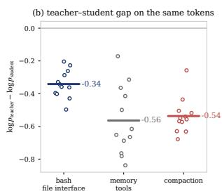

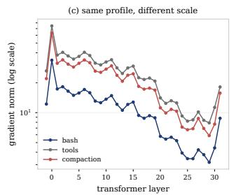

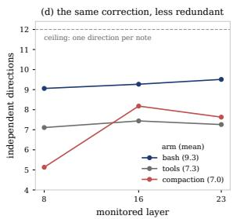

Figure 12 The file interface generates the least corrective signal. (a) Norm of the gradient of the distillation loss restricted to memory-content tokens, per supervised token, backpropagated through the initial checkpoint. Markers are individual notes (n = 12 per interface) and the bar is their mean. (b) Teacher-minus-student log-probability gap on the same tokens, which is the loss weight. (c) Per-layer gradient norms: the three interfaces share one profile and difer in scale. (d) Nearly independent directions the twelve note-level gradients span, for the MLP gate projection of layers 8, 16 and 23 (participation ratio of the Gram spectrum, where one direction per note is the ceiling of 12): the file interface needs less correction per token, and that correction is less redundant.
<table><tr><td>Interface</td><td></td><td>Correct 95% interval Margin p vs file</td><td></td></tr><tr><td>File</td><td>60/60</td><td>[0.940, 1.000] +0.577</td><td></td></tr><tr><td>Compaction</td><td>55/60</td><td>[0.816, 0.972] +0.528</td><td>0.029</td></tr><tr><td>Memory tools</td><td>50/60</td><td>[0.715,0.917] +0.480</td><td>0.0007</td></tr></table>

Table 9 Replacing a note’s key information by another task’s. Each note is scored against itself with its key segments replaced, matched in character count. Intervals are exact binomial, the margin is per memory-content token, and the last column is a one-sided Fisher test against the file interface.

Over 200 pairs per interface, which give 400 decisions, the teacher is correct in 76.5% of decisions for the file interface, 70.0% for compaction and 63.8% for the memory tools (Fig. 13a). The file interface’s interval meets compaction’s only over a narrow band, [0.720, 0.745], just under a third of the width of either interval. The decisions are also not independent, since every note is scored in both orders and each decision is made under one of the 47 contexts. Comparing the interfaces over those contexts, the file interface leads the memory tools by 11.6 points, with a paired interval of [0.029, 0.205] and 31 of the 47 contexts in its favour, and it leads compaction by 5.9 points, with 27 contexts in its favour and 17 against. The mean margins are +0.286, +0.271 and +0.212 nats (Fig. 13b). Restricting to decisions whose two notes difer by at most a fifth in content tokens leaves the ordering unchanged, at 0.765 for the file interface, 0.729 for compaction and 0.605 for the memory tools.

The second measurement holds the note fixed and moves only the information in it. For each note we take every segment whose content words overlap the note’s own task context, which is the segment set that carries the task, and replace that whole set with the corresponding set of a note written for another task under the same interface, choosing the donor so the two sets have the same character count. Every other byte of the note, and its call scafolding, stays as written. The teacher then scores the note as written against the note whose key information comes from another task, again as the mean log-probability per memory-content token.

Over 60 notes per interface the teacher ranks the untouched note above the replaced one in 60 of 60 cases on the file interface, 55 of 60 on compaction and 50 of 60 on the memory tools (Table 9), with mean margins of +0.577, +0.528 and +0.480 nats. A one-sided Fisher test against the file interface gives $p = 0 . 0 2 9$ for compaction and $p = 0 . 0 0 0 7$ for the memory tools.

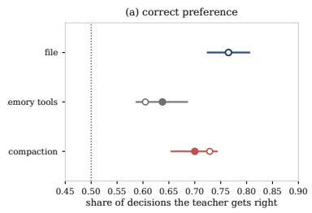

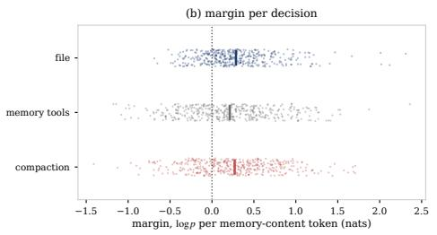

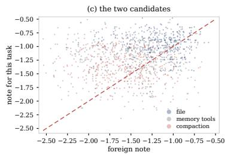

Figure 13 The teacher ranks the note written for its own task above a foreign note, most often under the file interface. (a) Share of decisions in which the teacher scores the note written for the prefix’s own context higher, with intervals over decisions and the chance level of one half. Hollow markers restrict the decisions to pairs whose two notes difer by at most a fifth in content tokens. (b) Margin per decision, the diference in mean logprobability per memory-content token, markers are single decisions and the bar is their mean. (c) The two candidates’ scores for the same decision, so a point above the diagonal is a decision the teacher gets right.
<table><tr><td>Method</td><td>Shop</td><td>Coding</td><td>AutoResearch</td><td>General</td><td>Visual</td><td>Avg.</td></tr><tr><td>CAMP-II</td><td>100.0</td><td>37.5</td><td>64.1</td><td>81.2</td><td>40.2</td><td>64.6</td></tr><tr><td>without the requirement, as trained</td><td>100.0</td><td>35.9</td><td>61.7</td><td>78.1</td><td>37.5</td><td>62.6</td></tr><tr><td>without the requirement, retrained</td><td>100.0</td><td>36.7</td><td>62.5</td><td>80.5</td><td>40.2</td><td>64.0</td></tr></table>

Table 10 Removing the requirement to write at a boundary. Task success on the CAMG-II test set when the context is replaced whether or not a valid continuation write exists. The second row evaluates the trained CAMP II-4B in that environment, the third trains the same recipe there.

Figure 3a measures how surprising each interface is to the two models. The preference above measures what that surprisal buys: on the interface both models already use, the teacher’s score separates a write that carries the task’s information from one that does not, and it separates them less often on the other two.

## D.4 Memory writes without a required checkpoint

The policy writes its state at a boundary, and the environment waits for that write before it replaces the context. Remove the requirement and the replacement proceeds either way, so a policy that wants its state to survive still has to write before it. Under that setting the trained policy keeps most of its success, both when it is evaluated as trained and when the same schedule is run in the new environment (Table 10). The second row is therefore the stronger statement: the memory behaviour does not need the requirement to be learned.

## D.5 Writes and read-backs across a replacement

A trained policy writes its note before a replacement and reads it back after, and it does so about three times as often as the initial checkpoint. We follow the CAMP-II-4B policy through the 65 Terminal-Bench episodes that ran to completion in our evaluation run and mark at every step whether it writes the note that carries its continuation, whether it reads it back, and where the context is replaced. 329 of the 337 written notes are read back after exactly one replacement, and 3 are never read again (Fig. 14a,b). The trained policy writes the file 5.2 times per episode and reads it back 5.0 times, while the initial checkpoint writes it 1.7 times and reads it back 2.1. It also starts earlier: 13.2% of its writes land at least one step before the replacement, against 6.5% for the initial checkpoint (Fig. 14c).

## E Extended Related Work

This appendix covers families beyond the three surveyed in the main text. The memory-aware OPD methods compared experimentally are introduced in Sec. 6.1.

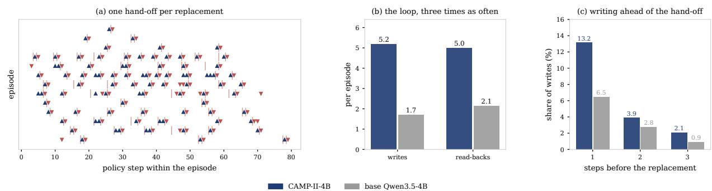  
Figure 14 A note written before a replacement is read back after it. (a) Writes (▲), read-backs (▼) and context replacements ( ) along 14 CAMP-II-4B Terminal-Bench episodes, one row per episode. (b) Writes and read backs per episode for CAMP-II-4B and for the initial checkpoint on the same episodes. (c) Share of writes that land at least one, two or three steps before the replacement.

Context Compression. What enters the active context can itself be learned, at several diferent sites. Wu et al. [64] condense history with an external summarizer and train the policy to reason over the summaries, propagating reward across segmented trajectories. A separate compressor can be distilled from optimized compression guidelines [21], and a memory-view router can be trained by supervised distillation followed by grouped GRPO while the acting policy stays frozen [5]. Cartridges moves the compression into the key–value cache: corpus-specific caches are trained ofline from synthetic conversations and context distillation with the language model frozen [9]. CAMP-II keeps memory as ordinary files and bounds only the continuation file, so compression is one file operation among others rather than the memory representation itself.

Long-Horizon Agent Environments. These environments provide task feedback over extended agent interactions: existing benchmarks span heterogeneous interactive tasks [31], and training frameworks support multi-turn policy optimization [65]. CAMG-II contributes five heterogeneous long-horizon environments, including visually grounded web development, for joint memory post-training through a shared file-memory interface [37].

Experience Reuse. Experience reuse conditions learning on what earlier episodes produced. Zhang et al. [81] distill the selection, use, writing, and maintenance of a hierarchical experience repository, and Ye et al. [76, 77] condition distillation on historical solution traces and guiding contexts, with the latter iterating experience extraction and consolidation. A second group builds self-teachers from experience: cross-problem behavioral patterns serve as a memory-conditioned scafold that is removed at inference [33], skill-conditioned self-distillation is gated alongside task RL [36], and hindsight skills are extracted as the supervising signal [72]. Wu et al. [62] couple policy updates with an evolving trajectory analyzer, Tu et al. [58] select the local teaching direction by comparing skill-conditioned and plain-context returns, and BCSD augments and prunes explicit skill context to rescale RL advantages, retaining skill guidance at inference [43]. These memories support reuse and hindsight-guided learning across tasks, whereas CAMP-II retains only the current episode’s state for continued execution.

On-Policy Distillation. The design space of OPD [1] extends beyond the memory setting. The teacher is one design choice: Zhao et al. [85] construct a self-teacher from privileged information and fix the initial policy as the teacher, while Hübotter et al. [14] condition a self-teacher on rich textual feedback or successful rollouts and use an exponential-moving- average one. Li et al. [29] analyze the mechanisms and practical recipe of OPD. Filtered privileged rollouts can be combined with RLVR to address prompts yielding zero reward [8], and complete student trajectories can adapt the teacher while prefix-only student inputs are preserved [11]. The trajectory can also be repaired before the supervision is applied: unreliable token supervision can be attributed to failed prefixes and the rollout revised [17], teacher–student continuation asymmetry can trigger a short teacher leg [67], and an intervention can be validated through its efect on the student’s continuation [3].

The training objective, teacher parameters, and scoring information are separate design choices. CAMP-II holds the teacher fixed and varies the training objective within the same file-memory interface.

Token-Level Supervision. A separate axis within OPD selects which of the tokens already produced should carry supervision. Privileged action traces can change the teacher’s input while the student objective still spans responses [44], and restricting privileged input is a diferent choice from restricting the distillation loss to action tokens. Supervision can vary by within-sequence position [32]. A teacher-directed perturbation’s first-order efect on the RL surrogate can redistribute auxiliary-loss mass within a turn [25]. Token selection and privileged-information adjustment can be coupled to a student learning-dificulty budget [73]. A reference only component can be subtracted to construct a question-conditioned target [52]. Supervision can be added on aligned final-layer hidden states, projecting the teacher–student residual through a frozen rank-64 factor estimated from residual covariance and LM-head Fisher sensitivity [4]. Tutor consensus can admit supervision when no external correctness labels are available [56]. These approaches select supervision by reliability, estimated utility, or representation geometry. A next-token score can be myopic about the outcome even for a capable teacher [49, 83], and the overlap between the two models predicts whether on-policy sampling helps at all [84]. Which tokens a memory task produces at all is decided upstream, by the interface. CAMP-II fixes that upstream choice and leaves the per-token criterion to these methods.

Distillation with Privileged Information. Teacher supervision often rests on information the student will not have at deployment. Policy Distillation transfers control policies into a student [48], and generalized distillation lets the supervision be computed from training-only privileged information [35]. In partially observable control, privileged state supports provably eficient learning under specified structural assump tions [2], but asymmetry also creates limits: a teacher’s state-conditioned decision may be unrealizable from the student’s observations [24], the relative merits of distillation and direct decision learning depend on the problem class [55], and Jiang et al. [18] train a smaller critic to supervise a fixed proprietary actor, so over sight comes from a model that sees less than the actor rather than one that sees more. Whether privileged content actually helps admits causal controls. Replacing a paired solution with another problem’s solution re tains substantial gains, exposing context-induced teacher behavior [15]. Correct-reference benefits vary with generation mode, scale, and dataset [54]. Reference value varies across rollout configurations when multiple reasoning views are compared with reference-free distillation [82]. Changes in token likelihood are distinct from changes in expected task outcome [40]. Self-distillation as a lone objective can show falling loss without corresponding validation gains [13]. These findings separate target fit, reference utility, and deployable task behavior, and CAMP-II measures those links with content-target probes, memory interventions, and test-set evaluation. The frozen teacher scores only what the student can see, and only the student remains afterwards.

Agent Distillation. Agent distillation transfers a teacher’s task-solving capability into a smaller deployable student. Kang et al. [20] transfer full task-solving behavior with retrieval and code tools through teacher trajectories, and Lyu et al. [38] extend the recipe with student rollouts: behavior cloning of the trajectories first, then teacher correction and further fine-tuning, then short-horizon RL. At the inference-time end, Agent Memory Distillation transfers hierarchical teacher memories through prompting and retrieval without parameter training [23]. Compact skills summarized from agent trajectories can serve as dynamic privileged information [59], and RetireOPD trains a decoupled skill-conditioned teacher whose supervision is retired once student–teacher discrepancy and success criteria are met [78]. What transfers is the teacher’s task behavior, and when its supervision stops is a design choice. The complementary question in CAMP-II is how the memory interface afects supervision of the acting policy’s own task-state records.

Behavioral Side Efects of Distillation. Distillation can change behavior beyond task success. Sampled demonstration self-distillation can concentrate correct outputs and flatten pass@k gains [41], and Peng et al. [45] diagnose thinking collapse through suppression of epistemic tokens at high-entropy decision points. Selfdistillation has also been studied as a mechanism for continual learning [53], whereas Denser = Better finds stronger forgetting and formatting feedback loops in its tested continual setting [60]. When Context Returns studies a diferent failure: performance can deteriorate when the privileged context is restored, and nocontext anchoring can reduce this harm [61]. Together these studies motivate measuring reasoning behavior, diversity, and context sensitivity alongside success. CAMP-II evaluates task success together with paired content interventions, and leaves these behavioral measures outside its evaluation.