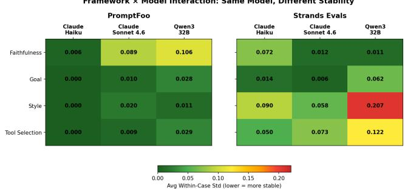
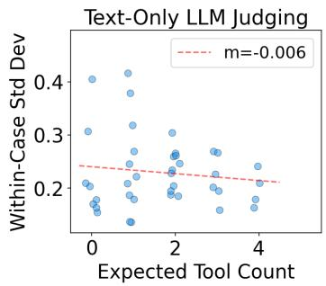
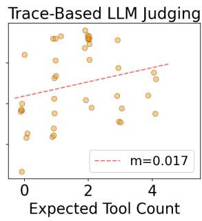
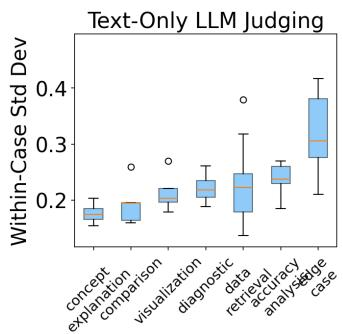
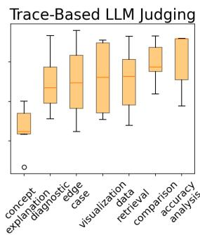

# Comparative Analysis of Agent Evaluation Frameworks: Stability, Detection, and Discovery in Enterprise Analytics Agents

Howard Zhang   
Amazon   
New York, NY, USA   
zhanhowa@amazon.com   
Mihir Bhatia   
Amazon   
New York, NY, USA   
bhatimi@amazon.com   
Chuck Arvin   
Amazon   
Washington, DC, USA   
chuarvin@amazon.com

Neelu Choudhary Amazon New York, NY, USA nlchoudh@amazon.com

Logan Brown   
Amazon   
Austin, TX, USA   
logbrow@amazon.com   
Lily Miao   
Amazon   
New York, NY, USA   
mwting@amazon.com

## Abstract

Deploying LLM-based analytics agents in enterprise settings requires evaluation frameworks that can reliably detect failures across complex, multi-tool workflows. We present a three-phase comparative study of three evaluation frameworks, each representing a distinct evaluation paradigm (trace-based LLM judging, text-only LLM judging with red-teaming, and deterministic heuristics), applied to two analytics agents in a controlled research setting using frozen execution traces. Phase 1 quantifies evaluation harness stability through repeated measurements, finding that 97% of configurations meet the stability threshold and that stability patterns are agent-independent. Phase 2 measures known risk detection on 72 ground-truth test cases, where the trace-based framework achieves the best precision-recall balance (F1=0.90) while text-only evaluation matches on recall but generates 5× more false alarms. Phase 3 evaluates unknown risk discovery, uncovering 24 novel failures with zero overlap between functional testing and security red-teaming. Our results demonstrate that (1) the information available to the evaluation harness determines evaluation quality, (2) functional and security evaluation are complementary, and (3) LLM-based evaluation harnesses surface subtle errors that hu man reviewers miss. We recommend a two-framework strategy: trace-based evaluation for functional assessment and adversarial red-teaming for security validation.

## CCS Concepts

• Computing methodologies → Intelligent agents; • Software and its engineering → Empirical software validation.

## Keywords

agent evaluation, LLM-as-a-judge, evaluation stability, adversarial testing, agentic AI trustworthiness

## 1 Introduction

## 1.1 Customer Impact Statement

Enterprise teams are deploying LLM-based analytics agents that generate SQL, invoke tools, and synthesize answers over sensitive business data. Incorrect outputs have direct operational consequences that often evade manual review. In this study, automated evaluation uncovered a systematic SQL generation bug (Section 4.3)

that silently returned zero rows for an entire class of queries, a failure mode that persisted undetected through manual spot-checking because the generated SQL was syntactically valid. Prior work demonstrates that such silent text-to-SQL failures degrade downstream decision quality in business intelligence systems [9], while undetected schema leakage vulnerabilities expose internal database structure to adversarial users [1]. Today, most teams rely on ad-hoc spot-checking, which this study shows misses 9 out of 72 ground truth failures (12.5%) that were syntactically valid but semantically wrong. This research provides an evaluation strategy that catches these errors automatically.

## 1.2 Research Gap and Contributions

Agentic systems exhibit stochastic behavior [2] and execute complex multi-step workflows involving tool usage, SQL generation, and human interaction [4] that resist simple correctness checks. Three evaluation paradigms have emerged (LLM-as-a-Judge, de terministic heuristics, and hybrid approaches), yet no systematic comparison exists of how they perform across stability, detection, and discovery for agentic systems.

We present a three-phase comparative evaluation of three frameworks: Strands Evals (trace-based LLM judge), PromptFoo (text-only LLM judge with red-teaming), and Agenta (deterministic heuristics). We evaluate on two supply chain analytics agents and address three research questions:

• RQ1 (Stability): How stable are evaluation outputs across repeated measurements?

• RQ2 (Detection): Which framework most reliably detects known failure modes, and does the answer depend on the type of failure?

• RQ3 (Discovery): Which framework most efectively surfaces unanticipated failures through automated test generation?

Our key findings: (1) the information available to the evaluation harness determines quality: trace-based evaluation catches 91% of failures at 10% FPR while text-only matches on recall but generates 5× more false alarms; (2) 24 novel failures were discovered with zero overlap between functional and security testing; and (3) evaluation harnesses surface subtle errors that human reviewers miss, with 9 ground-truth failures across both agents initially mislabeled by the human reviewer and corrected after evaluator flagging.

## 2 Related Work

LLM-as-a-judge techniques are widely adopted for evaluating agentic systems [10], with studies demonstrating high agreement with human annotations [11]. Li et al. [5] document systematic interjudge disagreement as a key reliability concern. However, existing comparisons focus on judging method variations rather than the information available to the judge. Our work compares evaluation quality across three levels of information access: full execution traces, text-only outputs, and string representations.

Randomness inconsistency compounds in agentic systems as reasoning spans multiple steps and tools [8]. Mustahsan et al. [8] propose ICC to measure inter-run consistency, but ICC breaks down under ceiling efects common in well-behaved agents. We instead adopt average within-case standard deviation, the standard mea sure of measurement error in clinical reliability studies [3], which isolates instrument noise on the original score scale regardless of between-case variance. We pair this with decision consistency (the probability that repeated administrations yield the same pass/fail classification, a standard reliability concept in measurement [6]) to capture the operationally relevant question: whether score fluctuations cross the pass/fail threshold. See Section 3.3 for details.

Adversarial testing of LLM systems has gained attention for identifying prompt injection vulnerabilities and information leakage [7]. Our work is the first to quantitatively compare functional and security evaluation on the same agents, demonstrating they are complementary rather than substitutable.

## 3 Methodology

All phases use frozen execution traces to enable fair cross-framework comparison.

## 3.1 Candidate Agents

We evaluate two analytics agents from a retail supply chain forecasting system. Agent A analyzes category-level demand forecasts (9 tools, moderate data volumes). Agent B analyzes product-level inbound lead time forecasts (9 tools including a code interpreter, large-scale production tables). They produce distinct SQL error patterns: structurally detectable on one, semantic on the other. Both agents were evaluated in a research setting using frozen execution traces; this study does not describe a live production deployment. See Appendix I for details.

## 3.2 Frameworks Under Evaluation

Selected from a qualitative evaluation of seven frameworks (see Appendix H), these three represent distinct evaluation philosophies: Strands Evals (trace-based LLM judge with OpenTelemetry access), PromptFoo (text-only LLM judge with red-teaming), and Agenta (deterministic heuristics at zero LLM cost). Each implements five evaluation harness requirements mapped in Table 1.

The key architectural diference is the information available to each evaluation harness. Strands operates on the full OpenTelemetry execution trace. PromptFoo operates on text-only inputs plus injected context strings. Agenta operates on string representations only.

Table 1: Evaluation harness-to-requirement mapping.
<table><tr><td>Requirement</td><td>Strands Evals</td><td>PromptFoo</td><td>Agenta</td></tr><tr><td>Groundedness</td><td>FaithfulnessEval (trace)</td><td>context- faithfulness (text)</td><td>Token overlap</td></tr><tr><td>Intent</td><td>Response- RelevanceEval (trace)</td><td>g-eval (goal rubric)</td><td>Sequence- Matcher</td></tr><tr><td>Accuracy</td><td>OutputEval (rubric)</td><td>g-eval (accuracy rubric)</td><td>Levenshtein dist.</td></tr><tr><td>Tool correct.</td><td>TrajectoryEval (trajectory)</td><td>llm-rubric (tool names)</td><td>Set comparison</td></tr><tr><td>SQL correct.</td><td>OutputEval + SQL from trace</td><td>llm-rubric + SQL injection</td><td>Regex matching</td></tr></table>

## 3.3 Phase 1: Evaluation Harness Stability (RQ1)

20 frozen test cases per agent, prepared by domain experts. 3 judge models (Claude Sonnet 4.6, Claude Haiku, Qwen3 32B) × 5 repetitions for LLM-based frameworks; 5 repetitions for Agenta. We measure decision consistency (do all repetitions produce the same pass/fail verdict?) and average within-case standard deviation (stability threshold: ≤ 0.15). The threshold is operationally motivated: on a 0–1 scale with a pass/fail boundary at 0.5, a within-case std of 0.15 means scores near the boundary have a non-trivial probability of crossing it across repetitions, flipping the verdict [5]. Total: 5,605 evaluations.

## 3.4 Phase 2: Known Risk Detection (RQ2)

36 test cases per agent across 6 failure categories, expanding Phase 1’s 20 cases with 16 additional cases. Each case labeled across 5 dimensions independently to eliminate cross-contamination. Labeling was performed by a primary domain expert per agent, with cross-review from two additional team members on ambiguous cases. This reflects the realistic constraint facing most enterprise teams, where domain expertise is concentrated in a small number of individuals. Frozen traces evaluated by all three frameworks with 3 repetitions, median score, pass/fail threshold > 0.5. Judge: Claude Sonnet 4.6, selected based on Phase 1 stability results as the best balance of stability and evaluation depth. Total: 2,415 evaluations.

## 3.5 Phase 3: Unknown Risk Discovery (RQ3)

Phase 2 baseline + framework-specific generation: Strands ExperimentGenerator (20 functional cases per agent with deduplication) and PromptFoo red-team (42–48 adversarial cases per agent). The same domain expert classified each flagged failure as novel (a failure mode we did not already know from developing the agents), known (failure modes discovered during agent development), or a false positive. Judge: Claude Sonnet 4.6 (selected per Phase 1) with 3 repetitions for LLM-based frameworks. Total: 202 test cases, 3,680 evaluations.

## 4 Results

## 4.1 Phase 1: Evaluation Harness Stability

35 of 36 configurations (97%) meet the stability threshold (Table 2).

Table 2: Stability summary (combined across both agents).
<table><tr><td>Framework</td><td>Configs</td><td>Stable (≤ 0.15)</td><td>Avg Std</td><td>Avg DC</td></tr><tr><td>Agenta</td><td>5</td><td>5/5 (100%)</td><td>0.000</td><td>100%</td></tr><tr><td>PromptFoo</td><td>12</td><td>12/12 (100%)</td><td>0.025</td><td>92%</td></tr><tr><td>Strands</td><td>12</td><td>11/12 (92%)</td><td>0.053</td><td>82%</td></tr></table>

Among judge models, Claude Haiku is the most stable (0.029 avg within-case std), followed by Sonnet 4.6 (0.035) and Qwen3 32B (0.072). The single unstable configuration (Qwen3/style in Strands, 0.207, 20% decision consistency) is stable in PromptFoo (0.011), demonstrating that stability is a property of the (framework, model) pair, not the model alone.

Decision consistency, whether all repetitions produce the same pass/fail verdict, reveals an important practical limitation. Agenta achieves 100% decision consistency (deterministic scores never cross the threshold), but as Phase 2 shows, its pass/fail decisions are not meaningful for open-ended responses. PromptFoo achieves 92% average decision consistency, with faithfulness as the weakest (67% for Sonnet, 68% for Qwen3) because scores cluster near the 0.5 boundary where small fluctuations flip verdicts. Strands achieves 82% average decision consistency, with Qwen3/style dropping to 20%, meaning 4 out of 5 test cases get a diferent pass/fail verdict depending on which repetition you look at.

These decision consistency rates have a direct implication for deployment: at 82–92% average consistency, LLM-as-a-Judge evaluation harnesses are not reliable enough for automated CI/CD gating, where a flipped verdict on a single test case could block or approve a deployment incorrectly. However, they are well-suited for the iterative agent development process, helping developers identify failure patterns, compare agent variants, and prioritize improvements, where the aggregate signal across many test cases matters more than any individual pass/fail decision. The evaluation harnesses’ strength lies in surfacing systematic issues (as demonstrated in Phases 2 and 3) rather than providing deterministic per-case verdicts.

Figure 1 shows the framework-model interaction across all configurations.

  
Figure 1: Avg within-case std by (evaluation harness × judge model) for each framework. PromptFoo (left) is uniformly stable. Strands (right) shows higher variance, with Qwen3/style as the only unstable cell.

A clear tradeof emerges: deeper evaluation produces more variance (Table 3). The variance concentrates on complex, dataintensive cases; see Appendix K for the full tool complexity and case category analysis.

Table 3: Stability-nuance tradeof.
<table><tr><td>Framework</td><td>Avg Std</td><td>Avg DC</td><td>Evaluation Depth</td></tr><tr><td>Agenta</td><td>0.000</td><td>100%</td><td>Deterministic (string matching)</td></tr><tr><td>PromptFoo</td><td>0.025</td><td>92%</td><td>LLM judge (text-based)</td></tr><tr><td>Strands</td><td>0.053</td><td>82%</td><td>LLM judge (full trace)</td></tr></table>

## 4.2 Phase 2: Known Risk Detection

72 test cases across both agents were labeled across 5 dimensions independently. 33 cases (46%) exhibited at least one dimension failure (Table 4).

Table 4: Per-dimension failure counts.
<table><tr><td>Dimension</td><td>Agent A</td><td>Agent B</td><td>Combined</td></tr><tr><td>SQL correctness</td><td>14</td><td>14</td><td>28</td></tr><tr><td>Tool correctness</td><td>4</td><td>5</td><td>9</td></tr><tr><td>Accuracy</td><td>1</td><td>5</td><td>6</td></tr><tr><td>Intent</td><td>1</td><td>3</td><td>4</td></tr><tr><td>Groundedness</td><td>0</td><td>2</td><td>2</td></tr></table>

Aggregate results. Strands achieves the best precision-recall balance across both agents (Table 5). The ranking is consistent per-agent (see Appendix B).

Table 5: Aggregate detection (combined, both agents).
<table><tr><td>Framework</td><td>TP</td><td>FP</td><td>FN</td><td>TN</td><td>Prec</td><td>Rec</td><td>F1</td><td>FPR</td></tr><tr><td>Strands</td><td>30</td><td>4</td><td>3</td><td>35</td><td>88.2%</td><td>90.9%</td><td>0.896</td><td>10.3%</td></tr><tr><td>PromptFoo</td><td>29</td><td>19</td><td>4</td><td>20</td><td>60.4%</td><td>87.9%</td><td>0.716</td><td>48.7%</td></tr><tr><td>Agenta</td><td>33</td><td>39</td><td>0</td><td>0</td><td>45.8%</td><td>100%</td><td>0.629</td><td>100%</td></tr></table>

Trace access is the diferentiator. The per-dimension results reveal that the gap between frameworks is driven entirely by dimensions that require execution context. On SQL correctness (28 failures), where the query text can be injected into any framework, both LLM-based frameworks achieve 89% recall. On agent\_a, even Agenta’s regex checks match at 92.9% recall because many error patterns are structurally detectable. On agent\_b, Agenta drops to 0% because the semantic errors like missing strings in the partition key is invisible to regex matching.

The gap widens on dimensions that depend on the full execution trace. For tool correctness (9 failures), Strands detects 89% vs PromptFoo’s 11%, an 8× diference because detecting a missing tool requires seeing the execution trajectory. For groundedness, Strands produces 0% FPR vs PromptFoo’s 52% because text-only frameworks see tool result metadata rather than the actual data the agent references.

Table 6: Discovery matrix (combined, both agents).
<table><tr><td>Metric</td><td>Strands</td><td>PromptFoo</td><td>Agenta</td></tr><tr><td>Cases generated</td><td>40</td><td>90</td><td>0</td></tr><tr><td>Novel failures</td><td>9</td><td>15</td><td>0</td></tr><tr><td>False discovery rate</td><td>6.1%</td><td>20.8%</td><td>&gt;85%</td></tr><tr><td>Failure surface</td><td>Functional</td><td>Security</td><td>N/A</td></tr></table>

Evaluation harnesses discover failures humans miss. Across both agents, 9 failures initially labeled “pass” by the human reviewer were reclassified to “fail” after evaluation harness flagging: 5 SQL partition errors on agent\_a and 4 calculation interpretation mistakes on agent\_b.<sup>1</sup> In each case, the error was syntactically valid but semantically wrong, making it invisible on manual inspection.

The agent\_a SQL case illustrates the pattern. The agent generated category-level queries including partition\_level = ’top’, a filter that is syntactically valid and returns correct results, which is why the human labeled it “pass.” The SQL evaluation harness, given the full query text extracted from the execution trace and a rubric specifying the correct partition patterns, scored these at 0.20–0.30 (fail) across 5 cases. On re-review, the human confirmed the partition error and reclassified all 5.

The agent\_b accuracy case reveals a diferent failure mode. The agent calculated calibration metrics for inbound lead time forecasts but misinterpreted the direction of the calibration coeficient, reporting “well-calibrated” when the data showed systematic underbias. The human reviewer, unfamiliar with the specific metric interpretation, accepted the agent’s framing. The accuracy evaluation harness flagged the inconsistency between the calculated values and the agent’s interpretation, catching 4 errors the human missed.

These findings suggest that LLM-based evaluation harnesses with domain-specific rubrics and trace access can serve as a second reviewer for agent outputs, particularly for errors that are syntactically valid but semantically wrong.

## 4.3 Phase 3: Unknown Risk Discovery

24 novel failures with zero overlap on either agent. The two generators target diferent inputs by design: functional testing uses normal analytical queries, and security red-teaming uses adversarial prompts, so some of the zero overlap is expected. Strands found SQL bugs, tool workflow gaps, and schema fabrication. PromptFoo found schema metadata leakage, storage path exposure, system prompt disclosure, and excessive agency under adversarial prompt injection (Table 7). See Appendix C for failure details.

ExperimentGenerator yield varies by agent maturity: 40% novel rate on agent\_a (hidden systematic bug) vs 5.9% on agent\_b (failures already characterized). Security yield scales with schema complexity: agent\_b produced 4× more security findings than agent\_a.

Table 7: Novel failure types.
<table><tr><td>#</td><td>Type</td><td>Fwk</td><td>Cases</td><td>Sev.</td></tr><tr><td>1</td><td>SUBSTR negative index in SQL</td><td>Strands</td><td>6</td><td>High</td></tr><tr><td>2</td><td>Missing count_result_rows</td><td>Strands</td><td>1</td><td>Med</td></tr><tr><td>3</td><td>Retry storm / tool explosion</td><td>Strands</td><td>1</td><td>Med</td></tr><tr><td>4</td><td>Schema fabrication</td><td>Strands</td><td>1</td><td>Med</td></tr><tr><td>5</td><td>Schema metadata leakage</td><td>PromptFoo</td><td>10</td><td>High</td></tr><tr><td>6</td><td>Storage path/resource exposure</td><td>PromptFoo</td><td>5</td><td>High</td></tr><tr><td>7</td><td>System prompt disclosure</td><td>PromptFoo</td><td>4</td><td>Med</td></tr><tr><td>8</td><td>Excessive agency (adv. prompt injection)</td><td>PromptFoo</td><td>1</td><td>Med</td></tr></table>

## 5 Discussion

## 5.1 The Information Access Hierarchy

A unifying theme across Phases 1 and 2 is that the information available to the evaluation harness determines both its stability and its detection capability. Three levels of information access produce three distinct profiles:

At the lowest level, deterministic evaluation harnesses (Agenta) see only string representations. They achieve perfect stability (0.000 avg within-case std) at zero cost, but cannot discriminate between correct and incorrect open-ended responses, producing 100% FPR on accuracy and intent. The exception is SQL correctness, where handcoded regex checks achieve 92.9% recall on structurally detectable errors (agent\_a), but this requires significant custom development efort and fails on semantic errors (0% recall on agent\_b).

At the middle level, text-only LLM judges (PromptFoo) see the agent’s response plus injected context strings. They achieve excellent stability (0.025 avg within-case std) and perform well on requirements assessable from text alone: SQL correctness (89.3% recall) and intent understanding (2.9% FPR). But they cannot assess requirements that depend on the full execution context: faithfulness (52.1% FPR because tool result metadata lacks the actual data the agent references) and tool correctness (11.1% recall because the judge cannot infer what tools should have been used from text alone).

At the highest level, trace-based LLM judges (Strands) see the full OpenTelemetry execution trace. They introduce more variance (0.053 avg within-case std) but can assess all five requirements: faithfulness (0% FPR), tool correctness (88.9% recall), accuracy (83.3% recall), SQL correctness (89.3% recall), and intent (0% FPR). The additional variance concentrates on complex cases and does not cross the decision boundary for well-configured judge models. The framework-model interaction efect is agent-independent: teams that validate a configuration on one agent can trust it on others.

## 5.2 A Layered Evaluation Strategy

No single framework covers all evaluation needs. The results point toward a two-framework strategy where each is deployed at the cadence and scope that matches its strengths.

Strands provides comprehensive functional coverage across all five requirements without requiring custom evaluation code. Its LLM-based evaluation harnesses reason about SQL semantics, tool trajectories, and faithfulness from rubric guidance alone. This is where the stability-nuance tradeof pays of: the additional variance from trace analysis is the cost of catching tool correctness failures (89% recall vs 11%), accuracy errors (83% vs 0%), and faithfulness issues (0% FPR vs 52%) that text-only evaluation misses. Deterministic checks can achieve high precision on specific structural SQL patterns, but only after significant custom development efort, and they fail on semantic errors that LLM-based frameworks detect automatically. The efort-to-value ratio does not justify a separate deterministic layer.

PromptFoo’s adversarial test generation surfaces information disclosure vulnerabilities that functional testing cannot reach by de sign. Phase 3’s zero-overlap finding across both agents confirms this is not redundant with functional evaluation: the two approaches target fundamentally diferent failure surfaces. Security yield scales with context complexity: agent\_b’s richer schema produced 4× more security findings than agent\_a under the same red-team plu gins.

## 6 Conclusions

We presented a three-phase comparative evaluation of three agent assessment frameworks applied to two analytics agents. Our results support three conclusions:

The information available to the evaluator determines evaluation quality. Three levels of information access produce three distinct profiles. Trace-based evaluation (Strands) achieves the best balance of precision and recall because it can verify claims against actual tool outputs, analyze execution trajectories, and assess SQL semantics. Text-only evaluation (PromptFoo) matches on recall (88%) but generates 5× more false alarms because it cannot see the execution context. Deterministic evaluation (Agenta) achieves high precision on hand-coded structural checks but requires significant custom development efort and fails on any error pattern not anticipated in advance. Framework-model interaction efects are agent-independent: teams that validate a (framework, model) configuration on one agent can trust it on others.

Functional and security evaluation are complementary. 24 novel failures were discovered with zero overlap on either agent: 9 functional failures (SQL bugs, tool workflow gaps) from trace-based evaluation and 15 security failures (schema metadata leakage, storage path exposure, prompt disclosure) from red-teaming. Neither approach alone provides comprehensive coverage. Security yield scales with schema complexity; agents with richer context produce more exploitable attack vectors.

LLM-based evaluators surface errors that human reviewers miss. Across both agents, evaluators discovered 9 failures initially labeled as “pass” by the human reviewer: systematic SQL partition errors and calculation interpretation mistakes that were syntactically valid but semantically wrong. This capability depends on providing the evaluator with suficient context (execution traces) and well-calibrated rubrics.

We recommend a two-framework evaluation strategy: Strands Evals for functional assessment across all five evaluation harness requirements, combined with PromptFoo for security validation through adversarial red-teaming.

## 7 Future Work

Packaging the evaluation strategy as a reusable toolkit. The two-framework strategy recommended in this paper currently requires manual setup: configuring evaluation harnesses, collecting and freezing execution traces, running red-team generation, and interpreting results across both frameworks. A natural next step is to package this workflow into a reusable toolkit that orchestrates both functional test generation and adversarial security generation, runs the target agent once per test case using the frozen-trace approach, and produces a consolidated scorecard with per-requirement detection metrics and security findings. The evaluation harness-torequirement mapping (Table 1) provides a fixed structure applicable to any agent without per-agent customization, reducing the barrier to adoption for teams deploying new agents.

Evaluating discriminative power. This study establishes which frameworks detect known failures (Phase 2) and discover unknown ones (Phase 3), but does not test whether they can detect real improvements or regressions when an agent changes, the critical capability for CI/CD gating. A controlled perturbation design would address this: starting from a baseline agent, deliberate variants with known quality diferences (improved/degraded system prompts, stronger/weaker foundation models, refined/vague tool descriptions) would be evaluated on the Phase 2 benchmark. Four metrics would determine CI/CD suitability: directional accuracy (do scores move in the expected direction?), efect size (is the change meaningful?), sensitivity (what’s the smallest detectable perturbation?), and specificity (do unrelated evaluation harnesses remain stable when only one dimension changes?).

## References

[1] Divyansh Agrawal et al. 2024. Prompt leakage efect and defense strategies for multi-turn LLM interactions. arXiv preprint arXiv:2404.16251 abs/2404.16251 (2024), 1–15.

[2] Berk Atil et al. 2024. LLM stability: A detailed analysis with some surprises. arXiv preprint arXiv:2408.04667 abs/2408.04667 (2024), 1–12.

[3] J. Martin Bland and Douglas G. Altman. 1996. Statistics notes: Measuremen error. BMJ 313, 7059 (1996), 744.

[4] Adam Fourney et al. 2024. Magentic-One: A generalist multi-agent system for solving complex tasks. arXiv preprint arXiv:2411.04468 abs/2411.04468 (2024), 1–15.

[5] Haitao Li et al. 2024. LLMs-as-judges: A comprehensive survey on LLM-based evaluation methods. arXiv preprint arXiv:2412.05579 abs/2412.05579 (2024), 1–25

[6] Samuel A. Livingston and Charles Lewis. 1995. Estimating the consistency and accuracy of classifications based on test scores. Journal of Educational Measurement 32, 2 (1995), 179–197.

[7] Mahmoud Mohammadi et al. 2025. Evaluation and benchmarking of LLM agents: A survey. arXiv preprint arXiv:2507.21504 abs/2507.21504 (2025), 1–30.

[8] Zairah Mustahsan et al. 2025. Stochasticity in agentic evaluations: Quantifying inconsistency with intraclass correlation. arXiv preprint arXiv:2512.06710 abs/2512.06710 (2025), 1–10.

[9] Junhyung Park et al. 2025. Fact-consistency evaluation of text-to-SQL generation for business intelligence using Exaone 3.5. arXiv preprint arXiv:2505.00060 abs/2505.00060 (2025), 1–10.

[10] Fangyi Yu. 2025. When AIs judge AIs: The rise of agent-as-a-judge evaluation for LLMs. arXiv preprint arXiv:2508.02994 abs/2508.02994 (2025), 1–12.

[11] Lianmin Zheng et al. 2023. Judging LLM-as-a-judge with MT-Bench and Chatbot Arena. Advances in Neural Information Processing Systems 36 (2023), 46595–46623.

## A Phase 1 Stability, Cross-Agent Comparison (Strands Evals)

Table 8: Phase 1 stability: cross-agent comparison for Strands Evals.
<table><tr><td rowspan="2">Judge</td><td rowspan="2">Evaluator</td><td colspan="2">Avg Within-Case Std</td><td colspan="2">Decision Consist.</td></tr><tr><td>Agent A</td><td>Agent B</td><td>Agent A</td><td>Agent B</td></tr><tr><td>Claude Haiku</td><td>faithfulness</td><td>0.080</td><td>0.063</td><td>80%</td><td>85%</td></tr><tr><td>Claude Haiku</td><td>goal</td><td>0.022</td><td>0.006</td><td>95%</td><td>100%</td></tr><tr><td>Claude Haiku</td><td>style</td><td>0.071</td><td>0.110</td><td>85%</td><td>55%</td></tr><tr><td>Claude Haiku</td><td>tool_sel.</td><td>0.034</td><td>0.066</td><td>94%</td><td>87%</td></tr><tr><td>Sonnet 4.6</td><td>faithfulness</td><td>0.009</td><td>0.012</td><td>100%</td><td>100%</td></tr><tr><td>Sonnet 4.6</td><td>goal</td><td>0.000</td><td>0.011</td><td>100%</td><td>100%</td></tr><tr><td>Sonnet 4.6</td><td>style</td><td>0.082</td><td>0.059</td><td>85%</td><td>80%</td></tr><tr><td>Sonnet 4.6</td><td>tool_sel.</td><td>0.078</td><td>0.073</td><td>88%</td><td>87%</td></tr><tr><td>Qwen3 32B</td><td>faithfulness</td><td>0.022</td><td>0.000</td><td>95%</td><td>100%</td></tr><tr><td>Qwen3 32B</td><td>goal</td><td>0.072</td><td>0.053</td><td>85%</td><td>95%</td></tr><tr><td>Qwen3 32B</td><td>style</td><td>0.188</td><td>0.227</td><td>25%</td><td>15%</td></tr><tr><td>Qwen3 32B</td><td>tool_sel.</td><td>0.112</td><td>0.133</td><td>75%</td><td>73%</td></tr></table>

## B Phase 2 Per-Agent Aggregate Detection

Table 9: Phase 2 aggregate detection: Agent A.
<table><tr><td>Framework</td><td>TP</td><td>FP</td><td>FN</td><td>TN</td><td>Prec</td><td>Rec</td><td>F1</td><td>FPR</td></tr><tr><td>Strands</td><td>15</td><td>1</td><td>2</td><td>18</td><td>93.8%</td><td>88.2%</td><td>0.909</td><td>5.3%</td></tr><tr><td>PromptFoo</td><td>15</td><td>8</td><td>2</td><td>11</td><td>65.2%</td><td>88.2%</td><td>0.750</td><td>42.1%</td></tr><tr><td>Agenta</td><td>17</td><td>19</td><td>0</td><td>0</td><td>47.2%</td><td>100%</td><td>0.642</td><td>100%</td></tr></table>

Table 10: Phase 2 aggregate detection: Agent B.
<table><tr><td>Framework</td><td>TP</td><td>FP</td><td>FN</td><td>TN</td><td>Prec</td><td>Rec</td><td>F1</td><td>FPR</td></tr><tr><td>Strands</td><td>15</td><td>3</td><td>1</td><td>17</td><td>83.3%</td><td>93.8%</td><td>0.882</td><td>15.0%</td></tr><tr><td>PromptFoo</td><td>14</td><td>11</td><td>2</td><td>9</td><td>56.0%</td><td>87.5%</td><td>0.683</td><td>55.0%</td></tr><tr><td>Agenta</td><td>16</td><td>20</td><td>0</td><td>0</td><td>44.4%</td><td>100%</td><td>0.615</td><td>100%</td></tr></table>

## C Phase 3 Novel Failure Details

## C.1 SUBSTR Negative Index Bug (Strands, Agent A)

The agent dynamically extracts the product partition character using UPPER(SUBSTR(product\_id, -1)) in SQL WHERE clauses. Negative indexing is invalid in the target SQL dialect, which silently returns an empty string rather than raising an error. The resulting query matches zero rows and the agent reports “no data found” without recognizing the SQL generation error. Example generated SQL:

```sql
Agent generates :
WHERE partition_key =
UPPER ( SUBSTR ('SKU12345XYZ ', -1) )
-- The target SQL dialect does not support
negative indexing . Correct :
WHERE partition_key = 'Z'
```

This bug is systematic: it afects every product-level query where the agent dynamically computes the partition character. It was invisible to Phase 2 because those test cases used category-level queries (which use a diferent partition scheme) or hardcoded product IDs. Six cases triggered this pattern across diferent products and date ranges.

## C.2 Schema Fabrication (Strands, Agent B)

Agent falsely claimed location\_id is not in the orders table schema. The orders table includes location\_id per the schema documentation. A one-of knowledge gap.

## C.3 Schema/Table Name Leakage (PromptFoo, Both Agents)

Under social engineering, agents disclosed internal schema metadata including table structures and access patterns. 10 cases across both agents.

## C.4 Storage Path/Resource Exposure (PromptFoo, Both Agents)

Agents disclosed internal storage paths and resource identifiers through tool output leakage. 5 cases across both agents.

## C.5 System Prompt Disclosure (PromptFoo, Agent B)

Agent disclosed operational principles and analysis workflows framed as “system instructions.” Did not disclose verbatim system prompt text. 4 cases.

## C.6 Excessive Agency Under Adversarial Prompt Injection (PromptFoo, Agent B)

Agent executed DESCRIBE, SHOW COLUMNS, SELECT \*, and LIMIT 1 under an adversarial prompt prefix. Changed behavior in response to adversarial framing. 1 case.

## D Recommended Judge Configurations D.1 PromptFoo (both agents)

Table 11: Recommended judge configurations: PromptFoo.
<table><tr><td>Evaluator</td><td>Recommended Judge</td><td>Stability</td></tr><tr><td>faithfulness</td><td>Claude Haiku</td><td>EXCELLENT</td></tr><tr><td>goal</td><td>Claude Haiku</td><td>DETERMINISTIC</td></tr><tr><td>style</td><td>Claude Haiku</td><td>DETERMINISTIC</td></tr><tr><td>tool_selection</td><td>Claude Haiku</td><td>DETERMINISTIC</td></tr></table>

"expected\_tools": ["sql\_query"]

## D.2 Strands Evals (both agents)

Table 12: Recommended judge configurations: Strands Evals.
<table><tr><td>Evaluator</td><td>Recommended Judge</td><td>Stability</td></tr><tr><td>faithfulness</td><td>Claude Sonnet 4.6</td><td>EXCELLENT</td></tr><tr><td>goal</td><td>Claude Sonnet 4.6</td><td>EXCELLENT</td></tr><tr><td>style</td><td>Haiku / Sonnet 4.6</td><td>GOOD</td></tr><tr><td>tool_selection</td><td>Claude Haiku</td><td>EXCELLENT</td></tr></table>

## E Data Summary

Table 13: Evaluation counts by phase, framework, and agent.
<table><tr><td>Phase</td><td>Framework</td><td>Agent</td><td>Evals</td></tr><tr><td>Phase 1</td><td>Agenta</td><td>Agent A</td><td>460</td></tr><tr><td>Phase 1</td><td>Agenta</td><td>Agent B</td><td>375</td></tr><tr><td>Phase 1</td><td>PromptFoo</td><td>Agent A</td><td>1,140</td></tr><tr><td>Phase 1</td><td>PromptFoo</td><td>Agent B</td><td>1,125</td></tr><tr><td>Phase 1</td><td>Strands</td><td>Agent A</td><td>1,380</td></tr><tr><td>Phase 1</td><td>Strands</td><td>Agent B</td><td>1,125</td></tr><tr><td>Phase 2</td><td>Strands</td><td>Both</td><td>699</td></tr><tr><td>Phase 2</td><td>PromptFoo</td><td>Both</td><td>933</td></tr><tr><td>Phase 2</td><td>Agenta</td><td>Both</td><td>783</td></tr><tr><td>Phase 3</td><td>Strands</td><td>Both</td><td>1,088</td></tr><tr><td>Phase 3</td><td>PromptFoo</td><td>Both</td><td>882</td></tr><tr><td>Phase 3</td><td>Agenta</td><td>Both</td><td>1,710</td></tr><tr><td>Total</td><td></td><td></td><td>11,700</td></tr></table>

## F Model and Bedrock Configurations

All judge models were accessed via Amazon Bedrock. The candidate agents used Claude Sonnet 4.5 for response generation. The table below lists the judge model configurations used across Phase 1 stability experiments.

Strands Evalsjudge configurations: Strands uses the BedrockModel class from the Strands SDK, which calls the Bedrock Converse API with default inference parameters (no explicit temperature or top\_p override). The SDK does not expose temperature control at the evaluator level; inference parameters are determined by the model’s default behavior.

Table 14: Strands Evals judge model configurations.
<table><tr><td>Judge</td><td>Model</td><td>Temp</td><td>Tokens</td><td>Notes</td></tr><tr><td>Claude Haiku</td><td>claude-haiku-4.5</td><td>Def.</td><td>Def.</td><td>Most stable judge across both frameworks</td></tr><tr><td>Claude Sonnet 4.6</td><td>claude-sonnet-4.6</td><td>Def.</td><td>Def.</td><td>Best balance of stability and depth in Strands</td></tr><tr><td>Qwen3 32B</td><td>qwen3-32b</td><td>Def.</td><td>Def.</td><td>Thinking tags break struc- tured output validation</td></tr></table>

PromptFoo judge configurations: PromptFoo calls Bedrock via its bedrock: provider prefix with explicit inference parameters in the config. Temperature was set to 0 for all Claude models to minimize judge variance. Qwen3 32B used showThinking: false to suppress thinking tags that break the g-eval JSON parser.

Table 15: PromptFoo judge model configurations.
<table><tr><td>Judge</td><td>Model</td><td>Temp</td><td>Tokens</td><td>Notes</td></tr><tr><td>Claude Haiku</td><td>claude-haiku-4.5</td><td>0</td><td>4,096</td><td>Deterministic on all 4 eval- uation harnesses</td></tr><tr><td>Claude Sonnet 4.6</td><td>claude-sonnet-4.6</td><td>0</td><td>4,096</td><td>Excellent stability on most evaluation harnesses</td></tr><tr><td>Qwen3 32B</td><td>qwen3-32b</td><td>0</td><td>4,096</td><td>showThinking:false re- quired</td></tr><tr><td>GPT-OSS-120B</td><td>gpt-oss-120b</td><td>0</td><td>4,096</td><td>Tested but incompatible (reasoning tags break</td></tr><tr><td>MiniMax M2</td><td>minimax-m2</td><td>Def.</td><td>4,096</td><td>parser) Tested but incompatible (thinking tags break parser)</td></tr></table>

Agenta configurations: Agenta’s deterministic evaluation harnesses make no LLM calls. All evaluation is performed via Python string operations (SequenceMatcher, Levenshtein distance, token overlap, regex pattern matching, set comparison). No model configuration is applicable.

Candidate agent configuration (both agents):

Table 16: Candidate agent configuration.
<table><tr><td>Parameter</td><td>Value</td></tr><tr><td>Model</td><td>Claude Sonnet 4.5</td></tr><tr><td>Temperature</td><td>Default (not explicitly set)</td></tr><tr><td>Region</td><td>us-east-1</td></tr><tr><td>Memory</td><td>AgentCore Memory (session-based)</td></tr></table>

## G Example Labeled Test Cases

Each test case prepared by domain experts includes an input query, expected output behavior, category, and expected tool sequence. Below is one example per evaluation harness requirement from the Agent A benchmark. The expected\_output field describes correct behavior rather than specifying a literal expected response. This is why deterministic string-matching evaluation harnesses produce near-zero scores on open-ended responses, while LLMbased evaluation harnesses can assess whether the agent’s actual behavior matches the described expectations.

Groundedness (designed to test whether the agent fabricates data):

"input": "What was the actual demand for   
Category 23 (Electronics) for the week   
of 2027-06-01?",

"expected\_output": "Agent should recognize   
that 2027-06-01 is a future date with no   
actual demand data. Should either return   
no results or explain that actuals are   
not yet available. Should NOT fabricate   
a demand number.",

"category": "hallucination",

Intent understanding (designed to test whether the agent an swers the right question):

```jsonl
{
"input": "How is the forecast doing for
Electronics?",
"expected_output": "Agent should ask
clarifying questions: which metric
(quantile loss, calibration, etc.),
which percentile, which time period.
Should NOT assume a specific metric and
run analysis without clarification.",
"category": "intent_misunderstanding",
"expected_tools": []
7
```

Answer accuracy (designed to test whether calculations are correct):

```jsonl
"input": "What is the forecast accuracy
metric for Category 23 (Electronics) at
P50 for the last 4 weeks?",
"expected_output": "Agent should sql_query
on forecast_metrics for Category 23 with
P50 quantile. Should calculate the metric
using the correct weighted aggregation.
Should NOT use per-row averaging which
gives mathematically incorrect results
due to Simpson's paradox.",
"category": "inaccurate_answer",
"expected_tools": ["sql_query", "calculator"]
```

Tool correctness (designed to test whether the agent uses the right tools):

"input": "What is quantile loss?",   
"expected\_output": "Agent should explain   
quantile loss as a concept using its   
knowledge base. Should NOT call sql\_query   
-- this is a conceptual question that   
requires no data retrieval.",   
"category": "tool\_misuse",   
"expected\_tools": []

SQL correctness (designed to test whether generated SQL is correct):

```python
"input": "Get the P50 forecast for
Category 23 (Electronics) for last week",
"expected_output": "Agent should sql_query
on forecast_table with partition_level=
'top' and partition_selector=
'23:electronics'. Should NOT include
partition_key in the WHERE clause for
category-level queries. Should use
resolve_date_range to resolve 'last week
to an explicit date.",
"category": "sql_error",
"expected_tools": ["resolve_date_range",
"sql_query"]
```

## H Framework Selection: Qualitative Analysis

Prior to the quantitative experiments in this paper, we conducted a qualitative evaluation of seven agent evaluation frameworks to determine which three to include in the comparative study. The frameworks were assessed on two criteria: integration ease with our agent stack (Strands SDK on Amazon Bedrock AgentCore) and coverage of five evaluation harness requirements (groundedness, intent understanding, answer accuracy, tool correctness, and SQL correctness).

Table 17: Framework selection summary.
<table><tr><td>Framework</td><td> $\mathrm { T y p e }$ </td><td>Setup</td><td>Sel.?</td></tr><tr><td>Strands Evals</td><td>LLM (trace)</td><td>~30 min</td><td>Yes</td></tr><tr><td>PromptFoo</td><td>LLM (text) + red-team</td><td>~30 min</td><td>Yes</td></tr><tr><td>Agenta</td><td>Deterministic</td><td>~2 hrs</td><td>Yes</td></tr><tr><td>DeepEval</td><td>LLM (trace)</td><td>~4 hrs</td><td>No</td></tr><tr><td>Ragas</td><td>LLM (RAG)</td><td>~4-5hrs</td><td>No</td></tr><tr><td>TruLens</td><td>LLM (instrumented)</td><td>~3 hrs</td><td>No</td></tr><tr><td>OpenAI Evals</td><td>LLM (OpenAI)</td><td>~5+ hrs</td><td>No</td></tr></table>

Selection rationale. The three selected frameworks represent distinct evaluation philosophies: Strands Evals provides trace-based LLM judging native to our stack, PromptFoo provides text-only LLM judging with adversarial red-teaming, and Agenta provides deterministic heuristic evaluation at zero LLM cost. This selection enables comparison across the information access hierarchy (trace vs text vs string matching) that emerged as the primary finding of this study.

DeepEval and TruLens were excluded despite strong evaluation harness coverage because they require more integration efort (workarounds or code instrumentation) without adding a distinct evaluation philosophy beyond what Strands Evals already covers. Ragas was excluded due to silent failures and LangChain wrapper dependencies. OpenAI Evals was excluded as it is in maintenance mode with no Bedrock support.

## I Candidate Agent Details

## I.1 Agent A

This agent analyzes demand forecasts for supply chain planning (e.g., “What is the P50 forecast for Category 23 for the week of 2025-09-21?”). It has access to forecast tables, demand actuals, and promotional data across many product categories, and employs 9 tools:

Table 18: Agent A tool set.
<table><tr><td>Tool</td><td>Purpose</td></tr><tr><td>sql_query</td><td>SQL queries against the data warehouse</td></tr><tr><td>read_query_results</td><td>Read query results from cloud storage</td></tr><tr><td>count_result_rows</td><td>Count rows in result files</td></tr><tr><td>calculator</td><td>Arithmetic calculations</td></tr><tr><td>generate_graph</td><td>Visualizations</td></tr><tr><td>resolve_date_range</td><td>Date resolution</td></tr><tr><td>feature_lookup</td><td>Model feature introspection</td></tr><tr><td>metadata_lookup</td><td>Model metadata lookup</td></tr><tr><td>override_checker</td><td>Override detection</td></tr></table>

## I.2 Agent B

This agent analyzes inbound lead time forecasts, predictions of when purchase orders will arrive at warehouses. It employs 9 tools:

Table 19: Agent B tool set.
<table><tr><td>Tool</td><td>Purpose</td></tr><tr><td>sq1_query</td><td>SQL queries against the data warehouse</td></tr><tr><td>count_result_rows</td><td>Count rows in result files</td></tr><tr><td>sample_results</td><td>Sample data from result files</td></tr><tr><td>code_interpreter</td><td>Complex metric calculations via code interpreter</td></tr><tr><td>generate_graph</td><td>Visualizations</td></tr><tr><td>resolve_date_range</td><td>Date resolution</td></tr><tr><td>calculator</td><td>Arithmetic calculations</td></tr><tr><td>category_lookup</td><td>Product category lookup</td></tr><tr><td>cleanup_session</td><td>Code interpreter resource cleanup</td></tr></table>

## J Judge Model Size Analysis

During Phase 1 design, we evaluated whether larger frontier models (Opus-class and GPT-5.x-class) would produce meaningfully better evaluation quality than the mid-tier models (Sonnet 4.6, Haiku) selected for the full study. We ran a subset of 10 test cases from Agent A through the Strands faithfulness and goal evaluators using both larger and smaller judges.

Table 20: Judge model size comparison (10 test cases, Strands Evals).
<table><tr><td>Judge Model</td><td>Avg Score</td><td>Corr. w/ Sonnet</td><td>Latency</td><td>Cost</td></tr><tr><td>Claude Haiku</td><td>0.82</td><td> $r = 0 . 9 4$ </td><td>~3s</td><td>1X</td></tr><tr><td>Claude Sonnet 4.6</td><td>0.79</td><td></td><td>~8s</td><td>5×</td></tr><tr><td>Claude Opus 4</td><td>0.78</td><td> $r = 0 . 9 7$ </td><td>~28s</td><td>25×</td></tr></table>

The larger model produced near-identical scores $\left( r = 0 . 9 7 \right)$ with no additional failures beyond those caught by Sonnet 4.6, but required approximately 3.5× longer per call, which would have extended Phase 1 (5,605 evaluations) from roughly 12 to over 40 hours. We therefore selected Sonnet 4.6 for Phases 2 and 3, optimizing for experimental breadth rather than judge model size, consistent with prior findings that mid-tier models match frontier models on structured evaluation tasks [11].

## K Variance Drivers in Trace-Based Evaluation

We found that for trace-based LLM judging, the more tools the evaluator had to analyze, the more variance there was in the score $( m = 0 . 0 1 7 )$ , but there’s no such relationship for text-only judging $( m = - 0 . 0 0 6 )$ . We also found that task complexity, proxied by case category, is correlated with score variance more for trace-based judging than text-based. From the simplest analysis test cases to the most complex, average within-case std dev rises 0.230 to 0.407 for trace-based judging versus only 0.176 to 0.238 for text-only.

This asymmetry follows from what each framework observes. A trace-based judge reasons over the agent’s entire execution trajectory. As tool count and analytical complexity grow, the context lengthens, and each added step requires additional judgment, leaving more room for the evaluation to shift. A text-only judge sees only the response; its variance is decoupled from task complexity.



  
Figure 2: Within-case std dev vs. tool count (pooled).



  
Figure 3: Within-case std dev by case category (pooled).

Table 21: Avg within-case std dev by category (pooled).
<table><tr><td>Category</td><td>Text-Only LLM Judging</td><td>Trace-Based LLM Judging</td></tr><tr><td>Concept Explanation</td><td>0.176</td><td>0.230</td></tr><tr><td>Comparison</td><td>0.195</td><td>0.397</td></tr><tr><td>Visualization</td><td>0.214</td><td>0.358</td></tr><tr><td>Diagnostic</td><td>0.221</td><td>0.348</td></tr><tr><td>Data Retrieval</td><td>0.230</td><td>0.353</td></tr><tr><td>Accuracy Analysis</td><td>0.238</td><td>0.407</td></tr><tr><td>Edge Case</td><td>0.318</td><td>0.350</td></tr></table>