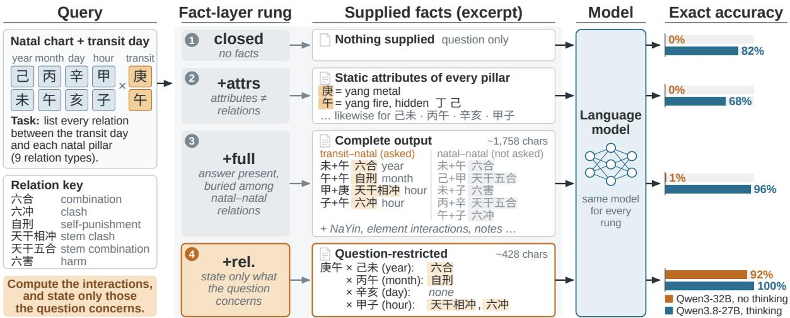
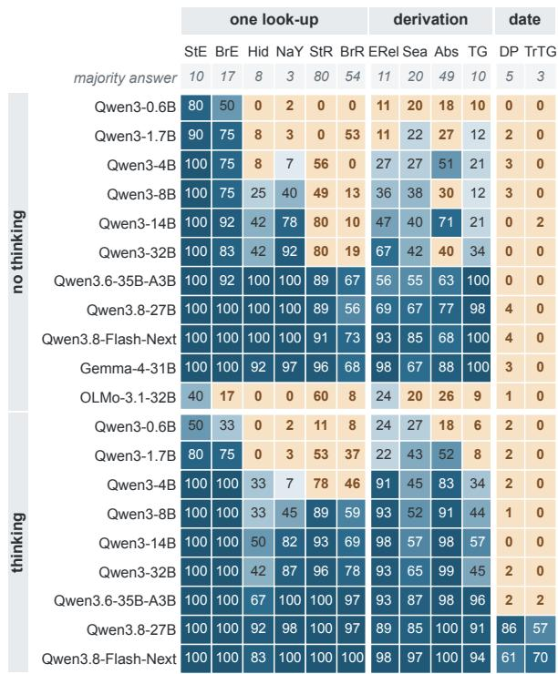
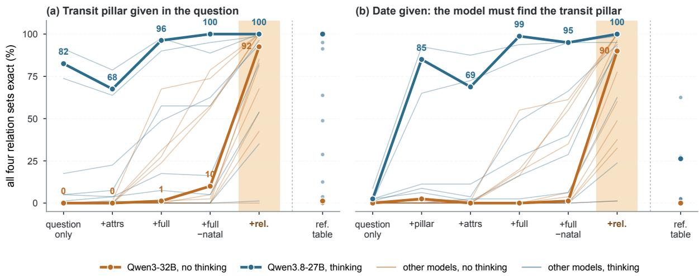
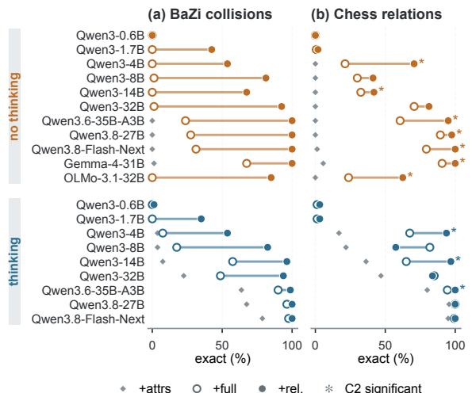
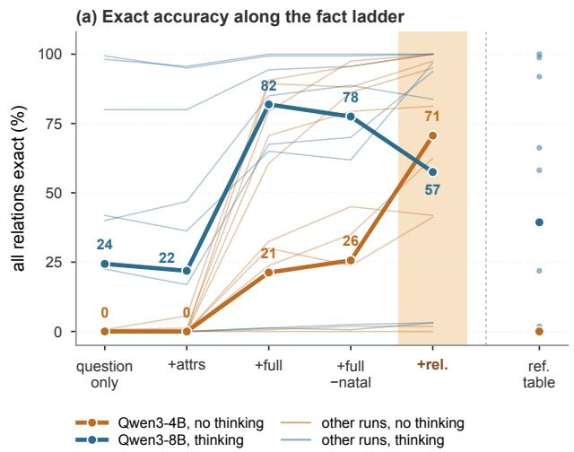
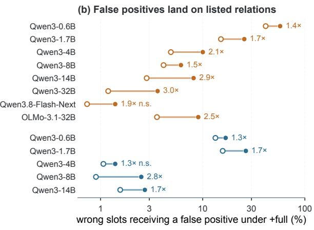
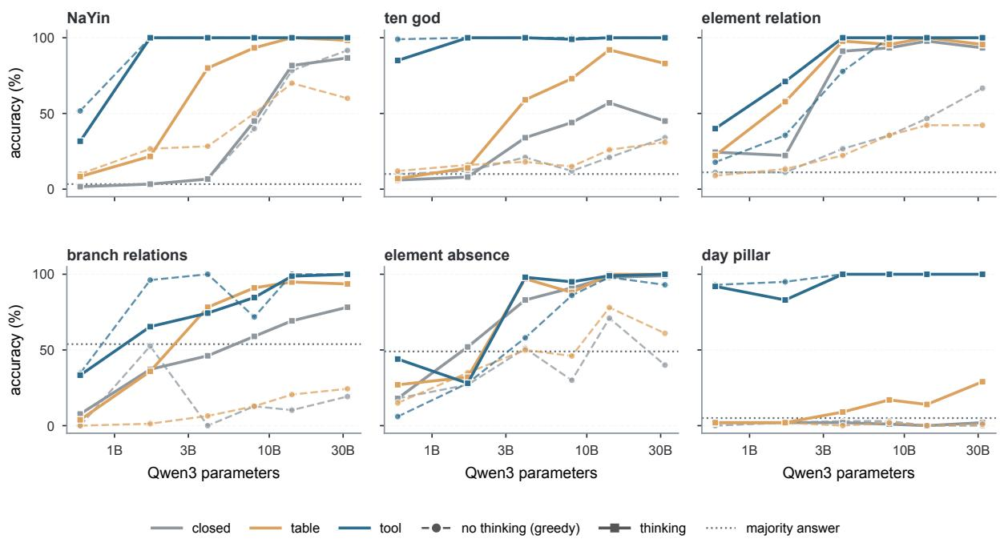

# Compute the Interactions, Not the Attributes: What a Fact Layer Must Supply in the Chinese Sexagenary System

Huixue Han Independent Researcher ixue9@icloud.com

Jiaying Liu Independent Researcher sammi.liu01@gmail.com

## Abstract

Language-model systems in rule-governed domains often pair the model with a deterministic fact layer, but which facts that layer should supply is rarely measured. We measure it in the Chinese sexagenary (干支) system underlying BaZi (八字) chart analysis, where every fact has one table-checkable value: 682 items over twelve fact categories and 160 transit–natal collision items, posed closed-book, with the reference table, and with computed facts at increasing levels. In eleven open-weight models answering directly, errors concentrate where attributes must be combined: none gets more than 4% of sexagenary days or 1% of collisions right. Static attributes have no consistent effect, and the complete relation list leaves most direct-answering models near zero although it contains the answer. A query-filtered layer (exploratory) raises Qwen3-8B and Qwen3-32B to 78–92% and four further models to 96– 100%. Three proprietary reasoning models compute 68–95% of collisions unaided. On chess positions, under predictions locked in advance, attributes again do not substitute for relations and listed distractors are misattributed. The fact layer must supply computed interactions; how they are presented depends on the model and the domain.

## 1 Introduction

Tool-augmented and retrieval-augmented systems supply a language model with computed facts or retrieved rules (Gao et al., 2023; Schick et al., 2023; Lewis et al., 2020). In a rule-governed domain, the designer of such a component chooses what it returns: the attributes of each entity, every relation among the entities, or only the relation the user asked about. Returning attributes is the simplest choice and leaves their combination to the model. Prior work shows that long or noisy tool output costs accuracy and that compressing it can help (Kate et al., 2025; Lele, 2026); it does not compare these three layers on the same questions. The comparison matters: answering directly, Qwen3-32B gets 1% of one item set right with a complete relation list that contains the answer, and 92% with only the relations the question concerns (Figure 1).

We measure this in the Chinese sexagenary (干 支, ganzhi) system. Its sixty-term cycle of stems and branches has dated days since the late Shang period (Keightley, 2000; Wilkinson, 2017), and its tables of elements and pairwise relations are the factual layer of BaZi (八 字, Four Pillars) chart analysis. A reading reasons in steps such as “the day master is 癸 water; the year stem 丙 is fire, which 癸 controls, so it is the wealth star; today is a 丁 丑 day, and 丁 clashes with 癸”. Every clause before the interpretation is a look-up or a short derivation over fixed tables, and when one is wrong the reading stays fluent. The domain suits the design question: every fact has one value once a convention is fixed, facts range from single lookups to combinations of several attributes, and the chart separates cleanly from interpretation. Prior BaZi benchmarks score interpretive or predictive answers whose ground truth is contested (Zheng et al., 2025; Chen and Liu, 2026); we score only table-checkable facts and vary how much of the computation is done for the model.

We ask three questions. RQ1: in which categories of table-checkable facts do models err without help? RQ2: does the reference table in context remove these errors? RQ3: which parts of the computation must a fact layer perform for the errors to disappear? Our contributions are:

1. A benchmark with a fact-layer ladder: 682 items over twelve categories and 160 transit– natal collision items, posed under conditions that difer only in what is computed for the model, with gold answers cross-checked against a second implementation of the rules (§3.1).

2. A localisation of the errors: across eleven open-weight models, single look-ups approach ceiling with scale, while errors concentrate in the sexagenary day count and in collisions between pillars. Answering directly, every model is at or below the majority baseline on closedbook day pillars, although models from 4B upward name 34–84% of weekdays on the same dates (§5.2).

  
Figure 1: The fact-layer ladder on one collision item (transit pillar given). Each rung supplies more of the computation to the same model; bars give exact accuracy over 80 items (orange: Qwen3-32B without thinking; blue: Qwen3.8-27B with thinking). The complete output (+FULL) contains every relation the answer needs, mixed with relations between natal pillars that the question does not concern; stating only the relations it concerns (+REL.) takes Qwen3-32B from 1% to 92%.

3. A reading failure in the fact layer: static attributes have no consistent efect on collisions, and the complete relation list leaves every Qwen3 model answering directly at 0–1%, although it states every relation the answer needs. A query-filtered layer, added after these runs, raises Qwen3-8B and Qwen3-32B to 78–92% and four further models to 96–100%; removing the natal–natal relations alone recovers little of this gain, which also comes with changes of length and layout (§5.3).

4. An out-of-sample test under locked rules: three proprietary reasoning models compute most collisions unaided (68–95%) and reach 99–100% with the complete list. This ceiling leaves the filtering predictions undecided, and the gain over attributes is not significant under the locked correction (§5.5).

5. A test in a second domain: on chess positions in English, with predictions locked and timestamped before any run, attributes again do not substitute for relations and unasked relations are again attached to the queried pair; the filtered layer beats the complete list in only 10 of 18 decidable cells, and the near-zero result does not carry over (§5.4).

## 2 Related Work

BaZi and language models. Zheng et al. (2025) predict life events of 50 public figures with a system that combines symbolic BaZi features with a language model; Chen and Liu (2026) collect 200 multiple-choice problems from a professional BaZi competition and supply a pre-computed chart to separate calendar conversion from inference. Li and Huang (2026) pose 3,000 multiple-choice questions, with a model-generated answer key and no tools, and find that theory questions score above chart-based cases for all six systems. These studies score interpretive or predictive answers.

Temporal and compositional reasoning. Date arithmetic is a known weakness of language models (Tan et al., 2023; Chu et al., 2024; Fatemi et al., 2025), including conversion between the Gregorian and Chinese lunar calendars (Miao et al., 2026). Models answer sub-questions they cannot combine (Press et al., 2023; Dziri et al., 2023); in a transit–natal collision every sub-fact is a look-up and the dificulty lies in the pairwise combination.

Externalising computation. Delegating computation to programs (Gao et al., 2023) or tools (Schick et al., 2023) and retrieving evidence into the context (Lewis et al., 2020; Vu et al., 2024) are the standard remedies for such errors; our TABLE condition corresponds to retrieving the rules and our TOOL conditions to program-computed facts.

Tool output and distractors. Answer retrieval degrades as tool responses grow (Kate et al., 2025), and query-aware pruning or compression of tool output can keep accuracy while removing most tokens (Kovács, 2026; Lele, 2026). Lele (2026) also report that removing noise from bloated output lifts two frontier models from 73% to 92– 100%. Zhang et al. (2026) change how a simulator’s report reaches the agent with its content fixed. These studies vary how much of an output remains or how it is delivered; we vary which layer of computed facts is returned. Irrelevant sentences and documents in a problem or retrieved context lower accuracy (Shi et al., 2023; Yoran et al., 2024; Yang et al., 2025b; Lee et al., 2026). Closest to our mechanism, irrelevant rules harm models in RuleArena, while meaningless padding of the same length costs little (Zhou et al., 2025). In +FULL the distractors are true relations printed by the fact layer itself. We add chess as a second rule system; earlier work uses it to study state tracking and policy learning (Toshniwal et al., 2022; Feng et al., 2023).

## 3 Benchmark

## 3.1 Reference table and gold answers

All gold answers are generated from a single JSON table that serves as the fact layer of an open-source BaZi assistant skill.<sup>1</sup> It contains the polarity and element of the ten stems and twelve branches, the hidden stems of each branch, the sheng (generating) and ke (controlling) cycles of the five elements, the ten-god rules, the seasonal strength states, the sixty-pillar NaYin table, the stem combinations and clashes, and seven branch relation types (六合 combination, 半合 half combination, 六冲 clash, 相刑 punishment, 六害 harm, 六破 destruction, 自 刑 self-punishment). Day pillars are counted from the anchor 1949-10-01 = 甲子, with the civil day changing at 00:00.

Where schools difer, the table fixes one convention and every afected question states it: 午未 combine to earth; a half combination requires the middle branch 子, 午, 卯 or 酉; the four 季 months count as earth-ruled; only pairwise relations are scored. A second implementation written from standard reference tables, sharing no code with the table, reproduces every gold answer of all 842 items, including the relation labels of the 160 collision items. The calendar library lunar\_python 1.4.8 agrees on all 392 answer fields it can derive. Answer-set programs that define the relations arithmetically agree with both fact layers on every case of their finite domains, including every date from 1900 to 2100 (Appendix G).

<table><tr><td>Abbr.</td><td>n</td><td>Steps What is asked</td></tr><tr><td>StE</td><td>10 1</td><td>polarity, element of a stem</td></tr><tr><td>BrE</td><td>12 1</td><td>polarity, element of a branch</td></tr><tr><td>ERel</td><td>45 2</td><td>sheng/ke relation, acting side</td></tr><tr><td>TG</td><td>1003</td><td>ten-god label vs. a day master</td></tr><tr><td>Hid</td><td>12 1</td><td>ordered hidden stems of a branch</td></tr><tr><td>NaY</td><td>601</td><td>NaYin of a pillar (free text)</td></tr><tr><td>StR</td><td>45 1</td><td>stem combinations and clashes</td></tr><tr><td>BrR</td><td>78 1-2</td><td>seven branch relation types</td></tr><tr><td>Sea</td><td>60 2</td><td>seasonal strength of an element</td></tr><tr><td>DP</td><td>100 date</td><td>day pillar of a date (free text)</td></tr><tr><td>Abs</td><td>1002</td><td>absent elements, surface vs. hidden</td></tr><tr><td>TrTG</td><td>604</td><td>date → pillar → ten god vs. natal</td></tr><tr><td>Total 682</td><td></td><td></td></tr></table>

Table 1: The twelve fact categories. Steps: table lookups or derivation steps from the reference table to the gold answer.

## 3.2 Fact categories

Table 1 lists the twelve categories, from single lookups (the element of a stem) through derivations over the same tables (a ten-god label needs the element relation, its direction and the polarities of two stems) to date arithmetic (the day pillar of a Gregorian date) and a four-step chain (date → transit day pillar → ten god against the natal day master). Answers are requested as JSON under a per-item schema whose enumerations list the admissible labels, so formatting errors are not counted as hallucinations; NaYin and pillars remain free text. Each category is reported next to its majority-class baseline.

## 3.3 Conditions

Every item is posed in three conditions that difer only in the context: CLOSED, the question only; TA-BLE, the full reference table with the ten-god and day-counting rules (about 1.7k characters) in the system prompt, from which the model must find and apply the relevant rows; and TOOL, the question preceded by the fact lines that the deterministic script prints for the relevant stems, branches, pillars or date, under the skill’s “CONFIRMED

BY CODE – DO NOT RECALCULATE” header.   
Prompts are in Simplified Chinese (Appendix A).

## 3.4 Transit–natal collisions

Practical use asks a combined question: how does a given day interact with a person’s chart? We draw 80 natal charts, sampling each of the four pil lars independently from the sixty terms, and pair each chart with a date (seed 20261031). The model must state the transit day pillar, list for each of the four natal pillars every pairwise relation it forms with the transit pillar (from nine stem and branch relation types), and give the ten god of the transit stem. An item is correct only if all four relation sets are exactly right. Each pair appears in a date given variant, in which the model must first find the transit pillar, and a pillar given variant. The condition ladder is extended by the amount of computation supplied: CLOSED, the question only; +PIL-LAR (date variant only), the computed transit pillar; +ATTRS, polarity, element and hidden stems of every pillar, without ten gods or relations; +FULL, the fact layer’s complete output, which lists all relations in the chart, including relations among the natal pillars that the question does not concern; TA-BLE, the reference table instead of computed facts; and +REL., a query-filtered layer that states only the transit pillar, the ten god of its stem, and the relations between the transit day and each natal pillar (“none” where there is none). This gives 880 requests per model and mode. +ATTRS versus +FULL measures the value of computing interactions. +FULL versus +REL. compares the com plete list with a filtered layer that difers from it in content, length and layout (§5.3). +REL. states the answer slot by slot and assumes a perfect filter, so it measures whether a model can read a stated answer; +FULL measures whether it can find that answer among true relations it was not asked about.

## 3.5 A second domain: chess

To test whether the design result holds for a different rule system and language, we built a chess set with the same structure. Each item places four pieces on a board, the counterpart of the natal pillars, and one new piece, the counterpart of the transit day. For each of the four pieces the model lists every relation the new piece forms with it, from seven types (attacks, attacked by, defends, defended by, same file, same rank, same diagonal). Every board contains at least one attack or defence between the new piece and a piece on the board, and one between two pieces already on it, the counterpart of a natal–natal relation. The 160 items (seed 20261105) are posed in English under six conditions that mirror the collision ladder: CLOSED; TABLE, with movement and relation definitions; +ATTRS, with colour, piece type, square, file, rank and square colour of every piece; +FULL, with all attributes and every pairwise relation on the board; +FULL−NATAL; and +REL.. Gold answers come from a standard-library implementation and agree with python-chess 1.11.2 on all 640 answer slots and on every relation line of +FULL.

## 4 Experimental Setup

Models. We evaluate eleven open-weight instruction-tuned models: the Qwen3 dense series at 0.6B, 1.7B, 4B, 8B, 14B and 32B parameters; three later Qwen releases (Qwen3.6-35B-A3B, a mixture-of-experts model with 3B active parameters; Qwen3.8-27B; Qwen3.8-Flash-Next in FP8); Gemma-4-31B-it; and OLMo-3.1-32B-Instruct (Yang et al., 2025a; Google DeepMind, 2026; Allen Institute for AI, 2026) (revisions in Appendix H). Models that support it are run without extended reasoning (“no thinking”) and with it (“thinking”).

Inference. All runs use vLLM 0.32.0 (Kwon et al., 2023) with JSON-schema structured outputs. No-thinking runs use greedy decoding with a 512- token cap, and the system prompt asks for the facts only, without explanation, so they measure direct answers rather than what a model could do if free to reason in text. Thinking runs use each model’s released sampling configuration and an 8,192-token cap, because greedy decoding with thinking produced repetition loops in a pilot. A budget probe repeats the day-pillar and transit items, and for the three strongest thinking models the most truncated collision conditions, at a 24,576-token cap. Replicate samples of selected thinking cells vary by a median of 5 points (Appendix H).

Exclusions. Two thinking runs are excluded because their outputs do not measure the task: Gemma-4-31B-it and OLMo-3.1-32B-Think (Appendix C).

Grading and statistics. Free-text answers are compared with gold after trimming whitespace and mapping traditional to simplified characters; four variant spellings of NaYin names are accepted. Set-valued answers are correct only if they equal the gold set; we also report micro precision and recall over relation labels. Truncated outputs and refusals count as wrong. Because all conditions and models share items, comparisons use the exact McNemar test (McNemar, 1947; Dietterich, 1998) with Holm correction (Holm, 1979) across the categories of a contrast.

Analysis plan and decision rules. Research questions, hypotheses H1–H4 and the analysis plan were written before any model was queried. Decision rules (Appendix B) and hypotheses H5–H9 on the collision set were fixed after the open-weight runs had been inspected and before any run of the three proprietary models that form the confirmatory set (§5.5); the thresholds are those of the original plan. The open-weight runs are thus the discovery set, in which the query-filtered condition and the weekday control were designed (Appendix C), and the proprietary runs test the resulting predictions. Predictions C1–C4 for the chess set were locked before any chess request, and the protocol and the hashes of the items, requests and grading code were timestamped with OpenTimestamps.

## 5 Results

Table 2 summarises the open-weight runs, with the confirmatory runs (§5.5) in its last block, and Figure 2 breaks closed-book accuracy down by category; per-category tables for every condition and further analyses are in Appendices D and E.

## 5.1 Static facts are recoverable; generation matters more than size

Single look-ups are close to ceiling from 4B parameters upward (stem elements: 100% for every Qwen3 model from 4B, all later Qwen releases and Gemma), and memorised long tables rise steeply with size (NaYin without thinking: 2% at 0.6B, 92% at 32B). Generation matters more than size: macro accuracy without thinking is unchanged from Qwen3-14B to Qwen3-32B (49% and 50%; McNemar $p = 0 . 7 3 )$ , whereas Qwen3.6- 35B-A3B, with 3B active parameters, reaches 68% $( p \ < \ 1 0 ^ { - 2 9 }$ against Qwen3-32B) and Qwen3.8- 27B 72%.

The reference table helps a model that reasons over it. Without thinking, the table changes 14 of 132 model–category cells significantly, 4 of them downward (Qwen3-32B on NaYin 92→60%); with thinking, it improves 26 of 108 cells and lowers none.

  
Figure 2: Closed-book accuracy (%) by category (abbreviations as in Table 1), grouped by the steps an answer needs. Top row: majority-class answer; apricot and bold: at or below it. Look-ups rise with model generation and size; the day pillar and the transit ten god stay at or below the majority answer for every model except the two Qwen3.8 models with thinking.

Computed facts are copied, except under reasoning. Computed facts improve 83 of 132 nothinking cells and lower none (macro accuracy 92– 100% from 4B upward, except OLMo at 83%). Thinking lowers six TOOL cells by up to 31 points (Qwen3-4B transit ten god 98→67%): the trace rederives a supplied fact and overrides it, despite the instruction not to recalculate.

## 5.2 The day pillar needs an anchor and a long count

Without thinking, every model answers 0–4% of closed-book day pillars correctly, at or below the 5% majority baseline, and 0–2% of transit ten gods. With thinking, the two Qwen3.8 models compute the day pillar (Qwen3.8-27B 86%, Qwen3.8-Flash-Next 61%) and reach 92% and 87% at a 24k-token cap (Table 8). Their thinking traces, graded step by step, show where the others fail (Table 10): the Qwen3 models from 4B to 32B state a correct date– pillar pair in at most 1% of closed-book traces; Qwen3.6 states mostly wrong ones (9% correct), and at a 24k cap 39% of its wrong answers follow one of them under a correct count (6% by chance); the two Qwen3.8 models state a correct pair in 99– 100% of traces and the correct count in 94–97%. Thinking carries out the count; it does not supply the anchor.

<table><tr><td></td><td colspan="7">No thinking</td><td colspan="7">Thinking</td></tr><tr><td></td><td colspan="3">Macro</td><td colspan="2">DP</td><td colspan="2">TrTG</td><td colspan="3">Macro</td><td colspan="2">DP</td><td colspan="2">TrTG</td></tr><tr><td>Model</td><td>closed</td><td>table</td><td>tool</td><td>closed</td><td>table</td><td>closed</td><td>tool</td><td>closed</td><td>table</td><td>tool</td><td>closed</td><td>table</td><td>closed</td><td>tool</td></tr><tr><td>Majority class</td><td>23</td><td>23</td><td>23</td><td>5</td><td>5</td><td>3</td><td>3</td><td>23</td><td>23</td><td>23</td><td>5</td><td>5</td><td>3</td><td>3</td></tr><tr><td>Qwen3-0.6B</td><td>16</td><td>23</td><td>55</td><td>0</td><td>2</td><td>0</td><td>3</td><td>15</td><td>26</td><td>56</td><td>2</td><td>2</td><td>0</td><td>5</td></tr><tr><td>Qwen3-1.7B</td><td>25</td><td>36</td><td>70</td><td>2</td><td>2</td><td>0</td><td>25</td><td>31</td><td>46</td><td>68</td><td>2</td><td>2</td><td>0</td><td>18</td></tr><tr><td>Qwen3-4B</td><td>31</td><td>43</td><td>93</td><td>3</td><td>0</td><td>0</td><td>98</td><td>52</td><td>76</td><td>94</td><td>2</td><td>9</td><td>0</td><td>67</td></tr><tr><td>Qwen3-8B</td><td>35</td><td>45</td><td>92</td><td>3</td><td>2</td><td>0</td><td>95</td><td>59</td><td>80</td><td>93</td><td>1</td><td>17</td><td>0</td><td>73</td></tr><tr><td>Qwen3-14B</td><td>49</td><td>54</td><td>100</td><td>0</td><td>0</td><td>2</td><td>97</td><td>67</td><td>81</td><td>97</td><td>0</td><td>14</td><td>0</td><td>85</td></tr><tr><td>Qwen3-32B</td><td>50</td><td>54</td><td>99</td><td>0</td><td>1</td><td>0</td><td>97</td><td>67</td><td>82</td><td>97</td><td>2</td><td>29</td><td>0</td><td>93</td></tr><tr><td>Qwen3.6-35B-A3B</td><td>68</td><td>67</td><td>100</td><td>0</td><td>0</td><td>0</td><td>100</td><td>78</td><td>89</td><td>94</td><td>2</td><td>45</td><td>2</td><td>97</td></tr><tr><td>Qwen3.8-27B</td><td>72</td><td>72</td><td>100</td><td>4</td><td>2</td><td>0</td><td>100</td><td>91</td><td>96</td><td>99</td><td>86</td><td>89</td><td>57</td><td>100</td></tr><tr><td>Qwen3.8-Flash-Next</td><td>76</td><td>76</td><td>100</td><td>4</td><td>2</td><td>0</td><td>100</td><td>92</td><td>99</td><td>99</td><td>61</td><td>95</td><td>70</td><td>100</td></tr><tr><td>Gemma-4-31B-it</td><td>76</td><td>81</td><td>100</td><td>3</td><td>3</td><td>0</td><td>100</td><td>一</td><td>一</td><td>一</td><td>一</td><td>一</td><td>一</td><td>一</td></tr><tr><td>OLMo-3.1-32B-Inst.</td><td>17</td><td>39</td><td>83</td><td>1</td><td>1</td><td>0</td><td>5</td><td>一</td><td></td><td>一</td><td>一</td><td>一</td><td>一</td><td></td></tr><tr><td>Claude Haiku 5.5</td><td></td><td></td><td></td><td></td><td></td><td></td><td>1</td><td>90</td><td>97</td><td>99</td><td>71</td><td>97</td><td>62</td><td>95</td></tr><tr><td>Claude Sonnet 5.5</td><td></td><td></td><td></td><td></td><td></td><td></td><td></td><td>98</td><td>100</td><td>100</td><td>96</td><td>99</td><td>92</td><td>100</td></tr><tr><td>Claude Opus 5.5</td><td>一</td><td></td><td>一</td><td>一</td><td></td><td></td><td>一</td><td>98</td><td>100</td><td>100</td><td>98</td><td>98</td><td>92</td><td>98</td></tr></table>

Table 2: Accuracy (%) on the 682-item benchmark. Macro: unweighted mean over the twelve categories; DP: day pillar; TrTG: transit ten god. No-thinking runs use greedy decoding; thinking runs use each model’s released sampling configuration with an 8k-token cap; “–”: not run or excluded (§4). Claude models (confirmatory set, §5.5) reason at efort low.

Weekdays on the same dates do not show the failure. On the weekday of the same 100 dates (Table 9), models from 4B upward answer 34–84% correctly without thinking, against 0–4% of day pillars (majority answer 21%), in 7–12 output tokens, the length of the JSON answer itself; their errors are mostly one day of (62–96%, against 33% for a uniformly drawn wrong answer). Such short answers and near misses suggest recall of a date– weekday association learned from text rather than a count, although the contrast also sets a cycle of 7 against one of 60. With thinking, the same Qwen3 models state correct date–weekday pairs (63–77% of stated pairs) and name a weekday formula in 93– 99% of traces (Table 10).

## 5.3 Collisions: attributes do not help, computed relations do

Without reasoning, collisions are not computed. In CLOSED without thinking, no model gets more than 1% of collision items fully right (0% in 21 of 22 model–variant cells), even when the transit pillar is stated in the question; the median model has 8% precision and 15% recall over relation labels

(Figure 3; Table 6).

Static attributes do not substitute for relations. The polarity, element and hidden stems of every pillar change exact accuracy by −16 to +7 points across the 40 model–mode–variant series at the 8k cap. The largest losses coincide with truncation and disappear at a 24k cap (Table 11). Combinations and clashes are identity tables over stems and branches, which these attributes do not encode, so this null follows partly from the structure of the domain; chess tests it where relations do follow from attributes (§5.4).

The complete relation list helps models that can select from it. The fact layer’s full output raises the thinking Qwen3.8 models to 94–99% and thinking Qwen3.6 to 85–90%, but half of the 40 series stay below 10%, including every Qwen3 model without thinking (0–1%). The list also states relations among the natal pillars, and these attract false positives in the larger no-thinking models. A relation type that the list states between a natal pillar and another natal pillar, but that the pillar does not form with the transit pillar, is wrongly reported for it in 34.9% of cases by Qwen3-32B, against 10.3% for unlisted types; for Qwen3.8-27B the rates are 16.8% and 1.6%.

A query-filtered layer is read correctly. These runs are exploratory, because +REL. was designed after the first analysis. Without thinking, +REL. raises Qwen3-32B from 1% to 92% (pillar variant) and from 0% to 90% (date variant), Qwen3-8B from 1% to 81% and from 0% to 78%, and Qwen3.6, Qwen3.8-27B, Qwen3.8- Flash-Next and Gemma-4 to 96–100%; only Qwen3-0.6B stays at 0–1%. With thinking, Qwen3-14B and larger reach 90–100%. Since +FULL states the same relations and leaves most of these models near zero, the gain measures how the facts are presented, not whether they are present.

  
Figure 3: Transit–natal collisions: share of items $( \% , n = 8 0$ per point) whose four relation sets are all exactly right, as more of the computation is supplied (8k cap). Thin lines: every open-weight model and mode; bold: Qwen3-32B without and Qwen3.8-27B with thinking. Shaded: +REL.; right of the grey line: the reference table instead of facts. Static attributes have no consistent efect; removing only the natal–natal relations (+FULL−NATAL) recovers little of what +REL. gains. Full results in Tables 6 and 12.

Removing natal–natal relations recovers little of the gain. The ablation +FULL−NATAL removes only the relation lines between two natal pillars from +FULL (H8, Appendix B); +REL. further omits the pillar attributes, the element interactions and the convention notes, groups the relations by natal pillar with explicit “none” lines, and is a quarter as long (428 against 1,758 characters). Of the +FULL→+REL. gain, +FULL−NATAL recovers a share R ≤ 0.31 in all eight Qwen3-8B and Qwen3-32B cells (Table 12). R exceeds 0.5 only for Qwen3.8-27B without thinking and in one Qwen3.6 thinking cell, whose gap is just 10 points. Natal–natal relations are thus a source of false positives (Qwen3-32B: 4.69→2.54 per item when they are removed), but most of the gain comes with the other changes of +REL. (R is a residual of this one ablation order). Length, per-pillar layout and “none” lines change together, so these runs cannot say which of them matters.

  
Figure 4: Without thinking, the complete list (hollow) already lifts 9 of 11 models to at least 21% in chess, while 7 of 11 stay below 2% in BaZi. (a) Collision items with the transit pillar given; (b) chess items. \*: +REL. beats +FULL after Holm correction (C2).

## 5.4 A second domain: chess

Figure 4 sets the chess set beside the collision set for eleven open-weight models (20 model–mode runs); Table 7 in Appendix D gives every condition. Without reasoning, no model computes the relations unaided: closed-book exact accuracy is 0–1%, and the attributes of every piece raise it to at most 6%. C1, that attributes do not substitute for relations, holds in all 18 decidable cells, 11 of which are at 0% under both conditions. Unlike in the collision set, the complete relation list is usable without reasoning: it lifts every model from 4B upward to at least 21%, and Gemma-4 to 91%. The two domains also difer in language and list format, so this diference cannot be attributed to the domain alone. Restricting the relations to the question adds significantly in 10 of the 18 decidable cells, for example from 21% to 71% for Qwen3-4B without thinking, so C2 is partially supported; with thinking, Qwen3-8B scores 82% with the complete list and 57% with the filtered one. Removing only the relations among pieces on the board recovers less than half of the gain in 5 of the 8 cells where it is at least 10 points, short of the two thirds the locked rule requires (C3 mixed); for Qwen3.8-Flash-Next without thinking, it alone raises the score from 79% to 98%. Under +FULL, a wrong slot whose relation type the list states between that piece and another piece on the board receives a false positive 1.3 to 3.0 times as often as an unlisted slot, significantly so in 11 of the 13 runs with at least 30 false positives (C4 supported; Figure 5). The three proprietary models score 73–97% closed-book and 98– 100% with the complete list, so C1 is decidable only for Haiku, where it holds, and C2–C4 are not decidable for them. Two findings hold in both domains: attributes do not substitute for computed relations, and relations the question does not concern are attached to the queried pair. The near-zero result under the complete list does not, and how much a filtered layer adds, and why, varies with the domain and the model.

## 5.5 Confirmatory evaluation

Claude Haiku 5.5, Sonnet 5.5 and Opus 5.5 were queried at efort low with the prompts and answer schemas of the open-weight runs (setup in Appendix F). At efort low the models produce median outputs of 308 (Opus) to 1,010 (Haiku) tokens on closed-book day pillars, so their answers include reasoning. Appendix F reports every test under the locked rules.

Fact categories (H1–H4). Closed-book macro accuracy is 90.2% (Haiku), 97.6% (Sonnet) and 97.7% (Opus); per item, error falls in that order as H4 predicts (13.0%, 3.1%, 1.3%; $p _ { \mathrm { H o l m } } < 1 0 ^ { - 1 2 }$ and 0.029). H3 holds for all three models: TOOL accuracy is at least 95% in every category, and each of the 11 residual errors is a misquote of a fact line that states the gold answer. Sonnet and Opus compute 96–98% of closed-book day pillars, so H4’s prediction of a day-pillar error of at least 20% holds for Haiku (29%) only.

Collisions (H5–H9). Without help, Haiku answers 86% (pillar variant) and 68% (date variant) of collision items exactly, Sonnet 95% and 92%, and Opus 95% and 88%. The complete list brings every cell to 99–100%. Its gain over attributes is 6–10 points in the three decidable cells but not significant under the locked correction over six cells (smallest $p _ { \mathrm { H o l m } } = 0 . 0 6 4 )$ , so H6 is not supported (Appendix C). Attributes reach the 10-point margin in no cell, yet with only three decidable cells H5’s threshold of five cannot be met, so H5 is not decided. With +FULL at ceiling, H7 and H8 have no decidable cell, and under +FULL the models make at most two false positives each, so H9 is not supported. These models do not make the selection errors seen in the open-weight runs, so the queryfiltered layer remains untested out of sample.

## 6 Discussion

What a fact layer should compute. Closedbook errors of strong models lie where attributes must be combined, not where more knowledge is needed, so attributes do not help. In a computationgraph model of the conditions, attributes lie on no derivation path of a BaZi relation, and accuracy falls in tiers set by the kind of computation a condition leaves, not by its number of steps (Appendix G). In the exploratory runs, relations restricted to the question raise every model except the smallest above its accuracy with the complete list, most to 78% or more. Models that reason well reach the ceiling without the filter, so the choice between complete and filtered output matters for models that answer directly, and it assumes the query is known.

Reasoning and supplied facts. Extended reasoning is what allows models to use the reference table and to count days, but it also re-derives supplied facts against an explicit instruction not to. Systems that pair a reasoning model with computed facts should therefore check the answer against those facts, not only condition on them.

Supplying versus scaling. Qwen3-14B and Qwen3-32B answer the same share of closed-book items, and no model computes collisions when answering directly. In that setting, supplying a readable computation moved accuracy where added parameters did not. Reasoning changes this: the three proprietary models compute most collisions unaided.

Beyond the sexagenary system. The ladder (attributes, all relations, the relations a question concerns) applies to any deterministic component that serves facts defined by rules over several entities, and gives its designer a direct test of what it must compute. How the facts should be presented depends on the model and the domain (§5.4).

## Limitations

Answers are constrained by a JSON schema with enumerated labels, which separates factual errors from formatting errors, but format constraints can themselves change performance (Tam et al., 2024), and scoring free-form readings would addition ally require extracting claims from text. The nothinking setting combines the instruction not to ex plain, immediate JSON output, a 512-token cap and greedy decoding, so its results do not sepa rate these factors and do not show what the mod els could do with free-text reasoning. The think ing contrast changes the decoder (vendor sampling versus greedy) as well as the reasoning mode; we bound the decoder efect without thinking. Most cells are sampled once and each condition uses one prompt template; replicates of selected think ing cells vary by a median of 5 points, a variation the McNemar tests do not include, and they gener alise over items, not over runs or templates. Valid thinking runs come from one model family, be cause two other families did not produce usable rea soning under constrained decoding. The collision set has 80 items per cell, each in two variants, and scores pairwise relations, not three-branch combi nations or punishments. Gold answers encode one set of school conventions, every afected question states its convention, and no practitioner validated the items. Dates and charts are synthetic: the four pillars are independent draws, so the month stem follows from the year stem in only 12 of the 80 charts, the hour stem from the day stem in 20, and both in 4. Pairwise relations are well defined on such charts, but their distribution may difer from that of real charts. The query-filtered condition and the weekday control were designed after the first open-weight analysis, and the filtered condition is tested on the collision query type with a perfect filter; a real filter would add its own errors. The +FULL−NATAL ablation separates the natal–natal re lations from the other diferences between +FULL and +REL. (length, layout, explicit “none” lines), but not those diferences from one another, and the two domains difer in language and list format as well as in rule system. The confirmatory runs cover three models from one provider at efort low and reach the ceiling, so they do not test the filtering predictions.

## Ethics Statement

This work measures whether language models reproduce the internal rules of the Chinese sexagenary system correctly. The sexagenary day count is a historical dating system (Keightley, 2000; Wilkinson, 2017), and its element and relation tables are the conventions of BaZi practice; we treat both as rule systems whose internal consistency can be checked. We make no claim about the validity of BaZi as a means of prediction or character assessment. The benchmark scores agreement with a stated convention, not the truth of any reading, and we do not evaluate interpretations. All charts and dates are synthetic, no personal data are used, and no human subjects were involved.

Readings produced by assistants built on such a fact layer may influence decisions about health, finances or relationships, and more accurate facts can make these readings appear more authoritative. We recommend that deployed systems state that readings are interpretive and not predictive, and that they are not a basis for such decisions. We release the benchmark to measure and reduce factual errors of language models on a rule-defined system, not to support predictive use. The benchmark, generator, fact layer and raw outputs will be released under CC BY 4.0 (data) and the MIT licence (code).

## References

Allen Institute for AI. 2026. OLMo 3.1 model card (Olmo-3.1-32B-Instruct). https://huggingface. co/allenai/Olmo-3.1-32B-Instruct.

Jiangxi Chen and Qian Liu. 2026. BaziQAbenchmark: Evaluating symbolic and temporally compositional reasoning in large language models. ArXiv:2602.12889.

Zheng Chu, Jingchang Chen, Qianglong Chen, Weijiang Yu, Haotian Wang, Ming Liu, and Bing Qin. 2024. Timebench: A comprehensive evaluation of temporal reasoning abilities in large language models. In Proceedings of the 62nd Annual Meeting of the Association for Computational Linguistics (Volume 1: Long Papers), page 1204–1228. Association for Computational Linguistics.

Thomas G. Dietterich. 1998. Approximate statistical tests for comparing supervised classification learning algorithms. Neural Computation, 10(7):1895–1923.

Nouha Dziri, Ximing Lu, Melanie Sclar, Xiang (Lorraine) Li, Liwei Jiang, Bill Yuchen Lin, Sean Welleck, Peter West, Chandra Bhagavatula, Ronan Le Bras, Jena Hwang, Soumya Sanyal, Xiang Ren, Allyson Ettinger, Zaid Harchaoui, and Yejin Choi. 2023. Faith and fate: Limits of transformers on compositionality. In Advances in Neural Information Processing Systems 36, NeurIPS 2023, page 70293–70332. Neural Information Processing Systems Foundation, Inc. (NeurIPS).

Sebastian Farquhar, Jannik Kossen, Lorenz Kuhn, and Yarin Gal. 2024. Detecting hallucinations in large language models using semantic entropy. Nature, 630(8017):625–630.

Bahare Fatemi, Mehran Kazemi, Anton Tsitsulin, Karishma Malkan, Jinyeong Yim, John Palowitch, Sungyong Seo, Jonathan Halcrow, and Bryan Perozzi. 2025. Test of time: A benchmark for evaluating LLMs on temporal reasoning. In The Thirteenth International Conference on Learning Representations (ICLR).

Xidong Feng, Yicheng Luo, Ziyan Wang, Hongrui Tang, Mengyue Yang, Kun Shao, David Mguni, Yali Du, and Jun Wang. 2023. ChessGPT: Bridging policy learning and language modeling. In Advances in Neural Information Processing Systems, volume 36, pages 7216–7262.

Henry F. Fliegel and Thomas C. Van Flandern. 1968. Letters to the editor: A machine algorithm for processing calendar dates. Communications ofthe ACM, 11(10):657.

Luyu Gao, Aman Madaan, Shuyan Zhou, Uri Alon, Pengfei Liu, Yiming Yang, Jamie Callan, and Graham Neubig. 2023. PAL: Program-aided language models. In Proceedings of the 40th International Conference on Machine Learning, volume 202 of Proceedings of Machine Learning Research, pages 10764–10799. PMLR.

Martin Gebser, Roland Kaminski, Benjamin Kaufmann, and Torsten Schaub. 2019. Multi-shot ASP solving with clingo. Theory and Practice of Logic Programming, 19(1):27–82.

Google DeepMind. 2026. Gemma 4 model card (gemma-4-31B-it). https://huggingface.co/ google/gemma-4-31B-it.

Sture Holm. 1979. A simple sequentially rejective multiple test procedure. Scandinavian Journal of Statistics, 6(2):65–70.

Yue Jia and Mark Harman. 2011. An analysis and survey of the development of mutation testing. IEEE Transactions on Software Engineering, 37(5):649– 678.

Kiran Kate, Tejaswini Pedapati, Kinjal Basu, Yara Rizk, Vijil Chenthamarakshan, Subhajit Chaudhury, Mayank Agarwal, and Ibrahim Abdelaziz. 2025. LongFuncEval: Measuring the efectiveness of long context models for function calling. Preprint, arXiv:2505.10570.

David N. Keightley. 2000. The Ancestral Landscape: Time, Space, and Community in Late Shang China (ca. 1200–1045 B.C.). Institute of East Asian Studies, University of California, Berkeley.

Ádám Kovács. 2026. Squeez: Task-conditioned tool-output pruning for coding agents. Preprint, arXiv:2604.04979.

Woosuk Kwon, Zhuohan Li, Siyuan Zhuang, Ying Sheng, Lianmin Zheng, Cody Hao Yu, Joseph Gonzalez, Hao Zhang, and Ion Stoica. 2023. Eficient memory management for large language model serving with pagedattention. In Proceedings of the 29th Symposium on Operating Systems Principles, SOSP ’23, page 611–626. ACM.

Seongyun Lee, Yongrae Jo, Minju Seo, Moontae Lee, and Minjoon Seo. 2026. Lost in the noise: How reasoning models fail with contextual distractors. Preprint, arXiv:2601.07226.

Nachiket Lele. 2026. Faithful, query-aware compression of LLM agent tool output.

Patrick Lewis, Ethan Perez, Aleksandra Piktus, Fabio Petroni, Vladimir Karpukhin, Naman Goyal, Heinrich Küttler, Mike Lewis, Wen-tau Yih, Tim Rocktäschel, Sebastian Riedel, and Douwe Kiela. 2020. Retrieval-augmented generation for knowledge-intensive NLP tasks. In Advances in Neural Information Processing Systems 33 (NeurIPS).

Jiulin Li and Ping Huang. 2026. Knowing the rules, applying the rules: Evaluating language models on traditional chinese Bazi. Preprint, arXiv:2610.05682.

Potsawee Manakul, Adian Liusie, and Mark Gales. 2023. Selfcheckgpt: Zero-resource black-box hallucination detection for generative large language models. In Proceedings of the 2023 Conference on Empirical Methods in Natural Language Processing, page 9004–9017. Association for Computational Linguistics.

Quinn McNemar. 1947. Note on the sampling error of the diference between correlated proportions or percentages. Psychometrika, 12(2):153–157.

Zhongjian Miao, Hao Fu, and Chen Wei. 2026. SPAN: Benchmarking and improving cross-calendar temporal reasoning of large language models. In Proceedings of the AAAI Conference on Artificial Intelligence.

Ofir Press, Muru Zhang, Sewon Min, Ludwig Schmidt, Noah Smith, and Mike Lewis. 2023. Measuring and

narrowing the compositionality gap in language models. In Findings of the Association for Computational Linguistics: EMNLP 2023, page 5687–5711. Association for Computational Linguistics.

Timo Schick, Jane Dwivedi-Yu, Roberto Dessi, Roberta Raileanu, Maria Lomeli, Eric Hambro, Luke Zettlemoyer, Nicola Cancedda, and Thomas Scialom. 2023. Toolformer: Language models can teach themselves to use tools. In Advances in Neural Information Processing Systems 36, NeurIPS 2023, page 68539–68551. Neural Information Processing Systems Foundation, Inc. (NeurIPS).

Freda Shi, Xinyun Chen, Kanishka Misra, Nathan Scales, David Dohan, Ed Chi, Nathanael Schärli, and Denny Zhou. 2023. Large language models can be easily distracted by irrelevant context. In Proceedings of the 40th International Conference on Machine Learning (ICML).

Zhi Rui Tam, Cheng-Kuang Wu, Yi-Lin Tsai, Chieh-Yen Lin, Hung-yi Lee, and Yun-Nung Chen. 2024. Let me speak freely? a study on the impact of format restrictions on large language model performance. In Proceedings of the 2024 Conference on Empirical Methods in Natural Language Processing: Industry Track, page 1218–1236. Association for Computational Linguistics.

Qingyu Tan, Hwee Tou Ng, and Lidong Bing. 2023. Towards benchmarking and improving the temporal reasoning capability of large language models. In Proceedings of the 61st Annual Meeting of the Associationfor Computational Linguistics (Volume 1: Long Papers), page 14820–14835. Association for Computational Linguistics.

Shubham Toshniwal, Sam Wiseman, Karen Livescu, and Kevin Gimpel. 2022. Chess as a testbed for language model state tracking. In Proceedings of the AAAI Conference on Artificial Intelligence, volume 36, pages 11385–11393.

Miles Turpin, Julian Michael, Ethan Perez, and Samuel R. Bowman. 2023. Language models don’t always say what they think: Unfaithful explanations in chain-of-thought prompting. In Advances in Neu ral Information Processing Systems 36 (NeurIPS).

Tu Vu, Mohit Iyyer, Xuezhi Wang, Noah Constant, Jerry Wei, Jason Wei, Chris Tar, Yun-Hsuan Sung, Denny Zhou, Quoc Le, and Thang Luong. 2024. Freshllms: Refreshing large language models with search engine augmentation. In Findings of the Association for Computational Linguistics ACL 2024, page 13697–13720. Association for Computational Linguistics.

Endymion Wilkinson. 2017. Chinese History: A New Manual, 5th edition. Harvard University Asia Center, Cambridge, MA.

Edwin B. Wilson. 1927. Probable inference, the law of succession, and statistical inference. Journal of the American Statistical Association, 22(158):209–212.

An Yang, Anfeng Li, Baosong Yang, Beichen Zhang, Binyuan Hui, Bo Zheng, Bowen Yu, Chang Gao, Chengen Huang, Chenxu Lv, et al. 2025a. Qwen3 technical report. arXiv preprint arXiv:2505.09388.

Minglai Yang, Ethan Huang, Liang Zhang, Mihai Surdeanu, William Wang, and Liangming Pan. 2025b. How is LLM reasoning distracted by irrelevant context? an analysis using a controlled benchmark. In Proceedings of the 2025 Conference on Empirical Methods in Natural Language Processing (EMNLP).

Ori Yoran, Tomer Wolfson, Ori Ram, and Jonathan Berant. 2024. Making retrieval-augmented language models robust to irrelevant context. In The Twelfth International Conference on Learning Representations (ICLR).

Ke Zhang, Sahchit Chundur, Jerry Peprah Owusu, Mohammad Javad Abdolhosseini Qomi, and Maziar Raissi. 2026. Same simulation, diferent evidence: Where retrieved tool output costs LLM agents accuracy. Preprint, arXiv:2610.26836.

Siyuan Zheng, Pai Liu, Xi Chen, Jizheng Dong, and Sihan Jia. 2025. BaZi-based character simulation benchmark: Evaluating AI on temporal and persona reasoning. In Wordplay: When Language Meets Games Workshop at EMNLP 2025. ArXiv:2510.23337.

Ruiwen Zhou, Wenyue Hua, Liangming Pan, Sitao Cheng, Xiaobao Wu, En Yu, and William Yang Wang. 2025. RuleArena: A benchmark for ruleguided reasoning with LLMs in real-world scenarios. In Proceedings of the 63rd Annual Meeting of the Association for Computational Linguistics, pages 550– 572.

## A Prompts

All prompts are in Simplified Chinese, except those of the chess set, which are in English. Each request carries a JSON schema; enumerated labels are listed in the schema. The examples below are reproduced from the request files, each followed by an English translation for the reader; the models saw only the original text. +FULL−NATAL is +FULL without the relation lines between two natal pillars.

## System prompt (all conditions)

你在参加一个八字干支基础知识测验。  
只回答事实本身，严格按给定 JSON 结构作答，<sub>,</sub>  
不要解释。<sub>,→</sub>

English translation (not shown to the models):

You are taking a quiz on basic BaZi   
stem-branch knowledge. Answer with the,   
facts only, strictly in the given JSON,   
structure, and do not explain.,

## CLOSED, transit ten god (user turn)

八字四柱为 辛未 丙辰 丁酉 乙酉（年 月 日 时）。  
公历 1941-10-04 这一天的流日干支<sub>,→</sub>  
（当天的日柱，不是本命日柱）是什么？<sub>用两个汉字作答。流日天干对本 日主是 么 神？,→,→</sub> 用两个汉字作答。  
流日天干对本命日主是什么十神？

## English translation (not shown to the models):

The four pillars of the BaZi chart are 辛未   
丙辰 丁酉 乙酉 (year month day hour).,   
What is the transit day pillar on the,   
Gregorian date 1941-10-04 (the day,   
pillar of that day, not the natal day,   
pillar)? Answer with two Chinese,   
, characters. Which ten god is the   
, transit-day stem relative to the natal   
day master?,

## TABLE: beginning of the reference table appended to the system prompt

```markdown
下面是可供查阅的参考表：
# 干支参考表
## 天干
| 天干 | 阴阳 | 五行 |
|- -- --|---|
|
|
[...]
```

## English translation (not shown to the models):

The following reference table is available   
, for look-up:   
# Stem-branch reference table   
## Heavenly stems   
| stem | yin/yang | element |   
|---|---|---|   
| 甲 | yang | wood |   
| 乙 | yin | wood |   
| 丙 | yang | fire |   
| 丁 | yin | fire |   
| 戊 | yang | earth |   
| 己 | yin | earth |   
| 庚 | yang | metal |   
| 辛 | yin | metal |   
| 壬 | yang | water |   
| 癸 | yin | water |   
[...]

## TOOL, transit ten god (user turn, fact lines truncated)

```markdown
## 各柱
- 年柱 辛未｜纳音 路旁土｜干 辛=阴金（小金），
偏财｜支 未=阴土（羊），藏 己土(食神)、<sub>,</sub>
丁火(比肩)、乙木(偏印)<sub>,</sub>
- 月柱 丙辰｜纳音 沙中土｜干 丙=阳火（大火），
劫财｜支 辰=阳土（龙），藏 戊土(伤官)、<sub>,</sub>
乙木(偏印)、癸水(七杀)<sub>,</sub>
- 日柱 丁酉｜纳音 山下火｜干 丁=阴火（小火），
<sub>,</sub> 日主｜支 酉=阴金（鸡），藏 辛金(偏财)
- 时柱 乙酉｜纳音 泉中水｜干 乙=阴木（小木），
<sub>,</sub> 偏印｜支 酉=阴金（鸡），藏 辛金(偏财)
- 流日 乙酉｜纳音 泉中水｜干 乙=阴木（小木），
<sub>,</sub> 偏印｜支 酉=阴金（鸡），藏 辛金(偏财)
```

## English translation (not shown to the models):

The following facts were computed by a   
deterministic script (CONFIRMED BY CODE,   
- DO NOT RECALCULATE, USE AS TRUTH):,   
# Stem-branch facts (CONFIRMED BY CODE - DO   
, NOT RECALCULATE, USE AS TRUTH)   
table: scripts/ganzhi/table.json v1   
date: 1941-10-04   
Day master: 丁 (yin fire, commonly called   
, small fire; image: lamp, candle, spark)   
## Pillars   
- Year pillar 辛未 | NaYin: roadside earth |   
stem 辛 = yin metal (small metal),,   
Indirect Wealth | branch 未 = yin earth,   
(goat), hidden: 己 earth (Eating God), 丁,   
fire (Friend), 乙 wood (Indirect,   
Resource),   
- Month pillar 丙辰 | NaYin: sand earth |   
stem 丙 = yang fire (big fire), Rob,   
Wealth | branch 辰 = yang earth,   
(dragon), hidden: 戊 earth (Hurting,   
Officer), 乙 wood (Indirect Resource), 癸,   
water (Seven Killings),   
- Day pillar 丁酉 | NaYin: fire at the foot   
of the mountain | stem 丁 = yin fire,   
(small fire), day master | branch 酉 =,   
yin metal (rooster), hidden: 辛 metal,   
(Indirect Wealth),   
- Hour pillar 乙酉 | NaYin: spring water |   
stem 乙 = yin wood (small wood),,   
Indirect Resource | branch 酉 = yin,   
metal (rooster), hidden: 辛 metal,   
(Indirect Wealth),   
- Transit day 乙酉 | NaYin: spring water |   
stem 乙 = yin wood (small wood),,   
Indirect Resource | branch 酉 = yin,   
metal (rooster), hidden: 辛 metal,   
(Indirect Wealth),

## Collision item, date variant, +ATTRS (user turn)

- 年柱 己未｜干 己=阴土｜支 未=阴土，藏干 己土、  
<sub>,</sub> 丁火、乙木  
- 月柱 丙午｜干 丙=阳火｜支 午=阳火，藏干 丁火、  
己土  
- 日柱 辛亥｜干 辛=阴金｜支 亥=阴水，藏干 壬水、  
<sub>,</sub> 甲木  
- 时柱 甲子｜干 甲=阳木｜支 子=阳水，藏干 癸水  
- 流日 庚午｜干 庚=阳金｜支 午=阳火，藏干 丁火、  
<sub>,</sub> 己土

English translation (not shown to the models):

Question: The four pillars of the BaZi chart   
, are 己未 丙午 辛亥 甲子 (year month day   
, hour). What is the transit day pillar on   
the Gregorian date 2009-09-22 (the day   
, pillar of that day, not the natal day   
, pillar)? Answer with two Chinese   
, characters. For each pillar, list every   
, pairwise relation that holds between the   
, transit day and that pillar, choosing   
, from stem combination (天干五合), stem   
, clash (天干相冲), combination (六合),   
, half combination (半合), clash (六冲),   
, punishment (相刑), harm (六害),   
, destruction (六破) and self-punishment   
, (自刑) (pairwise comparisons only:   
, three-branch combinations, directional   
, combinations and complete three-way   
, punishments are not counted; a half   
, combination counts only for two branches   
, that include a middle branch 子, 午, 卯   
, or 酉). Return an empty list if none   
, holds. Which ten god is the transit-day   
, stem relative to the natal day master?

## Collision item, +FULL: relation block of the factlayer output

土 ： <sup>年</sup>土： 柱 + 月 <sup>柱</sup><sub>+</sub> <sup>午</sup><sub>时</sub>   
[干] → <sup>柱己</sup> <sub>柱子</sub> 柱甲   
柱 未 +   
土 <sup>年</sup>水： 柱 流 日 <sup>午</sup><sub>日</sub>   
+ 柱 辛   
+   
+   
<sup>[干]</sup> <sub>[支]</sub> 柱甲 日庚   
+ 流

## English translation (not shown to the models):

- [branch] combination (六合) → earth: year   
, pillar 未 + month pillar 午   
- [stem] stem combination (天干五合) → earth:   
, year pillar 己 + hour pillar 甲   
- [branch] harm (六害): year pillar 未 + hour   
, pillar 子   
- [branch] combination (六合) → earth: year   
, pillar 未 + transit day 午   
- [stem] stem combination (天干五合) → water:   
, month pillar 丙 + day pillar 辛   
- [branch] clash (六冲): month pillar 午 +   
, hour pillar 子   
- [branch] self-punishment (自刑): month   
, pillar 午 + transit day 午   
- [stem] stem clash (天干相冲): hour pillar   
, 甲 + transit day 庚   
- [branch] clash (六冲): hour pillar 子 +   
, transit day 午

## Collision item, date variant, +REL.: fact block

\- 流日（公历 2009-09-22）干支：庚午

\- 流日天干 庚 = 阳金，对本命日主 辛 为 劫财

- 流日 与本命各柱之间成立的两两关系  
, 该 ， 本 各 柱之间的关系）  
刑

## English translation (not shown to the models):

The following facts were computed by a   
deterministic script (CONFIRMED BY CODE,   
- DO NOT RECALCULATE, USE AS TRUTH):,   
- Transit day (Gregorian 2009-09-22) pillar:   
<sub>,</sub> 庚午   
- Transit stem 庚 = yang metal; relative to   
the natal day master 辛 it is rob wealth,   
(劫财),   
- Pairwise relations between the transit day   
and each natal pillar (transit day and,   
that pillar only, not relations among,   
natal pillars):,   
- Transit 庚午 x year pillar 己未:   
, combination (六合)   
- Transit 庚午 x month pillar 丙午:   
, self-punishment (自刑)   
- Transit 庚午 x day pillar 辛亥: none   
- Transit 庚午 x hour pillar 甲子: stem   
, clash (天干相冲), clash (六冲)

## Chess item, system prompt and CLOSED question (original English)

You are taking a chess facts quiz. State   
only the facts, answer strictly in the,   
given JSON structure, and do not,   
, explain.   
Four pieces stand on a chessboard, and no   
other pieces are on it. Piece 1: white,   
, pawn on c2; Piece 2: black knight on c7;   
, Piece 3: black queen on h6; Piece 4:   
, white queen on a5. A black rook on a8 is   
, now placed on the board (the arriving   
, piece). For each of the four pieces,   
, list every relation that holds between   
, the arriving piece and that piece,   
, chosen from attacks, attacked\_by,   
, defends, defended\_by, same\_file,   
, same\_rank, same\_diagonal, and return an   
, empty list if none holds. Relations are   
, read from the arriving piece's point of   
, view: attacks means the arriving piece   
, could capture that piece (opposite   
, colours); defends means it protects that   
, piece (same colour); attacked\_by and   
, defended\_by mean that piece attacks or   
, protects the arriving piece. Pawns cover   
, only the two squares diagonally forward   
, (white moves towards rank 8); rooks,   
, bishops and queens are blocked by any   
, piece in between; knights jump. Ignore   
, check, pins and whose turn it is.   
, same\_file, same\_rank and same\_diagonal   
, hold when the two squares share a file,   
, a rank or a diagonal, whatever stands   
, between them.

## Chess item, +FULL: fact block

The following facts were computed by a   
deterministic script (CONFIRMED BY CODE,   
- DO NOT RECALCULATE, USE AS TRUTH):,   
Pieces on the board:   
- Piece 1: white pawn on c2 | file c (3),   
, rank 2 | light square   
- Piece 2: black knight on c7 | file c (3),   
, rank 7 | dark square   
- Piece 3: black queen on h6 | file h (8),   
, rank 6 | dark square   
- Piece 4: white queen on a5 | file a (1),   
, rank 5 | dark square   
- Arriving piece: black rook on a8 | file a   
, (1), rank 8 | light square   
Pairwise relations (every pair of pieces on   
the board, read from the first piece's,   
point of view; pairs without a relation,   
are omitted):,   
- Piece 1 (c2) - Piece 2 (c7): same\_file   
- Piece 2 (c7) - Piece 4 (a5): attacked\_by,   
, same\_diagonal   
- Arriving piece (a8) - Piece 2 (c7):   
, defended\_by   
- Arriving piece (a8) - Piece 4 (a5):   
, attacks, attacked\_by, same\_file   
Conventions: pawns cover the two squares   
diagonally forward (white towards rank   
8); rooks, bishops and queens are,   
blocked by the first piece in their,   
path; check, pins and the side to move,   
, are ignored.

## Chess item, +REL.: fact block

The following facts were computed by a   
deterministic script (CONFIRMED BY CODE,   
- DO NOT RECALCULATE, USE AS TRUTH):,   
- Arriving piece: black rook on a8   
- Relations between the arriving piece and   
each piece (only these pairs; relations,   
among Pieces 1-4 are not listed):,   
- Arriving piece x Piece 1 (white pawn on   
, c2): none   
- Arriving piece x Piece 2 (black knight   
, on c7): defended\_by   
- Arriving piece x Piece 3 (black queen on   
, h6): none   
- Arriving piece x Piece 4 (white queen on   
<sup>,</sup>→ <sup>a5):</sup> <sup>attacks,</sup> <sup>attacked\_by,</sup> <sup>same\_file</sup>

## B Decision rules for H1–H9

The hypotheses were written before any model was queried:

• H1. Closed-book single look-ups (stem and branch element, hidden stems) are near ceiling; errors concentrate in memorised long tables (NaYin), set-valued relations (branch relations, mainly recall), arithmetic (day pillar) and multistep chains (ten god, transit ten god).

• H2. The reference table in context removes most look-up errors, but much less for the day pillar and the transit ten god, which require counting over the table.

• H3. The TOOL condition is at or near ceiling in every category; residual errors are misquotes.

• H4. Errors fall with model size, but the closedbook day-pillar error stays large for every model. The decision rules below were fixed after the openweight runs had been inspected and before any confirmatory run; the thresholds are those of the original analysis plan.

• H1. “Near ceiling”: closed-book accuracy ≥ 95% in each of the three look-up categories. “Errors concentrate”: the closed-book error of each of NaYin, branch relations, day pillar, ten god and transit ten god exceeds the pooled error of the look-up categories (one-sided Fisher exact test). “Mainly recall”: branch-relation recall below precision.

• H2. Look-up categories pooled (34 items): relative error reduction from CLOSED to TABLE ≥ 50% with a significant McNemar test. Day pillar and transit ten god: relative reduction below the pooled look-up reduction.

• H3. TOOL accuracy ≥ 95% in every category; each residual error is classified as a misquote or as a fact/gold mismatch.

• H4. Macro error decreases Haiku > Sonnet > Opus on adjacent pairs (paired tests); closedbook day-pillar error ≥ 20% for each model.

Collision set (H5–H9). These hypotheses were written and their decision rules locked on 2026- 11-03, after the open-weight collision analysis of §5.3 and before any confirmatory run. They add one condition, +FULL−NATAL: the +FULL output with the relation lines between two natal pillars removed and every other line unchanged. Against +FULL it isolates the natal–natal relations; against +REL. it isolates the remaining diferences: +REL. also omits the pillar attributes, the element interactions between pillars and the convention notes, and groups the relations by natal pillar with explicit “none” lines. The confirmatory runs pose all 160 collision items under CLOSED, TABLE, +PILLAR (date variant), +ATTRS, +FULL, +FULL−NATAL and +REL. to the three proprietary models at efort low. The metric is exact accuracy over the four relation sets; a cell is one model and one variant (six cells); contrasts use the exact McNemar test with Holm correction over the six cells at $\alpha \ = \ 0 . 0 5 ;$ a cell in which both conditions reach 95% is recorded as at ceiling and not decided. The reference rung is

CLOSED in the pillar variant and +PILLAR in the date variant.

• H5. Static attributes do not substitute for relations. A cell supports H5 unless +ATTRS exceeds the reference rung by at least 10 points with a significant test; H5 holds if at least five of the decidable cells support it.

• H6. Computed relations help: +FULL > +ATTRS (one-sided). Supported if significant in every decidable cell, partly supported if in some.

• H7. Filtering to the question helps: +REL. > +FULL (one-sided), decided as H6.

• H8. Source of the filtering gain. In cells where +REL. exceeds +FULL by at least 10 points, R = $( a _ { \mathrm { n o n a t a l } } - a _ { \mathrm { f u l l } } ) / ( a _ { \mathrm { r e l } } - a _ { \mathrm { f u l l } } )$ , where a is exact accuracy under +FULL−NATAL, +FULL and +REL.; $R \geq 0 . 5$ attributes the gain mainly to removing natal–natal relations, $R < 0 . 5$ mainly to the layout and the explicit “none”. Without a qualifying cell, H8 is not decided on the confirmatory models.

• H9. Under +FULL, a wrong slot whose relation type the fact layer lists between that natal pillar and another natal pillar receives false positives more often than an unlisted slot (one-sided Fisher exact test per model, both variants pooled, Holm over the three models).

Chess set (C1–C4). Attacks and defences follow move coverage, with sliding pieces blocked by intervening pieces; the chess runs reuse each model’s decoding settings and length caps from its collision run. Locked on 2026-11-05, before any chess request; the protocol and the hashes of items, requests and grading code carry an OpenTimestamps proof of that date. The metric is exact accuracy over the four relation sets; a cell is one model– mode run; contrasts use exact McNemar tests with Holm correction over the decidable cells at α = 0.05, and a cell in which both conditions reach 95% is not decided.

• C1. Attributes do not substitute for relations: a cell supports C1 unless +ATTRS exceeds CLOSED by at least 10 points with a significant two-sided test; C1 holds if at least 80% of decidable cells support it.

• C2. Filtering to the question helps: +REL. > +FULL (one-sided); supported if at least 75% of decidable cells are significant, partly supported if at least 50%.

• C3. The filtering gain does not come mainly from removing distractors: in cells where +REL.

exceeds +FULL by at least 10 points, R as in H8; supported if $R \ : < \ : 0 . 5$ in at least two thirds of these cells.

• C4. False positives follow listed distractors: under +FULL, for each run with at least 30 false positives, wrong slots whose relation type the layer lists between that piece and another piece on the board (either direction) receive false positives more often than unlisted slots (one-sided Fisher exact test, Holm over runs); supported if significant in more than half of the qualifying runs.

## C Deviations and exclusions

Transit wording (item set v2). In v1, the transit question asked for “公历 X 的日柱”. In the TOOL condition the supplied facts label that date’s pillar 流日 and use 日柱 for the natal day pillar, so the question pointed at the wrong line; most models copied the natal pillar and scored 0–2% on this category under TOOL. v2 asks for “这一天的流日 干支（当天的日柱，不是本命日柱）”. Item identifiers, dates, charts and gold answers are unchanged, and a unit test checks the wording. All transit rows of all runs were re-run with v2; v1 outputs are archived.

H2 pooling. The draft plan compared the day pillar and transit ten god with the median per-category look-up reduction and required each look-up category to be significant. The locked rule pools the 34 look-up items, because 10–12 items per category give too little power.

Holm scope in H5–H8. The locked rule corrects over the six cells of a contrast. Our first analysis script corrected over the decidable cells instead, which gave $p _ { \mathrm { H o l m } } = 0 . 0 3 2$ for H6 in all three decidable cells and would have made H6 supported. We found this in review after the runs, corrected the script, and report the locked correction here and in the main text. The decision on H5 does not change, and H7 and H8 have no decidable cell. The later chess protocol states a correction over decidable cells in its locked text, so C1–C4 are unafected.

Decoding. No-thinking runs use greedy decoding; thinking runs use each model’s released sampling configuration, because greedy decoding with thinking produced repetition loops in a pilot (14 of 108 outputs truncated for Qwen3-0.6B).

Excluded thinking runs. Gemma-4-31Bit never emitted its reasoning channel under schema-constrained decoding (0 of 2,046 requests); measuring it would require a two-stage decode. OLMo-3.1-32B-Think produced schemaconforming answers for 140 of 2,046 requests and reached the output cap on 400; in the collision set nearly all outputs were truncated. Raw outputs of both runs are archived with the release.

Additional experiments. The thinking-budget probe and the collision set were added after the first analysis of the open-weight runs, motivated by the day-pillar results; neither is part of H1–H4. After the first analysis of the collision set we added three further runs: the query-filtered condition +REL. (all models), a 24k-token repeat of the most truncated collision conditions (three thinking models), and two replicate samples of selected thinking cells (four models). The original 720 collision requests were not changed. The +FULL−NATAL condition of H8 was added on 2026-11-03, before any confirmatory run; its open-weight runs (all eleven models, same decoding settings as +REL.) are exploratory and reported in Table 12. The weekday control (§5.2) was added after the main analysis and uses one prompt template.

Late chess runs. The two Qwen3.8-Flash-Next chess runs were made after the other 18 chess runs had been analysed, because the first job for them was removed from the cluster queue before it started. They use the locked requests, model revision and decoding settings. With them, C3 changes from supported (5 of 7 cells) to mixed (5 of 8); C1, C2 and C4 keep their decisions. Post hoc, and therefore exploratory, the eight C3 cells split by how well the model reads the complete list. Without thinking, R is 0.75–0.88 for the three models that score 61–79% under +FULL, and between −0.56 and 0.29 for the three that score 21–30%; the two thinking cells (65–68%) have $R \leq 0 . 1 0$ A model that already reads the complete list may lose most of its remaining items to attached distractors, while a weaker one also needs the shorter, regrouped layout. The split rests on eight cells and does not appear in the collision set, where Qwen3- 32B has $R \leq 0 . 3 1$

Confirmatory runs at efort high. The exploratory Opus runs at efort high ended in API errors for 388 of 398 closed-book and all 160 table requests and are not reported.

## D Full results

## E Additional results

Thinking budget. The day pillar needs a count of up to about 55,000 days from a sexagenary anchor. At 24k, Qwen3-32B answers 2% of closedbook day pillars with a median of 288 output tokens, too few for the count. Qwen3.6 reasons for a median of 8,227 tokens and reaches 6% closedbook, but 69% with the reference table, which contains the anchor 1949-10-01 = 甲子. Across three samples, the closed-book day pillar ranges over 73–86% for Qwen3.8-27B and 61–88% for Qwen3.8-Flash-Next. At the 24k cap, the closedbook transit ten god rises to 85% for Qwen3.8-27B (57% at 8k) and to 97% for Qwen3.8-Flash-Next (70% at 8k); Qwen3.6 is truncated on one closedbook day-pillar item (Table 8).

Weekday control. With thinking, Qwen3-4B to Qwen3-32B and Qwen3.6 answer 62–93% of weekdays against 0–2% of day pillars. The reference table for this control has a weekday anchor line added. Supplying the sexagenary anchor does not close the gap: with the reference table, thinking Qwen3-32B answers 29% of day pillars and Qwen3.6 45%, against 83% and 93% of closed-book weekdays. With thinking, the two Qwen3.8 models answer 97% of weekdays. Qwen3-0.6B and Qwen3-1.7B are near chance on both tasks (9–22% of weekdays), and their wrong weekdays are one day of at the uniform rate (32– 35%). The reference table has mixed efects on the weekday (Qwen3-4B without thinking 34→51%; Qwen3-32B with thinking 83→49%, with 13 truncated outputs), and every model copies a computed weekday (100%).

Thinking traces. We graded the thinking traces of the day-pillar runs step by step (exploratory). A date–pillar statement is a Gregorian date other than the target followed by a stem–branch pair that is not marked as a year or month pillar, graded against the true day pillar of that date; a count is correct if the trace contains the day diference between the target and a correctly stated date, or the target’s Julian Day Number. A random sample of 25 extracted statements contained no extraction error. With the reference table, which states the anchor, the Qwen3 models use it in 99–100% of traces and the failure moves to the count: 26–51% of traces contain the correct count, and among those that do not, half of the closest stated counts of Qwen3-8B and Qwen3- 32B are within two days of the true one (median one day). Qwen3.6 reaches the 8k cap in 55% of closed-book traces; at 24k it reaches it in 1% and still answers 6% correctly (Table 8), with 12% of its date–pillar statements correct and a year pillar used as a day pillar in 88% of its traces. At 24k, 39% of the wrong answers of Qwen3.6 and 67% of those of Qwen3.8-Flash-Next are the pillar that a stated wrong pair implies under a correct count, against 6% and 3% expected by chance. Traces need not reflect the computation that produced an answer (Turpin et al., 2023); the analysis shows which visible steps accompany correct answers.

Relation set and binding under +FULL. To locate what thinking changes in +FULL answers, we also score each answer as set-exact, binding error and broadcast (definitions in Appendix G; exploratory). Without thinking, Qwen3.6, Qwen3.8- 27B and Qwen3.8-Flash-Next are set-exact on 34– 46% of BaZi +FULL items and broadcast a relation in 36–42%, against 98–100% exact under +REL.; 68–75% of their false positives fall on natal pairs listed in the context, which make up 22% of candidate slots. With thinking they are set-exact on 88– 99% and broadcast in 1–4%. Thinking raises setexact for Qwen3-8B to Qwen3-32B from 6–13% to 34–65%, while binding errors remain in 12– 22% and broadcasts in 11–34% of their items. In chess, thinking lowers broadcasts of Qwen3-4B to Qwen3-14B from 30–48% to 10–18%, and to 0% for Qwen3.6 and Qwen3.8. Among the remaining errors of Qwen3-8B to Qwen3-32B under thinking, 21–35% have the correct relation set in the wrong pillars and 23–55% contain a broadcast.

Collisions with thinking: the date is the bottleneck. In the date variant at the 8k cap, the strongest thinking models score 1–9% closed-book with most outputs truncated; at 24k, Qwen3.8-27B reaches 89% and Qwen3.8-Flash-Next 94%, and the transit pillar alone gives 85% and 92% at 8k. Qwen3.6 stays at 1% at 24k, but 69% of its relation sets are exactly right relative to its own wrong transit pillar: its collision errors come from the date.

Collisions. At the 24k cap, both Qwen3.8 models score 96% closed-book and 94% with attributes in the pillar variant. In the date variant they score 95% (Qwen3.8-27B) and 94% (Qwen3.8-Flash-Next) with attributes, and 100% and 99% with the reference table; Qwen3.8-27B has 4 truncated closed-book outputs. With thinking, +REL. shortens reasoning relative to +FULL: Qwen3.8-Flash-Next uses 837 instead of 3,168 output tokens in the pillar variant. For Qwen3.6, which was not truncated at either cap, the attribute efect in the pillar variant changes sign between the two runs (74 → 64% at 8k, 69 → 75% at 24k). Under +FULL, Gemma-4 without thinking reaches 68% and 55% (pillar and date variants); a wrong slot whose relation type the list states between that natal pillar and another natal pillar receives a false positive at 24.0% against 2.6% for unlisted slots in Qwen3.6 and at 18.5% against 2.5% in Qwen3.8-Flash-Next without thinking, whereas in the 0.6B–4B models the two rates are within a factor of 1.4, because those models assign relations to almost every slot. Under +REL. without thinking, OLMo-3.1-32B-

<table><tr><td>Model</td><td>Think</td><td>StE</td><td>BrE</td><td>ERel</td><td>TG</td><td>Hid</td><td>NaY</td><td>StR</td><td>BrR</td><td>Sea</td><td>DP</td><td>Abs</td><td>TrTG</td><td>Macro</td></tr><tr><td>Majority</td><td></td><td>10</td><td>17</td><td>11</td><td>10</td><td>8</td><td>3</td><td>80</td><td>54</td><td>20</td><td>5</td><td>49</td><td>3</td><td>23</td></tr><tr><td>Qwen3-0.6B</td><td>一</td><td>80</td><td>50</td><td>11</td><td>10</td><td>0</td><td>2</td><td>0</td><td>0</td><td>20</td><td>0</td><td>18</td><td>0</td><td>16</td></tr><tr><td>Qwen3-0.6B</td><td>√</td><td>50</td><td>33</td><td>24</td><td>6</td><td>0</td><td>2</td><td>11</td><td>8</td><td>27</td><td>2</td><td>18</td><td>0</td><td>15</td></tr><tr><td>Qwen3-1.7B</td><td>一</td><td>90</td><td>75</td><td>11</td><td>12</td><td>8</td><td>3</td><td>0</td><td>53</td><td>22</td><td>2</td><td>27</td><td>0</td><td>25</td></tr><tr><td>Qwen3-1.7B</td><td>√</td><td>80</td><td>75</td><td>22</td><td>8</td><td>0</td><td>3</td><td>53</td><td>37</td><td>43</td><td>2</td><td>52</td><td>0</td><td>31</td></tr><tr><td>Qwen3-4B</td><td>一</td><td>100</td><td>75</td><td>27</td><td>21</td><td>8</td><td>7</td><td>56</td><td>0</td><td>27</td><td>3</td><td>51</td><td>0</td><td>31</td></tr><tr><td>Qwen3-4B</td><td>√</td><td>100</td><td>100</td><td>91</td><td>34</td><td>33</td><td>7</td><td>78</td><td>46</td><td>45</td><td>2</td><td>83</td><td>0</td><td>52</td></tr><tr><td>Qwen3-8B</td><td>一</td><td>100</td><td>75</td><td>36</td><td>12</td><td>25</td><td>40</td><td>49</td><td>13</td><td>38</td><td>3</td><td>30</td><td>0</td><td>35</td></tr><tr><td>Qwen3-8B</td><td>√</td><td>100</td><td>100</td><td>93</td><td>44</td><td>33</td><td>45</td><td>89</td><td>59</td><td>52</td><td>1</td><td>91</td><td>0</td><td>59</td></tr><tr><td>Qwen3-14B</td><td>一</td><td>100</td><td>92</td><td>47</td><td>21</td><td>42</td><td>78</td><td>80</td><td>10</td><td>40</td><td>0</td><td>71</td><td>2</td><td>49</td></tr><tr><td>Qwen3-14B</td><td>√</td><td>100</td><td>100</td><td>98</td><td>57</td><td>50</td><td>82</td><td>93</td><td>69</td><td>57</td><td>0</td><td>98</td><td>0</td><td>67</td></tr><tr><td>Qwen3-32B</td><td>一</td><td>100</td><td>83</td><td>67</td><td>34</td><td>42</td><td>92</td><td>80</td><td>19</td><td>42</td><td>0</td><td>40</td><td>0</td><td>50</td></tr><tr><td>Qwen3-32B</td><td>√</td><td>100</td><td>100</td><td>93</td><td>45</td><td>42</td><td>87</td><td>96</td><td>78</td><td>65</td><td>2</td><td>99</td><td>0</td><td>67</td></tr><tr><td>Qwen3.6-35B-A3B</td><td>一</td><td>100</td><td>92</td><td>56</td><td>100</td><td>100</td><td>100</td><td>89</td><td>67</td><td>55</td><td>0</td><td>63</td><td>0</td><td>68</td></tr><tr><td>Qwen3.6-35B-A3B</td><td>√</td><td>100</td><td>100</td><td>93</td><td>96</td><td>67</td><td>100</td><td>100</td><td>97</td><td>87</td><td>2</td><td>98</td><td>2</td><td>78</td></tr><tr><td>Qwen3.8-27B</td><td>一</td><td>100</td><td>100</td><td>69</td><td>98</td><td>100</td><td>100</td><td>89</td><td>56</td><td>67</td><td>4</td><td>77</td><td>0</td><td>72</td></tr><tr><td>Qwen3.8-27B</td><td>√</td><td>100</td><td>100</td><td>89</td><td>91</td><td>92</td><td>98</td><td>100</td><td>97</td><td>85</td><td>86</td><td>100</td><td>57</td><td>91</td></tr><tr><td>Qwen3.8-Flash-Next</td><td>一</td><td>100</td><td>100</td><td>93</td><td>100</td><td>100</td><td>100</td><td>91</td><td>73</td><td>85</td><td>4</td><td>68</td><td>0</td><td>76</td></tr><tr><td>Qwen3.8-Flash-Next</td><td>√</td><td>100</td><td>100</td><td>98</td><td>94</td><td>83</td><td>100</td><td>100</td><td>100</td><td>97</td><td>61</td><td>100</td><td>70</td><td>92</td></tr><tr><td>Gemma-4-31B-it</td><td>一</td><td>100</td><td>100</td><td>98</td><td>100</td><td>92</td><td>97</td><td>96</td><td>68</td><td>67</td><td>3</td><td>88</td><td>0</td><td>76</td></tr><tr><td>OLMo-3.1-32B-Inst.</td><td>一</td><td>40</td><td>17</td><td>24</td><td>9</td><td>0</td><td>0</td><td>60</td><td>8</td><td>20</td><td>1</td><td>26</td><td>0</td><td>17</td></tr></table>

Table 3: Per-category accuracy (%), CLOSED condition. Abbreviations as in Table 1.
<table><tr><td>Model</td><td>Think</td><td>StE</td><td>BrE</td><td>ERel</td><td>TG</td><td>Hid</td><td>NaY</td><td>StR</td><td>BrR</td><td>Sea</td><td>DP</td><td>Abs</td><td>TrTG</td><td>Macro</td></tr><tr><td>Majority</td><td></td><td>10</td><td>17</td><td>11</td><td>10</td><td>8</td><td>3</td><td>80</td><td>54</td><td>20</td><td>5</td><td>49</td><td>3</td><td>23</td></tr><tr><td>Qwen3-0.6B</td><td>一</td><td>90</td><td>83</td><td>9</td><td>12</td><td>33</td><td>10</td><td>0</td><td>0</td><td>18</td><td>2</td><td>15</td><td>0</td><td>23</td></tr><tr><td>Qwen3-0.6B</td><td>√</td><td>80</td><td>75</td><td>22</td><td>7</td><td>58</td><td>8</td><td>4</td><td>4</td><td>23</td><td>2</td><td>27</td><td>0</td><td>26</td></tr><tr><td>Qwen3-1.7B</td><td>一</td><td>100</td><td>92</td><td>13</td><td>16</td><td>58</td><td>27</td><td>67</td><td>1</td><td>25</td><td>2</td><td>35</td><td>0</td><td>36</td></tr><tr><td>Qwen3-1.7B</td><td>V</td><td>100</td><td>83</td><td>58</td><td>14</td><td>67</td><td>22</td><td>80</td><td>36</td><td>53</td><td>2</td><td>32</td><td>0</td><td>46</td></tr><tr><td>Qwen3-4B</td><td>一</td><td>100</td><td>100</td><td>22</td><td>18</td><td>100</td><td>28</td><td>36</td><td>6</td><td>50</td><td>0</td><td>50</td><td>0</td><td>43</td></tr><tr><td>Qwen3-4B</td><td>√</td><td>100</td><td>100</td><td>98</td><td>59</td><td>92</td><td>80</td><td>100</td><td>78</td><td>100</td><td>9</td><td>97</td><td>2</td><td>76</td></tr><tr><td>Qwen3-8B</td><td>一</td><td>100</td><td>100</td><td>36</td><td>15</td><td>92</td><td>50</td><td>40</td><td>13</td><td>48</td><td>2</td><td>46</td><td>0</td><td>45</td></tr><tr><td>Qwen3-8B</td><td>√</td><td>100</td><td>100</td><td>96</td><td>73</td><td>92</td><td>93</td><td>100</td><td>91</td><td>100</td><td>17</td><td>88</td><td>7</td><td>80</td></tr><tr><td>Qwen3-14B</td><td>1</td><td>100</td><td>100</td><td>42</td><td>26</td><td>100</td><td>70</td><td>71</td><td>21</td><td>37</td><td>0</td><td>78</td><td>0</td><td>54</td></tr><tr><td>Qwen3-14B</td><td>√</td><td>100</td><td>100</td><td>100</td><td>92</td><td>75</td><td>100</td><td>100</td><td>95</td><td>100</td><td>14</td><td>100</td><td>2</td><td>81</td></tr><tr><td>Qwen3-32B</td><td>一</td><td>100</td><td>100</td><td>42</td><td>31</td><td>100</td><td>60</td><td>87</td><td>24</td><td>43</td><td>1</td><td>61</td><td>0</td><td>54</td></tr><tr><td>Qwen3-32B</td><td>√</td><td>100</td><td>100</td><td>96</td><td>83</td><td>83</td><td>98</td><td>100</td><td>94</td><td>100</td><td>29</td><td>100</td><td>3</td><td>82</td></tr><tr><td>Qwen3.6-35B-A3B</td><td>一</td><td>100</td><td>100</td><td>42</td><td>80</td><td>100</td><td>98</td><td>98</td><td>29</td><td>75</td><td>0</td><td>79</td><td>0</td><td>67</td></tr><tr><td>Qwen3.6-35B-A3B</td><td>√</td><td>100</td><td>100</td><td>96</td><td>92</td><td>83</td><td>100</td><td>98</td><td>99</td><td>100</td><td>45</td><td>100</td><td>50</td><td>89</td></tr><tr><td>Qwen3.8-27B</td><td>一</td><td>100</td><td>100</td><td>58</td><td>96</td><td>100</td><td>100</td><td>84</td><td>74</td><td>88</td><td>2</td><td>65</td><td>0</td><td>72</td></tr><tr><td>Qwen3.8-27B</td><td>√</td><td>100</td><td>100</td><td>98</td><td>99</td><td>75</td><td>100</td><td>100</td><td>100</td><td>100</td><td>89</td><td>100</td><td>90</td><td>96</td></tr><tr><td>Qwen3.8-Flash-Next</td><td>一</td><td>100</td><td>100</td><td>98</td><td>100</td><td>100</td><td>100</td><td>100</td><td>65</td><td>83</td><td>2</td><td>63</td><td>0</td><td>76</td></tr><tr><td>Qwen3.8-Flash-Next</td><td>√</td><td>100</td><td>100</td><td>100</td><td>99</td><td>100</td><td>100</td><td>100</td><td>99</td><td>100</td><td>95</td><td>100</td><td>90</td><td>99</td></tr><tr><td>Gemma-4-31B-it</td><td>一</td><td>100</td><td>100</td><td>96</td><td>98</td><td>100</td><td>100</td><td>100</td><td>87</td><td>100</td><td>3</td><td>90</td><td>0</td><td>81</td></tr><tr><td>OLMo-3.1-32B-Inst.</td><td>一</td><td>100</td><td>83</td><td>33</td><td>10</td><td>50</td><td>38</td><td>69</td><td>4</td><td>28</td><td>1</td><td>49</td><td>0</td><td>39</td></tr></table>

Table 4: Per-category accuracy (%), TABLE condition. Abbreviations as in Table 1.

Instruct reaches 85% and 38% and Qwen3-1.7B 42% and 32%. With thinking, Qwen3.8-27B uses 2,182 instead of 4,584 output tokens on average in the pillar variant and 1,568 instead of 4,447 in the date variant, and Qwen3.8-Flash-Next 646 instead of 2,433 in the date variant. In the date variant at 24k, Qwen3.8-27B and Qwen3.8-Flash-Next produce means of 15,095 and 12,907 output tokens; supplying the transit pillar gives Qwen3.6 65% at 8k. The Qwen3.6 share of exactly right relation sets among items with a wrong transit pillar is 69% in CLOSED (n = 36) and 78% in TABLE (n = 18); for Qwen3 models with thinking it is at most 38%, so both steps fail.

Filtering ablation (H8). Table 12 reports R in the 31 open-weight cells where +REL. exceeds +FULL by at least 10 points. R is at most 0.06 for

<table><tr><td>Model</td><td>Think</td><td>StE</td><td>BrE</td><td>ERel</td><td>TG</td><td>Hid</td><td>NaY</td><td>StR</td><td>BrR</td><td>Sea</td><td>DP</td><td>Abs</td><td>TrTG</td><td>Macro</td></tr><tr><td>Majority</td><td></td><td>10</td><td>17</td><td>11</td><td>10</td><td>8</td><td>3</td><td>80</td><td>54</td><td>20</td><td>5</td><td>49</td><td>3</td><td>23</td></tr><tr><td>Qwen3-0.6B</td><td>1</td><td>100</td><td>92</td><td>18</td><td>99</td><td>92</td><td>52</td><td>40</td><td>35</td><td>28</td><td>93</td><td>6</td><td>3</td><td>55</td></tr><tr><td>Qwen3-0.6B</td><td>√</td><td>90</td><td>67</td><td>40</td><td>85</td><td>42</td><td>32</td><td>44</td><td>33</td><td>95</td><td>92</td><td>44</td><td>5</td><td>56</td></tr><tr><td>Qwen3-1.7B</td><td>一</td><td>100</td><td>92</td><td>36</td><td>100</td><td>100</td><td>100</td><td>20</td><td>96</td><td>43</td><td>95</td><td>28</td><td>25</td><td>70</td></tr><tr><td>Qwen3-1.7B</td><td>√</td><td>100</td><td>100</td><td>71</td><td>100</td><td>75</td><td>100</td><td>20</td><td>65</td><td>50</td><td>83</td><td>28</td><td>18</td><td>68</td></tr><tr><td>Qwen3-4B</td><td>一</td><td>100</td><td>83</td><td>78</td><td>100</td><td>100</td><td>100</td><td>100</td><td>100</td><td>98</td><td>100</td><td>58</td><td>98</td><td>93</td></tr><tr><td>Qwen3-4B</td><td>√</td><td>100</td><td>100</td><td>100</td><td>100</td><td>92</td><td>100</td><td>100</td><td>74</td><td>100</td><td>100</td><td>98</td><td>67</td><td>94</td></tr><tr><td>Qwen3-8B</td><td>一</td><td>100</td><td>100</td><td>100</td><td>100</td><td>100</td><td>100</td><td>51</td><td>72</td><td>97</td><td>100</td><td>86</td><td>95</td><td>92</td></tr><tr><td>Qwen3-8B</td><td>√</td><td>100</td><td>92</td><td>100</td><td>99</td><td>75</td><td>100</td><td>100</td><td>85</td><td>100</td><td>100</td><td>95</td><td>73</td><td>93</td></tr><tr><td>Qwen3-14B</td><td>一</td><td>100</td><td>100</td><td>100</td><td>100</td><td>100</td><td>100</td><td>100</td><td>100</td><td>100</td><td>100</td><td>98</td><td>97</td><td>100</td></tr><tr><td>Qwen3-14B</td><td>√</td><td>100</td><td>100</td><td>100</td><td>100</td><td>83</td><td>100</td><td>100</td><td>99</td><td>100</td><td>100</td><td>99</td><td>85</td><td>97</td></tr><tr><td>Qwen3-32B</td><td>一</td><td>100</td><td>100</td><td>100</td><td>100</td><td>100</td><td>100</td><td>100</td><td>100</td><td>100</td><td>100</td><td>93</td><td>97</td><td>99</td></tr><tr><td>Qwen3-32B</td><td>√</td><td>100</td><td>100</td><td>100</td><td>100</td><td>67</td><td>100</td><td>100</td><td>100</td><td>100</td><td>100</td><td>100</td><td>93</td><td>97</td></tr><tr><td>Qwen3.6-35B-A3B</td><td>一</td><td>100</td><td>100</td><td>100</td><td>100</td><td>100</td><td>100</td><td>100</td><td>100</td><td>100</td><td>100</td><td>100</td><td>100</td><td>100</td></tr><tr><td>Qwen3.6-35B-A3B</td><td>√</td><td>60</td><td>100</td><td>98</td><td>100</td><td>75</td><td>98</td><td>96</td><td>100</td><td>100</td><td>100</td><td>100</td><td>97</td><td>94</td></tr><tr><td>Qwen3.8-27B</td><td>一</td><td>100</td><td>100</td><td>100</td><td>100</td><td>100</td><td>100</td><td>100</td><td>100</td><td>100</td><td>100</td><td>99</td><td>100</td><td>100</td></tr><tr><td>Qwen3.8-27B</td><td>√</td><td>100</td><td>100</td><td>98</td><td>100</td><td>92</td><td>100</td><td>100</td><td>100</td><td>100</td><td>100</td><td>100</td><td>100</td><td>99</td></tr><tr><td>Qwen3.8-Flash-Next</td><td>一</td><td>100</td><td>100</td><td>100</td><td>100</td><td>100</td><td>100</td><td>100</td><td>100</td><td>100</td><td>100</td><td>98</td><td>100</td><td>100</td></tr><tr><td>Qwen3.8-Flash-Next</td><td>√</td><td>100</td><td>100</td><td>100</td><td>100</td><td>92</td><td>100</td><td>98</td><td>99</td><td>100</td><td>100</td><td>100</td><td>100</td><td>99</td></tr><tr><td>Gemma-4-31B-it</td><td></td><td>100</td><td>100</td><td>100</td><td>100</td><td>100</td><td>100</td><td>100</td><td>100</td><td>100</td><td>100</td><td>100</td><td>100</td><td>100</td></tr><tr><td>OLMo-3.1-32B-Inst.</td><td>一</td><td>100</td><td>100</td><td>100</td><td>100</td><td>75</td><td>97</td><td>100</td><td>100</td><td>43</td><td>99</td><td>82</td><td>5</td><td>83</td></tr></table>

Table 5: Per-category accuracy (%), TOOL condition. Abbreviations as in Table 1.

OLMo, Qwen3-1.7B and Qwen3-4B, 0.14–0.19 for Gemma-4, 0.38–0.44 for Qwen3.8-Flash-Next without thinking and 0.51–0.71 for Qwen3.8-27B without thinking. Qwen3-32B without thinking reaches 1% under +FULL−NATAL in the date variant, against 90% under +REL. Without thinking, removing the natal–natal lines lowers false positives per item in every model from 8B upward (Qwen3- 32B: 5.74→4.48 in the date variant), but not in Qwen3-1.7B and Qwen3-4B, which keep 13–22 false positives per item. Thinking Qwen3.8-Flash-Next falls from 98% under +FULL to 89% under +FULL−NATAL in the pillar variant (p = 0.039).

Error signatures. Without thinking, 76–92% of wrong day pillars have both stem and branch wrong (84.7% under uniform guessing). Relations are over-reported: on closed-book branch relations without thinking, Qwen3 models that produce relations have a micro precision of 8–19%, below their recall in every case (30–91%). Thinking raises precision sharply (Qwen3-14B 19→70%, Qwen3- 32B 17→77%, Qwen3.6 63→100%); Qwen3- 1.7B without thinking returns almost only empty sets (4 predicted labels in 78 items). The prespecified expectation that branch-relation errors are “mainly recall” holds in 3 of 20 runs. Table 13 reports ten samples per closed-book item without thinking: answer entropy separates greedy errors from correct answers with AUROC 0.62–0.93, but 6–34% of greedy errors are reproduced by all ten samples, which a consistency-based detector (Manakul et al., 2023; Farquhar et al., 2024) cannot flag but a table check can.

Pre-specified hypotheses on the open-weight runs. Table 14 applies the locked decision rules to the 20 open-weight runs. H1’s claim that single look-ups are at ceiling holds in 2 of 20 runs. Its claim that errors concentrate in five composite categories holds category by category: the closedbook error exceeds the pooled look-up error (onesided Fisher test) for the day pillar in 19 of 20 runs and for the transit ten god in 20 of 20, but for ten gods, branch relations and NaYin only in 12, 11 and 9 of 20 runs, the categories that newer and larger models answer correctly without help. H2’s second rule (the table helps the day pillar and transit ten god less than look-ups) holds in 17 of 18 decidable runs; its first rule holds in 10 of 18, the remaining runs mostly having too few closed-book look-up errors left to reach significance. H3 (TOOL ≥ 95% in every category) holds in 5 of 20 runs, all of them larger no-thinking models. H4’s prediction that the closed-book day-pillar error stays at or above 20% holds for all no-thinking runs and fails for Qwen3.8-27B with thinking (14%).

## F Confirmatory hypothesis tests

The models were queried through the Claude Code CLI (version 2.1.317), with all tools disabled, no user or project settings loaded and our system prompt in place of the CLI’s; every request returned an answer after at most one retry. The decision rules are those of Appendix B. Two choices that the locked text leaves open were fixed before the tests were computed: H4 is tested on the closed-book condition with two-sided exact McNemar tests (Holm over the two adjacent pairs), and

<table><tr><td></td><td></td><td colspan="5">Transit pillar given</td><td colspan="7">Only the date given</td></tr><tr><td>Model</td><td>Think</td><td>closed</td><td>+attrs</td><td>+full</td><td>table</td><td>+rel.</td><td>closed</td><td>+pillar</td><td></td><td>+attrs</td><td>+full</td><td>table</td><td>+rel.</td></tr><tr><td>Qwen3-0.6B</td><td></td><td>0</td><td>0</td><td>0</td><td></td><td></td><td></td><td></td><td>0</td><td>0</td><td>0</td><td>0</td><td>1</td></tr><tr><td>Qwen3-1.7B</td><td></td><td>0</td><td>0</td><td>0</td><td></td><td>42</td><td></td><td>0</td><td>0</td><td>0</td><td>0</td><td>0</td><td>32</td></tr><tr><td>Qwen3-4B</td><td></td><td>0</td><td>0</td><td>0</td><td></td><td>54</td><td></td><td>0</td><td>0</td><td>0</td><td>0</td><td>0</td><td>49</td></tr><tr><td>Qwen3-8B</td><td></td><td>0</td><td>0</td><td>1</td><td></td><td>81</td><td></td><td>1</td><td>1</td><td>0</td><td>0</td><td>0</td><td>78</td></tr><tr><td>Qwen3-14B</td><td></td><td>0</td><td>0</td><td>0</td><td></td><td>68</td><td></td><td>0</td><td>0</td><td>0</td><td>0</td><td>0</td><td>60</td></tr><tr><td>Qwen3-32B</td><td></td><td>0</td><td>0</td><td>1</td><td></td><td>92</td><td></td><td>0</td><td>2</td><td>0</td><td>0</td><td>0</td><td>90</td></tr><tr><td>Qwen3.6-35B-A3B</td><td></td><td>0</td><td>0</td><td>24</td><td></td><td>100</td><td></td><td>0</td><td>0</td><td>0</td><td>19</td><td>0</td><td>96</td></tr><tr><td>Qwen3.8-27B</td><td></td><td>0</td><td>0</td><td>28</td><td></td><td>100</td><td></td><td>0</td><td>0</td><td>0</td><td>16</td><td>0</td><td>100</td></tr><tr><td>Qwen3.8-Flash-Next</td><td></td><td>0</td><td>0</td><td>31</td><td></td><td>100</td><td></td><td>0</td><td>0</td><td>0</td><td>20</td><td>0</td><td>100</td></tr><tr><td>Gemma-4-31B-it</td><td></td><td>0</td><td>1</td><td>68</td><td></td><td>100</td><td></td><td>0</td><td>2</td><td>1</td><td>55</td><td>0</td><td>100</td></tr><tr><td>OLMo-3.1-32B-Inst.</td><td></td><td>0</td><td>0</td><td>0</td><td>0</td><td>85</td><td></td><td>0</td><td>0</td><td>0</td><td>0</td><td>0</td><td>38</td></tr><tr><td>Qwen3-0.6B</td><td>√</td><td>0</td><td>0</td><td>0</td><td></td><td></td><td>1</td><td>0</td><td>0</td><td>0</td><td>0</td><td>0</td><td>1</td></tr><tr><td>Qwen3-1.7B</td><td>√</td><td>0</td><td>1</td><td>0</td><td></td><td>35</td><td></td><td>0</td><td>0</td><td>0</td><td>0</td><td>0</td><td>24</td></tr><tr><td>Qwen3-4B</td><td>√</td><td>1</td><td>4</td><td>8</td><td>12</td><td>54</td><td></td><td>0</td><td>0</td><td>2</td><td>2</td><td>0</td><td>62</td></tr><tr><td>Qwen3-8B</td><td>√</td><td>5</td><td>4</td><td>18</td><td>29</td><td>82</td><td></td><td>2</td><td>6</td><td>1</td><td>16</td><td>1</td><td>92</td></tr><tr><td>Qwen3-14B</td><td>√</td><td>5</td><td>8</td><td>57</td><td>49</td><td>96</td><td></td><td>1</td><td>9</td><td>4</td><td>49</td><td>2</td><td>94</td></tr><tr><td>Qwen3-32B</td><td>√</td><td>18</td><td>22</td><td>49</td><td>64</td><td>94</td><td></td><td>2</td><td>11</td><td>11</td><td>28</td><td>2</td><td>90</td></tr><tr><td>Qwen3.6-35B-A3B</td><td>√</td><td>74</td><td>64</td><td>90</td><td>95</td><td>99</td><td></td><td>1</td><td>65</td><td>72</td><td>85</td><td>28</td><td>95</td></tr><tr><td>Qwen3.8-27B</td><td>√</td><td>82</td><td>68</td><td>96</td><td>100</td><td>100</td><td></td><td>2</td><td>85</td><td>69</td><td>99</td><td>26</td><td>100</td></tr><tr><td>Qwen3.8-Flash-Next</td><td>√</td><td>91</td><td>79</td><td>98</td><td>91</td><td>100</td><td></td><td>9</td><td>92</td><td>88</td><td>94</td><td>62</td><td>99</td></tr></table>

Table 6: Transit–natal collisions: share of items $( \% , n = 8 0$ per cell) whose complete set of pairwise relations between the transit day and the four natal pillars is exactly right. +pillar: the computed transit pillar is supplied; +attrs: polarity, element and hidden stems of every pillar (including the transit pillar) are supplied; +full: the fact layer’s full output, including all relations; table: the reference table instead of facts; +rel.: only the transit pillar, its ten god and the relations between the transit day and each natal pillar (query-filtered fact layer).

H5 uses a two-sided test. Among the open-weight runs, the thinking runs are the closer comparison, because the confirmatory models reason at efort low.

H1–H4. Haiku’s errors concentrate in the categories that combine attributes (day pillar, ten gods, transit ten god). The three look-up categories are at 100% except for Opus on hidden stems (10 of 12 items), so H1’s ceiling clause holds for Haiku and Sonnet. Errors concentrate significantly in the day pillar, ten gods and transit ten god for Haiku (three of the five categories) and in none for Sonnet and Opus, and branch-relation recall is not below precision for any model (Haiku: 97.7% recall, 95.5% precision). H2 cannot be decided for Haiku and Sonnet, whose look-up error is already 0% closedbook; for Opus the look-up error falls from 5.9% to $0 \% ( p \ = \ 0 . 5 0 )$ , and neither H2 rule is met. Under H3, the 11 residual TOOL errors are Haiku 8, Sonnet 1 and Opus 2. Closed-book error falls from Haiku to Sonnet (13.0% to 3.1% of items; $p _ { \mathrm { H o l m } } < 1 0 ^ { - 1 2 } )$ and from Sonnet to Opus (3.1% to $1 . 3 \% ; p _ { \mathrm { H o l m } } = 0 . 0 2 9 ) ;$ the closed-book day-pillar error is 29%, 4% and 2%.

H5–H9. A cell in which both conditions reach 95% is at ceiling and not decided. H5 is not decided: its three decidable cells all support it (differences of −5 to +5 points, all $p _ { \mathrm { H o l m } } = 1 )$ , but its threshold of five supporting cells cannot be reached because the other three cells are at ceiling. H6 is not supported: +FULL exceeds +AT-TRS in Haiku in both variants (7.5 and 10 points; $p _ { \mathrm { H o l m } } ~ = ~ 0 . 0 7 8$ and 0.064) and Opus in the date variant (6.25 points; $p _ { \mathrm { H o l m } } = 0 . 1 2 5 )$ , none significant. H7 and H8 have no decidable cell, because +FULL is already at 99–100%; +REL. and +FULL differ by at most 1.25 points in either direction. Under H9, $p _ { \mathrm { H o l m } } \geq 0 . 1 4 6$ for every model.

Efort high (exploratory). With efort high, Haiku’s closed-book day-pillar accuracy rises from 71% to 95% and its transit ten god from 62% to 73%; Sonnet reaches 96% and 97%. The Opus runs at efort high are not reported (Appendix C).

## G Formal model of the fact layer

Exhaustive verification. Both rule sets are reencoded as answer-set programs for clingo 5.8 (Gebser et al., 2019), without the fact-layer code or its table. Relations are arithmetic on the stem cycle $x , y \in \{ 0 , \ldots , 9 \}$ and the branch cycle x, y ∈ $\{ 0 , \ldots , 1 1 \} \colon { \mathcal { K } } ^ { } { \mathcal { F } } { \widehat { \Pi } } \widehat { \Xi } \mathrm { ~ i f f ~ } | x - y | = 5 ,$ 天干相 冲 if $| x - y | = 6 , { \overset { } { \land } } \bigoplus { \mathrm { i f f ~ } } x + y \equiv 1$ , 六害 if $x + y \equiv 7 ,$ 六冲 if $| x - y | = 6 ,$ 六破 if $\{ x , y \} = \{ b , b + 9 \}$ for an even $b ,$ and 半合 if $x \neq y , x \equiv y$ (mod 4) and one of them $\mathrm { i s } \equiv 0$ (mod 3) (all mod 12); 相刑 and 自刑 are enumerated. The day pillar is $( J + 4 9 )$ mod 60 for the Julian Day Number J (Fliegel and Van Flandern, 1968), not a count from an anchor date. Chess coverage casts rays that stop at the first occupied square. Each check in Table 15 covers every case of its finite domain, and all agree with the fact layers. To show that the checks are not vacuous, each of twelve mutants changes one rule (for example $b + 9  b + 3$ in 六破, no 400-year leap rule, no blocking), and every mutant fails at least one check (Jia and Harman, 2011).



  
Figure 5: Chess set in detail. (a) Exact accuracy along the fact ladder; the shaded column is +REL., and the reference table is shown apart because it is not a step of the ladder. Qwen3-4B without thinking gains most from filtering, and Qwen3-8B with thinking loses from it. Where the filtering gain is at least 10 points, removing only the relations between pieces already on the board recovers less than half of it, except for Qwen3-32B $( R = 0 . 8 2 )$ , Qwen3.6 $( R = 0 . 7 5 )$ and Qwen3.8-Flash-Next $( R = 0 . 8 8 )$ without thinking. (b) Under +FULL, wrong slots whose relation type the list states receive more false positives than unlisted slots, for the 13 runs with at least 30 false positives. The axis is logarithmic, so connector length is the ratio. n.s.: not significant after Holm correction (one-sided Fisher exact test).

Computation graphs. Following Dziri et al. (2023), an item is the directed acyclic graph of the ground rule instances on which its scored answer, the four relation sets, depends. A condition states some nodes in the context. The residual graph contains the nodes reached backwards from the answer without passing a stated node, that is, the rule applications left to the model; R is its size. Under +FULL the per-slot sets are not stated, so each slot node selects from every relation line. Table 16 reports the residual graph of each condition. In BaZi, relations are defined on stem and branch identity, so element and polarity lie on no path to the answer and +ATTRS leaves R at 41. In chess, +AT-TRS states the coordinates and removes 10 nodes (R 57.8 to 47.8), and accuracy with thinking stays at 56–58%. Within each set, accuracy falls in three tiers ordered by R: about 41–58 nodes (relations to compute), 5 (selection from a list) and 1 (copying per slot). +FULL and +FULL−NATAL have the same residual graph and difer only in context lines that feed no residual node.

Item-level tests. Within a condition, the number of residual nodes varies across chess items with the blocking checks (SD 3.6), and the number of relation lines that do not involve the transit day or the arriving piece varies under +FULL (SD 1.9 in BaZi, 1.0 in chess). Neither is associated with exact accuracy under thinking: odds ratio 0.99 [0.94, 1.04] per residual node, and 0.93 [0.84, 1.02] (BaZi) and 1.05 [0.87, 1.27] (chess) per such line, from a logit with one intercept per model, mode and condition and standard errors clustered by item; models answering directly give the same result. Date items, whose residual graph contains the calendar chain (depth 6 against 3), have an odds ratio of 0.018 [0.010, 0.032] against pillar items under thinking (CLOSED and TABLE). Accuracy follows which kind of node remains, not how many.

Error types. Let S be the slots (pillars or pieces) and T the relation types. An answer is a relation

  
Figure 6: Qwen3 0.6B–32B: accuracy against parameter count in six categories, by condition (colour) and mode (dashed: no thinking; solid: thinking). Dotted line: majority-class answer. Memorised-table categories rise with size; the closed-book day pillar stays near zero.

$A \subseteq S \times T$ with gold G, and $A _ { t } = \{ s : ( s , t ) \in$ A}. The answer is exact if $A = G$ and set-exact if $\pi _ { T } ( A ) = \pi _ { T } ( G )$ . A binding error is set-exact but not exact. A broadcast is a type $t \in \pi _ { T } ( G )$ with $| A _ { t } | > | G _ { t } | .$

## H Reproducibility

Decoding and sampling. Without thinking, sampling at temperature 0.7 instead of greedy decoding changes closed-book accuracy by −5.0 to +0.3 points across the eleven models, far less than the thinking efects in the main text. Items are generated with a fixed seed; element\_absence oversamples charts in which an element is absent on the surface but present among hidden stems. Tables of released results give Wilson intervals (Wilson, 1927). Thinking runs use each model’s released sampling configuration (temperature 0.6 for Qwen3, 1.0 for Qwen3.6 and Qwen3.8; top-p 0.95, top-k 20). One sample is drawn per item and condition, except in the consistency analysis, which draws ten samples at temperature 0.7 without thinking; replacing greedy decoding by this sampling changes day-pillar accuracy by −2.6 to +1.3 points across the eleven models. To estimate sampling variation of the thinking runs, four models draw two further samples (seed 20261101) on the day-pillar items (CLOSED,

TABLE) and the collision +FULL items; across the resulting three samples, cell accuracy varies by a median of 5 points. The largest range, 27 points, is Qwen3.8-Flash-Next’s closed-book day pillar (61–88%), a cell in which many outputs reach the 8k cap. OLMo-3.1-32B-Think reached the cap on 400 of 2,046 requests; among the included thinking runs, every non-truncated output conformed to the schema.

Inference ran on NVIDIA A100 and H100 GPUs with vLLM 0.32.0 in a container. All raw outputs (prompt, model text, parsed answer, grade, token counts) are stored as JSONL. Every table in this paper is generated from the result files by scripts/make\_tables.py, and every number quoted in the text by scripts/key\_numbers.py. Code, data and raw outputs are provided as anonymised supplementary material.

<table><tr><td>Model</td><td></td><td>Th. closed</td><td>table</td><td>+attrs</td><td>+full</td><td>-natal</td><td>+rel.</td></tr><tr><td>Qwen3-0.6B</td><td></td><td>0</td><td>0</td><td>0</td><td>0</td><td>0</td><td>0</td></tr><tr><td>Qwen3-1.7B</td><td></td><td>0</td><td>0</td><td>0</td><td>1</td><td>2</td><td>2</td></tr><tr><td>Qwen3-4B</td><td></td><td>0</td><td>0</td><td>0</td><td>21</td><td>26</td><td>71</td></tr><tr><td>Qwen3-8B</td><td></td><td>0</td><td>0</td><td>0</td><td>30</td><td>24</td><td>41</td></tr><tr><td>Qwen3-14B</td><td></td><td>0</td><td>0</td><td>0</td><td>32</td><td>45</td><td>42</td></tr><tr><td>Qwen3-32B</td><td></td><td>0</td><td>0</td><td>0</td><td>71</td><td>79</td><td>81</td></tr><tr><td>Qwen3.6-35B-A3B</td><td></td><td>0</td><td>0</td><td>0</td><td>61</td><td>86</td><td>95</td></tr><tr><td>Qwen3.8-27B</td><td></td><td>0</td><td>0</td><td>0</td><td>89</td><td>88</td><td>98</td></tr><tr><td>Qwen3.8-Flash-Next</td><td></td><td>1</td><td>0</td><td>1</td><td>79</td><td>98</td><td>100</td></tr><tr><td>Gemma-4-31B-it</td><td></td><td>1</td><td>1</td><td>6</td><td>91</td><td>96</td><td>100</td></tr><tr><td>OLMo-3.1-32B-Inst.</td><td>一</td><td>0</td><td>0</td><td>0</td><td>24</td><td>35</td><td>62</td></tr><tr><td>Qwen3-0.6B</td><td>√</td><td>0</td><td>0</td><td>0</td><td>1</td><td>1</td><td>3</td></tr><tr><td>Qwen3-1.7B</td><td>√</td><td>0</td><td>2</td><td>0</td><td>1</td><td>2</td><td>3</td></tr><tr><td>Qwen3-4B</td><td>√</td><td>22</td><td>22</td><td>17</td><td>68</td><td>70</td><td>94</td></tr><tr><td>Qwen3-8B</td><td>√</td><td>24</td><td>39</td><td>22</td><td>82</td><td>78</td><td>57</td></tr><tr><td>Qwen3-14B</td><td>√</td><td>42</td><td>58</td><td>36</td><td>65</td><td>62</td><td>97</td></tr><tr><td>Qwen3-32B</td><td>√</td><td>40</td><td>66</td><td>47</td><td>85</td><td>89</td><td>84</td></tr><tr><td>Qwen3.6-35B-A3B</td><td> $\checkmark$ </td><td>80</td><td>92</td><td>80</td><td>94</td><td>96</td><td>100</td></tr><tr><td>Qwen3.8-27B</td><td> $\checkmark$ </td><td>98</td><td>99</td><td>96</td><td>100</td><td>100</td><td>100</td></tr><tr><td>Qwen3.8-Flash-Next</td><td> $\checkmark$ </td><td>99</td><td>100</td><td>95</td><td>99</td><td>99</td><td>100</td></tr><tr><td>Claude Haiku 5.5</td><td>low</td><td>73</td><td>85</td><td>74</td><td>98</td><td>99</td><td>98</td></tr><tr><td>Claude Sonnet 5.5</td><td>low</td><td>96</td><td>97</td><td>99</td><td>99</td><td>100</td><td>100</td></tr><tr><td>Claude Opus 5.5</td><td>low</td><td>97</td><td>98</td><td>100</td><td>100</td><td>100</td><td>100</td></tr></table>

Table 7: Chess set: share of items $( \% , n = 1 6 0 )$ whose relation sets between the new piece and all four pieces on the board are exactly right. Conditions mirror the collision ladder; −natal is +FULL without the relations between two pieces already on the board. Th.: thinking; low: Claude at efort low.

<table><tr><td></td><td></td><td></td><td colspan="2">8k cap</td><td colspan="3">24k cap</td></tr><tr><td>Model</td><td>Cat.</td><td>Cond.</td><td>Acc.</td><td>Trunc.</td><td>Acc.</td><td>Trunc.</td><td>Med. tok.</td></tr><tr><td>Qwen3-32B</td><td>DP</td><td>closed</td><td>2</td><td>0</td><td>2</td><td>0</td><td>288</td></tr><tr><td></td><td>DP</td><td>table</td><td>29</td><td>2</td><td>35</td><td>0</td><td>1,926</td></tr><tr><td></td><td>TrTG</td><td>closed</td><td>0</td><td>0</td><td>0</td><td>0</td><td>695</td></tr><tr><td></td><td>TrTG</td><td>table</td><td>3</td><td>0</td><td>5</td><td>0</td><td>1,102</td></tr><tr><td>Qwen3.6-35B-A3B</td><td>DP</td><td>closed</td><td>2</td><td>55</td><td>6</td><td>1</td><td>8,227</td></tr><tr><td></td><td>DP</td><td>table</td><td>45</td><td>42</td><td>69</td><td>1</td><td>7,713</td></tr><tr><td></td><td>TrTG</td><td>closed</td><td>2</td><td>21</td><td>3</td><td>0</td><td>6,436</td></tr><tr><td></td><td>TrTG</td><td>table</td><td>50</td><td>15</td><td>62</td><td>0</td><td>5,345</td></tr><tr><td>Qwen3.8-27B</td><td>DP</td><td>closed</td><td>86</td><td>12</td><td>92</td><td>0</td><td>5,992</td></tr><tr><td></td><td>DP</td><td>table</td><td>89</td><td>9</td><td>98</td><td>0</td><td>4,810</td></tr><tr><td></td><td>TrTG</td><td>closed</td><td>57</td><td>23</td><td>85</td><td>0</td><td>6,622</td></tr><tr><td></td><td>TrTG</td><td>table</td><td>90</td><td>4</td><td>98</td><td>0</td><td>5,101</td></tr><tr><td>Qwen3.8-Flash-Next</td><td>DP</td><td>closed</td><td>61</td><td>27</td><td>87</td><td>0</td><td>5,814</td></tr><tr><td></td><td>DP</td><td>table</td><td>95</td><td>1</td><td>96</td><td>0</td><td>2,612</td></tr><tr><td></td><td>TrTG</td><td>closed</td><td>70</td><td>15</td><td>97</td><td>0</td><td>5,901</td></tr><tr><td></td><td>TrTG</td><td>table</td><td>90</td><td>5</td><td>100</td><td>0</td><td>4,035</td></tr></table>

Table 8: Thinking-budget probe. Accuracy (%), number of truncated outputs, and median output tokens at the 24k cap. DP: 100 items; TrTG: 60 items.

<table><tr><td></td><td></td><td colspan="3">closed</td><td>table</td><td>tool</td></tr><tr><td>Model</td><td>Th.</td><td>WD</td><td>DP</td><td>±1</td><td>WD</td><td>WD</td></tr><tr><td>Qwen3-0.6B</td><td> $^ -$ </td><td>9</td><td>0</td><td>33</td><td>15</td><td>100</td></tr><tr><td></td><td> $\checkmark$ </td><td>11</td><td>2</td><td>35</td><td>13</td><td>100</td></tr><tr><td>Qwen3-1.7B</td><td> $^ -$ </td><td>20</td><td>2</td><td>35</td><td>11</td><td>100</td></tr><tr><td></td><td> $\checkmark$ </td><td>22</td><td>2</td><td>32</td><td>15</td><td>100</td></tr><tr><td>Qwen3-4B</td><td></td><td>34</td><td>3</td><td>67</td><td>51</td><td>100</td></tr><tr><td></td><td> $\checkmark$ </td><td>62</td><td>2</td><td>86</td><td>40</td><td>100</td></tr><tr><td>Qwen3-8B</td><td></td><td>49</td><td>3</td><td>76</td><td>58</td><td>100</td></tr><tr><td></td><td> $\checkmark$ </td><td>75</td><td>1</td><td>80</td><td>51</td><td>100</td></tr><tr><td>Qwen3-14B</td><td></td><td>57</td><td>0</td><td>63</td><td>54</td><td>100</td></tr><tr><td></td><td> $\checkmark$ </td><td>82</td><td>0</td><td>88</td><td>68</td><td>100</td></tr><tr><td>Qwen3-32B</td><td></td><td>45</td><td>0</td><td>82</td><td>41</td><td>100</td></tr><tr><td></td><td> $\checkmark$ </td><td>83</td><td>2</td><td>88</td><td>49</td><td>100</td></tr><tr><td>Qwen3.6-35B-A3B</td><td> $^ -$ </td><td>69</td><td>0</td><td>77</td><td>68</td><td>100</td></tr><tr><td></td><td> $\checkmark$ </td><td>93</td><td>2</td><td>75</td><td>89</td><td>100</td></tr><tr><td>Qwen3.8-27B</td><td></td><td>57</td><td>4</td><td>84</td><td>63</td><td>100</td></tr><tr><td></td><td> $\checkmark$ </td><td>97</td><td>86</td><td>50</td><td>93</td><td>100</td></tr><tr><td>Qwen3.8-Flash-Next</td><td></td><td>84</td><td>4</td><td>75</td><td>74</td><td>100</td></tr><tr><td></td><td> $\checkmark$ </td><td>97</td><td>61</td><td>100</td><td>96</td><td>100</td></tr><tr><td>Gemma-4-31B-it</td><td></td><td>73</td><td>3</td><td>96</td><td>75</td><td>100</td></tr><tr><td>OLMo-3.1-32B-Inst.</td><td>一</td><td>60</td><td>1</td><td>62</td><td>53</td><td>100</td></tr></table>

Table 9: Weekday control on the 100 day-pillar dates. WD: weekday accuracy (%; majority answer 21%, uniform 14%); DP: closed-book day-pillar accuracy on the same dates from the main runs; ±1: share of wrong weekdays that are one day of (uniform 33%). Th.: thinking.

<table><tr><td rowspan="2">Model</td><td colspan="6">Day pillar, closed-book</td><td rowspan="2">table</td><td colspan="2">Weekday, closed-book</td></tr><tr><td> $\operatorname { A c c . }$ </td><td>corr. anchor</td><td>corr. count</td><td>no anchor</td><td>wrong only</td><td>trunc. corr. count</td><td>anchor prec.</td><td>formula</td></tr><tr><td>Qwen3-4B</td><td>2</td><td>1</td><td>0</td><td>77</td><td>17</td><td>3</td><td>26</td><td>63</td><td>99</td></tr><tr><td>Qwen3-8B</td><td>1</td><td>0</td><td>0</td><td>71</td><td>25</td><td>3</td><td>51</td><td>75</td><td>97</td></tr><tr><td>Qwen3-14B</td><td>0</td><td>0</td><td>0</td><td>72</td><td>27</td><td>1</td><td>36</td><td>72</td><td>93</td></tr><tr><td>Qwen3-32B</td><td>2</td><td>0</td><td>0</td><td>82</td><td>16</td><td>0</td><td>39</td><td>77</td><td>99</td></tr><tr><td>Qwen3.6-35B-A3B</td><td>2</td><td>61</td><td>47</td><td>0</td><td>20</td><td>55</td><td>93</td><td>72</td><td>99</td></tr><tr><td>Qwen3.8-27B</td><td>86</td><td>100</td><td>97</td><td>0</td><td>0</td><td>12</td><td>92</td><td>82</td><td>92</td></tr><tr><td>Qwen3.8-Flash-Next</td><td>61</td><td>99</td><td>94</td><td>1</td><td>0</td><td>27</td><td>99</td><td>90</td><td>90</td></tr></table>

Table 10: Thinking traces, graded step by step (%, 100 items per cell, 8k cap). corr. anchor: the trace states at least one correct date–day-pillar pair other than the target; corr. count: it contains the correct day count from such a pair, or the target’s Julian Day Number; no anchor, wrong only, trunc.: share of traces that state no date–pillar pair, only wrong ones, or end at the cap without an answer. Weekday: share of stated date–weekday pairs that are correct, and share of traces that name a weekday formula (Zeller, Kim Larsen or Doomsday).
<table><tr><td></td><td colspan="2">P: closed</td><td colspan="2">P: +attrs</td><td colspan="2">D: closed</td><td colspan="2">D: table</td><td colspan="2">D: +attrs</td></tr><tr><td></td><td>8k</td><td>24k</td><td>8k</td><td>24k</td><td>8k</td><td>24k</td><td>8k</td><td>24k</td><td>8k</td><td>24k</td></tr><tr><td>Qwen3.6-35B-A3B</td><td>74 (0)</td><td>69 (0)</td><td>64 (0)</td><td>75 (0)</td><td>1 (43)</td><td>1 (1)</td><td>28 (37)</td><td>46 (0)</td><td>72 (0)</td><td>62 (0)</td></tr><tr><td>Qwen3.8-27B</td><td>82 (13)</td><td>96 (0)</td><td>68 (17)</td><td>94 (0)</td><td>2 (79)</td><td>89 (4)</td><td>26 (58)</td><td>100 (0)</td><td>69 (20)</td><td>95 (0)</td></tr><tr><td>Qwen3.8-Flash-Next</td><td>91 (3)</td><td>96 (0)</td><td>79 (12)</td><td>94 (0)</td><td>9 (75)</td><td>94 (0)</td><td>62 (31)</td><td>99 (0)</td><td>88 (7)</td><td>94 (0)</td></tr></table>

Table 11: Collision accuracy (%, all four relation sets exact) with thinking at an 8k and a 24k output cap; number of truncated outputs (of 80) in parentheses. P: transit pillar given; D: only the date given.

<table><tr><td colspan="2"></td><td colspan="4">Transit pillar given</td><td colspan="4">Only the date given</td></tr><tr><td>Model</td><td></td><td>Th. +full</td><td>-natal</td><td>+rel.</td><td></td><td>R +full</td><td>-natal +rel.</td><td></td><td>R</td></tr><tr><td>Qwen3-1.7B</td><td></td><td>0</td><td>0</td><td>42</td><td>0.00</td><td>0</td><td>0</td><td>32</td><td>0.00</td></tr><tr><td>Qwen3-4B</td><td></td><td>0</td><td>0</td><td>54</td><td>0.00</td><td>0</td><td>1</td><td>49</td><td>0.03</td></tr><tr><td>Qwen3-8B</td><td></td><td>1</td><td>2</td><td>81</td><td>0.02</td><td>0</td><td>4</td><td>78</td><td>0.05</td></tr><tr><td>Qwen3-14B</td><td></td><td>0</td><td>5</td><td>68</td><td>0.07</td><td>0</td><td>6</td><td>60</td><td>0.10</td></tr><tr><td>Qwen3-32B</td><td></td><td>1</td><td>10</td><td>92</td><td>0.10</td><td>0</td><td>1</td><td>90</td><td>0.01</td></tr><tr><td>Qwen3.6-35B-A3B</td><td></td><td>24</td><td>56</td><td>100</td><td>0.43</td><td>19</td><td>35</td><td>96</td><td>0.21</td></tr><tr><td>Qwen3.8-27B</td><td></td><td>28</td><td>79</td><td>100</td><td>0.71</td><td>16</td><td>59</td><td>100</td><td>0.51</td></tr><tr><td>Qwen3.8-Flash-Next</td><td></td><td>31</td><td>57</td><td>100</td><td>0.38</td><td>20</td><td>55</td><td>100</td><td>0.44</td></tr><tr><td>Gemma-4-31B-it</td><td></td><td>68</td><td>74</td><td>100</td><td>0.19</td><td>55</td><td>61</td><td>100</td><td>0.14</td></tr><tr><td>OLMo-3.1-32B-Inst.</td><td></td><td>0</td><td>0</td><td>85</td><td>0.00</td><td>0</td><td>0</td><td>38</td><td>0.00</td></tr><tr><td>Qwen3-1.7B</td><td>√</td><td>0</td><td>0</td><td>35</td><td>0.00</td><td>0</td><td>0</td><td>24</td><td>0.00</td></tr><tr><td>Qwen3-4B</td><td>√</td><td>8</td><td>5</td><td>54</td><td>-0.05</td><td>2</td><td>6</td><td>62</td><td>0.06</td></tr><tr><td>Qwen3-8B</td><td>√</td><td>18</td><td>16</td><td>82</td><td>-0.02</td><td>16</td><td>29</td><td>92</td><td>0.16</td></tr><tr><td>Qwen3-14B</td><td>√</td><td>57</td><td>57</td><td>96</td><td>0.00</td><td>49</td><td>66</td><td>94</td><td>0.39</td></tr><tr><td>Qwen3-32B</td><td>√</td><td>49</td><td>62</td><td>94</td><td>0.31</td><td>28</td><td>40</td><td>90</td><td>0.20</td></tr><tr><td>Qwen3.6-35B-A3B</td><td>√</td><td>90</td><td>95</td><td>99</td><td></td><td>85</td><td>95</td><td>95</td><td>1.00</td></tr><tr><td>Qwen3.8-27B</td><td>√</td><td>96</td><td>100</td><td>100</td><td>一</td><td>99</td><td>95</td><td>100</td><td>一.</td></tr><tr><td>Qwen3.8-Flash-Next</td><td>√</td><td>98</td><td>89</td><td>100</td><td></td><td>94</td><td>95</td><td>99</td><td></td></tr></table>

Table 12: Ablation of the filtering gain (H8, exploratory). Exact collision accuracy $( \% , n = 8 0 )$ under +FULL, +FULL−NATAL (relations between two natal pillars removed) and +REL.; $R = ( a _ { \mathrm { - n a t a l } } - a _ { \mathrm { f u l l } } ) / ( a _ { \mathrm { r e l } } -$ a<sub>full</sub>), computed where +REL. exceeds +FULL by at least 10 points. Qwen3-0.6B has no such cell and is omitted.

<table><tr><td>Model</td><td>Err.</td><td>H</td><td>AUROC</td><td>Conf. err.</td></tr><tr><td>Qwen3-0.6B</td><td>91</td><td>1.15</td><td>0.62</td><td>17</td></tr><tr><td>Qwen3-1.7B</td><td>82</td><td>1.08</td><td>0.63</td><td>26</td></tr><tr><td>Qwen3-4B</td><td>78</td><td>0.87</td><td>0.76</td><td>34</td></tr><tr><td>Qwen3-8B</td><td>76</td><td>0.93</td><td>0.70</td><td>24</td></tr><tr><td>Qwen3-14B</td><td>63</td><td>0.66</td><td>0.79</td><td>32</td></tr><tr><td>Qwen3-32B</td><td>62</td><td>0.92</td><td>0.82</td><td>24</td></tr><tr><td>Qwen3.6-35B-A3B</td><td>40</td><td>1.09</td><td>0.89</td><td>8</td></tr><tr><td>Qwen3.8-27B</td><td>37</td><td>1.08</td><td>0.91</td><td>6</td></tr><tr><td>Qwen3.8-Flash-Next</td><td>33</td><td>0.92</td><td>0.93</td><td>8</td></tr><tr><td>Gemma-4-31B-it</td><td>32</td><td>0.61</td><td>0.86</td><td>27</td></tr><tr><td>OLMo-3.1-32B-Inst.</td><td>86</td><td>1.76</td><td>0.81</td><td>7</td></tr></table>

Table 13: Sampling consistency, closed condition, no thinking (10 samples at T = 0.7 per item). Err.: greedy error rate (%); H<sup>¯</sup> : mean answer entropy (bits); AUROC: 6entropy as a detector of greedy errors; Conf. err.: share of greedy errors on which all 10 samples agree (%).

<table><tr><td>Locked decision rule</td><td></td><td>Runs</td></tr><tr><td>H1</td><td>closed look-ups ≥ 95% (StE, BrE, Hid)</td><td>2/20</td></tr><tr><td>H1</td><td>BrR recall &lt; precision</td><td>3/20</td></tr><tr><td>H2</td><td>rule 1: pooled look-up error cut ≥ 50%, McNemar sig.</td><td>10/18</td></tr><tr><td>H2</td><td>rule 2: DP and TrTG cut below look-up cut</td><td>17/18</td></tr><tr><td>H3</td><td>tool ≥ 95% in every category</td><td>5/20</td></tr><tr><td>H4</td><td>closed DP error ≥ 20% (no thinking)</td><td>11/11</td></tr><tr><td>H4</td><td>closed DP error  $\geq 2 0 \%$  (thinking)</td><td>8/9</td></tr></table>

Table 14: Locked decision rules applied to the openweight runs (exploratory; runs where the rule is satisfied / runs where it is decidable). H2 is undecidable when the closed look-up error is zero.

<table><tr><td>Check</td><td>Cases</td><td>Result</td></tr><tr><td>B1 stem relations, all ordered pairs</td><td>100</td><td>pass</td></tr><tr><td>B2 branch relations, all ordered pairs</td><td>144</td><td>pass</td></tr><tr><td>B3 day pillar, every date 1900-01-01– 73,414 2100-12-31</td><td></td><td>pass</td></tr><tr><td>B4 ten god, all (day master, stem) pairs</td><td>100</td><td>pass</td></tr><tr><td>B5 collision items: gold relations, ten</td><td>160</td><td>pass</td></tr><tr><td>god, day pillar C1 coverage, every kind × colour ×</td><td>768</td><td>pass</td></tr><tr><td>square (empty board) C2 sliding coverage,</td><td>every 12,096</td><td>pass</td></tr><tr><td>rook/bishop/queen square × blocker C1+C2 fact-layer coverage vs python- 12,864</td><td></td><td>pass</td></tr><tr><td>chess C3 chess items: gold relations</td><td>160</td><td>pass</td></tr></table>

Table 15: Exhaustive checks of the fact layers against answer-set programs (B: BaZi, C: chess). Each check covers every case of its domain. Mutation test: 12 of 12 single-rule mutants fail at least one check.

<table><tr><td rowspan="2">Condition</td><td colspan="2">Residual</td><td colspan="2">Context lines</td><td colspan="2">Exact (%)</td></tr><tr><td></td><td>R depth</td><td>on</td><td>off</td><td>direct</td><td>thinking</td></tr><tr><td>BaZi collisions</td><td></td><td></td><td></td><td></td><td></td><td></td></tr><tr><td>CLOSED</td><td>43.0</td><td>4.5</td><td>0.0</td><td>0.0</td><td>0.1</td><td>21.1</td></tr><tr><td>TABLE</td><td>43.0</td><td>4.5</td><td>0.0</td><td>0.0</td><td>0.1</td><td>40.2</td></tr><tr><td>+PILLAR</td><td>41.0</td><td>3.0</td><td>1.0</td><td>0.0</td><td>0.7</td><td>38.4</td></tr><tr><td>+ATTRS</td><td>41.0</td><td>3.0</td><td>1.0</td><td>4.0</td><td>0.1</td><td>35.4</td></tr><tr><td>+FULL</td><td>5.0</td><td>2.0</td><td>3.1</td><td>34.3</td><td>14.6</td><td>56.2</td></tr><tr><td>+FULL—NATAL</td><td>5.0</td><td>2.0</td><td>3.1</td><td>29.6</td><td>28.1</td><td>60.8</td></tr><tr><td>+REL.</td><td>1.0</td><td>1.0</td><td>4.0</td><td>3.0</td><td>82.8</td><td>89.8</td></tr><tr><td>Chess</td><td></td><td></td><td></td><td></td><td></td><td></td></tr><tr><td>CLOSED</td><td>57.8</td><td>6.0</td><td>0.0</td><td>0.0</td><td>0.1</td><td>58.0</td></tr><tr><td>TABLE</td><td>57.8</td><td>6.0</td><td>0.0</td><td>0.0</td><td>0.1</td><td>68.0</td></tr><tr><td>+ATTRS</td><td>47.8</td><td>5.0</td><td>5.0</td><td>0.0</td><td>0.8</td><td>56.1</td></tr><tr><td>+FULL</td><td>5.0</td><td>2.0</td><td>2.0</td><td>10.4</td><td>55.3</td><td>84.7</td></tr><tr><td>+FULL—NATAL</td><td>5.0</td><td>2.0</td><td>2.0</td><td>8.0</td><td>64.0</td><td>84.7</td></tr><tr><td>+REL.</td><td>1.0</td><td>1.0</td><td>4.0</td><td>2.0</td><td>76.7</td><td>90.3</td></tr></table>

Table 16: Residual computation left by each condition (means over items) and exact accuracy (mean over openweight models of at least 4B parameters, 8k cap). R: rule applications the model must perform; on/of: context lines that do or do not feed them.

<table><tr><td>Hugging Face repository</td><td>Revision</td><td>GPUs</td><td>Runs</td></tr><tr><td>Qwen/Qwen3-0.6B</td><td>c1899de289</td><td>1</td><td>no-think, sampled, think</td></tr><tr><td>Qwen/Qwen3-1.7B</td><td>70d244cc86</td><td>1</td><td>no-think, sampled, think</td></tr><tr><td>Qwen/Qwen3-4B</td><td>1cfa9a7208</td><td>1</td><td>no-think, sampled, think</td></tr><tr><td>Qwen/Qwen3-8B</td><td>b968826d9c</td><td>1</td><td>no-think, sampled, think</td></tr><tr><td>Qwen/Qwen3-14B</td><td>40c069824f</td><td>1</td><td>no-think, sampled, think</td></tr><tr><td>Qwen/Qwen3-32B</td><td>9216db5781</td><td>1</td><td>no-think, sampled, think</td></tr><tr><td>Qwen/Qwen3.6-35B-A3B</td><td>995ad96eac</td><td>1</td><td>no-think, sampled, think</td></tr><tr><td>Qwen/Qwen3.8-27B</td><td>1d4bf0f2ff</td><td>1</td><td>no-think, sampled, think</td></tr><tr><td>Qwen/Qwen3.8-Flash-Next-FP8</td><td>236dfdf285</td><td>4</td><td>no-think, sampled, think</td></tr><tr><td>google/gemma-4-31B-it</td><td>842da3794e</td><td>2</td><td>no-think, sampled</td></tr><tr><td>allenai/0lmo-3.1-32B-Instruct</td><td>ac0587e4a7</td><td>1</td><td>no-think, sampled</td></tr></table>

Table 17: Model checkpoints. “sampled”: ten samples at $T = 0 . 7$ without thinking (consistency analysis). Excluded thinking runs (Gemma-4, OLMo-3.1-Think) are listed in Appendix C.