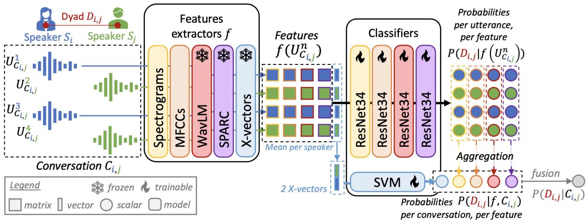

# DYSHIP: LEVERAGING ACOUSTIC FEATURES FOR SPEAKER RELATIONSHIP CLASSIFICATION FROM DYADIC CONVERSATIONS

Kieran Sturges1,2, Thomas Thebaud1,3, Yaohan Guan1, Najim Dehak1

1Center for Language and Speech Processing, Johns Hopkins University, Baltimore, MD, USA 2CSE and Mathematics Department, Pennsylvania State University, State College, PA, USA 3AMIAD, Palaiseau, France

## ABSTRACT

We introduce DyShip, a framework for classifying speaker familiarity and kinship from dyadic conversations in the Seamless Interaction corpus. We compare five speech representations: spectrograms, MFCCs, self-supervised WavLM representations, x-vectors, and estimated articulatory movements. Spectral features perform best for familiarity classification, reaching an accuracy of 87.81%, while WavLM achieves the highest kinship accuracy of 85.17%. X-vectors and articulatory features yield weaker results on familiarity classifiaction, but shine for kinship classification, with an AUC of 0.909 for x-vectors. Most classifiers exceed previously reported human and audio language model scores on the same dataset. These findings highlight the potential of conventional acoustic features for relationship inference and motivate further investigation of the conversational cues captured by different representations.

Index Terms— Speaker relationships, spectral features, x-vectors, articulatory features, self-supervised learning representations

## 1. INTRODUCTION

Spoken dialogue is a rich form of interaction between two individuals; it contains a large set of information beyond its transcript: the identity of speakers, and their individual characteristics, such as their age, gender, and accents, can be predicted from their speech [1, 2]. Beyond the static characteristics of a speaker, previous works have shown that during oral interactions, one speaker tends to modify their speech to adapt to the other one, both lexically [3] and acoustically [4], a phenomenon known as speech entrainment. Further works have shown that this entrainment is correlated with social relationships between speakers [5]. Similarly, individuals of the same family exhibit similar speech patterns: children follow some habits from their parents [6], family groups exhibit coherent syntax [7], and even some vocal tract similarities can be measured [8].

Building on the recently published Seamless Interactions dataset [9], which contains short spoken dialogues among speakers whose relationship is labeled, recent unpublished works have been looking into predicting the relationship between speakers from the transcript or the spoken interaction [10, 11] FriendBench [11] used the first 20 seconds of dialogues and asked text, audio, and video large language models (LLM) to predict the familiarity of the speakers as a binary output, reaching respectively 56.2, 66.7, and 66.7% accuracies with their best LLM. Comparatively, individual human raters showed up to 49.9, 56.3, and 60.9% accuracies, respectively. Comparatively, [10] used the full conversations, up to 5 minutes, and compared different prompting techniques to improve LLM performances on the transcript and the audio, yielding up to 75.0% accuracy using an audio LLM (Compared to 62.3% using a zero-shot prompt). With access to the full dialogue, individual annotators obtained a 65.4% F1 score when given both the full transcript and audio. As LLM inference is getting increasingly costly and human annotation can be as costly and time-consuming, this pushes forward the interest toward simpler classification systems.

In this work, we train binary classifiers to predict relationships between 2 speakers given a dialogue. We predict both familiar-versus-stranger classification, as defined in the labels of Seamless Interactions [9], as well as the belonging to ones family, which will be refered as kinship. The classifiers are trained on spectral features (Spectrograms and MFCCs), on Self-Supervised Learning Representations (SSLR, here we use WavLM [12]), using vocal tract estimations (predicted by the SPARC system [13]) and x-vectors [14, 15]. Our contributions are threefold:

• We introduce DyShip, a framework for familiarity and kinship classification from dyadic speech, evaluated on the Seamless Interaction corpus [9].

• We systematically compare five speech representations, showing that conventional spectral features perform best forfamiliarity classification, while self-supervised WavLM and x-vectors perform best for kinship classification.

• We provide a reproducible pipeline for feature extraction, classifier training, and conversation-level inference, together with the code1 and the models2.

## 2. RELATED WORKS

## 2.1. Speech Representations

Speech representations capture complementary aspects of the speech signal, ranging from spectral structure to learned speaker characteristics and articulatory information. For a long time, spectral representations in speech processing have been the norm: spectrograms describe the distribution of signal energy across time and frequency, while Mel-frequency cepstral coefficients (MFCCs) provide a compact representation of the spectral envelope, most useful for speaker recognition tasks. More recently, self-supervised models such as WavLM [12] learn contextual representations from large speech corpora, supporting the extraction of information relevant to multiple speech processing tasks. Speaker embeddings, commonly referred to as x-vectors [14], instead emphasize speaker-discriminative characteristics; in this work, they are extracted using ECAPA-TDNN [15]. Finally, articulatory representations offer a description of speech production: SPARC [13] estimates vocal tract movements from audio, using a fine-tuned WavLM system and a classification head, including the movements of the lips, jaw, and tongue. Comparing these representations allows us to investigate whether speaker relationships are better predicted from conventional acoustic features, general-purpose learned representations, speaker identity cues, or estimated articulatory dynamics.

## 2.2. Human and LLM perfomances

Recent studies have investigated how accurately humans and large language models can infer speaker relationships from conversational cues. FriendBench [11] evaluates 26 models from seven companies on familiarity classification using 20- second excerpts from 96 balanced dyads in the Seamless Interaction dataset. Its comparison of text, audio, and video inputs highlights the contribution of non-textual cues, with audio-based predictions outperforming those based on transcripts alone. The study also reports a tendency for models to predict strangers, whereas human judgments are more balanced. Complementing this short-excerpt setting, concurrent work [10] examines relationship inference using full conversations and different prompting strategies, providing additional human and LLM reference results. These studies motivate our investigation of acoustic representations by showing that conversational speech contains cues relevant to relationship inference, while leaving open which representations capture them most effectively. We use their reported results to contextualize our classifiers, while recognizing differences in input duration, supervision, and evaluation protocols.

## 3. MATERIALS AND METHODS

## 3.1. Dataset

We use the Seamless Interaction dataset [9], which contains over 4,000 hours of recorded dyadic interactions from over 4,000 participants. The dataset includes diversity in participant age, race, gender, and education level, and provides a range of naturalistic and acted speech interactions, guided by conversational prompts. The naturalistic subset also contains interpersonal relationships labels for 11 relation classes: ’strangers’ are neither familiar nor kinship, ’friends’, ’coworkers’, ’roommates’, ’romantic partners’, ’classmates’, ’neighbors’, and ’generic familiar’ are defined as familiar relations but non-kin, while ’siblings’, ’parent-child’ pairs, and ’generic family’ are both kinship and familiar. We used the train, development, and test splits provided by Seamless Interaction to ensure that no participant is shared between splits. For the training and development sets, we only kept utterances that were at least five seconds long, and segmented longer utterances into five second segments. In contrast, the test set included all utterances to match previous evalutation frameworks. We also excluded interactions that did not involve exactly two participants or for which the interpersonal relationship label was not in the metadata. Lastly, interactions missing dyad IDs from the metadata were retained only in the training set. Table 1 summarizes the sizes of the resulting datasets after applying these criteria. The final dataset contains 5.14% conversations from kin dyads, and 51.00% from familiar dyads.

Table 1. Durations and count of speakers, unique dyad, conversations, and utterances per subset.
<table><tr><td>Set</td><td>Duration (h)</td><td>Speakers  $S _ { i }$ </td><td>Dyads  $D _ { i , j }$ </td><td>Conv.  $C _ { i , j }$ </td><td>Utt.  $U _ { C _ { i , j } } ^ { n }$ </td></tr><tr><td>Train</td><td>579.58</td><td>431</td><td>3,118</td><td>41,852</td><td>417,306</td></tr><tr><td>Dev</td><td>6.36</td><td>103</td><td>47</td><td>559</td><td>4,577</td></tr><tr><td>Test</td><td>28.03</td><td>103</td><td>55</td><td>607</td><td>28,220</td></tr><tr><td>Total</td><td>613.97</td><td>637</td><td>3,220</td><td>43,018</td><td>450,103</td></tr></table>

## 3.2. Models

## 3.2.1. Features

We train one binary classifier per feature and per task, considering five representations: Spectral: MFCCs and spectrograms are extracted using Pytorch [16]. SSLR: We extract representations from the final layer of the frozen WavLMbase-plus [12] model, yielding 768 dimension embeddings. Vocal Tract: The pretrained SPARC model [13] is used to predict 6 vocal tract movements in the sagittal plane across six articulators: the upper lip, lower lip, lower incisor, tongue tip, tongue blade, and tongue dorusm. x-vectors are extracted using the pretrained ECAPA-TDNN [15] from Speechbrain [17].

  
Fig. 1. Schematic of the pipeline: Each utterance is processed separately by different feature extractor, then by a dedicated classifier to predict the probability per utterance, aggregated into a probability per conversation.

## 3.2.2. Classifiers

For MFCC, spectrogram, WavLM, and SPARC representations, we used a ResNet-34 classifier [18] with a binary classifier head. For X-Vector representations, we used a nonlinear support vector machine (SVM) classifier from scikitlearn package [19]. The X-Vector representations are standardized using StandardScaler before classification, and we use a radial basis function (RBF) kernel, set the C value to 1, set the gamma value to scale, and balanced class weights. We also used this classifier architecture for fusion models.

## 3.3. Metrics

We evaluated each model at the conversation level using unweighted accuracy, macro f1 score, and the area under the receiver operating characteristic curve (AUC). All the metrics are evaluated on the conversation-level probabilities $P ( D _ { i , j } | f , C _ { i , j } )$ .

## 3.4. Experimental setup

A dyad $D _ { i , j }$ is defined as a set of 2 speakers $S _ { i }$ and $S _ { j } \ ( i \neq$ j), which has a fixed familiarity (familiar vs stranger) and a fixed kinship (kin vs non-kin). Given each conversation $C _ { i , j }$ is defined as a sequence of $N$ utterances $U _ { C _ { i , j } } ^ { n } , n \in \mathbb { I } ^ { 1 , N } ]$ from 2 speakers $S _ { i }$ and $S _ { j }$

## 3.4.1. Feature extractors

First, each utterance $U _ { C _ { i , j } } ^ { n }$ is processed to extract a set of features $f ( U _ { C _ { i , i } } ^ { n } )$ from a frozen feature extractor $f ,$ as described in section 3.2.1.

## 3.4.2. ResNet classifiers training

One classifier is trained per type of feature extracted and per task (familiar-vs-stranger and kin-vs-nonkin). The ResNet34 classifiers are trained with a batch size of 32, learning rate of 0.0001, class-weighted cross-entropy loss, and the Adam optimizer. The classifiers are trained for 10 epochs on a single Nvidia 1080Ti GPU (X hours of training time); the checkpoint with the best validation loss is selected for evaluation. The familiarity probabilities are extracted for each utterance in the test set to obtain the familiarity probability P of a dyad $D _ { i , j }$ given the observation of one utterance $P ( D _ { i , j } | f ( U _ { C _ { i , j } } ^ { n } ) )$

## 3.4.3. Conversation-level aggregation

Once the utterance-wise predictions $P ( D _ { i , j } | f ( U _ { C _ { i , j } } ^ { n } ) )$ have been computed for the full test set, they are aggregated using a weighted mean to obtain one probability per conversation $C _ { i , j } \colon$

$$
P ( D _ { i , j } | f , C _ { i , j } ) = \frac { \sum _ { n = 1 } ^ { N } \alpha _ { n } P ( D _ { i , j } | f ( U _ { C _ { i , j } } ^ { n } ) ) } { \sum _ { n = 1 } ^ { N } \alpha _ { n } }\tag{1}
$$

We explore 2 options for the weights $\alpha _ { n } \colon$ Unweighted fusion $( \forall n , \alpha _ { n } \ = \ 1 )$ and length-condition fusion, so longer utterances have a larger weight in the sum $( \forall n , \alpha _ { n } = l e n ( U _ { C _ { i , j } } ^ { n } ) )$

## 3.4.4. The X-vector exception

The x-vectors are processed differently than the rest of the features: one x-vector is extracted per utterance, then the xvectors belonging to one speaker in a conversation are pooled using a mean to get one x-vector per speaker. Interactions missing a dyad ID assume that all utterances belong to one speaker, and the pooled x-vector is duplicated. Finally, an SVM model is trained to predict the familiarity of the conversation directly from the tuple of x-vectors. SVMs are trained on CPUs using the scikit-learn package [19].

## 3.4.5. Features fusions

Finally, a fusion of all features is learned as a weighted sum of the conversation-level probabilities $P ( D _ { i , j } | f , C _ { i , j } )$ for all features f ∈ {Spectrogram, MFCC, SPARC, WavLM, Xvector}. The weights are learned either using a linear SVM to maximize the accuracy on the dev set, or all fixed at 1 for unweighted fusion.

## 4. RESULTS

Table 2 shows the classification results shown by each classifier as well as their fusion, compared with existing studies.

Familiar-vs-Stranger Classification: Most classifiers show a significant improvement both from human capabilities and audio LLMs. The ResNet34 classifiers showed up to 86.49% of accuracy for the Spectrograms and up to 0.917 AUC for the MFCCs, leading the way toward lowressource high-perfoming systems. The SPARC features showed second-to-last performances, probably explained by the speaker-wise normalization of the values by the model, which would have erased some of the intrinsic properties of the speech related to each speaker. However, they seems to gain the most from the aggregation by length of the utterances. The X-vector-based system performed the worst.

Kin-vs-Nonkin Classification: The kinship classification exhibited a much lower range of performances, led by the WavLM-based system with an 85.17% accuracy. X-vectorsbased and SPARC-based systems showed a higher discrimination on that task, with up to 0.909 AUC for the x-vectors. This may be explained

Cross-feature fusion: The weighted fusion brings almost no improvement, which could be explained by the domain difference between the dev and the test sets: the dev set evaluates on 5-second utterances while the test set uses all of them. Contrastively, the unweighted fusion shows the best performances across almost all metrics, with up to 0.925 AUC for familiar classification and 0.916 AUC for kinship.

## 5. DISCUSSION AND CONCLUSION

This article presents DyShip, a study of whether acoustic information from dyadic conversations can reveal speaker familiarity and kinship. Using the Seamless Interaction dataset, we compare five speech representations: MFCCs, spectrograms, WavLM embeddings, estimated vocal tract movements, and x-vectors. Among individual representations, spectral features provide the strongest familiarity results, with MFCCs achieving an AUC of 0.917 and spectrograms reaching an F1 score of 83.76%. For kinship, WavLM achieves the highest accuracy (85.17%) and F1 score (73.69%), while x-vectors yield the highest AUC (0.909). Unweighted fusion further improves F1 and AUC for both tasks, reaching 86.87% and 0.925 for familiarity, and 87.27% and 0.916 for kinship, outperforming SVM-based fusion on all reported metrics. These results support acoustic representations as effective baselines for relationship inference, although comparisons with reported human and audio LLM scores remain subject to differences in evaluation protocols.

Table 2. Accuracy (Acc), Macro F1 scores (F1), and AUC metrics across representations and aggregation methods at the conversation level.
<table><tr><td>Feature</td><td>System</td><td colspan="3">Familiar-vs-Stranger</td><td colspan="3">Kin-vs-Nonkin</td></tr><tr><td></td><td></td><td>Acc.</td><td>F1</td><td>AUC</td><td>Acc.</td><td>F1</td><td>AUC</td></tr><tr><td colspan="8">Unweighted Average of the utterances</td></tr><tr><td>MFCC</td><td>ResNet34</td><td>67.38</td><td>66.33</td><td>0.917</td><td>84.02</td><td>68.51</td><td>0.849</td></tr><tr><td>Spectrogram</td><td>ResNet34</td><td>86.49</td><td>82.09</td><td>0.897</td><td>82.87</td><td>72.11</td><td>0.875</td></tr><tr><td>WavLM</td><td>ResNet34</td><td>85.67</td><td>82.20</td><td>0.910</td><td>85.01</td><td>73.70</td><td>0.891</td></tr><tr><td>SPARC</td><td>ResNet34</td><td>65.73</td><td>64.59</td><td>0.828</td><td>84.84</td><td>61.41</td><td>0.805</td></tr><tr><td>X-Vector</td><td>SVM</td><td>65.57</td><td>60.58</td><td>0.684</td><td>83.36</td><td>45.46</td><td>0.909</td></tr><tr><td colspan="8">Weighted Average by length of the utterances</td></tr><tr><td>MFCC</td><td>ResNet34</td><td>76.61</td><td>74.59</td><td>0.917</td><td>81.71</td><td>69.30</td><td>0.838</td></tr><tr><td>Spectrogram</td><td>ResNet34</td><td>87.81</td><td>83.76</td><td>0.899</td><td>81.22</td><td>70.76</td><td>0.873</td></tr><tr><td>WavLM</td><td>ResNet34</td><td>84.51</td><td>81.89</td><td>0.917</td><td>85.17</td><td>73.69</td><td>0.885</td></tr><tr><td>SPARC</td><td>ResNet34</td><td>71.33</td><td>69.50</td><td>0.846</td><td>85.01</td><td>69.33</td><td>0.818</td></tr><tr><td>X-Vector</td><td>SVM</td><td>65.57</td><td>60.58</td><td>0.684</td><td>83.36</td><td>45.46</td><td>0.909</td></tr><tr><td colspan="2">Weighted Fusion by SVM</td><td>80.41</td><td>76.75</td><td>0.893</td><td>76.94</td><td>78.07</td><td>0.798</td></tr><tr><td colspan="2">Unweighed Fusion</td><td>86.01</td><td>86.87</td><td>0.925</td><td>88.96</td><td>87.27</td><td>0.916</td></tr><tr><td colspan="8">From the whole conversation</td></tr><tr><td>Audio</td><td>Best LLM [10]</td><td>74.0</td><td>50.8</td><td>=</td><td></td><td></td><td></td></tr><tr><td>Audio+Transcript</td><td>Best LLM [10]</td><td>75.0</td><td>66.5</td><td>=</td><td></td><td></td><td></td></tr><tr><td>Audio</td><td>Human [10]</td><td>67.8</td><td>62.8</td><td>一</td><td></td><td></td><td></td></tr><tr><td>Audio+Transcript</td><td>Human [10]</td><td>72.2</td><td>65.4</td><td></td><td></td><td></td><td></td></tr><tr><td colspan="8">From the first 20 seconds</td></tr><tr><td>Audio</td><td>Best LLM [11]</td><td>66.7</td><td>=</td><td>-</td><td></td><td></td><td></td></tr><tr><td>Audio</td><td>Human [11]</td><td>63.5</td><td></td><td></td><td></td><td></td><td></td></tr></table>

Despite these results, several limitations remain. Classification is evaluated on a single dataset, with only 47 and 55 unique dyads in the development and test sets, respectively. Although participants are disjoint across splits, multiple conversations per dyad produce dependent observations and limit generalization. Kinship classification also exhibits substantial class imbalance, making accuracy alone insufficient to characterize performance. The x-vector system illustrates this discrepancy, achieving an AUC of 0.909 but an F1 score of only 45.46% at the evaluated decision threshold. Moreover, utterance-level classification followed by aggregation provides no explicit modeling of turn-taking, crossspeaker adaptation, or temporal dependencies. Finally, correlations between predictions do not identify the acoustic cues captured by each representation. Although unweighted fusion improves performance, the weaker SVM-based fusion results show that combining representations does not necessarily yield gains.

Future work will investigate explicit modeling of crossspeaker dynamics by processing complete conversations and extend evaluation to other datasets with relationship annotations, such as CallHome [20, 21]. Additional data could broaden the diversity of evaluated relationships and support a more balanced assessment of kinship classification.

## 6. REFERENCES

[1] Tiantian Feng, Jihwan Lee, Anfeng Xu, Yoonjeong Lee, Thanathai Lertpetchpun, Xuan Shi, Helin Wang, Thomas Thebaud, Laureano Moro-Velazquez, Dani

Byrd, et al., “Vox-profile: A speech foundation model benchmark for characterizing diverse speaker and speech traits,” arXiv preprint arXiv:2505.14648, 2025.

[2] Yuchen Yang, Thomas Thebaud, and Najim Dehak, “Demographic attributes prediction from speech using wavlm embeddings,” in 2025 59th Annual Conference on Information Sciences and Systems (CISS). IEEE, 2025, pp. 1–6.

[3] Susan E Brennan et al., “Lexical entrainment in spontaneous dialog,” Proceedings ofISSD, vol. 96, pp. 41–44, 1996.

[4] Joachim Gross, Nienke Hoogenboom, Gregor Thut, Philippe Schyns, Stefano Panzeri, Pascal Belin, and Simon Garrod, “Speech rhythms and multiplexed oscillatory sensory coding in the human brain,” PLoS biology, vol. 11, no. 12, pp. e1001752, 2013.

[5] Stefan Be ˇ nuˇ s, “Social aspects of entrainment in spokenˇ interaction,” Cognitive Computation, vol. 6, no. 4, pp. 802–813, 2014.

[6] Janellen Huttenlocher, Marina Vasilyeva, Heidi R Waterfall, Jack L Vevea, and Larry V Hedges, “The varieties of speech to young children.,” Developmental psychology, vol. 43, no. 5, pp. 1062, 2007.

[7] Annick De Houwer, “Language variation and local elements in family discourse,” Language variation and change, vol. 15, no. 3, pp. 329–349, 2003.

[8] Rachel Evan Vanderydt, A study of voice similarities among family members, MGH Institute of Health Professions, 1998.

[9] Vasu Agrawal, Akinniyi Akinyemi, Kathryn Alvero, Morteza Behrooz, Julia Buffalini, Fabio Maria Carlucci, Joy Chen, Junming Chen, Zhang Chen, Shiyang Cheng, et al., “Seamless interaction: Dyadic audiovisual motion modeling and large-scale dataset,” arXiv preprint arXiv:2506.22554, 2025.

[10] Yaohan Guan, Yen-Ju Lu, Yuzhe Wang, Junhyeok Lee, Jesus Villalba, Laureano Moro Velazquez, Thomas Thebaud, and Najim Dehak, “Who are they to each other? multi-agent reasoning for speaker relationship inference,” 2026.

[11] Jeffrey M Girard, Jason Z Zheng, Jacqueline R Vertino, Antony D’Avirro, and Benjamin Peloquin, “Friendbench: Benchmarking dyadic familiarity inference in humans and multimodal large language models,” arXiv preprint arXiv:2607.29602, 2026.

[12] Sanyuan Chen, Chengyi Wang, Zhengyang Chen, Yu Wu, Shujie Liu, Zhuo Chen, Jinyu Li, Naoyuki

Kanda, Takuya Yoshioka, Xiong Xiao, et al., “Wavlm: Large-scale self-supervised pre-training for full stack speech processing,” IEEE Journal of Selected Topics in Signal Processing, vol. 16, no. 6, pp. 1505–1518, 2022.

[13] Cheol Jun Cho, Peter Wu, Tejas S Prabhune, Dhruv Agarwal, and Gopala K Anumanchipalli, “Coding speech through vocal tract kinematics,” IEEE Journal of Selected Topics in Signal Processing, vol. 18, no. 8, pp. 1427–1440, 2024.

[14] David Snyder, Daniel Garcia-Romero, Gregory Sell, Daniel Povey, and Sanjeev Khudanpur, “X-vectors: Robust dnn embeddings for speaker recognition,” in 2018 IEEE international conference on acoustics, speech and signal processing (ICASSP). IEEE, 2018, pp. 5329– 5333.

[15] Brecht Desplanques, Jenthe Thienpondt, and Kris Demuynck, “Ecapa-tdnn: Emphasized channel attention, propagation and aggregation in tdnn based speaker verification,” arXiv preprint arXiv:2005.07143, 2020.

[16] Sagar Imambi, Kolla Bhanu Prakash, and GR Kanagachidambaresan, “Pytorch,” in Programming with TensorFlow: solution for edge computing applications, pp. 87–104. Springer, 2021.

[17] Mirco Ravanelli, Titouan Parcollet, Peter Plantinga, Aku Rouhe, Samuele Cornell, Loren Lugosch, Cem Subakan, Nauman Dawalatabad, Abdelwahab Heba, Jianyuan Zhong, Ju-Chieh Chou, Sung-Lin Yeh, Szu-Wei Fu, Chien-Feng Liao, Elena Rastorgueva, Franc¸ois Grondin, William Aris, Hwidong Na, Yan Gao, Renato De Mori, and Yoshua Bengio, “Speech-Brain: A general-purpose speech toolkit,” 2021, arXiv:2106.04624.

[18] Kaiming He, Xiangyu Zhang, Shaoqing Ren, and Jian Sun, “Deep residual learning for image recognition,” in Proceedings of the IEEE conference on computer vision and pattern recognition, 2016, pp. 770–778.

[19] Oliver Kramer, “Scikit-learn,” in Machine learning for evolution strategies, pp. 45–53. Springer, 2016.

[20] Alexandra Canavan, David Graff, and George Zipperlen, “Callhome american english speech,” Linguistic Data Consortium, 1997.

[21] Denys Katerenchuk, David Guy Brizan, and Andrew Rosenberg, “Interpersonal relationship labels for the callhome corpus,” in Proceedings ofthe Eleventh International Conference on Language Resources and Evaluation (LREC 2018), 2018.