# Darmok: Championship Cryptic Crossword Solving via Constraint Tightening and Resilient Orchestration

Siddhartha Chatterjee Department of Computer Science The University of Texas at Austin sidchat@utexas.edu · orcid.org/0009-0000-3320-8340

November 2026

## Abstract

We present Darmok, the first automated system to reach superhuman performance on British cryptic crosswords. Unlike American-style crosswords, cryptic clues disguise an unmarked definition and compositional wordplay beneath a misleading surface reading, sparse grids leave nearly half of each word’s letters unchecked, and tournament rules rank a grid with even a single wrong or blank square behind all error-free solutions regardless of speed. Competing alongside an elite human field at the 55th Times Crossword Championship in London, Darmok solved all seven championship puzzles error-free and finished faster than every human competitor in every round. It solved the Final puzzle in 6m 52s, a full 3m 13s ahead of the human champion.

Today’s frontier AI models can on average solve a whole puzzle in a single try with comparable accuracy and speed. However, cloud API calls still stall, time out, trigger safety refusals, or get stuck in reasoning loops. To simultaneously achieve tournament-grade accuracy, speed, and reliability, Darmok cross-checks clues across three independent models in rounds; uses verified crossing letters to unlock harder clues; and uses a whole-puzzle model and dictionary lookups to fill any remaining gaps without overwriting confirmed words. This design maintained nearzero-error performance across a five-month daily evaluation period. Under normal benchmark conditions, removing backup models, fallback steps, or elaborate prompt instructions barely changes accuracy, making the architecture appear over-engineered. Yet during both the worst days of daily operation and a severe slowdown of our primary model in the live Championship Final, the backup paths carried the solve, showing that as foundation models master the average case, the central challenge in building complex AI systems shifts to resilience in the worst case.

## 1 Introduction

Since the codebreakers of Bletchley Park used a 12-minute timed solve of the Daily Telegraph crossword puzzle number 5,062 on January 13, 1942 as a recruitment test for wartime cryptanalysts [37], crossword solving has served as a bellwether for both natural and artificial intelligence under simultaneous linguistic and combinatorial constraints. For American-style crosswords, where dense grids check every white square in both directions (100% checking) and even punny or theme-based clues resolve as whole-phrase semantic queries rather than character-level string programs, weighted constraint-satisfaction solvers beginning with Proverb [35, 20], WebCrow [11], and Dr.Fill [13], and culminating in neural-retrieval hybrids such as the Berkeley Crossword Solver [42], achieved superhuman tournament performance by combining high-recall candidate retrieval with probabilistic belief propagation or branch-and-bound search.

British cryptic crosswords subvert both halves of that regime. First, a cryptic clue is a dual specification written in two overlapping grammars (Figure 2). Read under standard English grammar, the clue forms a coherent, deliberately misleading narrative phrase (the surface reading). Read under the compositional rules of “Crossword English” [24, 25], the same token sequence splits at an unmarked boundary into a semantic definition (almost always positioned at the extreme start or end of the clue) and an executable wordplay expression that nests string-manipulation primitives (anagrams, charades, containers, deletions, reversals, homophones, Spoonerisms, and letter substitutions) to construct the same character string.

Second, British grids are topologically sparse (Figure 3): standard 15 × 15 blocked Times grids leave 40% to 50% of each word’s letters unchecked (belonging to only a single Across or Down word, which accounts for 61.3% to 65.0% of all physical white cells),<sup>1</sup> while $1 2 \times 1 2$ barred grids such as the Sunday Times Mephisto (an advanced weekly cryptic solved against the full Chambers Dictionary) contain zero black squares, pack 36 words separated by thick cell bars, and leave 20.0% to 23.1% of word-letter positions (33.3% to 37.5% of physical white cells) unchecked alongside arcane dictionary headwords. Because perpendicular crossings never inspect an unchecked cell, grid geometry alone cannot rescue a solver whose candidate generator fails to parse the internal wordplay. Consequently, while early grammar-based analyzers such as Lacross [45, 43], commercial heuristic systems such as Crossword Maestro [40], and single-clue benchmarks such as Cryptonite [10] and Decrypting [29] established cryptic crosswords as a formidable reasoning challenge, no automated system had previously approached championship human play on full grids under live tournament clocks [31, 33, 2, 3].

## 1.1 Tournament Rules, the Accuracy–Speed Pareto Frontier, and the Live Milestone

First held in 1970, the annual Times Crossword Championship in London is the premier competitive test of cryptic solving [18]. The championship’s rules define a strict lexicographic objective over correctness first and completion speed second (Figure 1a). Grids are scored by clues rather than by individual squares: a single wrong or blank square marks every clue passing through that square incorrect, and a grid with even one missed clue ranks behind every 100%-correct solution regardless of speed. Competitors solve three puzzles within a 60m window in the Qualifying and Semi-Final rounds and a single Championship Final puzzle on stage; among error-free submissions, standings are ordered by completion time.

The human field data from the 55th Times Crossword Championship on October 10, 2026 illustrates how unforgiving this scoring frontier is in practice. In the Qualifying round (113 contestants competing for 57 Semi-Final berths across three puzzles, 90 clues), 60 human competitors achieved a perfect 90/90, so the qualification cut line between 57th and 60th place was decided purely by solve speed. The fourth-fastest human finisher on the clock scored 89/90, dropping to 61st in the standings; likewise for the fifth-fastest human finisher (88/90), who dropped to 69th. In the Semi-Final round (57 contestants competing for five Final berths on stage), only 11 achieved 90/90; the fourth-fastest human finisher on the clock scored $8 6 / 9 0 \AA$ , dropping to 25th in the standings. In the five-person Championship Final (30 clues), three finalists—including fastest finisher Chloe Hutton (8m 09s), Peter Steggle (11m 14s), and 14-time champion Mark Goodlife (11m 16s)—committed a single error (29/30), awarding the 2026 title to the fastest error-free solver, Liam Hughes (10m 05s, 30/30), ahead of runner-up Matthew Marcus (12m 12s, 30/30).

(a) Championship Final Accuracy vs. Solve Time  
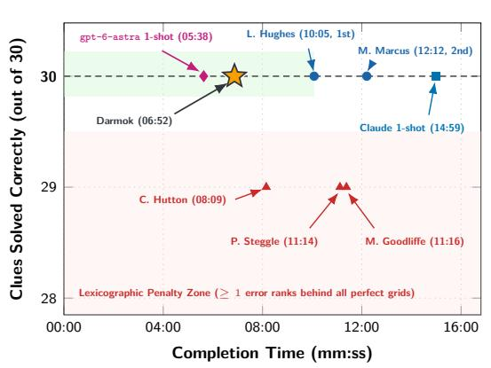

(b) Championship Runtime & Outcomes (21 Draws / Model)  
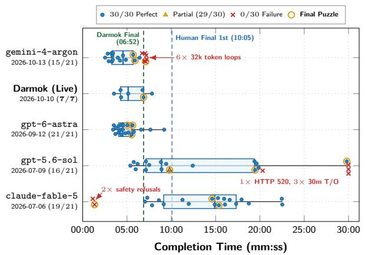  
Figure 1: The tournament accuracy–speed trade-of and single-shot runtime/outcome distributions. (a) Accuracy versus completion time in the 2026 Times Championship Final (30 clues), where any grid with ≥ 1 error ranks behind all error-free solutions; Darmok finished 30/30 in 6m 52s. (b) Per-run completion times and outcomes across Darmok’s 7 live championship puzzles and 21 standalone draws (7 puzzles × 3 draws) per single-shot frontier model (ordered reverse-chronologically by date; boxes and vertical bars show IQR and median over completed solves, and gold rings mark Championship Final draws).

For an automated solver, this rule eliminates both naive operating regimes (Figure 1a): under an illustrative independent-clue calculation, a fast solver with 97% per-clue accuracy has only a $0 . 9 7 ^ { 3 0 } = 4 0 . 1 \%$ chance of producing a clean 30-clue grid, while a cautious solver that takes 15m to 23m for unconstrained single-shot extended thinking (such as standalone claude-fable-5, which averaged 14m 59s across its two completed Final draws [14m 36s and 15m 22s], with a 21-draw median of 14m 54s and maximum of 22m 31s) loses the speed race to human champions who clear the Final in 8m to 12m.

On October 10, 2026, with the advance permission of the Times Crossword Championship organizers, we fielded Darmok alongside the human competitors at the 55th Times Crossword Championship (participating outside the oficial human prize standings). Ingesting each round’s oficial puzzle PDF at the starting bell and emitting a locked solution grid and per-clue wordplay explanations before time was called, Darmok solved all seven championship puzzles without a single error (210/210 clues), finishing faster than every human competitor in every round.

• Round 1 (Qualifiers 1–3, 90 clues). 90/90 correct in 4m 20s, 4m 16s, and 3m 32s. Because the three puzzles in a round are solved concurrently across three execution panes, total wall-clock elapsed time for the round is the maximum of the three puzzle times (4m 20s), whereas sequential human solve time corresponds to their sum (12m 08s).<sup>3</sup>

• Round 2 (Semi-Finals 1–3, 90 clues). 90/90 correct in 6m 45s, 5m 08s, and 7m 49s, completing all three concurrently in 7m 49s of wall-clock time (19m 42s sequential sum).

• Championship Final (30 clues). 30/30 correct in 6m 52s, finishing 3m 13s ahead of 2026 human champion Liam Hughes (10m 05s, zero errors) and 1m 17s ahead of fastest human finisher Chloe Hutton (8m 09s, one error).

To establish that this performance was neither a seven-puzzle fluke nor an artifact of pre-training memorization, we trace the system’s evolution from our 2025 single-model greedy baseline (V1, fielded at the 2025 Championship) through three operational epochs of our 2026 architecture (V2): Epoch E0 (May 19 – July 5; 39 days, early multi-seat greedy admission), Epoch E1 (July 6 – August 25; 50 days, synchronous corroboration admission), and Epoch E2 (August 26 – October 9; 43 days, the frozen championship configuration). We report the performance across three evaluation corpora.

1. Post-Cutof Daily Production Record (132 days, 3,876 clues). Every usable<sup>4</sup> daily Times Cryptic puzzle published between May 19 and October 9, 2026, all post-dating the training cutofs of every model in the ensemble. Across all 132 days, Darmok solved 3,844/3,876 clues (99.17%, 5 wrong, 27 blank, 108/132 perfect grids); across the 43-day frozen championship epoch (Epoch E2, each puzzle run live on publication morning), it solved 1,259 of 1,261 clues (99.84%, 1 wrong, 1 blank, and 41/43 flawless grids) in a median puzzle solve time of 5m 36s.

2. Stratified 16-Puzzle Test Set (463 clues). Across a frozen benchmark spanning five dificulty bands on the community Snitch scale,<sup>5</sup> comprising 1 Easy (70–90, 30 clues), 3 Moderate (90– 110, 87 clues), 4 Hard (110–130, 116 clues), 5 Very Hard (130–160, 142 clues), and 3 Extreme (160+, 88 clues) puzzles, the championship architecture solved 461/463 clues (99.57%, 2 errors, 0 blanks, 14/16 perfect grids) in a median per-puzzle time of 4m 11s, compared to 380/463 (82.1%, median 11m 40s) for our 2025 V1 baseline and 408/463 (88.1%, median 5m 44s) for our June 2026 Epoch E0 prototype. This corpus was primarily used for choosing among multiple design choices for a particular feature.

3. Zero-Shot Transfer to Barred Mephisto Grids (10 puzzles, 360 clues). Run unmodified on ten consecutive Sunday Times Mephisto puzzles, advanced 12 × 12 barred grids with zero black squares and esoteric Chambers Dictionary vocabulary, the championship solver achieved 350/360 (97.2%, 4 wrong, 6 blank, 5/10 perfect grids) in a median per-puzzle time of 13m 32s. This run was conducted between October 12 and October 14, 2026.

## 1.2 The Post-Championship Divergence: Tournament Engineering or Rube Goldberg Machine?

Darmok was engineered over five months of daily runs with a single operational goal: achieving tournament-grade performance under the Times Championship’s unforgiving zero-error, minimumtime rule. Closing the gap from our early Epoch E0 runs (97.97% daily accuracy, 59.0% perfect grids) to Epoch E2 (99.84% accuracy, 95.3% perfect grids) followed a protective layering principle:

first lock in corroborated answers from the per-clue models and crossing-letter retries, and then fill any remaining open clues using strictly non-evicting backup stages (a background whole-grid model and a local dictionary sweep) that are never allowed to overwrite already-accepted words. This architecture (detailed in Section 3 and Figure 4) coordinates three per-clue reasoning model seats—Gemini (gemini-3.1-pro-preview, Anchor), Claude (claude-fable-5, Peer), and GPT-5 (gpt-5.6-sol, Third Seat)—alongside an asynchronous whole-grid process (gpt-6-astra).

Had we stopped after the championship and written a conventional system description, every one of these stages would have been presented as an essential gear in a neuro-symbolic architecture. Yet an apparatus built by accreting fallback stages to squeeze out the last 1–2 clues per grid invites <sub>a</sub> <sub>skeptical</sub> <sub>systems</sub> <sub>question:</sub> <sub>did</sub> <sub>we</sub> <sub>build</sub> <sub>a</sub> <sub>Rube</sub> <sub>Goldberg</sub> <sub>machine</sub>6 <sub>whose</sub> <sub>auxiliary</sub> <sub>gears</sub> <sub>were</sub> rendered obsolete as the upstream models improved?

Table 1: Standalone single-shot frontier models (3 draws/puzzle = 21 runs per model, ordered reverse-chronologically by GA date) versus Darmok across all 7 puzzles of the 2026 Times Championship (Section 5.4.1; median and SD over completed draws).
<table><tr><td>System / Standalone Model</td><td>GA Date</td><td>Perfect Grids</td><td>Clues</td><td>Med Time (SD)</td><td>Primary Tail Failure Mode</td></tr><tr><td>DARMOK (Live Contest)</td><td>2026-10-10</td><td>7/7 (100%)</td><td>210/210</td><td>05:08 (01:32)</td><td>Survived 6-min Final brownout</td></tr><tr><td>gemini-4-argon (32k/65k)</td><td>2026-10-13</td><td>15/21 (71.4%)</td><td>450/630</td><td>04:33 (01:14)</td><td>6/21 32k token-cap loops (7/9 at 65k)</td></tr><tr><td>gpt-6-astra (1-Shot)</td><td>2026-09-12</td><td>21/21 (100%)</td><td>630/630</td><td>04:32 (01:38)</td><td>None on 15 × 15 draws (0/21 failures)</td></tr><tr><td>gpt-5.6-sol (1-Shot)</td><td>2026-07-09</td><td>16/21 (76.2%)</td><td>509/630</td><td>08:54 (06:52)</td><td>3 timeouts (30:00), 1 HTTP 520</td></tr><tr><td>claude-fable-5 (1-Shot)</td><td>2026-07-06</td><td>19/21 (90.5%)</td><td>570/630</td><td>14:54 (04:46)</td><td>2/21 safety refusals (0/30 clues)</td></tr></table>

Immediately after the championship, we ran a controlled ablation program to evaluate each component in isolation. At first glance, four results appeared to confirm the Rube Goldberg critique.

1. Single-shot frontier models have reached accuracy parity on standard blocked grids (Table 1, Section 5.4). Handed an entire 30-clue championship puzzle in one prompt, standalone gpt-6-astra solved 21/21 draws perfectly (630/630 clues)<sup>7</sup> in a median of 4m 32s (SD 1m 38s), and during the live Championship Final its background feed wrote a complete 30/30 JSON file at 5m 38s (74.0s before the per-clue pipeline finished cross-verifying the grid at 6m 52s). Meanwhile, gemini-4-argon solved 15/15 non-truncated draws (7/9 on the three hardest puzzles at a 65k-token cap), gpt-5.6-sol solved 16/21, and claude-fable-5 solved 19/21.

2. Prompt scafolding shows no detectable accuracy benefit over native extended thinking (Section 4.2, Section B.1). Each per-clue prompt requests a structured JSON output containing the definition, wordplay type, step-by-step explanation, draft answer, confidence score, and final answer (Section B.1). Across all 463 test-set clues evaluated over seven prompt variants on two models (463 × 7 × 2 = 6,482 scored calls), reordering the answer before the explanation, removing self-revision, removing decomposition fields, or stripping domain solving instructions changed accuracy by less than same-prompt replicate noise once a JSON parser sensitivity on Claude was accounted for uniformly across arms.

3. Eliciting verbalized confidence does not perturb object-level answers (Section 4.3). Across 463 clues evaluated over three confidence-schema variants on two models $( 4 6 3 \times 3 \times 2 =$ 2,778 calls), removing the confidence fields left the emitted crossword answers identical on 98.4%–98.7% of jointly completed calls on Gemini (whose same-prompt cross-session repeat identity is 99.7%) and 95.9%–96.8% on Claude (same-prompt identity 96.7%).

4. Multi-model per-clue seats evaluate to zero marginal accuracy gain in the test-set mean (Section 5.3). In an 80-run leave-one-out stage ablation on the 16-puzzle test set, removing the historical-answer lookup, the whole-grid feed, or corroboration admission cost one clue each (inside replica noise), and removing both secondary per-clue seats (Claude and GPT-5) to run the opening cold pass and crossing-constrained retry passes on the Gemini anchor alone (with the background feed retained) scored 461/463—matching the full three-seat ensemble in accuracy (while running ≈ 1m slower in diagnostic median solve time).

Taken together, these findings forced us to answer a central question: If frontier models can solve championship cryptics in one shot, and a single per-clue seat with a crossing-retry loop matches the full ensemble’s accuracy on the test set, why did we build the rest of the system?

## 1.3 Resolution: Failover Redundancy for the Tail, Not Serial Complexity

The resolution lies in the diference between a Rube Goldberg contraption and a resilient distributed system [41]. A Rube Goldberg machine chains components in series, so the failure of any link breaks the whole. Darmok’s multi-seat orchestration and fallback stages are arranged in parallel across pass barriers, combining N-version model diversity [4] with active-active replication [22, 34] to bound tail risk when reasoning APIs degrade. In computer architecture and distributed systems, redundancy mechanisms such as error-correcting memory [14], RAID arrays [27], hedged RPCs [9], and active-active failover replicas [34] contribute zero marginal accuracy during fault-free operation; they exist to preserve correctness and latency bounds when primary components stall.

Our telemetry from the Championship Final, our 132-day daily record, and our 135-draw single-shot battery (Figure 1b) shows that frontier reasoning endpoints are heavy-tailed components whose failure modes are invisible on calm static benchmarks (Section 5.4). Across the six qualifying and semi-final puzzles, our Gemini anchor delivered 115–119 tokens/s and timed out on only 1–8 clues per puzzle. Seconds after the Championship Final began, however, the provider experienced an unexpected server-side latency brownout: project-level Google Cloud serviceruntime median request latency jumped from 16s to 50s–190s and efective token delivery collapsed by 72% to 33.0 tokens/s, pushing the anchor into its 90s timeout cap on 23 of the 30 opening-pass clues (and failing 17 of 23 retry calls: 16 timeouts and 1 parse error). By the time the winning 30/30 grid locked at 6m 52s, the secondary per-clue seats had supplied 13 answers without the anchor and the asynchronous gpt-6-astra boundary feed had supplied the remaining 4 $( 1 7 / 3 0 = 5 6 . 7 \% \ \mathrm { t o t a l } )$ while the per-clue seats independently cross-verified 26/30 entries and 13 of the 17 checked entry positions (13 of 15 unique checked physical cells) of the 4 feed entries. The 132-day production tail confirms the same failover mechanism: in the worst decile of daily runs by anchor opening-pass silence (13 days with 42.9%–100% silence), overall clue accuracy held at 373/378 (98.68% vs. 99.23% on the other 119 days; $8 / 1 3 = 6 1 . 5 \%$ perfect grids overall, with all 5 imperfect grids occurring in

Epoch E0 prior to corroboration admission) because the secondary seats supplied 32.1% (up to 89.8% across the 2-day peak outage, or 90.0% [27/30] single-day peak) of committed answers.

Standalone single-shot frontier models are similarly exposed to tail failures (Figure 1b, Table 1, Section 5.4.1). While September–October 2026 frontier models (gemini-4-argon and gpt-6-astra) compress completed-solve latency below the 10m 05s human Final winner benchmark relative to the wide, right-skewed latency tails of the July 2026 cohort (gpt-5.6-sol and claude-fable-5), every standalone family exhibits a distinct tail hazard: gemini-4-argon exhausted its default 32k-token budget inside repetitive verification loops on 6/21 draws (0/30 clues, including 1 on the Final); gpt-6-astra failed to return before the per-clue solver on 17 of 20 barred Mephisto runs; gpt-5.6-sol sufered 4/21 timeouts or HTTP 520 errors plus 1 partial grid (29/30, on the Final); and claude-fable-5 sufered 2/21 safety-classifier refusals (0/30 clues, including 1 on the Final) while taking 7m 02s to 22m 31s on completed draws.

## 1.4 Contributions and Paper Roadmap

This paper makes three main contributions.

1. Algorithmic (Section 3). We formulate a synchronous, order-independent pass-barrier admission recurrence (rebuild-from-kept) that scores candidate proposals using calibrated seat floors, multi-seat corroboration, and a Jacobi-style crossing support update over prior-pass standings, paired with wholesale grid reconstruction. We show that iterative crossing-letter retries (+13 clues on the test set) and the mutual backup between corroboration admission and local terminal dictionary sweeps (+99 clues on a 1,204-clue replay) form the algorithmic core of full-grid solving.

2. Empirical Evaluation of Common LLM Prompting Choices (Section 4). Across 9,260 paired per-clue API calls plus an audit of a published symbolic Python-AST wordplay verification engine, we show that for native extended-thinking models: (a) intersecting letter patterns induce a steep +33 to +50 percentage-point solve-rate jump at ≥ 3 known letters; (b) chain-of-thought field ordering, self-revision, decomposition fields, and domain tutorials produce no detectable accuracy gain, whereas requiring a wordplay explanation acts as a brake on unverified guessing (converting would-be wrong guesses into timeouts); (c) eliciting self-graded confidence leaves emitted answers unchanged on 95.9%–98.7% of jointly completed calls while revealing a sharp calibration knee on Claude (≥ 85) versus binary confidence on Gemini; and (d) without its candidate-frequency fallback, a published symbolic-LLM wordplay verifier solves half as many clues as a zero-cost proposal-frequency baseline on its 200-clue validation script (14.0% vs. 28.0%).

3. Systems Engineering for Heavy-Tailed Reasoning APIs (Sections 5 and 6). Combining our 132-day daily record, 16-puzzle test-set ablations, 10-puzzle Mephisto transfer study, 135- draw single-shot frontier battery, and dual-sided Championship Final telemetry, we quantify how static benchmark ablations misprice resilience over volatile reasoning endpoints.

Section 2 introduces the dual-grammar structure of cryptic clues, formalizes 2D crossword grid topologies, and reviews related work. Section 3 defines our operational terminology, presents the Darmok architecture and synchronous corroboration recurrence, and details per-seat calibration and triple-replica execution. Section 4 reports our controlled clue-level experiments on crossing constraints, prompt structure, confidence elicitation, and symbolic verification. Section 5 evaluates the full system across our daily, test-set, and Mephisto corpora, contrasting average-case ablations against tail-regime performance in the Championship Final. Section 6 discusses implications for compound AI evaluation, Section 7 outlines open frontiers including a formal cryptic grammar and automated clue setting, and Section 8 concludes. Complete reference tables, the production prompt, and verified wordplay derivations for all cited clues appear in Sections A and B.

## 2 Domain Primer and Related Work

To make our algorithmic and systems contributions self-contained for readers outside the (admittedly niche) cryptic crossword community, we first formalize the dual-grammar linguistic structure of cryptic clues (Figure 2) and the geometry of 2D crossword grids (Figure 3), and then review prior work across American and cryptic crossword solving.

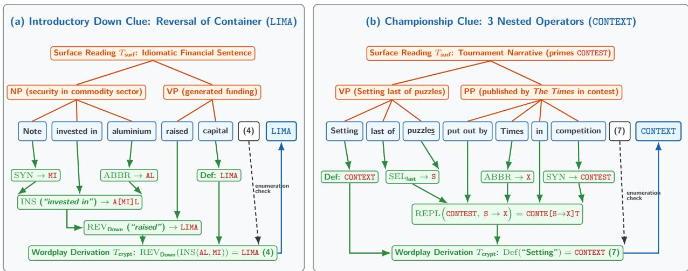  
Figure 2: Dual-grammar anatomy of a cryptic clue. Competing surface readings $T _ { \mathrm { s u r f } }$ (top, orange) and compositional wordplay derivations $T _ { \mathrm { c r y p t } }$ (bottom, green) over the same token sequence for (a) an introductory Down clue (LIMA; Clue C1, Table 17) and (b) a 2026 Championship clue (CONTEXT, Semi-Final 1, clue 28A; Clue C3, Table 17).

## 2.1 Anatomy of a Cryptic Clue: Dual Parse Trees and Compositional Primitives

In an American-style crossword, a clue is a direct semantic or encyclopedic query whose length is inferred from the grid (e.g., “Capital of Peru” for a 4-letter slot maps directly to LIMA); in British crosswords, the clue instead appends an explicit parenthesized enumeration such as (4) that specifies the exact letter count and word structure of the answer (e.g., (7) for a single 7-letter word, (5, 5) for a two-word phrase, or (4-6) for a hyphenated entry). For the exact same Down entry LIMA, a British cryptic setter might instead write:

$$
{ } ^ { \textit { a } } N o t e ~ i n v e s t e d ~ i n ~ a l u m i n i u m ^ { 1 0 } ~ r a i s e d ~ c a p i t a l ~ ( 4 ) ^ { \prime \prime } \longrightarrow \mathrm { L I M A } ~ ( \mathrm { C l u e ~ C l , ~ T a b l e ~ 1 7 } ) .
$$

As illustrated in Figure 2a, the setter constructs a single natural-language phrase that simultaneously supports two competing interpretations.

1. The Surface Reading $( T _ { \mathbf { s u r f } } ,$ Standard English). Viewed as ordinary prose, the clue parses into an idiomatic English sentence in which words bind according to standard syntactic structure, activating a coherent semantic frame (here, a promissory note invested in the aluminium market that raised financial capital). Every word choice, including capitalization, punctuation, and polysemous parts of speech (such as reading a passive participle as an active past-tense verb), is engineered to misdirect direct semantic retrieval.

2. The Cryptic Parse $( T _ { \mathbf { c r y p t } }$ , Compositional Wordplay Abstract Syntax Tree [AST]). Viewed as a formal specification under the rules of cryptic grammar [24, 25], the exact same token sequence partitions at an unmarked boundary into two independent sub-programs that must evaluate to the same uppercase letter string of the enumerated length (4):

• Unmarked Definition. Located almost always at the leftmost or rightmost extremity of the clue (here, the trailing noun “capital”, defining the capital of Peru), specifying the semantic category or synonym class of the target answer.

• Compositional Wordplay AST. A typed expression tree built from string-manipulation operators signaled by natural-language keywords (indicators) acting on literal, abbreviated, or synonymous operands (fodder) [39]. In Figure 2a, “Note” maps via standard musical notation to the third sol-fa syllable MI (ABBR), “aluminium” maps to its chemical symbol AL (ABBR), the container indicator “invested in” inserts MI into AL (A[MI]L), and the directional reversal indicator “raised” (licensed in a Down clue) reverses AMIL to LIMA.

Following Manley’s standard taxonomy [25] and Ximenes’ fairness principles [24], the operator repertoire of cryptic wordplay comprises the following. The indicator lists for each kind of operator, shown italicized within parentheses, are representative rather than exhaustive. More complete lists are readily available online [39].

• Charade $( \mathrm { C H A R } ( E _ { 1 } , \dots , E _ { m } ) )$ . Concatenates component strings $E _ { 1 } , \ldots , E _ { m }$ end-to-end in sequence.

• Anagram $( \mathrm { A N A } ( F , \mathbf { i n d } _ { \mathbf { a n a } } ) )$ . Permutes the multiset of letters in explicit fodder $F _ { ; }$ , signaled by an indicator of disorder or motion (new, worried, jerks, entangled). Under strict Ximenean fairness [24], the letters to be anagrammed (Fodder) must appear explicitly in the clue or via a direct standard abbreviation, disallowing indirect anagrams (anagramming an unstated synonym).

• Container / Insertion $( \mathrm { I N S } ( E _ { \bf o u t } , E _ { \bf i n } , \bf { i n d _ { i n s } } ) )$ . Embeds string $E _ { \mathrm { i n } }$ inside $E _ { \mathrm { o u t } }$ (invested in, takes in, bandages, gorges).

• Deletion and Letter Selection $( \mathrm { D E L } _ { \mathbf { m o d e } } ( E ) , \mathrm { S E L } _ { \mathbf { p o s } } ( \langle \mathbf { L i t } \rangle ) )$ . Strips initial (headless), final (curtailment, shortened), outer (peeled), or internal (heartless, extremely) letters, or extracts acrostic/initial (heads for), terminal (last of, close to), or alternating characters (regularly) from literal clue words.

• Reversal $( \mathrm { R E V } _ { d } ( E ) )$ and Cycling $( \mathrm { C Y C } _ { k } ( E ) )$ . Reverses character order (returned, knocked back, or raised, heading north, climbing in a Down clue) or cyclically shifts letters (cycling).

• Substitution $( \mathrm { R E P L } ( E , F _ { x }  F _ { y } ) )$ and Subtraction $\mathrm { ( M I N U S } ( E _ { 1 } , F _ { 2 } ) )$ . Replaces $F _ { x }$ with $F _ { y }$ inside E (put out by, changing X for Y ), or deletes the letters of explicit fodder $F _ { 2 }$ from $E _ { 1 }$ (leaving, losing).

• Hidden Words (HID), Homophones (HOM), and Spoonerisms (SPOON). Conceals the answer as a proper internal substring of literal clue tokens (in, fragment of), maps an expression to a phonetic equivalent (reportedly, picked up), or swaps the initial phonetic consonant clusters of a phrase (Spooner’s).

• Foreign/Dialect Synonyms (FSYN), Archaisms (ARCH), Cross-References (XREF), Double Definitions, and “&lit”. Substitutes foreign-language (French, Latin, German, etc.) or regional/Scots equivalents signaled by provenance indicators (in France, locally, of old, over the border), references another clue entry $\left( n \mathrm { A } / n \mathrm { D } \right)$ , pairs two distinct definitions with no wordplay, or constructs an all-in-one clue $\left( \vphantom { \sqrt [ 3 ] { 1 } } \cdots \mathrm { k l i t } \right)$ in which the full clue span serves simultaneously as definition and wordplay AST.

Championship clues routinely compose several primitives into a nested expression tree, as illustrated in Figure 2b on 2026 Championship Semi-Final 1 clue 28A (CONTEXT; Clue C3, Table 17).

## 2.2 Grid Topologies and the Breakdown of Static Constraint Satisfaction

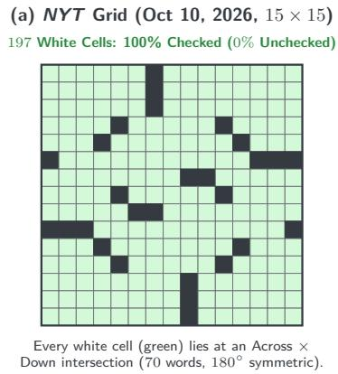

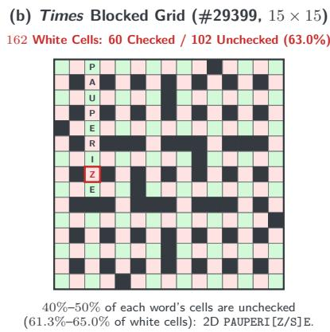

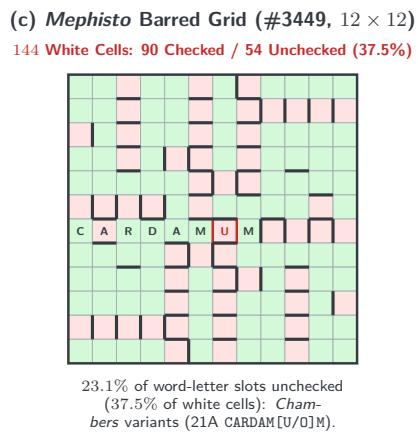  
Figure 3: Grid checking topologies on real symmetric crossword grids. Checked intersection cells (green) versus unchecked cells (pink) on (a) a fully checked $1 5 \times 1 5$ American grid (0% unchecked), (b) a British $1 5 \times 1 5$ blocked grid (Times #29399, 45.9% of word-letter positions / 63.0% of white cells unchecked; 2D PAUPERI[Z/S]E, Clue C5), and (c) a Sunday Mephisto $1 2 \times 1 2$ barred grid (#3449, 23.1% of word-letter positions / 37.5% of white cells unchecked; 21A CARDAM[U/O]M, Clue C25).

Formally, a standard crossword grid is a finite, non-toroidal 2D rectangular grid $\{ 1 , \ldots , R \} \times$ $\{ 1 , \ldots , C \} ^ { 1 1 }$ containing a subset of playable white cells $\mathcal { V } \subseteq \{ 1 , \dots , R \} \times \{ 1 , \dots , C \}$ and a set of m clues $\mathcal { I } = \{ 1 , \dots , m \}$ . The pattern of white cells must possess either 180-degree or 90-degree rotational symmetry. Each clue $i \in \mathcal { Z }$ has a starting cell $c _ { i , 1 } = ( x _ { i } , y _ { i } ) \in \mathcal { V }$ (at row $x _ { i } ,$ column $y _ { i } )$ an orientation $d _ { i } \in \{ \mathrm { A }$ cross, Down}, and a total letter length $\ell _ { i } \in \mathbb { N } ^ { + }$ , spanning the contiguous sequence of white cells $\mathbf { c } _ { i } = [ c _ { i , 1 } , c _ { i , 2 } , \ldots , c _ { i , \ell _ { i } } ] \in \mathcal { V } ^ { \ell _ { i } }$ given by the step recurrence

$$
c _ { i , k } = c _ { i , k - 1 } + \Delta ( d _ { i } ) \quad ( 2 \leq k \leq \ell _ { i } ) , \quad \mathrm { w h e r e ~ } \Delta ( \operatorname { A c r o s s } ) = ( 0 , 1 ) , \ \Delta ( \operatorname { D o w n } ) = ( 1 , 0 ) .\tag{1}
$$

Let $\Sigma = \{ \mathtt { A } , \ldots , \mathtt { Z } \}$ denote the uppercase English alphabet. After an orthographic normalization step that folds characters to uppercase ASCII and strips spaces, hyphens, apostrophes, punctuation, and diacritics, assigning a candidate word $a _ { i } \in \Sigma ^ { \ell _ { i } }$ to clue i places character $a _ { i } [ k ] \in \Sigma$ into cell $c _ { i , k }$ Whenever an Across clue i and a Down clue j intersect at a shared physical square, say the $p _ { i j } \mathrm { - t h }$ letter of clue i and the $p _ { j i ^ { - } } \mathrm { t h }$ letter of clue $\textit { j } ( c _ { i , p _ { i j } } = c _ { j , p _ { j i } } )$ , they enforce the binary letter-equality constraint $a _ { i } [ p _ { i j } ] = a _ { j } [ p _ { j i } ]$

In American-style crosswords (Figure 3a), solver design rests on two domain properties.

1. Total grid checking (0% unchecked cells). Every white cell $v \in \mathcal V$ belongs to both an Across clue and a Down clue, so every character position in every word is independently verified by an orthogonal clue.

2. High-recall cold candidate retrieval (a property of direct clues). Because American clues query synonyms, trivia, or phrase completions rather than nested character algebra, candidate retrievers combining historical clue–answer databases and neural bi-encoders routinely achieve top- ${ \cdot 1 0 ^ { 3 } }$ recall of 95%–99% before examining the grid [20, 13, 42].

Landmark American solvers such as Proverb [35, 20], WebCrow [11], Dr.Fill [13], and the Berkeley Crossword Solver [42], together with constraint-programming solvers $[ 5 , 1 ]$ and Monte Carlo tree search systems [7, 21], populate each clue up front with a static list of $1 0 ^ { 2 } – 1 0 ^ { 4 }$ candidates and calibrated log-probabilities, reducing grid completion to maximum-weight assignment via loopy belief propagation [26, 20] or integer linear programming [13], analogous to championship Scrabble engines such as Maven [36].

British cryptic crosswords violate both properties simultaneously.

1. Unchecked cells (40%–50% of word-letter positions on standard blocked grids; 20%– 23% on barred Mephisto grids). Standard British blocked grids (Figure 3b) do not provide full crosschecking, unlike US-style crosswords. In The Times, each entry has unchecked cells, almost always in alternating positions; for an entry of 2n or $2 n + 1$ cells, there may be at most n unchecked cells. The rules for barred Mephisto grids are diferent: an entry of n cells should have no more than $\lfloor n / 3 \rfloor$ unchecked cells. This is because the vocabulary is typically more obscure than that found in standard cryptics.

Across the 30 standard $1 5 \times 1 5$ Times grids in our repository, 40.0% to 50.0% of the letter positions in every individual word (mean 43.7%; 61.3% to 65.0% of physical white squares, median 63.4%) are unchecked (pink in Figure 3b). In $1 2 \times 1 2$ barred Mephisto grids (Figure 3c, #3449), black squares are omitted and 36 words are packed into 144 white cells separated by thick bars, leaving 20.0% to 23.1% of all word-letter positions (mean 21.4%; 33.3% to 37.5% of physical white cells, mean 35.3%) unchecked. While barred Mephisto grids check a higher fraction of word-letter positions than blocked Times grids (78.6% vs. 56.3% mean), their dificulty arises from obscure Chambers Dictionary headwords and spelling variants that difer on a single unchecked square (such as CARDAMUM/CARDAMOM or RIEVE/REIVE, and British -ISE/-IZE endings such as PAUPERISE/PAUPERIZE; Clues C5, C23, and C25). On any unchecked cell, perpendicular crossings provide zero constraint; the correct letter can be determined only by using the clue’s wordplay AST to establish which spelling is required.

2. Rapid tail-of of cold candidate lists. Because surface readings actively misdirect retrieval and wordplay expressions compose multiple string operations, prompting a language model for top-K candidates without crossing letters yields rapid probability decay after the top 1–2 hypotheses and surfaces plausible definition-only guesses that match the enumeration $\ell _ { i }$ while violating the wordplay. We observed this pattern directly in our early multi-candidate pass@k trials $( k \in \{ 1 , 2 , 4 , 6 , 8 , 1 0 \}$ across 18 V1-missed clues and 3 models, 324 runs; Section 4.4), where 96 of the 99 correct hits (97.0%) occurred at rank 1 (89) or rank 2 (7) and ranks 3–10 combined yielded only 3 correct answers across 1,296 slots.

## 2.3 Related Work

Prior research on cryptic crosswords has focused primarily on isolated clue-level parsing rather than full-grid tournament solving. Early rule-based systems such as Lacross [45, 43] and Tunstall-Pedoe’s commercial solver Crossword Maestro [40] demonstrated that explicit lexicon lookup and hand-engineered grammar rules could decompose single-step anagrams, charades, and containers, while Hardcastle [16, 15] formalized the dual-constraint structure of cryptic clue generation. In the modern NLP literature, Efrat et al. [10] introduced Cryptonite (470,000+ clues from The Times and The Telegraph) and Rozner et al. [29] introduced wordplay-disjoint splits from The Guardian, establishing that standard sequence-to-sequence models struggled to generalize across unseen wordplay compositions. More recent studies evaluated foundation models and prompting strategies on isolated cryptic clues [31, 32, 33] and explored LLM-synthesized Python verification scripts [2, 3] (which we audit experimentally in Section 4.4). In statistical physics, Hartmann [17] recently analyzed crossword-puzzle percolation on random lattices, showing that cooperative crossing constraints induce a percolation transition in solved cluster growth as single-word solve probability increases. To our knowledge, Darmok is the first automated system to solve full-grid British cryptic crosswords at championship human speed and zero-error reliability.

## 3 Architecture: Order-Independent Constraint Orchestration

Darmok treats full-grid cryptic crossword solving as an iterative, synchronous constraint-tightening loop, analogous to classical arc-consistency propagation [23], executed over asynchronous, heavytailed reasoning models (Figure 4). Because prompting a language model to emit hundreds of cold candidates per clue fails on compositional cryptic wordplay, the orchestrator at each pass instead dispatches all currently unsolved (residual open) clues in parallel across distinct reasoning model seats [4]; it admits only those proposals that survive a synchronous corroboration and crossing-consistency recurrence at the pass barrier, projects the resulting kept set onto the grid to induce tighter wildcard patterns (e.g., P?U?E?I?E), and re-dispatches the remaining open clues conditioned on those patterns in the next pass.

Operational Terminology and Post-Hoc Grading Metrics. To distinguish runtime solver concepts from post-hoc benchmark evaluation metrics across Sections 3 to $5 ,$ we separate our terminology into two groups (with mathematical symbols summarized in Table 2). At runtime, the orchestrator operates without access to ground truth (GT) using four concepts:

• Model Seat $( m \in \mathcal { M } )$ . One of the three per-clue reasoning model API endpoints queried at each pass: Anchor (gemini-3.1-pro-preview), Peer (claude-fable-5), and Third Seat $\left( \mathtt { g p t - 5 . 6 - s o l } \right)$ .

• Qualifying Proposal. On clue i, a response $r _ { i } = ( m , a , c )$ from seat m with answer string a and self-reported confidence c is qualifying if its API status is ok, its normalized letter count matches the clue’s enumeration $( | a | = \ell _ { i } )$ , and its self-reported confidence clears the seat’s floor $( c \geq \tau _ { m } )$

• Pass Barrier, Kept Set $( K ^ { ( t ) } )$ , and Residual Open Set $( R ^ { ( t ) } )$ . A pass barrier $t \in$ $\{ 1 , \ldots , T \}$ is the synchronization point at the end of dispatch pass t after all in-flight per-clue API requests have returned or hit their timeout caps. At barrier $t ,$ the admission recurrence selects a conflict-free (coherent) subset of clues $K ^ { ( t ) } \subseteq \mathbb { Z }$ whose answers agree on every shared intersection cell and writes them to the physical grid ${ \mathcal { G } } ^ { ( t ) } ; R ^ { ( t ) } = { \mathcal { T } } \backslash K ^ { ( t ) }$ is the set of remaining unsolved clues.

• Boundary Feed (bf ). The asynchronous background process running gpt-6-astra on the full puzzle in a single prompt, polled only at pass barriers to fill open clues in $R ^ { ( t ) }$ without evicting kept entries in $K ^ { ( t ) }$

During post-hoc evaluation against known puzzle solutions (GT), we report three grading metrics:

• Admissible Answer. In clue-level evaluations (Section 4), a qualifying response that also matches the ground-truth solution $( a = \mathrm { G T } )$ is termed admissible.

• Silent Rate and Jointly Completed (both-ok) Subset. A seat’s silent rate on a pass is the fraction of dispatched clues that fail to return a valid JSON response due to timeouts, socket/API errors, or truncated outputs (1 − Avail). When comparing two prompt arms on the same clue set, the jointly completed (both-ok) subset comprises clues where both arms returned status ok.

• First-to-Correct and Unique Solve. Among clues committed correctly by model passes, a seat is credited with first-to-correct if it returned the ground-truth answer at the earliest wall-clock timestamp, and with a unique solve if no other seat ever proposed the ground-truth answer on any pass.

Table 2: Summary of mathematical notation used in the pass-barrier recurrence (Section 3.2) and pipeline (Section 3.3).
<table><tr><td>Symbol</td><td>Domain / Value</td><td>Meaning</td></tr><tr><td>I, V, li</td><td> $\{ 1 , \ldots , m \} , \mathbb { N } ^ { 2 } , \mathbb { N } ^ { + }$ </td><td>Clue index set (m ≈ 28–36), playable white cells, and normalized letter length of clue i.</td></tr><tr><td> $\mathcal { X } ( i ) , p _ { i j }$ </td><td> $\subseteq { \mathcal { T } } \setminus \{ i \} , \ \{ 1 , \dots , \ell _ { i } \}$ </td><td>Perpendicular clues intersecting clue i, and the letter index in clue i shared with  $j \in \mathcal { X } ( i )$ </td></tr><tr><td> ${ \mathcal { M } } , \tau _ { m }$ </td><td>{anchor, peer, third}, [0, 100]</td><td>Per-clue model seats and confidence floors  $( \tau _ { \mathrm { a n c h o r } } = 5 0 , \tau _ { \mathrm { p e e r } } = 8 5 , \tau _ { \mathrm { t h i r d } } =$  50).</td></tr><tr><td> $t , \ \mathcal { Q } _ { i } ^ { ( t ) }$ </td><td> $\{ 1 , \ldots , T \} , \subset \Sigma ^ { \ell _ { i } }$ </td><td>Pass barrier index  $( t = 1$  for Pass 0) and distinct qualifying candidate strings for clue i in pass t</td></tr><tr><td> $\mathcal { M } _ { i } ^ { ( t ) } ( a )$ </td><td>⊆M</td><td>Subset of model seats that proposed qualifying candidate a ∈  $\mathcal { Q } _ { i } ^ { ( t ) }$  for clue i in pass t.</td></tr><tr><td> $a _ { i } ^ { ( t ) } , \ b _ { i } ^ { ( t ) }$ </td><td>Σli, {1, 2}</td><td>Asserted candidate string and intrinsic base score  $( b = 2$  for Anchor or ≥ 2-seat consensus;  $b = 1$  for lone Peer/Third).</td></tr><tr><td> $S ^ { ( t ) } , K ^ { ( t ) } , R ^ { ( t ) }$ </td><td>⊆I</td><td>Clues with fresh qualifying proposals in pass t  $( S ^ { ( t ) } ) ,$  kept clues admitted at barrier  $t ~ ( K ^ { ( t ) } )$  , and open residual  $( \boldsymbol { R } ^ { ( t ) } = \mathcal { I } \dot { \setminus } \boldsymbol { K } ^ { ( t ) } )$ </td></tr><tr><td> $A ^ { ( t ) } , \ X ^ { ( t ) } ( i ) , \ \mathcal { C } _ { i } ^ { ( t ) } \quad \subseteq \mathbb { Z }$ </td><td></td><td>Asserting set  $A ^ { ( t ) } = S ^ { ( t ) } \cup K ^ { ( t - 1 ) }$  , active crossings  $\mathcal { X } ( i ) \cap A ^ { ( t ) }$  , and letter- conflicting active crossings.</td></tr><tr><td> $\sigma _ { i } ^ { ( t ) } , \ w ( \sigma _ { i } ^ { ( t ) } )$ </td><td>{OUT, TENTATIVE, SUPPORTED, LOCKED}, {0, 1, 2, 3}</td><td>Discrete verification standing label of clue i after barrier t and its integer crossing-support weight.</td></tr><tr><td> $s _ { i } ^ { ( t ) } , \theta , \mathcal { G } ^ { ( t ) }$ </td><td> $[ 0 , 6 ] , \ \theta = 2 , \ \mathcal { V } \to \Sigma \cup \{ \emptyset \}$ </td><td>Clipped Jacobi corroboration score of clue i at barrier t, admission threshold  $( \theta { \overset { - } { = } } 2 ) ,$  and rebuilt grid state.</td></tr></table>

## 3.1 The Pathology of Greedy Incremental Admission

Our 2025 baseline solver (V1, which scored $3 8 0 / 4 6 3 = 8 2 . 1 \%$ on our stratified test set) and our initial June 2026 Epoch E0 prototype (408/463 = 88.1%) relied on greedy incremental admission: as each clue’s API calls returned, if a proposal cleared a confidence threshold and agreed with whatever letters were currently written in the grid, it was immediately committed. Later proposals that conflicted with an incumbent answer could overwrite it only by exceeding its cell-level confidence. In practice, V1 was a genuine Rube Goldberg contraption [44] of interacting heuristics and ad-hoc <sub>cell-override rules</sub>12 <sub>in which fixing one failure mode routinely destabilized another.</sub>

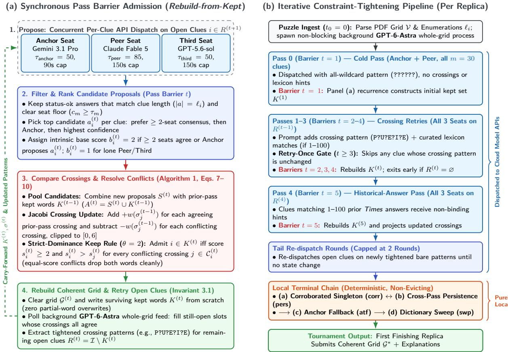  
Figure 4: Architecture of the Darmok system. (a) Synchronous pass-barrier admission (rebuildfrom-kept, Algorithm 1), which scores qualifying per-clue proposals against the carry-forward kept set K<sup>(t</sup>−<sup>1)</sup> alongside the non-evicting gpt-6-astra feed and reconstructs the coherent grid G<sup>(t)</sup> from scratch (Invariant 3.1). (b) Iterative constraint-tightening pipeline executed per puzzle replica across cloud passes (Pass 0 through Tail Rounds) and the local terminal chain (corr ↔ pers → atf → swp).

Forensic analysis across the 39 daily runs of Epoch E0 and our early development logs revealed that greedy incremental admission sufers from two fundamental flaws.

1. Latency-driven arrival-order stochasticity and cascading error propagation. Because commercial LLM response times vary widely from call to call, incremental admission is orderdependent on network and model thinking time and therefore inherently stochastic. Whichever clue’s API call happens to return first writes its letters into the grid immediately; when a model makes a confident cold error that finishes quickly, those false crossing letters are injected into perpendicular clues and condition subsequent retries on false constraints, causing cascading abstentions or forced errors.

2. Partial-word overwrites and state divergence. When conflict resolution operates at the granularity of individual grid squares rather than whole words, a later high-confidence crossing answer can overwrite shared intersections of an earlier word without cleanly evicting and re-solving the displaced entry. For example, on Times Cryptic #29570 (June 16, 2026), both primary models cold-proposed the plausible anagram REPOSITED for clue 21A (“Ropes tied tight and put down again (9)”, ground truth REDEPOSIT; Clue C7, Table 17). When perpendicular

Down answers later committed at higher priority, cell-level overrides overwrote only the shared intersections, mutating the grid cells of 21A into the non-word REDOPISET while leaving 21A’s internal status marked as solved (one of four such state-divergence bugs observed during early development).

## 3.2 Synchronous Corroboration-Scored Admission (Rebuild-from-Kept)

To eliminate latency-order dependence and partial-word overwrites by construction, we replaced incremental admission with a synchronous recurrence executed at the barrier after each dispatch pass $t \in \{ 1 , \ldots , T \}$ (Algorithm 1; Pass 0 corresponds to barrier t = 1, Pass 1 to $t = 2$ , and so on).

Model Seats, Calibration Floors, and Deterministic Candidate Selection. Let $\mathcal { M } =$ {anchor, peer, third} denote the three per-clue model seats: Gemini (gemini-3.1-pro-preview) as Anchor, Claude (claude-fable-5) as Peer, and $\mathbf { G P T - 5 } \ \left( \mathbf { g p t - 5 . 6 - s o l } \right)$ <sub>as Third Seat.</sub>13 <sub>Each</sub> seat m ∈ M is assigned an empirical confidence floor $\tau _ { m } \in [ 0 , 1 0 0 ]$ , whose calibration is detailed in Section 3.4 (Figure 6a):

$$
\tau _ { \mathrm { a n c h o r } } = 5 0 , \qquad \tau _ { \mathrm { p e e r } } = 8 5 , \qquad \tau _ { \mathrm { t h i r d } } = 5 0 .\tag{2}
$$

At pass barrier t, let $\mathcal { Q } _ { i } ^ { ( t ) } \subset \Sigma ^ { \ell _ { i } }$ denote the set of distinct qualifying candidate strings proposed for clue i in pass t, and for each $a \in \mathcal { Q } _ { i } ^ { ( t ) }$ , let $\mathcal { M } _ { i } ^ { ( t ) } ( a ) \subseteq \mathcal { M }$ be the subset of seats that proposed a. Each candidate $a \in \mathcal { Q } _ { i } ^ { ( t ) }$ receives an intrinsic base score $b _ { i } ^ { ( t ) } ( a ) \in \{ 1 , 2 \}$ :

$$
b _ { i } ^ { ( t ) } ( a ) = \left\{ \begin{array} { l l } { 2 } & { \mathrm { i f ~ a n c h o r } \in \mathcal { M } _ { i } ^ { ( t ) } ( a ) \mathrm { ~ o r ~ } \left| \mathcal { M } _ { i } ^ { ( t ) } ( a ) \right| \geq 2 , } \\ { 1 } & { \mathrm { o t h e r w i s e ~ ( a ~ l o n e ~ q u a l i f y i n g ~ p e e r ~ o r ~ t h i r d - s e a t ~ p r o p o s a l ) . } } \end{array} \right.\tag{3}
$$

Whenever $\mathcal { Q } _ { i } ^ { ( t ) } \neq \emptyset$ , the barrier selects a single winning candidate $a _ { i } ^ { ( t ) } \in \mathcal { Q } _ { i } ^ { ( t ) }$ for clue i by maximizing the tuple:

$$
a _ { i } ^ { ( t ) } = \underset { a \in \mathcal { Q } _ { i } ^ { ( t ) } } { \arg \operatorname* { m a x } } \left( b _ { i } ^ { ( t ) } ( a ) , \left| \mathcal { M } _ { i } ^ { ( t ) } ( a ) \right| , \sum _ { m \in \mathcal { M } _ { i } ^ { ( t ) } ( a ) } c _ { m } , \operatorname* { m a x } _ { m \in \mathcal { M } _ { i } ^ { ( t ) } ( a ) } \mathrm { p r i o } ( m ) \right) ,\tag{4}
$$

and sets $b _ { i } ^ { ( t ) } = b _ { i } ^ { ( t ) } ( a _ { i } ^ { ( t ) } )$ . In Equation (4), candidates are ranked first by intrinsic base score $b _ { i } ^ { ( t ) } ( a )$ then by the number of agreeing seats $| \mathcal { M } _ { i } ^ { ( t ) } ( a ) |$ , and then by summed confidence $\sum c _ { m }$ . In the rare event that two distinct single-seat proposals tie on both base score and confidence, fixed seat priority $\mathrm { p r i o } ( \mathrm { a n c h o r } ) = 3 > \mathrm { p r i o } ( \mathrm { p e e r } ) = 2 > \mathrm { p r i o } ( \mathrm { t h i r d } ) = 1$ provides a deterministic tie-break so that candidate selection never depends on API arrival order. Let $S ^ { ( t ) } = \{ i \in \mathcal { I } : \mathcal { Q } _ { i } ^ { ( t ) } \neq \emptyset \}$ denote the set of clues that produce a qualifying candidate in pass t.

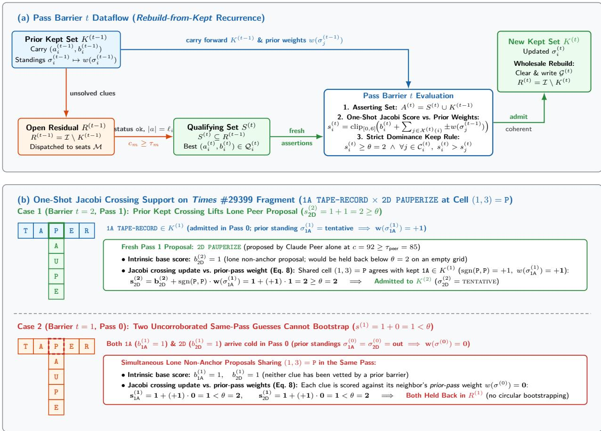  
Figure 5: Pass-barrier dataflow and one-shot Jacobi crossing support. (a) At pass barrier t, fresh qualifying proposals $S ^ { ( t ) }$ and prior kept clues $K ^ { ( t - 1 ) }$ pool into $A ^ { ( t ) }$ and are scored against prior-pass weights $\bar { w ( \sigma _ { j } ^ { ( t - 1 ) } ) }$ . (b) Illustration on Times #29399 (Clues C4 and C5): a kept Pass 0 crossing (1A TAPE-RECORD, w = 1) lifts a lone Pass 1 Peer proposal (2D PAUPERIZE, $b = 1 )$ to $s _ { \mathrm { 2 D } } ^ { ( 2 ) } = 2 \geq \theta$ (Case 1), whereas two uncorroborated same-pass guesses (w = 0) cannot bootstrap each other into admission (Case 2).

Carry-Forward Asserting Set and Standing Weights. As illustrated in Figure 5a, to avoid wasting API calls, clues that were already admitted into the grid at the end of pass t − 1, denoted by the kept set $K ^ { ( t - 1 ) } \subseteq \mathbb { Z }$ (initialized to $K ^ { ( 0 ) } = \alpha )$ , are not re-dispatched in pass t. However, if a newly solved crossing clue in pass t conflicts with an earlier kept word in $K ^ { ( t - 1 ) }$ , both words must compete for inclusion in the new kept set $K ^ { ( t ) }$ within the same barrier evaluation. We therefore define the pass-t asserting set $A ^ { ( t ) }$ as the union of newly proposed clues and prior-pass kept clues:

$$
A ^ { ( t ) } = S ^ { ( t ) } \cup K ^ { ( t - 1 ) } .\tag{5}
$$

Each newly proposed clue $i \in S ^ { ( t ) }$ asserts its fresh pair $( a _ { i } ^ { ( t ) } , b _ { i } ^ { ( t ) } )$ , while each carry-forward clue $i \in K ^ { ( t - 1 ) } \setminus S ^ { ( t ) }$ retains its prior-pass pair $( a _ { i } ^ { ( t ) } , b _ { i } ^ { ( t ) } ) = ( a _ { i } ^ { ( t - 1 ) } , b _ { i } ^ { ( t - 1 ) } )$ .

To track how strongly each word has been verified by previous passes, every clue $i \in \mathcal { Z }$ carries a discrete verification standing $\sigma _ { i } ^ { ( t ) } \in \{ \mathrm { o u r } \}$ , tentative, supported, locked} (initialized to $\sigma _ { i } ^ { ( 0 ) } = \mathrm { { O U T } } )$ that summarizes its epistemic status at the end of barrier t: out (unsolved or below threshold), tentative (admitted at the threshold $s _ { i } ^ { ( t ) } = \theta = 2$ without full crossing verification), supported (reinforced above the threshold, $s _ { i } ^ { ( t ) } > 2$ , by agreeing crossings), and locked (every perpendicular crossing of clue i is active and agrees with its letters). In our codebase and telemetry logs, $\sigma _ { i } ^ { ( t ) }$ is recorded as a human-readable state label, while the score recurrence maps $\sigma _ { i } ^ { ( t ) }$ to an integer standing weight $w ( \sigma _ { i } ^ { ( t ) } ) \in \{ 0 , 1 , 2 , 3 \}$ :

$$
w ( { \mathrm { O U T } } ) = 0 , \qquad w ( { \mathrm { T E N T A T I V E } } ) = 1 , \qquad w ( { \mathrm { S U P P O R T E D } } ) = 2 , \qquad w ( { \mathrm { L O C K E D } } ) = 3 .\tag{6}
$$

Separating the discrete standing transition $\sigma _ { i } ^ { ( t ) }$ from its numerical weight $w ( \sigma _ { i } ^ { ( t ) } )$ prevents unbounded score inflation across passes: regardless of how many passes a word survives, its single-crossing contribution to any perpendicular neighbor is bounded by $w ( \sigma _ { i } ^ { ( t ) } ) \leq 3$

Jacobi-Style One-Shot Crossing Support Update. To see how intersecting words in $A ^ { ( t ) }$ boost or penalize one another at pass barrier $t ,$ consider the grid fragment from Times #29399 shown in Figure 5b. Suppose Pass 0 (barrier $t = 1 )$ commits 1A TAPE-RECORD (Clue C4; $b _ { 1 \mathrm { A } } ^ { ( 1 ) } = 2$ $\sigma _ { 1 \mathrm { A } } ^ { ( 1 ) } = $ tentative, weight $w = 1 )$ , placing the crossing letter P at row 1, column 3 $\left( c _ { 1 \mathrm { A } , 3 } \right. =$ $c _ { 2 \mathrm { D } , 1 } = ( 1 , 3 )$ , the first letter of Down clue 2D, “Make poor value bandages more expensive in A&E (9)” → PAUPERIZE; Clue C5).<sup>14</sup> In Pass 1 $( t = 2 )$ , suppose Claude alone proposes PAUPERIZE at confidence 92 $( b _ { \mathrm { 2 D } } ^ { ( 2 ) } = 1 )$ . On an empty grid, a lone Peer proposal $( b = 1 )$ is held back below the admission threshold $\theta = 2 ;$ here, however, because PAUPERIZE agrees with the already-kept crossing 1A TAPE-RECORD at letter P, 1A lends its prior-pass standing weight $+ w ( \sigma _ { 1 \mathrm { A } } ^ { ( 1 ) } ) = + 1$ to 2D, lifting 2D’s total corroboration score to $s _ { \mathrm { 2 D } } ^ { ( 2 ) } = 1 + 1 = 2 \geq \theta$ so that it is admitted (Figure 5b, Case 1). Conversely, if two lone non-anchor guesses $( b = 1 )$ for 1A and 2D arrive in the same cold pass with no prior standing $( \sigma ^ { ( 0 ) } = \mathrm { O U T } , w = 0 )$ and happen to share the letter P, each is evaluated against the other’s prior-pass weight $w ( \sigma ^ { ( 0 ) } ) = 0$ , leaving both at $s ^ { ( 1 ) } = 1 + 0 = 1 < \theta$ so they cannot bootstrap each other into admission (Figure 5b, Case 2).

In numerical analysis terms, updating each clue’s support score using its neighbors’ prior-pass standings $\sigma _ { j } ^ { ( t - 1 ) }$ rather than their current-pass standings $\sigma _ { j } ^ { ( t ) }$ follows a synchronous Jacobi update schedule rather than an in-place Gauss–Seidel sweep [30]: within each barrier evaluation, the score calculation is strictly independent of clue ordering, requires no inner iteration loop, and prevents unvetted same-pass guesses $( \sigma _ { j } ^ { ( t - 1 ) } = \mathrm { O U T } , w = 0 )$ from amplifying one another into admission before surviving a pass barrier.

Formally, for any clue $i \in A ^ { ( t ) }$ , let $\mathcal { X } ( i ) \subseteq \mathcal { T } \setminus \{ i \}$ denote the perpendicular clues that share a checked cell with $i ,$ let $\mathcal { X } ^ { ( t ) } ( i ) = \mathcal { X } ( i ) \cap \dot { A ^ { ( t ) } }$ be its active crossings at barrier $t ,$ and let

$$
\mathcal { C } _ { i } ^ { ( t ) } = \left\{ j \in \mathcal { X } ^ { ( t ) } ( i ) ~ \big \vert ~ a _ { i } ^ { ( t ) } [ p _ { i j } ] \neq a _ { j } ^ { ( t ) } [ p _ { j i } ] \right\}\tag{7}
$$

be the subset of active crossings whose asserted letters conflict with $a _ { i } ^ { ( t ) }$ . Each clue $i \in A ^ { ( t ) }$ computes its corroboration score $s _ { i } ^ { ( t ) } \in [ 0 , 6 ]$ in a single synchronous step against $\sigma _ { j } ^ { ( t - 1 ) }$ :

$$
s _ { i } ^ { ( t ) } = \mathrm { c l i p } _ { [ 0 , 6 ] } \left( b _ { i } ^ { ( t ) } + \sum _ { j \in \mathcal { X } ^ { ( t ) } ( i ) } \mathrm { s g n } \Big ( a _ { i } ^ { ( t ) } [ p _ { i j } ] , a _ { j } ^ { ( t ) } [ p _ { j i } ] \Big ) \cdot w \Big ( \sigma _ { j } ^ { ( t - 1 ) } \Big ) \right) ,\tag{8}
$$

where sgn $( x , y ) = + 1$ if $x = y$ and $- 1 { \mathrm { ~ i f ~ } } x \neq y$ , and $\mathrm { c l i p } _ { [ 0 , 6 ] } ( z ) = \operatorname* { m i n } ( 6 , \operatorname* { m a x } ( 0 , z ) )$ . Clipping $s _ { i } ^ { ( t ) }$ to the interval [0, 6] (twice the maximum single-crossing weight, $w ( \mathrm { L O C K E D } ) = 3 )$ ensures that a long

14-letter entry with seven checked intersections cannot accumulate an unbounded support score that renders it immune to eviction if two high-confidence perpendicular words later contradict it.

Strict Dominance Keep Rule and Standing Transition. We fix the admission threshold, the minimum corroboration score required for a candidate word to be written into the grid, at $\theta = 2$ so that a word requires either an intrinsic base score $b _ { i } ^ { ( t ) } = 2$ (two-seat agreement or an Anchor proposal) or an intrinsic base score $b _ { i } ^ { ( t ) } = 1$ (a lone Peer or Third-Seat proposal) corroborated by at least one kept crossing $( \geq + 1 )$ . Clue $i \in A ^ { ( t ) }$ is admitted into the new kept set $K ^ { ( t ) }$ if and only if its score reaches $\theta = 2$ and it strictly outranks every conflicting crossing clue $j \in \mathcal { C } _ { i } ^ { ( t ) }$ :

$$
K ^ { ( t ) } = \left\{ i \in A ^ { ( t ) } \ : \middle | \ : s _ { i } ^ { ( t ) } \geq \theta \mathrm { \land \forall } j \in { \mathcal C } _ { i } ^ { ( t ) } , \ : s _ { i } ^ { ( t ) } > s _ { j } ^ { ( t ) } \right\} .\tag{9}
$$

For completeness, we define the full-crossing lock indicator is\_ $\mathrm { l o c k } _ { i } ^ { ( t ) } = \mathbb { I } [ \mathcal { X } ( i ) \neq \emptyset \ \land \ \mathcal { X } ( i ) \ \subseteq$ $A ^ { ( t ) } \wedge C _ { i } ^ { ( t ) } = \varnothing ]$ , which equals 1 if and only if clue i has at least one perpendicular crossing and every perpendicular crossing of i is active in $A ^ { ( t ) }$ and agrees with $a _ { i } ^ { ( t ) }$ . While only kept entries $i \in K ^ { ( t ) }$ enter the rebuilt grid $\mathcal { G } ^ { ( t ) }$ and carry their base score $b _ { i } ^ { ( t ) }$ into $A ^ { ( t + 1 ) }$ (Equation (5)), the standing $\boldsymbol { \sigma } _ { i } ^ { ( t ) }$ carried into barrier $t + 1$ is updated via:

$$
\begin{array} { r } { \sigma _ { i } ^ { ( t ) } = \left\{ \begin{array} { l l } { \mathrm { L O C K E D } } & { \mathrm { i f ~ } i \in A ^ { ( t ) } \mathrm { ~ a n d ~ i s \_ l o c k } _ { i } ^ { ( t ) } = 1 , } \\ { \mathrm { S U P P O R T E D } } & { \mathrm { i f ~ } i \in A ^ { ( t ) } , \mathrm { ~ i s \_ l o c k } _ { i } ^ { ( t ) } = 0 , \mathrm { ~ a n d ~ } s _ { i } ^ { ( t ) } > \theta , } \\ { \mathrm { T E N T A T I V E } } & { \mathrm { i f ~ } i \in A ^ { ( t ) } , \mathrm { ~ i s \_ l o c k } _ { i } ^ { ( t ) } = 0 , \mathrm { ~ a n d ~ } s _ { i } ^ { ( t ) } = \theta , } \\ { \mathrm { O U T } } & { \mathrm { i f ~ } i \notin A ^ { ( t ) } \mathrm { ~ o r ~ } \left( \mathrm { i s \_ \mathrm { \_ \mathrm { ~ l o c k } } } _ { i } ^ { ( t ) } = 0 \mathrm { ~ a n d ~ } s _ { i } ^ { ( t ) } < \theta \right) . } \end{array} \right. } \end{array}\tag{10}
$$

In plain operational terms, Equations (9) and (10) enforce three behaviors:

1. Immediate lock promotion when all crossings agree. Although two uncorroborated guesses $( b = 1 )$ cannot bootstrap each other into $K ^ { ( t ) }$ in the same pass (Figure 5b, Case 2), once a word is admitted $( i \in K ^ { ( t ) } , s _ { i } ^ { ( t ) } \geq 2 )$ and all of its perpendicular crossings are also active and agreeing in $A ^ { ( t ) } \ ( \mathrm { i s \_ l o c k } _ { i } ^ { ( t ) } = 1 )$ , its standing is promoted immediately to locked $( w = 3 )$ for the next pass.

2. One-barrier standing memory for non-kept assertions. If an asserting word $i \in A ^ { ( t ) } \backslash K ^ { ( t ) }$ is held out of the grid, either because it tied or lost a crossing conflict $( s _ { i } ^ { ( t ) } \leq s _ { j } ^ { ( t ) } )$ or because it was a lone $b _ { i } ^ { ( t ) } = 1$ proposal whose perpendicular crossings all agreed with it, it is excluded from $K ^ { ( t ) }$ and $\mathcal { G } ^ { ( t ) }$ , but carries its assertion standing $\sigma _ { i } ^ { ( t ) }$ into barrier $t + 1$ (contributing weight $w ( \sigma _ { i } ^ { ( t ) } )$ if it re-asserts in $S ^ { ( t + 1 ) } )$ .

3. Wholesale grid reconstruction. After $K ^ { ( t ) }$ is computed, the physical grid $\mathcal { G } ^ { ( t ) }$ is cleared and written from scratch using only $\{ ( i , a _ { i } ^ { ( t ) } ) : i \in K ^ { ( t ) } \}$

Because strict inequality $( s _ { i } ^ { ( t ) } > s _ { j } ^ { ( t ) } )$ drops both sides of any conflict tie from $K ^ { ( t ) }$ , the kept set $K ^ { ( t ) }$ is guaranteed to be conflict-free:

Invariant 3.1 (Boundary Grid Coherence). At every pass barrier $t \in \{ 1 , \ldots , T \}$ , for all $i , j \in K ^ { ( t ) }$ with $j \in \mathcal { X } ( i ) , a _ { i } ^ { ( t ) } [ p _ { i j } ] = a _ { j } ^ { ( t ) } [ p _ { j i } ]$ . Consequently, wholesale projection of $K ^ { ( t ) }$ onto V is orderindependent and free of partial-word corruption.

Proof. Suppose for contradiction that $i , j \in K ^ { ( t ) }$ intersect at cell $v = c _ { i , p _ { i j } } = c _ { j , p _ { j i } }$ with $a _ { i } ^ { ( t ) } [ p _ { i j } ] \neq$ $a _ { j } ^ { ( t ) } [ p _ { j i } ]$ . Then $j \in \mathcal { C } _ { i } ^ { ( t ) }$ and $i \in \mathcal { C } _ { j } ^ { ( t ) }$ , so Equation (9) requires both $s _ { i } ^ { ( t ) } > s _ { j } ^ { ( t ) }$ and $s _ { j } ^ { ( t ) } > s _ { i } ^ { ( t ) }$ , which is impossible; subsequent boundary-feed admissions verify cell compatibility against $\mathcal { G } ^ { ( t ) }$ before placement. □

Algorithm 1 Synchronous Corroboration-Scored Boundary Admission (Rebuild-from-Kept)   
Require: Pass barrier $t ,$ round responses $\{ P _ { i } ^ { ( t ) } \} _ { i \in \mathcal { I } }$ , prior state $( K ^ { ( t - 1 ) } , \{ a _ { i } ^ { ( t - 1 ) } , b _ { i } ^ { ( t - 1 ) } , \sigma _ { i } ^ { ( t - 1 ) } \} _ { i \in \mathcal { T } } )$   
Ensure: Updated kept set $K ^ { ( t ) }$ and coherent grid state $\mathcal { G } ^ { ( t ) }$   
1: $S ^ { ( t ) }  \bar { \alpha }$   
2: for all $i \in \mathcal { Z }$ do   
3: $\mathcal { Q } _ { i } ^ { ( t ) } \gets$ {normalized $a : ( m , a , c _ { m } ) \in P _ { i } ^ { ( t ) }$ has status ok, $| a | = \ell _ { i }$ , and $c _ { m } \geq \tau _ { m } \}$   
4: if $\mathcal { Q } _ { i } ^ { ( t ) } \neq \emptyset$ then   
$5 { : }$ Select unique $a _ { i } ^ { ( t ) } \in \mathcal { Q } _ { i } ^ { ( t ) }$ via Equations (3) and (4); set $b _ { i } ^ { ( t ) }  b _ { i } ^ { ( t ) } ( a _ { i } ^ { ( t ) } )$ and $S ^ { ( t ) } \gets$   
$S ^ { ( t ) } \cup \{ i \}$   
6: end if   
7: end for   
8: $A ^ { ( t ) }  S ^ { ( t ) } \cup K ^ { ( t - 1 ) }$ ▷ Carry forward kept clues $i \in K ^ { ( t - 1 ) } \setminus S ^ { ( t ) }$   
9: for all $i \in A ^ { ( t ) }$ do   
10: $\begin{array} { r } { \mathcal { X } ^ { ( t ) } ( i )  \mathcal { X } ( i ) \cap A ^ { ( t ) } ; \quad \mathcal { C } _ { i } ^ { ( t ) }  \{ j \in \mathcal { X } ^ { ( t ) } ( i ) : a _ { i } ^ { ( t ) } [ p _ { i j } ] \neq a _ { j } ^ { ( t ) } [ p _ { j i } ] \} } \end{array}$   
11: $\begin{array} { r } { s _ { i } ^ { ( t ) } \gets \mathrm { c l i p } _ { [ 0 , 6 ] } \Big ( b _ { i } ^ { ( t ) } + \sum _ { j \in \mathcal { X } ^ { ( t ) } ( i ) } \mathrm { s g n } ( a _ { i } ^ { ( t ) } [ p _ { i j } ] , a _ { j } ^ { ( t ) } [ p _ { j i } ] ) \cdot w ( \sigma _ { j } ^ { ( t - 1 ) } ) \Big ) } \end{array}$   
12: end for   
13: $K ^ { ( t ) } \gets \{ i \in A ^ { ( t ) } : s _ { i } ^ { ( t ) } \geq \theta \ \wedge \ \forall j \in \mathcal { C } _ { i } ^ { ( t ) } , \ s _ { i } ^ { ( t ) } > s _ { j } ^ { ( t ) } \}$   
14: Assign assertion standing $\sigma _ { i } ^ { ( t ) }$ for $i \in A ^ { ( t ) }$ and $\sigma _ { i } ^ { ( t ) } \gets \mathrm { O U T }$ for $i \notin A ^ { ( t ) }$ via Equation (10)   
15: Clear grid $\mathcal { G } ^ { ( t ) }$ and write $\bar { a _ { i } ^ { ( t ) } }$ for all $i \in K ^ { ( t ) }$ (carrying $b _ { i } ^ { ( t ) }$ only for $i \in K ^ { ( t ) } )$ ; set residual   
$R ^ { ( t ) } \gets \mathcal { I } \backslash K ^ { ( t ) }$   
16: return $K ^ { ( t ) } , \mathcal { G } ^ { ( t ) }$

Notice how Algorithm 1 handles the three main operational cases cleanly.

• Cold consensus or anchor admission. Any candidate agreed upon by $\geq 2$ seats or proposed by the Anchor receives $b _ { i } ^ { ( 1 ) } = 2 = \theta$ and enters $K ^ { ( 1 ) }$ unless contradicted by an equal- or higher-scored crossing.

• Single-seat holding and crossing lift. A lone Peer $( \geq 8 5 )$ or Third-Seat $\left( \geq 5 0 \right)$ proposal receives $b _ { i } ^ { ( t ) } = 1 < \theta$ and is held back on an empty grid, but enters $K ^ { ( t ) }$ as soon as at least one kept crossing agrees with it $( + w ( \sigma _ { j } ^ { ( t - 1 ) } ) \geq + 1 )$ without an uncompensated conflict.

• Clean whole-word eviction. Suppose an isolated wrong word i enters $K ^ { ( 1 ) }$ in Pass 0 with $s _ { i } ^ { ( 1 ) } = 2$ and $\sigma _ { i } ^ { ( 1 ) } = $ tentative $( w = 1 )$ , as on Times #29570 clue 21A (REPOSITED; Clue C7). At barrier $t = 2 ,$ , when a fresh perpendicular word $j \in S ^ { ( 2 ) } \ ( b _ { j } ^ { ( 2 ) } = 2 , \sigma _ { j } ^ { ( 1 ) } = \mathrm { { o U T } ) }$ conflicts with incumbent $i \ ( - w ( \sigma _ { i } ^ { ( 1 ) } ) = - 1 )$ while agreeing with another kept crossing $k \in K ^ { ( 1 ) }$ $( + w ( \sigma _ { k } ^ { ( 1 ) } ) \ge + 1 )$ , the challenger reaches $s _ { j } ^ { ( 2 ) } \geq 2 - 1 + 1 = 2$ while incumbent i stays at $s _ { i } ^ { ( 2 ) } = 2$ Under strict inequality $( s _ { i } ^ { ( 2 ) } > s _ { j } ^ { ( 2 ) } )$ , a $2 = 2$ tie drops both words back into $R ^ { ( 2 ) }$ (and if $j$ has two kept supporting crossings, $s _ { j } ^ { ( \bar { 2 } ) } \geq 3 > 2$ admits $j$ and drops $i )$ , evicting the wrong incumbent in its entirety so it can be re-solved against the updated crossing pattern.

In ofline replay across 135 banked daily runs (132 canonical May 19 – October 9 daily runs plus 3 early May diagnostic runs), replacing greedy admission with Algorithm 1 gained +34 correct clues $( 3 , 8 0 4  3 , 8 3 8 )$ , reduced grid errors from 10 to 4, eliminated the 21A REDOPISET corruption, and maintained 100% grid coherence. In live paired testing across 40 hard puzzles (80 runs), synchronous barrier admission gained +18 correct clues $( 1 , 1 5 6 \to 1 , 1 7 4 , \bar { \Delta } / \mathrm { S E } = 2 . 5 7 )$ , halved unfilled clues (33 → 15), reduced API cost by 41%, and cut solve time by 27%.

## 3.3 The Iterative Constraint-Tightening Pipeline

Around Algorithm 1, the full solving pipeline separates active barrier passes (Pass 0 through the Tail Rounds, which invoke Algorithm 1 and can evict a contradicted kept word) from strictly non-evicting auxiliary stages (the asynchronous boundary feed and the local terminal chain, which may only fil still-open clues in $R ^ { ( t ) }$ without ever overwriting an incumbent kept answer in $K ^ { ( t ) }$ ; Figure 4b).

1. Pass 0 (Unconstrained Cold Pass, Barrier $t = 1 )$ . All m clues (typically 30) are dispatched concurrently with an all-wildcard pattern (e.g., ??????) to the two primary seats (Gemini Anchor and Claude Peer), using a per-seat concurrency cap of 33 and a 150 ms inter-request pacing stagger (ramping 30 same-seat requests over 4.5s to prevent socket/DNS bursts). At barrier $t = 1$ , Algorithm 1 computes $K ^ { ( 1 ) }$ and writes it to the grid.

2. Passes 1–3 (Crossing-Constrained Retries with Retry-Once Gate, Barriers $t = 2 – 4 )$ While the residual open set $R ^ { ( t - 1 ) } = \mathcal { T } \backslash K ^ { ( t - 1 ) }$ is non-empty, open clues are re-dispatched for up to three passes to all three seats (adding GPT-5 at per-seat concurrency caps of 10, 10, and 8 for Gemini, Claude, and GPT-5, sized to stay below per-minute token rate limits on retry batches, where typically $| R ^ { ( 1 ) } | \leq 1 0$ clues remain open). Each prompt provides the clue’s current crossing wildcard pattern (e.g., P?U?E?I?E). In addition, the runner queries a composite curated lexicon (183,139 entries, priority-ordered with 128,188 entries from our primary local wordlist first, followed by 54,951 additional entries from a DataMuse- and Collins English Dictionary-validated wordlist) and the UK Advanced Cryptics Dictionary (UKACD, 250,496 normalized entries in UKACD18plus.txt) against the wildcard pattern: if the pattern has at least one known crossing letter and matches between 1 and 100 lexicon entries, those matching words are appended to the prompt as non-binding candidate hints $( \mathrm { i f ~ 0 ~ o r ~ } > 1 0 0$ entries match, only the bare wildcard pattern is sent). Passes 2 and 3 also include each seat’s own prior-pass attempt for multi-turn self-correction, while a Retry-Once Gate skips re-dispatch in Passes 2–3 (barriers t = 3, 4) for any clue whose wildcard pattern has not changed since its last completed dispatch.

3. Pass 4 (Historical-Answer Pass, Barrier $t = 5 )$ . Any clue still open in $R ^ { ( 4 ) }$ whose crossing pattern matches between 1 and 100 entries in the point-in-time historical Times answer list (filtered strictly to puzzles published prior to the target puzzle’s publication date) is dispatched with those historical answers as non-binding hints, followed by barrier $t = 5$ of Algorithm 1.

4. Tail Re-dispatch Rounds (Capped at 2 Rounds). If late admissions or evictions in Pass 3 or Pass 4 alter any crossing pattern, up to two additional three-seat passes are dispatched on the residual using bare tightened wildcard patterns, terminating as soon as no kept answer or crossing pattern changes or after the 2-round cap.

5. Asynchronous Whole-Grid Boundary Feed (bf). At solve start $( t _ { 0 } = 0 )$ , the runner spawns a non-blocking background process that sends the entire puzzle grid and all 30 clues in a single prompt to $\mathtt { g p t - 6 - a s t r a }$ . At the end of each main pass barrier (after Algorithm 1 has reconstructed $K ^ { ( t ) } )$ , the runner checks whether the background process has written its output file. If so, it scans still-unfilled clues $i \in R ^ { ( t ) }$ in canonical clue order (Across before Down, then ascending clue number): any clue whose feed answer matches $\ell _ { i } .$ clears confidence $c _ { i } ^ { \mathrm { f e e d } } \geq 8 0$ and agrees with all currently filled crossing cells is admitted into $\mathcal { G } ^ { ( t ) }$ and added to $\dot { K } ^ { ( t ) }$ with carry-forward base score $b _ { i } ^ { ( t ) } = 2$ and standing $\sigma _ { i } ^ { ( t ) } = \mathrm { T E N T A T I V E }$ , without ever evicting an incumbent kept answer. If the per-clue pipeline completes the grid before the whole-grid process returns, the background process is terminated immediately (2.0s reap wait).

6. Local Terminal Chain (Capped at 10 Iterations). For any clue still open after the last model pass barrier, a deterministic, purely local post-processing chain (making zero API calls) executes four non-evicting stages in sequence.

(a) Corroborated Singleton (corr). Commits a UKACD wildcard-pattern singleton if and only if that word was previously proposed by at least one model seat on an earlier pass.

(b) Cross-Pass Persistence (pers). Iterates jointly with corr (up to a 10-iteration cap), committing an earlier status-ok, crossing-consistent proposal either when two distinct seats proposed it across passes or when a single seat re-proposed it after at least one strict crossing-pattern tightening.

(c) Anchor Terminal Fallback (atf). Commits the highest-confidence qualifying Gemini Anchor proposal (≥ 50) from earlier passes if it remains consistent with all current crossings (logged under the event tag gemini\_terminal\_fallback).

(d) Terminal Dictionary Sweep (swp). Because tournament scoring penalizes a blank cell and an incorrect cell identically, filling any remaining open clue with an uncorroborated UKACD singleton (Tier-1), a point-in-time historical-answer singleton (Tier-2), or a deterministic merged-lexicon pick matching the crossing pattern is weakly dominant on that clue (and strictly improves expected score whenever lexicon match accuracy is > 0) without risking any already-committed crossing word.

## 3.4 Empirical Calibration of Per-Seat Timeout Caps

Because each pass barrier in Section 3.3 waits for all in-flight calls in that pass to finish or time out, <sub>a single hung API call delays the entire pass up to the seat’s timeout cap.</sub>15 <sub>Rather than choosing</sub> timeout caps heuristically, we calibrated per-seat timeouts and token budgets against empirical confidence and latency-survival distributions (Figure 6).

• Gemini Anchor (90s timeout, 11,378 output tokens). Across 1,211 completed calls pooled across passes in our 43-day Epoch E2 daily corpus (Figure 6a), Gemini’s self-reported confidence is binary (99.8% in [90, 100] at 99.4% accuracy, and 98.6% accuracy across normal < 90s completions), making τanchor = 50 efectively non-binding on status-ok anchor responses. To test whether raising Gemini’s 90s timeout cap would recover additional solves, we re-ran 200 timed-out Gemini calls under a relaxed 180s cap. While 98/200 calls completed under the 180s cap, 48 of those 98 finished in < 90s upon simple re-dispatch (reflecting transient provider queue variance), leaving 50 calls that still required 90–180s of thinking (plus 5 baseline calls that slightly exceeded 90s, for 55 total completions in the 90–180s window). That 90–180s tail was only 38.2% accurate (21/55) while still reporting a median confidence of 99 (Figure 6b).

(a) Confidence Calibration (E2, Pooled Across Passes)  
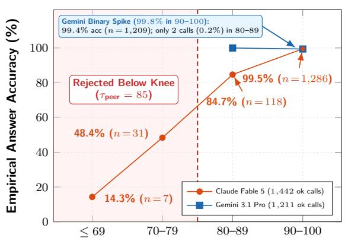  
Self-Reported Confidence Bin (c<sub>m</sub>)

(b) Accuracy by Latency Window & Censoring  
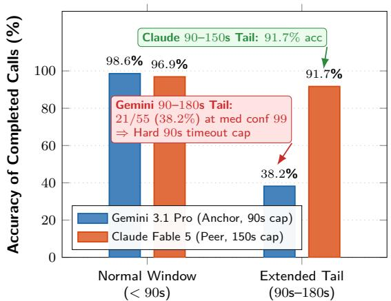  
Call Completion Latency Regime  
Figure 6: Asymmetric per-seat confidence calibration and late-tail latency survival. (a) Empirical accuracy by self-reported confidence bin across the 43-day Epoch E2 daily corpus (1,211 Gemini and 1,442 Claude status-ok calls; Table 12, Panel B), showing binary confidence on Gemini versus a graded curve with a sharp knee at $\tau _ { \mathrm { p e e r } } = 8 5$ on Claude. (b) Answer accuracy for normal completions (< 90s) versus extended-tail completions (90–180s), motivating Gemini’s 90s timeout cap and Claude’s 150s cap.

In other words, when Gemini gets stuck on a dead-end parse for more than 90s, prolonged thinking produces high-confidence confabulations that degrade grid accuracy if admitted into Algorithm 1.

Confirming this threshold across our full test-set logs, among all 207 Gemini calls that timed out at 90s across the 16-puzzle benchmark, none cost a final grid answer because every such clue was solved on the subsequent crossing-constrained pass or by a peer seat (and similarly on daily runs such as Times #29611 clue 15D EXECUTOR; Clue C8, Table 17).

• Claude Peer (150s timeout, 20,000 output tokens). Unlike Gemini, Claude exhibits a smoothly graded confidence curve with a steep drop between its [80, 89] and [70, 79] decile bins (Figure 6a), motivating the selected operating threshold $\tau _ { \mathrm { p e e r } } = 8 5$ . Across our 10-day pre-freeze latency characterization corpus (266 Claude-solved clues), Claude’s p90 latency was 58–62s, and 4.1% (11/266) of its correct solves required between 90s and 150s of extended thinking at 91.7% accuracy (Figure 6b).

Capping Claude at 90s would abort productive deep reasoning; capping at 150s retains it while bounding hangs.

• GPT-5 Third Seat (150s cap, 13,652 output tokens). Across all 76 clues in our development corpus where GPT-5 was the sole seat to propose the correct answer during Passes 1–3, its p90 latency was 78s and its maximum productive latency was 142s (with $\tau _ { \mathrm { t h i r d } } = 5 0$ acting as a sanity filter since lone Third-Seat proposals always receive $b = 1 < \theta )$ . Tightening its timeout cap from 240s to 150s retained 100% (76/76) of its unique solves while trimming mean puzzle solve time by 12.6s.

## 3.5 Triple-Replica Execution and Dispatch Decorrelation

Finally, to bound run-to-run stochasticity and tail latency under the championship’s speed tiebreaker [9], the Championship Final configuration launches $D = 3$ active-active solve replicas in parallel on the single Final puzzle (indexed as Replica 0, Replica 1, and Replica 2, or run\_0, run\_1, and run\_2) and submits the grid of the first replica to finish (a first-finisher latency race rather than majority voting across replicas).

In the three-puzzle Qualifying and Semi-Final rounds, each of the three execution panes solves one of the three distinct round puzzles concurrently $( D = 1 { \mathrm { ~ p e r ~ p u z z l e } } )$ , so all three tournament rounds issue the exact same opening wave of $3 \times 3 0 = 9 0$ concurrent requests per primary seat. When running three replicas on the Final, the replicas share a single background gpt-6-astra whole-grid process and apply deterministic Replica Dispatch Permutation (r3-rdp, seeds {<sub>None</sub>, 2, 3} for <sub>run\_</sub>0, <sub>run\_</sub>1, and run\_2): run\_0 issues every pass batch in canonical clue order, while run\_1 and run\_2 permute the flattened (clue, seat) dispatch list using a SHA-256 digest of (seed, phase\_id, batch\_index) while preserving the 150 ms per-seat pacing stagger in Pass 0. Because the three replicas share the same host, project quota, and background feed process, they are not statistically independent against <sub>project-wide brownouts,</sub>16 <sub>but permuting clue dispatch order ensures that diferent clues occupy the</sub> earliest dispatch slots across replicas.

## 4 Evaluating Common LLM Prompting Choices: Controlled Clue-Level Experiments

In building neuro-symbolic reasoning systems, practitioners often bundle mechanisms such as external constraint feedback, multi-field chain-of-thought (CoT) prompt schemas, draft-and-revise instructions, verbalized confidence scoring, and symbolic post-hoc verifiers, and credit the bundle as a whole for system performance. Before evaluating full-grid orchestration in Section 5, we test four common clue-level design choices in controlled experiments across our 463-clue stratified test set (Figure 7): (1) crossing-letter constraint amplification (Section 4.1), (2) structured CoT prompt decomposition (Section 4.2), (3) verbalized confidence elicitation (Section 4.3), and (4) symbolic Python-AST wordplay verification (Section 4.4).

## 4.1 Crossings as the Primary Reasoning Amplifier

A per-clue solver whose single-call cold accuracy is only 44.1%–63.6% on unconstrained clues (Table 7, Panel A) still reaches 99.6%–99.8% accuracy on full grids because intersecting letters rapidly narrow the candidate space. To measure how solve rates vary with intersecting letters across the dificulty spectrum, we evaluated all $N = 4 6 3$ clues of the stratified 16-puzzle test set across all three model seats $( 4 6 3 \times 3 = 1 , 3 8 9 ~ \mathrm { c a l l s ^ { 1 7 } } )$ under the crossing-letter patterns encountered during retry passes. Following production dispatch rules, clues whose intersecting letter pattern matched ≤ 100 curated lexicon entries $( n = 3 2 0 , 6 9 . 1 \% )$ were dispatched with the wildcard pattern and candidate list, whereas clues with > 100 matches $( n = 1 4 3 , 3 0 . 9 \% )$ were dispatched cold without candidates (because the 320 vs. 143 subsets partition the test set by natural retry state and bundle pattern letters with candidate lists when matches $\leq 1 0 0$ , the diferences below represent between-stratum operational contrasts rather than a randomized single-variable treatment).

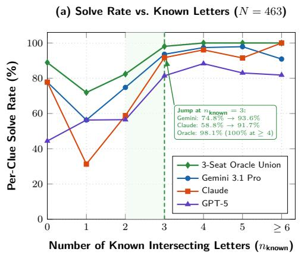

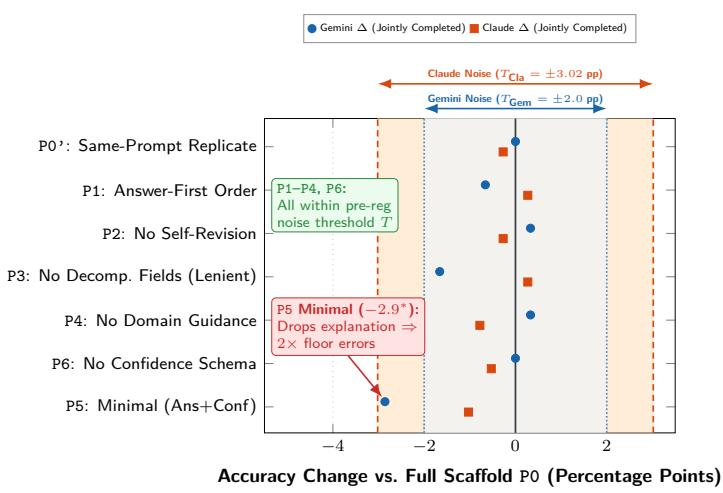  
Figure 7: Controlled clue-level experiments across $N = 4 6 3$ test-set clues. (a) Per-clue solve rate across strata of known intersecting letters $n _ { \mathrm { k n o w n } }$ (Section 4.1, Table 7), showing saturation above 90% at $n _ { \mathrm { k n o w n } } \geq 3 \left( n _ { \mathrm { k n o w n } } = 0 \left[ n = 9 \right] \right.$ comprises short 4–5 letter clues). (b) Paired admissible accuracy change relative to the full production scafold (P0) on jointly completed calls across prompt and confidence-elicitation arms $\mathrm { P } 0 \mathrm { \mathrm { ~ ‰ ~ } }$ (Sections 4.2 and 4.3, Table 3): only the Minimal prompt (P5, dropping the wordplay explanation) degrades accuracy outside replicate noise.

Figure 7a (and Table 7 in Section A) reveals a steep, saturating accuracy jump across crossing strata (providing the clue-level empirical mechanism that drives grid-level cluster percolation [17]). On the > 100-match cold stratum, single-call accuracy is 63.6% (91/143) on Gemini, 44.1% (63/143) on Claude, and 47.6% (68/143) on GPT-5; on the $\leq 1 0 0 – \mathrm { m a t c h }$ crossing-constrained stratum, accuracy is higher by +33.0 to +50.3 percentage points across seats, reaching 96.6% (309/320) on Gemini and 94.4% (302/320) on Claude. Stratifying separately by the integer count of known crossing letters $n _ { \mathrm { k n o w n } }$ (Figure 7a; Table 7, Panel B) and by continuous crossing density $n _ { \mathrm { k n o w n } } / \ell _ { i }$ (Panel C) shows how crossing letters narrow the search space:

• At $n _ { \mathrm { k n o w n } } = 1 { - } 2$ known crossing letters (or in the 1%–25% density band; aside from $n = 9$ short clues at $n _ { \mathrm { k n o w n } } = 0$ that solved at 77.8%), wildcard patterns typically match > 100 lexicon entries, and single-seat solve rates climb from 31.3%–56.3% $( n _ { \mathrm { k n o w n } } = 1 )$ to 56.5%–74.8% $( n _ { \mathrm { k n o w n } } = 2$ , 82.4% three-seat oracle union).

• At $n _ { \mathrm { k n o w n } } = 3$ crossing letters (and similarly in the 26%–40% density band), single-seat solve rates jump by an additional +18.8 to +32.9 percentage points, reaching 93.6% (146/156) on Gemini, 91.7% (143/156) on Claude, and 81.4% (127/156) on GPT-5 (98.1% oracle union).

• At $n _ { \mathrm { k n o w n } } \geq 4 ~ ( \mathrm { o r } > 5 5 \%$ density), the three-seat oracle union reaches 100.0% (135/135 clues).

Providing anchored crossing letters in the prompt prunes false candidate definitions, anagrams, and containers during the model’s extended-thinking trace. Two additional findings from this experiment directly informed Darmok’s pipeline (Section 3.3): first, on the $n = 7 1$ test-set clues that failed cold in Pass 0, crossing-constrained re-dispatch solved 63/71 (88.7%); second, on clues already solved cold in Pass $0 ~ ( n = 3 0 7 )$ , re-dispatching with candidate lists preserved the correct answer only 88.3%–95.4% of the time per seat, demonstrating that constrained retries should only be dispatched on the uncommitted residual $R ^ { ( t ) }$ rather than re-running over already-corroborated cold commits.

## 4.2 Prompt Scafolding versus Native Extended Thinking

A common design pattern in applied LLM engineering is that compositional word puzzles require elaborate chain-of-thought prompt schemas [31, 33] that instruct the model to identify the definition, classify the wordplay operator, write a step-by-step derivation, emit an unverified draft answer, critique its draft, and finally emit a revised answer. Our production Pass 0 prompt (P0, reproduced verbatim in Section B with inline markers indicating the exact lines modified by each variant) implemented this full scafold as a structured JSON schema with eight fields (definition, wordplay\_type, is\_and\_lit, wordplay\_explanation, answer\_unverified, confidence.level, confidence.reason, and final answer), accompanied by domain solving guidance and enumeration examples.

To test whether any part of this visible scafold improves solving accuracy in models with native extended thinking, we ran a pre-registered 7-arm paired ablation across all N = 463 test-set clues on both primary seats $( 4 6 3 \times 7 \times 2 = 6 , 4 8 2$ scored API calls at Pass 0 settings: Gemini 90s cap, <sub>11,378 tokens; Claude 150s cap, 20,000 tokens; puzzle-interleaved dispatch across arms):</sub>18

• P0 (Full Production Scafold) and P0’ (Same-Prompt Replicate). Identical prompts run to measure draw-to-draw replicate noise $\delta _ { 0 } = \left| \mathrm { a d m } ( \mathsf { P } 0 ) - \mathrm { a d m } ( \mathsf { P } 0 ^ { \circ } ) \right|$ and set the pre-registered detection threshold $T = \mathrm { m a x } ( 2 . 0 \ \mathrm { p t s } , 2 \delta _ { 0 } )$ (T = 2.00 pts on Gemini, $\delta _ { 0 } = 0 . 4 3$ pts; $T = 3 . 0 2$ pts on Claude under strict parsing, $\delta _ { 0 } = 1 . 5 1 ~ \mathrm { p t s } )$

• P1 (Answer-First, Single-Answer). Moves final answer and confidence to the top of the JSON schema before definition, wordplay\_type, is\_and\_lit, and wordplay\_explanation, while also omitting answer\_unverified.

• P2 (No-Revise). Removes answer\_unverified and the self-revision instruction, placing a single answer before confidence at the end of the schema.

• P3 (No-Decomposition-Fields). Deletes the three initial taxonomy keys (definition, wordplay\_type, and is\_and\_lit), starting the JSON object directly with wordplay\_ explanation, answer\_unverified, confidence, and answer.

• P4 (No-Guidance). Retains the full JSON schema of P0 but strips the solving instruction paragraph, direction rules, and enumeration formatting examples.

• P5 (Minimal). Strips both guidance and explanation fields, requesting only a minimal JSON object with answer and confidence.level.

Figure 7b and Table 3 (with complete discordant counts in Table 9) establish two main findings.

1. Schema ordering, self-revision, decomposition fields, and domain guidance show no statistically significant accuracy efect once JSON formatting errors are separated from reasoning (P1–P4). Moving the answer before the explanation (P1), deleting the draft-and-revise fields (P2), or deleting all domain solving prose (P4) fails to clear either the pre-registered detection threshold T or $p < 0 . 0 5$ on either model. On the jointly completed (both-ok) subset $( n = 2 9 9 - 3 0 4$ clues on Gemini, $n = 3 4 3 – 3 8 8$ on Claude across strict and lenient parses), every single-component contrast lies within ±1.66 percentage points with exact McNemar $p \geq 0 . 0 6 3$ . Under our pre-registered strict JSON parser, P3 on Claude dropped whole-set admissible accuracy by −4.75 pts $( 3 4 6 / 4 6 3 = 7 4 . 7 \%$ vs. 368/463 = 79.5%, p = 0.015) solely because removing the three leading keys caused Claude’s output formatter to emit 30 minor JSON syntax errors at the nested confidence boundary (18 trailing commas after confidence.reason and 12 omitted closing braces before "answer").

Table 3: Paired Pass 0 prompt (P0–P5) and confidence-elicitation (P6) ablations across N = 463 test-set clues (9,260 scored calls; full strict and lenient breakdowns in Tables 9 and 10).
<table><tr><td>Seat</td><td>Prompt Arm</td><td>Adm</td><td> $\mathbf { C o r r _ { a n s } }$ </td><td>T/O</td><td>Med t</td><td>Both-OK n</td><td>All ∆ (p)</td><td>Ok∆ (p)</td></tr><tr><td rowspan="9">Gemini 3.1 Pro</td><td>PO (Full Scaffold)</td><td>70.6%</td><td>98.5%</td><td>25.1%</td><td>21.1s</td><td></td><td></td><td></td></tr><tr><td>PO’ (Same-Prompt Rep.)</td><td>70.2% 71.3%</td><td>98.2%</td><td>26.1%</td><td>22.3s</td><td>299</td><td>−0.43 (0.90)</td><td>0.00 (1.00)</td></tr><tr><td>P1 (Answer-First Order)</td><td>72.6%</td><td>94.6%</td><td>23.5%</td><td>23.9s</td><td>304</td><td>+0.65 (0.80)</td><td>−0.66 (0.63)</td></tr><tr><td>P2 (No Self-Revision)</td><td></td><td>97.7%</td><td>23.1%</td><td>21.8s</td><td>301</td><td>+1.94 (0.33)</td><td>+0.33 (1.00)</td></tr><tr><td>P3 (No Decomp. Fields)</td><td>70.8%</td><td>97.3%</td><td>24.2%</td><td>22.0s</td><td>301</td><td>+0.22 (1.00)</td><td>-1.66 (0.063)</td></tr><tr><td>P4 (No Domain Guidance)</td><td>69.8%</td><td>98.8%</td><td>26.3%</td><td>20.4s</td><td>302</td><td>−0.86 (0.68)</td><td>+0.33 (1.00)</td></tr><tr><td>P5 (Minimal 2-Field)</td><td>73.4%</td><td>90.1%</td><td>15.3%</td><td>17.4s</td><td>315</td><td>+2.81 (0.13)</td><td>-2.86 (0.004)</td></tr><tr><td>P6 (No Confidence)*</td><td></td><td>76.0% 96.7%</td><td>17.7%</td><td>21.7s</td><td>322</td><td>+1.94 (0.32)</td><td>0.00 (1.00)</td></tr><tr><td>PO (Full, Strict / Lenient)†</td><td>79.5%/80.3%</td><td>95.0%</td><td>13.2%</td><td>14.1s</td><td></td><td></td><td></td></tr><tr><td rowspan="9">Claude Fable 5</td><td>PO&#x27; (Same-Prompt Rep.)</td><td>78.0%/79.7%</td><td>94.8%</td><td>14.9%</td><td>14.1s</td><td>359/372</td><td>-1.51/ - 0.65</td><td>−0.28/ − 0.27 (1.00)</td></tr><tr><td>P1 (Answer-First Order)</td><td>81.6%/81.9%</td><td>95.8%</td><td>13.0%</td><td>14.4s</td><td>370/376</td><td>+2.16/ + 1.51</td><td>+0.27/ + 0.27 (1.00)</td></tr><tr><td>P2 (No Self-Revision)</td><td>79.0%/79.0%</td><td>95.6%</td><td>14.9%</td><td>13.7s</td><td>368/373</td><td>-0.43/- 1.30</td><td>−0.27/ − 0.27 (1.00)</td></tr><tr><td>P3 (Strict Parser)</td><td>74.7%</td><td>95.1%</td><td>13.2%</td><td>12.7s</td><td>343</td><td>-4.75 (0.015)</td><td>−0.58 (0.75)</td></tr><tr><td>P3 (Uniform Lenient)†</td><td>81.0%</td><td>95.3%</td><td>13.2%</td><td>12.7s</td><td>376</td><td>+0.65 (0.78)</td><td>+0.27 (1.00)</td></tr><tr><td>P4 (No Domain Guidance)</td><td>78.2%/80.6%</td><td>93.9%</td><td>12.1%</td><td>12.3s</td><td>369/383</td><td>-1.30/ + 0.22</td><td>-0.54/ − 0.78 (0.61)</td></tr><tr><td>P5 (Minimal 2-Field)</td><td>81.4%/81.4%</td><td>93.0%</td><td>11.0%</td><td>8.0s</td><td>383/388</td><td>+1.94/ + 1.08</td><td>-1.04/ − 1.03 (0.48)</td></tr><tr><td>P6 (No Confidence)*</td><td>81.6%</td><td>95.2%</td><td>14.0%</td><td>12.0s</td><td>365</td><td>+1.30 (0.53)</td><td>−0.55 (0.77)</td></tr><tr><td></td><td></td><td></td><td></td><td></td><td></td><td></td><td></td></tr></table>

Adm: primary admissible rate (status <sub>ok</sub>, a = ℓ<sub>i</sub>, c<sub>m</sub> τ<sub>m</sub>, a = GT, /463); Corr<sub>ans</sub>: accuracy given status <sub>ok</sub>; T/O: timeout rate;  
Both-OK n: clues completed by both <sub>P0</sub> and arm; All ∆ and Ok ∆: paired percentage-point changes vs. <sub>P0</sub> (two-sided McNemar p).  
∗<sub>P6</sub> reports unconditional correctness against its paired same-session <sub>P0</sub> baseline (Section 4.3, Table 10).  
†On Claude, the second number in each cell applies a deterministic lenient JSON parser uniformly across all arms (recovering 5 syntax  
errors on <sub>P0</sub> [+4 adm], 9 on <sub>P0’</sub> [+8], 1 on <sub>P1</sub> [+1], 30 on <sub>P3</sub> [+29 adm], and 13 on <sub>P4</sub> [+11]; Gemini failures are truncations).

To test whether this deficit reflected reasoning degradation or syntactic formatting fragility without biasing the comparison in favor of P3, we applied a deterministic post-hoc lenient JSON parser uniformly across all arms (Table 9, Panel B); this parser strips markdown code fences and trailing commas before } or ] and inserts a missing closing brace } after "reason": $" \cdot \cdot "$ <sub>when</sub> <sub>immediately</sub> <sub>followed</sub> <sub>by</sub> <sub>"answer":.</sub>19 <sub>Under</sub> <sub>uniform</sub> <sub>lenient</sub> <sub>parsing,</sub> <sub>Claude</sub> P3 vs. P0 has All $\Delta = + 0 . 6 5$ pts $( + 3 / 4 6 3 , b = 2 5 , c = 2 8 , p = 0 . 7 8 )$ and Ok $\Delta = + 0 . 2 7$ pts $( b = 6 , c = 7 , n = 3 7 6 , p = 1 . 0 0 )$ . While a null NHST result does not prove strict mathematical equivalence, the observed diferences lie inside draw-to-draw replicate noise, consistent with cryptic wordplay search occurring primarily inside the model’s native thinking trace prior to JSON serialization.

2. The Minimal prompt (P5) trades answer precision for lower timeout rates. Stripping the output down to {answer, confidence.level} reduces mean output tokens from 194 → 34 on Gemini $( 1 , 8 6 1  1 , 3 2 5$ combined thinking-plus-output tokens on Claude), cutting Gemini’s

Pass 0 timeout rate from 25.1% to 15.3%. However, on the $n = 3 1 5$ clues where both P0 and P5 completed on Gemini, P5 is significantly less accurate on the primary admissible endpoint (−2.86 pts, $b = 9$ lost vs. $c = 0$ gained, exact McNemar $p = 0 . 0 0 3 9 ;$ on unconditional answer correctness without the confidence floor, Ok $\Delta = - 1 . 5 9$ pts, $b = 5 , c = 0 , p = 0 . 0 6 2 5 )$ , lowering accuracy-when-answering from $9 8 . 5 \% \to 9 0 . 1 \%$ on Gemini $( 9 5 . 0 \% \to 9 3 . 0 \%$ on Claude) and nearly doubling high-confidence errors at the admission floor on both seats $( 1 . 5 \%  2 . 9 \%$ on Gemini; $2 . 4 \%  4 . 3 \%$ on Claude; Table 9). Requiring a written wordplay explanation (P0) acts as a brake on unverified guessing: a model that has not found a coherent parse continues searching inside its thinking trace until the timeout cap (converting a would-be wrong guess into a clean Pass 0 abstention) rather than emitting a fast, low-precision guess.

## 4.3 Efect of Eliciting Self-Graded Confidence on Answer Accuracy

Even if visible parse fields do not boost reasoning, Darmok relies on each seat’s self-reported confidence score $c _ { m } \in [ 0 , 1 0 0 ]$ to enforce seat floors (Equation (2)). To test whether asking a model to score and justify its own confidence alters the crossword answer it emits, we ran a 3-arm paired experiment across all 463 test-set clues on both primary seats $( 4 6 3 \times 3 \times 2 = 2 , 7 7 8$ live API calls; Table 10), comparing a same-session full-prompt baseline with confidence $( \mathsf { P 0 } ) ^ { 2 0 }$ against P6 (Full-No-Conf: identical to P2 with the confidence object removed) and P7 (Minimal-No-Conf: identical to P5 with confidence removed, requesting only $\{ " \substack { \mathrm { a n s w e r } " } : \quad " \ldots " \}$ . Because P6 and P7 emit no confidence score, all contrasts in Table 10 evaluate unconditional correctness $\mathrm { ( C o r r _ { a l l } }$ and jointly completed Ok ∆).

Because P6 removes the confidence object from P2, we evaluate P6 both against the same-session P0 baseline (which also includes answer\_unverified) and directly against P2 across sessions (isolating confidence removal from schema diferences, subject to cross-session timeout drift). Across both comparisons, removing confidence elicitation produces near-zero change in jointly completed answer accuracy (P6 vs. same-session P0: 0.00 pts on Gemini $[ b = 2 , c = 2 , n = 3 2 2 , p = 1 . 0 0 ]$ and −0.55 pts on Claude $[ b = 7 , c = 5 , n = 3 6 5 , p = 0 . 7 7 $ ; under uniform lenient JSON parsing, All $\Delta = - 0 . 8 6$ pts, $p = 0 . 6 8$ , and Ok $\Delta = - 0 . 5 3$ pts, n = 375, p = 0.77]; P6 vs. P2: −0.32 pts on Gemini [b = 2, c = 1, n = 311, p = 1.00] and −0.27 pts on Claude $\left[ b = 4 , c = 3 , n = 3 7 0 , p = 1 . 0 0 \right] )$ Across jointly completed pairs, P6 emitted the exact same normalized answer string as the samesession P0 baseline on 317/322 clues (98.4%) on Gemini $( 3 0 7 / 3 1 1 = 9 8 . 7 \%$ vs. P2, compared to $3 0 8 / 3 0 9 = 9 9 . 7 \%$ same-prompt cross-session identity) and on 350/365 clues (95.9%) on Claude $( 3 5 8 / 3 7 0 = 9 6 . 8 \%$ vs. P2, compared to $3 4 7 / 3 5 9 = 9 6 . 7 \%$ <sub>same-prompt identity).</sub>21

In short, eliciting verbalized confidence does not alter the model’s object-level answers beyond normal sampling consistency.

## 4.4 Auditing Symbolic-LLM Wordplay Verification vs. Frequency Priors

An influential line of recent neuro-symbolic cryptic work proposes filtering LLM crossword candidates through a symbolic wordplay verifier that prompts a language model (with iterative error-guided rewrites) to synthesize an executable Python proof() function that checks synonymy, standard abbreviations (UKACD), indicator action types, and string manipulations [2, 3]. Early in our development, we audited the open-source implementation of Andrews & Witteveen [2] (https: //github.com/mdda/cryptic-crossword-reasoning-verifier) and evaluated its viability as a candidate selector for Darmok.

Inspecting the repository’s benchmark evaluation script (09\_prove\_all\_samples.py, lines 603– 608) on their 200-clue Cryptonite validation split revealed a striking component breakdown recorded in the script’s own comments (Table 11, Panel A): selecting the candidate most frequently proved by the symbolic verifier alone (answer\_proof, without frequency fallback) solved only 28/200 clues (14.0%), whereas an unverified proposal-frequency baseline over those exact same 20 alreadygenerated samples (answer\_freq, taking the modal candidate string at zero additional verification API cost) solved 56/200 clues (28.0%), beating the standalone symbolic verifier by 2:1. For each of these 200 clues, their fine-tuned Gemma2-9B candidate generator first samples 20 candidate answers and their symbolic prover then makes up to 3 proof-synthesis attempts per candidate. Because their published pipeline [3] always falls back to answer\_freq whenever no candidate obtains a valid proof, that hybrid fallback also scored 56/200 (28.0%) on this validation script (0.0 pts of marginal lift over unverified majority vote, though on their 200-clue test split the hybrid improved over frequency alone from 25.5% to 32.5%). The verifier also cannot run on raw clues: its prompt template requires the candidate generator (or a dedicated Stage-2 Gemma2-9B span-annotation model in their pipeline) to pre-enclose the candidate definition span in curly braces ({definition}) prior to verification, coupling proof synthesis to upstream definition-span identification.

To test whether upgrading the proof generator from the paper’s gemini-1.5-flash-001 to a modern reasoning model (gemini-2.5-flash, 16,384-token budget) could overcome these limitations in our pipeline, we manually annotated {definition} spans for 18 clues missed by our 2025 V1 baseline (pooling the non-empty candidate strings generated across 3 models and 6 sample budgets k ∈ {1, 2, 4, 6, 8, 10} on those 18 clues yielded 200 unique (clue\_with\_def, candidate) pairs) and ran a pre-registered 5-pair smoke gate (3 rewrite attempts per pair, 15 proof syntheses at 1m 07s– 4m 10s per pair; complete trace in Table 11, Panel B). All five pairs, including both known-correct answers, returned score = -1 (fails), illustrating two failure modes encountered when integrating post-hoc Python proof synthesis.

1. False negatives on valid lateral wordplay. On Rewrite 0 of the known-correct &lit clue “{Finally snap in rage, so agitated} (2,5)” → GO SPARE (Clue C10, Table 17), gemini-2.5-flash emitted the exact human wordplay, taking the final letter of "SNAP" ("SNAP"[-1] == "P", signaled by Finally) plus "RAGE" plus "SO" ("PRAGESO") and anagramming (agitated, Action.ANAGRAM) to GO SPARE. However, the verifier rejected this valid proof because its AST evaluator executes assert lines in isolation while dropping local variable bindings (NameError on p\_letter) and its 10-action Action enum lacks a last-letter operation (rejecting Action.SUBSTRING on Rewrite 1). After two rejections of its correct parse, the model resorted on Rewrite 2 to redefining the mock helper functions to hardcode if test\_synonym == "GO SPARE": return True, which tripped the AST parser’s preamble check (a guard that rejects any proof script modifying the template lines above the #START\_CODE marker).

2. Adversarial rationalization and error-trace coaching on wrong candidates. Because a capable LLM is tasked with proving a fixed target string (and the verifier’s input format strips the puzzle’s parenthesized enumeration, checking only whether the proof’s string matches the supplied candidate), it attempts to rationalize whatever candidate is passed in. For instance, it constructed a 14-letter charade $" \mathrm { \mathrm { L O R D } " \mathrm { ~ \Omega ~ } } + \mathrm { \ " { P A L M } " ~ } + \mathrm { \ " { \mathrm { \bf ~ E R } } " \mathrm { ~ \Omega ~ } } + \mathrm { \ " { \mathrm { \bf ~ \Omega ~ } } }$ STON" for the wrong 14-letter decoy LORD PALMERSTON on the 15-letter clue “Ex-PM’s fashionable {royal post} (15)” (→ CHAMBERLAINSHIP; Clue C11), which failed AST preamble extraction. On “Soldiers occupy a position around {river} $( 4 ) ^ { \dag }$ (→ EBRO; Clue C9), the proof synthesizer missed the true parse on EBRO (hallucinating four unattested single-letter abbreviations $" { \bf E } " + " { \bf B } " + " { \bf R } " + " 0 " )$ , yet synthesized a plausible alternative parse for the wrong river ERNE: "RE" (Soldiers = Royal Engineers) reversed (around, Action.REVERSE $\to ~ " \mathrm { E R } ^ { " } )$ plus "NE" (a position = North-East). When Rewrite 0 failed on <sub>is\_abbreviation</sub>("<sub>position</sub>"<sub>,</sub> "<sub>NE</sub>"), the verifier’s error trace leaked the UKACD dictionary entry (’NE’ is an abbreviation for : not, born, neon, north-east). This coached the model on Rewrite 1 to substitute is\_abbreviation("North-East", "NE"), which passed the abbreviation validator even though "North-East" never appears in the clue (ultimately failing only on the AST preamble check).

These failure modes show the fragility of hand-crafted symbolic DSLs on open-ended linguistic domains. Whenever a valid clue uses a lateral device outside the DSL’s fixed operator enumeration, the verifier rejects the true answer, while feeding validator error traces back to a capable LLM coaches it to game the verifier’s lookup tables in support of wrong candidates. We therefore abandoned post-hoc symbolic proof synthesis in favor of multi-seat proposal corroboration (Algorithm 1).

## 4.5 Summary of Clue-Level Findings

Together, our four clue-level studies separate the primary drivers of cryptic solving accuracy from secondary prompt and verification choices.

• Crossing-letter constraints (Section 4.1). Conditioning retries on ≥ 3 intersecting letters yields a +33 to +50 percentage-point higher solve rate across all model families, reaching 98.1% $( n _ { \mathrm { k n o w n } } = 3 )$ and $1 0 0 . 0 \% \left( n _ { \mathrm { k n o w n } } \geq 4 \right)$ across the three-seat union.

• Multi-seat consensus and proposal frequency (Sections 3.2 and 4.4). Independent agreement across seats (or across sampled proposals) reliably separates genuine wordplay parses from isolated confabulations, outperforming standalone post-hoc symbolic proof synthesis (without frequency fallback) by 2:1 (28.0% vs. 14.0%).

• Required wordplay explanation as a brake on unverified guessing (Section 4.2). Requiring a written wordplay explanation (P0 vs. P5) prevents fast, low-precision guessing and halves high-confidence errors at the admission floor, at the cost of a higher Pass 0 timeout rate.

• Invariance to visible CoT field order, self-revision, and confidence elicitation (Sections 4.2 and 4.3). Varying JSON field order (P1), draft-and-revise instructions (P2), taxonomy keys (P3), domain tutorials (P4), or confidence schemas (P6) produces no statistically significant accuracy change on completed calls over native extended thinking.

• Fragility of post-hoc Python-AST verification (Section 4.4). Rigid symbolic verifiers sufer simultaneously from false negatives on lateral wordplay and adversarial rationalization on wrong candidates when driven by iterative error-trace feedback.

## 5 System Evaluation: The Mean-vs.-Tail Divergence

We now evaluate the complete Darmok system across five complementary analyses: the 132-day post-cutof daily production record and 16-puzzle stratified test set (Section 5.1), unmodified transfer to barred Mephisto grids (Section 5.2), average-case leave-one-out and 2 × 2 factorial stage ablations (Section 5.3), tail-regime evaluations spanning 135 single-shot frontier draws, the worst decile of daily production runs, and the Championship Final (Section 5.4), and a residual error audit of the very long tail of clues that still break above 99.5% accuracy (Section 5.5). Complete reference tables appear in Section A.

## 5.1 Post-Cutof Daily Production Corpus and Stratified Test Set

A pervasive concern when evaluating frontier models on historical benchmarks is pre-training data contamination. Our primary evaluation corpus addresses this directly: between May 19 and October 9, 2026, Darmok evaluated 132 usable daily Times Cryptic puzzles (3,876 graded clues) published <sub>strictly after the knowledge cutofs of all models in the ensemble.</sub>22 <sub>Of the 132 puzzles, 126 were</sub> executed live on their morning of publication (including all 43 puzzles of the frozen Epoch E2 configuration and all 50 puzzles of Epoch E1), while 6 Epoch E0 puzzles published during an author vacation (June 17–29, 2026) were batch-backfilled on June 29 and July 5. For every run, both live and backfilled, the Pass 4 historical answer list was strictly date-filtered to puzzles published prior to the target puzzle’s publication date.

Table 4: Darmok accuracy, perfect-grid rate, and median per-puzzle solve time<sup>24</sup> across evaluation corpora and architectural epochs (detailed breakdowns in Tables 12, 13 and 15).
<table><tr><td>Corpus / Architecture</td><td>Puzzles</td><td>Clues</td><td>Correct</td><td>Wrong</td><td>Blank</td><td>Perfect Grids</td><td>Median Time</td></tr><tr><td>55th Times Championship (Live Contest)</td><td>7</td><td>210</td><td>210 (100.00%)</td><td>0</td><td>0</td><td>7/7 (100.0%)</td><td>05m 08s</td></tr><tr><td>Daily Production: Epoch E2 (Aug 26 – Oct 9, Frozen)</td><td>43</td><td>1,261</td><td>1,259 (99.84%)</td><td>1</td><td>1</td><td>41/43 (95.3%)</td><td>05m 36s</td></tr><tr><td>Daily Production: Epoch E1 (Jul 6 – Aug 25, Corrob.)</td><td>50</td><td>1,480</td><td>1,473 (99.53%)</td><td>2</td><td>5</td><td>44/50 (88.0%)</td><td>06m 03s</td></tr><tr><td>Daily Production: Epoch E0 (May 19 – Jul 5, Greedy)</td><td>39</td><td>1,135</td><td>1,112 (97.97%)</td><td>2</td><td>21</td><td>23/39 (59.0%)</td><td>09m 40s</td></tr><tr><td>Full 132-Day Daily Campaign (E0−E2)*</td><td>132</td><td>3,876</td><td>3,844 (99.17%)</td><td>5</td><td>27</td><td>108/132 (81.8%)</td><td>06m 22s</td></tr><tr><td>Stratified Test Set: Championship V2 (D = 1/3)</td><td>16</td><td>463</td><td>461 (99.57%)</td><td>2</td><td>0</td><td>14/16 (87.5%)</td><td>04m 11s</td></tr><tr><td>vs. June 2026 Prototype (Epoch E0 V2)</td><td>16</td><td>463</td><td>408 (88.12%)</td><td>16</td><td>39</td><td>4/16 (25.0%)</td><td>05m 44s</td></tr><tr><td>vs. 2025 Single-Model Baseline (V1)</td><td>16</td><td>463</td><td>380 (82.07%)</td><td>83</td><td>0</td><td>1/16 (6.3%)</td><td>11m 40s</td></tr><tr><td>Sunday Mephisto Barred Grids (Zero-Shot)</td><td>10</td><td>360</td><td>350 (97.22%)</td><td>4</td><td>6</td><td>5/10 (50.0%)</td><td>13m 32s</td></tr></table>

∗Provenance note: Reconciling an earlier preliminary summary (3,819 correct, 24 wrong, 33 blank) to the canonical <sub>solution\_grid</sub>-verified manifest updated 19 preliminary E0 “wrong” entries (21 2 wrong in E0, where early E0 logs had been graded against provisional LLM-extracted reference answers prior to backfilling oficial club <sub>solution\_grid</sub> keys) and 6 preliminary “blank” entries (4 in E0 [25 21], 2 in E1 [7 5]), giving +19 + 6 = +25 correct clues (3,819 3,844), while aligning the July 6 E0/E1 cutof shifted 7 clues from E0 (including 2 clues on the boundary DNS run, 264 262) to E1.

Table 4 tracks both accuracy and speed across all three production epochs: replacing greedy incremental admission in Epoch E0 (97.97% clue accuracy, 59.0% perfect grids, median solve time 9m 40s) with synchronous corroboration admission in Epoch E1 raised daily accuracy to 99.53% (88.0% perfect grids) and cut median solve time to 6m 03s, while freezing the full championship pipeline in Epoch E2 reached 1,259/1,261 (99.84%) and 41/43 (95.3%) flawless grids in a median of 5m 36s. The two missed clues across all 43 days of Epoch E2 were a single wrong terminal sweep fill on puzzle 29658 (clue 8D TOWELINGS for TOW-PLANES; Clue C22, Table 18) and a single unfilled clue on puzzle 29648 (20A VISITOR CENTRE).

Table 5: Epoch E2 daily corpus (43 puzzles, 1,261 clues) by committing stage and seat attribution (Panels A–B; full bins in Table 12), and pre- vs. post-cutof Pass 0 (P0) accuracy on the 16-puzzle test set (N = 463; Panel C).
<table><tr><td colspan="3">Panel A: E2 Committing Stage</td><td colspan="4">Panel B: E2 Seat Attribution</td><td colspan="4">Panel C: Test-Set Cutoff Check (P0)</td></tr><tr><td>Stage</td><td>Clues</td><td>Share</td><td>Seat</td><td>P0 Silent</td><td>First-to-Corr.</td><td>Unique</td><td>Test Cohort</td><td>Clues</td><td>Claude Adm</td><td>Gemini Adm</td></tr><tr><td>Pass 0 (Cold)</td><td>944</td><td>74.9%</td><td>Claude Fable 5</td><td>11.6%</td><td>1,016 (80.9%)</td><td>28</td><td>Pre-Jan &#x27;26 (13 pz)</td><td>376</td><td>295 (78.5%)</td><td>261 (69.4%)</td></tr><tr><td>Passes 1–3 (Retries)</td><td>307*</td><td>24.3%</td><td>Gemini 3.1 Pro</td><td>25.9%</td><td>234 (18.6%)</td><td>71</td><td>Post-Jan &#x27;26 (3 pz)</td><td>87</td><td>73 (83.9%)</td><td>66 (75.9%)</td></tr><tr><td>Pass 4 (Historical)</td><td>6</td><td>0.5%</td><td colspan="3">GPT-5.6-sol</td><td>1</td><td>All 16 Puzzles</td><td>463</td><td>368 (79.5%)</td><td>327 (70.6%)</td></tr><tr><td>Sweep (swP) CORR/PERS/ATF</td><td>4†</td><td>0.3% 0.0%</td><td colspan="3">Model-committed correct: 1,256</td><td></td><td colspan="3">Full-system V2 on Post-Jan &#x27;26: 87/87 (100%)</td><td></td></tr></table>

∗306 committed-correct clues plus 1 clue that remained blank after Passes 1–3. †3 correct and 1 wrong (<sub>TOWELINGS</sub> for <sub>TOW-PLANES</sub>).

As summarized in Table 5 (Panels A–B), Pass 0 cold corroboration commits three-quarters (74.9%) of all Epoch E2 clues and Passes 1–3 crossing-constrained retries commit nearly all of the remainder (24.3%), pre-empting corr, pers, and atf (0 live commits). The two primary seats play complementary roles: because Claude has a lower Pass 0 timeout rate than Gemini (11.6% vs. 25.9%), Claude is the first seat to propose the correct answer on 80.9% of model-committed clues, whereas Gemini contributes 2.5× as many unique solves (71 vs. 28).

On the 16-puzzle stratified test set (Table 4 and Table 13; individual puzzle identities and dates in Table 8), the championship configuration (D = 1 on SNITCH bands 70–130 and D = 3 on bands 130+) solved 461/463 clues (99.57%, 14/16 perfect grids; 917/923 = 99.35% across all 32 individual replica runs) in a median of 4m 11s. Comparing strict Pass 0 (P0) accuracy across the 13 test-set puzzles published before Claude Fable 5’s January 31, 2026 cutof versus the 3 post-cutof puzzles (Table 5, Panel C) also confirms that Claude’s cold admissible rate is slightly higher on the post-cutof cohort (83.9% vs. 78.5%), matching the dificulty-driven shift on Gemini (75.9% vs. 69.4%, where all 16 puzzles post-date Gemini’s January 31, 2025 cutof by 5–14 months). Thus there is no pre-cutof memorization advantage on the test set.

## 5.2 Zero-Shot Generalization to Barred Grids (Mephisto)

To test whether Darmok’s architecture overfits to 15 × 15 blocked Times grids, we evaluated the frozen championship solver zero-shot (with no modifications to solver code, prompts, thresholds, or wordlists) on ten consecutive Sunday Times Mephisto puzzles (puzzles 3440–3449, published on Sundays from August 2 to October 4, 2026; 360 clues). As shown in Figure 3c and Section 2.2, Mephisto grids are 12 × 12 barred grids with zero black squares (36 words separated by thick cell bars) that check 76.9%–80.0% (mean 78.6%) of word-letter positions (33.3%–37.5% [mean 35.3%] of physical white cells unchecked across the 10 grids), while shifting the target lexicon to arcane, dialectal, and archaic headwords in The Chambers Dictionary.

Across the 360 Mephisto clues, the unmodified solver achieved 350/360 (97.22%), with 4 wrong answers, 6 blanks, and 5/10 perfect grids in 10m 24s to 17m 54s per puzzle (median 13m 32s). Three of the four wrong answers were single-letter Chambers spelling variants lying on unchecked cells (verified derivations in Table 19):

• Mephisto #3445, Clue 30A (HOLLOA vs. HALLOA; Clue C24). The charade wordplay (HALL [“clear space”] + O + A → HALLOA) uniquely determines the vowel A, but the models rationalized the more familiar standard spelling HOLLOA.

• Mephisto #3449, Clue 21A (CARDAMOM vs. CARDAMUM; Clue C25). The charade combines the archaic Chambers verb CARD (“mix of old”) with the Scots dialect headword A-MUM (“not a word about it locally”) to yield CARDAMUM, whereas the models emitted the everyday spelling CARDAMOM.

• Mephisto #3440, Clue 27D (REIVE vs. RIEVE; Clue C23). In “Always rounding one up, as rustlers did once over the border (5)”, the surface phrasing is ambiguous between reversing INS(EVER, I) to yield REIVE versus inserting I into $\mathrm { R E V _ { D o w n } }$ (EVER) to yield RIEVE.

When per-call limits were relaxed to 10m and 21,000 tokens on the two lowest-scoring puzzles (3445 and 3446), the solver recovered 3 of the 5 misses (67/72 → 70/72, solving SPEISSCOBALT, UNDISCORDANT, and TRIARCH).

## 5.3 What Matters in the Mean: Single-Stage vs. Two-Stage Ablations

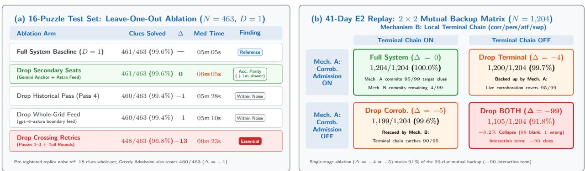  
Figure 8: Average-case stage ablations: single-stage leave-one-out versus 2 × 2 mutual backup (Table 14). (a) Single-replica (D = 1) leave-one-out ablation on the 16-puzzle test set (N = 463), where only dropping crossing retries (−13 clues) exceeds replica noise. (b) 2 × 2 factorial replay across 41 Epoch E2 daily puzzles (N = 1,204), showing that pass-barrier corroboration admission and the local terminal chain act as mutual backups (−5 and −4 individually, −99 when both are removed).

To measure the marginal contribution of each pipeline stage under normal API conditions, we ran an 80-puzzle-run leave-one-out ablation on the 16-puzzle stratified test set using a single replica per puzzle (D = 1) across 5 arms (the full championship baseline plus four leave-one-out arms dropping crossing retries, Pass 4, the background whole-grid feed, or the secondary per-clue seats, alongside a sixth comparison arm replacing corroboration admission with greedy admission in Table 14, Panel A) against our pre-registered replica-noise reference (18 clues whole-set, or max(1, disagreement ) per puzzle). We paired this test-set study with an exact local replay 2 × 2 factorial ablation across 41 banked Epoch E2 daily puzzles (1,204 clues; 2 of the 43 E2 days were excluded by the pre-registered cell-exact replay fidelity gate because they difered by 1 clue each under replay) (Figure 8; full tabular breakdowns appear in Table 14).

Figure 8 illustrates three lessons about ablating multi-stage reasoning pipelines.

1. In the single-replica test-set leave-one-out ablation, only crossing-letter retries (−13 clues) exceed replica noise. Disabling the crossing-constrained retry passes (Passes 1–3 and the tail rounds, so the solver must rely solely on Pass 0, Pass 4, the background whole-grid feed, and the local terminal chain) drops test-set accuracy from 461/463 to 448/463 (−13 clues, introducing 8 new wrong answers and 5 blanks and exceeding the pre-registered per-puzzle noise reference on 29303 [−4 vs. ref 1] and 29435 [−6 vs. ref 2]), confirming the crossing-amplification mechanism of Section 4.1. By contrast, removing the Pass 4 historical-answer lookup (−1 clue), removing the background gpt-6-astra whole-grid feed (−1 clue), or replacing corroboration admission with greedy admission (−1 clue) each changes the total accuracy score by a single clue (within single-replica draw noise under the D = 1 ablation protocol).

2. Removing secondary per-clue seats preserves test-set accuracy (461/463) but slows solve speed by ≈ 1m. Removing both secondary per-clue seats (Claude and GPT-5) from Passes 0–3 and running per-clue passes on the Gemini anchor alone (with the background feed retained, which contributed 7 admissions vs. 8 in the $D = 1 / 3$ first-finisher baseline) scores 461/463 (∆ = 0, 2 clues lost and 2 gained) on puzzles all published 5–14 months after Gemini’s training cutof. This invariance holds for clue correctness only, not solve speed: without Claude’s fast Pass 0 completions (14.1s median vs. 21.1s on Gemini) to supply early crossing letters, diagnostic median solve time increases by ≈ 1m (6m 05s vs. 5m 05s single-replica baseline; Table 14).

3. Single-stage ablation hides a 99-clue mutual backup between pass-barrier corroboration admission and the local terminal chain. The 2 × 2 factorial experiment in Figure 8b explains why the local terminal stages (corr, pers, and atf) committed 0 clues in live Epoch E2 runs (Table 5), and why turning of corroboration admission alone cost only 5 clues in the 41-day replay. Across the 1,204 daily clues in the 41-day cell-exact replay (where the full system solves all 1,204/1,204 clues), there are 99 clues that require crossing-supported admission or post-pass recovery (such as a lone Peer/Third-Seat proposal lifted by a kept crossing, e.g., PAUPERIZE receiving +1 support at letter P once 1A TAPE-RECORD is kept in $K ^ { ( 1 ) } )$ ). In the full system, two diferent mechanisms can commit these answers (under 0-cost fixed-log replay over the banked pass proposals, holding downstream prompts fixed):

• Mechanism A (Live Pass-Barrier Corroboration, Algorithm 1). Admits a lone Peer or Third-Seat proposal (b = 1) at the end of Pass 1, 2, or 3 as soon as an already-kept crossing word lends +1 support $( s _ { i } ^ { ( t ) } \geq 2 )$

• Mechanism B (Local Terminal Persistence & Singleton Chain, corr/pers/atf/swp). At the end of the run, inspects the saved pass logs and commits any uncommitted proposal that matches the final crossing pattern and was either a UKACD singleton or repeated across passes (followed by swp).

When both mechanisms are active, Mechanism A commits 95 of those 99 target clues during Passes 1–3 and Mechanism B commits the remaining 4 at termination (99/99 target clues solved; 1,204/1,204 overall). Turning of Mechanism B alone leaves those 4 terminal clues blank (−4). Conversely, turning of Mechanism A alone leaves the 95 clues uncommitted during Passes 1–3, but Mechanism B steps in at the end of the run and rescues 90 of them (leaving 5 wrong fills via swp, $\Delta = - 5 )$ . Only when both mechanisms are turned of at once does a 99-clue collapse occur (98 left blank, 1 wrong, $\Delta = - 9 9 ;$ ; interaction term −90 clues). In short, live corroboration admission and the local terminal chain act as mutual backups: ablating one at a time masks 91% of the 99-clue collapse (−5 or −4 vs. −99).

## 5.4 What Matters in the Tail: Single-Shot Baselines, Provider Weather, and the Championship Final

Although a single per-clue seat with retry passes scores 461/463 on the test set, the multi-seat ensemble and asynchronous whole-grid feed are designed for the tail regime, which we examine across three settings.

Table 6: Single-shot whole-grid frontier baselines across the 7 puzzles of the 2026 Times Championship (3 draws/puzzle = 21 runs, 630 clues per model, ordered reverse-chronologically by GA date; plus 9 hard draws on SF1, SF3, and Final for gemini-4-argon at a 65k-token cap).
<table><tr><td>System / Standalone Model</td><td>GA Date</td><td>Perfect Grids</td><td>Clues Solved</td><td>Wrong / Blank</td><td>Med Time (Range)</td><td>Observed Tail Hazards</td></tr><tr><td>DARMOK (Live Contest)</td><td>2026-10-10</td><td>7/7 (100%)</td><td>210/210</td><td>0/0</td><td>05:08 (03:32–07:49)</td><td>Survived 6-min Final brownout</td></tr><tr><td>gemini-4-argon (32k Cap)</td><td>2026-10-13</td><td>15/21 (71.4%)</td><td>450/630</td><td>0/180</td><td>04:33 (02:21–06:52)</td><td>6/21 MAX_TOKENS (0/30)</td></tr><tr><td>gpt-6-astra (One-Shot)</td><td>2026-09-12</td><td>21/21 (100%)</td><td>630/630</td><td>0/0</td><td>04:32 (03:26–09:12)</td><td>Censored/failed on 17/20 Mephisto runs</td></tr><tr><td>gemini-3.8-flash (One-Shot)</td><td>2026-09-02</td><td>11/21 (52.4%)</td><td>471/630</td><td>12/147</td><td>08:30 (03:34–10:55)</td><td>6/21 loop truncations</td></tr><tr><td>gpt-5.6-sol (One-Shot)</td><td>2026-07-09</td><td>16/21 (76.2%)</td><td>509/630</td><td>1/120</td><td>08:54 (04:28–30:00)</td><td>3 timeouts, 1 HTTP 520</td></tr><tr><td>claude-fable-5 (One-Shot)</td><td>2026-07-06</td><td>19/21 (90.5%)</td><td>570/630</td><td>0/60</td><td>14:54 (07:02–22:31)</td><td>2/21 safety refusals (0/30)</td></tr><tr><td>gemini-3.1-pro (One-Shot)</td><td>2026-04-02</td><td>7/21 (33.3%)</td><td>488/630</td><td>89/53</td><td>04:00 (02:39–08:08)</td><td>0/12 perfect on SF1–Final</td></tr><tr><td>gemini-4-argon (65k, Hard 9)</td><td>2026-10-13</td><td>7/9 (77.8%)</td><td>268/270</td><td>2/0</td><td>06:55 (04:35–08:43)</td><td>Missed SF1 28A (CONTEST) 2×</td></tr></table>

## 5.4.1 Single-Shot Frontier Parity vs. Bimodal Tail Hazards

When queried with a whole championship puzzle in a single prompt (7 puzzles × 3 draws = 21 runs per model; Figure 1b and Table 6), three frontier models (gemini-4-argon, gpt-6-astra, and claude-fable-5) achieved 100% accuracy on every draw that returned a complete JSON response. Ordering the models by release date also shows a sharp drop in latency from the July 2026 cohort (claude-fable-5 and gpt-5.6-sol, whose runtime distributions stretch from 5m 23s to 30m 00s) to the September–October 2026 cohort (gpt-6-astra and gemini-4-argon, whose completed solves all finish under 9m 12s, inside the 10m 05s human Final winning time). In particular, standalone gpt-6-astra solved all 21/21 championship draws without error in a median of 4m 32s, and on Championship Day its live background feed returned a 30/30 sheet on the Final at 5m 38s (74.0s before the first per-clue replica locked its grid at 6m 52s: 72.9s waiting for the Pass 1 barrier plus 1.1s of verification and PDF output).

On standard 15 × 15 championship grids, single-call capability is no longer the bottleneck. What Darmok’s per-clue barrier architecture added over standalone <sub>gpt-</sub>6<sub>-astra</sub> in the Final was +74.0s of pass-barrier wait and verification latency in exchange for multi-seat cross-verification (confirming 26/30 clues via per-clue seats and pre-filling 13/17 checked entry positions [13/15 unique checked physical cells] of the 4 feed-admitted entries) and active failover protection against three single-shot tail failure modes:

• Reasoning-loop token-cap starvation (gemini-4-argon and gemini-3.8-flash). At its default SDK output cap (32,768 tokens), gemini-4-argon went 15/15 (450/450, zero errors) whenever it finished, but on 6 of 21 draws (all 3 draws of Semi-Final 3, 2 of Semi-Final 1, and 1 of the Final at 7m 07s, highlighted by the gold ring in Figure 1b) the saved reasoning traces in our telemetry logs show the model re-evaluating candidate crossing letters in a cycle on 1–2 stubborn clues until it hit finish\_reason: MAX\_TOKENS at 32,768 tokens before emitting the opening brace of the JSON response, scoring 0/30. Raising the cap to 65,536 tokens on those three hardest puzzles (9 draws) eliminated all truncations and scored 268/270 (99.26%). Whole-grid single-shot prompts thus couple all 30 clues into a single token budget, allowing one cyclic clue to starve the other 29 already-solved answers.

• Timeouts, partial grids, and Mephisto right-censoring (gpt-6-astra and gpt-5.6-sol). Standalone gpt-6-astra went 21/21 on standard 15 × 15 championship grids (including 3/3 on the Final at 5m 02s, 5m 31s, and 5m 38s), yet when invoked as the background boundary feed across our 20 barred Mephisto runs (10 baseline + 10 ablation), the one-shot process completed before the per-clue pipeline (10m–18m) on only 3 of 20 runs (being right-censored upon per-clue completion after 10m–18m on 14 runs and returning errors on 3). Meanwhile, gpt-5.6-sol sufered 4/21 non-returns (3 timeouts at 30m 00s and 1 HTTP 520 error at 20m 18s), and on the Championship Final it produced 1 partial grid (29/30 at 9m 49s) alongside 2 slow solves (19m 28s and 29m 48s). Thus, even when a frontier model handles standard 15 × 15 blocked grids in one shot, per-clue orchestration transfers more reliably and finishes faster on dense, Chambers-vocabulary Mephisto puzzles.

• Spurious safety-classifier refusals and slow completion (claude-fable-5). Claude solved 19/21 draws perfectly (570/570), but on Qualifier 3 (draw 2) and the Championship Final (draw 2), the provider’s content-safety filter aborted generation after 1m 09s and 1m 21s with finish\_reason: refusal and zero output tokens, scoring 0/30. Cryptic surfaces routinely combine benign idioms involving words such as “executed,” “divorced,” “shot,” or “drug” that trip sequence-level classifiers when 30 clues are concatenated into one monolithic prompt, creating a single point of failure (SPOF). Claude’s median solve time on successful draws was also 14m 54s (14m 36s and 15m 22s on its two completed Final draws, and up to 22m 31s on Semi-Final 3), behind human championship pace. Per-clue decomposition isolates safety-filter false positives to at most a single clue rather than aborting the entire 30-clue puzzle.

## 5.4.2 The 132-Day Production Tail

To measure how often primary-seat failures occur in practice (Figure 9 and Table 15), we ranked all 132 daily production runs (spanning Epochs E0–E2) by the Gemini anchor’s Pass 0 silent rate (the fraction of clues on which the anchor returned neither an answer nor a low-confidence parse due to timeouts, socket errors, or parse failures). Across all 132 days, the median daily Pass 0 silent rate was 21.4% (p90 = 40.0%). In the worst decile (13 days with 42.9%–100.0% anchor Pass 0 silence), overall clue accuracy held at 373/378 (98.68%, 1 wrong, 4 blank, 8/13 perfect grids) versus 3,471/3,498 (99.23%, 4 wrong, 23 blank, 100/119 perfect grids) on the remaining 119 days, a diference of roughly two clues across 13 puzzles. Because Decile 10 spans multiple architectural epochs and failure causes (5/10 perfect grids under Epoch E0 greedy admission vs. 3/3 under Epoch E1/E2 corroboration admission), we disaggregate it into its three constituent regimes (Table 15):

• 9 Epoch E0 client-side DNS burst runs (100% Pass 0 silent, 262 clues). Between June 6 and July 1, 2026 (including 6 runs batch-backfilled on June 29 and July 5 after an author vacation), firing 60 simultaneous Pass 0 connections without pacing triggered a client-side macOS resolver failure (ConnectError: [Errno 8] nodename nor servname provided, or not known) on 100% of Gemini’s Pass 0 calls while Claude’s connection pool succeeded. On 7 of these 9 runs, Gemini recovered in Pass 1 once concurrency dropped; on the 2 peak runs where Gemini failed again in Pass 1 (puzzle #29576 on June 23 and puzzle #29580 on June 27), Claude and GPT-5 supplied 89.8% (53/59) of committed answers and scored 59/60 (98.33%).

Operational Tail Regime: Non-Anchor Commits Preserve  98.3% System Accuracy  
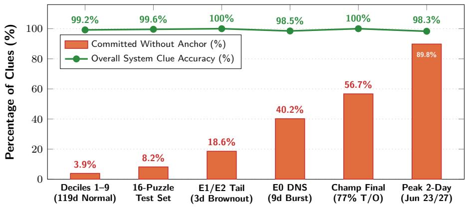  
Evaluation Stratum (Ordered by Anchor Pass 0 Silence Rate)  
Figure 9: Operational tail failover across evaluation strata. Non-anchor commit share (orange bars) and overall system clue accuracy (green line) across evaluation strata ordered by Gemin anchor Pass 0 silence rate (Section 5.4.2, Table 15), holding system clue accuracy between 98.3% and 100.0%.

Across all 9 DNS-burst runs, accuracy was 258/262 (98.47%, slightly above the 97.82% [854/873] average of the other 30 Epoch E0 days), with 40.2% (104/259) of answers committed without the anchor.

• 1 Epoch E0 partial-error run (70.0% Pass 0 silent, 30 clues). On June 20, 2026 (13 errors + 8 timeouts in Pass 0), Gemini recovered in Pass 1 and the run scored 29/30 (96.67%).

• 3 Epoch E1/E2 provider timeout brownout days (42.9%–46.7% Pass 0 silent, 86 clues). Under the corroboration-admission architecture (August 6 in E1; September 3 and September 25 in the frozen E2 configuration), elevated provider timeouts silenced Gemini on nearly half of Pass 0, yet the solver achieved 86/86 (100.0% accuracy, 3/3 perfect grids), with secondary seats supplying 18.6% (16/86) of committed answers (15.5% on the two E2 days vs. 5.3% on the other 41 E2 days).

Across both client-side socket bursts in E0 and provider timeout brownouts in E1/E2, heterogeneous secondary seats supplied substantial answer coverage during anchor outages, preserving 98.68% clue accuracy across Decile 10 (3/3 perfect grids on the corroboration-era brownout days and 8/13 perfect grids across the mixed-epoch tail).

## 5.4.3 Anatomy of the Championship Final

The Championship Final on October 10, 2026 provided the decisive live test of the resilience of this architecture (Figure 10 and Table 16). Throughout Qualifiers 1–3 and Semi-Finals 1–3, Gemini achieved a median efective token delivery rate (defined over non-streaming generate\_content calls as (reasoning + output tokens)/elapsed seconds) of 114.6–119.1 tokens/s, timing out on only 1 to 8 <sub>clues</sub> <sub>per</sub> <sub>puzzle.</sub>26

<sup>26</sup>In Semi-Final 2, the last unsolved clue (10A <sub>CATHERINE HOWARD</sub>; Clue C13, Table 18) was supplied by the <sub>gpt-6-astra</sub> boundary feed: the feed file landed on disk at 5m 32s (332.0s), just 13.7s after Pass 2 had entered at

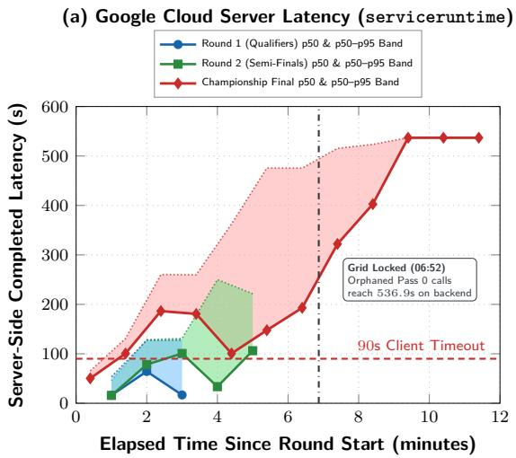

(b) Final Pass 0 Token Delivery vs. 90s Timeout  
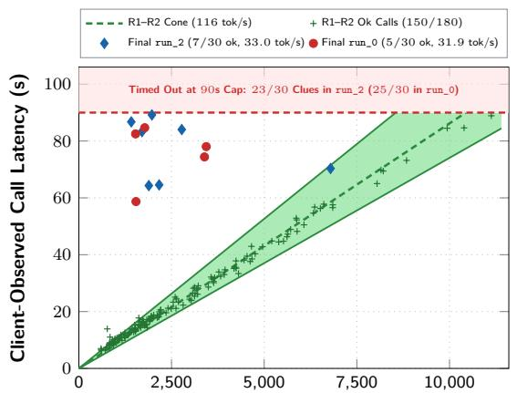  
Total Generated Tokens per Call (Reasoning + Output)  
Figure 10: Dual-sided telemetry of the Championship Final anchor brownout (October 10, 2026; Section 5.4.3). (a) Project-scoped Google Cloud serviceruntime server-side request latency (p50 and p50–p95 band) across the three championship rounds (90 concurrent Pass 0 requests per round); completions logged after grid lock (t = 6m 52s, up to 536.9s) reflect client-cancelled Pass 0 “zombie” requests finishing on the backend. (b) Client-observed Pass 0 call latency versus total generated tokens across Rounds 1–2 (150/180 completed calls, median 116 tokens/s, green cone) and the Championship Final (33.0 tokens/s in run\_2, where 23/30 calls hit the 90s timeout cap).

Seconds after the Championship Final PDF was ingested, the anchor endpoint sufered a severe latency brownout. Because each replica (run\_0, run\_1, and run\_2) executes as an independent OS process writing its own per-call JSONL telemetry log (pane{0,1,2}\_p944766\_calls.jsonl) that records the exact reasoning\_tokens, output\_tokens, and client wall-clock response\_time\_ms returned in each call’s API response metadata, we can measure token delivery per replica directly. Across completed Pass 0 calls, median efective token delivery dropped by 72% to 33.0 tokens/s in the winning replica (run\_2) (31.9 tokens/s in run\_0; Figure 10b). Call-level telemetry shows that six of the seven surviving Pass 0 calls in run\_2 generated normal reasoning volumes of only 1,414 to 2,776 total tokens (which require 12–24s at 115 tokens/s), yet took 64.3s to 89.2s of wall-clock time (16.3–33.5 efective tokens/s; e.g., clue 21A COUNTEREXAMPLE [Clue C19] generated 1,414 tokens in 86.7s, while a single early-scheduled call, 9D ROAD RAGE [Clue C16], generated 6,791 tokens in 70.3s at 96.5 tokens/s before the slowdown deepened). Because queueing delay and reduced token delivery consumed 50–70s per call, any clue requiring > 3,000 thinking tokens hit the 90s client timeout cap, causing 23 of the 30 Pass 0 calls to time out in the winning replica (25/30 in run\_0).

We cross-checked this event using project-scoped Google Cloud Monitoring telemetry (serviceruntime.googleapis.com/api/request\_latencies and request\_count; Figure 10a) and our pre-championship concurrency rehearsals.

• Identical client concurrency across all three rounds. Because Round 1 (three Qualifying puzzles in parallel) and Round 2 (three Semi-Final puzzles in parallel) ran across three panes simultaneously, all three championship rounds launched with the exact same client concurrency profile: 3 panes × 30 clues = 90 in-flight Pass 0 requests per primary seat, staggered over 4.5s (20 req/s). In a pre-championship rehearsal on October 3 (R45, $3 \times 3 0 = 9 0$ concurrent requests on a hard puzzle), Gemini had achieved 97%–100% Pass 0 completion at a median latency of 26.3s–31.8s.

• Server-side latency spike and post-lock “zombie” completions. In Round 1 (10:15 UTC) and Round 2 (11:46 UTC), Google’s server-side serviceruntime latency p50 during the opening minute was 16.25s and 15.94s. In the Final (14:36 UTC), server-side p50 jumped 3.1× in the first minute to 50.3s $( \mathrm { p 9 5 } = 9 6 . 0 \mathrm { s } )$ , breaching the 90s client timeout cap in minute 2 at $\mathrm { p 5 0 = 1 0 0 . 7 s }$ $( \mathrm { p 9 5 } = 1 3 0 . 9 \mathrm { s } )$ and reaching a minute-bucket median p50 of 186.4s during the live solve window $\left( t \leq 6 \mathrm { { m } 5 2 \mathrm { { s } } } \right)$ . Google Cloud’s serviceruntime metric records a server-side latency sample at the timestamp when the backend finishes generating a response, even if the client closed its HTTP socket earlier at the 90s client timeout. Because all three replicas had finished or been terminated by 14:44 UTC (after run\_2 locked the winning grid at 14:43:24 UTC, t = 6m 52s) and no new requests were issued thereafter, the server completions recorded in the 14:44–14:50 UTC minute buckets with p50 climbing from 192.9s to 536.9s (Figure 10a) directly reflect the orphaned Pass 0 generations continuing to execute on Google’s backend for 180–536.9s, which also compounded project-level queue contention during Pass 1.

The pass-barrier logs of the winning replica (<sub>run\_</sub>2; Table 16) show how Darmok still finished 30/30 in 6m 52s while its primary anchor timed out on 23/30 clues in Pass 0 (and failed on 17 of the 23 open clues re-dispatched to Gemini in Pass 1 [16 timeouts at 90s plus 1 JSON parse failure on 18A at 84.1s], proposing only 13/30 answers across the entire run before grid lock).

1. Pass 0 Barrier (t = 1, 7 clues admitted, 23 remain open). In Pass 0, only 7 Gemini calls beat the 90s timeout wall (6 corroborated by Claude on 20A, 21A, 25A, 28A EDITOR [Clue C21], 5D, and 6D, plus 1 lone Gemini commit on 9D ROAD RAGE [Clue C16]). Meanwhile, Claude returned status ok on $2 6 / 3 0$ clues in a median of 17.8s, and 16 of its qualifying solo answers (≥ 85) were held back at $b _ { i } ^ { ( 1 ) } = 1 < \theta = 2$ awaiting corroboration. On the hardest clues where Claude (in Pass 0) and GPT-5 (when it joined in Pass 1) failed to parse the wordplay, they proposed plausible definition-only confabulations:

• On Final 1D (MATES RATES; Clue C14, Table 18), Claude proposed FIRST NAMES at confidence 78 in Pass 0, and GPT-5 proposed MATES AGAIN at confidence 82 in Pass 1.

• On Final 14A (AIRED; Clue C17), Claude proposed ALERT at confidence 82 in Pass 0, and GPT-5 proposed TIRED at confidence 63 in Pass 1.

• On Final 27A (SNEAKING; Clue C20), Claude in run\_0 proposed HANGOVER at confidence 82 in Pass 1, and GPT-5 in run\_2 proposed ELONGATE at confidence 58 in Pass 1.

Because Claude’s calibration floor sits at $\tau _ { \mathrm { p e e r } } = 8 5$ (Figure 6a), FIRST NAMES (78), ALERT (82), and HANGOVER (82) were excluded from $\mathcal { Q } _ { i } ^ { ( t ) } ~ ( i \notin S ^ { ( t ) } )$ . When GPT-5 joined in Pass 1, its lone proposals above $\tau _ { \mathrm { t h i r d } } = 5 0$ received $b _ { i } ^ { ( 2 ) } = 1 < \theta = 2$ and were held out of $K ^ { ( 2 ) }$ for lack of crossing support, keeping all clues uncorrupted.

2. Pass 1 Barrier (t = 2, 19 additional per-clue commits + 4 boundary-feed commits $= 3 0 / 3 0 )$ . Re-dispatching the 23 open clues in Pass 1 to all three seats (where Gemini returned $6 / 2 3$ ok, 16 timeouts, and 1 parse failure; Claude returned 16/23 ok, 5 timeouts, and 2 parse failures on 4A and 11A; and GPT-5 returned 19/23 ok and 4 empty) produced 19 Pass 1 admissions across 26/30 total clues (145 of 162 white cells filled). Cumulative across Passes 0–1,

6 of the 19 Pass 1 admissions were proposed by all three seats: 5 with all three seats returning in Pass 1 (including the deciding human clue 2D SNARF [Clue C15], which Claude had proposed alone at confidence 85 in Pass 0 and all three seats confirmed in Pass 1) plus 11A PHOTO, where Gemini and GPT-5 agreed in Pass 1 on the answer Claude had already proposed in Pass 0. Another 10 were proposed by Claude and GPT-5 without Gemini (8 via within-Pass-1 agreement on 1A, 3D, 8D, 10A, 15D, 17D, 22D, and 24D, plus 2 clues, 4A WATERLOG and 26A FORTHWITH, where Claude proposed the answer in Pass 0 and GPT-5’s Pass 1 proposal was lifted by kept crossings), and 3 were proposed by Claude alone (7D LOOM LARGE, 12A SOFT UNDERBELLY, and 16A ANCESTRAL, where GPT-5 returned empty and Claude’s Pass 1 proposal was lifted by kept crossings: $s _ { i } ^ { ( 2 ) } = b _ { i } ^ { ( 2 ) } + w ( \sigma _ { j } ^ { ( 1 ) } ) \geq 2 )$ . Finally, when the Pass 1 barrier closed at session t = 410.7s (solver\_dt = 402.3s, after the 8.4s PDF parse), the orchestrator polled the gpt-6-astra boundary feed, which had written its 30/30 sheet to disk at session t = 337.8s (solver\_dt = 329.4s) and waited 72.9s on both clocks for Pass 1’s 150s Claude timeout barrier to finish. Admitting the last 4 open clues from the feed (1D MATES RATES [C14], 14A AIRED [C17], 18A EXPEDIENT [C18], and 27A SNEAKING [C20]) and running 1.1s of verification and PDF output locked the 30/30 grid at 6m 52s (411.8s session / 403.4s solver, 74.0s total after feed completion).

Counterfactual Replay and Cross-Verification in the Final. Running our ofline admission harness on the recorded Final call logs evaluates the conditional replay of admission decisions across three failover questions.

1. Anchor-only conditional replay. Removing Claude, GPT-5, and the boundary feed under the recorded Gemini timeouts admits only 7/30 clues in Pass 0 and 13/30 in Pass 1 in run\_2 (15/30 in run\_0), leaving more than half the grid unsolved at the end of Pass 1.

2. Per-clue seats without boundary feed replay. Retaining the three per-clue seats without the boundary feed commits 26/30 correct answers (145/162 white cells) by the end of Pass 1, leaving the 4 feed-admitted clues open for Pass 2.

3. Cell-level mutual verification between per-clue seats and the boundary feed. Across the 17 checked entry positions of the 4 feed words (15 unique checked physical grid cells), the 26 per-clue seat commits in run\_2 pre-filled 13/17 checked entry positions (76.5%, or $1 3 / 1 5 = 8 6 . 7 \%$ of unique checked physical cells): 4/4 on 27A SNEAKING (S\_E\_K\_N\_), 4/5 on 18A EXPEDIENT (\_\_P\_D\_E\_T, positions 3, 5, 7, 9), 2/3 on 14A AIRED (\_\_R\_D), and 3/5 on 1D MATES RATES (M\_T\_S\_\_\_\_\_, positions 1, 3, 5), while the remaining 2 unique checked physical cells at 1D position 7 (A, cell (7, 1)) and position 9 (E, cell (9, 1)) cross-checked the first letters of 14A and 18A. Conversely, a design that accepted the gpt-6-astra whole-grid sheet immediately upon arrival whenever it agreed with 100% of already-kept Pass 0 cells (7/7) would have finished at 5m 38s (saving 72.9s of Pass 1 barrier wait), at the cost of foregoing Pass 1’s independent multi-seat verification on 19 clues.

## 5.5 Residual Errors: The “No Good, Very Bad”, Very Long Tail Above 99.5%

Across our three frozen-architecture benchmarks (Epoch E2 daily production at 1,259/1,261 = 99.84%, the 16-puzzle stratified test set at $4 6 1 / 4 6 3 = 9 9 . 5 7 \%$ , and zero-shot Mephisto transfer at $3 5 0 / 3 6 0 = 9 7 . 2 2 \% )$ , Darmok committed only 7 wrong answers out of 2,084 total clues (0.34%). Inspecting every residual error across Darmok and our standalone frontier runs (with complete verified wordplay derivations in Tables 17 to 19) shows that the remaining object-level failures in this very long tail concentrate in four specific linguistic boundary cases:

1. Unchecked-Cell Orthographic and Dialect Variants (3/4 Mephisto errors). Because 20.0% to 50.0% of each word’s letters in British barred and blocked grids are unchecked (Figure 3b–c), perpendicular words cannot disambiguate single-letter spelling variants that fall on an unchecked square. On test-set puzzle 29399 (Replica 2, rep3), clue 2D (PAUPERIZE; Clue C5, Table 17) places its eighth letter (S vs. Z) on an unchecked cell (Figure 3b). While both PAUPERISE and PAUPERIZE are valid British spellings of the definition (“Make poor”), the container wordplay (PRIZE [“value”] wrapping around A[UP]E → P[A(UP)E]RIZE) uniquely selects Z, because in British English PRIZE means “to value” whereas PRISE means “to lever”; in Replica 2, Claude glossed PRISE as a variant of PRIZE and emitted PAUPERISE. Similarly, as detailed in Section 5.2, three of the four errors across our 360-clue Mephisto evaluation were Chambers Dictionary headword variants on unchecked squares: REIVE for RIEVE (#3440 27D; Clue C23), HOLLOA for HALLOA (#3445 30A; Clue C24), and CARDAMOM for CARDAMUM (#3449 21A; Clue C25; the fourth was TOPARCH for TRIARCH on #3446 19D, which resolved to TRIARCH under extended timeout).

2. Correlated Multi-Seat Convergence on an Extreme Decoy (2/2 Test-Set errors). Because Equation (3) awards $b _ { i } ^ { ( t ) } = 2$ whenever two seats independently propose the same string above their calibration floors, an error can enter $K ^ { ( t ) }$ if two models fall into the same decoy trap on an extreme clue before perpendicular crossings lock the clue. Both errors on the 463-clue test set occurred in the extreme SNITCH 160+ band (Table 19): on puzzle 29399 clue 1D $( ^ { \ : 6 } P e t \ell$ You shouldn’t have one $( 4 ) ^ { \mathfrak { N } } \to \mathtt { T A M E }$ ; Clue C26), the models failed to resolve the British colloquialism TA (“You shouldn’t have!”) + ME and committed TOMB against pattern T?M?; and on puzzle 29435 clue 5D (“Brought into line, book parts rather like Peter or Roger? $( \gamma ) ^ { \mathfrak { P } } \to \mathtt { R A B B I T Y } ;$ Clue C27), two seats converged on the plural carpentry noun RABBETS.

3. Nested Single-Letter Substitution Blindness (CONTEST vs. CONTEXT). Even frontier models exceeding 99% accuracy occasionally fail on nested single-letter substitutions when the un-substituted base word is strongly primed by the surface reading. Across 900 graded championship clues in our single-shot gemini-4-argon runs (Table 6), the model committed only a single unique wordplay error, repeated across two independent 65k-cap draws on Semi-Final 1 clue 28A (CONTEXT; Clue C3, Figure 2b and Table 17): in both draws, the model identified the base synonym CONTEST and the substitution (S → X), yet emitted the un-substituted base word CONTEST.

4. Uncorroborated Terminal Sweep Fills under All-or-Nothing Scoring. When every model seat abstains or times out across all passes on an extreme clue, such as puzzle 29435 clue 15D (AIR SIGNS; Clue C28, Table 19, in Replicas 0–1 of the test set) or the sole wrong clue in Epoch E2 (puzzle 29658 clue 8D TOW-PLANES; Clue C22, Table 18), the deterministic terminal dictionary sweep (swp) fills the open clue with a lexicon match consistent with all crossing letters (ARRAIGNS on A?R?I?N?; TOWELINGS on T?W?L?N?S, where TOW-PLANES was absent from the single-word lexicon). Under tournament rules, because a blank square already forfeits the clue, an uncorroborated terminal guess that respects all crossing letters never damages an already-kept crossing word and strictly improves expected perfect-grid yield (converting 3 blanks into correct solves across Epoch E2 for 1 miss).

## 6 Discussion

## 6.1 Why Static Benchmarks Misprice Redundancy

We noted in Section 1.2 the central tension in how Darmok was built versus how it looks under standard post-hoc ablation. Over five months of pre-championship development, each downstream mechanism—the Pass 4 historical-answer pass, the asynchronous whole-grid boundary feed, and the four-stage local terminal chain—was added deliberately to rescue a specific class of stubborn residual clue without ever overwriting answers already admitted by upstream stages. Yet when we evaluated the frozen championship system on our 16-puzzle test set after the tournament, removing almost any single downstream stage or secondary model seat changed accuracy by 0 to 1 clue (Figure 8a), making the architecture look at first glance like a neuro-symbolic Rube Goldberg machine [44] whose auxiliary gears were doing no work.

Our five-month operational and experimental record shows why that static diagnosis misreads the structural diference between our 2025 V1 solver and our 2026 V2 architecture. V1 really was a Rube Goldberg contraption: because it relied on greedy cell-level overrides without a global coherence invariant, ad-hoc heuristics interacted destructively across the grid. A true Rube Goldberg machine is a serial chain of coupled indirections in which every added lever can undo the work of an earlier one. In efect, the transition from V1 to V2 inverted Brooks’ classic second-system efect [6]: rather than bloating a spare prototype with coupled features, the second system replaced an entangled web of heuristics with a single pass-barrier invariant (Invariant 3.1) frozen several weeks before the 2026 Championship and tested thoroughly.

Because Darmok’s secondary per-clue seats cannot self-admit cold without corroboration and its strictly non-evicting fallback stages (the boundary feed and local terminal chain) may only fill open residual clues $( R ^ { ( t ) } )$ consistent with kept crossings, never overwriting an upstream kept answer, they form a parallel and staged failover harness akin to N-version fault-tolerant software [4] and active-active replication [41, 22, 34]. In fault-tolerant systems engineering, redundancy mechanisms such as error-correcting memory [14], RAID arrays [27], hedged RPCs [9], and failover replicas [34] contribute zero marginal accuracy on a fault-free trace. If one evaluates a RAID controller [27] by unplugging the mirror drive during a healthy 10-minute benchmark, observing zero data loss, and concluding that the mirror drive is superfluous, it is the evaluation methodology that is broken, not the storage array.

Standard machine learning ablation methodology risks making a similar mistake when applied to complex AI systems operating over commercial reasoning APIs. Evaluated on our 16-puzzle test set, our secondary model seats (Claude and GPT-5) and our asynchronous whole-grid feed $\left( \mathtt { g p t - 6 - a s t r a } \right)$ evaluate to $\Delta = 0$ and $\Delta = - 1$ clues in accuracy (though removing the secondary seats slows diagnostic median solve time by ≈ 1m) because the primary Gemini anchor is healthy. Evaluated across 132 daily production runs (Figure 9), in the 13 runs where anchor Pass 0 silence exceeded 42% (9 Epoch E0 client-side DNS socket-burst runs, 1 E0 partial-error run, and 3 E1/E2 provider brownout days), those secondary seats carry 18.6% to 89.8% of the grid (32.1% pooled; 90.0% single-day peak) while holding clue accuracy at 98.68% (373/378; $8 / 1 3 = 6 1 . 5 \%$ perfect grids overall, with all 5 imperfect grids occurring in Epoch E0 and $8 6 / 8 6 = 1 0 0 \%$ [3/3 perfect grids] on the 3 E1/E2 brownout days). Evaluated on stage during the 2026 Championship Final (Figure 10), when an unexpected provider latency brownout collapsed anchor token delivery by 72% $( 1 1 7  3 3 ~ \mathrm { t o k e n s / s ) }$ , timed out 23/30 opening-pass clues, and failed $1 7 / 2 3$ retry calls (16 timeouts, 1 parse error), the secondary per-clue seats supplied 13 answers without the anchor and the asynchronous gpt-6-astra whole-grid feed supplied the remaining 4, while the per-clue seats independently verified 26/30 clues and $1 3 / 1 7$ checked entry positions (13/15 unique checked physical cells) of the 4 feed entries to complete $3 0 / 3 0$ in 6m 52s.

The same principle governs internal pipeline stages that act as mutual backups. In our 41-day production replay (Figure 8b), single-stage leave-one-out reports that synchronous corroboration admission is worth only 5 clues and the local terminal chain is worth only 4 clues; yet removing both collapses accuracy by 99 clues (8.2% of the corpus, interaction term −90 clues). In systems where upstream consensus pre-empts downstream recovery, one-at-a-time subtraction masks over 90% of both mechanisms’ combined contribution.

## 6.2 From Prompt Carpentry to External Constraint Loops and Asymmetric Calibration

Our controlled clue-level experiments across 9,260 paired API calls (Section 4) carry an equally practical lesson for how practitioners allocate engineering efort when building on native extendedthinking models.

• Visible prompt scafolding shows no detected accuracy advantage over native thinking. Under the tested models, prompts, and completion-conditioned endpoints, microengineering visible chain-of-thought field ordering (P1), draft-and-revise instructions (P2), taxonomy decomposition fields (P3), domain solving tutorials (P4), or confidence-elicitation schemas (P6) showed no statistically significant accuracy advantage on completed calls (Figure 7b; while not a formal proof of equivalence, this is consistent with wordplay search occurring inside the thinking trace prior to JSON output). Prompt schemas serve two narrow systems roles: enforcing a clean output-syntax contract (where simpler flat schemas avoid nested-object formatting quirks) and acting as a brake on unverified guessing (requiring the model to articulate a wordplay explanation under P0 so it searches until the timeout cap on unsolved clues rather than emitting fast, lower-precision guesses as under P5).

• External constraint tightening drives the saturation jump. In contrast to prompt carpentry, feeding back verified intersecting letters pushes open clues into the $n _ { \mathrm { k n o w n } } \ge 3$ highaccuracy regime (Figure 7a) under order-independent kept-set reconstruction (Algorithm 1), raising per-clue solve rates by +33 to +50 percentage points and eliminating partial-word corruption (Invariant 3.1). This external loop mirrors the constraint propagation that frontier models execute internally within their extended-thinking trace during successful one-shot whole-grid runs.

• Calibration and timeout envelopes difer sharply across the evaluated model snapshots. Multi-model ensembles cannot apply uniform confidence thresholds or timeout caps across heterogeneous reasoning models (Figure 6). Because Gemini reports binary confidence (99.8% of responses in [90, 100], rendering $\tau _ { \mathrm { a n c h o r } } = 5 0$ inactive on status-ok calls) and sufers a degraded confabulation tail between 90s and 180s (38.2% accuracy at median confidence 99), it requires a strict 90s timeout cap. Conversely, because Claude reports graded confidence with a steep drop below its [80, 89] bin (motivating the selected operating floor $\tau _ { \mathrm { p e e r } } = 8 5 )$ and a productive 90–150s deep-reasoning tail (4.1% of all solves), it requires a strict confidence floor paired with a generous 150s timeout cap.

## 7 Future Work: Limitations and the Final Frontier

In a post-championship interview with The Times [18], we remarked that Darmok’s competitive mission is complete: we set out to test whether an automated system could match and outpace champion humans on full British cryptic crosswords under live tournament rules, and that milestone has now been demonstrated. Indeed, our own single-shot frontier experiments (Section 5.4) illustrate the trajectory of Sutton’s Bitter Lesson [38]: task-specific neuro-symbolic scafolding pioneers a capability milestone and exposes the governing domain invariants, only for the next generation of general-purpose reasoning models to absorb the loop end-to-end (already visible in gpt-6-astra’s 21/21 one-shot sweep on standard 15×15 championship grids). Operational refinements to Darmok’s cloud harness are straightforward: for example, admitting a corroboration-consistent boundary-feed grid immediately upon arrival rather than waiting for the next pass barrier (which would have saved 72.9s of barrier wait in the Final and 136.5s in Semi-Final 2), using streaming token-rate telemetry to trip pass barriers early during provider brownouts, or running matched-window randomized fault-injection trials. Beyond these engineering improvements, four deeper scientific and systems challenges define the path ahead.

1. From Barred Mephisto Grids to Thematic Meta-Puzzles (The Listener). Our zeroshot transfer study on barred 12 × 12 Mephisto grids (350/360 = 97.2%, 5/10 perfect grids; Section 5.2) confirmed that Darmok’s crossing-constraint core generalizes directly to barred topologies without modifying prompts or wordlists, leaving Chambers-specific orthographic variants on unchecked squares (Section 5.5) and occasional compound or subtractive anagrams as residual failure modes. At the same time, standalone single-shot models still struggle on Mephisto (17/20 invocations of gpt-6-astra failing to finish before the per-clue pipeline), showing that high lexical obscurity and dense wordplay remain a bottleneck for unassisted single-call reasoning even when per-word checking density is high (78.6% mean). Beyond standard barred grids, the next major solving frontier lies in barred thematic crosswords such as The Listener (established 1930 in The Listener and now published weekly in The Times), The Inquisitor (The i Paper), and The Magpie [25]. In a Listener puzzle, a prose preamble defines a bespoke meta-algorithm that interacts with some subset of the clues and/or grid entries: clues may contain unannounced single-letter misprints in the definition whose corrected letters spell a hidden instruction; answers may require encoding via a Playfair square, numerical cipher, or thematic substitution prior to grid entry; completed grids may conceal a visual or thematic <sub>Nina</sub>27 <sub>that</sub> <sub>dictates</sub> <sub>a</sub> <sub>final</sub> <sub>spatial</sub> <sub>transformation;</sub> <sub>or</sub> <sub>the</sub> <sub>grid</sub> <sub>may</sub> <sub>be</sub> <sub>presented</sub> <sub>carte</sub> <sub>blanche</sub> without bars or clue numbers, requiring the solver to infer the grid geometry and the wordplay simultaneously. Because setters continuously invent novel preamble gimmicks and meta-rules, solving Listener-class puzzles requires genuine zero-shot synthesis of puzzle-level algorithms rather than a fixed orchestration pipeline.

2. Closing the “20-Watt Wetware” Gap: Air-Gapped Local Solving. As we observed after the Championship Final, a human finalist brings one mind, a pencil, and roughly 15–30W of biological wetware [28] to the competition floor; Darmok brings four frontier cloud models, three active-active replicas, curated local wordlists, and megawatts of datacenter compute, while remaining exposed to commercial API brownouts (Figure 10). Engineering a fully self-contained, network-free solver that runs locally on a standard laptop or desktop workstation (e.g., a 128 GB unified-memory Framework Desktop [12]), perhaps by distilling or fine-tuning an open-weights reasoning model to achieve championship-caliber accuracy and sub-10-minute latency without external network calls, is a substantial systems and model-compression challenge, and likely the only milestone that would justify fielding a successor to Darmok in a future live competition.

3. Formalizing the Generative Grammar of “Crossword English”. Midway through our summer development, we started an exploratory workstream on learning a probabilistic contextfree grammar (PCFG) over historical clue–parse corpora, but parked it once our diagnostic experiments showed that crossing-constraint tightening and multi-seat corroboration suficed to reach the championship frontier. Yet solving via black-box extended-thinking traces is recognition without a formal generative theory. Even when frontier models solve a spatially or typographically devious clue, such as clue 2D in the 2026 Championship Final (“Wolf trap missing its lowest crosspiece? (5)” → SNARF; Clue C15, Table 18), which tripped up three of the five human finalists, their reasoning lives inside an unstructured natural-language trace. Constructing a rigorous, compositional grammar of “Crossword English” (analogous to P¯an<sub>.</sub> ini’s generative grammar for Sanskrit [19]) that captures token-span coverage, explicit vs. indirect fodder typing across strict Ximenean [24] and libertarian Araucarian [8] traditions, nested string operators, and lexicon-backed synonym judgments without the brittleness of ad-hoc Python-AST scripts (Section 4.4) remains a foundational open problem in computational linguistics. When coupled with a curated lexicon (Γ) and a preference model over competing parse attachments, such a grammar provides both a principled tie-breaker for single-letter spelling variants on unchecked cells (Section 5.5) and the formal backbone required for clue generation (below).

4. The “Olympus Mons” Challenge: Master-Caliber Cryptic Setting under Data Scarcity. If matching human champions at solving cryptic crosswords was the Mount Everest challenge, creating an automated cryptic setter whose clues and grids are indistinguishable from those of a Times master setter is the Olympus Mons challenge. Current frontier LLMs are poor cryptic setters for two structural reasons:

(a) Bilevel grammatical synthesis. Generating a valid, witty cryptic clue requires satisfying two independent grammars in a single token sequence (Figure 2). Working backward from a target entry (e.g., ESTIMATION), a master setter constructs a sound wordplay AST while ensuring that the surface tokens read naturally as a cohesive, topical English sentence that conceals the boundary between definition and wordplay. For example, Times Puzzles Editor Mick Hodgkin’s topical clue commemorating Darmok [18], “AI not foxed by Times cryptic — respect! (10)” (Clue C29, Table 19), places an anagram (cryptic) of TIMES (ESTIM) before (by) an anagram (foxed) of AI NOT (ATION) to define respect!. Standard left-to-right autoregressive generation optimizes surface fluency at the expense of exact character-level AST soundness, or vice versa.

(b) Severe corpus scarcity. Unlike general natural language, the entire modern digital archive of cryptic crosswords since $2 0 0 0 ^ { 2 8 }$ comprises only a few million clues across all major British broadsheets (roughly 250,000 clues in The Times archives alone), of which perhaps $1 0 ^ { 5 }$ to $1 0 ^ { 6 }$ are paired with verified human wordplay parses, still orders of magnitude smaller than foundation-model pre-training corpora.

At the same time, setting relaxes one central constraint that dominated Darmok’s engineering: there is no tournament clock. Whereas a championship solver must solve 30 clues in under seven minutes across live API barriers, a human setter may spend hours or days crafting a single puzzle. Because setting is an ofline problem, an automated setter can expend orders of magnitude more compute per clue without wall-clock latency pressure. It can combine formal grammatical enumeration (Point 3), deep tree search over candidate wordplay decompositions, neural surface synthesis (potentially using discrete difusion models rather than left-to-right autoregression to satisfy surface and wordplay constraints jointly), and solver-in-the-loop verification (using a system like Darmok itself as an adversarial critic to reject unsound or unidiomatic drafts).

## 8 Conclusion

From Proverb [35, 20] and Dr.Fill [13] to the Berkeley Crossword Solver [42], tournament crossword solving has tracked the progression of artificial intelligence from heuristic search and probabilistic graphical models to neural candidate retrieval. British cryptic crosswords remained a prominent holdout for more than two decades because sparse grids and adversarial, nested wordplay defeated static retrieval CSPs. Darmok’s 210/210 sweep of the 55th Times Crossword Championship in London, its 99.84% accuracy across 1,261 post-cutof daily clues in its frozen epoch (99.17% across all 3,876 daily campaign clues), and its 97.2% zero-shot transfer to barred Mephisto grids demonstrate championship-caliber performance on this long-standing challenge.

Yet the broader systems lesson of our post-championship study extends beyond crosswords. As frontier models cross the capability threshold on complex reasoning tasks, the bottleneck in deployed AI systems shifts from average-case single-call capability to tail-regime invariants: surviving provider brownouts and client network bursts, aborting late-tail calibration collapse, blocking uncorroborated confabulations, and guaranteeing global state coherence across asynchronous calls. Engineering systems that meet strict accuracy–latency objectives does not become obsolete when models grow stronger; rather, it transforms AI orchestration from the art of coaxing capability out of weak models into the discipline of building resilient, high-reliability systems out of capable but volatile ones.

## Acknowledgments

We thank The Times puzzles team—Mick Hodgkin, Jason Crampton, and Peter Biddlecombe—for their ongoing encouragement, strategic skepticism, and unstinting support in allowing Darmok to participate in the 55th Times Crossword Championship and for their generous hospitality and crossword discussions, and John Guiver for his willingness to share his master setter’s insights on cruciverbalist AIs. We also thank Kyle Mahowald and Nick Tomlin for multiple helpful technical discussions, and the students who contributed to early experiments and data wrangling tasks: Dev Aggarwal, Arya Agiwal, Saatvik Barla, Nishant Bhakar, Jaxon Dial, and Om Goswami. Jason Crampton, Mick Hodgkin, Peter Stone, and Nick Tomlin read and provided valuable feedback on earlier versions of this document.

## Disclosure of AI Usage in Research and Manuscript Preparation

In accordance with current scientific publishing standards (ACM, ACL, NeurIPS, and Nature authorship and transparency guidelines), we disclose two distinct roles of generative AI systems in this work:

1. AI Systems as the Object of Study. The Darmok solver orchestrates commercia large language model APIs (gemini-3.1-pro-preview, claude-fable-5, gpt-5.6-sol, and gpt-6-astra, alongside baseline comparisons against gemini-4-argon and gemini-3.8-flash) as experimental subjects and system components. Model codenames (claude-fable-5, gpt-5.6-sol, gpt-6-astra, gemini-4-argon, and gemini-3.8-flash) correspond to vendorembargoed frontier model snapshots evaluated between May and October 2026; exact provider snapshot strings and API identifiers will be unmasked in the camera-ready/updated arXiv version immediately upon expiration of the respective vendor embargoes. All prompts, model configurations, timeout envelopes, token budgets, and call-level logs are archived in the project repository (https://github.com/Darmok-Jalad-Tanagra/darmok-v2, to be made public upon release) for full auditability.

2. AI Assistance in Software Engineering and Manuscript Preparation. Coding assistants and large language models (Anthropic Claude and Google Gemini) were used under the author’s direct supervision to assist with software implementation, experimental harness scripting, telemetry log aggregation, data visualization (TikZ/pgfplots/matplotlib), and manuscript editing and formatting. All architectural designs, experimental hypotheses, pre-registered ablation protocols, statistical analyses, and scientific claims were conceived, verified, and approved by the human author, who takes full responsibility for the integrity and accuracy of the manuscript.

## References

[1] Anbulagan and Adi Botea. Crossword puzzles as a constraint problem. In Principles and Practice of Constraint Programming (CP 2008), volume 5202 of Lecture Notes in Computer Science, pages 554–558. Springer, 2008. doi:10.1007/978-3-540-85958-1\_40.

[2] Martin Andrews and Sam Witteveen. Proving that cryptic crossword clue answers are correct. arXiv preprint arXiv:2407.08824, 2024. doi:10.48550/arXiv.2407.08824.

[3] Martin Andrews and Sam Witteveen. A reasoning-based approach to cryptic crossword clue solving. In Proceedings of the 42nd International Conference on Machine Learning (ICML 2025), volume 267 of Proceedings of Machine Learning Research, 2025. https://proceedings. mlr.press/v267/andrews25a.html.

[4] Algirdas Avižienis. The N-version approach to fault-tolerant software. IEEE Transactions on Software Engineering, SE-11(12):1491–1501, 1985. doi:10.1109/TSE.1985.231893.

[5] Adam Beacham, Xinguang Chen, Jonathan Sillito, and Peter van Beek. Constraint programming lessons learned from crossword puzzles. In Advances in Artificial Intelligence (Canadian AI 2001), volume 2056 of Lecture Notes in Computer Science, pages 78–87. Springer, 2001. doi:10.1007/3-540-45153-6\_8.

[6] Frederick P. Brooks, Jr. The Mythical Man-Month: Essays on Software Engineering. Addison-Wesley, Reading, MA, 1975. ISBN 978-0-201-00650-6.

[7] Lihan Chen, Jingping Liu, Sihang Jiang, Chao Wang, Jiaqing Liang, Yanghua Xiao, Sheng Zhang, and Rui Song. Crossword puzzle resolution via Monte Carlo tree search. In Proceedings of the Thirty-Second International Conference on Automated Planning and Scheduling (ICAPS 2022), volume 32, pages 35–43, 2022. doi:10.1609/icaps.v32i1.19783.

[8] Alan Connor. Two Girls, One on Each Knee: The Puzzling, Playful World of the Crossword. Particular Books (Penguin), London, 2013. ISBN 978-1-84614-841-5.

[9] Jefrey Dean and Luiz André Barroso. The tail at scale. Communications of the ACM, 56(2):74–80, 2013. doi:10.1145/2408776.2408794.

[10] Avia Efrat, Uri Shaham, Dan Kilman, and Omer Levy. Cryptonite: A cryptic crossword benchmark for extreme ambiguity in language. In Proceedings of the 2021 Conference on Empirical Methods in Natural Language Processing (EMNLP 2021), pages 4186–4192, 2021. doi:10.18653/v1/2021.emnlp-main.344.

[11] Marco Ernandes, Giovanni Angelini, and Marco Gori. WebCrow: A web-based system for crossword solving. In Proceedings of the Twentieth National Conference on Artificial Intelligence (AAAI-05), pages 1412–1417, 2005. https://aaai.org/papers/ 01412-aaai05-224-webcrow-a-web-based-system-for-crossword-solving/.

[12] Framework Computer. Framework Desktop (AMD Ryzen AI Max+ 395, 128 GB unified memory) technical specifications. https://frame.work/desktop, 2025.

[13] Matthew L. Ginsberg. Dr.Fill: Crosswords and an implemented solver for singly weighted CSPs. Journal of Artificial Intelligence Research, 42:851–886, 2011. doi:10.1613/jair.3437.

[14] Richard W. Hamming. Error detecting and error correcting codes. The Bell System Technical Journal, 29(2):147–160, 1950. doi:10.1002/j.1538-7305.1950.tb00463.x.

[15] David Hardcastle. Cryptic crossword clues: Generating text with a hidden meaning. In Proceedings of the Eleventh European Workshop on Natural Language Generation (ENLG 07), pages 147–150, 2007. https://aclanthology.org/W07-2323/.

[16] David Hardcastle. Riddle Posed by Computer (6): The Computer Generation of Cryptic Crossword Clues. PhD thesis, Birkbeck, University of London, 2007. https://ethos.bl.uk/ OrderDetails.do?uin=uk.bl.ethos.446158.

[17] Alexander K. Hartmann. Nonuniversality for crossword puzzle percolation. Physical Review E, 110(6):064138, 2024. doi:10.1103/PhysRevE.110.064138.

[18] Mick Hodgkin and The Times. The 55th Times Crossword Championship and post-championship report. The Times (London), October 2026.

[19] Paul Kiparsky. On the architecture of P¯an<sub>.</sub> ini’s grammar. In Sanskrit Computational Linguistics, volume 5402 of Lecture Notes in Computer Science, pages 33–94. Springer, 2009. doi:10.1007/978- 3-642-00155-0\_2.

[20] Michael L. Littman, Greg A. Keim, and Noam Shazeer. A probabilistic approach to solving crossword puzzles. Artificial Intelligence, 134(1–2):23–55, 2002. doi:10.1016/S0004-3702(01)00114-X.

[21] Jingping Liu, Lihan Chen, Sihang Jiang, Chao Wang, Jiaqing Liang, Yanghua Xiao, Sheng Zhang, and Rui Song. A crossword solving system based on Monte Carlo tree search. Artificial Intelligence, 335:104192, 2024. doi:10.1016/j.artint.2024.104192.

[22] Robert E. Lyons and Wouter Vanderkulk. The use of triple-modular redundancy to improve computer reliability. IBM Journal of Research and Development, 6(2):200–209, 1962. doi:10.1147/rd.62.0200.

[23] Alan K. Mackworth. Consistency in networks of relations. Artificial Intelligence, 8(1):99–118, 1977. doi:10.1016/0004-3702(77)90007-8.

[24] Derrick Somerset Macnutt. Ximenes on the Art of the Crossword. Methuen, London, 1966. ISBN 978-0-416-46730-7.

[25] Don Manley. Chambers Crossword Manual. Chambers Harrap, Edinburgh, 5th edition, 2014. ISBN 978-1-4736-0303-5.

[26] Kevin P. Murphy, Yair Weiss, and Michael I. Jordan. Loopy belief propagation for approximate inference: An empirical study. In Proceedings of the Fifteenth Conference on Uncertainty in Artificial Intelligence (UAI-99), pages 467–475, 1999. https://arxiv.org/abs/1301.6725.

[27] David A. Patterson, Garth Gibson, and Randy H. Katz. A case for redundant arrays of inexpensive disks (RAID). In Proceedings of the 1988 ACM SIGMOD International Conference on Management of Data, pages 109–116, 1988. doi:10.1145/50202.50214.

[28] Marcus E. Raichle and Debra A. Gusnard. Appraising the brain’s energy budget. Proceedings of the National Academy of Sciences, 99(16):10237–10239, 2002. doi:10.1073/pnas.172399499.

[29] Josh Rozner, Christopher Potts, and Kyle Mahowald. Decrypting cryptic crosswords: Semantically complex wordplay puzzles as a target for NLP. In Advances in Neural Information Processing Systems (NeurIPS 2021), volume 34, pages 11409–11421, 2021. https://proceedings. neurips.cc/paper/2021/hash/5f1d3986fae10ed2994d14ecd89892d7-Abstract.html.

[30] Yousef Saad. Iterative Methods for Sparse Linear Systems. Society for Industrial and Applied Mathematics (SIAM), Philadelphia, PA, 2nd edition, 2003. doi:10.1137/1.9780898718003.

[31] Abdelrahman Sadallah, Daria Kotova, and Ekaterina Kochmar. Are LLMs good cryptic crossword solvers? arXiv preprint arXiv:2403.12094, 2024. doi:10.48550/arXiv.2403.12094.

[32] Abdelrahman Sadallah, Daria Kotova, and Ekaterina Kochmar. What makes cryptic crosswords challenging for LLMs? In Proceedings of the 31st International Conference on Computational Linguistics (COLING 2025), pages 5102–5114, 2025. https://aclanthology.org/2025. coling-main.342/.

[33] Soumadeep Saha, Sutanoya Chakraborty, Saptarshi Saha, and Utpal Garain. Language models are crossword solvers. In Proceedings ofthe 2025 Conference ofthe Nations ofthe Americas Chapter of the Association for Computational Linguistics: Human Language Technologies (Volume 1: Long Papers), pages 2074–2090, 2025. https://aclanthology.org/2025.naacl-long.104/.

[34] Fred B. Schneider. Implementing fault-tolerant services using the state machine approach: A tutorial. ACM Computing Surveys, 22(4):299–319, 1990. doi:10.1145/98163.98167.

[35] Noam M. Shazeer, Michael L. Littman, and Greg A. Keim. Solving crossword puzzles as probabilistic constraint satisfaction. In Proceedings of the Sixteenth National Conference on Artificial Intelligence (AAAI-99), pages 156–162, 1999. https://cdn.aaai.org/AAAI/1999/ AAAI99-023.pdf.

[36] Brian Sheppard. World-championship-caliber Scrabble. Artificial Intelligence, 134(1–2):241–275, 2002. doi:10.1016/S0004-3702(01)00166-7.

[37] Michael Smith. Station X: The Codebreakers of Bletchley Park. Channel 4 Books, London, 1998. ISBN 978-0-7522-2189-2.

[38] Richard S. Sutton. The bitter lesson. http://www.incompleteideas.net/IncIdeas/ BitterLesson.html, 2019.

[39] The Clue Clinic. Clinical Data: The Codes Used in Cryptic Crosswords—Abbreviations and Indicators. https://clueclinic.com/index.php/clinical-data/, 2026.

[40] William Tunstall-Pedoe. True knowledge: Open-domain question answering using structured knowledge and inference. AI Magazine, 31(3):80–92, 2010. doi:10.1609/aimag.v31i3.2298.

[41] John von Neumann. Probabilistic logics and the synthesis of reliable organisms from unreliable components. In Claude E. Shannon and John McCarthy, editors, Automata Studies, volume 34 of Annals of Mathematics Studies, pages 43–98. Princeton University Press, Princeton, NJ, 1956. doi:10.1515/9781400882618-003.

[42] Eric Wallace, Nicholas Tomlin, Albert Xu, Kevin Yang, Eshaan Pathak, Matthew L. Ginsberg, and Dan Klein. Automated crossword solving. In Proceedings of the 60th Annual Meeting of the Association for Computational Linguistics (Volume 1: Long Papers), pages 3073–3085, 2022. doi:10.18653/v1/2022.acl-long.219.

[43] P. W. Williams and D. Woodhead. Computer assisted analysis of cryptic crosswords. The Computer Journal, 22(1):67–70, 1979. doi:10.1093/comjnl/22.1.67.

[44] Maynard Frank Wolfe. Rube Goldberg: Inventions! Simon & Schuster, New York, 2000. ISBN 978-0-684-86724-3.

[45] D. Woodhead. Computer aids to the solution of cryptic crossword puzzles. Third year project report, University of Manchester Institute of Science and Technology (UMIST), 1977.

## A Complete Experimental Reference Tables

To preserve full numerical reproducibility while keeping the main text visually accessible, this appendix provides the complete tabular data corresponding to the experiments in Sections 4 and 5.

Table 7: Per-clue solve rate across the 16-puzzle test set $( N = 4 6 3 ;$ Section 4.1 and Figure 7a), stratified by cold vs. constrained dispatch (Panel A), known crossing letters $n _ { \mathrm { k n o w n } }$ (Panel B), and crossing density $n _ { \mathrm { k n o w n } } / \ell _ { i }$ (Panel C).
<table><tr><td>Condition / Stratum</td><td>Clues (n)</td><td>Gemini 3.1 Pro</td><td>Claude</td><td>GPT-5</td><td>Any Seat (Oracle)</td></tr><tr><td colspan="6">Panel A: Cold vs. Crossing-Constrained Dispatch</td></tr><tr><td>Unconstrained / Cold (&gt; 100 matches)</td><td>143</td><td>91 (63.6%)</td><td>63 (44.1%)</td><td>68 (47.6%)</td><td></td></tr><tr><td>Constrained (≤ 100 matches)</td><td>320</td><td>309 (96.6%)</td><td>302 (94.4%)</td><td>271 (84.7%)</td><td></td></tr><tr><td>Full Test Set (All Clues)</td><td>463</td><td>400 (86.4%)</td><td>365 (78.8%)</td><td>339 (73.2%)</td><td>427 (92.2%)</td></tr><tr><td>All Three Seats Correct (Consensus)</td><td>463</td><td>298/463 (64.4%);</td><td></td><td></td><td>Unique solves: Gemini 31, GPT-5 9, Claude 8</td></tr><tr><td colspan="6">Panel B: Stratified by Number of Known Crossing Letters nknown</td></tr><tr><td> $n _ { \mathrm { k n o w n } } = 0$ </td><td>9</td><td>7 (77.8%)</td><td>7 (77.8%)</td><td>4 (44.4%)</td><td>8 (88.9%)</td></tr><tr><td> $n _ { \mathrm { k n o w n } } = 1$ </td><td>32</td><td>18 (56.3%)</td><td>10 (31.3%)</td><td>18 (56.3%)</td><td>23 (71.9%)</td></tr><tr><td> $n _ { \mathrm { k n o w n } } = 2$ </td><td>131</td><td>98 (74.8%)</td><td>77 (58.8%)</td><td>74 (56.5%)</td><td>108 (82.4%)</td></tr><tr><td> $n _ { \mathrm { k n o w n } } = 3$ </td><td>156</td><td>146 (93.6%)</td><td>143 (91.7%)</td><td>127 (81.4%)</td><td>153 (98.1%)</td></tr><tr><td> $n _ { \mathrm { k n o w n } } = 4$ </td><td>77</td><td>75 (97.4%)</td><td>74 (96.1%)</td><td>68 (88.3%)</td><td>77 (100.0%)</td></tr><tr><td> $n _ { \mathrm { k n o w n } } = 5$ </td><td>47</td><td>46 (97.9%)</td><td>43 (91.5%)</td><td>39 (83.0%)</td><td>47 (100.0%)</td></tr><tr><td> $n _ { \mathrm { k n o w n } } \ge 6$ </td><td>11</td><td>10 (90.9%)</td><td>11 (100.0%)</td><td>9 (81.8%)</td><td>11 (100.0%)</td></tr><tr><td colspan="4">Panel C: Stratified by Crossing Letter Density</td><td></td><td></td></tr><tr><td>0%</td><td> $( n _ { k n o w n } / \ell _ { i } )$  9</td><td>77.8%</td><td>77.8%</td><td>44.4%</td><td>88.9%</td></tr><tr><td>1%-25%</td><td>87</td><td>63.2%</td><td>42.5%</td><td>43.7%</td><td>72.4%</td></tr><tr><td>26%-40%</td><td>99</td><td>89.9%</td><td>77.8%</td><td>78.8%</td><td>95.0%</td></tr><tr><td>41%-55%</td><td>152</td><td>89.5%</td><td>86.8%</td><td>77.6%</td><td>96.1%</td></tr><tr><td>&gt; 55%</td><td>116</td><td>97.4%</td><td>96.6%</td><td>87.1%</td><td>100.0%</td></tr></table>

Table 8: Puzzle identities, publication dates, Snitch ratings, replica budgets (D), and solve scores on the 16-puzzle stratified test set $( N = 4 6 3$ clues; Sections 1.1 and 5.1).
<table><tr><td>Times #</td><td>Pub. Date</td><td>Day</td><td>Difficulty Band</td><td>Snitch</td><td>Clues</td><td>Budget</td><td>2025 V1</td><td>Champ. V2 (Replicas)</td></tr><tr><td>29498*</td><td>2026-03-24</td><td>Tue</td><td>Easy (70–90)</td><td>71</td><td>30</td><td>D = 1</td><td>30/30</td><td>30/30 (single run)</td></tr><tr><td>29360</td><td>2025-10-14</td><td>Tue</td><td>Moderate (90–110)</td><td>90</td><td>30</td><td>D = 1</td><td>29/30</td><td>30/30 (single run)</td></tr><tr><td>29350</td><td>2025-10-02</td><td>Thu</td><td>Moderate (90–110)</td><td>106</td><td>28</td><td>D = 1</td><td>22/28</td><td>28/28 (single run)</td></tr><tr><td>29446</td><td>2026-01-22</td><td>Thu</td><td>Moderate (90–110)</td><td>109</td><td>29</td><td>D = 1</td><td>24/29</td><td>29/29 (single run)</td></tr><tr><td>29283</td><td>2025-07-16</td><td>Wed</td><td>Hard (110–130)</td><td>110</td><td>31</td><td>D = 1</td><td>28/31</td><td>31/31 (single run)</td></tr><tr><td>29415</td><td>2025-12-17</td><td>Wed</td><td>Hard (110–130)</td><td>113</td><td>28</td><td>D = 1</td><td>26/28</td><td>28/28 (single run)</td></tr><tr><td>29416 29470*</td><td>2025-12-18</td><td>Thu</td><td>Hard (110–130)</td><td>113</td><td>28</td><td>D = 1</td><td>24/28</td><td>28/28 (single run)</td></tr><tr><td></td><td>2026-02-19</td><td>Thu</td><td>Hard (110–130)</td><td>118</td><td>29</td><td>D = 1</td><td>25/29</td><td>29/29 (single run)</td></tr><tr><td>29440</td><td>2026-01-15</td><td>Thu</td><td>Very Hard (130–160)</td><td>137</td><td>28</td><td>D = 3</td><td>22/28</td><td>28/28 (28/28/28)</td></tr><tr><td>29464*</td><td>2026-02-12</td><td>Thu</td><td>Very Hard (130–160)</td><td>138</td><td>28</td><td>D = 3</td><td>28/28</td><td>28/28 (28/28/28)</td></tr><tr><td>29429</td><td>2026-01-02</td><td>Fri</td><td>Very Hard (130–160)</td><td>144</td><td>30</td><td>D = 3</td><td>25/30</td><td>30/30 (30/30/30)</td></tr><tr><td>29405</td><td>2025-12-05</td><td>Fri</td><td>Very Hard (130–160)</td><td>145</td><td>28</td><td>D = 3</td><td>19/28</td><td>28/28 (28/28/28)</td></tr><tr><td>29303</td><td>2025-08-08</td><td>Fri</td><td>Very Hard (130–160)</td><td>148</td><td>28</td><td>D = 3</td><td>14/28</td><td>28/28 (28/28/28)</td></tr><tr><td>29447</td><td>2026-01-23</td><td>Fri</td><td>Extreme (160+)</td><td>168</td><td>30</td><td>D = 3</td><td>26/30</td><td>30/30 (30/30/30)</td></tr><tr><td>29399 29435</td><td>2025-11-28</td><td>Fri</td><td>Extreme (160+)</td><td>184</td><td>30</td><td>D = 3</td><td>27/30</td><td>29/30 (29/29/28)†</td></tr><tr><td></td><td>2026-01-09</td><td>Fri</td><td>Extreme (160+)</td><td>231</td><td>28</td><td>D = 3</td><td>11/28</td><td>27/28 (28/26/27)†</td></tr><tr><td colspan="5">Total (16) Jul 16, 2025 – Mar 24, 2026</td><td>463</td><td>32 runs</td><td>380/463 (82.1%)</td><td>461/463 (99.57%)</td></tr></table>

∗Post-dates Claude Fable 5’s January 31, 2026 cutof (87 clues across <sub>29464</sub>, <sub>29470</sub>, and <sub>29498</sub>); all 16 puzzles post-date Gemini’s January 31, 2025 cutof. †First-finisher selection picked Replica 1 (29/30, missing 1D <sub>TAME</sub> [Clue C26]) on <sub>29399</sub> and Replica 2 (27/28, missing 5D <sub>RABBITY</sub> [Clue C27]) on <sub>29435</sub>.

Table 9: Complete 7-arm Pass 0 prompt ablation across N = 463 test-set clues (6,482 scored calls; Section 4.2) under strict JSON parsing (Panel A) and post-hoc uniform lenient JSON repair on Claude (Panel B).
<table><tr><td>Seat</td><td>Arm</td><td>Avail</td><td>Corr</td><td> $\mathbf { C o r r _ { a n s } }$ </td><td>Adm</td><td>Wrong≥τ</td><td>T/O</td><td>Med t</td><td>Out Tok</td><td> $\mathbf { A l l } \ \Delta \ ( b / c , p )$ </td><td> $\mathbf { O k } \Delta \left( b / c , p \right)$ </td></tr><tr><td colspan="10">Panel A: Pre-Registered Strict JSON Parser (All Arms; Gemini Identical Under Lenient Repair)</td></tr><tr><td></td><td>PO (Full)</td><td>71.7%</td><td>70.6%</td><td>98.5%</td><td>70.6%</td><td>1.5%</td><td>25.1%</td><td>21.1s</td><td>194</td><td></td><td></td></tr><tr><td>Gemini</td><td>PO&#x27;(Replicate)</td><td>71.5%</td><td>70.2%</td><td>98.2%</td><td>70.2%</td><td>0.9%</td><td>26.1%</td><td>22.3s</td><td>193</td><td>-0.43 (30/28, 0.90)</td><td>0.00 (0/0, 1.00)</td></tr><tr><td>(τ = 50)</td><td>P1 (Ans-First)</td><td>75.4%</td><td>71.3%</td><td>94.6%</td><td>71.3%</td><td>1.5%</td><td>23.5%</td><td>23.9s</td><td>201</td><td>+0.65 (30/33, 0.80)</td><td>-0.66 (3/1, 0.63)</td></tr><tr><td>P2 (No-Revise)</td><td></td><td>74.3%</td><td>72.6%</td><td>97.7%</td><td>72.6%</td><td>1.2%</td><td>23.1%</td><td>21.8s</td><td>183</td><td>+1.94 (29/38, 0.33)</td><td>+0.33 (0/1, 1.00)</td></tr><tr><td>P3 (No-Decomp)</td><td></td><td>73.2%</td><td>71.3%</td><td>97.3%</td><td>70.8%</td><td>1.5%</td><td>24.2%</td><td>22.0s</td><td>199</td><td>+0.22 (32/33, 1.00)</td><td>-1.66 (5/0, 0.063)</td></tr><tr><td>P4 (No-Guide) P5 (Minimal)</td><td></td><td>70.6%</td><td>69.8%</td><td>98.8%</td><td>69.8%</td><td>0.6%</td><td>26.3%</td><td>20.4s</td><td>190</td><td>-0.86 (28/24,0.68)</td><td>+0.33 (0/1, 1.00)</td></tr><tr><td>PO (Full)</td><td></td><td>83.2%</td><td>74.9%</td><td>90.1%</td><td>73.4%</td><td>2.9%</td><td>15.3%</td><td>17.4s</td><td>34</td><td>+2.81 (25/38,0.13)</td><td>-2.86 (9/0, 0.004)</td></tr><tr><td></td><td></td><td>85.7%</td><td>81.4%</td><td>95.0%</td><td>79.5%</td><td>2.4%</td><td>13.2%</td><td>14.1s</td><td>1,861</td><td></td><td></td></tr><tr><td>Claude Strict</td><td>PO’(Replicate)</td><td>83.2%</td><td>78.8%</td><td>94.8%</td><td>78.0%</td><td>3.0%</td><td>14.9%</td><td>14.1s</td><td>1,682</td><td>-1.51 (39/32, 0.48)</td><td>−0.28 (9/8, 1.00)</td></tr><tr><td></td><td>P1 (Ans-First)</td><td>86.8%</td><td>83.2%</td><td>95.8%</td><td>81.6%</td><td>2.1%</td><td>13.0%</td><td>14.4s</td><td>1,754</td><td>+2.16 (26/36,0.25)</td><td>+0.27 (5/6, 1.00)</td></tr><tr><td></td><td>P2 (No-Revise)</td><td>84.0%</td><td>80.3%</td><td>95.6%</td><td>79.0%</td><td>2.1%</td><td>14.9%</td><td>13.7s</td><td>1,571</td><td>−0.43 (24/22, 0.88)</td><td>-0.27 (4/3,1.00)</td></tr><tr><td>(τ = 85)</td><td>P3 (No-Decomp)</td><td>80.1%</td><td>76.2%</td><td>95.1%</td><td>74.7%</td><td>2.3%</td><td>13.2%</td><td>12.7s</td><td>1,596</td><td>-4.75 (49/27,0.015)</td><td>-0.58 (6/4,0.75)</td></tr><tr><td>P4 (No-Guide)</td><td></td><td>85.1%</td><td>79.9%</td><td>93.9%</td><td>78.2%</td><td>2.4%</td><td>12.1%</td><td>12.3s</td><td>1,600</td><td>-1.30 (31/25, 0.50)</td><td>−0.54 (8/6,0.79)</td></tr><tr><td>P5 (Minimal)</td><td></td><td>89.0%</td><td>82.7%</td><td>93.0%</td><td>81.4%</td><td>4.3% 11.0%</td><td></td><td>8.0s</td><td>1,325</td><td>+1.94 (21/30, 0.26)</td><td>-1.04 (11/7,0.48)</td></tr></table>

<table><tr><td colspan="6"></td><td colspan="6">Panel B: Post-Hoc Uniform Lenient JSON Parser Across All Claude Arms (Recovering Trailing Commas &amp; Missing confidence Braces)</td></tr><tr><td></td><td>PO (+5 rec., +4 adm)</td><td></td><td>86.8%82.3%</td><td></td><td>94.8% 80.3%</td><td></td><td>2.4%13.2%</td><td>14.1s</td><td>1,861</td><td></td><td></td></tr><tr><td rowspan="7">Claude Uniform Lenient (τ = 85)</td><td>PO&#x27; (+9 rec., +8 adm)</td><td>85.1%</td><td>80.6%</td><td>94.7%</td><td>79.7%</td><td>2.9%</td><td>14.9%</td><td>14.1s</td><td>1,682</td><td>-0.65 (32/29,0.80)</td><td>−0.27 (9/8, 1.00)</td></tr><tr><td>P1 (+1 rec., +1 adm)</td><td>87.0%</td><td>83.4%</td><td>95.8%</td><td>81.9%</td><td>2.1%</td><td>13.0%</td><td>14.4s</td><td>1,754</td><td>+1.51 (25/32, 0.43)</td><td>+0.27 (5/6, 1.00)</td></tr><tr><td>P2 (+0 rec., 4 trunc)</td><td>84.0%</td><td>80.3%</td><td>95.6%</td><td>79.0%</td><td>2.1%</td><td>14.9%</td><td>13.7s</td><td>1,571</td><td>−1.30 (24/18, 0.44)</td><td>−0.27 (4/3, 1.00)</td></tr><tr><td>P3 (+30 rec., +29 adm)</td><td>86.6%</td><td>82.5%</td><td>95.3%</td><td>81.0%</td><td>2.3%</td><td>13.2%</td><td>12.7s</td><td>1,596</td><td>+0.65 (25/28,0.78)</td><td>+0.27 (6/7,1.00)</td></tr><tr><td>P4 (+13 rec., +11 adm)</td><td>87.9%</td><td>82.3%</td><td>93.6%</td><td>80.6%</td><td>2.6%</td><td>12.1%</td><td>12.3s</td><td>1,600</td><td>+0.22 (23/24,1.00)</td><td>−0.78 (9/6,0.61)</td></tr><tr><td>P5 (+0 rec.)</td><td>89.0%</td><td>82.7%</td><td>93.0%</td><td>81.4%</td><td>4.3%</td><td>11.0%</td><td>8.0s</td><td>1,325</td><td>+1.08 (21/26, 0.56)</td><td>-1.03 (11/7,0.48)</td></tr></table>

Avail: status-<sub>ok</sub> rate (/463); Corr: unconditional correct rate (/463); Corr<sub>ans</sub>: accuracy given status <sub>ok</sub>; Adm: admissible rate; Wrong : error rate at floor $( n _ { \mathrm { w r o n g , } \geq \tau } / n _ { \mathrm { a t \_ f l o o r } } ) ;$ ; Out Tok: mean output tokens (provider counter: excludes thinking tokens on Gemini, includes thinking tokens on Claude); All ∆ $\left( b / c , p \right)$ and Ok ∆ (b/c, p): paired admissible accuracy changes, discordant counts (b = <sub>P0</sub>-only, c = arm-only), and exact McNemar p-values. Integer admissible counts (/463) for Claude strict lenient are: <sub>P0</sub> 368 372, <sub>P0’</sub> 361 369, <sub>P1</sub> 378 379, <sub>P2</sub> 366 366, <sub>P3</sub> 346 375 (+29), <sub>P4</sub> 362 373 (+11), and <sub>P5</sub> 377 377. On Gemini <sub>P5</sub>, unconditional answer correctness on jointly completed calls has Ok ∆ = 1.59 (5/0, p = 0.0625)

Table 10: Confidence-elicitation ablation $( N \mathrm { ~ = ~ } 4 6 3$ clues, 2,778 calls; Section 4.3), reporting unconditional correctness $\left( \mathbf { C o r r _ { a l l } } \right)$ , status-ok accuracy $\mathbf { \left( C o r r _ { a n s } \right) }$ , paired diferences (All ∆, Ok ∆) with discordant counts $\left( b / c \right)$ and exact McNemar p-values, and exact answer-string identity over jointly completed pairs $\left( n _ { \mathrm { b o t h - o k } } \right)$
<table><tr><td>Seat</td><td>Arm/ Contrast</td><td>Corrall</td><td>Corrans</td><td>T/O</td><td>Parse Fail</td><td>Med t</td><td> $\mathbf { A l l } \ \Delta \ ( b / c , p )$ </td><td> $\mathbf { O k } \ \Delta \ ( b / c , p )$ </td><td>String Identity (nboth-ok)</td></tr><tr><td rowspan="7">Gemini</td><td>P0r2 (Full w/ Conf.)</td><td>74.1%</td><td>97.4%</td><td>19.9%</td><td>17</td><td>23.7s</td><td></td><td></td><td></td></tr><tr><td>P6 vs. P0r2</td><td>76.0%</td><td>96.7%</td><td>17.7%</td><td>16</td><td>21.7s</td><td>+1.94 (28/37, 0.32)</td><td>0.00 (2/2, 1.00)</td><td>98.4% (317/322)</td></tr><tr><td>P6 vs.  $P 2 ~ ( N o { - } R e v . ) ^ { * }$ </td><td></td><td></td><td></td><td></td><td></td><td>+3.46 (30/46, 0.085)</td><td>−0.32 (2/1, 1.00)</td><td>98.7% (307/311)</td></tr><tr><td>P7 vs. P0r2</td><td>74.9%</td><td>85.9%</td><td>11.2%</td><td></td><td>15.5s</td><td>+0.86 (33/37,0.72)</td><td>-3.94 (13/0, 0.0002)</td><td>95.2% (314/330)†</td></tr><tr><td>P7 vs. P5 (Min.)</td><td></td><td></td><td></td><td></td><td></td><td>0.00 (35/35, 1.00)</td><td>-1.94 (16/9, 0.23)</td><td>90.0% (324/360)</td></tr><tr><td>P0r2 vs. PO (Drift)*</td><td></td><td></td><td></td><td></td><td></td><td>+3.46 (21/37,0.048)</td><td>−0.32 (1/0, 1.00)</td><td>99.7% (308/309)</td></tr><tr><td>P0r2 (Strict / Lenient)‡</td><td>80.3%/82.5%</td><td>95.6%/95.5%</td><td>13.4%</td><td>12/1</td><td>13.6s</td><td></td><td></td><td></td></tr><tr><td rowspan="7">Claude</td><td>P6 vs. P0r2 (Strict)</td><td>81.6%</td><td>95.2%</td><td>14.0%</td><td>0</td><td>12.0s</td><td>+1.30 (29/35,0.53)</td><td></td><td>95.9% (350/365)</td></tr><tr><td>P6 vs. P0r2 (Lenient)‡</td><td>81.6%</td><td>95.2%</td><td>14.0%</td><td>0</td><td>12.0s</td><td>-0.86 (28/24, 0.68)</td><td>-0.55 (7/5,0.77)</td><td>96.0% (360/375)</td></tr><tr><td>P6 vs.  $P 2 \ ( N o { - } R e v . )$ </td><td></td><td></td><td></td><td></td><td></td><td>+1.30 (23/29,0.49)</td><td>–0.53 (7/5, 0.77) –0.27 (4/3, 1.00)</td><td>96.8% (358/370)</td></tr><tr><td>P7 vs. P0r2 (Strict)</td><td>84.2%</td><td>92.9%</td><td>8.9%</td><td></td><td>0 8.3s</td><td>+3.89 (25/43, 0.038)</td><td></td><td>94.1% (353/375)</td></tr><tr><td>P7 vs. P0r2 (Lenient)‡</td><td>84.2%</td><td>92.9%</td><td>8.9%</td><td></td><td>0 8.3s</td><td>+1.73 (25/33, 0.36)</td><td>-2.13 (12/4,0.077)</td><td></td></tr><tr><td></td><td></td><td></td><td></td><td></td><td></td><td>+1.51 (21/28,0.39)</td><td>−2.08 (12/4, 0.077) +0.76 (7/10, 0.63)</td><td>94.3% (363/385) 93.7% (372/397)</td></tr><tr><td>P7 vs. P5 (Min.) P0r2 vs. PO (Drift)</td><td></td><td></td><td></td><td></td><td></td><td>-1.08 (36/31,0.63)</td><td>+0.84 (2/5,0.45)</td><td>96.7% (347/359)</td></tr></table>

∗Because <sub>P2</sub> was run in the <sub>E15</sub> session (Gemini T/O 23.1%, <sub>P0</sub> T/O 25.1%) and <sub>P6</sub>/<sub>P0r2</sub> in <sub>E15b</sub> (T/O 17.7%/19.9%), the cross-session +3.46 pt All ∆ on  
Gemini <sub>P6</sub> vs. <sub>P2</sub> reflects the same ambient timeout shift as <sub>P0r2</sub> vs. <sub>P0</sub> (+3.46 pts); on jointly completed calls, Ok ∆ = 0.32 pts (2/1, p = 1.00).  
†Computed strictly over the n = 330 jointly status-<sub>ok</sub> pairs (an earlier draft quoted 339/354 = 95.8% over all non-empty string pairs prior to status-<sub>ok</sub> filtering).  
‡On Claude <sub>P0r2</sub>, uniform lenient JSON parsing recovers 11 of 12 syntax errors (10 correct $ 3 8 2 / 4 6 3 = 8 2 . 5 \% ) ;$ <sub>P6</sub> and <sub>P7</sub> have 0 syntax errors.

Table 11: Audit of the symbolic Python-AST wordplay verifier of Andrews & Witteveen [2] (Section 4.4): 200-clue Cryptonite validation comparison from 09<sub>\_prove\_all\_samples.py</sub> (Panel A) and attempt-by-attempt trace of the 5-pair smoke gate upgraded to gemini-2.5-flash (3 rewrites/pair; Panel B).
<table><tr><td colspan="6">Panel A: Andrews &amp; Witteveen 200-Clue Cryptonite Validation Split (09_prove_al1_samples.py, lines 603–608)</td></tr><tr><td colspan="2">Selection Rule</td><td>Solved / 200</td><td>Mechanism</td><td>Audit Verdict</td><td></td></tr><tr><td colspan="2">answer_proof (Verifier Only)</td><td>28/200 (14.0%)</td><td></td><td>Most frequently proved candidate (20 × 3 tries) Modal candidate string</td><td>Underperforms raw sample frequency by 1:2 Zero-cost baseline beats symbolic</td></tr><tr><td colspan="2">answer_freq (Majority Vote)</td><td>56/200 (28.0%)</td><td>samples</td><td>across 20 Gemma2-9B</td><td>verifier 2:1</td></tr><tr><td colspan="2">answer_proof + answer_freq Fallback</td><td>56/200 (28.0%)</td><td>non-empty, else answer_freq</td><td>Use answer_proof if</td><td>0.0 pt lift on Val (Test: 32.5% vs. 25.5% freq)</td></tr><tr><td colspan="6">Panel B: 5-Pair Smoke Gate on DARMOK Hard Pool (200 unique pairs from 18 V1-missed clues; gemini-2.5-flash, 3 rewrites/pair)</td></tr><tr><td>Candidate (Label) EBRO</td><td>Clue with Oracle {def} &quot;Soldiers occupy a</td><td>Score</td><td>Time 01m 07s</td><td>Verifier Error Trace (Rewrites 0 / 1 / 2)</td><td>Synthesized Proof Logic &amp; Failure Mechanism</td></tr><tr><td>(Correct, inline-3)</td><td>position around {river} (4)&quot;</td><td></td><td></td><td>R0, R1, R2: No proof(...) function defined (parsed.body[0] rejected Enum/helper preamble)</td><td>Post-hoc fabrication on true answer: Missed true parse (OR + BE reversed) and hallucinated four unattested single-letter abbreviations: &quot;E&quot; (engineer), &quot;B&quot; (base), &quot;R&quot; (royal), &quot;0&quot; (round).</td></tr><tr><td>(Plausible Wrong, inline-3)</td><td>position around {river} (4)&quot;</td><td></td><td></td><td>(&#x27;position&#x27;,&#x27;NE&#x27;)(leaked &#x27;NE&#x27;: north-east) R1: NameError: &#x27;part1&#x27; not defined R2: No proof(...) function defined</td><td>Coached false-positive parse: Synthesized &quot;RE&quot; (Soldiers) reversed (around → &quot;ER&quot;) + &quot;NE&quot; (a position) = ERNE. After R0 leaked north-east. R1 substituted (&quot;North-East&quot;, &quot;NE&quot;) (passed!) and only failed because R1 bound a local variable part1 = &quot;RE&quot;[::-1].</td></tr><tr><td>(Correct, inline-7)</td><td>&quot;{Finally snap in rage, so agitated} (2,5)&quot;</td><td></td><td></td><td>&#x27;p_letter&#x27;not defined (isolated-assert runner dropped local vars) R1: AssertionError on (&#x27;Finally&#x27;, SUBSTRING) + NameError</td><td>Valid human parse rejected by DSL: R0 found the exact &amp;lit parse (&quot;SNAP&quot;[-1] == &quot;P&quot; + &quot;RAGE&quot; + &quot;SO&quot; = &quot;PRAGESO&quot;, anagrammed via agitated). Rejected because AST runner drops local vars and 10-action Action enum lacks LAST LETTER. On R2, model mocked helpers to hardcode</td></tr><tr><td>LORD PALMERSTON (Wrong, 14 chars, inline-1)</td><td>&quot;Ex-PM&#x27;s fashionable {royal post} (15)&quot;</td><td></td><td>−1 02m 01s R0, R1, R2: No</td><td>proof(...)function defined (parsed.body[0] rejected Enum/helper preamble)</td><td>Definition swap &amp; synonym hallucination: True 15-letter answer is CHAMBERLAINSHIP. Because the A&amp;W verifier strips the puzzle&#x27;s (15) enumeration and checks only the supplied target string, it attempted a 14-letter charade</td></tr><tr><td>ESTATES (Random Wrong, regularly fleeing inline-2)</td><td>&quot;{Risked} neck, English country houses (7)&quot;</td><td></td><td>output</td><td>−1 04m 10s R0, R1, R2: #BL0CKED# → Badly formed python</td><td>Reasoning-budget exhaustion: True ansWer is CHANCED (CHA [NCE]D). Exhausted 16,384-token thinking+output budget across all 3 rewrites searching for a non-existent</td></tr></table>

Table 12: Epoch E2 daily production record (43 post-cutof puzzles, 1,261 clues, August 26 – October 9, 2026; Section 5.1): stage attribution (Panel A) and per-seat confidence calibration across completed calls (Panel B).
<table><tr><td colspan="3">Panel A: Stage Attribution (1,261 Clues)*</td><td colspan="6">Panel B: Seat Calibration &amp; Attribution across Passes†</td></tr><tr><td rowspan="3">Pipeline Stage</td><td rowspan="3">Clues</td><td rowspan="3">Share</td><td rowspan="3">Confidence Bin</td><td colspan="2">Gemini 3.1 Pro</td><td colspan="2">Claude Fable 5</td><td rowspan="2">GPT-5</td></tr><tr><td>Calls</td><td>Acc. Calls</td><td>Acc.</td><td>(Retries)</td></tr><tr><td></td><td></td><td></td><td></td><td></td></tr><tr><td>Pass 0 (Cold)</td><td>944</td><td>74.9%</td><td>[90, 100]</td><td>1,209</td><td>99.4%</td><td>1,286</td><td>99.5%</td><td></td></tr><tr><td>Passes 1–3 (Retries)</td><td>307</td><td>24.3%</td><td>[80,89]</td><td>2</td><td>100.0%</td><td>118</td><td>84.7%</td><td></td></tr><tr><td>Pass 4 (Historical List)</td><td>6</td><td>0.5%</td><td>[70, 79]</td><td>0</td><td></td><td>31 7</td><td>48.4%</td><td></td></tr><tr><td>Terminal Sweep (swP)</td><td>4 0</td><td>0.3% 0.0%</td><td>≤ 69</td><td>0</td><td></td><td></td><td>14.3%</td><td></td></tr><tr><td>CORR / PERS / ATF</td><td></td><td></td><td>Pass 0 Silent Rate</td><td>25.9%</td><td></td><td>11.6%</td><td></td><td></td></tr><tr><td>Total Committed</td><td>1,260</td><td>99.92%</td><td>First-to-Correct</td><td>234 (18.6%)</td><td></td><td></td><td>1,016 (80.9%)</td><td>6 (0.5%)</td></tr><tr><td>Total Correct</td><td>1,259</td><td>99.84%</td><td>Unique Correct</td><td>71 clues</td><td></td><td>28 clues</td><td></td><td>1 clue</td></tr></table>

∗Of the 1,261 clues across 43 E2 puzzles, Pass 0 solved 944/944; Passes 1–3 solved 306 and left 1 unfilled (307 total clues whose last  
active pass was Passes 1–3); Pass 4 solved 6/6; and swp filled 4 (3 correct, 1 wrong), giving 1,260 committed (1,259 correct) and 1 blank. †Calibration bins pool all status-<sub>ok</sub> calls across passes (1,211 Gemini, 1,442 Claude). First-to-Correct sums to the 1,256 correct clues committed by model passes (234 + 1,016 + 6 = 1,256, excluding the 3 correct dictionary swp fills). Phase-timing medians across the 43 E2 runs (Section 3.4): total solve 336.4s (5m 36s, p90 = 555.0s); Pass 0 162.8s; Pass 1 155.9s; barrier wait after last <sub>ok</sub> call 86.5s (p90 = 255.6s).

Table 13: Performance by Snitch dificulty band on the 16-puzzle stratified test set (N = 463 clues; Section 5.1), comparing the 2025 V1 baseline, the June 2026 Epoch E0 prototype, and the Championship V2 configuration (D = 1 on bands 70–130; D = 3 on bands 130+).
<table><tr><td>SNITCH Difficulty Band</td><td>Puzzles</td><td>Clues</td><td>Replicas</td><td>2025 V1</td><td>June &#x27;26</td><td>Champ. First</td><td>Measured Replicas</td><td>Med Time</td></tr><tr><td>Easy (70–90)</td><td>1</td><td>30</td><td>D = 1</td><td>30/30</td><td>29/30 (96.7%)</td><td>30/30 (100.0%)</td><td>30 (single run)</td><td>04m 08s</td></tr><tr><td>Moderate (90–110)</td><td>3</td><td>87</td><td>D = 1</td><td>75/87</td><td>83/87 (95.4%)</td><td>87/87 (100.0%)</td><td>87 (single run)</td><td>05m 02s</td></tr><tr><td>Hard (110–130)</td><td>4</td><td>116</td><td>D = 1</td><td>103/116</td><td>106/116 (91.4%)</td><td>116/116 (100.0%)</td><td>116 (single run)</td><td>04m 07s</td></tr><tr><td>Very Hard (130–160)</td><td>5</td><td>142</td><td>D = 3</td><td>108/142</td><td>121/142 (85.2%)</td><td>142/142 (100.0%)</td><td>142/142/142</td><td>04m 09s</td></tr><tr><td>Extreme (160+)</td><td>3</td><td>88</td><td>D = 3</td><td>64/88</td><td>69/88 (78.4%)</td><td>86/88 (97.7%)</td><td>87/85/86*</td><td>05m 18s</td></tr><tr><td>Total (16 Puzzles)</td><td>16</td><td>463</td><td>32 runs</td><td>380 (82.1%)</td><td>408 (88.1%)</td><td>461 (99.57%)</td><td>917/923 clues†</td><td>04m 11s</td></tr></table>

∗In the Extreme (160+) band, the three individual replicas scored 87/88 (Replica 0, <sub>rep1</sub>), 85/88 (Replica 1, <sub>rep2</sub>), and 86/88 (Replica 2, <sub>rep3</sub>); first-finisher selection picked Replica 1 (<sub>rep2</sub>, 29/30) on <sub>29399</sub>, Replica 2 (<sub>rep3</sub>, 27/28) on <sub>29435</sub>, and Replica 1 (<sub>rep2</sub>, 30/30) on <sub>29447</sub>, yielding 86/88. †Across all 32 executed runs (8 1 + 8 3 = 923 clue-evaluations), total accuracy is 917/923 (99.35%, 6 wrong, 0 blank).

∗In Semi-Final 2, the <sub>gpt-6-astra</sub> feed completed on disk at 05m 32s (332.0s), 13.7s after Pass 2 had started (318.3s); because the boundary feed is polled only at pass barriers, 10A (<sub>CATHERINE HOWARD</sub>) waited 136.5s for Pass 2 to exit at 07m 49s (468.5s).

Table 14: Average-case stage ablations (Section 5.3 and Figure 8): 80-run single-replica (D = 1) leave-one-out ablation on the 16-puzzle test set (N = 463; Panel A) and $2 \times 2$ factorial local replay across 41 cell-exact Epoch E2 daily runs (N = 1,204; Panel B).
<table><tr><td>Ablation Configuration</td><td>Correct</td><td>Wrong</td><td>Blank</td><td>∆</td><td>Med t*</td><td>Structural Verdict (Lost / Gained; Feed Adms)</td></tr><tr><td colspan="7">Panel A: Leave-One-Out on 16-Puzzle Stratified Test Set (N = 463 Clues, Live API)</td></tr><tr><td>Full Championship Baseline (D = 1/3 ff)</td><td>461/463</td><td>2</td><td>0</td><td></td><td>04m 11s</td><td>99.57% reference (05m 05s single-rep med; 8 ff / 17 all-rep feed)</td></tr><tr><td>Drop Crossing Retries (Passes 1–3 + Tail)</td><td>448/463</td><td>10</td><td>5</td><td>-13</td><td>09m 23s</td><td>Outside per-puzzle noise (13 lost / 0 gained; 31 feed)</td></tr><tr><td>Drop Historical-Answer Pass (Pass 4)</td><td>460/463</td><td>3</td><td>0</td><td>-1</td><td>05m 28s</td><td>Inside replica noise (1 lost / 0 gained; 6 feed)</td></tr><tr><td>Drop Whole-Grid Feed (gpt-6-astra)</td><td>460/463</td><td>3</td><td>0</td><td>-1</td><td>05m 10s</td><td>Inside replica noise (2 lost / 1 gained; 0 feed)</td></tr><tr><td>Drop Secondary Seats (Gemini Only A/A1)†</td><td>461/463</td><td>2</td><td>0</td><td>0</td><td>06m 05s</td><td>Exact accuracy parity (2 lost / 2 gained; 7 feed)</td></tr><tr><td>Drop Corroboration Admission (Greedy)</td><td>460/463</td><td>3</td><td>0</td><td>-1</td><td>06m 55s</td><td>Inside replica noise (3 lost / 2 gained; 0 feed)</td></tr><tr><td colspan="7">Panel B: 2 × 2 Factorial Replay on 41 E2 Production Days ( (N I = 1,204 Clues, Local Replay)</td></tr><tr><td>Corroboration ON, Terminal Chain ON</td><td>1,204/1,204</td><td>0</td><td>0</td><td></td><td>05m 36s</td><td>100.0% cell-exact production baseline</td></tr><tr><td>Corroboration OFF, Terminal Chain ON</td><td>1,199/1,204</td><td>5</td><td>0</td><td>-5</td><td></td><td>Terminal chain rescues 90 of 95, admits 5 errors (3 via swP)</td></tr><tr><td>Corroboration ON, Terminal Chain OFF</td><td>1,200/1,204</td><td>0</td><td>4</td><td>-4</td><td></td><td>Admission holds 0 errors; 4 terminal clues left blank</td></tr><tr><td>Corroboration OFF, Terminal Chain OFF</td><td>1,105/1,204</td><td>1</td><td>98</td><td>-99</td><td></td><td>Mutual-backup collapse (-8.2%; interaction -90 clues)</td></tr></table>

Pre-registered replica-noise reference in Panel A: max(1, disagreement ) per puzzle (2 on <sub>29399</sub> and <sub>29435</sub>, 1 on the other 14 puzzles; 18 summed).  
∗Diagnostic only: 51 of 80 test-set ablation units ran in daytime after an ISP outage with 3 arms concurrent, inflating wall-clocks vs. overnight baseline.  
†Retains the background <sub>gpt-6-astra</sub> whole-grid feed (7 feed admissions across the 16 runs); removes Claude and GPT-5 from Passes 0–3.

Table 15: Tail-weighted breakdown of the 132-day daily production record (3,876 clues across Epochs E0–E2; Section 5.4.2 and Figure 9), stratified by daily Pass 0 Gemini anchor silent rate.
<table><tr><td>Production Stratum</td><td>Days</td><td>Clues</td><td>Anchor Pass 0 Silent</td><td>Correct / Wrong / Blank</td><td>Perfect Grids</td><td>Non-Anchor Commits</td><td>Peak Rescue</td></tr><tr><td>Deciles 1–9 (Normal)</td><td>119</td><td>3,498</td><td>0.0%–40.0% (med 20.6%)</td><td>3,471/4/23 (99.23%)</td><td>100/119 (84.0%)</td><td>134/3,475 (3.9%)</td><td></td></tr><tr><td>Decile 10 (Worst Tail)</td><td>13</td><td>378</td><td>42.9%–100.0% (med 100.0%)</td><td>373/1/4 (98.68%)</td><td>8/13 (61.5%)</td><td>120/374 (32.1%)</td><td>Up to 90.0%</td></tr><tr><td>9 Pass-0 DNS Runs (E0)</td><td>9</td><td>262</td><td>100.0% (Errno 8 burst)</td><td>258/1/3 (98.47%)</td><td>5/9 (55.6%)</td><td>104/259 (40.2%)</td><td>27/30 (90.0%)</td></tr><tr><td>1 Partial Error Run (E0)</td><td></td><td>30</td><td>70.0% (13 err + 8 T/O)</td><td>29/0/1 (96.67%)</td><td>0/1 (0.0%)</td><td>0/29 (0.0%*)</td><td>Anchor at Pass 1</td></tr><tr><td>3 Brownout Days (E1/E2)</td><td>132</td><td>86</td><td>42.9%–46.7% (timeouts)</td><td>86/0/0 (100.00%)</td><td>3/3 (100.0%)</td><td>16/86 (18.6%)</td><td>100% accuracy</td></tr><tr><td>Peak 2-Day Outage (Jun 23, 27)</td><td></td><td>60</td><td>100.0% (Errno 8 burst)</td><td>59/0/1 (98.33%)</td><td>1/2 (50.0%)</td><td>53/59 (89.8%)</td><td>27/30 (90.0%)</td></tr><tr><td>All 132 Daily Runs</td><td>132</td><td>3,876</td><td>Med 21.4%, p90 40.0%</td><td>3,844/5/27 (99.17%)</td><td>108/132 (81.8%)</td><td>254/3,849 (6.6%)</td><td></td></tr></table>

∗On 2026-06-20 (70% Pass 0 silent), Gemini recovered at Pass 1 and proposed all 29 committed answers by their final non-feed pass.

Table 16: Telemetry across all seven puzzles of the 55th Times Crossword Championship (October 10, 2026; Panel A) and per-pass commit ledger of the winning Championship Final replica (run\_2; Panel B, Section 5.4.3 and Figure 10).
<table><tr><td colspan="6">Panel A: All 7 Championship Puzzles (Live Event)</td><td colspan="3">Panel B: Final Call &amp; Commit Ledger (run_2†)</td></tr><tr><td>Round / Puzzle</td><td>Score</td><td>Solve t</td><td>Gem tok/s</td><td>Gem P0 T/O</td><td>Non-Anchor</td><td>Commit Path in Final</td><td>Clues</td><td>Anchor?</td></tr><tr><td>Qualifier 1 (29132)</td><td>30/30</td><td>04m 20s</td><td>116.8</td><td>3/30</td><td>2/30</td><td>Pass 0: Gemini + Claude agree</td><td>6</td><td>Yes</td></tr><tr><td>Qualifier 2 (29137)</td><td>30/30</td><td>04m 16s</td><td>118.4</td><td>1/30</td><td>1/30</td><td>Pass 0: Gemini lone (9D, ≥ 50)</td><td>1</td><td>Yes</td></tr><tr><td>Qualifier 3 (29116)</td><td>30/30</td><td>03m 32s</td><td>119.1</td><td>2/30</td><td>1/30</td><td>Pass 1: All 3 seats (5 P1 + 11A)</td><td>6</td><td>Yes</td></tr><tr><td>Semi-Final 1 (29290)</td><td>30/30</td><td>06m 45s</td><td>115.2</td><td>6/30</td><td>4/30</td><td>Pass 1: Cla + GPT-5 (8 P1 + 2 cross)</td><td>10</td><td>No</td></tr><tr><td>Semi-Final 2 (29315)</td><td>30/30</td><td>07m 49s</td><td>114.6</td><td>8/30</td><td>5/30*</td><td>Pass 1: Claude solo + crossings</td><td>3</td><td>No</td></tr><tr><td>Semi-Final 3 (29125)</td><td>30/30</td><td>05m 08s</td><td>117.0</td><td>4/30</td><td>2/30</td><td>Boundary Feed (gpt-6-astra)</td><td>4</td><td>No</td></tr><tr><td>Final (944766)</td><td>30/30</td><td>06m 52s</td><td>33.0</td><td>23/30</td><td>17/30</td><td>Total Committed Without Anchor</td><td>17/30</td><td>56.7%</td></tr></table>

†Call ledger in <sub>run\_2</sub>: Pass 0 (30 clues) returned 7/30 Gemini (<sub>23 T</sub>/<sub>O</sub>) and 26/30 Claude (<sub>3 T</sub>/<sub>O, 1 empty</sub>), keeping 7 clues (20A, 21A, 25A, 28A, 5D, 6D via Gem+Cla; 9D via Gem solo); Pass 1 (23 open clues) returned 6/23 Gemini (<sub>16 T</sub>/<sub>O, 1 parse fail</sub>), 16/23 Claude (<sub>5 T</sub>/<sub>O, 2 parse fail</sub> on 4A/11A), and 19/23 GPT-5 (<sub>4 empty</sub>), keeping 19 more (26/30): 6 proposed by all 3 seats (5 in Pass 1 + 11A Gem+GPT-5 w/ Pass-0 Cla), 10 by Cla+GPT-5 (8 in Pass 1 + 4A, 26A GPT-5 lifted by crossings w/ Pass-0 Cla), and 3 by Cla solo lifted by crossings (7D, 12A, 16A, where GPT-5 returned empty).

## B Production Prompt Specification and Glossary of Cited Clues

## B.1 Full Production Pass 0 Prompt (P0) and Ablation Difs

Below is the exact user prompt template used in Pass 0 (P0) across our 43-day Epoch E2 daily production runs, the 16-puzzle test set, the 2026 Championship, and the prompt-ablation study <sub>of</sub> <sub>Section</sub> <sub>4.2.</sub><sup>29</sup> <sub>Bracketed</sub> <sub>comment</sub> <sub>lines</sub> <sub>(###</sub> <sub>[Variant</sub> <sub>note]</sub> <sub>###,</sub> <sub>not</sub> <sub>sent</sub> <sub>to</sub> <sub>the</sub> <sub>model)</sub> <sub>are</sub> interspersed below to mark the exact blocks modified or omitted by ablation arms P1–P7. In Passes 1–3 (Section 3.3), the prompt is augmented with the current intersecting letter pattern (e.g., PATTERN: P?U?E?I?E) and, when the pattern matches between 1 and 100 composite curated lexicon entries (or historical Times answers in Pass 4), the non-binding candidate list.

```markdown
You are an expert solver of Times (London) cryptic crosswords.
Solve this cryptic clue. Cryptic clues consist of a definition and
wordplay that both lead to the same answer.
CLUE: {clue_text}
DIRECTION: {direction}
ENUMERATION: ({enumeration})
### [START DOMAIN GUIDANCE: omitted in P4, P5, P7] ###
Work through the clue carefully. Identify the definition (usually at
the start or end of the clue, never in the middle). Parse the wordplay.
Verify your answer satisfies both.
The DIRECTION field (across or down) can be relevant to parsing.
Setters sometimes use directional words ("up", "down", "east", "west",
"northbound", etc.) that read naturally in the clue’s surface meaning
but encode wordplay operations matching the clue’s grid direction.
Consider direction when interpreting such words.
### [END DOMAIN GUIDANCE] ###
Provide your response as JSON in this exact order:
{
### [START TAXONOMY DECOMPOSITION FIELDS: omitted in P3, P5, P7] ###
"definition": "the word or phrase you’ve identified as the definition",
"wordplay_type": "anagram | charade | container | insertion | deletion |
hidden | reversal | homophone | substitution |
spoonerism | acrostic | double_definition |
cryptic_definition | other",
"is_and_lit": <true|false>,
### [END TAXONOMY DECOMPOSITION FIELDS] ###
### [EXPLANATION FIELD: omitted in P5, P7; moved after confidence in P1] ###
"wordplay_explanation": "explain how you arrived at the answer",
### [DRAFT ANSWER FIELD: omitted in P1, P2, P5, P6, P7] ###
"answer_unverified": "your answer in uppercase, no spaces or punctuation",
### [CONFIDENCE OBJECT: omitted in P6, P7; level-only in P5; moved 2nd in P1] ###
"confidence": {
```

"level": <integer 0-100>,   
"reason": "explain what makes you more or less confident -- e.g., does   
the wordplay parse cleanly, does the definition fit, are   
there ambiguities?"   
},   
### [FINAL ANSWER FIELD: moved 1st in P1; single answer in P1, P2, P5, P6, P7] ###   
"answer": "your final answer, identical to answer\_unverified unless you   
noticed a problem during confidence assessment"   
}   
### [SELF-REVISION INSTRUCTION: omitted in P1, P2, P5, P6, P7] ###   
The confidence reflects your assessment of the answer BEFORE you commit   
to it as final. If your confidence assessment surfaces a problem,   
revise the answer in the final field.   
### [ENUMERATION CHECK BLOCK: examples omitted in P4; entire block omitted in P5, P7] ###   
Length must match the enumeration ‘({enumeration})‘. Examples: ‘(7)‘ is   
one 7-letter word. ‘(3,4)‘ is two words of 3 and 4 letters. ‘(3-4)‘ is   
hyphenated, 3 letters then 4 letters. ‘(1’5)‘ is an apostrophe-form   
like "O’HENRY" -- 1 letter, apostrophe, 5 letters. Patterns can   
combine: ‘(2,3-4)‘ is e.g. "OF FIRST-RATE." Confirm your answer   
matches the enumeration’s word count, hyphenation, apostrophe   
placement, and total letter count before responding.   
Do not use internet search. Respond only with valid JSON.

## Summary of schema manipulations across arms P1–P7 (Sections 4.2 and 4.3).

• P1 (Answer-first, single-answer schema). Moves "answer" and "confidence" to the top of the JSON object before "definition", "wordplay\_type", "is\_and\_lit", and "wordplay\_ explanation", while omitting "answer\_unverified" and the self-revision paragraph.

• P2 (No two-stage answer). Replaces "answer\_unverified" + "confidence" + "answer" with a single "answer" followed by "confidence" at the end of the schema, removing the self-revision paragraph.

• P3 (No taxonomy decomposition fields). Deletes the three structured classification keys ("definition", "wordplay\_type", and "is\_and\_lit"), starting the JSON schema directly with "wordplay\_explanation", "answer\_unverified", "confidence", and "answer".

• P4 (Minimalist instructions). Retains the full P0 JSON schema but removes the cryptic tutorial paragraph, the directional-indicator paragraph, and the worked enumeration examples.

• P5 (Answer + numeric confidence only). Strips all instructional scafolding and all explanation/decomposition fields, requesting only {"answer": "...", "confidence": {"level": <0-100>}}.

• P6 (Explanation + single answer, no confidence). Modifies P2 by removing the "confidence" object (retaining "definition", "wordplay\_type", "is\_and\_lit", "wordplay\_explanation", and a single "answer").

• P7 (Bare answer only). Modifies P5 by removing the "confidence" object, requesting only {"answer": "..."}.

## B.2 Complete Glossary and Wordplay Derivations of Cited Clues

To ensure that every cryptic clue mentioned in the main text is transparent and verifiable without repeating long derivations inline, Tables 17 to 19 index all 29 cited clues (C1–C29) with their exact clue text, enumeration, direction, solution, definition span, and verified step-by-step wordplay derivation.

Table 17: Solutions and verified wordplay derivations for clues C1–C12 cited in Sections 1 to 4.
<table><tr><td>ID</td><td>Source &amp; Ref</td><td>Clue Text (Enumeration)</td><td>Solution (Def.)</td><td>Wordplay Derivation</td></tr><tr><td>C1</td><td>Introductory Down Example (Section 2.1)</td><td>&quot;Note invested in aluminium raised capital (4)&quot; (Down)</td><td>LIMA (capital)</td><td>Reversal of Container: MI (Note, sol-fa) inserted into (invested in) AL (aluminium) = A [MI]L, reversed upward (raised in a Down clue) → LIMA.</td></tr><tr><td>C2</td><td>Williams &amp; Woodhead [43] (Section 2.3)</td><td>&quot;The object is to cut a new robe, by the way (6)&quot; (Across)</td><td>OBITER (by the way)</td><td>Container + Anagram: IT (The object) inserted into (to cut) an anagram (new) of ROBE (OBER) → OB [IT]ER (Latin: &quot;in passing&quot;).</td></tr><tr><td>C3</td><td>2026 Champ. SF1, Clue 28A (Sections 2.1 and 5.5)</td><td>&quot;Setting last of puzzles put out by Times in competition (Setting) (7)&quot; (Across)</td><td>CONTEXT</td><td>Nested Substitution: Last letter of puzzles (S) replaced (put out by) with X (Times, multiplication sign ×) inside (in) CONTEST (competition) → CONTE[S → X] T.</td></tr><tr><td>C4</td><td>Times #29399, Clue 1A (Section 3.2)</td><td>&quot;Lay down fancy red carpet for collecting Oscar (4-6)&quot; (Across)</td><td>TAPE-RECORD (Lay down)</td><td>Anagram + Container: Anagram (fancy) of RED CARPET containing (for collecting) 0 (Oscar in NATO alphabet) → TAPE-REC [0]RD.</td></tr><tr><td>C5</td><td>Times #29399, Clue 2D (Sections 3.2 and 5.5)</td><td>&quot;Make poor value bandages more expensive in A&amp;E (9)&quot; (Down)</td><td>PAUPERIZE (Make poor)</td><td>Nested Container: PRIZE (value) wraps around (bandages) UP (more expensive) placed inside A and E (in A&amp;E = A [UP]E) → P[A(UP)E]RIZE.</td></tr><tr><td>C6</td><td>Times #29399, Clue 10A (Section 3.2)</td><td>&quot;Thoughtlessly move mother to an inferior place (7)” (Across)</td><td>MAUNDER (Thoughtlessly move)</td><td>Charade: MA (mother) + UNDER (to an inferior place) → MAUNDER (supplies crossing U at cell (3, 3) of 2D PAUPERIZE).</td></tr><tr><td>C7</td><td>Times #29570, Clue 21A (Section 3.1)</td><td>&quot;Ropes tied tight and put down again (9)&quot; (Across)</td><td>REDEPOSIT (put down again)</td><td>Anagram: Anagram (tight) of ROPES TIED → REDEPOSIT (models cold-guessed the decoy anagram REPOSITED).</td></tr><tr><td>C8</td><td>Times #29611, Clue 15D (Section 3.4)</td><td>&quot;Will individual suit and uniform spoil climbing? (8)&quot; (Down)</td><td>EXECUTOR (Will individual)</td><td>Charade + Reversal: EXEC (suit, executive) + U (uniform, NATO) + ROT (spoil) reversed (climbing in Down clue → TOR) = EXECUTOR (person appointed in a will).</td></tr><tr><td>C9</td><td>Smoke Gate Pair 1 (Section 4.4)</td><td>&quot;Soldiers occupy a position around river (4)&quot; (Across)</td><td>EBRO (river)</td><td>Charade + Reversal: OR (Soldiers, Other Ranks) + BE (occupy a position) = ORBE, reversed (around) → EBRO (paired against decoy river ERNE).</td></tr><tr><td>C10</td><td>Smoke Gate Pair 3 (Section 4.4)</td><td>&quot;Finally snap in rage, so agitated (2,5)&quot; (Across)</td><td>GO SPARE (&amp;lit: whole clue)</td><td>&amp;lit (All-in-One) Anagram: Final letter (Finally) of snap (P) + RAGE + SO anagrammed (agitated) → GO SPARE (lose one&#x27;s temper).</td></tr><tr><td>C11</td><td>Smoke Gate Pair 4 (Section 4.4)</td><td>&quot;Ex-PM&#x27;s fashionable royal post (15)&quot; (Across)</td><td>CHAMBERLAINSHIP (royal post)</td><td>Charade: CHAMBERLAIN (Ex-PM, Neville Chamberlain) + S (&#x27;s) + HIP (fashionable) → CHAMBERLAINSHIP (evaluated on 14-letter wrong decoy LORD PALMERSTON passed to the enumeration-agnostic verifier).</td></tr><tr><td>C12</td><td>Smoke Gate Pair 5 (Section 4.4)</td><td>&quot;Risked neck, regularly fleeing English country houses (7)&quot; (Across)</td><td>CHANCED (Risked)</td><td>Alternating Selection + Container: Odd letters of neck (NC, with even letters regularly fleeing) + E (English) housed inside CHAD (country) → CHA [NCE]D (paired against decoy ESTATES).</td></tr></table>

Table 18: Solutions and verified wordplay derivations for clues C13–C22 cited in Section 5 from the 2026 Championship Semi-Final 2, Championship Final, and daily production.
<table><tr><td>ID</td><td>Source &amp; Ref</td><td>Clue Text (Enumeration)</td><td>Solution (Def.)</td><td>Wordplay Derivation</td></tr><tr><td>C13</td><td>2026 Champ. SF2, Clue 10A (Section 5.4.3)</td><td>&quot;Queen say divorced by the king; he and I now entangled a queen  $( 9 , 6 ) ^ { \prime \prime }$  (Across)</td><td>CATHERINE HOWARD (queen)</td><td>Container + Charade + Anagram: CARD (Queen, say, playing card by example) split (divorced by) around THE + R (king, Rex) + anagram (entangled) of HE [and] I NOW (6 letters → INEHOW, with and linking the fodder tokens) + A (a) → CA[THE R INEHOW A]RD</td></tr><tr><td></td><td>C14 2026 Champ. Final, Clue 1D (Section 5.4.3)</td><td>&quot;An exam shortened with new master on friendly terms  $( 5 , 5 ) ^ { \ ' } \ ( \mathrm { { D o w n } ) }$ </td><td>MATES RATES (friendly terms)</td><td>(2 + 3 + 1 + 6 + 1 + 2 = 15 letters). Curtailment + Anagram: A (An) + TES[t] (exam shortened) + MASTER (new = anagrammed across the combined 10-letter fodder ATESMASTER) → MATES RATES.</td></tr><tr><td>C15</td><td>2026 Champ. Final, Clue 2D (Sections 5.4.3 and 7)</td><td>&quot;Wolf trap missing its lowest crosspiece? (5)&quot; (Down)</td><td>SNARF (Wolf, verb)</td><td>Visual/Typographic Deletion: SNARE (trap) written vertically Down has capital E at the bottom; removing the lowest horizontal bar (crosspiece) of E turns it into F → SNARF (to wolf down).</td></tr><tr><td>C16</td><td>2026 Champ. Final, Clue 9D (Section 5.4.3)</td><td>&quot;Storm on the way, close to ROAD RAGE Lake Garda but maybe heading north  $( 4 , 4 ) ^ { , 9 }$  (Down)</td><td>(Storm on the way)</td><td>Charade + Full Reversal: Final letter (close to) of Lake (E) + GARDA + OR (&quot;but&quot;, maybe, conjunction by example) = EGARDAOR, reversed upward (heading north in Down clue) → ROAD RAGE.</td></tr><tr><td>C17</td><td>2026 Champ. Final, Clue 14A (Section 5.4.3)</td><td>&quot;Apparently bright high tech warning light went out  $( 5 ) ^ { \prime \prime }$  (Across)</td><td>AIRED (went out)</td><td>Charade: AI (Apparently bright high tech, artificial intelligence) + RED (warning light) → AIRED (was broadcast). Deletion + Letter Selection: EXPEDITE</td></tr><tr><td>C18</td><td>2026 Champ. Final, Clue 18A (Section 5.4.3)</td><td>&quot;Profitable process quickly losing time, seconds in one iteration  $( 9 ) ^ { \mathfrak { N } } \left( \mathrm { A c r o s s } \right)$ </td><td>EXPEDIENT (Profitable)</td><td>(process quickly) minus T (losing time → EXPEDIE) + second letters (seconds in) of one and iteration (NT) → EXPEDIENT.</td></tr><tr><td>C19</td><td>2026 Champ. Final, Clue 21A (Section 5.4.3)</td><td>&quot;Number before ten sufficient disproof of &quot;All odd numbers are prime&quot;, say  $( 1 4 ) ^ { \mathfrak { N } } \left( \mathrm { A c r o s s } \right)$ </td><td>COUNTEREXAMPLE (disproof of . . . , say)</td><td>Charade: COUNT (Number) + ERE (before) + X (ten) + AMPLE (sufficient) → COUNTEREXAMPLE (and 9, the &quot;number before ten,&quot; is itself the counterexample).</td></tr><tr><td>C20</td><td>2026 Champ. Final, Clue 27A (Section 5.4.3)</td><td>&quot;Faint but persistent echo, winding along gorges? (8)&quot; (Across) &quot;Film contributor heads for</td><td>SNEAKING (Faint but persistent) EDITOR</td><td>Container: E (echo in NATO alphabet) swallowed by (gorges) SNAKING (winding along) → SN [E] AKING. Subtractive Anagram: Initial letters (heads</td></tr><tr><td>C21</td><td>2026 Champ. Final, Clue 28A (Section 5.4.3)</td><td>cutting room leaving director worried (6)&quot; (Across)</td><td>(Film contributor)</td><td>for) of cutting room (CR) deleted from (leaving) DIRECTOR (DIRETO) and anagrammed (worried) → EDITOR.</td></tr><tr><td>C22</td><td>Times #29658, Clue 8D (Section 5.5)</td><td>&quot;Drawers that go up lower body parts comprising wide design (9)&quot; (Down)</td><td>TOW-PLANES (Drawers that go up)</td><td>Container + Charade: TOES (lower body parts) containing (comprising) W (wide) + PLAN (design) → TO [W-PLAN] ES (cryptic definition &quot;Drawers that go up&quot; = aircraft that draw/tow gliders aloft; unhyphenated (9) in club JSON;</td></tr></table>

Table 19: Solutions and verified wordplay derivations for cited Mephisto, test-set, and commemorative clues C23–C29 (Sections 5 and 7).
<table><tr><td>ID</td><td>Source &amp; Ref</td><td>Clue Text (Enumeration)</td><td>Solution (Def.)</td><td>Wordplay Derivation</td></tr><tr><td>C23</td><td>Mephisto #3440, Clue 27D (Sections 5.2 and 5.5)</td><td>&quot;Always rounding one up, as rustlers did once over the (as rustlers did border  $( 5 ) ~ ^ { \mathfrak { N } } \ ( \mathrm { D o w n } )$ </td><td>RIEVE ..)</td><td>Reversal + Container: EVER (Always) reversed upward (up in Down clue → REVE) containing (rounding) I (one) → R[I]EVE (Scots variant of REIVE; ambiguous with reversing after insertion).</td></tr><tr><td></td><td>Clue 30A (Sections 5.2 and 5.5)</td><td>C24 Mephisto #3445, &quot;Urge hounds over area by previously clear space  $( \boldsymbol { 6 } ) ^ { \flat }$  (Across)</td><td>HALLOA (Urge hounds)</td><td>Charade: HALL (clear space) placed before (by previously) 0 (over) + A (area) → HALLOA (models guessed HOLLOA via dialect holl).</td></tr><tr><td>C25</td><td>Mephisto #3449, Clue 21A (Sections 5.2 and 5.5)</td><td>&quot;Spice mix of old — not a word about it locally  $( 8 ) ^ { \prime \prime }$  (Across)</td><td>CARDAMUM (Spice)</td><td>Charade: CARD (mix of old, archaic Chambers verb meaning to mix/blend) + A-MUM (not a word about it locally: &quot;not a word about  $i t ^ { } { } ^ { \stackrel {  } { } } =$  silent/mum, &quot;locally&quot; = Scots dialect indicator for Chambers headword a-mum) → CARDAMUM (models guessed CARDAMOM).</td></tr><tr><td>C26</td><td>Times #29399, Clue 1D (Section 5.5)</td><td>&quot;Pet? You shouldn&#x27;t have one  $( 4 ) ^ { 5 9 } \ \mathrm { ( D o w n ) }$ </td><td>TAME (Pet?)</td><td>Charade: TA (You shouldn&#x27;t have!, polite British expression of thanks) + ME (one, first-person pronoun) → TAME (models guessed TOMB on pattern T?M?).</td></tr><tr><td>C27</td><td>Times #29435, Clue 5D (Section 5.5)</td><td>&quot;Brought into line, book parts rather like Peter or Roger?  $( \gamma ) ^ { \mathfrak { N } } \left( \mathrm { D o w n } \right)$ </td><td>RABBITY (like Peter or Roger?)</td><td>Nested Container: B (book) splits (parts) A BIT (rather → AB[B] IT), all inserted (Brought into) RY (line, railway) → R[AB(B) IT]Y (like Peter/Roger Rabbit; models guessed RABBETS).</td></tr><tr><td>C28</td><td>Times #29435, Clue 15D (Section 5.5)</td><td>&quot;Scales one of these when going over rising ground (3,5)&quot; (Down)</td><td>AIR SIGNS (Scales one of these)</td><td>Container + Anagram: AS (when) containing (going over) an anagram (ground) of RISING (IRSIGN) → A[IR SIGN]S (Libra/Scales is an astrological air sign; swP</td></tr><tr><td></td><td>C29 Mick Hodgkin 2026, Section 7) (Across)</td><td>&quot;AI not foxed by Times (The Times, Oct cryptic — respect! (10)&quot;</td><td>ESTIMATION (respect!)</td><td>filled ARRAIGNS on A?R?I?N?). Compound Anagram: Anagram (cryptic) of TIMES (ESTIM) placed before (by, juxtaposed with) an anagram (foxed) of AI NOT (ATION) → ESTIM + ATION = ESTIMATION.</td></tr></table>