# Diferentiable Filtering for Inertial Odometry

Yaru Gu1 and Ting Zou\*1

1Department of Mechanical and Mechatronics Engineering, Memorial University of Newfoundland, St. John’s, A1B 3X5, Canada.

\*Corresponding author. E-mail: tzou@mun.ca.

## Abstract

Accurate inertial odometry is critical for autonomous systems but sufers from unbounded drift caused by the integration of sensor noise and biases. In approaches such as TLIO, neural pseudo-measurements are trained independently of their downstream filter. This paper introduces Diferentiable Filtering for Inertial Odometry (DFIO), a learning framework that embeds the update stages of an error-state Kalman filter directly into a computational graph. Following standalone pre-training, DFIO jointly optimizes the displacement and covariance output heads using posterior-position supervision through diferentiable measurement updates. The proposed system is validated on public pedestrian motion datasets featuring both calibrated and uncalibrated inertial measurements. Experimental results on a pedestrian dataset demonstrate that DFIO reduces mean absolute and one-second relative translation errors by 13.2% and 39.6% relative to the TLIO baseline, and by 7.7% and 17.4% relative to its pre-trained counterpart. Furthermore, evaluations on uncalibrated smartphone inertial data indicate that the proposed method efectively mitigates translational drift and maintains trajectory alignment under highly noisy sensor conditions. Source code will be made publicly available.

## 1. Introduction

Reliable estimates of position and orientation are essential for a multitude of engineering applications, including robot navigation [1], autonomous-vehicle localization [2], the registration of virtual content in augmented reality [3], and pedestrian motion tracking [4, 5], to name a few. For mobile platforms, inertial measurement units (IMUs) ofer a compact, low-cost source of high-rate motion information. Because they measure angular velocity and specific force without observing the surrounding scene, they remain useful when external positioning signals or visual features are unavailable [6, 7]. These advantages make inertial odometry (IO) an important component of autonomous navigation, but obtaining accurate trajectories from inertial measurements alone remains challenging.

Strapdown inertial navigation first integrates angular velocity to estimate orientation, then uses that orientation to transform specific force into a navigation frame and recover velocity and position [8]. Biases, measurement noise, and orientation errors therefore afect not only individual estimates but also the subsequent trajectory, causing drift to accumulate over time [6]. Calibration can reduce systematic errors, including nonlinear scale-factor efects [9], but residual errors and stochastic noise still propagate through the integration [10].

A common way to control this drift is to introduce complementary observations. Chen et al. [4] combined learned pedestrian motion increments with Bluetooth localization in a particle filter. In robotic navigation, Alkhawaja et al. [11] fused depth-based localization with inertial estimates using cascadecorrelation networks, while Zhang et al. [12] combined learned optical-flow tracking with visual–inertial optimization under changing illumination. These approaches demonstrate how additional observations can complement inertial integration. When such observations are unavailable, however, an IMU-only estimator must instead draw on information about the motion itself.

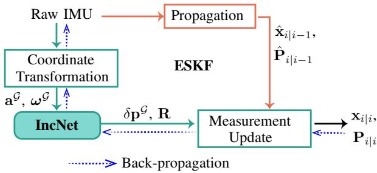  
Figure 1. Overview of DFIO. Raw IMU measurements drive analytical ESKF propagation and are transformed into a local gravity-aligned frame G for neural measurement model IncNet. The specific force aG and angular velocity $\omega ^ { \mathcal { G } }$ are processed by IncNet to predict a displacement increment $\delta \mathbf { p } ^ { \mathcal { G } }$ and its covariance Rfor the ESKF measurement update. The pairs $( \hat { \mathbf { x } } _ { i \mid i - 1 } , \hat { \mathbf { P } } _ { i \mid i - 1 } )$ and $( \mathbf { x } _ { i \mid i } , \mathbf { P } _ { i \mid i } )$ denote the prior and posterior state estimates and error-state covariances, respectively,for measurement windows �. After standalone pretraining, posterior-position supervision through the diferentiable update refines the displacement and covariance heads ofIncNet. Blue dotted arrows indicate backpropagation during training.

Learning-based IO provides a way to extract this information from data [13]. Methods such as IONet [14] and RoNIN [15] learn motion increments or velocities from inertial sequences and compose them into trajectories. Their predictions capture regularities that are dificult to express through sensor calibration alone, but prediction errors can still accumulate during trajectory reconstruction. Hybrid methods therefore combine learned motion measurements with analytical IMU propagation: TLIO [7] supplies displacement measurements and their covariances to an extended Kalman filter (EKF), while DIVE [16] uses learned velocity measurements in an on-manifold EKF. The filter balances these learned motion priors against its propagated estimate according to their uncertainties.

When learned predictions are fused with an inertial prior, training can also account for their efect on the resulting state estimate. In TLIO and DIVE, the measurement networks are trained against reference displacement or velocity targets. Such supervision improves the local predictions, but does not directly optimize the state estimate obtained after the filter combines them with its prior. Diferentiable filtering provides a means of bringing that downstream objective into training [17, 18]. This idea is already relevant to inertial navigation: AI-IMU Dead-Reckoning [19] and the pedestrian method of Wang et al. [20] train covariance adapters using errors in the filter’s estimated motion. These methods learn how strongly to trust prescribed motion constraints, but they need to construct their pseudo-measurements from specific assumptions about the motion. This motivates investigating whether filter-output supervision can refine pseudo-measurements learned directly from IMU data.

We address this question with Diferentiable Filtering for Inertial Odometry (DFIO). As shown in Fig. 1, DFIO combines an error-state Kalman filter (ESKF) with IncNet, a temporal network that predicts three-dimensional displacement increments and diagonal measurement covariances in a local gravity-aligned frame. The network is first trained using displacement supervision. Its displacement and covariance heads are then refined together using posterior-position supervision through diferentiable filter updates, while the pretrained temporal encoder is held fixed. The propagation model retains the deterministic IMU kinematics; the learnable quantities are the neural measurement predictions and their uncertainties. This allows the training objective to assess those predictions through their efect on the estimated trajectory.

The contributions of this work are:

• A learned inertial measurement model that combines temporal residual features and self-attention to predict three-dimensional displacement increments and measurement covariances for an ESKF.

• A two-stage training strategy that jointly refines the displacement and covariance heads using filter posterior-position feedback, while retaining the analytical IMU propagation model of the ESKF.

• An evaluation on held-out TLIO pedestrian trajectories, with comparisons and ablations examining the efects of displacement and covariance refinement. An additional evaluation on a subset of the OxIOD dataset [21] examines performance with noisy, uncalibrated smartphone IMU measurements.

## 2. Related Work

## 2.1. Learning-Assisted Inertial Odometry

Learning has been applied at diferent levels of inertial estimation, from correcting state estimates to predicting motion directly [13, 22]. For translational odometry, a related motivation is to learn the relationship between an inertial sequence and the motion that generated it, thereby reducing reliance on unconstrained integration.

IONet [14] uses a recurrent architecture based on long short-term memory (LSTM) [23] to predict windowed displacement magnitudes and heading changes, which are composed into pedestrian trajectories. RoNIN [15] develops this direction by comparing residual networks [24], LSTMs, and temporal convolutional networks [25] for horizontal motion prediction and trajectory reconstruction. To capture richer context within inertial sequences, CTIN [26] combines a residual encoder with self-attention for motion prediction. To optimize computational cost, the OxIOD study [21] examines lightweight learned inertial navigation and on-device inference. IMUNet [27] combines a MobileResNet-based noise-estimation stage with a learned velocity-estimation stage, jointly supervised using reference velocities. Together, these studies show how learned motion models and sensor corrections can supplement conventional inertial integration.

Fusion provides a further means of using the learned motion information. TLIO [7] predicts threedimensional relative displacements and their covariances and incorporates them in a stochastic-cloning EKF. The augmented state allows relative measurements between past and current poses to update the estimated motion. Building on the TLIO filtering framework, EqNIO [28] introduces gravity-preserving equivariant representations for displacement and covariance prediction. DIVE [16] predicts velocity and its covariance from IMU-derived histories and uses an on-manifold EKF for quadrotor state estimation. In TLIO and DIVE, the neural measurement models are trained against local reference targets before their predictions are used in the filter. This separation motivates examining whether training through the filter can further improve the final estimates.

A complementary approach starts from motion constraints and learns how much confidence to assign to them. AI-IMU Dead-Reckoning [19] uses approximately zero lateral and vertical velocities in the vehicle frame as pseudo-measurements in an invariant EKF, with a neural adapter predicting timevarying covariances. Its adapter and selected filter parameters are trained using filter trajectory errors. Wang et al. [20] extend covariance adaptation to pedestrian velocity pseudo-observations and train the adapter by comparing filter-estimated body-frame velocities with reference velocities. Thus, filter-output supervision is already established in inertial navigation. However, these pseudo-measurements rely on specific motion assumptions, and may not generalize to arbitrary movements. In contrast, DFIO learns pseudo-measurements directly from IMU sequences and refines them jointly with their covariances through the filter update.

## 2.2. Diferentiable Filteringfor State Estimation

Training a learned measurement model through its estimator connects prediction quality to the stateestimation objective. Backprop KF [17] demonstrated this principle by placing a neural observation model and Kalman-filter recurrence in a computation graph, with experiments on visual tracking and the KITTI visual-odometry benchmark [29]. Related formulations retain the structure of particle filters [30, 31] and histogram filters [32] while learning models for their inference objectives. The common idea is to preserve the estimator’s algorithmic structure while adapting its learnable components to the final task.

Subsequent work has explored which components benefit from learning. DynaNet [33] learns timevarying latent dynamics within a neural Kalman model, while KalmanNet [34] uses a recurrent network to estimate the Kalman gain. Liu et al. [35] develop a diferentiable ensemble Kalman filter with learned stochastic dynamics and evaluate it on visual odometry. Alongside these architectural choices, uncertainty modeling and training stability are central considerations. Kloss et al. [18] compare several diferentiable filters and training strategies, finding particular benefits from learning noise models through the filter, while also showing that the value of joint training depends on the component and task. These findings make component-wise evaluation important for identifying which parts of a learned estimator benefit from supervision through the filter.

Diferentiable filtering also provides a way to combine known dynamics with learned sensing. Li and Waslander [36] combine analytical IMU propagation with learned visual relative-pose measurements and covariances, using both intermediate measurement supervision and a final state-estimation objective. For heterogeneous sensing, Lee et al. [37] study diferentiable fusion of visual, haptic, and proprioceptive information, including learned crossmodal weighting. These studies illustrate how estimator structure can organize learning around the final state estimate while accommodating diferent choices of physical and learned models.

DFIO builds on this line of work for measurements derived solely from IMU data. Its focus is the joint refinement of learned displacement means and covariances using posterior-position feedback from ESKF updates. The experiments examine the benefit of this refinement and the individual efects of displacement and covariance adaptation in pedestrian IO.

## 3. Preliminaries

## 3.1. Notation and Coordinate Frames

Throughout this paper, scalars are written in italics $( \mathrm { e } . \mathrm { g } . , a )$ , vectors in bold lowercase (e.g., a), and matrices in bold uppercase (e.g., A). Coordinate frames are represented by calligraphic capitals (e.g., A). The primary frames are:

• The world frame $\llangle \mathcal { W } ,$ an inertial reference whose �-axis points opposite to gravity.

• The body frame B, rigidly attached to the IMU sensor.

• The local gravity-aligned frame $\mathcal { G } _ { i }$ , associated with measurement window �. Its vertical axis is parallel to that of $\mathcal { W } .$ , and its horizontal orientation is determined by the anchor yaw $\hat { \psi } _ { i , 0 }$ , as defined in Section 4.1.1.

A superscript identifies the frame in which a vector is expressed. World-frame superscripts are omitted for brevity. The body-to-world rotation $\mathbf { C } _ { k } \in S O ( 3 )$ maps a body-frame vector to the world frame. A tilde denotes a raw IMU measurement, a hat denotes an estimate, and superscripts − and + distinguish the prior and posterior estimates at a measurement update.

The index � denotes an IMU sampling step, � denotes a measurement window, and � denotes a sampling time within a window. The IMU sampling interval is $\delta t _ { k } = t _ { k + 1 } - t _ { k }$

## 3.2. IMU Measurement Model

An IMU measures the angular velocity and specific force in its body frame B. At a discrete time step $t _ { k }$ , the raw measurements from the gyroscope, $\tilde { \omega } _ { k } ^ { \mathcal { B } }$ , and accelerometer, $\widetilde { \mathbf { a } } _ { k } ^ { \mathcal { B } }$ , are modeled as:

$$
\tilde { \omega } _ { k } ^ { \mathcal { B } } = \omega _ { k } ^ { \mathcal { B } } + \mathbf { b } _ { g , k } ^ { \mathcal { B } } + \eta _ { g , k } ^ { \mathcal { B } } ,\tag{1a}
$$

$$
\tilde { \mathbf { a } } _ { k } ^ { \mathcal { B } } = \mathbf { a } _ { k } ^ { \mathcal { B } } - \mathbf { C } _ { k } ^ { \top } \mathbf { g } + \mathbf { b } _ { a , k } ^ { \mathcal { B } } + \boldsymbol { \eta } _ { a , k } ^ { \mathcal { B } } ,\tag{1b}
$$

where $\omega _ { k } ^ { \mathcal { B } }$ is the true angular velocity and $\mathbf { a } _ { k } ^ { \mathcal { B } }$ is the true kinematic acceleration, both expressed in the body frame. Given the world-frame gravity vector g, the accelerometer measures the specific force $\mathbf { a } _ { k } ^ { \mathcal { B } } - \mathbf { C } _ { k } ^ { \dot { T } } \mathbf { g }$ . The measurements are corrupted by slowly varying biases, $\mathbf { b } _ { g , k } ^ { \mathcal { B } }$ and $\mathbf { b } _ { a , k } ^ { \mathcal { B } }$ , and are subject to zero-mean, white Gaussian noise, $\pmb { \eta } _ { g , k } ^ { \mathcal { B } } \sim N ( \mathbf { 0 } , \sigma _ { g } ^ { 2 } \mathbf { I } )$ and $\pmb { \eta } _ { a , k } ^ { \mathcal { B } } \sim N ( \mathbf { 0 } , \tilde { \sigma _ { a } ^ { 2 } } \mathbf { I } )$ . The biases are modeled as random walks:

$$
\mathbf { b } _ { g , k + 1 } ^ { \mathcal { B } } = \mathbf { b } _ { g , k } ^ { \mathcal { B } } + \nu _ { g , k } ^ { \mathcal { B } } ,\tag{2a}
$$

$$
\mathbf { b } _ { a , k + 1 } ^ { \mathcal { B } } = \mathbf { b } _ { a , k } ^ { \mathcal { B } } + \nu _ { a , k } ^ { \mathcal { B } } ,\tag{2b}
$$

where the driving noise terms are $\nu _ { g , k } ^ { \mathcal { B } } \sim N ( \mathbf { 0 } , \sigma _ { b g } ^ { 2 } \mathbf { I } )$ and $\nu _ { a , k } ^ { \mathcal { B } } \sim N ( \mathbf { 0 } , \sigma _ { b a } ^ { 2 } \mathbf { I } )$

## 3.3. Error-State Kalman Filter Framework

The ESKF propagates a nominal state using nonlinear IMU kinematics and estimates small perturbations around that state using linearized error dynamics. The estimated perturbations are then injected into the nominal state to correct the trajectory.

## 3.3.1. State Definition

The true state at time $t _ { k }$ is

$$
\begin{array} { r } { \mathbf { x } _ { k } = \left( \mathbf { p } _ { k } , \mathbf { v } _ { k } , \mathbf { C } _ { k } , \mathbf { b } _ { a , k } ^ { \mathcal { B } } , \mathbf { b } _ { g , k } ^ { \mathcal { B } } \right) , } \end{array}\tag{3}
$$

where p�, $\mathbf { v } _ { k } \in \mathbb { R } ^ { 3 }$ are world-frame position and velocity, $\mathbf { C } _ { k } \in S O ( 3 )$ is the body-to-world rotation, and $\mathbf { b } _ { a , k } ^ { \mathcal { B } } , \mathbf { b } _ { g , k } ^ { \mathcal { B } } \in \mathbb { R } ^ { 3 }$ are the accelerometer and gyroscope biases. Its nominal estimate is denoted by $\hat { \mathbf { x } } _ { k }$ The associated 15-dimensional error state is

$$
\delta \mathbf { x } _ { k } = \left[ \delta \mathbf { p } _ { k } ^ { \top } \ \delta \mathbf { v } _ { k } ^ { \top } \ \pmb { \phi } _ { k } ^ { \top } \ ( \delta \mathbf { b } _ { a , k } ^ { \mathcal { B } } ) ^ { \top } \ ( \delta \mathbf { b } _ { g , k } ^ { \mathcal { B } } ) ^ { \top } \right] ^ { \top } .\tag{4}
$$

Position, velocity, and bias errors are additive, for example $\mathbf { p } _ { k } \ = \ { \hat { \mathbf { p } } } _ { k } + \delta \mathbf { p } _ { k }$ . Attitude uses a leftmultiplicative perturbation,

$$
\mathbf { C } _ { k } = \exp _ { S O ( 3 ) } ( \pmb { \phi } _ { k } ) \hat { \mathbf { C } } _ { k } ,\tag{5}
$$

We denote this combination of additive and rotational perturbations by $\mathbf { x } _ { k } = \hat { \mathbf { x } } _ { k }$ ⊞ $\delta { \bf x } _ { k }$

## 3.3.2. State Propagation

Between measurement updates, the nominal state is propagated at the IMU sampling frequency. Over one interval $\delta t _ { k }$ , the discrete-time kinematics are

$$
\begin{array} { r } { \hat { \mathbf { C } } _ { k + 1 } ^ { - } = \hat { \mathbf { C } } _ { k } ^ { + } \exp _ { S O ( 3 ) } \left[ ( \tilde { \omega } _ { k } ^ { \mathcal { B } } - \hat { \mathbf { b } } _ { g , k } ^ { \mathcal { B } , + } ) \delta t _ { k } \right] , } \end{array}\tag{6a}
$$

$$
\hat { \mathbf { v } } _ { k + 1 } ^ { - } = \hat { \mathbf { v } } _ { k } ^ { + } + \hat { \mathbf { a } } _ { k } ^ { \mathcal { W } } \delta t _ { k } ,\tag{6b}
$$

$$
\begin{array} { r } { \hat { \mathbf { p } } _ { k + 1 } ^ { - } = \hat { \mathbf { p } } _ { k } ^ { + } + \hat { \mathbf { v } } _ { k } ^ { + } \delta t _ { k } + \frac { 1 } { 2 } \hat { \mathbf { a } } _ { k } ^ { \mathcal { W } } \delta t _ { k } ^ { 2 } , } \end{array}\tag{6c}
$$

where $\hat { \mathbf { a } } _ { k } ^ { \mathcal { W } } = \hat { \mathbf { C } } _ { k } ^ { + } ( \tilde { \mathbf { a } } _ { k } ^ { \mathcal { B } } - \hat { \mathbf { b } } _ { a , k } ^ { \mathcal { B } , + } ) + \mathbf { g }$ is the estimated world-frame kinematic acceleration. The nominal bias estimates remain unchanged during prediction because the random-walk increments have zero mean:

$$
\hat { \mathbf { b } } _ { a , k + 1 } ^ { \mathcal { B } , - } = \hat { \mathbf { b } } _ { a , k } ^ { \mathcal { B } , + } , \qquad \hat { \mathbf { b } } _ { g , k + 1 } ^ { \mathcal { B } , - } = \hat { \mathbf { b } } _ { g , k } ^ { \mathcal { B } , + } .\tag{7}
$$

Their uncertainty is included in the covariance propagation,

$$
\mathbf { P } _ { k + 1 } ^ { - } = \mathbf { F } _ { k } \mathbf { P } _ { k } ^ { + } \mathbf { F } _ { k } ^ { \top } + \mathbf { Q } _ { k } ,\tag{8}
$$

where $\mathbf { P } _ { k }$ describes the error-state uncertainty, $\mathbf { F } _ { k }$ is the discrete error-state transition matrix and $\mathbf { Q } _ { k }$ is the discretized process noise covariance matrix.

## 3.3.3. Measurement Correction and Error Reset

For a measurement or pseudo-measurement $\mathbf { z } _ { k }$ with model ${ \bf z } _ { k } = h _ { k } ( { \bf x } _ { k } ) + \epsilon _ { k }$ , assume $\epsilon _ { k } \sim { \cal N } ( \mathbf { 0 } , \mathbf { R } _ { k } )$ The standard update further assumes that this error is uncorrelated with the prior state error. Linearization about $\hat { \mathbf { x } } _ { k } ^ { - }$ gives

$$
\mathbf { H } _ { k } = \left. \frac { \partial h _ { k } ( \hat { \mathbf { x } } _ { k } ^ { - } \oplus \delta \mathbf { x } ) } { \partial \delta \mathbf { x } } \right| _ { \delta \mathbf { x } = \mathbf { 0 } } .\tag{9}
$$

The innovation, its covariance, and the Kalman gain are

$$
\mathbf { y } _ { k } = \mathbf { z } _ { k } - h _ { k } \big ( \hat { \mathbf { x } } _ { k } ^ { - } \big ) ,\tag{10a}
$$

$$
\mathbf { S } _ { k } = \mathbf { H } _ { k } \mathbf { P } _ { k } ^ { - } \mathbf { H } _ { k } ^ { \top } + \mathbf { R } _ { k } ,\tag{10b}
$$

$$
\mathbf { K } _ { k } = \mathbf { P } _ { k } ^ { - } \mathbf { H } _ { k } ^ { \top } \mathbf { S } _ { k } ^ { - 1 } .\tag{10c}
$$

The estimated error correction and covariance are computed as

$$
\widehat { \delta \mathbf { x } } _ { k } = \mathbf { K } _ { k } \mathbf { y } _ { k } ,\tag{11a}
$$

$$
\bar { \mathbf { P } } _ { k } = ( \mathbf { I } - \mathbf { K } _ { k } \mathbf { H } _ { k } ) \mathbf { P } _ { k } ^ { - } .\tag{11b}
$$

The correction is then injected through $\hat { \mathbf { x } } _ { k } ^ { + } \ = \ \hat { \mathbf { x } } _ { k } ^ { - }$ ⊞ $\widehat { \delta \mathbf { x } } _ { k }$ . After nominal-state injection, the general covariance reset is

$$
\mathbf { P } _ { k } ^ { + } = \mathbf { G } _ { k } \bar { \mathbf { P } } _ { k } \mathbf { G } _ { k } ^ { \top } ,\tag{12}
$$

where $\mathbf { G } _ { k }$ is the Jacobian of the error-state reset.

## 4. Methodology

As illustrated in Fig. 1, the proposed DFIO framework is formulated as a diferentiable state estimation graph. Rather than treating neural inertial odometry as an independent regression task, DFIO tightly

couples a deep temporal measurement encoder (IncNet) with an ESKF, enabling the joint refinement of displacement predictions and their covariances through the filter updates.

## 4.1. Learned Measurement Model: IncNet

For measurement window �, containing � IMU samples at times $t _ { i , 0 } , \ldots , t _ { i , n - 1 }$ , IncNet regresses a 3D relative position increment $\widehat { \Delta \mathbf { p } _ { i } } ^ { \mathcal { G } _ { i } } \in \mathbb { R } ^ { 3 }$ alongside an associated heteroscedastic measurement covariance $\mathbf { R } _ { i } \in \mathbb { R } ^ { 3 \times 3 }$

## 4.1.1. Input Parameterization

Following the design principles of TLIO [7] and DIVE [16], IncNet operates entirely within a local, gravity-aligned coordinate frame $\mathcal { G } _ { i }$ established at the window anchor $t _ { i , 0 }$ . This removes dependence on arbitrary global headings from the network representation.

The raw body-frame IMU samples $( \tilde { \mathbf { a } } _ { \tau } ^ { \mathcal { B } } , \tilde { \omega } _ { \tau } ^ { \mathcal { B } }$ for $\tau \in [ t _ { i , 0 } , t _ { i , n - 1 } ] )$ are first transformed into the world frame $\mathcal { W }$ :

$$
\begin{array} { r } { \tilde { \mathbf { a } } _ { \tau } = \hat { \mathbf { C } } ( \tau ) \tilde { \mathbf { a } } _ { \tau } ^ { \mathcal { B } } , \quad \tilde { \omega } _ { \tau } = \hat { \mathbf { C } } ( \tau ) \tilde { \omega } _ { \tau } ^ { \mathcal { B } } . } \end{array}\tag{13}
$$

In both training stages and at inference, the rotations $\hat { \mathbf { C } } ( \tau )$ are obtained by gyroscope integration initialized with the reference orientation at the start of each sequence. The resulting world-frame IMU channels are normalized using per-axis robust scalers fitted on the training set. The network input for window � is

$$
\mathbf u _ { i } ^ { \mathcal { G } _ { i } } = \mathrm { b l k d i a g } ( \mathbf A _ { i } , \mathbf A _ { i } ) S ( \mathbf u _ { i } ^ { \mathcal { W } } ) , \qquad \mathbf A _ { i } = \mathbf C _ { z } ^ { \top } ( \hat { \psi } _ { i , 0 } ) ,\tag{14}
$$

where ${ \mathbf { u } } _ { i } ^ { \mathcal { W } }$ stacks the world-frame specific-force and angular-velocity channels, and S denotes their normalization transforms. During standalone pre-training (Phase 1 in Section 4.3), synthetic random yaw rotations $\hat { \psi } _ { i , 0 } \sim \mathcal { U } ( - \pi , \pi )$ are applied consistently to both the IMU inputs and their displacement targets. During fine-tuning stage (Phase 2 in Section 4.3) and inference, the ESKF provides the estimated anchor yaw $\hat { \psi } _ { i , 0 }$ for this transformation.

## 4.1.2. Network Architecture and Outputs

The network extends the 1D temporal residual architecture proposed in [7] by incorporating selfattention mechanisms. The input sequence passes through an initial $7 \times 1$ convolutional stem (stride 2) for feature downsampling, followed by four progressive residual stages (64 → 128 → 256 → 512 channels). Each stage contains two depthwise-separable residual blocks coupled with a Multi-Head Self-Attention (MHSA) module operating across the temporal axis.

A global average pooling layer aggregates the final temporal feature map into a fixed 512-dimensional context vector. This vector is fed into two parallel, fully-connected output heads: a displacement head predicting $\widehat { \Delta \mathbf { p } _ { i } } ^ { G _ { i } }$ , and an uncertainty head regressing a 3-coeficient parameter vector $\pmb { \ell } _ { i } \in \mathbb { R } ^ { 3 }$ . Assuming the measurement noise is uncorrelated across the spatial axes, the covariance is diagonal, with $\ell _ { i }$ parameterizing the log standard deviations:

$$
\mathbf { R } _ { i } ( \pmb { \ell } _ { i } ) = \mathrm { d i a g } \left( e ^ { 2 \ell _ { i , x } } , e ^ { 2 \ell _ { i , y } } , e ^ { 2 \ell _ { i , z } } \right) .\tag{15}
$$

## 4.2. Displacement Measurement Update

For window �, the saved anchor position and yaw are held fixed in the linearized measurement update. The displacement observation and innovation are

$$
h _ { i } ( \hat { \mathbf { x } } _ { i } ^ { - } ) = \mathbf { A } _ { i } ( \hat { \mathbf { p } } _ { i } ^ { - } - \hat { \mathbf { p } } _ { i , 0 } ) ,\tag{16}
$$

$$
\mathbf { y } _ { i } ^ { \mathcal { G } _ { i } } = \widehat { \Delta \mathbf { p } } _ { i } ^ { \mathcal { G } _ { i } } - h _ { i } \big ( \widehat { \mathbf { x } } _ { i } ^ { - } \big ) .\tag{17}
$$

For the error-state ordering in (4), the Jacobian is

$$
\mathbf { H } _ { i } = \left[ \mathbf { A } _ { i } \ \mathbf { 0 } _ { 3 \times 1 2 } \right] .\tag{18}
$$

The update uses (10) with the predicted covariance $\mathbf { R } _ { i }$

## 4.3. Two-Stage Curriculum Training

Optimizing a tightly coupled neural-filtering system from random initialization can be unstable when the initial displacement and covariance predictions are inaccurate. Optimization is therefore structured into a two-stage curriculum.

## 4.3.1. Phase 1: Standalone Measurement Pre-training

The initial phase isolates the IncNet module, bypassing the filter to establish a competent baseline displacement estimator. Following the MSE-to-NLL training schedule used in [7, 16], the network is first trained for 10 epochs minimizing the Mean Squared Error (MSE) against the ground-truth window displacement $\Delta \mathbf { \bar { p } } _ { i } ^ { g _ { i } , \mathrm { g t } }$

$$
\mathcal { L } _ { \mathrm { M S E } } = \frac { 1 } { B } \sum _ { i = 1 } ^ { B } \left\| \widehat { \Delta \mathbf { p } } _ { i } ^ { \mathcal { G } _ { i } } - \Delta \mathbf { p } _ { i } ^ { \mathcal { G } _ { i } , \mathrm { g t } } \right\| _ { 2 } ^ { 2 } ,\tag{19}
$$

where � is the batch size and each target is expressed in the same coordinates as its prediction. Once the displacement estimates stabilize, the loss transitions to the marginal NLL for the remaining epochs:

$$
\mathcal { L } _ { \mathrm { N L L } } = \frac { 1 } { 2 B } \sum _ { i = 1 } ^ { B } \left( \mathbf { e } _ { i } ^ { \top } \mathbf { R } _ { i } ^ { - 1 } \mathbf { e } _ { i } + \ln \operatorname* { d e t } { \mathbf { R } _ { i } } \right) ,\tag{20}
$$

where $\mathbf { e } _ { i } = \Delta \mathbf { p } _ { i } ^ { \mathcal { G } _ { i } , \mathrm { g t } } - \widehat { \Delta \mathbf { p } } _ { i } ^ { \mathcal { G } _ { i } }$ . At the conclusion of Phase 1, IncNet predicts local motion and its inputdependent uncertainty, but has not yet been optimized using filter-output supervision.

## 4.3.2. Phase 2: Filter-Coupled Refinement

In Phase 2, IncNet is embedded into the closed-loop ESKF computation graph. To preserve the features learned in Phase 1, the temporal encoder is frozen and held in evaluation mode, while estimation errors backpropagated through the filter update only the linear output projection heads.

Gradients from posterior-position supervision pass through the error-state correction and covariance update (11). Through the measurement innovation $\mathbf { y } _ { i } ^ { \mathcal { G } _ { i } }$ and Kalman gain $\mathbf { K } _ { i }$ in (10), these gradients reach the predicted displacement $\widehat { \Delta \mathbf { p } _ { i } } ^ { G _ { i } }$ and covariance $\mathbf { R } _ { i }$ . This allows the two output heads to be refined according to their efect on the posterior position and covariance.

At each measurement update �, the coupled system minimizes

$$
\begin{array} { r } { \mathcal { L } _ { \mathrm { P h a s e 2 } } = \mathcal { L } _ { \mathrm { p o s - N L L } } + \lambda _ { \mathrm { N E E S } } \mathcal { L } _ { \mathrm { N E E S } } , } \end{array}\tag{21}
$$

where $\lambda _ { \mathrm { N E E S } } = 0 . 1$ . The primary objective supervises the posterior positions $\hat { \mathbf { p } } _ { i } ^ { + }$ and their 3×3 marginal covariances $\mathbf { P } _ { p , i } ^ { + }$ against reference positions:

$$
\mathcal { L } _ { \mathrm { p o s - N L L } } = \frac { 1 } { 2 } \left[ \mathbf { e } _ { p , i } ^ { \top } ( \mathbf { P } _ { p , i } ^ { + } ) ^ { - 1 } \mathbf { e } _ { p , i } + \ln \operatorname* { d e t } \mathbf { P } _ { p , i } ^ { + } \right] ,\tag{22}
$$

where $\mathbf { e } _ { p , i } = \mathbf { p } _ { i } ^ { \mathrm { g t } } - \hat { \mathbf { p } } _ { i } ^ { + }$ and $\mathbf { P } _ { p , i } ^ { + }$ is the position block of $\mathbf { P } _ { i } ^ { + }$

To additionally regularize the scale of covariance-normalized posterior-position errors, we use a penalty based on the position normalized estimation error squared (NEES),

$$
q _ { p , i } = \mathbf { e } _ { p , i } ^ { \top } ( \mathbf { P } _ { p , i } ^ { + } ) ^ { - 1 } \mathbf { e } _ { p , i } .\tag{23}
$$

The expected NEES under a correctly specified zero-mean Gaussian position-error model is the position dimension $d _ { p } = 3$ . Using this value as a reference, we define

$$
\mathcal { L } _ { \mathrm { N E E S } } = \left[ \mathrm { c l i p } \left( \ln \left( \frac { q _ { p , i } } { d _ { p } } \right) , - 7 , 7 \right) \right] ^ { 2 } .\tag{24}
$$

The squared logarithmic ratio penalizes multiplicative deviations above and below the reference value, while clipping limits the contribution of extreme values. This auxiliary term is a heuristic covariancescale regularizer rather than a statistical consistency test or a guarantee of calibrated uncertainty. The combined loss is averaged over the trajectories processed in parallel. Algorithm 1 summarizes DFIO filtering, and Algorithm 2 summarizes Phase 2 refinement using the same filtering operations.

## 4.4. Implementation Details

DFIO was implemented in PyTorch and trained on an NVIDIA GeForce RTX 3070 GPU. To prepare inputs for the IncNet module, raw IMU data is processed into windows of $n = 1 0 0$ samples (approximately 0.5 s at 200 Hz). In Phase 1, the network is optimized using Adam with an initial learning rate of $1 0 ^ { - 4 }$ and a ReduceLROnPlateau scheduler (patience 5, decay factor 0.5). In Phase 2, the unfrozen IncNet linear projection heads are updated at a learning rate of $1 0 ^ { - 3 }$ . During Phase 2 training, the position, velocity, and orientation at the start of each loader segment are set to their reference values; bias estimates and covariance are carried between consecutive segments of the same trajectory. During inference, the estimated state is carried forward without these reference resets.

## 5. Experimental Results

## 5.1. Experimental Setup

## 5.1.1. Datasets

We evaluate DFIO on two public datasets of pedestrian motion recorded with consumer-grade IMUs. The TLIO dataset [7] provides the main quantitative evaluation, while a subset of OxIOD [21] provides a supplementary case study on noisy, uncalibrated smartphone IMU data.

• TLIO dataset: We use 205 sequences containing varied human motion recorded with a Bosch BMI055 IMU. The pre-calibrated measurements are downsampled from 1000 to 200 Hz. Fifteen trajectories are held out for testing; the remaining sequences are used for training and validation.

• OxIOD subset: We use eight slow-walking sequences recorded with smartphone IMUs at 100 Hz. Models are trained separately on this subset using a 5/2/1 training/validation/test split, as described in Section 5.3.

Algorithm 1 DFIO Filtering Process   
Require: Body-frame IMU sequence $\mathbf { u } ^ { \mathcal { B } }$ , initial state $\mathbf { x } _ { 0 } .$ , covariance ${ \bf P } _ { 0 }$ , IMU noise parameters,   
sampling interval $\delta t .$ , trained IncNet, and saved input/output scalers S, T   
Ensure: State history $\mathcal { X }$ , covariance history $\mathcal { P }$   
1: $\hat { \mathbf { x } } _ { 0 } ^ { + }  \mathbf { x } _ { 0 } , \mathbf { P } _ { 0 } ^ { + }  \mathbf { P } _ { 0 }$   
2: $\mathcal { \bar { X } }  \emptyset , \mathcal { \bar { P } }  \emptyset$   
3: $\mathbf { u } ^ { \mathcal { W } }  \mathrm { G y r o P } \mathrm { 1 }$ reprocess $( \mathbf { u } ^ { \mathcal { B } } , \hat { \mathbf { C } } _ { 0 } ^ { + } )$ using (13)   
4: $\bar { \mathbf { u } } ^ { \mathcal { W } }  S ( \mathbf { u } ^ { \mathcal { W } } )$   
5: Form � windows of � samples with stride $n - 1$   
6: for $i = 1 , \dots ,$ � do   
7: $( \hat { \mathbf { x } } _ { i , 0 } , \mathbf { P } _ { i , 0 } ) \gets ( \hat { \mathbf { x } } _ { i - 1 } ^ { + } , \mathbf { P } _ { i - 1 } ^ { + } )$   
8: Save anchor $( \hat { \bf p } _ { i , 0 } , \hat { \bf C } _ { i , 0 } )$ from $\hat { \mathbf { x } } _ { i , 0 }$   
9: $\hat { \psi } _ { i , 0 } \gets \mathrm { y a w } ( \hat { \mathbf { C } } _ { i , 0 } ) , \mathbf { A } _ { i } \gets \mathbf { C } _ { z } ^ { \top } ( \hat { \psi } _ { i , 0 } )$   
10: $\mathbf { u } _ { i } ^ { \mathcal { G } _ { i } } \gets \mathrm { b l k d i a g } ( \mathbf { A } _ { i } , \mathbf { A } _ { i } ) \bar { \mathbf { u } } _ { i } ^ { \mathcal { W } }$   
11: $( \pmb { \mu } _ { i } , \pmb { \ell } _ { i } ) \gets \mathrm { I n c N e t } ( \mathbf { u } _ { i } ^ { \mathcal { G } _ { i } } )$   
12: for $k = 0 , \ldots , n - 2$ do   
13: $( \hat { \mathbf { x } } _ { i , k + 1 } , \mathbf { P } _ { i , k + 1 } ) \gets f ( \hat { \mathbf { x } } _ { i , k } , \mathbf { P } _ { i , k } , \mathbf { u } _ { i , k } ^ { \mathcal { B } } , \delta t )$   
14: end for   
15: $( \hat { \mathbf { x } } _ { i } ^ { - } , \mathbf { P } _ { i } ^ { - } ) \gets ( \hat { \mathbf { x } } _ { i , n - 1 } , \mathbf { P } _ { i , n - 1 } )$   
16: $( \widehat { \Delta \mathbf { p } } _ { i } ^ { \mathcal { G } _ { i } } , \mathbf { R } _ { i } ) \gets \mathrm { M e t r i c O u t p u t s } ( \pmb { \mu } _ { i } , \pmb { \ell } _ { i } ; \mathcal { T } )$   
17: Floor the diagonal entries of $\mathbf { R } _ { i }$ at $\mathrm { 1 0 ^ { - 8 } m ^ { 2 } }$   
18: Compute $\mathbf { y } _ { i } ^ { \mathcal { G } _ { i } }$ and $\mathbf { H } _ { i }$ using (17) and (18)   
19: $( \hat { \mathbf { x } } _ { i } ^ { + } , \mathbf { P } _ { i } ^ { + } ) \xleftarrow { } \mathrm { E S K F C o r r e c t } ( \hat { \mathbf { x } } _ { i } ^ { - } , \mathbf { P } _ { i } ^ { - } , \mathbf { y } _ { i } ^ { \mathcal { G } i } , \mathbf { H } _ { i } , \mathbf { R } _ { i } )$   
20: Append $\hat { \mathbf { x } } _ { i } ^ { + }$ to $\mathcal { X }$ and $\mathbf { P } _ { i } ^ { + }$ to $\dot { \mathcal P }$   
21: end for   
return $\mathcal { X } , \mathcal { P }$

## 5.1.2. Baselines and Models

We compare two baseline methods representing learning-based IMU integration and filtering with an independently trained neural measurement model:

• RoNIN-IncNet: we construct a kinematic dead-reckoning baseline adapted from RoNIN [15], denoted as RoNIN-IncNet. Whereas standard RoNIN models regress step-wise velocities for spatial integration, RoNIN-IncNet directly concatenates the 3D position increments predicted by our IncNet model. In this configuration, global orientation is propagated via open-loop gyroscope integration.

• TLIO: We use its oficial open-source implementation [7]. TLIO fuses learned displacement measurements and covariances within an ESKF architecture, with the neural measurement model trained against local reference targets.

We then evaluate four variants of our IncNet–ESKF configurations to examine the efect of filteraware refinement and the roles of its two output heads:

• Phase 1 Only: The IncNet model trained solely on phase 1 losses and then directly deployed in the ESKF.

• Tune Inc: Phase 2 refines only the displacement head while keeping the covariance head frozen.

• Tune Cov: Phase 2 refines only the covariance head while keeping the displacement head frozen.

• DFIO: The complete method jointly refines the displacement and covariance heads in Phase 2.

Algorithm 2 Filter-Coupled Refinement   
Require: Training and validation trajectories with reference states, Phase 1 IncNet, and filter initializa  
tion   
Ensure: Refined IncNet   
1: Freeze the temporal encoder and hold it in evaluation mode   
Preprocess each trajectory as in Algorithm 1, line 3   
3: Initialize Adam for the two output heads, with parameters $\pmb { \theta } _ { \mathrm { h } }$   
4: for each training epoch do   
5: Initialize the state and covariance independently for each trajectory   
6: for each single-window batch i in temporal order do   
7: $( \hat { \mathbf { x } } _ { i , 0 } , \mathbf { P } _ { i , 0 } )$ ← carried state and covariance   
8: Replace the initial position, velocity, and orientation with their reference values   
9: Obtain $( \hat { \mathbf { x } } _ { i } ^ { + } , \mathbf { P } _ { i } ^ { + } )$ using Algorithm 1, lines 8–19   
10: Compute the batch-mean loss ${ \overline { { \mathcal { L } } } } _ { i }$ using (21)   
11: Clear gradients and backpropagate ${ \overline { { \mathcal { L } } } } _ { i }$ to $\pmb { \theta } _ { \mathrm { h } }$   
12: Clip the gradient norm to 5 and update $\pmb { \theta } _ { \mathrm { h } }$ using Adam   
13: Carry detached copies of $\hat { \mathbf { x } } _ { i } ^ { + }$ and $\mathbf { P } _ { i } ^ { + }$ to the next window   
14: end for   
15: Evaluate validation loss; retain the best IncNet and apply learning-rate and stopping criteria   
16: end for   
17: return IncNet with the lowest validation loss

TLIO and Phase 1 Only therefore represent independent measurement learning followed by filtering, whereas Tune Cov, Tune Inc, and DFIO use filter-output supervision during refinement. All four IncNet–ESKF configurations use the same network architecture and filter formulation; their comparison examines the added refinement stage and the efects of trainable heads.

## 5.1.3. Metrics

Let $\mathbf { p } _ { k } , \mathbf { C } _ { k }$ , and $\psi _ { k }$ denote the reference position, body-to-world rotation, and yaw at evaluation sample �, and let hats denote their estimates. Each trajectory contains � evaluation samples. For relative metrics, � is the integer sample ofset corresponding to a fixed time window (e.g., 1 s), yielding $M = N - L$ total overlapping evaluation windows. Define $\Delta \mathbf { p } _ { k , L } = \mathbf { p } _ { k + L } - \mathbf { p } _ { k }$ and $\Delta \psi _ { k , L } = \psi _ { k + L } - \psi _ { k }$ , with analogous definitions for estimated quantities. We report the following metrics:

• Absolute translation error (ATE, m): The mean Euclidean position error over a trajectory:

$$
\mathrm { A T E } = \frac { 1 } { N } \sum _ { k = 1 } ^ { N } \| \hat { \mathbf p } _ { k } - \mathbf p _ { k } \| _ { 2 } .\tag{25}
$$

• Relative translation error (RTE-1s, m): The root-mean-square error (RMSE) of the relative translational displacements over fixed-duration (1 s) windows, projected into the start-of-window local body frame:

$$
\mathrm { R T E } _ { 1 \mathrm { s } } = \sqrt { \frac { 1 } { M } \sum _ { k = 1 } ^ { M } \left. \hat { \mathbf { C } } _ { k } ^ { \top } \Delta \hat { \mathbf { p } } _ { k , L } - \mathbf { C } _ { k } ^ { \top } \Delta \mathbf { p } _ { k , L } \right. _ { 2 } ^ { 2 } } .\tag{26}
$$

• Translation drift rate (TDR, %): The final position error normalized by reference path length $\begin{array} { r } { D = \sum _ { k = 1 } ^ { N - 1 } \| \mathbf { p } _ { k + 1 } - \mathbf { p } _ { k } \| _ { 2 } \colon } \end{array}$

$$
\mathrm { T D R } = \frac { \| \hat { \mathbf { p } } _ { N } - \mathbf { p } _ { N } \| _ { 2 } } { D } \times 1 0 0 \% .\tag{27}
$$

• Absolute yaw error (AYE, deg): The RMSE of yaw errors:

$$
\mathrm { A Y E } = \sqrt { \frac { 1 } { N } \sum _ { k = 1 } ^ { N } ( \hat { \psi } _ { k } - \psi _ { k } ) ^ { 2 } } .\tag{28}
$$

• Relative yaw error (RYE-1s, deg): The RMSE of the relative yaw drift over fixed-duration (1 s) windows:

$$
\mathrm { R Y E _ { 1 s } } = \sqrt { \frac { 1 } { M } \sum _ { k = 1 } ^ { M } ( \Delta \hat { \psi } _ { k , L } - \Delta \psi _ { k , L } ) ^ { 2 } } .\tag{29}
$$

• Yaw drift rate (YDR, deg/h): The final absolute yaw error normalized by trajectory duration $T _ { h }$ in hours:

$$
\mathrm { Y D R } = \frac { \vert \hat { \psi } _ { N } - \psi _ { N } \vert } { T _ { h } } .\tag{30}
$$

## 5.2. Model Performance

Table 1 summarizes the baseline and model-variant results on the TLIO test set, where all entries were recomputed using the definitions in section 5.1.3, with equal weight assigned to each test trajectory in the reported means and medians. The grouped comparison examines how filtering, the pretrained measurement model, and filter-aware head refinement contribute to the performance of the complete method.

## 5.2.1. Open-Loop Integration versus Filtering

All five filtered configurations yield lower mean and median errors than RoNIN-IncNet across the six reported metrics. Even without filter-aware refinement, Phase 1 Only achieves a mean ATE of 1.840 m, compared with 2.657 m for open-loop integration, and a mean YDR of 46.757 compared with 295.233 deg/h. Whereas the open-loop baseline directly accumulates predicted increments and gyroscope rotations, the filter uses displacement residuals and their predicted uncertainty to correct the propagated state. These results support the benefit of combining learned displacement measurements with recursive IMU-based estimation.

## 5.2.2. Independently Trained Measurement Models

Having established the benefit of filtering, we compare TLIO with Phase 1 Only. Both train the neural measurement model independently of the filter, and then fuse the displacement measurement and uncertainty within the ESKF. For the network design, IncNet extends TLIO’s temporal residual network with temporal self-attention, enabling the measurement model to aggregate information across the input window.

Compared to TLIO, Phase 1 Only reduces mean RYE-1s from 0.893 to 0.231 deg and mean YDR from 197.434 to 46.757 deg/h, corresponding to reductions of 74.1% and 76.3%, respectively. Mean ATE and RTE-1s also decrease, from 1.957 to 1.840 m and from 0.140 to 0.102 m. The results show that the independently trained IncNet–ESKF combination already provides improved mean translation and heading accuracy, making it the starting point for DFIO.

Table 1. Results on the 15 held-out TLIO trajectories. Each metric cell reports mean / median values. The lowest mean and median across all six methods are bold..
<table><tr><td>Method type</td><td>Model</td><td>ATE[m]</td><td>RTE-1s[m]</td><td>TDR[%]</td><td>AYE[deg]</td><td>RYE-1s[deg]</td><td>YDR[deg/h]</td></tr><tr><td>Open-loop</td><td>RoNIN-IncNet</td><td>2.657 / 2.197</td><td>0.244 / 0.218</td><td>2.852 / 2.985</td><td>12.903 / 10.983</td><td>1.723 / 1.333</td><td>295.233 / 218.982</td></tr><tr><td rowspan="2">Independent learning</td><td>TLIO</td><td>1.957 / 1.610</td><td>0.140 / 0.136</td><td>1.863 / 1.401</td><td>2.353 / 1.806</td><td>0.893 / 0.494</td><td>197.434 / 73.172</td></tr><tr><td>Phase 1 Only</td><td>1.840 / 1.856</td><td>0.102 / 0.102</td><td>1.760 / 2.019</td><td>2.120 / 1.920</td><td>0.231 / 0.237</td><td>46.757 / 45.102</td></tr><tr><td rowspan="3">Filter-aware learning</td><td>Tune Cov</td><td>1.897 / 1.758</td><td>0.085 / 0.086</td><td>1.479 / 1.124</td><td>2.358 / 1.865</td><td>0.230 / 0.235</td><td>52.922 / 52.309</td></tr><tr><td>Tune Inc</td><td>1.795 / 1.631</td><td>0.085 / 0.085</td><td>1.673 / 1.540</td><td>1.998 / 1.484</td><td>0.229 / 0.231</td><td>46.214 / 37.220</td></tr><tr><td>DFIO</td><td>1.699 / 1.645</td><td>0.084 / 0.082</td><td>1.656 / 1.700</td><td>2.007 / 1.370</td><td>0.231 / 0.233</td><td>43.598 / 37.015</td></tr></table>

Table 2. Paired translation-error comparisons on the 15 TLIO test trajectories. Δ denotes DFIO minus the baseline; negative valuesfavor DFIO. The 95% confidence intervals are percentile bootstrap intervalsfor the mean paired diference, obtainedfrom 100,000 resamples ofcomplete test trajectories.
<table><tr><td>Baseline</td><td>Metric</td><td>Improved / worsened</td><td>Mean ∆ [m]</td><td>95% CI [m]</td></tr><tr><td>TLIO</td><td>ATE</td><td>6/9</td><td>-0.2576</td><td>[-0.9231, 0.2861]</td></tr><tr><td>TLIO</td><td>RTE-1s</td><td>15/0</td><td>-0.0554</td><td>[-0.0718, -0.0395]</td></tr><tr><td>Phase 1 Only</td><td>ATE</td><td>8/7</td><td>-0.1409</td><td>[-0.3510, 0.0528]</td></tr><tr><td>Phase 1 Only</td><td>RTE-1s</td><td>14/1</td><td>-0.0177</td><td>[-0.0225, -0.0125]</td></tr></table>

## 5.2.3. Filter-Aware Learning

The next comparison examines whether refinement using filter-output supervision improves upon independent measurement learning. As shown in Table 1, all three filter-aware variants reduce mean RTE-1s relative to both Phase 1 Only and TLIO: Tune Cov and Tune Inc achieve 0.085 m, while DFIO achieves 0.084 m, compared with 0.102 and 0.140 m for the two independently trained systems. Thus, the refinement stage improves short-interval translation accuracy whether it adjusts the measurement values, their weighting, or both.

For the complete DFIO model, these local gains are accompanied by lower trajectory-wide position errors. Relative to Phase 1 Only, mean ATE decreases by 7.7%, from 1.840 to 1.699 m, and median ATE decreases from 1.856 to 1.645 m. Mean YDR also decreases by 6.8%, from 46.757 to 43.598 deg/h, while mean RYE-1s remains 0.231 deg at the reported precision. Filter-aware refinement therefore adds translation-accuracy gains while retaining the heading performance of the pretrained system. Relative to TLIO, the complete method reduces mean ATE by 13.2% and mean RTE-1s by 39.6%. The large heading advantage over TLIO is already present after Phase 1; the incremental benefit of Phase 2 is most obvious in translation accuracy.

Table 2 complements Table 1 by showing the distribution of improvements across test trajectories. DFIO reduces RTE-1s on all 15 trajectories relative to TLIO and on 14 trajectories relative to Phase 1 Only. The mean paired ATE diferences also favor DFIO, at −0.258 m and −0.141 m, respectively, with lower ATE on 6 and 8 trajectories. Although the 95% bootstrap intervals for the mean ATE diferences span zero, the results demonstrate broad RTE-1s improvements together with lower average position error on the evaluated test set.

## 5.2.4. Efects ofDisplacement and Covariance Refinement

The three filter-aware configurations clarify how the displacement and covariance heads contribute. Tune Cov retains the pretrained displacement head yet reduces mean RTE-1s from 0.102 to 0.085 m and achieves the lowest mean and median TDR, 1.479% and 1.124%. This shows that adapting measurement weighting can improve local translation accuracy and final-position drift without refining the displacement head. Its mean ATE, however, increases from 1.840 to 1.897 m, and its mean AYE and YDR also increase. Lower final-position drift therefore does not necessarily imply a more accurate trajectory throughout the sequence.

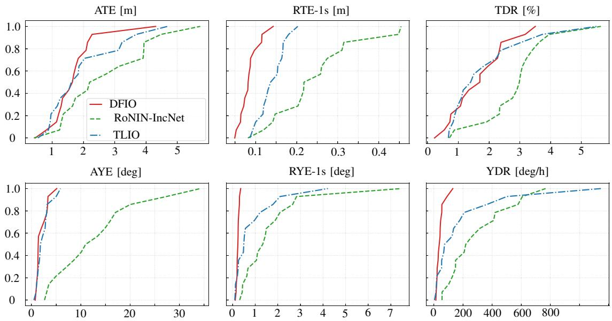  
Figure 2. Cumulative distributions of error metrics on the TLIO test setfor DFIO, TLIO, and RoNIN-IncNet baseline.

Tune Inc also achieves a mean RTE-1s of 0.085 m and improves mean ATE to 1.795 m. It gives the lowest median ATE among the IncNet–ESKF variants, 1.631 m, and the lowest mean AYE and mean and median RYE-1s among all methods. These results demonstrate the benefit of adapting the predicted displacement itself, even when the covariance head is held fixed.

Joint refinement in DFIO produces the lowest mean ATE, 1.699 m, compared with 1.897 m for Tune Cov and 1.795 m for Tune Inc. It also achieves the lowest mean and median RTE-1s, median AYE, and mean and median YDR across all six methods. In particular, mean YDR decreases to 43.598 deg/h, compared with 52.922 and 46.214 deg/h for the single-head variants. Overall, DFIO improves mean trajectory accuracy and short-interval translation accuracy while ofering the lowest heading drift among h l d h d

Figure 2 shows the cumulative distribution functions (CDF) of the error metrics for DFIO and the two baselines, and Fig. 3 provides selected planar trajectory comparisons.

## 5.3. Supplementary OxIOD Case Study

To assess the framework’s adaptability to significantly diferent sensor characteristics, we evaluated DFIO on the OxIOD dataset. This data, sourced from uncalibrated, low-cost smartphone IMUs, exhibits high noise levels and bias instability. Both the DFIO and the TLIO models were trained from scratch using the same random split of 5, 2, and 1 sequences for training, validation, and testing, respectively, allowing both networks to learn the specific motion dynamics and noise profiles inherent to the smartphone hardware. Due to the lack of prior calibration data in this dataset, the initial gyroscope and accelerometer biases for the ESKF were initialized to zero.

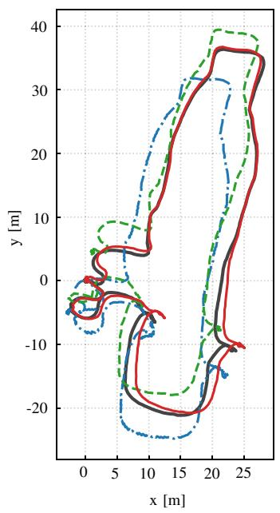

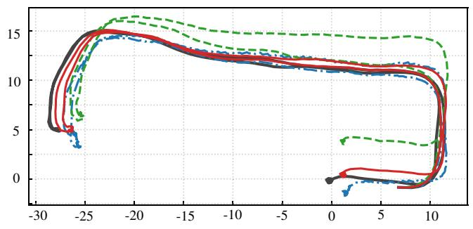

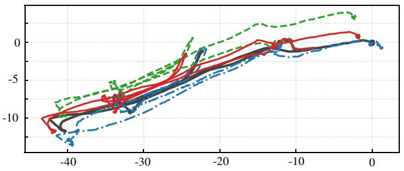

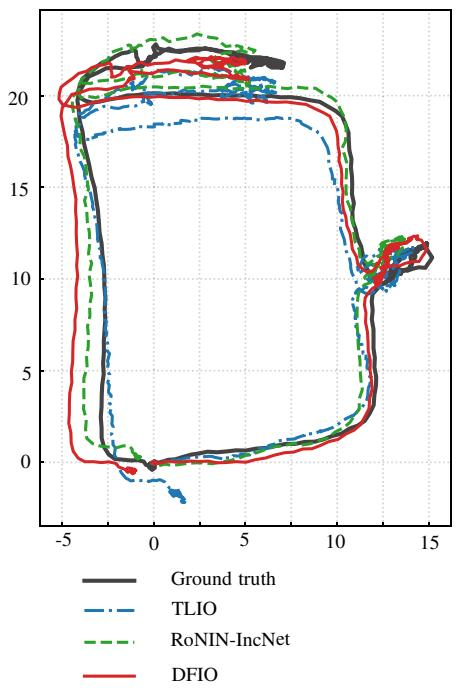

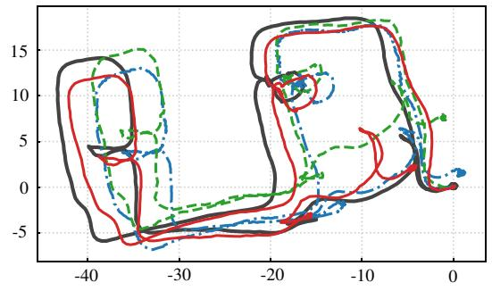

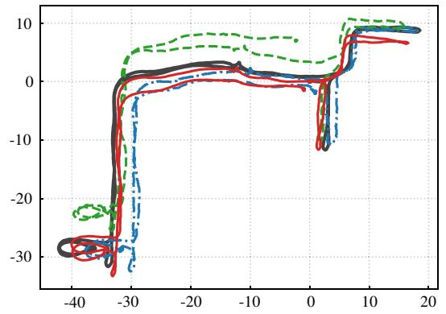  
Figure 3. Selected planar trajectoriesfrom the TLIO test set, comparing reference trajectories, DFIO, TLIO, and RoNIN-IncNet..

Figure 4 compares the trajectory components estimated by DFIO, TLIO, and RoNIN-IncNet against the ground truth. While all evaluated models manage to track the general trend of the yaw angle reasonably well throughout the sequence, the baseline methods sufer from significant translational drift. On the contrary, DFIO efectively mitigates this drift, maintaining tight alignment with the ground-truth.

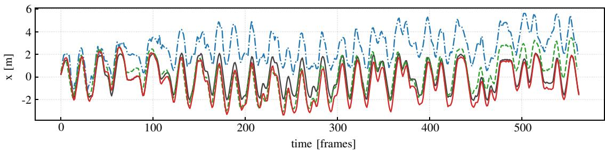

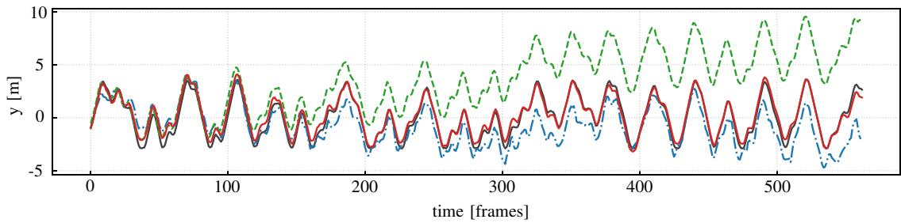

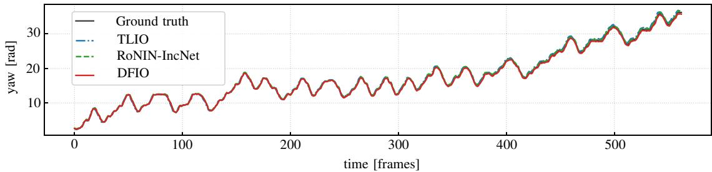  
Figure 4. Position components and yaw estimation on the held-out OxIOD sequence..

## 6. Conclusions

This paper presented DFIO, a filter-aware learning framework that combines learned three-dimensional displacement measurements and diagonal covariances with an analytical ESKF. Its two-stage training procedure first learns the measurement model through displacement supervision, then jointly refines the displacement and covariance heads using posterior-position feedback through filter updates. This formulation connects measurement learning to the resulting filtered estimates while retaining analytical IMU propagation.

On 15 held-out TLIO trajectories, DFIO achieved a mean ATE of 1.699 m and a mean RTE-1s of 0.084 m. These correspond to reductions of 13.2% and 39.6% relative to the TLIO baseline, and 7.7% and 17.4% relative to the independently trained IncNet–ESKF. The refinement primarily improved translation accuracy while retaining the heading accuracy of the pretrained system. Comparisons with the single-head variants showed diferent trade-ofs across the reported metrics, with joint refinement yielding the lowest mean position and relative translation errors among the four IncNet–ESKF model variants. The separately trained OxIOD case study provided a supplementary illustration on a smartphone walking sequence to show DFIO’s efectiveness in noisy and uncalibrated IMU data.

The present evaluation concerns pedestrian motion. Future work will investigate a broader range of robotic motions and sensor conditions, together with refinement over longer filter sequences.

Author Contributions. Yaru Gu: Conceptualization, methodology, software, formal analysis, investigation, validation, data curation, visualization, writing—original draft, and writing—review & editing. Ting Zou: Conceptualization, supervision, project administration, funding acquisition, and writing—review & editing.

Financial Support. This research was supported by the Natural Sciences and Engineering Research Council of Canada (NSERC) through Discovery Grants RGPIN-2019-04131 and RGPIN-2026-04492 awarded to the second author.

Conflicts of Interest. The authors declare no conflicts of interest exist.

Data Availability Statement. The TLIO and OxIOD datasets analysed in this study are publicly available at https://github.com CathIAS/TLIO and https://deepio.cs.ox.ac.uk/, respectively. The DFIO source code will be made publicly available.

Ethical Approval. Not applicable.

## References

[1] T. D. Barfoot, State estimationfor robotics, (Cambridge University Press, 2024).

[2] S. Kuutti, S. Fallah, K. Katsaros, M. Dianati, F. Mccullough, and A. Mouzakitis, “A survey of the state-of-the-art localization techniques and their potentials for autonomous vehicle applications”, IEEE Internet ofThings Journal, 5(2), 829–846 (2018).

[3] E. Marchand, H. Uchiyama, and F. Spindler, “Pose estimation for augmented reality: a hands-on survey”, IEEE transactions on visualization and computer graphics, 22(12), 2633–2651 (2015).

[4] J. Chen, B. Zhou, S. Bao, X. Liu, Z. Gu, L. Li, Y. Zhao, J. Zhu, and Q. Li, “A data-driven inertial navigation/Bluetooth fusion algorithm for indoor localization”, IEEE Sensors Journal, 22(6), 5288–5301 (2021).

[5] Z. Zhang, X. Wang, D. Huang, X. Fang, M. Zhou, and B. Mi, “IDT: An integration of detection and tracking toward low-observable multipedestrian for urban autonomous driving”, IEEE Transactions on Industrial Informatics, 19(9), 9887–9897 (2023).

[6] M. Kok, J. D. Hol, and T. B. Schön, “Using Inertial Sensors for Position and Orientation Estimation”, Foundations and Trends in Signal Processing, 11(1-2), 1–153 (2017).

[7] W. Liu, D. Caruso, E. Ilg, J. Dong, A. I. Mourikis, K. Daniilidis, V. Kumar, and J. Engel, “Tlio: Tight learned inertial odometry”, IEEE Robotics andAutomation Letters, 5(4), 5653–5660 (2020).

[8] P. G. Savage, “Strapdown inertial navigation integration algorithm design part 1: Attitude algorithms”, Journal ofguidance, control, and dynamics, 21(1), 19–28 (1998).

[9] X. Zhang, C. Zhou, F. Chao, C.-M. Lin, L. Yang, C. Shang, and Q. Shen, “Low-cost inertial measurement unit calibration with nonlinear scale factors”, IEEE transactions on industrial informatics, 18(2), 1028–1038 (2021).

[10] K. Burnett, A. P. Schoellig, and T. D. Barfoot, “IMU as an input versus a measurement of the state in inertial-aided state estimation”, Robotica, 43(2), 680–700 (2025).

[11] F. Alkhawaja, M. A. Jaradat, and L. Romdhane, “Low-cost depth/IMU intelligent sensor fusion for indoor robot navigation”, Robotica, 41(6), 1689–1717 (2023).

[12] J. Zhang, C. Zhang, Q. Liu, Q. Ma, and J. Qin, “Tightly-coupled visual-inertial odometry with robust feature association in dynamic illumination environments”, Robotica, 43(6), 2304–2319 (2025).

[13] C. Chen and X. Pan, “Deep learning for inertial positioning: A survey”, IEEE transactions on intelligent transportation systems, 25(9), 10506–10523 (2024).

[14] C. Chen, X. Lu, A. Markham, and N. Trigoni, “Ionet: Learning to cure the curse of drift in inertial odometry”, In: Proceedings ofthe AAAI conference on artificial intelligence, 32(1), (2018).

[15] S. Herath, H. Yan, and Y. Furukawa, “Ronin: Robust neural inertial navigation in the wild: Benchmark, evaluations, & new methods”, In: 2020 IEEE international conference on robotics and automation (ICRA), (2020), pp. 3146–3152.

[16] A. Bajwa, C. C. Cossette, M. A. Shalaby, and J. R. Forbes, “Dive: Deep inertial-only velocity aided estimation for quadrotors”, IEEE Robotics and Automation Letters, 9(4), 3728–3734 (2024).

[17] T. Haarnoja, A. Ajay, S. Levine, and P. Abbeel, “Backprop kf: Learning discriminative deterministic state estimators”, Advances in neural information processing systems, 29 (2016).

[18] A. Kloss, G. Martius, and J. Bohg, “How to train your diferentiable filter”, Autonomous Robots, 45(4), 561–578 (2021).

[19] M. Brossard, A. Barrau, and S. Bonnabel, “AI-IMU dead-reckoning”, IEEE Transactions on Intelligent Vehicles, 5(4), 585–595 (2020).

[20] Y. Wang, H. Cheng, and M. Q.-H. Meng, “Pedestrian motion tracking by using inertial sensors on the smartphone”, In: 2020 IEEE/RSJ International Conference on Intelligent Robots and Systems (IROS), (2020), pp. 4426–4431.

[21] C. Chen, P. Zhao, C. X. Lu, W. Wang, A. Markham, and N. Trigoni, “Deep-learning-based pedestrian inertial navigation: Methods, data set, and on-device inference”, IEEE Internet of Things Journal, 7(5), 4431–4441 (2020).

[22] M. K. Al-Sharman, Y. Zweiri, M. A. K. Jaradat, R. Al-Husari, D. Gan, and L. D. Seneviratne, “Deep-learning-based neural network training for state estimation enhancement: Application to attitude estimation”, IEEE Transactions on Instrumentation and Measurement, 69(1), 24–34 (2019).

[23] S. Hochreiter and J. Schmidhuber, “Long short-term memory”, Neural computation, 9(8), 1735– 1780 (1997).

[24] K. He, X. Zhang, S. Ren, and J. Sun, “Deep residual learning for image recognition”, In: Proceedings of the IEEE conference on computer vision and pattern recognition, (2016), pp. 770–778.

[25] S. Bai, J. Z. Kolter, and V. Koltun, “An empirical evaluation of generic convolutional and recurrent networks for sequence modeling”, arXiv preprint arXiv:1803.01271, (2018).

[26] B. Rao, E. Kazemi, Y. Ding, D. M. Shila, F. M. Tucker, and L. Wang, “CTIN: Robust Contextual Transformer Network for Inertial Navigation”, In: Proceedings ofthe AAAI Conference on Artificial Intelligence, 36(5), (2022), pp. 5413–5421.

[27] B. Zeinali, H. Zanddizari, and M. J. Chang, “Imunet: Eficient regression architecture for inertial imu navigation and positioning”, IEEE Transactions on Instrumentation and Measurement, 73, 1–13 (2024).

[28] R. K. Jayanth, Y. Xu, Z. Wang, E. Chatzipantazis, K. Daniilidis, and D. Gehrig, “EqNIO: Subequivariant Neural Inertial Odometry”, In: The Thirteenth International Conference on Learning Representations, (2025).

[29] A. Geiger, P. Lenz, and R. Urtasun, “Are we ready for autonomous driving? the KITTI vision benchmark suite”, In: 2012 IEEE conference on computer vision and pattern recognition, (2012), pp. 3354–3361.

[30] R. Jonschkowski, D. Rastogi, and O. Brock, “Diferentiable particle filters: End-to-end learning with algorithmic priors”, arXiv preprint arXiv:1805.11122, (2018).

[31] P. Karkus, D. Hsu, and W. S. Lee, “Particle filter networks with application to visual localization”, In: Conference on robot learning, (2018), pp. 169–178.

[32] R. Jonschkowski and O. Brock, “End-to-end Learnable Histogram Filters”, In: Workshop on Deep Learningfor Action and Interaction at NIPS, (2016).

[33] C. Chen, C. X. Lu, B. Wang, N. Trigoni, and A. Markham, “DynaNet: Neural Kalman dynamical model for motion estimation and prediction”, IEEE Transactions on Neural Networks and Learning Systems, 32(12), 5479–5491 (2021).

[34] G. Revach, N. Shlezinger, X. Ni, A. L. Escoriza, R. J. Van Sloun, and Y. C. Eldar, “Kalman-Net: Neural network aided Kalman filtering for partially known dynamics”, IEEE Transactions on Signal Processing, 70, 1532–1547 (2022).

[35] X. Liu, G. Clark, J. Campbell, Y. Zhou, and H. B. Amor, “Enhancing state estimation in robots: A data-driven approach with diferentiable ensemble kalman filters”, In: 2023 IEEE/RSJ International Conference on Intelligent Robots and Systems (IROS), (2023), pp. 1947–1954.

[36] C. Li and S. L. Waslander, “Towards end-to-end learning of visual inertial odometry with an EKF”, In: 2020 17th conference on computer and robot vision (CRV), (2020), pp. 190–197.

[37] M. A. Lee, B. Yi, R. Martín-Martín, S. Savarese, and J. Bohg, “Multimodal sensor fusion with differentiable filters”, In: 2020 IEEE/RSJ International Conference on Intelligent Robots and Systems (IROS), (2020), pp. 10444–10451.