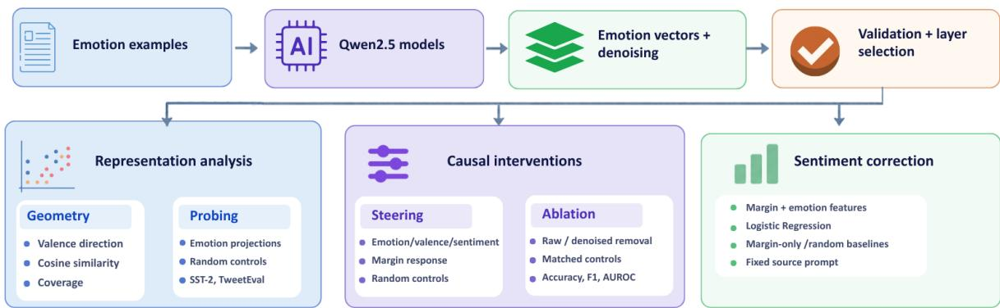
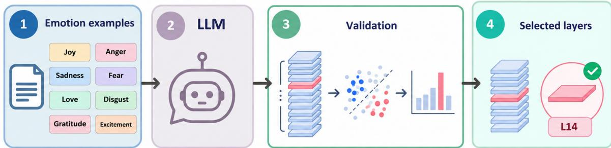
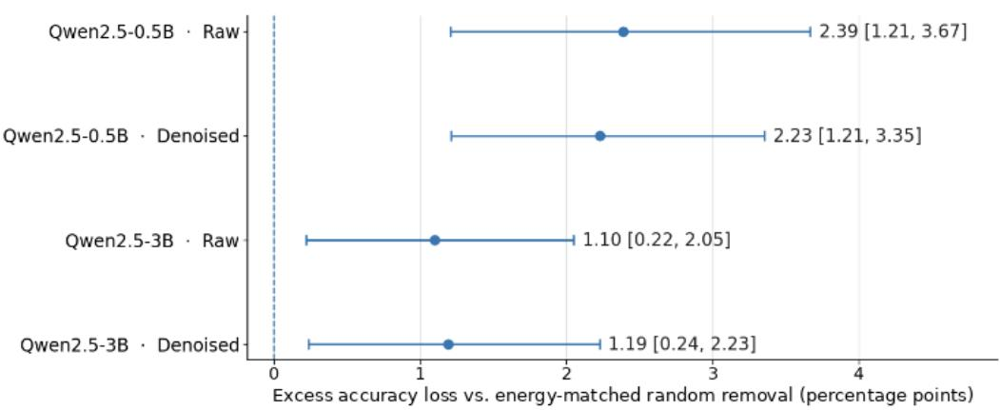

# Do Language Models Feel the Sentiment? Investigating Emotion Vectors

Ali Hassan Khan1,†, Saad Bin Ather1,\*,†, Muhammad Saif1,†, Maryam Bashir1 and Hajra Waheed1

1National University of Computer and Emerging Sciences, Lahore, Pakistan

## Abstract

Emotion vectors are directions in a language model’s internal representations that are associated with emotional concepts. Prior work shows that these vectors can influence model behavior, but their role in sentiment classification remains unclear. This study investigates emotion directions in Qwen2.5-0.5B-Instruct and Qwen2.5- 3B-Instruct. Eight directions extracted from GoEmotions are evaluated through sentiment probing, activation interventions, and supervised correction. Emotion-only probes achieve 88.66% and 90.70% accuracy on binary TweetEval. In exploratory matched-ablation experiments, raw emotion-space removal causes 2.39 and 1.10 percentage points more accuracy loss than matched isotropic random-subspace removal for 0.5B and 3B, respectively. All four TweetEval raw and denoised efects are significant after Holm adjustment across eight comparisons. An exploratory SST-2 extension shows smaller raw excess losses of 0.66 and 0.57 points, with no efects surviving Holm adjustment. Frozen sentiment-correction classifiers are also tested on 20,000 Amazon Polarity reviews. Emotion-based correction improves accuracy over uncorrected Qwen, but does not consistently outperform margin-only baselines. These results distinguish sentiment information available in model representations, the efects of changing those representations, and their practical value for classification. They do not establish a uniquely emotional mechanism.

## Keywords

Emotion Vectors, Mechanistic Interpretability, Sentiment Analysis, Representation Geometry, Causal Interventions, Cross-Domain Generalization

## 1. Introduction

Emotion recognition and sentiment classification concern related but distinct properties of text. A language model may encode information associated with an emotion without using it to make a sentiment prediction. Likewise, an accurate supervised probe does not establish how the original model reaches its predictions. Emotion representations therefore need to be examined in terms of accessible information, intervention efects, and predictive utility. This distinction matters for trustworthy AI because it limits what representation-based explanations can claim about model decisions.

Sofroniew et al. [1] showed that emotion-related representations in Claude Sonnet 4.5 can influence model behavior. Sentiment-interpretability research has also identified polarity directions with causal efects [2]. The present study examines how emotion directions derived from an independent emotion dataset relate to sentiment predictions in two Qwen2.5 models. Geometric analysis, supervised probes, steering, and subspace ablation address diferent aspects of this relationship. Perturbation-matched random controls test whether ablation efects exceed those of comparably sized activation changes. Supervised correction and frozen transfer then test the practical value of emotion projections. Throughout, emotion vectors refer to directions associated with labeled emotional content, not subjective emotional

experience.

The main findings and contributions are:

1. Emotion-derived features recover substantial sentiment information, although full-state probes perform better. Neutral-PCA denoising improves emotion validation and valence alignment, but does not consistently improve sentiment probing.

2. Steering and subspace removal change sentiment predictions. Under matched perturbations, all four TweetEval raw and denoised efects survive Holm correction across eight comparisons. None of the four exploratory SST-2 efects survives correction.

3. Emotion features improve some trained sentiment-correction classifiers. On Amazon Polarity, the frozen correction heads improve over uncorrected Qwen, but do not consistently outperform margin-only correction. Raw valence steering remains below the maximum random-direction response, whereas denoised valence exceeds it.

## 2. Related Work

Mechanistic interpretability studies have identified emotion-related representations in language models. Sofroniew et al. [1] identified emotion vectors in Claude Sonnet 4.5 and showed efects on preferences, sycophancy, and reward hacking. Reichman et al. [3] identified a low-dimensional emotion space across contexts and languages using emotionally rewritten sentences. Maheswaran and Desarkar [4] examined cross-dataset and cross-prompt transfer and reported limits in emotion reasoning. Sun et al. [5] studied valence and arousal representations and their efects on the emotional tone of generated text. These studies show emotion-related structure and behavioral efects.

Other studies focus on sentiment representations. Tigges et al. [2] identified a linear sentiment direction that afects model predictions. Di Palma et al. [6] studied layer-dependent sentiment information in LLaMA models. They showed that probe performance depends on layer selection and representation pooling. They also separated recoverable information from model predictions. Du et al. [7] examined context-dependent sentiment representations, including efects of tone and audience.

Radwan [8] investigated an emotion-centroid valence direction and its relationship with sentiment classification. The study compared direction removal with random-direction controls. Our work extends this comparison to eight independently extracted emotion directions and their shared subspace. It uses rank-matched and perturbation-energy-matched controls.

Probing requires careful interpretation. Hewitt and Liang [9] used control tasks to separate encoded information from probe capacity. Elazar et al. [10] examined whether removing recoverable information changes model behavior. Related methods include iterative nullspace projection [11] and linear concept erasure [12]. These studies support the use of behavioral interventions alongside supervised probes. Successful decoding alone does not establish that the original model uses the information.

Activation interventions provide further evidence. Rimsky et al. [13] used contrastive activation addition to steer model behavior. Tak et al. [14] studied emotion inference representations and their causal efects. Wang et al. [15] examined neurons and attention heads linked to emotional expression. Fang et al. [16] combined probing with interventions and reported stronger efects from targeted changes than random changes. These studies mainly address emotion recognition, inference, or expression, rather than sentiment classification.

Equal-rank subspace removal does not necessarily produce equal activation changes. Perturbationenergy matching provides a more controlled comparison but cannot establish a uniquely emotional mechanism. Efects may also reflect sentiment information shared with other directions.

Our study combines emotion-space geometry, sentiment probing, steering, and subspace ablation to separate accessible information from intervention efects. Controls include rank-matched and energymatched removal. Supervised sentiment correction and frozen Amazon transfer test predictive utility without assuming a uniquely emotional mechanism.

## 3. Methodology

This study examines emotion directions in frozen language models. Eight directions are extracted from GoEmotions, and a layer is selected for each model through emotion validation. The directions are evaluated using geometry, sentiment probes, and activation interventions. Finally, supervised correction tests whether emotion projections add information beyond the model’s output sentiment margin. Random-direction controls provide comparisons throughout. Figure 1 summarizes the workflow.

  
Figure 1: Overview of the study. Emotion directions from GoEmotions are used for representation analysis, interventions, and sentiment correction. The correction classifiers are also tested on Amazon without retraining.

## 3.1. Emotion Directions and Layer Selection

The experiments use frozen Qwen2.5-0.5B-Instruct and Qwen2.5-3B-Instruct [17]. Emotion directions are extracted from 7,417 strict single-label examples in the oficial GoEmotions training split [18]. The eight emotions are joy, love, excitement, gratitude, sadness, anger, fear, and disgust.

For each text, nonspecial and nonpadding raw-text tokens are mean-pooled from the residual stream after each decoder block. This gives one vector, $\mathbf { h } _ { i } ^ { ( l ) }$ , for example � at layer �. For each emotion, its mean vector is compared with the unweighted mean of the other seven emotion class means:

$$
\pmb { \mu } _ { e } ^ { ( l ) } = \frac { 1 } { N _ { e } } \sum _ { \substack { i : y _ { i } = e } } \mathbf { h } _ { i } ^ { ( l ) } , \qquad \mathbf { v } _ { e } ^ { ( l ) } = \pmb { \mu } _ { e } ^ { ( l ) } - \frac { 1 } { | \mathcal { E } | - 1 } \sum _ { \substack { k \in \mathcal { E } } } \pmb { \mu } _ { k } ^ { ( l ) } .\tag{1}
$$

Here, $N _ { e }$ is the number of examples labeled with emotion �. The set $\mathcal { E }$ contains the eight emotions. Thus, $\mathbf { v } _ { e } ^ { ( l ) }$ points from the average of the other emotions toward emotion �.

The directions form the matrix $\mathbf { V } ^ { ( l ) } = [ \mathbf { v } _ { 1 } ^ { ( l ) } , \ldots , \mathbf { v } _ { 8 } ^ { ( l ) } ]$ . The unnormalized contrasts sum to zero, so their span has rank at most seven. Subspace ablation uses an SVD-derived orthonormal basis, with a relative singular-value tolerance of $1 0 ^ { - 5 }$

Neutral-PCA denoising tests whether removing patterns common in neutral text changes the emotion directions. At each layer, PCA is fitted to 12,810 separate neutral examples from the oficial GoEmotions training split. These examples are filtered to exclude normalized-text overlap with the emotion extraction and validation pools. The smallest number of leading components explaining at least 50% of the neutral activation variance is retained. Their projection is then removed from each emotion contrast:

$$
\widetilde { \mathbf { v } } _ { e } ^ { ( l ) } = \left( \mathbf { I } - \mathbf { U } _ { k } ^ { ( l ) } \mathbf { U } _ { k } ^ { ( l ) \top } \right) \mathbf { v } _ { e } ^ { ( l ) } .\tag{2}
$$

Here, I is the identity matrix. $\mathbf { U } _ { k } ^ { ( l ) }$ contains the � orthonormal PCA components. The product $\mathbf { U } _ { k } ^ { ( l ) } \mathbf { U } _ { k } ^ { ( l ) \top } \mathbf { v } _ { e } ^ { ( l ) }$ is the part removed from the emotion direction.

Raw and denoised directions are kept as separate conditions. Denoising may reduce shared neutraltext variation, but it may also discard sentiment-relevant information. Their geometry, probing, steering, ablation, and correction results are therefore compared rather than assuming denoising is beneficial.

Emotion discrimination is measured by AUROC on held-out GoEmotions examples and by transfer evaluation on EmpatheticDialogues [19]. Both raw and denoised directions are evaluated; only denoised directions are used to select layers. Selection uses the seven emotions shared across these datasets, excluding love.

For each eligible center layer �, the AUROC for each emotion is first averaged over layers � − 1, �, and � + 1. The mean (�) and 25th percentile (�) are then calculated across the seven smoothed emotion AUROCs for each dataset. The selection score is

$$
\begin{array} { r } { S ^ { ( l ) } = 0 . 7 \operatorname* { m i n } \{ A _ { \mathrm { G O } } ^ { ( l ) } , A _ { \mathrm { E D } } ^ { ( l ) } \} + 0 . 3 \operatorname* { m i n } \{ Q _ { \mathrm { G O } } ^ { ( l ) } , Q _ { \mathrm { E D } } ^ { ( l ) } \} . } \end{array}\tag{3}
$$

Here, GO and ED denote GoEmotions and EmpatheticDialogues. Taking the lower score across datasets favors layers that perform consistently on both, while the 25th-percentile term accounts for weaker-performing emotions.

The highest-scoring window determines its center layer. Boundary layers cannot be selected as centers; ties favor the earlier layer. This procedure selects layer 14 for Qwen2.5-0.5B and layer 18 for Qwen2.5-3B. The layers remain fixed in all later experiments. Downstream sentiment labels and accuracy are not used for layer selection. Figure 2 illustrates the process.

  
Figure 2: Layer selection using emotion validation. Layers 14 and 18 are selected for Qwen2.5-0.5B and Qwen2.5- 3B, respectively.

## 3.2. Emotion–Sentiment Geometry and Probing

Emotion–sentiment geometry and probing test whether these directions contain positive–negative sentiment information. All analyses use the frozen model and the layer selected by emotion validation.

Joy, love, excitement, and gratitude form the positive emotion group, ${ \mathcal { E } } ^ { + }$ ; sadness, anger, fear, and disgust form the negative group, ${ { \mathcal { E } } ^ { - } }$ . The diference between the two group means defines an emotion-based valence direction:

$$
{ \bf v } _ { \mathrm { v a l } } ^ { ( l ) } = \frac { 1 } { 4 } \sum _ { e \in \mathcal { E } ^ { + } } { \bf v } _ { e } ^ { ( l ) } - \frac { 1 } { 4 } \sum _ { e \in \mathcal { E } ^ { - } } { \bf v } _ { e } ^ { ( l ) } .\tag{4}
$$

Here, � is the selected layer. Separate valence directions are calculated from raw and denoised emotion contrasts. The groups are defined without using downstream sentiment labels.

A reference sentiment direction is derived from sentiment-training examples passed through the same frozen model. The diference between the mean positive and negative pooled representations at the selected layer defines

$$
\mathbf { d } _ { \mathrm { s e n t } } ^ { ( l ) } = \pmb { \mu } _ { \mathrm { p o s } } ^ { ( l ) } - \pmb { \mu } _ { \mathrm { n e g } } ^ { ( l ) } .\tag{5}
$$

Here, $\mu _ { \mathrm { p o s } } ^ { ( l ) }$ � and $\mu _ { \mathrm { n e g } } ^ { ( l ) }$ are the mean representations of the positive and negative training examples. This direction uses training labels, but no evaluation labels. It is a reference for comparison with the emotion directions. It is diferent from the model’s output sentiment margin.

Two geometric comparisons are made. Cosine similarity measures alignment between the emotionbased valence and sentiment directions. Coverage measures the fraction of the sentiment direction within the emotion subspace:

$$
\mathrm { C o v e r a g e } = \frac { \| \mathbf { Q } _ { E } \mathbf { Q } _ { E } ^ { \top } \mathbf { d } _ { \mathrm { s e n t } } \| _ { 2 } ^ { 2 } } { \| \mathbf { d } _ { \mathrm { s e n t } } \| _ { 2 } ^ { 2 } } .\tag{6}
$$

Here, $\mathbf { Q } _ { E }$ is an orthonormal basis for the raw or denoised emotion space. The numerator measures the squared norm of the sentiment direction projected into this space; the denominator is its total squared norm. Coverage ranges from 0 to 1 and is also compared with random rank-matched spaces.

Sentiment probes test whether the emotion scores of individual texts predict polarity. Each text is encoded by the frozen model, and its mean-pooled selected-layer representation is projected onto the eight emotion directions. This produces eight scores per example.

L2-regularized logistic-regression probes are trained on raw and denoised scores separately. Comparison probes use random directions or the full pooled hidden state. All probes are trained with sentiment labels but exclude Qwen’s output margin. Training-only feature standardization is used. The regularization parameter is selected on validation macro- $F _ { 1 }$ from $C \in \{ 0 . 0 0 1 , 0 . 0 1 , 0 . 1 , 1 , 1 0 , 1 0 0 , 1 0 0 0 \}$ . These tests measure recoverable sentiment information, not whether unmodified Qwen uses it.

## 3.3. Steering and Subspace Ablation

Two interventions test the efect of emotion directions on model outputs. Steering adds a direction to activations, while ablation removes an activation component within the emotion subspace. Both use the fixed selected layer of each frozen Qwen model.

At each valid raw-text token, excluding prompt, special, and padding tokens, steering adds or subtracts a normalized direction [13]:

$$
\mathbf { h } _ { t } ^ { \prime } = \mathbf { h } _ { t } + s \eta \| \mathbf { h } _ { t } \| _ { 2 } \frac { \mathbf { v } } { \| \mathbf { v } \| _ { 2 } } , \qquad s \in \{ - 1 , + 1 \} , \quad \eta \in \{ 0 . 0 1 , 0 . 0 2 5 , 0 . 0 5 \} .\tag{7}
$$

Here, $\mathbf { h } _ { t }$ is the original token activation, ${ \bf h } _ { t } ^ { \prime }$ is the changed activation, and v is the direction being tested. The sign � selects addition or subtraction. The three values of� make the change equal to $1 \% , 2 . 5 \% ,$ or 5% of the original activation norm. In the implementation, $\eta = 0 . 1 \alpha .$ where $\alpha \in \{ 0 . 1 , 0 . 2 5 , 0 . 5 \}$

Steering tests raw and denoised emotion directions, emotion-based valence, and the sentiment reference from Section 3.2. Fifty independently sampled Gaussian-QR random directions provide controls. Each direction is unit normalized before the same steering strengths are applied. These tests match intervention size, not the resulting efect on model outputs.

The sentiment margin, $M ( x )$ , is the log-probability of the positive first-answer token minus that of the negative first-answer token. Each candidate label is required to tokenize as one token. The two-sided steering response is half the diference between the margins after positive and negative steering. This margin is a relative label score, not calibrated confidence or an accuracy change.

Subspace ablation removes an activation component in the emotion space [11, 12]. Let $\mathbf { Q } _ { E }$ denote its orthonormal basis. The removal fraction $\beta$ defines the intervention:

$$
\mathbf { h } _ { t } ^ { \prime } = \mathbf { h } _ { t } - \beta \mathbf { Q } _ { E } \mathbf { Q } _ { E } ^ { \top } \mathbf { h } _ { t } , \qquad 0 \leq \beta \leq 1 .\tag{8}
$$

Full removal uses � = 1. Raw and denoised emotion spaces are tested separately against random rank-seven spaces. Each paired comparison uses the same examples and candidate-label prediction rule. Ablation performance is primarily reported using classification accuracy. Matched comparisons additionally report excess accuracy loss relative to random-subspace removal, with paired 95% confidence intervals.

TweetEval intervention evaluations use positive and negative ground-truth examples, excluding neutral examples. The original two-label instruction specifies positive and negative sentiment. Binary predictions are determined by comparing the two candidate-token log-probabilities. Accuracy and macro-� are computed over these two sentiment classes.

Removing subspaces of equal rank can change activations by diferent amounts. A second experiment therefore matches perturbation energy. For each valid text token, the squared norm of the activation change is divided by the squared norm of its original activation. The mean over valid tokens is the example’s normalized perturbation energy.

Full random-space removal sets an energy target. For paired emotion-space removal, one � is chosen per example through 16 bisection steps to match the measured target. The same � applies to every valid text token in that example. Matching uses no sentiment labels. If full emotion removal cannot reach the target, � = 1 is used and the mismatch is recorded.

Excess accuracy loss is the performance loss after matched emotion-space removal minus the loss after random-space removal. Fifty paired random rank-seven controls are used per model. Confidence intervals are obtained from paired example-and-seed bootstrap resampling. Energy matching controls the size of activation changes, but not their direction or downstream efects. The historical TweetEval analysis uses 600 previously inspected examples and is exploratory. An SST-2 extension uses a separate 600-example balanced internal holdout from oficial training; its analysis is also treated as exploratory.

## 3.4. Sentiment Correction

The sentiment probes measure accessible information. Sentiment correction tests whether emotion features improve predictions beyond the output margin. Separate L2-regularized logistic-regression classifiers are fitted for each Qwen model and source dataset. Each source setting uses 14,186 training examples: 7,093 positive and 7,093 negative. The Qwen weights and emotion directions remain frozen.

SST-2 contains sentences from movie reviews [20, 21], while TweetEval contains tweets [22, 23]. Binary sentiment experiments on both datasets evaluate positive and negative ground-truth examples.

Four prompt identifiers, P1–P4, are used for prompt-sensitivity analysis. The templates below show their standard forms. In each template, the {labels} placeholder denotes positive or negative for both SST-2 and TweetEval. The {text} placeholder denotes the input example. A blank line separates the instructions from the Text: line.

P1 P2   
Classify the sentiment of this text as Determine whether the following text   
{labels}. expresses {labels} sentiment.   
Reply with only one label: {labels}. Answer only: {labels}.   
Text: {text} Text: {text}   
P3 P4   
Read the text and identify its sentiment. Is the sentiment in this text {labels}?   
Output exactly one word: {labels}. Return only the label, with no explanation.   
Text: {text} Text: {text}

All sentiment-correction and Amazon transfer experiments use their saved source-specific P1 instructions. Candidate-token log-probabilities provide the positive-minus-negative sentiment margin �(�). The correction classifiers produce binary sentiment predictions. These experiments are distinct from prompt-sensitivity evaluation and intervention-based predictions.

Each correction classifier receives the margin and eight emotion scores from the selected layer. For text �, the token activations are mean-pooled to obtain h(�). The score for emotion � is

$$
z _ { e } ( x ) = \frac { \overline { { \mathbf { h } } } ( x ) ^ { \top } \mathbf { v } _ { e } } { \| \mathbf { v } _ { e } \| _ { 2 } } .\tag{9}
$$

This score measures the representation’s projection onto emotion direction $\mathbf { v } _ { e } .$ . The feature vector is $[ M ( x ) , z _ { 1 } ( x ) , \ldots , z _ { 8 } ( x ) ]$ ]. Raw and denoised directions are evaluated with separate classifiers.

Comparison heads use the margin alone or the margin with 50 saved random rank-seven feature controls. The eight mean-contrast emotion directions sum to zero before normalization, so their subspace has rank at most seven. The random controls therefore match the emotion-space rank rather than the number of projection scores.

Feature transformations and standardization are fitted on source training data only. The logisticregression parameter � is selected using validation balanced accuracy, followed by macro-�1. Ties are resolved in favor of the smaller �. Test labels are not used to fit the final classifiers or set an evaluation-specific decision threshold.

## 3.5. Cross-Domain Transfer and Statistical Analysis

Frozen cross-domain transfer tests whether source-trained correction heads work on a diferent dataset. A fixed, label-balanced sample of 20,000 reviews (10,000 per class) is drawn from the oficial Amazon Polarity test set [24]. Target labels determine the sample’s class balance but are not used to fit classifiers or choose hyperparameters.

SST-2- and TweetEval-trained classifiers are applied for each Qwen model, giving four source–model settings. Every setting retains its P1 prompt, model weights, layer, feature transforms, classifier weights, and source-trained decision rule. Amazon labels are joined only after predictions are frozen. Both SST-2 and TweetEval use positive and negative labels in their prompts and all correction classifiers produce binary sentiment predictions.

For each setting, uncorrected Qwen is compared with margin-only, raw-emotion, denoised-emotion, and random-feature correction. Random-control results average 50 source-trained classifiers. Accuracy, macro-�1, balanced accuracy, and AUROC are computed, with accuracy presented as the primary cross-domain evaluation metric.

Evaluation uncertainty is estimated by bootstrap resampling. Compared methods share paired example resamples, with class balance preserved. The Amazon evaluation uses 2,000 fixed-seed resamples. Random-seed variation is reported separately from example-resampling uncertainty. The matched ablation analysis also resamples paired random seeds when estimating its confidence intervals.

For matched ablation, 50,000 class-stratified paired example-and-seed bootstrap resamples are used on the fixed evaluation predictions. Approximate two-sided null-centered bootstrap �-values are computed with a plus-one correction and adjusted using Holm–Bonferroni across eight comparisons. Nominal 95% percentile intervals are reported for individual comparisons. Bonferroni basic-bootstrap intervals with 99.375% marginal coverage target approximate 95% family-wise coverage across the eight tests. These are not Holm-adjusted intervals, and their coverage depends on the bootstrap approximation.

Source-domain tests and previously inspected intervention samples are treated as exploratory. Amazon confidence intervals remain nominal; its predictions were frozen before target-label outcome evaluation, although labels were used to construct a balanced sample.

The SST-2 and TweetEval classifiers are trained on diferent source datasets, but both use positive and negative sentiment labels. Their cross-domain results are reported separately for each source-trained setting.

## 3.6. Reproducibility and Availability

Later-stage records identify Qwen2.5-0.5B-Instruct and Qwen2.5-3B-Instruct revisions 7ae557604adf67be50417f59c2c2f167def9a775 and aa8e72537993ba99e69dfaafa59ed015b17504d1, respectively. Correction and transfer explicitly pin these revisions.

Recorded software includes Python 3.12.4, PyTorch 2.14.0+cu126, Transformers 4.57.6, NumPy 2.5.3, scikit-learn 1.9.1, and NNsight 0.5.15. Experiments used an NVIDIA RTX A4000 (16,376 MiB VRAM). The recorded driver was 596.71; PyTorch used a cu126 build.

Both tokenizers encode the exact lowercase, unspaced strings positive, negative, and neutral as single tokens with IDs 30487, 42224, and 59568, respectively. Leading-space variants have diferent IDs. Emotion extraction used raw text, while sentiment experiments applied Qwen chat templates with generation prefixes. No extraction seed was recorded. Sampling used seed 42, steering used 43, random controls used 1000–1049 or 2000–2049, and matched-ablation bootstrap used seeds 45/46 with 50,000 resamples. Correction and Amazon bootstrap used seed 47. Recorded Amazon batch computation totaled approximately 51.7 minutes, excluding overhead.

Source code is available at https://github.com/Alihassan0155/ Do-Language-Models-Feel-the-Sentiment. Both 600-example identifier lists are retained locally but are not publicly released. Datasets, predictions, emotion vectors, trained heads, and experimental outputs are also excluded.

## 4. Experiments and Results

We evaluate frozen Qwen2.5-0.5B-Instruct and Qwen2.5-3B-Instruct, selecting layers 14 and 18 using GoEmotions validation. Prompt sensitivity uses 12,000 SST-2 training and 872 validation examples, alongside 6,347 binary TweetEval test examples. Generated labels are decoded for up to four tokens.

Representation probes use SST-2 splits of 9,600/2,400/872 and TweetEval splits of 24,942/1,131/6,347. Steering and full ablation use 600 balanced examples per dataset. Matched ablation uses an inspected TweetEval sample and a separate SST-2 training holdout, each containing 600 examples.

Correction classifiers train on 14,186 balanced source examples and are evaluated on 5,000 SST-2 or 6,347 TweetEval examples. Frozen transfer uses 20,000 Amazon reviews.

## 4.1. Prompt Sensitivity and Emotion Validation

## Table 1

Sentiment classification accuracy (%) under four prompt variants (P1–P4). SST-2 reports generated-label accuracy on pooled sampled training and validation examples. TweetEval reports binary positive-negative sentiment evaluation.
<table><tr><td>Model</td><td>Dataset</td><td>P1</td><td>P2</td><td>P3</td><td>P4</td></tr><tr><td>0.5B</td><td>SST-2</td><td>89.44</td><td>86.09</td><td>85.82</td><td>89.05</td></tr><tr><td>3B</td><td>SST-2</td><td>79.18</td><td>85.26</td><td>81.46</td><td>87.80</td></tr><tr><td>0.5B</td><td>TweetEval</td><td>79.62</td><td>78.92</td><td>77.31</td><td>82.72</td></tr><tr><td>3B</td><td>TweetEval</td><td>78.35</td><td>79.52</td><td>78.01</td><td>81.57</td></tr></table>

Prompt wording afects generated-label accuracy (Table 1). The saved P1 instruction is used for downstream sentiment correction and cross-domain transfer. Prompt-sensitivity analysis evaluates generated labels, whereas correction uses margin-based binary classifiers. TweetEval evaluation examples were inspected in earlier stages, so the later correction results are treated as exploratory.

Neutral-PCA denoising improves emotion discrimination on the oficial GoEmotions validation split. Across all layers and eight one-vs-rest tasks, mean AUROC rises from 0.616 to 0.883 for 0.5B. For 3B, it rises from 0.611 to 0.891. This evaluation uses 879 strict single-label examples. At the selected layers, the leading neutral principal component explains 99.74% of neutral activation variance in 0.5B and 99.12% in 3B. Thus thresholds between 30% and 70% would retain that same component at these fixed layers. This observation does not test whether selecting layers again at a diferent threshold would give the same result.

For layer selection, a seven-emotion evaluation uses 712 GoEmotions validation examples, excluding love, together with 490 EmpatheticDialogues validation examples. At the selected layers, denoised macro-AUROC reaches 0.876 for Qwen2.5-0.5B at layer 14 and 0.896 for Qwen2.5-3B at layer 18 on the matched GoEmotions subset. Each emotion is evaluated against the other six. These results are descriptive because validation performance also guided layer selection.

## 4.2. Sentiment Information and Representation Geometry

Table 2  
Sentiment prediction from representation-only probes. Accuracy is a percentage; AUROC ranges from 0 to 1. Random results average ten seeds.
<table><tr><td colspan="2"></td><td colspan="2">SST-2</td><td colspan="2">TweetEval</td></tr><tr><td>Model Features</td><td></td><td>Acc. (%) AUROC</td><td></td><td>Acc. (%)</td><td>AUROC</td></tr><tr><td rowspan="4">0.5B</td><td>Raw emotion</td><td>81.88</td><td>0.898</td><td>88.66</td><td>0.958</td></tr><tr><td>Denoised</td><td>81.77</td><td>0.892</td><td>87.99</td><td>0.957</td></tr><tr><td>Random rank-7</td><td>63.08</td><td>0.695</td><td>53.11</td><td>0.740</td></tr><tr><td>Full state</td><td>89.11</td><td>0.959</td><td>91.70</td><td>0.974</td></tr><tr><td rowspan="4">3B</td><td>Raw emotion</td><td>79.13</td><td>0.868</td><td>90.70</td><td>0.961</td></tr><tr><td>Denoised</td><td>78.21</td><td>0.870</td><td>90.09</td><td>0.961</td></tr><tr><td>Random rank-7</td><td>62.00</td><td>0.675</td><td>54.22</td><td>0.753</td></tr><tr><td>Full state</td><td>91.28</td><td>0.969</td><td>93.46</td><td>0.982</td></tr></table>

These probes predict sentiment from model representations alone. They do not use the model’s output margin. On binary TweetEval, raw emotion features reach 88.66% accuracy for 0.5B and 90.70% for 3B (Table 2). Both exceed the random controls. The full hidden state gives higher accuracy still.

On SST-2, raw emotion features reach 81.88% and 79.13% accuracy. Denoising improves emotion validation, but it does not consistently improve sentiment probing.

Relationship between emotion and sentiment directions. Coverage (%) measures the fraction of the supervised sentiment direction captured by each subspace. Random coverage reports mean ± SD across 10 rank-seven random subspaces. Cosine similarity measures valence alignment. Bold compares raw and denoised results.
<table><tr><td colspan="2"></td><td colspan="3">Coverage (%)</td><td colspan="2">Cosine similarity</td></tr><tr><td></td><td>Model Dataset</td><td>Raw</td><td>Denoised</td><td>Random</td><td>Raw</td><td>Denoised</td></tr><tr><td>0.5B</td><td>SST-2</td><td>49.54</td><td>50.22</td><td> $0 . 8 1 \pm 0 . 2 8$ </td><td>0.041</td><td>0.599</td></tr><tr><td>3B</td><td>SST-2</td><td>40.91</td><td>40.51</td><td> $0 . 3 6 \pm 0 . 1 7$ </td><td>0.232</td><td>0.551</td></tr><tr><td>0.5B</td><td>TweetEval</td><td>59.36</td><td>66.85</td><td> $1 . 0 9 \pm 0 . 3 5$ </td><td>0.076</td><td>0.717</td></tr><tr><td>3B</td><td>TweetEval</td><td>57.41</td><td>62.91</td><td> $0 . 4 6 \pm 0 . 2 4$ </td><td>0.166</td><td>0.664</td></tr></table>

Emotion-space coverage ranges from 40.51% to 66.85%, substantially exceeding the empirical random rank-seven controls. The theoretical isotropic expectations are 0.78% for 0.5B and 0.34% for 3B. This substantial overlap with supervised sentiment directions may partly explain the observed intervention efects without establishing a uniquely emotional mechanism.

Denoising increases the cosine similarity between emotion-based valence and the sentiment direction (Table 3). On TweetEval, similarity rises from 0.076 to 0.717 for 0.5B and from 0.166 to 0.664 for 3B. The denoised emotion spaces also cover 66.85% and 62.91% of the corresponding sentiment directions.

Geometry and probe accuracy answer diferent questions. Closer alignment does not always produce better classification. A successful probe shows that a classifier can recover sentiment information. It does not show whether unmodified Qwen uses that information when predicting.

## 4.3. Interventions on Sentiment Predictions

Steering tests whether emotion-related activation changes afect output sentiment margins. At the selected layer, interventions use 1%, 2.5%, and 5% of each valid token’s activation norm. Table 4 reports

two-sided responses. Denoised valence exceeds the maximum absolute response of 50 random directions at every strength and setting, whereas raw valence remains below that maximum. The supervised sentiment direction consistently gives the largest response.

## Table 4

Two-sided sentiment-margin responses at three steering strengths. Random statistics summarize absolute mean responses across 50 directions. Values are margin changes, not accuracy changes.
<table><tr><td>Model</td><td>Dataset</td><td>Strength</td><td>Raw</td><td></td><td>Denoised Sentiment</td><td>Rand. med. Rand. max.</td><td></td></tr><tr><td>0.5B</td><td>SST-2</td><td>1%</td><td>0.020</td><td>0.160</td><td>0.237</td><td>0.008</td><td>0.043</td></tr><tr><td></td><td></td><td>2.5%</td><td>0.051</td><td>0.400</td><td>0.593</td><td>0.021</td><td>0.110</td></tr><tr><td></td><td></td><td>5%</td><td>0.101</td><td>0.799</td><td>1.185</td><td>0.042</td><td>0.219</td></tr><tr><td>3B</td><td>SST-2</td><td>1%</td><td>0.068</td><td>0.230</td><td>0.421</td><td>0.028</td><td>0.095</td></tr><tr><td></td><td></td><td>2.5%</td><td>0.171</td><td>0.582</td><td>1.083</td><td>0.070</td><td>0.236</td></tr><tr><td></td><td></td><td>5%</td><td>0.342</td><td>1.208</td><td>2.326</td><td>0.140</td><td>0.473</td></tr><tr><td>0.5B</td><td>TweetEval</td><td>1%</td><td>0.023</td><td>0.079</td><td>0.080</td><td>0.011</td><td>0.038</td></tr><tr><td></td><td></td><td>2.5%</td><td>0.057</td><td>0.198</td><td>0.199</td><td>0.029</td><td>0.094</td></tr><tr><td></td><td></td><td>5%</td><td>0.112</td><td>0.393</td><td>0.398</td><td>0.057</td><td>0.187</td></tr><tr><td>3B</td><td>TweetEval</td><td>1%</td><td>0.056</td><td>0.240</td><td>0.259</td><td>0.027</td><td>0.118</td></tr><tr><td></td><td></td><td>2.5%</td><td>0.138</td><td>0.603</td><td>0.648</td><td>0.067</td><td>0.298</td></tr><tr><td></td><td></td><td>5%</td><td>0.276</td><td>1.214</td><td>1.305</td><td>0.136</td><td>0.590</td></tr></table>

Individual emotion directions also afect margins in the expected direction. On TweetEval, denoised joy produces responses of 0.370 and 1.072 for 0.5B and 3B, while sadness produces −0.395 and −0.819. All eight denoised emotions show the expected response direction. These efects demonstrate behavioral sensitivity, not that the model normally relies on these directions.

Full emotion-space removal is evaluated using binary candidate-token accuracy (Table 5). Its separate evaluation samples and scoring protocol prevent direct comparison with prompt-sensitivity or correction accuracies.

## Table 5

Accuracy (%) after full emotion-space removal. Parentheses indicate percentage-point drops from the unmodified baseline.
<table><tr><td>Model</td><td>Dataset</td><td>Baseline</td><td>Raw</td><td>Denoised</td></tr><tr><td>0.5B</td><td>SST-2</td><td>89.50</td><td>88.00 (1.50)</td><td>88.67 (0.83)</td></tr><tr><td>3B</td><td>SST-2</td><td>91.00</td><td>86.83 (4.17)</td><td>90.67 (0.33)</td></tr><tr><td>0.5B</td><td>TweetEval</td><td>87.17</td><td>77.83 (9.33)</td><td>78.50 (8.67)</td></tr><tr><td>3B</td><td>TweetEval</td><td>87.50</td><td>77.83 (9.67)</td><td>80.50 (7.00)</td></tr></table>

The SST-2 full- and matched-ablation experiments use distinct, non-overlapping balanced samples of 600 examples. Full ablation uses oficial validation data (3B baseline: 91.00%), whereas matched ablation uses an internal training holdout (81.67%). Both retain the same two-label P1 prompt and binary candidate-token scoring. The discrepancy persists across larger cached prediction pools and is not specific to the 600-example samples. These results cannot be interpreted as a same-sample comparison.

Full raw removal causes the largest accuracy drops on TweetEval: 9.33 and 9.67 percentage points for 0.5B and 3B, respectively. On SST-2, the 3B raw and denoised drops are 4.17 and 0.33 points.

By comparison, full random rank-seven removal reduces TweetEval accuracy by 0.78 and 0.46 points. However, equal-rank removal does not imply equal perturbation energy. For 0.5B, raw, denoised, and random removal change 4.66%, 6.70%, and 0.77% of normalized activation energy; the corresponding 3B values are 8.10%, 3.93%, and 0.35%. Random energies approximate the isotropic expectations 7/896 and 7/2048. Thus, equal-rank comparisons alone cannot establish superiority over other data-derived subspaces.

Energy-matched ablation addresses this diference by scaling emotion-space removal separately for each example to match random-removal energy. TweetEval results use binary candidate scores reconstructed from saved intervention outputs, without changing model inputs or interventions. Results average 50 paired random seeds rather than treating repeated predictions as independent.

## Table 6

TweetEval matched ablation with binary candidate scoring. Excess loss is the additional accuracy drop versus random removal (percentage points). Results average 50 paired seeds. Excess losses are computed before rounding, brackets give nominal paired 95% percentile CIs from 50,000 bootstrap resamples.

<table><tr><td>Model</td><td>Removal</td><td>Acc. (%)</td><td>Excess loss [95% CI]</td></tr><tr><td rowspan="5">0.5B</td><td>None</td><td>87.17</td><td></td></tr><tr><td>Random</td><td>86.39</td><td></td></tr><tr><td>Raw</td><td>84.00</td><td>2.39 [1.21, 3.67]</td></tr><tr><td>Denoised</td><td>84.16</td><td>2.23 [1.21, 3.35]</td></tr><tr><td>None</td><td>87.50</td><td>一</td></tr><tr><td>3B</td><td>Random</td><td>87.04</td><td></td></tr><tr><td></td><td>Raw</td><td>85.94</td><td>1.10 [0.22, 2.05]</td></tr><tr><td></td><td>Denoised</td><td>85.84</td><td>1.19 [0.24, 2.23]</td></tr></table>

At matched energy, raw-emotion removal produces 2.39 and 1.10 points of excess loss for 0.5B and 3B (Table 6). Both nominal intervals exclude zero. Figure 3 visualizes all four efects; family-wise inference appears in Table 8.

These efects apply to the tested isotropic random controls, not all data-derived subspaces. Emotion spaces substantially overlap supervised sentiment directions, potentially explaining some intervention efects without a uniquely emotional mechanism. Energy matching controls perturbation magnitude, not direction or downstream consequences.

  
Figure 3: Excess accuracy loss relative to energy-matched random removal. Points show percentage-point efects; bars show nominal paired 95% percentile CIs from 50,000 resamples. The dashed line indicates zero.

The exploratory SST-2 extension uses 600 balanced oficial-training examples with no audited source-ID or normalized-text overlap against previous saved experimental uses. It retains the original P1 prompt and binary scoring, with 50 paired random controls. The initial 2,000-draw analysis was reproduced, and intervals use 50,000 class-stratified paired example-and-seed bootstrap resamples. All 30,000 energy comparisons passed for each model and emotion-space condition. Random-removal accuracy SDs were 0.29 and 0.57 points for 0.5B and 3B, respectively.

On SST-2, raw removal yields excess losses of 0.66 and 0.57 points. Only the 3B nominal raw interval excludes zero; neither survives Holm adjustment. These efects are smaller than TweetEval’s, but difering evaluation samples prevent attributing the diference to dataset properties alone. Both analyses are exploratory.

Multiple-comparison-adjusted results for both datasets appear in Table 8.

Table 7  
Exploratory SST-2 matched ablation on 600 balanced training-holdout examples. Accuracy averages 50 seeds; excess loss is relative to random removal (percentage points). Brackets show nominal paired 95% CIs.
<table><tr><td>Model</td><td>Removal</td><td>Acc. (%)</td><td>Excess loss [95% CI]</td></tr><tr><td rowspan="5">0.5B</td><td>None</td><td>90.00 一</td><td></td></tr><tr><td>Random</td><td>89.81</td><td></td></tr><tr><td>Raw</td><td>89.15</td><td>0.66 [-0.10, 1.49]</td></tr><tr><td>Denoised</td><td>89.66</td><td>0.15 [-0.22, 0.61]</td></tr><tr><td>None</td><td></td><td>一</td></tr><tr><td rowspan="4">3B</td><td></td><td>81.67</td><td></td></tr><tr><td>Random</td><td>81.70</td><td></td></tr><tr><td>Raw</td><td>81.14</td><td>0.57 [0.12, 1.09]</td></tr><tr><td>Denoised</td><td>81.30</td><td>0.40 [-0.32, 1.15]</td></tr></table>

## Table 8

Matched-ablation inference across eight comparisons. Bonferroni basic-bootstrap intervals target approximate 95% family-wise coverage; Holm-adjusted �-values use 50,000 paired resamples. Intervals are not Holm-adjusted. Efects are percentage points.
<table><tr><td>Dataset</td><td></td><td>Model Removal</td><td>Family-wise 95% CI Holm p</td><td></td></tr><tr><td>TweetEval</td><td>0.5B</td><td>Raw</td><td>[0.57, 4.02]</td><td>0.0021</td></tr><tr><td></td><td></td><td>Denoised</td><td>[0.60, 3.60]</td><td>0.0008</td></tr><tr><td></td><td>3B</td><td>Raw</td><td>[-0.25, 2.31]</td><td>0.042</td></tr><tr><td></td><td></td><td>Denoised</td><td>[-0.27, 2.53]</td><td>0.048</td></tr><tr><td>SST-2</td><td>0.5B</td><td>Raw</td><td>[-0.53, 1.72]</td><td>0.2982</td></tr><tr><td></td><td></td><td>Denoised</td><td>[-0.54, 0.65]</td><td>0.5661</td></tr><tr><td></td><td>3B</td><td>Raw</td><td>[-0.20, 1.19]</td><td>0.1102</td></tr><tr><td></td><td></td><td>Denoised</td><td>[-0.69, 1.40]</td><td>0.5661</td></tr></table>

All four exploratory TweetEval efects have Holm-adjusted $p < 0 . 0 5 ( 0 . 0 0 2 1 , 0 . 0 0 0 8 , 0 . 0 4 2 ,$ , and 0.048), while none of the four SST-2 efects survives adjustment. Bonferroni simultaneous intervals exclude zero for the two 0.5B TweetEval efects, but not for 3B. These interval and test procedures therefore give diferent conclusions for 3B. The approximate bootstrap �-values have finite Monte Carlo precision. Overall, the evidence indicates sensitivity to tested isotropic random-space comparisons on TweetEval, not a uniquely emotional mechanism or robust cross-dataset generalization.

## 4.4. Sentiment Correction

To assess predictive utility beyond Qwen’s output margin, source-trained logistic-regression classifiers combine margin and emotion features. Raw, denoised, and random features are compared with marginonly correction and uncorrected Qwen. Each setting retains its saved P1 prompt; preprocessing and model selection use source training and validation data only.

Raw emotion features outperform margin-only correction most strongly on TweetEval (Table 9), improving accuracy by 6.26 and 1.55 percentage points for 0.5B and 3B, respectively (paired 95% CIs: [5.47, 7.07] and [1.10, 2.02]). Both also outperform random-feature controls, with AUROCs of 0.9706 and 0.9836.

On SST-2, the corresponding gains are 1.04 points (95% CI [0.56, 1.52]) and 0.10 points ([-0.36, 0.58]); the latter is inconclusive. These improvements establish predictive utility for trained classifiers, not causal reliance by unmodified Qwen.

## 4.5. Frozen Cross-Domain Transfer

Source-trained classifiers are evaluated without target retraining or tuning on 20,000 balanced Amazon Polarity test reviews. Prompts, layers, feature transforms, classifier weights, and decision rules remain frozen. Target labels determine sample balance only.

Table 11  
Table 9  
Source-domain accuracy (%). Random results average 50 classifiers; the final row reports across-seed SD in percentage points. Bold marks the best.
<table><tr><td rowspan="3">Method</td><td>SST-2</td><td></td><td colspan="2">TweetEval</td></tr><tr><td>0.5B</td><td>3B</td><td>0.5B</td><td>3B</td></tr><tr><td></td><td>80.96</td><td>85.88</td><td>89.81</td></tr><tr><td>Original Qwen Margin only</td><td>89.32 89.14</td><td>91.34</td><td>85.88</td><td>92.48</td></tr><tr><td>Raw emotion + margin</td><td>90.18</td><td>91.44</td><td>92.14</td><td>94.03</td></tr><tr><td>Denoised + margin</td><td>89.88</td><td>91.28</td><td>92.09</td><td>94.01</td></tr><tr><td>Random + margin</td><td>89.75</td><td>91.24</td><td>86.93</td><td>92.50</td></tr><tr><td>Random seed SD</td><td>0.23</td><td>0.17</td><td>0.87</td><td>0.19</td></tr></table>

Table 10  
Amazon accuracy/macro- ${ \bf \nabla } \cdot F _ { 1 }$ (%). Random results average 50 source-trained classifiers; the final row reports across-seed SD in percentage points. Bold marks the best.
<table><tr><td></td><td colspan="2">SST-2 trained</td><td colspan="2">TweetEval trained</td></tr><tr><td>Method</td><td>0.5B</td><td>3B</td><td>0.5B</td><td>3B</td></tr><tr><td>Original Qwen</td><td>92.24/92.22</td><td>94.13/94.12</td><td>92.13/92.13</td><td>94.67/94.66</td></tr><tr><td>Margin only</td><td>92.05/92.02</td><td>95.86/95.86</td><td>92.13/92.13</td><td>95.78/95.78</td></tr><tr><td>Raw emotion + margin</td><td>93.63/93.62</td><td>95.90/95.90</td><td>92.65/92.64</td><td>95.48/95.48</td></tr><tr><td>Denoised + margin</td><td>93.42/93.41</td><td>95.86/95.86</td><td>92.93/92.93</td><td>95.39/95.38</td></tr><tr><td>Random + margin</td><td>92.57/92.56</td><td>95.85/95.86</td><td>92.24/92.23</td><td>95.68/95.68</td></tr><tr><td>Random seed SD</td><td>0.29/0.30</td><td>0.05/0.05</td><td>1.35/1.37</td><td>0.12/0.12</td></tr></table>

Amazon raw-emotion accuracy gains (percentage points), with nominal paired 95% percentile CIs from 2,000 resamples.
<table><tr><td>Source</td><td>Model</td><td>Raw – Margin</td><td>Raw – Original</td></tr><tr><td>SST-2</td><td>0.5B</td><td>+1.58 [1.34, 1.83]</td><td>+1.39 [1.15, 1.62]</td></tr><tr><td>SST-2</td><td>3B</td><td>+0.04 [-0.08, 0.17]</td><td>+1.77 [1.50, 2.04]</td></tr><tr><td>TweetEval</td><td>0.5B</td><td>+0.52 [0.22, 0.82]</td><td>+0.52 [0.22, 0.82]</td></tr><tr><td>TweetEval</td><td>3B</td><td>-0.30 [-0.47, -0.13]</td><td>+0.81 [0.57, 1.03]</td></tr></table>

Raw-emotion correction improves over uncorrected Qwen in all four Amazon settings by 0.52–1.77 points (Tables 10 and 11). However, relative to margin-only correction, gains are inconsistent: +1.58 and +0.04 points for SST-2-trained 0.5B and 3B, and +0.52 and -0.30 points for TweetEval-trained models. The +0.04-point gain is inconclusive, while the negative TweetEval 3B diference indicates worse accuracy.

Macro- ${ \bf \nabla } \cdot { \cal F } _ { 1 }$ shows broadly similar rankings. Accuracy gains also need not improve AUROC: SST-2- trained 3B raw correction achieves 0.9874, below uncorrected Qwen’s 0.9888. Thus, emotion features ofer some cross-domain benefit but no consistent advantage over margin-only correction. Sourcespecific results are not directly interchangeable.

## 4.6. Discussion

Emotion probes recover substantial sentiment information, but improved geometric alignment after neutral-PCA denoising does not consistently improve classification. Probe accuracy alone does not establish reliance by the original model.

Steering and ablation afect model outputs. Raw valence steering remains below the maximum tested random response, whereas denoised valence exceeds it. All four exploratory TweetEval matched-ablation efects survive Holm correction, but only the two 0.5B efects have simultaneous Bonferroni-adjusted intervals excluding zero. No SST-2 efect survives Holm correction. These findings show sensitivity relative to isotropic random controls, not a uniquely emotional mechanism.

Emotion-based correction improves some predictions but does not consistently outperform marginonly correction during frozen Amazon transfer.

For trustworthy AI, these results highlight the limits of representation-based explanations. Future work should examine additional model families, independent datasets, data-aligned controls, and the relationship between denoising and predictive performance.

## 4.7. Limitations

The experiments examine only two models from the same model family and use selected internal layers. The historical TweetEval matched-ablation sample was inspected before the final comparison. The SST-2 extension has no audited overlap with prior saved examples, but broader independence from undocumented decisions cannot be established. Its results are therefore exploratory. Individual 95% percentile confidence intervals are nominal, whereas Bonferroni-adjusted basic-bootstrap simultaneous intervals target approximate 95% family-wise coverage across eight comparisons. These intervals are distinct from Holm-adjusted �-values. Matched perturbation energy does not control intervention direction or all possible distribution shifts in the activations.

The generated-label prompts, binary candidate-token intervention readout, and binary correction heads use diferent prediction rules. Prompt-sensitivity results are descriptive and are not directly comparable with the correction experiments. Neutral-PCA uses a fixed explained-variance threshold, and a full threshold-sensitivity analysis was not conducted. These limitations restrict the interpretation and generalization of the findings.

## 5. Conclusion

Emotion directions in the two Qwen2.5 models contain sentiment information recoverable by supervised probes. Steering and ablation show that changing these directions can afect model outputs. In matched ablation, all four TweetEval efects survive Holm correction across eight comparisons, whereas none of the SST-2 efects does. Only the two TweetEval 0.5B efects have Bonferroni-adjusted simultaneous intervals excluding zero. Neutral-PCA denoising improves emotion validation and valence alignment without consistently improving sentiment prediction. Frozen emotion-based correction improves over uncorrected Qwen on Amazon, but does not consistently outperform margin-only correction. The results therefore distinguish accessible sentiment information, intervention efects, and practical predictive utility. They do not establish a uniquely emotional mechanism or broad transfer to other model families.

## Data Rights, Ethics and Model Licenses

This study uses five publicly available datasets: GoEmotions (Apache 2.0), SST-2 (license unspecified), TweetEval (license unspecified, subject to platform terms), EmpatheticDialogues (CC BY-NC 4.0), and Amazon Polarity (Hugging Face release listed as Apache 2.0). Dataset licenses may not cover rights in underlying user-generated content. The models are Qwen2.5-0.5B-Instruct (Apache 2.0) and Qwen2.5-3B-Instruct (Qwen Research License). The source code is publicly available at https: //github.com/Alihassan0155/Do-Language-Models-Feel-the-Sentiment. Datasets, individual predictions, evaluation identifiers, extracted emotion vectors, trained correction heads, and experimental artifacts are not redistributed. Researchers should obtain datasets and model checkpoints from their original providers under the applicable terms.

## Declaration on Generative AI

During the preparation of this work, the authors used ChatGPT (OpenAI) for language editing, academic rephrasing, and suggestions regarding figure layouts. All AI-assisted outputs were reviewed and edited by the authors, who take full responsibility for the scientific content, results, interpretations, and conclusions. Figures 1 and 2 were manually designed by the authors using Canva, with no generative AI-generated artwork. Figure 3 was plotted directly from the experimental results without the use of generative AI tools.

## References

[1] N. Sofroniew, I. Kauvar, W. Saunders, R. Chen, T. Henighan, S. Hydrie, C. Citro, A. Pearce, J. Tarng, W. Gurnee, J. Batson, S. Zimmerman, K. Rivoire, K. Fish, C. Olah, J. Lindsey, Emotion concepts and their function in a large language model, 2026. URL: https://arxiv.org/abs/2604.07729. arXiv:2604.07729.

[2] C. Tigges, O. J. Hollinsworth, A. Geiger, N. Nanda, Language models linearly represent sentiment, in: Proceedings of the 7th BlackboxNLP Workshop: Analyzing and Interpreting Neural Networks for NLP, Association for Computational Linguistics, 2024, pp. 58–87. URL: https://aclanthology. org/2024.blackboxnlp-1.5/. doi:10.18653/v1/2024.blackboxnlp-1.5.

[3] B. Reichman, A. Avsian, L. Heck, Emotions where art thou: Understanding and characterizing the emotional latent space of large language models, in: International Conference on Learning Representations, 2026, pp. 49924–49947. URL: https://proceedings.iclr.cc/paper\_files/paper/2026/ file/51fa846f6b6b463144736fc3c3481f8c-Paper-Conference.pdf.

[4] A. Maheswaran, M. S. Desarkar, A unified view on emotion representation in large language models, in: Proceedings of the 19th Conference of the European Chapter of the Association for Computational Linguistics (Volume 1: Long Papers), Association for Computational Linguistics, 2026, pp. 3589–3610. URL: https://aclanthology.org/2026.eacl-long.165/. doi:10.18653/v1/2026. eacl-long.165.

[5] L. Sun, L. Yan, X. Lu, A. Lee, J. Zhang, J. Shao, Valence-arousal subspace in LLMs: Circular emotion geometry and multi-behavioral control, 2026. URL: https://arxiv.org/abs/2604.03147. arXiv:2604.03147.

[6] D. Di Palma, A. De Bellis, G. Servedio, V. W. Anelli, F. Narducci, T. Di Noia, LLaMAs have feelings too: Unveiling sentiment and emotion representations in LLaMA models through probing, in: Proceedings of the 63rd Annual Meeting of the Association for Computational Linguistics (Volume 1: Long Papers), Association for Computational Linguistics, 2025, pp. 6124–6142. URL: https://aclanthology.org/2025.acl-long.306/. doi:10.18653/v1/2025.acl-long.306.

[7] H. Du, J. Shi, Y. Zhang, G. Zhou, Y. Gao, Usage-modulated sentiment representations in large language models, 2026. URL: https://arxiv.org/abs/2610.05069. arXiv:2610.05069.

[8] Y. Radwan, Nine emotion centroids: A label-free valence axis that transfers across four modalities, arXiv preprint arXiv:2608.18090 (2026).

[9] J. Hewitt, P. Liang, Designing and interpreting probes with control tasks, in: Proceedings of the 2019 conference on empirical methods in natural language processing and the 9th international joint conference on natural language processing (emnlp-ijcnlp), 2019, pp. 2733–2743.

[10] Y. Elazar, S. Ravfogel, A. Jacovi, Y. Goldberg, Amnesic probing: Behavioral explanation with amnesic counterfactuals, Transactions of the Association for Computational Linguistics 9 (2021) 160–175.

[11] S. Ravfogel, Y. Elazar, H. Gonen, M. Twiton, Y. Goldberg, Null it out: Guarding protected attributes by iterative nullspace projection, in: Proceedings of the 58th annual meeting of the association for computational linguistics, 2020, pp. 7237–7256.

[12] N. Belrose, D. Schneider-Joseph, S. Ravfogel, R. Cotterell, E. Raf, S. Biderman, Leace: Perfect linear

concept erasure in closed form, Advances in Neural Information Processing Systems 36 (2023) 66044–66063.

[13] N. Rimsky, N. Gabrieli, J. Schulz, M. Tong, E. Hubinger, A. Turner, Steering llama 2 via contrastive activation addition, in: Proceedings of the 62nd Annual Meeting of the Association for Computational Linguistics (Volume 1: Long Papers), 2024, pp. 15504–15522.

[14] A. N. Tak, A. Banayeeanzade, A. Bolourani, M. Kian, R. Jia, J. Gratch, Mechanistic interpretability of emotion inference in large language models, in: Findings of the Association for Computational Linguistics: ACL 2025, Association for Computational Linguistics, 2025, pp. 13090–13120. URL: https://aclanthology.org/2025.findings-acl.679/. doi:10.18653/v1/2025.findings-acl.679.

[15] C. Wang, Y. Zhang, R. Yu, Y. Zheng, L. Gao, Z. Song, Z. Xu, G. Xia, H. Zhang, D. Zhao, X. Chen, Do LLMs “feel”? emotion circuits discovery and control, in: Proceedings of the 43rd International Conference on Machine Learning, volume 306 of Proceedings ofMachine Learning Research, PMLR, 2026, pp. 132595–132613. URL: https://proceedings.mlr.press/v306/wang26ky.html.

[16] T. Fang, G. Guibon, D. Buscaldi, Some emotions run deeper: Layer-wise probing and causal intervention in large language models, 2026. URL: https://arxiv.org/abs/2609.01279. arXiv:2609.01279.

[17] Qwen Team, Qwen2.5 technical report, 2025. URL: https://arxiv.org/abs/2412.15115. arXiv:2412.15115.

[18] D. Demszky, D. Movshovitz-Attias, J. Ko, A. Cowen, G. Nemade, S. Ravi, GoEmotions: A dataset of fine-grained emotions, in: Proceedings of the 58th Annual Meeting of the Association for Computational Linguistics, Association for Computational Linguistics, 2020, pp. 4040–4054. URL: https://aclanthology.org/2020.acl-main.372/. doi:10.18653/v1/2020.acl-main.372.

[19] H. Rashkin, E. M. Smith, M. Li, Y.-L. Boureau, Towards empathetic open-domain conversation models: A new benchmark and dataset, in: Proceedings of the 57th Annual Meeting of the Association for Computational Linguistics, Association for Computational Linguistics, 2019, pp. 5370–5381. URL: https://aclanthology.org/P19-1534/. doi:10.18653/v1/P19-1534.

[20] R. Socher, A. Perelygin, J. Wu, J. Chuang, C. D. Manning, A. Ng, C. Potts, Recursive deep models for semantic compositionality over a sentiment treebank, in: Proceedings of the 2013 Conference on Empirical Methods in Natural Language Processing, Association for Computational Linguistics, 2013, pp. 1631–1642. URL: https://aclanthology.org/D13-1170/.

[21] A. Wang, A. Singh, J. Michael, F. Hill, O. Levy, S. R. Bowman, GLUE: A multi-task benchmark and analysis platform for natural language understanding, in: Proceedings of the 2018 EMNLP Workshop BlackboxNLP, 2018, pp. 353–355. doi:10.18653/v1/W18-5446.

[22] F. Barbieri, J. Camacho-Collados, L. Espinosa Anke, L. Neves, TweetEval: Unified benchmark and comparative evaluation for tweet classification, in: Findings of the Association for Computational Linguistics: EMNLP 2020, Association for Computational Linguistics, 2020, pp. 1644–1650. URL: https://aclanthology.org/2020.findings-emnlp.148/. doi:10.18653/v1/2020.findings-emnlp. 148.

[23] S. Rosenthal, N. Farra, P. Nakov, SemEval-2017 task 4: Sentiment analysis in Twitter, in: Proceedings of the 11th International Workshop on Semantic Evaluation, 2017, pp. 502–518. doi:10.18653/v1/S17-2088.

[24] X. Zhang, J. Zhao, Y. LeCun, Character-level convolutional networks for text classification, in: Advances in Neural Information Processing Systems, 2015, pp. 649–657. URL: https://mlanthology. org/neurips/2015/zhang2015neurips-characterlevel/.