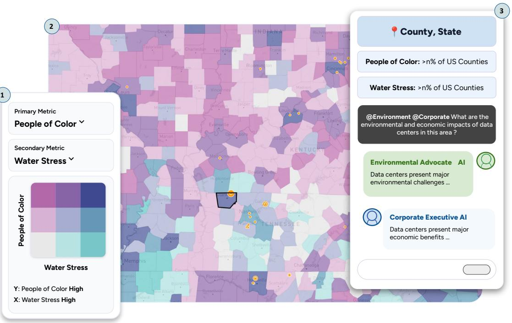
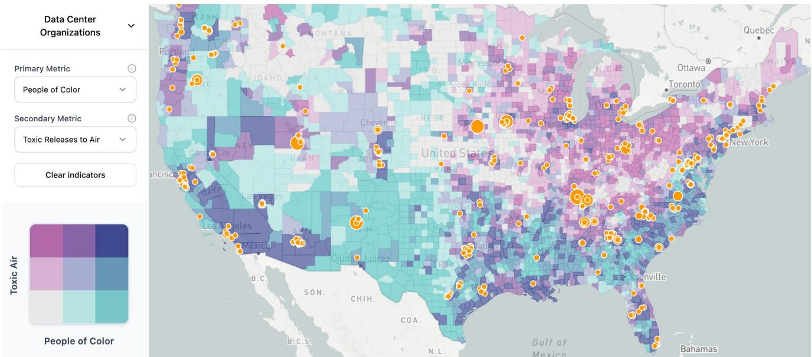
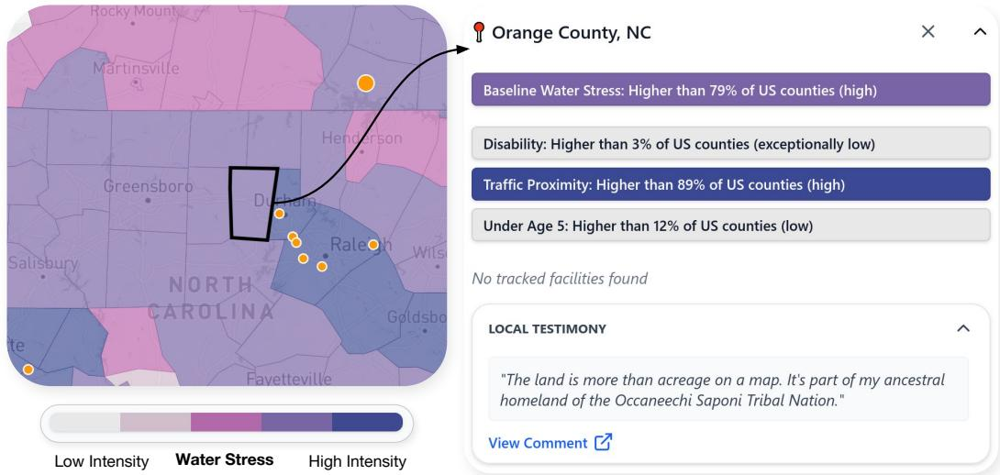
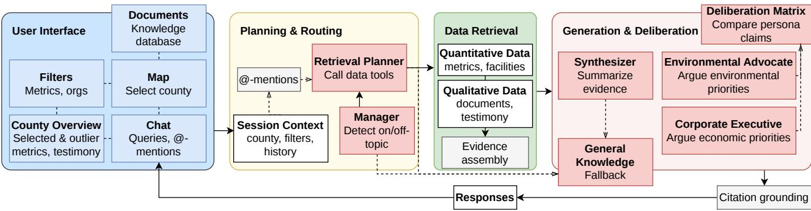
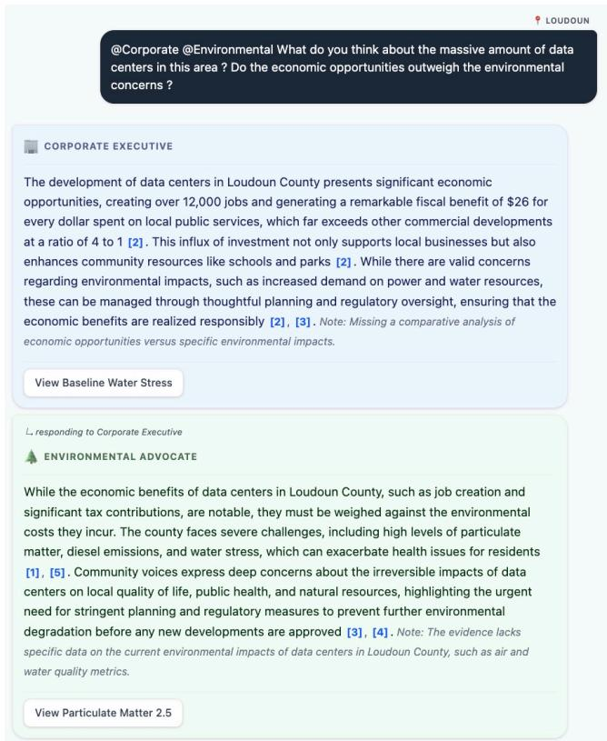

# EJAI: Judgment-Preserving Civic AI for Data Center Environmental Justice

Evan Pačes-Wiles<sup>1\*</sup> Bryen Alvarez<sup>1\*</sup> Sara Gulabani<sup>2\*</sup> Akshara Kolipaka<sup>1\*</sup> Snehalkumar ‘Neil’ S. Gaikwad<sup>1,2\*</sup>

<sup>\*</sup>Society-Centered AI Lab <sup>1</sup>Department of Computer Science <sup>2</sup>School of Data and Information Sciences University of North Carolina, Chapel Hill, USA gaikwad@cs.unc.edu

  
Figure 1: EJAI is a source-grounded multi-agent visualization system for data center environmental justice. Users can filter data centers and visualize metrics (1) on a map of data centers (2). Clicking a county surfaces an overview of selected and outlier metrics, tracked data centers, and local quotes. Users can query the system (3), including @-mention personas, for source-<sub>g</sub>roun<sup>d</sup>e<sup>d</sup> res<sub>p</sub>onses.

## Ab<sub>s</sub>t<sub>rac</sub>t

Communities in the United States and around the world are contesting data centers, the physical infrastructure of AI. These disputes pose environmental justice issues: residents must weigh unevenly distributed burdens using evidence scattered across metrics, corporate claims, policy documents, and public testimony. A formative study with 10 users showed that dashboards and single-agent AI can settle questions before people examine that evidence. Here we present EJAI, a source-grounded system that links an interactive map, retrieved evidence, missing-data statements, and two stakeholder personas that allow people to inspect evidence and form their own policy recommendations. In a small functional benchmark of 21 queries, retrieved evidence supported 98.4% of factual claims and the system acknowledged missing evidence in 32 of 33 cases. Persona alignment carried a grounding cost: the Corporate Executive omitted some evidence that conflicted with its assigned priorities. In a within-subjects study, 15 participants acting as residents prepared for a simulated town hall. Some checked cited AI claims while treating map metrics as oficial, some made conditional recommendations with safeguards such as water-use disclosure, and some found the personas simplified or biased. Our results sug gest that civic AI can support preparation for public reasoning when it makes evidence, gaps, and disagreement open to inspection, and that corpus imbalance and two-sided personas remain open justice concerns.

## CCS Conce<sub>p</sub>ts

• Human-centered com<sub>p</sub>uting → Interactive s<sub>y</sub>stems and tools; Visualization; Collaborative and social computing systems and tools; • Computing methodologies → Natural language processing.

## Ke<sub>y</sub>words

Environmental justice, interactive systems, natural language processing, human-AI interaction

## 1 I<sub>n</sub>t<sub>ro</sub>d<sub>uc</sub>ti<sub>on</sub>

As AI expansion drives demand for data center infrastructure [43], several North Carolina governments have paused approvals for data centers. On October 6, 2026, the Raleigh City Council voted 7–1 to pause approvals for certain large data centers for six months, as residents asked how working-class neighborhoods would be protected and how they would have a real voice [36]. In 2026, Durham County adopted a nine-month pause [53], Orange County adopted a one-year pause [12], and Charlotte extended its pause to as late as October 2027 [5]. Developers and some local oficials emphasize tax revenue, jobs, and investment, while residents and advocates raise concerns about water use, electricity demand, land conversion, emissions, noise, and utility costs [32, 56]. These disputes raise environmental justice concerns because burdens and benefits may fall unevenly across communities [32, 33, 56]. We treat data center siting as an environmental justice problem grounded in broader concerns with distribution, recognition, and participation. Residents must evaluate burdens using evidence that is fragmented, technical, incomplete, and shaped by institutional interests.

Reasoning about these disputes requires connecting metrics, facility records, corporate claims, policy documents, and community testimony [31, 56], work often performed by advocates, journalists, and community organizations as civic data intermediaries [17, 64]. Dashboards can show where facilities are located and which counties have high burdens [15, 52], but they typically present metrics without local context. LLM assistants can explain terminology and summarize documents [44], but authoritative answers may encourage overreliance without verification. Neither is designed to help residents examine evidence while forming their own view. Could a resident who learns of a proposed data center at a public meeting get help inspecting the evidence for their county, seeing what is missing, comparing how stakeholders interpret the same evidence, and reaching their own recommendation?

Critical research on AI’s societal impacts has documented the environmental costs ofAI infrastructure [22, 43, 76] and argued that the public should have democratic control over how AI is developed [7, 76]. Within HCI, scholars have called for balancing eficiency and ease of use with environmental justice [71]. We build on this work by asking how an interactive visualization–LLM system can help the public scrutinize the infrastructure AI depends on and support civic judgment about it. We call this design aim judgmentpreserving civic AI: LLM systems that help people inspect evidence, recognize uncertainty, compare interpretations, and form their own civic recommendations. Drawing on Sen’s capability approach and his account of democracy as public reasoning [67, 68], we design for four civic capabilities: engaging with local evidence; understanding what it means and what it leaves out; interacting with competing interpretations; and preparing to act through questions, conditions, and recommendations.

Dashboards and LLM assistants carry diferent risks for this aim. Dashboards can leave users to infer what metrics mean, how they relate to a proposed facility, and what evidence is missing; practitioners report that frontline residents can find existing environmental justice screening tools confusing, or alarming in how they represent their communities, rather than empowering [21]. Single-agent chat can detach interpretation from local context [8, 64], obscure missing evidence [38, 78], and make contested decisions appear settled [28, 66]. In a formative study with 10 users, participants with a map and documents filled evidence gaps with assumptions, while those who also had a single-agent assistant generally used it as an answer source, with little source verification. Both patterns risk premature closure, in which people settle on an interpretation before examining the evidence behind it.

To address these risks, we frame AI as a data intermediary that handles bounded evidence work, such as defining metrics, summarizing sources, and surfacing gaps. This framing raises three challenges. Computationally, a system must combine metrics, facility records, documents, and testimony, state what those sources cannot answer, and keep stakeholder personas distinct while grounded in shared evidence. Interactionally, it must reduce efort while leaving interpretation with the user. Normatively, it must account for sources that carry diferent interests and authority, and for personas that can flatten the people they represent.

We thus present EJAI, a source-grounded multi-agent visualization– LLM system for environmental justice sensemaking around data center development. Its technical contribution is a coordination pipeline that binds map interaction to evidence retrieval and generation. Map selections pass to a retrieval planner, responses carry inline citations, missing-data statements, and map-layer suggestions. Two stakeholder personas, the Environmental Advocate and the Corporate Executive, debate the same evidence in turn before a deliberation matrix summarizes the exchange.

We evaluate EJAI through a technical benchmark and a withinsubjects user study. In a small functional benchmark of 21 queries, retrieved evidence supported 98.4% (126/128) of factual claims (90.6% under a stricter judge), a source cited in the same sentence supported 89.1% (114/128), and the system acknowledged missing evidence in 32 of 33 cases. The user study compared a map-only dashboard, a single-agent retrieval-augmented chatbot, and EJAI with 15 participants acting as residents in a simulated town hall preparation task. Many made conditional recommendations with safeguards such as water-use disclosure and community benefit agreements, and questioned whose voices the testimony represented.

This paper makes four contributions. First, it identifies two forms of premature closure in environmental justice sensemaking: assumption-driven closure with dashboards and authoritydriven closure with single-agent AI. Second, it introduces judgmentpreserving civic AI, a design approach in which LLM systems handle evidence work and leave civic interpretation with users. Third, it presents EJAI, whose coordination pipeline connects map state to evidence retrieval, cited generation, missing-data statements, and persona deliberation. Fourth, it shows that aligning personas with assigned stakeholder priorities carries a grounding cost, with 85.2% sub-question coverage for the Corporate Executive and 96.3– 100% for two-persona exchanges. Additionally, it reports how some participants checked AI claims, trusted map metrics, rehearsed disagreement, and made conditional recommendations. Together, these contributions move from documenting the costs of AI infrastructure toward tools for examining them.

  
Figure 2: EJAI ma . Environmental and socioeconomic indicators are visualized at the county level. Users can combine two m<sub>e</sub>tri<sub>cs</sub> in <sub>a</sub> bi<sub>va</sub>ri<sub>a</sub>t<sub>e v</sub>i<sub>ew a</sub>nd in<sub>spec</sub>t tr<sub>ac</sub>k<sub>e</sub>d d<sub>a</sub>t<sub>a ce</sub>nt<sub>e</sub>r f<sub>ac</sub>iliti<sub>es ac</sub>r<sub>oss</sub> th<sub>e</sub> Unit<sub>e</sub>d St<sub>a</sub>t<sub>es.</sub>

## 2 R<sub>e</sub>l<sub>a</sub>t<sub>e</sub>d W<sub>or</sub>k

In this section, we connect three threads of research: civic data and environmental justice, visualization–LLM interaction, and multiagent deliberation.

## 2.1 Civic Data and Environmental Justice

Civic data research helps residents recognize local problems and take part in public decisions. CitiSense and Smell Pittsburgh support community air quality monitoring [37, 57], and Regulation Room helped users comment on proposed U.S. federal rules [27]. Since public datasets require domain knowledge and technical efort [9, 81], civic data intermediaries translate them into local concerns [25, 63], and recent work distinguishes institutional “far” data from locally situated “near” data [64]. Environmental justice scholarship shows that burdens track race and class [11], extends justice from distribution to recognition and participation [65], and treats whose knowledge counts as a question of justice [30]. Although people rely on environmental justice screening tools to contest facility siting and draft public comments, these tools often privilege opaque abstract metrics over local and plural forms of knowledge [21]. Therefore, recent research calls for future environmental justice tools to operationalize trust through transparent provenance, empowerment through qualitative local knowledge, and accountability by bridging data with action [21]. Furthermore, the Toronto Water

Atlas demonstrates that environmental platforms must sustain multiple ways of knowing [1]. The capability approach evaluates such systems by what people are able to do with them, and accounts of public reasoning place open discussion of evidence and values at the center of justice [67, 68].

Recent work asks how communities can take part in decisions about AI’s environmental costs [7, 22, 76]. To date, this work has largely centered on data that communities can see or collect. Data center disputes add a further requirement: site-level facts such as water use [43] and operational details [80] are often unavailable, so gaps in the record are part of the dispute. Practitioners similarly report that outdated or undisclosed data layers erode their trust in screening tools [21]. Each justice dimension is at stake in who bears burdens, who gets a voice, and whose testimony counts. EJAI therefore places testimony beside county metrics, labels source types, and states when evidence cannot answer a question.

## 2.2 Visualization–LLM Interaction

Visualization research shows that framing shapes what people conclude [23, 39], and that the way missing data is shown afects perceived data quality and confidence [72]. LLMs extend this work: LIDA generates visualizations from data summaries and goals [19], and Data Formulator lets authors define data concepts in natural language or by example [77]. Retrieval-augmented generation pairs models with retrieved passages [41], and Ragas proposes measures of its faithfulness and relevance [26]. These systems also carry known risks. LLMs can spread misinformation and reinforce existing biases [6], people may over-rely on AI outputs [10, 14], and audits have found unsupported claims in cited responses [45, 49].

These tools were largely designed for analysts, authors, and information seekers with a defined task. Civic decisions add a further requirement: the same indicator can carry diferent meanings for residents, oficials, and advocates [28, 64], and a missing fact can matter as much as a retrieved one. EJAI extends visualization–LLM interaction to this setting by treating map state and chat as shared context. Our benchmark extends RAG evaluation by scoring citation accuracy separately from faithfulness and by withholding evidence types to measure acknowledgment of gaps.

## 2.3 Multi-A<sub>g</sub>ent Deliberation

Multi-agent LLM systems assign roles to divide work and produce alternative interpretations [42, 79]. Perspectra and ChoiceMates give users control over which agents they consult [46, 60], and the Habermas Machine helped more than 5,000 UK participants find common ground [73]. Related research asks how closely conditioned models reflect human groups [4] and shows that personas can flatten groups and reflect stereotypes [58, 70].

This work has largely aimed at task performance, ideation, or consensus. Infrastructure disputes add a diferent requirement: disagreement over values is part of the record, so a system must keep that disagreement visible while tying each position to shared evidence. EJAI therefore gives two personas the same evidence, lets the second respond to the first, and summarizes the exchange in a deliberation matrix. Our benchmark adds Non-Collapse and Rebuttal Grounding to measure these exchanges.

We argue that civic AI should support public reasoning by making evidence, gaps, and disagreement open to inspection while keeping judgment with the public.

## 3 Formative Stud<sub>y</sub> and Desi<sub>g</sub>n Goals

To learn what this support should do and understand community design needs, we deployed an exploratory system to study how users reasoned across spatial indicators, policy documents, corporate claims, and AI explanations. We asked: How does AI-mediated <sub>g</sub>uidance across s<sub>p</sub>atial environmental data and <sub>p</sub>olic<sub>y</sub> or corporate documents shape environmental justice reasoning <sub>compare</sub>d <sub>w</sub>ith <sub>access</sub> th<sub>roug</sub>h <sub>a</sub> d<sub>as</sub>hb<sub>oar</sub>d <sub>an</sub>d PDF d<sub>ocu-</sub> ments?

## 3<sub>.</sub>1 M<sub>e</sub>th<sub>o</sub>d

We recruited � = 10 participants through word of mouth and email. Participants had no formal expertise with EJScreen [75] or environmental justice analysis and were screened for basic data literacy. In a between-subjects design, five used a spatial visualization and document corpus, and five used the same materials plus a singleagent AI assistant that could answer questions, explain metrics, summarize evidence, and prompt reflection.

Participants completed three think-aloud tasks: find information with ground-truth answers, evaluate corporate environmental claims against public indicators and reports, and make a recommendation about a hypothetical data center expansion. Two researchers independently coded the transcripts and resolved disagreements to develop a shared codebook, and we coded treatment chat logs by query type. Given the exploratory design and small sample, we report qualitative observations.

## 3.2 Findin<sub>g</sub>s

3.2.1 AI supported information seeking more than critical reflection. Participants with the assistant used it to clarify terminology, interpret unfamiliar indicators, and locate information. P10 described how the AI corrected their interpretation: "[AI] helped me realize that what I thought baseline water stress was was not actually what [I thought] it was." Participants rarely used it for Socratic reflection. Conversation logs showed a common pattern: participants asked a factual question, received an explanation, and moved to another query, with little source verification or comparison of interpretations. P9 reported consulting documents less often: "[The assistant] made me look through that a lot less, because I feel like the AI is just very tempting." We call this pattern authority-driven closure: the assistant’s answer stood in for checking how that answer was constructed. P5 was an exception and used the assistant’s suggestions to find indicators to compare against the visualization.

3.2.2 Incomplete spatial evidence encouraged assumption-driven inference. When the available evidence did not answer their questions, participants substituted other indicators or relied on assumptions. When P2 could not find freshwater withdrawal data, they used another water indicator while recognizing the uncertainty: "I don’t see [freshwater withdrawals] here, so I’m just gonna look at the water-related things... I’m not fully sure if this is the correct thing to do here." Other participants interpreted spatial patterns through prior knowledge. P7 said high particulate matter "makes sense" because the area was near a larger city, then inferred that data centers could lower unemployment because "they hire a lot of people nearby." We call this pattern assumption-driven closure: prior beliefs filled the space left by missing evidence.

3.2.3 Evaluating data center development required weighing competing civic priorities. Participants wanted to know a project’s benefits and the interests of afected stakeholders. P8 acknowledged that environmental evidence could justify concern about a data center in an already burdened community, but added, "it’s also hard to just say, “No,” you shouldn’t develop... because development is also necessary." P9 was uncertain about making a recommendation without knowing the stakeholders’ views: "I’m not someone at Google working on a data center, I’m not a community member."

## 3.3 Desi<sub>g</sub>n Goals

These findings led to four design goals.

• DG1: Cou<sub>p</sub>le s<sub>p</sub>atial visualization and AI evidence work. Treat map state and chat as shared context, because residents meet these disputes in a specific place.

• DG2: Inte<sub>g</sub>rate hetero<sub>g</sub>eneous evidence across scales and source types. Connect county-level indicators, facility records, metric metadata, corporate reports, institutional documents, and public testimony.

• DG3: Preserve <sub>p</sub>rovenance and make missin<sub>g</sub> evidence visible. Ground generated claims in inspectable sources, distinguish source types, and surface missing evidence, because absent facts such as site-specific water use are part of civic evaluation.

• DG4: Su<sub>pp</sub>ort stakeholder com<sub>p</sub>arison without automating judgment. Present stakeholder perspectives as interpretive lenses over shared evidence, and keep control of the recommendation with the user.

  
Fi<sub>g</sub>ure 3: Count<sub>y</sub> o<sub>v</sub>er<sub>v</sub>ie<sub>w</sub> for Oran<sub>g</sub>e Count<sub>y,</sub> North Carolina. Selectin<sub>g</sub> a count<sub>y</sub> re<sub>v</sub>eals en<sub>v</sub>ironmental and socioeconomic i<sub>n</sub>di<sub>ca</sub>t<sub>ors,</sub> t<sub>rac</sub>k<sub>e</sub>d d<sub>a</sub>t<sub>a cen</sub>t<sub>er</sub> f<sub>ac</sub>iliti<sub>es, an</sub>d l<sub>oca</sub>l t<sub>es</sub>ti<sub>mony co</sub>ll<sub>ec</sub>t<sub>e</sub>d f<sub>rom pu</sub>bli<sub>c commen</sub>t<sub>s.</sub>

## 4 <sup>S</sup><sub>y</sub>stem

EJAI implements these goals, and Figure 4 shows its architecture. Its features map to the four civic capabilities: the map and county overview support engaging with local evidence, cited chat and missing-data statements support understanding it, and personas and the deliberation matrix support interacting with competing interpretations and preparing questions for public meetings.

## 4.1 Exam<sub>p</sub>le Scenario

A resident hears that a data center may be proposed near their community. They select Orange County, North Carolina, notice high baseline water stress, read testimony about river protection and water quality, and ask how data centers could afect water and electricity costs. EJAI returns a cited response stating that the retrieved evidence contains local water concerns, while site-specific evidence about utility-bill impacts is missing. It also suggests the Baseline Water Stress map layer. The resident then asks the Environmental Advocate and Corporate Executive personas to discuss trade-ofs, inspects their citations, and prepares a question for a town hall, such as whether the county will require water-use disclosure or a community benefit agreement.

## 4<sub>.</sub>2 K<sub>now</sub>l<sub>e</sub>d<sub>ge</sub> D<sub>a</sub>t<sub>a</sub>b<sub>ase</sub>

EJAI includes tracked data center facilities [54], county-level environmental and socioeconomic metrics [24, 40], and metric metadata. Its corpus holds 107 documents and 44 public comments: 77 corporate environmental reports and disclosures from six technology companies, 19 advocacy and institutional reports, 6 academic papers [2, 18, 29, 50, 55, 69], 5 EPA documents, and testimony from Mecklenburg (21), Loudoun (14), and Orange (9) counties [16, 47, 74]. Residents otherwise meet these sources as separate records (DG2).

We did not attempt to make the corpus representative of all stakeholder positions. It reflects available public records and documents collected for the study scenarios, and this imbalance is itself a design concern for civic AI. Appendix B lists the full corpus.

## 4.3 Ma<sub>p</sub> and Count<sub>y</sub> O<sub>v</sub>er<sub>v</sub>ie<sub>w</sub>

The map (Figure 2) shows data center facilities and county-level indicators as univariate or bivariate choropleths. Selecting a county updates the county overview and chat context (DG1). We use the county as the main unit because county boards decide many of these questions, as in the Orange County and Durham County moratoria [12, 53]. The overview places selected metrics, outlier metrics, and tracked facilities beside local testimony, helping users connect institutional metrics with lived experience (DG2).

## 4<sub>.</sub>4 S<sub>ource-</sub>G<sub>roun</sub>d<sub>e</sub>d Ch<sub>a</sub>t

Users can ask free-text questions about a selected county or broader data center issues (Figure 6, Appendix A). The system passes the county, active metrics, organization filters, and conversation history to the backend (DG1). A Manager agent checks whether the query is in scope, and a retrieval planner calls tools for county metrics, facility records, metric metadata, documents, testimony, rankings, and correlations (DG2). A synthesizer then generates a short cited response. When relevant, the system suggests a map layer so the user can check the response against the map (DG1).

## 4<sub>.</sub>5 St<sub>a</sub>k<sub>e</sub>h<sub>o</sub>ld<sub>er</sub> P<sub>ersonas</sub>

Users invoke personas with @-mentions (Figure 5). The Environmental Advocate prioritizes public health, environmental protection, local voices, lived experience, and community power, and opposes new development when harms remain unresolved. The Corporate Executive prioritizes investment, economic growth, project viability, shareholder value, and timely development, and argues that concerns are manageable through mitigation, engineering, and regulatory oversight. We assigned these opposing stances by design so that disagreement stays visible (Appendix F).

  
Figure 4: EJAI system architecture. Interface interactions and active map selections are routed through a planning layer that determines which uantitative and ualitative evidence to retrieve. Retrieved data asses to the <sub>g</sub>eneration and deliberation l<sub>ayer, w</sub>hi<sub>c</sub>h <sub>pro</sub>d<sub>uces an</sub>d <sub>summar</sub>i<sub>zes source-groun</sub>d<sub>e</sub>d <sub>responses an</sub>d <sub>s</sub>t<sub>a</sub>k<sub>e</sub>h<sub>o</sub>ld<sub>er exc</sub>h<sub>anges.</sub>

Both personas receive the same retrieved evidence. They are instructed to cite claims, acknowledge missing evidence, and challenge each other without seeking consensus, while keeping factual claims consistent with the shared evidence. The second persona sees the first persona’s response, so a resident can hear a claim and a response to it before meeting the same exchange at a town hall (DG4). A deliberation matrix then summarizes the core issue, shared evidence, each interpretation, and missing information. We use persona as shorthand for an explicitly labeled argumentative lens. These agents do not represent, simulate, or speak for real stakeholders.

## 4<sub>.</sub>6 Un<sub>ce</sub>rt<sub>a</sub>int<sub>y a</sub>nd Pr<sub>ove</sub>n<sub>a</sub>n<sub>ce</sub>

Claims are cited inline, and users can expand citations to view source excerpts and, when available, the original document or transcript (Figure 6, Appendix A). Source labels distinguish institutional documents, corporate reports, advocacy materials, academic sources, metric metadata, and local testimony, because these sources carry diferent interests (DG3). When retrieved evidence cannot answer part of a query, EJAI adds a short missing-data statement that names the absent data or perspective, which a resident can raise with oficials (DG3). If the corpus cannot answer a broad definitional question, the system can provide a separately labeled general-knowledge supplement. System guardrails deter answering out-of-scope questions

## 4.7 Im<sub>p</sub>lementation

EJAI is a React and Node.js web application. GPT-4o mini handles query routing, synthesis, persona responses, and deliberation summaries. Azure Document Intelligence extracts PDF content, and text-embedding-3-large embeds chunks stored in Azure DocumentDB. Before presenting a response, the system filters unused evidence and renumbers citations to match the claims shown.

## 5 T<sub>ec</sub>h<sub>n</sub>i<sub>ca</sub>l B<sub>enc</sub>h<sub>mar</sub>k

We first tested the system without users, because errors carry a specific cost in a public dispute. A resident may repeat a generated

claim at a town hall, so a citation that does not support it, or an answer that hides a missing water-use figure, can weaken their position or mislead others.

## 5.1 <sup>S</sup>etu<sub>p</sub>

We built 21 queries from the user study’s evidence base, covering three recurring themes in public comments: water, energy and air pollution, and economic development and community benefits. Nine Factual queries targeted one evidence dimension, nine Multihop queries required reasoning across two, as when a resident compares a neighbor’s testimony with a county metric, and three Understanding queries asked for broader synthesis.

We used five metrics for untagged responses. Retrieval Coverage is the percentage of core sub-questions whose answers appeared in retrieved chunks. Sub-Question Coverage is the percentage that the final response answered using the expected evidence dimension, since a resident asking about jobs and water needs both answered. Faithfulness is the percentage of atomic factual claims supported by at least one retrieved chunk. Citation Accuracy is the percentage supported by a source cited in the same sentence, which matters to a resident who clicks one citation to check one sentence. Negative Rejection Rate is how often the system acknowledged missing evidence when we withheld a required evidence dimension.

We also ran the non-factual queries with one or both personas. For two-persona exchanges, Non-Collapse measures whether the personas produced meaningfully diferent interpretations of the same evidence, because collapsed personas would show users a false consensus. Rebuttal Grounding measures whether the second persona substantively responded to the first, because civic rehearsal depends on hearing a response to a specific claim.

## 5.2 Judges

We scored these metrics with GPT-4o as an LLM judge and repeated them with the stricter GPT-6-Astra (model version 2026-09-03). Four researchers working in pairs independently labeled a stratified sample of 9 of the 21 query families, including 185 claims. Following [82], we treat a judge as reliable when its agreement with humans matches human–human agreement. On faithfulness, raw agreement was 90.0% for GPT-4o and 85.1% for GPT-6-Astra, compared with

  
Figure 5: EJAI personas. Environmental Advocate and Cor-<sub>pora</sub>t<sub>e</sub> E<sub>xecu</sub>ti<sub>ve agen</sub>t<sub>s</sub> d<sub>e</sub>lib<sub>era</sub>t<sub>e over s</sub>h<sub>are</sub>d <sub>re</sub>t<sub>r</sub>i<sub>eve</sub>d <sub>ev</sub>i<sub>-</sub> d<sub>ence.</sub> A d<sub>e</sub>lib<sub>era</sub>ti<sub>on ma</sub>t<sub>r</sub>i<sub>x summar</sub>i<sub>zes s</sub>h<sub>are</sub>d <sub>ev</sub>id<sub>ence,</sub> <sub>persona</sub> i<sub>n</sub>t<sub>erpre</sub>t<sub>a</sub>ti<sub>ons,</sub> <sub>an</sub>d <sub>m</sub>i<sub>ss</sub>i<sub>ng</sub> i<sub>n</sub>f<sub>orma</sub>ti<sub>on.</sub>

88.6% between humans (Table 11). GPT-4o flagged 3.8% of sampled claims as unsupported (7/185), compared with 9.5% of rater labels (35/370) and 13.5% for GPT-6-Astra (25/185). Since GPT-4o produced a more permissive estimate of faithfulness than GPT-6-Astra, we report both rather than treating either as definitive. Appendix D lists detailed validation results and Appendix G lists prompts.

## 5<sub>.</sub>3 R<sub>esu</sub>lt<sub>s</sub>

5.3.1 Retrieval andsource grounding. In this small functional benchmark, EJAI retrieved expected evidence for all 33 empirical subquestions and addressed all 36 sub-questions in its responses. Faithfulness was 98.4% (126/128) and Citation Accuracy 89.1% (114/128) (Table 8, Appendix C). Citation Accuracy was lowest for factual queries (77.3%, 34/44). Under GPT-6-Astra, Faithfulness was 90.6% (116/128), Citation Accuracy 84.4% (108/128), and Sub-Question Coverage 91.7% (33/36). Retrieval Coverage and Negative Rejection Rate did not change.

5.3.2 Data gap handling. The system acknowledged missing evidence in 32 of 33 cases (97.0%) (Table 9, Appendix C). The single overclaim was a general-knowledge answer that defined “carbonfree energy" when document evidence was withheld, which the interface labels as general knowledge. Scoring included the appended missing-data statement, so acknowledgment depends on users reading it.

5.3.3 Persona alignment and grounding. Table 1 shows the central result: aligning a persona with assigned priorities carried a grounding cost. The Corporate Executive omitted retrieved evidence that conflicted with its assigned frame, lowering coverage to 85.2% (23/27), and it was lowest on coverage and faithfulness under both judges (81.5% and 83.1% under GPT-6-Astra). Twopersona exchanges recovered coverage, reaching 100.0% for the Environmental-first exchange and 96.3% for the Corporate-first exchange. One persona alone may therefore present a one-sided record, while an exchange brings more of that record into view. Table 13 (Appendix D) shows results recomputed with GPT-6-Astra.

Non-Collapse was 91.7% and 75.0% across the two turn orders, and 83.3% in both under GPT-6-Astra. Rebuttal Grounding was 100.0% in both turn orders under GPT-4o. Citation Accuracy fell from 95.2% for the non-factual baseline to 88.0% (Environmental), 84.4% (Corporate), and 81.4% and 80.7% for two-persona exchanges. Most of these drops came from omitted citation brackets on claims that remained supported elsewhere in the response. The Corporate Executive produced 14 of the 20 unsupported claims across persona runs, including technological solutions absent from the sources, such as claiming data centers use “recycled water for cooling.” In a dispute over local water supply, that is the kind of claim a resident most needs to catch.

## 6 User Stud<sub>y</sub> and Human E<sub>v</sub>aluation

The benchmark tested the system alone. The user study asked how people reason with it when acting as residents in a simulated town hall preparation task.

## 6<sub>.</sub>1 M<sub>e</sub>th<sub>o</sub>d

We recruited � = 15 participants through email and in person from one U.S. state, withheld for review. Participants were at least 18, fluent in English, and reported no specialized expertise in environmental policy, urban planning, or data center infrastructure. Participant IDs are nonconsecutive. Sessions ran in person and over Zoom and lasted approximately 60 minutes.

The study used a within-subjects design with three conditions. Map-Only was a civic dashboard with documents and testimony, with no AI support. Single-Agent added a single-agent RAG chatbot. EJAI used the same model and retrieval pipeline, plus missingdata surfacing, stakeholder personas, and a deliberation matrix. Participants investigated Orange County, North Carolina; Loudoun County, Virginia; and Mecklenburg County, North Carolina. We counterbalanced condition order and county assignment with a 3×3 Latin square. Because EJAI bundled several features, our claims concern condition-level diferences.

After a pre-survey and tutorial, participants had 8 minutes per condition for an open-ended think-aloud exploration of a proposed data center. They then wrote a Town Hall Preparation Brief with their recommendation, confidence level, evidence used, missing information, trade-ofs considered, and a question for local oficials. A semi-structured exit interview closed the session.

Table 1: Persona evaluation. Evaluation of single- and dual-agent configurations on non-factual queries (� = 27 sub-questions, including manual scoring for reasoning tasks). Beyond standard coverage and faithfulness, dual-agent debate branches are assessed on Non-Collapse and Rebuttal Grounding (� = 12 queries). Higher is better for all metrics.
<table><tr><td></td><td colspan="2">Sub-Q Coverage</td><td colspan="2">Faithfulness</td><td colspan="2">Non-Collapse</td><td colspan="2">Rebuttal Grounding</td></tr><tr><td>Persona Configuration</td><td>%</td><td>(n/N)</td><td>%</td><td>(n/N)</td><td>%</td><td>(n/N)</td><td>%</td><td>(n/N)</td></tr><tr><td>No Persona (Baseline)</td><td>100.0%</td><td>(27/27)</td><td>98.8%</td><td>(83/84)</td><td>n/a</td><td></td><td></td><td>n/a</td></tr><tr><td>Environmental</td><td>100.0%</td><td>(27/27)</td><td>100.0%</td><td>(75/75)</td><td>n/a</td><td></td><td></td><td>n/a</td></tr><tr><td>Corporate</td><td>85.2%</td><td>(23/27)</td><td>90.9%</td><td>(70/77)</td><td></td><td>n/a</td><td></td><td>n/a</td></tr><tr><td>Environmental-first exchange</td><td>100.0%</td><td>(27/27)</td><td>96.2%</td><td>(150/156)</td><td>91.7%</td><td>(11/12)</td><td>100.0%</td><td>(12/12)</td></tr><tr><td>Corporate-first exchange</td><td>96.3%</td><td>(26/27)</td><td>95.3%</td><td>(143/150)</td><td>75.0%</td><td>(9/12)</td><td>100.0%</td><td>(12/12)</td></tr></table>

We conducted theory-informed, LLM-assisted thematic analysis of the think-aloud transcripts. The codebook drew on prior work on actor-specific reasoning [28], near and far data and data feminism [20, 64], and AI overreliance [10], plus inductive codes (Table 14, Appendix E). GPT-5.4 mini segmented transcripts into action units and GPT-5.4 assigned first-pass codes (see Appendix H for prompts). One researcher reviewed every segment and code, and two others independently coded a stratified 10% subset without referring to prior labels. Following qualitative reliability norms in HCI [51], we used this comparison as a diagnostic to refine code boundaries and themes. We also reviewed briefs and exit interviews qualitatively.

## 6.2 Findin<sub>g</sub>s

We report themes across conditions and name a condition where it shapes the finding. Table 15 (Appendix E) reports counts for selected codes by condition, which we treat as descriptive only.

6.2.1 Participants built recommendations across maps, testimony, documents, and AI explanations. Participants rarely relied on a single evidence source. In their briefs, they frequently named environmental metrics, local testimony, facility counts, documents, and AI summaries. P1 rejected a proposal after combining high baseline water stress, drinking water concerns, wastewater indicators, and testimony about Indigenous cultural significance. P15 used community testimony to ground what they had seen on the map, saying the “main concerns seem to be trafic and environmental issues, which were all the . . . environmental metrics" they had just viewed.

6.2.2 Participants treated AI as bounded evidence support. Participants turned to AI when metrics, documents, or local terminology were dificult to interpret. In Map-Only, P5 could not resolve local zoning acronyms in testimony, and P6 did not know what trafic proximity or particulate matter meant. With AI access, participants asked direct clarification questions. P2 said the AI helped by “providing context to what things mean," and also said it did not form a decision for them. P7 said AI helped “summarize a lot of different views" and point to specific documents. Descriptively, AI delegation codes numbered 80 in EJAI and 59 in Single-Agent, and self-delegation codes numbered 32 and 39.

6.2.3 Some participants verified AI claims more than map metrics. Source-grounded AI responses helped some participants inspect provenance and challenge claims. P1 said, “Basically, I’d look at the source," and distrusted job-creation claims when the cited evidence came mainly from Google. In EJAI, P5 questioned a Corporate Executive response: “This is from Google? So, I don’t know how much I trust this." Verification codes numbered 5, 12, and 21 in Map-Only, Single-Agent, and EJAI, and accepted-reliance codes numbered 6, 13, and 5. Descriptively, EJAI sessions contained more verification codes than accepted-reliance codes, while Single-Agent sessions showed similar counts of each.

Map metrics received less scrutiny from some participants. P1 said built-in map metrics “felt, like, oficial." P7 later reflected that they “took the environmental statistics at face value" because little visible information showed where they came from.

6.2.4 Participants wantedfiner-scale and more representative evidence. Participants identified missing evidence that limited their confidence, including site-specific water use, electricity demand, grid impacts, job counts, tax arrangements, and sub-county patterns. P13 wanted to know “how much water or electricity the data center would use,” which they said would influence their final decision. Participants also identified representational gaps. P1 wondered whether residents who did not speak English had ways to participate in town halls. P10 said testimonies were “probably only by people who speak English" and recommended delay until there was input from limited-English-speaking residents.

6.2.5 Personas supported civic rehearsal and raised trust concerns. In EJAI, personas helped several participants rehearse civic disagreement. P7 said the system helped them pick “which parts of the diferent perspectives I agreed and disagreed with." P9 described it as a way to simulate a town hall exchange: “you say something, then someone’s like, well, here’s this." P4 used agreement between personas as one signal that a claim might be credible and checked map filters “to make sure the AI wasn’t hallucinating." That signal is weak, because both personas draw on the same retrieved evidence and the same model.

Others distrusted the personas. P5 ranked the persona condition last because the agents seemed to have “their conclusions before their information." P8 described them as “stock character[s]." P9 wanted a neutral resident persona, arguing that many afected residents may have “no idea what the F is going on with data centers."

6.2.6 Participants turned evidence into conditional civic safeguards. Participants treated recommendations as conditional and evidencedependent. Many briefs called for delay, moratorium, further study, or approval with safeguards, including environmental impact studies, water-use disclosure, grid impact analysis, monitoring plans, community benefit agreements, tax arrangements, and more community input. P6 advocated for a moratorium, adding that if data centers are built, they should be “taxed heavily" and the money should return to the afected community. P13 called for benefit agreements, saying infrastructure damage “shouldn’t come on the local community."

## 7 Di<sub>scuss</sub>i<sub>o</sub>n

Our findings suggest that civic AI can help people work through fragmented evidence, and that its form shapes how they check it. Table 2 maps each design goal to the justice concern and civic capability it addresses, the features that implement it, and the results that bear on it. We read code counts as descriptive, alongside the themes above.

## 7<sub>.</sub>1 Pr<sub>e</sub>m<sub>a</sub>t<sub>u</sub>r<sub>e</sub> Cl<sub>osu</sub>r<sub>e a</sub>nd E<sub>v</sub>id<sub>e</sub>n<sub>ce</sub> W<sub>o</sub>rk

Our studies point to two forms of premature closure. In dashboards, assumption-driven closure appeared when users reasoned from county indicators to possible data center impacts without causal evidence. In single-agent AI, authority-driven closure appeared when a generated answer stood in for checking how it was constructed, which fits prior findings on overreliance [10, 13, 14]. In civic settings, an early answer can shape what residents ask, ignore, or bring into public meetings. The strongest role for AI was bounded evidence work: defining metrics, summarizing documents, comparing sources, and applying general claims to a specific county.

## 7.2 Epistemic Justice: Source Authority and the <sup>C</sup>or<sub>p</sub>us

Our study raises questions about whose knowledge carries authority. Some participants scrutinized AI text more than map metrics: P5 questioned a Google-sourced claim, while P1 said map metrics “felt, like, oficial.” One design factor may contribute: our agent prompts tell models to frame metrics as institutional data, while the map carried no equivalent cue. This pattern extends prior arguments that institutional data can appear detached from the choices and politics that produced it [20, 35, 48, 64]. It also aligns with existing research showing users of environmental justice screening tools can take quantitative data at face value, especially when legitimized by state sources [21]. The corpus raises the same question. Source grounding ties a system to a curated corpus, and that corpus reflects institutional availability, language access, and power. Ours held 77 corporate reports and disclosures and 44 public comments from three counties, so grounding may privilege corporate sources even in a tool meant for community reasoning.

## 7.3 Recognitional Justice: Testimony, Language, <sub>an</sub>d P<sub>ersonas</sub>

Participants found county indicators too coarse and questioned whose voices appeared in testimony, and P10 recommended delay until limited-English-speaking residents had more input. These questions echo work treating local knowledge as necessary evidence [3, 17, 21, 25]. One descriptive pattern raises a caution: neardata codes were lowest in EJAI (47, compared with 74 and 71), and trade-of codes did not rise (8, compared with 11 and 11). Persona exchanges may draw attention away from testimony, and this question needs direct study. Together with our benchmark, this suggests that personas surface disagreement at a cost to both grounding and local voice [59, 60]. P8’s description of the personas as “stock character[s]” points to a related risk: a two-sided exchange can suggest that corporate and community positions carry equal weight when power and harm are asymmetric. The Corporate Executive’s unsupported mitigation claims make that risk concrete, echoing real-world technological narratives that prior research critiques [61].

## 7.4 Procedural Justice: From Access to Public Reasonin<sub>g</sub>

Civic technology has often treated public access to data as a route to accountability, yet more data does not by itself produce accountable action [34, 81]. Regulation Room showed that broader participation in rulemaking depends on lowering barriers of process knowledge, awareness, and information overload [27]. Our findings carry this lesson to AI infrastructure. In Map-Only, participants could see the data and still met terms they could not resolve. Sen’s capability approach names this diference: a resource matters through what people are able to do with it [67]. We therefore judge civic AI by what people can do with it, such as question a metric, name a missing fact, or draft a condition.

Sen also treats democracy as public reasoning among people [68]. Our participants worked alone for short sessions, so our study covers preparation for that reasoning. In their briefs, they drafted questions and conditions, such as water-use disclosure and community benefit agreements, and P9 used the personas to simulate a town hall exchange. This work matters most when it reaches a public forum. Orange County and Raleigh adopted their pauses to study impacts and write rules [12, 36], giving residents a window to bring evidence, gaps, and conditions to oficials. EJAI has no channel into that process, which would require partnerships with local governments or community groups.

Civic data intermediaries already do much of this work [62, 64], and they hold local knowledge and relationships that a system lacks. Civic AI should support advocates, journalists, and organizers in that role, and it should leave them room to contest what the system says. It also needs stewardship: someone must decide which documents enter a corpus, update it, and answer for its balance.

Participants weighed distributive burdens such as water stress and tax arrangements, and EJAI leaves those outcomes unchanged. It does not change who decides where a data center is built, and generated personas cannot replace direct participation by afected communities. It may help people arrive better prepared to question the evidence and the people presenting it. Using commercial LLMs to examine AI infrastructure also carries a tension, because the tool depends on the kind of infrastructure it helps people question.

Table 2: Design goals mapped to justice concerns, civic capabilities, features, and results, based on analysis of technical b<sub>enc</sub>h<sub>mar</sub>k <sub>an</sub>d <sub>user</sub> <sub>s</sub>t<sub>u</sub>d<sub>y.</sub>
<table><tr><td>Design goal</td><td>Concern and capability</td><td>Features</td><td>Results</td></tr><tr><td>DG1: Couple map and AI</td><td>Distributive; engaging</td><td>suggestions</td><td>Map, county overview, map-layer Participants moved across maps, testimony, doc- uments, and AI (P1, P15)</td></tr><tr><td>DG2: Integrate evidence</td><td>Recognitional; understanding</td><td>Testimony beside metrics, mixed cor- pus</td><td>P15 tied testimony to metrics; near-data codes lowest in EJAI (47)</td></tr><tr><td>DG3: Provenance and gaps</td><td>Epistemic; understanding</td><td>Citations, source labels, missing- data statements</td><td>Gaps acknowledged in 32 of 33 cases; verifica- tion codes 5, 12, 21; map metrics felt official (P1, P7)</td></tr><tr><td>DG4: Stakeholder comparison Procedural; interacting and Personas, deliberation matrix</td><td>preparing to act</td><td></td><td>Rehearsal (P7, P9); 85.2% coverage for the Cor- porate Executive; conditional briefs</td></tr></table>

## 7<sub>.</sub>5 D<sub>es</sub>i<sub>g</sub>n C<sub>o</sub>n<sub>s</sub>id<sub>e</sub>r<sub>a</sub>ti<sub>o</sub>n<sub>s</sub>

Based on our study observations and benchmark, we derive four design considerations for future civic AI systems.

Connect generated claims to spatial context. Participants moved between maps, testimony, documents, and AI explanations as they built recommendations. Future systems should link each AI response to the relevant county, metric, facility record, document, or testimony, because a civic claim is useful when a resident can tie it to their own place.

Expose missing evidence as part of the answer. Participants wanted site-specific water use, grid impacts, and tax terms, and many briefs called for disclosure or further study. Future systems should name these gaps so residents can raise them with oficials.

Give maps the same provenance treatment as AI text. P7 “took the environmental statistics at face value," while P5 questioned a claim sourced from Google. Future systems should show sources, dates, methods, and aggregation limits on maps, because a metric that looks oficial can settle a public question before anyone checks it.

Use personas for comparison, with clear labels. Personas helped P9 simulate a town hall exchange, while P8 called them “stock character[s]" and the Corporate Executive omitted conflicting evidence. Future systems should frame personas as interpretive lenses, broaden the set of roles, and keep testimony in view during exchanges.

## 8 Li<sub>m</sub>it<sub>a</sub>ti<sub>ons</sub> <sub>an</sub>d F<sub>u</sub>t<sub>ure</sub> W<sub>or</sub>k

Beyond data centers, our approach may extend to other contested siting decisions where institutional metrics, corporate claims, and local testimony sit in separate records, such as transmission lines or industrial permits. The pipeline depends on map state, typed evidence sources, and stated gaps, and each new setting would need its own corpus and roles.

We examined simulated civic preparation by participants acting as residents, which let us compare three conditions under a counterbalanced design. In addition, participants were English-fluent users working on a hypothetical proposal, counties difered in evidence and testimony. In future work, we plan to deploy EJAI with afected residents in [anonymized location] to conduct longitudinal studies and co-design roles and corpora with communities [17, 64].

Test the pipeline on residents’ own questions. Our benchmark drew on themes from public comments, withheld evidence to test gap handling, and compared two judges against human labels. Because we wrote the 21 queries from our corpus, coverage partly reflects questions the corpus could answer. Future work should score questions collected from residents and public meetings, including questions the corpus cannot answer.

Separate features and co-design roles. We tested EJAI as a whole system, so our claims are at the condition level. Two opposing personas made disagreement measurable, and they can also imply that a dispute has two sides. Ablation studies should test each feature on its own.

## 9 C<sub>o</sub>n<sub>c</sub>l<sub>us</sub>i<sub>o</sub>n

Data center disputes ask residents to weigh unevenly distributed burdens using evidence that is fragmented, technical, and contested. We present EJAI, a system that links maps, retrieved evidence, missing-data statements, and stakeholder personas so that people can work through that evidence and keep the decision. In our studies, participants acting as residents used AI for bounded evidence work, used citations to check generated claims, and used persona disagreement to rehearse civic arguments. Some also trusted map metrics without the same scrutiny, wanted finer-scale evidence, and viewed personas as simplified or steering. As AI drives demand for data center infrastructure, our findings point toward public tools that make evidence inspectable, uncertainty explicit, and civic judgment central.

## 10 A<sub>c</sub>k<sub>now</sub>l<sub>e</sub>d<sub>gmen</sub>t<sub>s</sub>

We would like to thank the UNC AI Acceleration Program for compute resources.

## 11 Ethi<sub>ca</sub>l C<sub>o</sub>n<sub>s</sub>id<sub>e</sub>r<sub>a</sub>ti<sub>o</sub>n<sub>s</sub> St<sub>a</sub>t<sub>e</sub>m<sub>e</sub>nt

The formative and user studies were approved by the Institutional Review Board at the institution where the research was conducted. All participants provided informed consent. All data and responses were accessible only by authorized researchers and anonymized before analysis. We anonymized transcripts before being LLM segmented and first-pass coded, with one researcher closely reviewing all outputs.

Anchoring EJAI in a corpus with institutional data and documents introduces infrastructural bias, which risks marginalizing alternative experiences and ways of knowing the environment. We surfaced direct community testimony but further research should explore co-creation of corpora and personas with communities.

Providing two pre-determined personas risks flattening power dynamics and perspectives. To mitigate this risk, we framed personas as interpretive lenses and not stand-ins for real stakeholders. Personas must be clearly labeled and presented alongside, not instead of, community testimony.

EJAI could be misused to legitimize data center siting decisions. To mitigate this, the system avoids directly recommending civic decisions. We bound the system as a preparation tool for public reasoning that cannot replace direct civic participation or community consent.

We acknowledge the ethical tension of relying on resourceintensive commercial large language models to examine the environmental footprint of AI infrastructure itself. Future work must evaluate how similar capabilities can be achieved using smaller, less resource-intensive local models. Additionally, future work should consider partnering with public institutions for community access to language models designed and audited for fairness, accountabil ity, and transparency.

## 12 Generati<sub>v</sub>e AI Usa<sub>g</sub>e Statement

We discuss the use of GPT-4o mini in our system architecture. The technical benchmark used GPT-4o and GPT-6-Astra as judges, with human validation, as Section 5.2 and Appendix G describe. We built the codebook from theory and used GPT-5.4 mini and GPT-5.4 for LLM-assisted thematic analysis, with human validation, as Section 6.1 and Appendix H describe. We used Claude Opus 5.5 for grammar and language editing.

## R<sub>e</sub>f<sub>erences</sub>

[1] Taneea S Agrawaal, Nils Bonfils, Amelia Lee Dogan, Siyi Wu, and Robert Soden. 2026. The Toronto Water Atlas: Staging Encounters With Nature Through Design. In Proceedings of the 2026 CHI Conference on Human Factors in Computing Systems. 1–21.

[2] Dlzar Al Kez, Aoife M Foley, David Laverty, Dylan Furszyfer Del Rio, and Ben jamin Sovacool. 2022. Exploring the sustainability challenges facing digitalization and internet data centers. Journal ofCleaner Production 371 (2022), 133633.

[3] Adriana Alvarado Garcia, Alyson L Young, and Lynn Dombrowski. 2017. On making data actionable: How activists use imperfect data to foster social change for human rights violations in Mexico. Proceedings of the ACM on Human-Computer Interaction 1, CSCW (2017), 1–19

[4] Lisa P Argyle, Ethan C Busby, Nancy Fulda, Joshua R Gubler, Christopher Rytting, and David Wingate. 2023. Out of one, many: Using language models to simulate human samples. Political Analysis 31, 3 (2023), 337–351.

[5] Jessica Beebe. 2026. Charlotte Extends Data Center Moratorium For 11 More Months. https://www.bisnow.com/news/charlotte/data-center-development charlotte-extends-data-center-moratorium-for-11-more-months. Published October 26, 2026.

[6] Emily M Bender, Timnit Gebru, Angelina McMillan-Major, and Shmargaret Shmitchell. 2021. On the dangers of stochastic parrots: Can language models be too big?. In Proceedings ofthe 2021 ACM conference on fairness, accountability, and transparency. 610–623.

[7] Daniel James Bogiatzis-Gibbons. 2024. Beyond individual accountability:(re-) asserting democratic control of ai. In Proceedings ofthe 2024 ACM Conference on Fairness, Accountability, and Transparency. 74–84.

[8] Ashley Boone, Na’Taki Osborne Jelks, Quanda Spencer, Destinee Whitaker, Carl DiSalvo, and Christopher A Le Dantec. 2026. Civic Data at the Seams. In Proceedings ofthe 2026 CHI Conference on Human Factors in Computing Systems. 1–16.

[9] Chris Bopp, Ellie Harmon, and Amy Voida. 2017. Disempowered by data: Nonprof its, social enterprises, and the consequences of data-driven work. In Proceedings

of the 2017 CHI conference on human factors in computing systems. 3608–3619.

[10] Zana Buçinca, Maja Barbara Malaya, and Krzysztof Z Gajos. 2021. To trust or to think: cognitive forcing functions can reduce overreliance on AI in AI-assisted decision-making. Proceedings of the ACM on Human-computer Interaction 5, CSCW1 (2021), 1–21.

[11] Robert D. Bullard. 1990. Dumping in Dixie: Race, Class, and Environmental Quality. Westview Press.

[12] Eli Chen. 2026. Orange County passes one-year moratorium on data centers. https://www.wunc.org/environment/2026-04-22/orange-county-moratoriumdata-centers. Published April 22, 2026.

[13] Chun-Wei Chiang, Zhuoran Lu, Zhuoyan Li, and Ming Yin. 2024. Enhancing ai-assisted group decision making through llm-powered devil’s advocate. In Proceedings of the 29th International Conference on Intelligent User Interfaces. 103–119.

[14] Chun-Wei Chiang and Ming Yin. 2022. Exploring the efects of machine learning literacy interventions on laypeople’s reliance on machine learning models. In Proceedings of the 27th International Conference on Intelligent User Interfaces. 148–161.

[15] Abiola Paterne Chokki, Anthony Simonofski, Benoît Frénay, and Benoit Vanderose. 2022. Engaging citizens with open government data: The value of dashboards compared to individual visualizations. Digital Government: Research and Practice 3, 3 (2022), 1–20.

[16] City of Charlotte. 2026. City Council Business Meeting on 2026-05-26 5:30 PM. https://charlottenc.granicus.com/player/clip/3682

[17] Leona F Davis and Mónica D Ramírez-Andreotta. 2021. Participatory research for environmental justice: a critical interpretive synthesis. Environmental health perspectives 129, 2 (2021), 026001.

[18] Alex de Vries-Gao. 2026. The carbon and water footprints of data centers and what this could mean for artificial intelligence. Patterns 7, 1 (2026).

[19] Victor Dibia. 2023. LIDA: A tool for automatic generation of grammar-agnostic visualizations and infographics using large language models. In Proceedings of the 61st Annual Meeting ofthe Association for Computational Linguistics (Volume 3: System Demonstrations). 113–126.

[20] Catherine D’Ignazio and Lauren F Klein. 2020. Data feminism. Vol. 10. MIT press, Cambridge, MA.

[21] Amelia Lee Doğan, Soham De, Ufuoma Ovienmhada, and Lindah Kotut. 2026. Environmental Justice Screening Tools: Current Practices and Future Directions. Proceedings ofthe ACM on Human-Computer Interaction 10, 6 (2026), 1–32.

[22] Andrés Domínguez Hernández, Shyam Krishna, Antonella Maia Perini, Michael Katell, SJ Bennett, Ann Borda, Youmna Hashem, Semeli Hadjiloizou, Sabeehah Mahomed, Smera Jayadeva, et al. 2024. Mapping the individual, social and biospheric impacts of Foundation Models. In Proceedings ofthe 2024 ACM Conference on Fairness, Accountability, and Transparency. 776–796.

[23] Marian Dörk, Patrick Feng, Christopher Collins, and Sheelagh Carpendale. 2013. Critical InfoVis: exploring the politics of visualization. In CHI’13 Extended Abstracts on Human Factors in Computing Systems. Association for Computing Machinery, 2189–2198.

[24] EPA. 2024. Environmental Justice Mapping and Screening Tool (EJScreen). doi:10.7910/DVN/RLR5AX

[25] Sheena Erete, Emily Ryou, Geof Smith, Khristina Marie Fassett, and Sarah Duda. 2016. Storytelling with data: Examining the use of data by non-profit organizations. In Proceedings ofthe 19th ACM conference on Computer-Supported cooperative work & social computing. 1273–1283.

[26] Shahul Es, Jithin James, Luis Espinosa-Anke, and Steven Schockaert. 2023. Ragas: Automated Evaluation of Retrieval Augmented Generation. arXiv:2309.15217.

[27] Cynthia R. Farina, Mary J. Newhart, Claire Cardie, Dan Cosley, and Cornell eRulemaking Initiative. 2011. Rulemaking 2.0. University ofMiami Law Review 65, 2 (2011).

[28] Teppo Felin, Mari Sako, andJessica Hullman. 2026. AI and actor-specific decisions. AI & SOCIETY (2026), 1–19.

[29] Janna Frenzel, Sophie Toupin, Jenna Ruddock, Jen Liu, Fieke Jansen, Shawna Finnegan, and Jennifer Radlof. 2023. DIGITAL INFRASTRUCTURES AND ENVIRONMENTAL JUSTICE: POLICIES, PRACTICES, AND VISIONS. AoIR Selected Papers ofInternet Research (2023)

[30] Miranda Fricker. 2007. Epistemic Injustice: Power and the Ethics of Knowing. Oxford University Press.

[31] Federica Fusi, Fengxiu Zhang, and Jiaqi Liang. 2023. Unveiling environmental justice through open government data: Work in progress for most US states. Public Administration 101, 3 (2023), 1088–1114.

[32] Babu George and Lamine Conteh. 2026. Ecological sustainability challenges of large data centers: Environmental pressures, resource depletion, and sustainable digital infrastructure. Explora Environ Resour 3, 3 (2026), 026120005.

[33] Mohammad Hajiesmaili, Shaolei Ren, Ramesh Sitaraman, and Adam Wierman. 2025. Toward Environmentally Equitable AI. Commun. ACM 68, 7 (June 2025), 70–73. doi:10.1145/3725980

[34] Jamie Hancock, Ruoyun Hui, Jatinder Singh, and Anjali Mazumder. 2024. Trouble at Sea: Data and digital technology challenges for maritime human rights concerns. In Proceedings ofthe 2024 ACM Conference on Fairness, Accountability,

and Transparency. 988–1001.

[35] Donna Haraway. 1988. Situated Knowledges: The Science Question in Feminism and the Privilege of Partial Perspective. Feminist Studies 14, 3 (1988), 575–599. http://www.jstor.org/stable/3178066

[36] Gianna Holiday. 2026. Raleigh approves 6-month data center moratorium as activists push for longer pause. https://www.wunc.org/politics/2026- 10- 07/raleigh-council-data-center-moratorium-opposition. Published October 7, 2026.

[37] Yen-Chia Hsu, Jennifer Cross, Paul Dille, Michael Tasota, Beatrice Dias, Randy Sargent, Ting-Hao Huang, and Illah Nourbakhsh. 2020. Smell Pittsburgh: engag ing community citizen science for air quality. ACM Transactions on Interactive Intelligent Systems (TiiS) 10, 4 (2020), 1–49.

[38] Sunnie SY Kim, Jennifer Wortman Vaughan, Q Vera Liao, Tania Lombrozo, and Olga Russakovsky. 2025. Fostering appropriate reliance on large language models: The role of explanations, sources, and inconsistencies. In Proceedings of the 2025 CHI Conference on Human Factors in Computing Systems. 1–19.

[39] Ha-Kyung Kong, Zhicheng Liu, and Karrie Karahalios. 2018. Frames and slants in titles of visualizations on controversial topics. In Proceedings ofthe 2018 CHI conference on human factors in computing systems. 1–12.

[40] Samantha Kuzma, Marc FP Bierkens, Shivani Lakshman, Tianyi Luo, Liz Saccoccia, Edwin H Sutanudjaja, and Rens Van Beek. 2023. Aqueduct 4.0: Updated decision-relevant global water risk indicators. World Resources Institute, Wash ington, DC, USA.

[41] Patrick Lewis, Ethan Perez, Aleksandra Piktus, Fabio Petroni, Vladimir Karpukhin, Naman Goyal, Heinrich Küttler, Mike Lewis, Wen-tau Yih, Tim Rock täschel, et al. 2020. Retrieval-augmented generation for knowledge-intensive nlp tasks. Advances in neural information processing systems 33 (2020), 9459–9474.

[42] Guohao Li, Hasan Hammoud, Hani Itani, Dmitrii Khizbullin, and Bernard Ghanem. 2023. Camel: Communicative agents for" mind" exploration of large language model society. Advances in neural information processing systems 36 (2023), 51991–52008.

[43] Pengfei Li, Jianyi Yang, Mohammad A Islam, and Shaolei Ren. 2025. Making ai less’ thirsty’. Commun. ACM 68, 7 (2025), 54–61.

[44] Michael Xieyang Liu, Tongshuang Wu, Tianying Chen, Franklin Mingzhe Li, Aniket Kittur, and Brad A Myers. 2024. Selenite: Scafolding online sensemaking with comprehensive overviews elicited from large language models. In Proceedings of the 2024 CHI Conference on Human Factors in Computing Systems. 1–26.

[45] Nelson F Liu, Tianyi Zhang, and Percy Liang. 2023. Evaluating verifiability in generative search engines. In Findings of the Association for Computational Linguistics: EMNLP 2023. 7001–7025.

[46] Yiren Liu, Viraj Nischal Shah, Sangho Suh, Pao Siangliulue, Tal August, and Yun Huang. 2026. Perspectra: Choosing Your Experts Enhances Critical Thinking in Multi-Agent Research Ideation. In Proceedings ofthe 2026 CHI Conference on Human Factors in Computing Systems. 1–27.

[47] Loudoun County Planning Commission. 2026. Planning Commission Public Hearing. https://loudoun.granicus.com/player/clip/7748

[48] Yanni Alexander Loukissas. 2019. All data are local: Thinking critically in a data-driven society. MIT press.

[49] Varun Magesh, Faiz Surani, Matthew Dahl, Mirac Suzgun, Christopher D Manning, and Daniel E Ho. 2025. Hallucination-free? Assessing the reliability of leading AI legal research tools. Journal ofempirical legal studies 22, 2 (2025), 216–242.

[50] Manish Marwah, Paulo Maciel, Amip Shah, Ratnesh Sharma, Tom Christian, Virgilio Almeida, Carlos Araújo, Erica Souza, Gustavo Callou, Bruno Silva, et al. 2010. Quantifying the sustainability impact of data center availability. ACM SIGMETRICS Performance Evaluation Review 37, 4 (2010), 64–68.

[51] Nora McDonald, Sarita Schoenebeck, and Andrea Forte. 2019. Reliability and inter-rater reliability in qualitative research: Norms and guidelines for CSCW and HCI practice. Proceedings ofthe ACM on human-computer interaction 3, CSCW (2019), 1–23.

[52] Alina McIntyre, Leila Heidari, Michael Hagen, Roseann Bongiovanni, Bianca Navarro Bowman, Patricia Fabian, Patrick Kinney, and Madeleine Kangsen Scammell. 2025. Extreme heat and air quality: community leader perspectives on information barriers and opportunities in two environmental justice commu nities. NEWSOLUTIONS: A Journal ofEnvironmental and Occupational Health Policy 34, 4 (2025), 256–267.

[53] Will Michaels and Eli Chen. 2026. Durham County joins a growing list of areas that have paused data center development across NC. https://www.wunc.org/e nvironment/2026-08-26/durham-county-data-center-moratorium. Published August 26, 2026.

[54] Kendall Mongird, Travis Thurber, Chris Vernon, Casey Burleyson, Kerem Ziya Akdemir, and Jennie Rice. 2025. IM3 Open Source Data Center Atlas. doi:10.579 31/2550666

[55] Steven Gonzalez Monserrate. 2022. The cloud is material: On the environmental impacts of computation and data storage. MIT Case Studies in Social and Ethical Responsibilities ofComputing (2022).

[56] Wacuka M Ngata, Noman Bashir, Michelle Westerlaken, Laurent Liote, Yasra Chandio, and Elsa Olivetti. 2025. The Cloud next door: investigating the environmental and socioeconomic strain of datacenters on local communities. In Proceedings of the ACM SIGCAS/SIGCHI Conference on Computing and Sustainable Societies. 769–774.

[57] Nima Nikzad, Nakul Verma, Celal Ziftci, Elizabeth Bales, Nichole Quick, Piero Zappi, Kevin Patrick, Sanjoy Dasgupta, Ingolf Krueger, Tajana Šimunić Rosing, et al. 2012. Citisense: Improving geospatial environmental assessment of air quality using a wireless personal exposure monitoring system. In Proceedings of the conference on Wireless Health. 1–8.

[58] Alexandra Olteanu, Solon Barocas, Su Lin Blodgett, Lisa Egede, Alicia DeVrio, and Myra Cheng. 2026. AI Automatons: AI Systems Intended to Imitate Humans. In The 2026 ACM Conference on Fairness, Accountability, and Transparency. 5507– 5545.

[59] Bo Pan, Jiaying Lu, Ke Wang, Li Zheng, Zhen Wen, Yingchaojie Feng, Minfeng Zhu, and Wei Chen. 2025. Agentcoord: Visually exploring coordination strategy for llm-based multi-agent collaboration. Computers & graphics (2025), 104338.

[60] Jeongeon Park, Bryan Min, Kihoon Son, Jean Y Song, Xiaojuan Ma, and Juho Kim. 2026. Choicemates: Supporting unfamiliar online decision-making with multi-agent conversational interactions. In Proceedings ofthe 31st International Conference on Intelligent User Interfaces. 1526–1550.

[61] Shreyasha Paudel, Sabine Loos, and Robert Soden. 2025. Hype versus Historical Continuity: Situating the Rise of AI in Climate and Disaster Risk Modeling. In Proceedings ofthe 2025 CHI Conference on Human Factors in Computing Systems. 1–17.

[62] Firaz Peer and Carl DiSalvo. 2022. The work of infrastructural bricoleurs in building civic data dashboards. Proceedings ofthe ACM on Human-Computer Interaction 6, CSCW1 (2022), 1–25.

[63] Aare Puussaar, Ian G Johnson, Kyle Montague, Philip James, and Peter Wright. 2018. Making open data work for civic advocacy. Proceedings ofthe ACM on Human-Computer Interaction 2, CSCW (2018), 1–20.

[64] Han Qiao, Siyi Wu, and Christoph Becker. 2025. " Near Data" and" Far Data" for Urban Sustainability: How Do Community Advocates Envision Data Intermediaries? Proceedings ofthe ACM on Human-Computer Interaction 9, 2 (2025), 1–30.

[65] David Schlosberg. 2007. Defining Environmental Justice: Theories, Movements, and Nature. Oxford University Press.

[66] Timothée Schmude, Mireia Yurrita, Kars Alfrink, Thomas Le Gof, Sebastian Tschiatschek, and Tiphaine Viard. 2026. Two Means to an End Goal: Connecting Explainability and Contestability in the Regulation of Public Sector AI. In The 2026 ACM Conference on Fairness, Accountability, and Transparency. 3078–3104.

[67] Amartya Sen. 1999. Development as freedom. Vol. 6. Oxford university press, Oxford.

[68] Amartya Sen. 2009. The Idea of Justice. Harvard University Press.

[69] Md Abu Bakar Siddik, Arman Shehabi, and Landon Marston. 2021. The environmental footprint of data centers in the United States. Environmental Research Letters 16, 6 (2021), 064017.

[70] Mattea Sim, Basia Radka, Tadayoshi Kohno, Franziska Roesner, and Kurt Hugenberg. 2025. Characterizing the default persona during design: mental representations of technology users are gendered. In Proceedings ofthe 2025 ACM Conference on Fairness, Accountability, and Transparency. 1972–1984.

[71] Robert Soden, Vishal Sharma, Matthew Louis Mauriello, and Nicola J Bidwell. 2025. Climate for Change: New HCI Research for Climate Action. interactions 32, 1 (2025), 50–52.

[72] Hayeong Song and Danielle Albers Szafir. 2018. Where’s my data? evaluating visualizations with missing data. IEEE transactions on visualization and computer graphics 25, 1 (2018), 914–924.

[73] Michael Henry Tessler, Michiel A Bakker, Daniel Jarrett, Hannah Sheahan, Martin J Chadwick, Raphael Koster, Georgina Evans, Lucy Campbell-Gillingham, Tantum Collins, David C Parkes, et al. 2024. AI can help humans find common ground in democratic deliberation. Science 386, 6719 (2024), eadq2852.

[74] Town of Hillsborough, NC. 2026. Board of Commissioners Work Session: June 22, 2026. https://www.youtube.com/watch?v=pVGen3xYWls

[75] U.S. Environmental Protection Agency. [n. d.]. EJSCREEN: Environmental Justice Screening and Mapping Tool. https://19january2021snapshot.epa.gov/ejscreen\_. html

[76] Ana Valdivia. 2025. Data Ecofeminism. In Proceedings ofthe 2025 ACM Conference on Fairness, Accountability, and Transparency (Athens, Greece) (FAccT ’25). Association for Computing Machinery, New York, NY, USA, 391–403. doi:10.1145/3715275.3732027

[77] Chenglong Wang, John Thompson, and Bongshin Lee. 2023. Data formulator: Ai-powered concept-driven visualization authoring. IEEE Transactions on Visualization and Computer Graphics 30, 1 (2023), 1128–1138.

[78] Greta Warren, Jingyi Sun, Irina Shklovski, and Isabelle Augenstein. 2026. Show me the evidence: Evaluating the role of evidence and natural language explana tions in AI-supported fact-checking. In The 2026 ACM Conference on Fairness, Accountability, and Transparency. 4899–4934.

[79] Qingyun Wu, Gagan Bansal, Jieyu Zhang, Yiran Wu, Beibin Li, Erkang Zhu, Li Jiang, Xiaoyun Zhang, Shaokun Zhang, Jiale Liu, et al. 2023. Autogen: Enabling next-gen llm applications via multi-agent conversation. arXiv preprint arXiv:2308.08155 (2023).

[80] Corey Young. 2026. Clouds on the horizon: an integrative review of data centers and local governance in the United States. Oxford Open Energy 5 (2026), oiag006.

[81] Gareth W Young, Rob Kitchin, and Jeneen Naji. 2022. Building city dashboards for diferent types of users. In Sustainable smart city transitions. Routledge, 259–279.

[82] Lianmin Zheng, Wei-Lin Chiang, Ying Sheng, Siyuan Zhuang, Zhanghao Wu, Yonghao Zhuang, Zi Lin, Zhuohan Li, Dacheng Li, Eric Xing, et al. 2023. Judging llm-as-a-judge with mt-bench and chatbot arena. Advances in neural information processing systems 36 (2023), 46595–46623.

## A Additi<sub>ona</sub>l Fi<sub>gures</sub>

## What are the effects of data centers <sub>on</sub> the environment?

Data centers significantly impact the environment through their high electricity and consumption. instance, large data center can use as much electricity as 80,000 homes and consume up to 5 million gallons of water daily, which can exacerbate local water scarcity, especially in water-stressed areas like southern Arizona and Texas [1], [2]. Additionally, the demands greenhouse emissions, as most of their electricity is sourced from fossil fuel power plants, which are maior water consumers and GHG emitters [3], [4].

[1] Advocacy - SELC

[2] Advocacy - World Resources Institute

[3] Academic

[4] Academic

Ask, or type @ for one or more personas..

## [1]Advocacy - SELC

## View Document ☑

Data centers require  tremendous  of electricity to both power their computer servers and to operate the cooling systems that keep the at optimal temperature. A large hyperscale data center operated by major tech companies like Amazon, Google, and Microsoft   <sub>as</sub> much power as roughly 80,000 homes.1 Utilities across the country are pointing to this power demand to justify the buildout of expensive, polluting power facilities \- undermining climate emission reduction goals and driving up electricity bills.

Data centers can also consume vast amounts of water, particularly when they rely  water for their cooling needs. Lawrence Berkeley National Laboratory found that in 2023 alone, U.S. data centers consumed approximately 66 billion liters (or 17.4 billion gallons) of water.2 This amount of water - which does not capture any of the data centers built in the U.S. in the last two years  would satisfy the household needs of nearly 160,000 American families for  entire year.3 The hyperscale data centers of one large tech company reportedly use approximately 200 million gallons of water - per facility - in a single year.4 For context, that amount of water would fill Olympic-sized swimming pool stretched to length of over 9 miles. Further, these figures do not account for the substantial amount of water that is consumed in the process of generating the power that data centers use.5

Figure 6: EJAI chat. The interface supports question answering through cited AI-generated responses. Citations can be expanded t<sub>o s</sub>h<sub>ow a source</sub> li<sub>n</sub>k <sub>an</sub>d <sub>re</sub>l<sub>evan</sub>t <sub>source excerp</sub>t<sub>.</sub>

## B Document Cor<sub>p</sub>us

## B.1 Cor<sub>p</sub>orate Sustainabilit<sub>y</sub> Re<sub>p</sub>orts

T<sub>a</sub>bl<sub>e</sub> 3<sub>:</sub> C<sub>orpora</sub>t<sub>e env</sub>i<sub>ronmen</sub>t<sub>a</sub>l <sub>repor</sub>t<sub>s an</sub>d <sub>pu</sub>bli<sub>ca</sub>ti<sub>ons</sub> i<sub>nc</sub>l<sub>u</sub>d<sub>e</sub>d i<sub>n</sub> th<sub>e researc</sub>h <sub>corpus, co</sub>ll<sub>ec</sub>t<sub>e</sub>d f<sub>rom pu</sub>bli<sub>c</sub>l<sub>y ava</sub>il<sub>a</sub>bl<sub>e</sub> <sub>corpora</sub>t<sub>e env</sub>i<sub>ronmen</sub>t<sub>a</sub>l <sub>repor</sub>t<sub>s an</sub>d di<sub>sc</sub>l<sub>osures pu</sub>bli<sub>s</sub>h<sub>e</sub>d b<sub>y</sub> t<sub>ec</sub>h<sub>no</sub>l<sub>ogy compan</sub>i<sub>es.</sub>

<table><tr><td>Company</td><td>Years</td><td>Environmental Reports</td><td>Corporate Disclosures</td></tr><tr><td>Apple</td><td>2008-2025</td><td>18</td><td>0</td></tr><tr><td>Amazon</td><td>2018-2024</td><td>7</td><td>1</td></tr><tr><td>Google</td><td>2016-2025</td><td>10</td><td>10</td></tr><tr><td>Meta</td><td>2019-2021,2023-2024</td><td>5</td><td>3</td></tr><tr><td>Microsoft</td><td>2003-2007,2009-2022,2024-2025</td><td>21</td><td>1</td></tr><tr><td>NTT DATA</td><td>2025</td><td>1</td><td>0</td></tr></table>

## B<sub>.</sub>2 A<sub>ca</sub>d<sub>em</sub>i<sub>c</sub> Lit<sub>era</sub>t<sub>ure</sub>

T<sub>a</sub>bl<sub>e</sub> 4<sub>:</sub> A<sub>ca</sub>d<sub>em</sub>i<sub>c</sub> <sub>pu</sub>bli<sub>ca</sub>ti<sub>ons</sub> i<sub>nc</sub>l<sub>u</sub>d<sub>e</sub>d i<sub>n</sub> th<sub>e</sub> <sub>researc</sub>h <sub>corpus,</sub> <sub>source</sub>d f<sub>rom</sub> <sub>aca</sub>d<sub>em</sub>i<sub>c</sub> <sub>pu</sub>bli<sub>ca</sub>ti<sub>ons</sub> <sub>concern</sub>i<sub>ng</sub> d<sub>a</sub>t<sub>a</sub> <sub>cen</sub>t<sub>er</sub> sustainability and environmental justice impacts.

<table><tr><td>Author(s)</td><td>Year</td><td>Publication Title</td></tr><tr><td>Marwah et al. [50]</td><td>2010</td><td>Quantifying the Sustainability Impact of Data Center Availability</td></tr><tr><td>Siddik et al. [69]</td><td>2021</td><td>The Environmental Footprint of Data Centers in the United States</td></tr><tr><td>Monserrate [55]</td><td>2022</td><td>The Cloud Is Material: On the Environmental Impacts of Computation and Data Storage</td></tr><tr><td>Al Kez et al. [2]</td><td>2022</td><td>Exploring the Sustainability Challenges Facing Digitalization and Internet Data Centers</td></tr><tr><td>Frenzel et al. [29]</td><td>2023</td><td>Digital Infrastructures and Environmental Justice: Policies, Practices, and Visions</td></tr><tr><td>de Vries-Gao [18]</td><td>2026</td><td>The Carbon and Water Footprints of Data Centers and What This Could Mean for Artificial Intelligence</td></tr></table>

## B.3 Government Documents

T<sub>a</sub>bl<sub>e</sub> 5<sub>:</sub> E<sub>nv</sub>i<sub>ronmen</sub>t<sub>a</sub>l P<sub>ro</sub>t<sub>ec</sub>ti<sub>on</sub> A<sub>gency pu</sub>bli<sub>ca</sub>ti<sub>ons</sub> i<sub>nc</sub>l<sub>u</sub>d<sub>e</sub>d i<sub>n</sub> th<sub>e researc</sub>h <sub>corpus, source</sub>d f<sub>rom pu</sub>bli<sub>c</sub>l<sub>y access</sub>ibl<sub>e</sub> Environmental Protection Agency (EPA) technical guidance and strategic plans.

<table><tr><td>Publication Title</td><td>Year</td></tr><tr><td>Legal Tools to Advance Environmental Justice</td><td>2022</td></tr><tr><td>Technical Guidance for Assessing Environmental Justice in Regulatory Analysis</td><td>2023</td></tr><tr><td>Environmental Justice Strategic Plan</td><td>2024</td></tr><tr><td>EFScreen Technical Documentation v2.3</td><td>2024</td></tr><tr><td>Environmental Justice and Civil Rights in Permitting FAQs</td><td>2024</td></tr></table>

## B<sub>.</sub>4 P<sub>u</sub>bli<sub>c</sub> C<sub>o</sub>mm<sub>e</sub>nt<sub>s</sub>

T<sub>a</sub>bl<sub>e</sub> 6<sub>:</sub> P<sub>u</sub>bli<sub>c commen</sub>t<sub>s</sub> i<sub>nc</sub>l<sub>u</sub>d<sub>e</sub>d i<sub>n</sub> th<sub>e researc</sub>h <sub>corpus, organ</sub>i<sub>ze</sub>d b<sub>y coun</sub>t<sub>y.</sub> T<sub>ranscr</sub>ib<sub>e</sub>d f<sub>rom pu</sub>bli<sub>c</sub>l<sub>y ava</sub>il<sub>a</sub>bl<sub>e on</sub>li<sub>ne</sub> town hall and commission meeting records in Mecklenburg (NC), Orange (NC), and Loudoun (VA) counties.

<table><tr><td>County</td><td>State</td><td>Comments</td></tr><tr><td>Mecklenburg</td><td>North Carolina</td><td>21</td></tr><tr><td>Orange</td><td>North Carolina</td><td>9</td></tr><tr><td>Loudoun</td><td>Virginia</td><td>14</td></tr></table>

## B<sub>.</sub>5 Ad<sub>vocacy</sub> <sub>an</sub>d I<sub>ns</sub>tit<sub>u</sub>ti<sub>ona</sub>l R<sub>epor</sub>t<sub>s</sub>

T<sub>a</sub>bl<sub>e</sub> 7<sub>:</sub> Ad<sub>vocacy</sub> <sub>an</sub>d i<sub>ns</sub>tit<sub>u</sub>ti<sub>ona</sub>l <sub>pu</sub>bli<sub>ca</sub>ti<sub>ons</sub> i<sub>nc</sub>l<sub>u</sub>d<sub>e</sub>d i<sub>n</sub> th<sub>e</sub> <sub>researc</sub>h <sub>corpus,</sub> <sub>co</sub>ll<sub>ec</sub>t<sub>e</sub>d f<sub>rom</sub> <sub>pu</sub>bli<sub>c</sub> d<sub>a</sub>t<sub>a</sub> <sub>cen</sub>t<sub>er</sub> <sub>repor</sub>t<sub>s</sub> b<sub>y</sub> environmental<sub>,</sub> civic<sub>,</sub> and <sub>p</sub>olic<sub>y</sub> advocac<sub>y</sub> or<sub>g</sub>anizations.

<table><tr><td>Organization</td><td>Publication Title</td></tr><tr><td>Brookings</td><td>Why Community Benefit Agreements Are Necessary for Data Centers</td></tr><tr><td>Center for Biological Diversity</td><td>How the AI Boom Threatens to Entrench Fossil Fuels and Compromise Climate Goals</td></tr><tr><td>Data Center Watch</td><td>Local Activism Threatens to Derail the U.S. Data Center Boom</td></tr><tr><td>Good Jobs First</td><td>Cloudy with a Loss of Spending Control: How Data Centers Are Endangering State Budgets What to Ask When a Data Center Wants to Come to Town: A guide for public officials and community</td></tr><tr><td>Kapor Foundation</td><td>members on the most important questions to ask, long before approval The Unequal Burden of Data Centers: An Examination of the Environmental and Public Health Impacts on Communities in California</td></tr><tr><td>National Association for the Advancement of Colored People</td><td>Stop Dirty Data: NAACP&#x27;s 2026 Recommendations for Protecting Frontline Communities to Stop Dirty Data</td></tr><tr><td>National League of Cities</td><td>A Primer for Local Governments: Understanding Data Centers</td></tr><tr><td>North American Electric Reliability Corporation</td><td>Characteristics and Risks of Emerging Large Loads: Large Loads Working Group Reliability Guideline Risk Mitigation for Emerging Large Loads: Large Loads Working Group Reliability Guideline</td></tr><tr><td>Public Citizen</td><td>Reining in Big Tech: Policy Solutions to Address the Data Center Buildout</td></tr><tr><td>Sierra Club</td><td>Demanding Better: How growing demand for electricity can drive a cleaner grid Unconstrained Demand: Virginia&#x27;s Data Center Expansion and Its Impacts</td></tr><tr><td>Southern Environmental Law Center</td><td>Getting It Right: Local Approaches to Data Center Development</td></tr><tr><td>Stand.earth</td><td>Global Ramifications, Local Impact – Microsoft&#x27;s AI Pollution Footprint</td></tr><tr><td>The Maybe</td><td>Where Cloud Meets Cement: A Case Study Analysis of Data Center Development</td></tr><tr><td>Union of Concerned Scientists</td><td>Data Center Power Play: How Clean Energy Can Meet Rising Electricity Demand While Delivering Climate and Health Benefits</td></tr><tr><td>We Build Progress</td><td>How States Are Approaching the Data Center Boom</td></tr><tr><td>World Resources Institute</td><td>From Energy Use to Air Quality, the Many Ways Data Centers Affect US Communities</td></tr></table>

## C T<sub>ec</sub>hni<sub>ca</sub>l B<sub>e</sub>n<sub>c</sub>hm<sub>a</sub>rk D<sub>e</sub>t<sub>a</sub>il<sub>s</sub>

Interpretive statements. Interpretive statements, which are not scored for Faithfulness, made up an estimated 7.7% of baseline output, 18.5% and 24.5% for the single Environmental Advocate and Corporate Executive, and 27.1% and 25.4% for the Environmental-first exchange and Corporate-first exchange exchanges. These shares depend on the LLM’s separation of factual from interpretive statements (Appendix G), which we did not independently validate.

Citation accuracy. Citation accuracy fell from 95.2% for the non-factual baseline to 88.0% (Environmental), 84.4% (Corporate), and roughly 81% for the dual-agent exchanges (81.4% and 80.7%). Trace analysis showed that most of these drops came from sentences omitting citation brackets entirely. Personas also occasionally generated borderline inferential statements that claim extraction categorized as factual. Unsupported claims were highest in the Corporate Executive persona (7 of 77 factual claims under GPT-4o), which occasionally mentioned technological solutions not present in the retrieved sources.

Table 8: Retrieval and <sub>g</sub>eneration <sub>p</sub>erformance across <sub>q</sub>uer<sub>y</sub> t<sub>yp</sub>es usin<sub>g</sub> unta<sub>gg</sub>ed <sub>q</sub>ueries and the default s<sub>y</sub>nthesizer to evaluate 128 atomic factual claims across 36 sub-questions (9 Factual, 18 Multi-hop, and 9 Understanding sub-questions). Retrieval C<sub>overage</sub> d<sub>oes no</sub>t i<sub>nc</sub>l<sub>u</sub>d<sub>e</sub> th<sub>e</sub> th<sub>ree</sub> “<sub>reason</sub>i<sub>ng</sub>" <sub>su</sub>b<sub>-ques</sub>ti<sub>ons w</sub>ithi<sub>n</sub> th<sub>e</sub> U<sub>n</sub>d<sub>ers</sub>t<sub>an</sub>di<sub>ng ca</sub>t<sub>egory s</sub>i<sub>nce</sub> th<sub>ey eva</sub>l<sub>ua</sub>t<sub>e</sub> i<sub>n</sub>t<sub>erna</sub>l synthesis; Sub-Q Coverage includes manual scoring results for these reasoning tasks. Faithfulness and Citation Accuracy are computed over atomic factual claims. All metrics except the manual scores are LLM-judge estimates.
<table><tr><td></td><td colspan="2">Retrieval Coverage</td><td colspan="2">Sub-Q Coverage</td><td colspan="2">Faithfulness</td><td colspan="2">Citation Accuracy</td></tr><tr><td>Query Type</td><td>%</td><td>(n/N)</td><td>%</td><td>(n/N)</td><td>%</td><td>(n/N)</td><td>%</td><td>(n/N)</td></tr><tr><td>Factual</td><td>100.0%</td><td>(9/9)</td><td>100.0%</td><td>(9/9)</td><td>97.7%</td><td>(43/44)</td><td>77.3%</td><td>(34/44)</td></tr><tr><td>Multi-hop</td><td>100.0%</td><td>(18/18)</td><td>100.0%</td><td>(18/18)</td><td>100.0%</td><td>(56/56)</td><td>94.6%</td><td>(53/56)</td></tr><tr><td>Understanding</td><td>100.0%</td><td>(6/6)</td><td>100.0%</td><td>(9/9)</td><td>96.4%</td><td>(27/28)</td><td>96.4%</td><td>(27/28)</td></tr><tr><td>Overall</td><td>100.0%</td><td>(33/33)</td><td>100.0%</td><td>(36/36)</td><td>98.4%</td><td>(126/128)</td><td>89.1%</td><td>(114/128)</td></tr></table>

T<sub>a</sub>bl<sub>e</sub> 9<sub>:</sub> D<sub>a</sub>t<sub>a gap</sub> h<sub>an</sub>dli<sub>ng un</sub>d<sub>er ev</sub>id<sub>ence a</sub>bl<sub>a</sub>ti<sub>on, w</sub>h<sub>en spec</sub>ifi<sub>c ev</sub>id<sub>ence</sub> di<sub>mens</sub>i<sub>ons,</sub> t<sub>es</sub>ti<sub>mony,</sub> d<sub>ocumen</sub>t<sub>s, or me</sub>t<sub>r</sub>i<sub>cs, are</sub> i<sub>n</sub>t<sub>en</sub>ti<sub>ona</sub>ll<sub>y w</sub>ithh<sub>e</sub>ld f<sub>rom</sub> th<sub>e re</sub>t<sub>r</sub>i<sub>eva</sub>l <sub>con</sub>t<sub>ex</sub>t<sub>.</sub> D<sub>a</sub>t<sub>a was co</sub>ll<sub>ec</sub>t<sub>e</sub>d b<sub>y</sub> i<sub>n</sub>t<sub>en</sub>ti<sub>ona</sub>ll<sub>y w</sub>ithh<sub>o</sub>ldi<sub>ng ev</sub>id<sub>ence</sub> di<sub>mens</sub>i<sub>ons</sub> t<sub>o</sub> t<sub>es</sub>t 33 empirical sub-questions (12 No Testimony, 12 No Documents, and 9 No Metrics ablation conditions). Higher is better.
<table><tr><td colspan="3">Negative Rejection Rate</td></tr><tr><td>Ablated Dimension</td><td>%</td><td>(n/N)</td></tr><tr><td>No Testimony</td><td>100.0%</td><td>(12/12)</td></tr><tr><td>No Documents</td><td>91.7%</td><td>(11/12)</td></tr><tr><td>No Metrics</td><td>100.0%</td><td>(9/9)</td></tr><tr><td>Overall</td><td>97.0%</td><td>(32/33)</td></tr></table>

Table 10: Interpretive share, faithfulness, and citation accuracy by persona configuration (non-factual queries, GPT-4o judge). Inter<sub>p</sub>retive share is the fraction of extracted statements classified as inter<sub>p</sub>retive rather than factual (out of 84 factual claims for the baseline, 75 for Environmental, 77 for Corporate, 156 for Environmental-first, and 150 for Corporate-first).
<table><tr><td>Configuration</td><td>Interp. share</td><td>Faithfulness</td><td>Citation acc.</td></tr><tr><td>No Persona (Baseline)</td><td>7.7%</td><td>98.8% (83/84)</td><td>95.2% (80/84)</td></tr><tr><td>Environmental</td><td>18.5%</td><td>100.0% (75/75)</td><td>88.0% (66/75)</td></tr><tr><td>Corporate</td><td>24.5%</td><td>90.9% (70/77)</td><td>84.4% (65/77)</td></tr><tr><td>Environmental-first</td><td>27.1%</td><td>96.2% (150/156)</td><td>81.4% (127/156)</td></tr><tr><td>Corporate-first</td><td>25.4%</td><td>95.3% (143/150)</td><td>80.7% (121/150)</td></tr></table>

## D Judge Validation Details

We report pairwise raw agreement, Gwet’s AC1, and Cohen’s � between the two raters of each item and between each judge and each rater (Table 11). As a supplementary check, three-rater agreement (two humans plus one judge) gave the same picture: raw agreement on faithfulness was 89.5% with GPT-4o and 86.3% with Astra (87.0% and 83.8% for citation accuracy), with Fleiss’ � of 0.25 and 0.29 on faithfulness versus 0.34 for the two humans alone. Retrieval coverage, gap handling, and deliberation are small checks, so we report agreeing comparisons only. The 15 hand-scored reasoning sub-questions were labeled by two raters, who agreed on all 15 (14 covered, 1 not covered). Raw agreement and AC1 are comparable between judges and humans, but � is lower for the judges (e.g., 0.20 for GPT-4o versus 0.34 between humans on faithfulness). This largely reflects label distributions that difer from the raters’ (GPT-4o is more lenient and Astra stricter), and for Sub-Q coverage GPT-4o labeled every sampled item covered, which forces � to zero.

GPT-6-Astra was stricter than GPT-4o across the full benchmark runs. Of the 18 claims in the human sample that only Astra flagged, both raters had accepted 15, and 11 of those were the same scope issue repeated across conditions; we report both judges alongside the human-labeled sample rather than treating either judge as definitive. Under Astra, absolute faithfulness is lower (baseline 90.6% versus 98.4%; dual-persona 83–85% versus 95–96%) and citation accuracy is lower (84.4% versus 89.1%). Sub-Q coverage also falls from 100% to 91.7%. Retrieval coverage (100%) and negative rejection (97.0%) are unchanged, and the Corporate-only configuration is lowest on faithfulness and Sub-Q coverage under both judges.

Table 11: Pairwise agreement between raters and judges on the human-labeled sample, calculated by comparing LLM judge <sub>ou</sub>t<sub>pu</sub>t<sub>s aga</sub>i<sub>ns</sub>t <sub>manua</sub>l l<sub>a</sub>b<sub>e</sub>l<sub>s prov</sub>id<sub>e</sub>d b<sub>y</sub> t<sub>wo pa</sub>i<sub>rs o</sub>f i<sub>n</sub>d<sub>epen</sub>d<sub>en</sub>t h<sub>uman ra</sub>t<sub>ers over a s</sub>t<sub>ra</sub>tifi<sub>e</sub>d <sub>samp</sub>l<sub>e o</sub>f 9 <sub>ou</sub>t <sub>o</sub>f 21 <sub>query</sub> families (185 claims, 370 rater labels, 86 sub-question coverage comparisons, and 15 hand-scored reasoning sub-questions). C<sub>e</sub>ll<sub>s repor</sub>t <sub>raw agreemen</sub>t<sub>, w</sub>ith G<sub>we</sub>t’<sub>s</sub> AC1 i<sub>n paren</sub>th<sub>eses an</sub>d C<sub>o</sub>h<sub>en</sub>’<sub>s �</sub> i<sub>n</sub> b<sub>rac</sub>k<sub>e</sub>t<sub>s.</sub> H<sub>uman–</sub>h<sub>uman compares</sub> th<sub>e</sub> t<sub>wo</sub> raters of each item (pooled over both pairs). Judge–human compares the judge against each of the two raters of each item, so it uses twice as many comparisons as there are items (370 for faithfulness and citation accuracy, 86 for Sub-Q coverage). Pooled judge–human AC1 and � are computed from the summed per-rater marginal counts. Because most claims are supported, � is l<sub>ow an</sub>d <sub>s</sub>h<sub>ou</sub>ld b<sub>e rea</sub>d <sub>a</sub>l<sub>on s</sub>id<sub>e</sub> AC1<sub>.</sub> F<sub>or</sub> th<sub>e sma</sub>ll<sub>er c</sub>h<sub>ec</sub>k<sub>s we re or</sub>t <sub>a ree</sub>i<sub>n com ar</sub>i<sub>sons over</sub> t<sub>o</sub>t<sub>a</sub>l <sub>com ar</sub>i<sub>sons.</sub> GPT<sub>-</sub>4<sub>o</sub> fl<sub>agge</sub>d 7 <sub>o</sub>f 185 <sub>c</sub>l<sub>a</sub>i<sub>ms as unsuppor</sub>t<sub>e</sub>d <sub>an</sub>d A<sub>s</sub>t<sub>ra</sub> 25 <sub>o</sub>f 185<sub>, versus</sub> 35 <sub>o</sub>f 370 <sub>ra</sub>t<sub>er</sub> l<sub>a</sub>b<sub>e</sub>l<sub>s.</sub>
<table><tr><td>Metric</td><td>Items</td><td>Human-Human</td><td>GPT-4o-Human</td><td>Astra-Human</td></tr><tr><td>Faithfulness (supported vs. not)</td><td>185</td><td>88.6% (0.86) [0.34]</td><td>90.0% (0.89) [0.20]</td><td>85.1% (0.81) [0.27]</td></tr><tr><td>Citation accuracy</td><td>185</td><td>86.5% (0.81) [0.53]</td><td>87.3% (0.83) [0.48]</td><td>82.4% (0.75) [0.42]</td></tr><tr><td>Sub-Q coverage (judged rows)</td><td>43</td><td>88.4% (0.86) [0.26]</td><td>91.9% (0.91) [0.00]</td><td>84.9% (0.82) [-0.08]</td></tr><tr><td>Retrieval coverage</td><td>11</td><td>10/11</td><td>19/22</td><td>19/22</td></tr><tr><td>Negative rejection (gap)</td><td>11</td><td>11/11</td><td>22/22</td><td>22/22</td></tr><tr><td>Non-Collapse</td><td>8</td><td>7/8</td><td>13/16</td><td>15/16</td></tr><tr><td>Rebuttal Grounding</td><td>8</td><td>8/8</td><td>12/16</td><td>12/16</td></tr><tr><td>Reasoning sub-Qs (hand-scored)</td><td>15</td><td>15/15 (1.00) [1.00]</td><td>n/a</td><td>n/a</td></tr></table>

Table 12: Table 8 recomputed with GPT-6-Astra as the judge for Retrieval Coverage, Sub-Q Coverage, Faithfulness, and Citation Accuracy. Faithfulness and Citation Accuracy use the same GPT-4o-extracted claims; Sub-Q Coverage includes the hand-scored reasonin<sub>g</sub> sub-<sub>q</sub>uestions.
<table><tr><td rowspan="2">Query Type</td><td colspan="2">Retrieval Coverage</td><td colspan="2">Sub-Q Coverage</td><td colspan="2">Faithfulness</td><td colspan="2">Citation Accuracy</td></tr><tr><td>%</td><td>(n/N)</td><td>%</td><td>(n/N)</td><td>%</td><td>(n/N)</td><td>%</td><td>(n/N)</td></tr><tr><td>Factual</td><td>100.0%</td><td>(9/9)</td><td>88.9%</td><td>(8/9)</td><td>90.9%</td><td>(40/44)</td><td>72.7%</td><td>(32/44)</td></tr><tr><td>Multi-hop</td><td>100.0%</td><td>(18/18)</td><td>94.4%</td><td>(17/18)</td><td>87.5%</td><td>(49/56)</td><td>87.5%</td><td>(49/56)</td></tr><tr><td>Understanding</td><td>100.0%</td><td>(6/6)</td><td>88.9%</td><td>(8/9)</td><td>96.4%</td><td>(27/28)</td><td>96.4%</td><td>(27/28)</td></tr><tr><td>Overall</td><td>100.0%</td><td>(33/33)</td><td>91.7%</td><td>(33/36)</td><td>90.6%</td><td>(116/128)</td><td>84.4%</td><td>(108/128)</td></tr></table>

Table 13: Table 1 recomputed with GPT-6-Astra as the judge for Sub-Q Coverage, Faithfulness, Non-Collapse, and Rebuttal Groundin . Faithfulness uses the same GPT-4o-extracted claims; Sub-Q Covera e includes the hand-scored reasonin sub <sub>q</sub>uest<sup>i</sup>ons.
<table><tr><td rowspan="2">Persona Configuration</td><td colspan="2">Sub-Q Coverage</td><td colspan="2">Faithfulness</td><td colspan="2">Non-Collapse</td><td colspan="2">Rebuttal Grounding</td></tr><tr><td>%</td><td>(n/N)</td><td>%</td><td>(n/N)</td><td>%</td><td>(n/N)</td><td>%</td><td>(n/N)</td></tr><tr><td>No Persona (Baseline)</td><td>92.6%</td><td>(25/27)</td><td>90.5%</td><td>(76/84)</td><td></td><td>n/a</td><td></td><td>n/a</td></tr><tr><td>Environmental</td><td>100.0%</td><td>(27/27)</td><td>89.3%</td><td>(67/75)</td><td></td><td>n/a</td><td></td><td>n/a</td></tr><tr><td>Corporate</td><td>81.5%</td><td>(22/27)</td><td>83.1%</td><td>(64/77)</td><td></td><td>n/a</td><td></td><td>n/a</td></tr><tr><td>Environmental-first exchange</td><td>96.3%</td><td>(26/27)</td><td>83.3%</td><td>(130/156)</td><td>83.3%</td><td>(10/12)</td><td>100.0%</td><td>(12/12)</td></tr><tr><td>Corporate-first exchange</td><td>92.6%</td><td>(25/27)</td><td>85.3%</td><td>(128/150)</td><td>83.3%</td><td>(10/12)</td><td>91.7%</td><td>(11/12)</td></tr></table>

## E Qualitative Coding Details

The qualitative codebook was developed for user study think-aloud transcript analysis. Reliance codes were always tagged with a source (AI or Self-navigated); Info codes were tagged with a source only when it was not evident from the excerpt. Task Delegation codes were tagged with a sub-tag describing the task type (data-seek, summarize, compare, clarify, apply, interpret). Position taken/revised was tagged with a status (initial, revised, final).

Table 14: Qualitative Codebook used for think-aloud transcript analysis, informed by theory.
<table><tr><td>Code</td><td>Definition</td></tr><tr><td>Actor-specific reasoning</td><td>User reasons from their own stake, identity, values, or lived experience</td></tr><tr><td>Third-person reasoning</td><td>User reasons from data/AI output alone, no personal stake invoked</td></tr><tr><td>Info: Far data</td><td>Institutional, quantitative, or national/general info surfaced</td></tr><tr><td>Info: Near data</td><td>Testimony, personal accounts, lived experience surfaced</td></tr><tr><td>Info: Perspective contrast</td><td>Two or more conflicting perspectives surfaced, presented by system or connected by user</td></tr><tr><td>Gap: User-Missing Knowledge</td><td>User flags own lack of domain knowledge</td></tr><tr><td>Gap: User-Missing Evidence</td><td>User flags lack of evidence or contextual info available</td></tr><tr><td>Gap: AI-Explicit</td><td>AI flags evidence gap directly</td></tr><tr><td>Gap: AI-Implicit</td><td>AI doesn&#x27;t answer question directly, implying missing evidence to user</td></tr><tr><td>Reliance: Accepted</td><td>User adopts a claim (AI or otherwise) without checking</td></tr><tr><td>Reliance: Verified</td><td>User checks a claim (confirms or discounts it either way)</td></tr><tr><td>Reliance: Doubted, unverified</td><td>User voices skepticism of a claim but takes no checking action</td></tr><tr><td>Trade-off weighing</td><td>User weighs costs/benefits across stakeholders or perspectives</td></tr><tr><td>Position taken/revised</td><td>User states, holds, or changes their recommendation/stance</td></tr><tr><td>Task Delegation: AI</td><td>User offloads a task to the system&#x27;s AI</td></tr><tr><td>Task Delegation: User</td><td>User chooses to do a task themselves in response to or instead of the AI</td></tr><tr><td>Other / Meta</td><td>Procedural comments, uncertain transcriptions, or other</td></tr></table>

T<sub>a</sub>bl<sub>e</sub> 15<sub>:</sub> C<sub>oun</sub>t<sub>s o</sub>f <sub>se</sub>l<sub>ec</sub>t<sub>e</sub>d <sub>co</sub>d<sub>es ass</sub>i <sub>ne</sub>d t<sub>o</sub> thi<sub>n</sub>k<sub>-a</sub>l<sub>ou</sub>d <sub>ac</sub>ti<sub>on un</sub>it<sub>s,</sub> b <sub>con</sub>diti<sub>on,</sub> d<sub>er</sub>i<sub>ve</sub>d f<sub>rom</sub> GPT<sub>-</sub>5<sub>.</sub>4 <sub>m</sub>i<sub>n</sub>i <sub>se men</sub>t<sub>a</sub>ti<sub>on</sub> <sub>an</sub>d GPT<sub>-</sub>5<sub>.</sub>4 fi<sub>rs</sub>t<sub>- ass c</sub>l<sub>ass</sub>ifi<sub>ca</sub>ti<sub>on o</sub>f 15 <sub>user s</sub>t<sub>u</sub>d t<sub>ranscr</sub>i t<sub>s,</sub> f<sub>o</sub>ll<sub>owe</sub>d b <sub>manua</sub>l <sub>researc</sub>h<sub>er rev</sub>i<sub>ew an</sub>d <sub>va</sub>lid<sub>a</sub>ti<sub>on.</sub> Th<sub>ese</sub> <sub>coun</sub>t<sub>s</sub> d<sub>escr</sub>ib<sub>e</sub> th<sub>e ana</sub>l<sub>ys</sub>i<sub>s an</sub>d <sub>are no</sub>t fi<sub>n</sub>di<sub>ngs: co</sub>d<sub>es were use</sub>d t<sub>o</sub> l<sub>oca</sub>t<sub>e passages</sub> f<sub>or</sub> th<sub>ema</sub>ti<sub>c ana</sub>l<sub>ys</sub>i<sub>s, co</sub>d<sub>e</sub> b<sub>oun</sub>d<sub>ar</sub>i<sub>es</sub> were refined durin<sub>g</sub> anal<sub>y</sub>sis<sub>,</sub> and counts de<sub>p</sub>end on how transcri<sub>p</sub>ts were se<sub>g</sub>mented into action units. Action units could <sub>rece</sub>i<sub>ve mu</sub>lti<sub>p</sub>l<sub>e co</sub>d<sub>es.</sub> P<sub>os</sub>t<sub>-</sub>t<sub>as</sub>k b<sub>r</sub>i<sub>e</sub>f<sub>s an</sub>d <sub>ex</sub>it i<sub>n</sub>t<sub>erv</sub>i<sub>ews are exc</sub>l<sub>u</sub>d<sub>e</sub>d<sub>.</sub> T<sub>as</sub>k<sub>-</sub>d<sub>e</sub>l<sub>ega</sub>ti<sub>on co</sub>d<sub>es app</sub>l<sub>y on</sub>l<sub>y</sub> t<sub>o con</sub>diti<sub>ons w</sub>ith AI<sub>.</sub>
<table><tr><td>Code</td><td>Map-Only</td><td>Single-Agent</td><td>EJAI</td></tr><tr><td>Total coded action units</td><td>937</td><td>1027</td><td>995</td></tr><tr><td>Info: Far data</td><td>148 (15.8)</td><td>127 (12.4)</td><td>126 (12.7)</td></tr><tr><td>Info: Near data</td><td>74 (7.9)</td><td>71 (6.9)</td><td>47 (4.7)</td></tr><tr><td>Info: Perspective contrast</td><td>5 (0.5)</td><td>15 (1.5)</td><td>29 (2.9)</td></tr><tr><td>Gap: User-Missing Knowledge</td><td>33 (3.5)</td><td>22 (2.1)</td><td>19 (1.9)</td></tr><tr><td>Gap: User-Missing Evidence</td><td>37 (3.9)</td><td>17 (1.7)</td><td>15 (1.5)</td></tr><tr><td>Gap: AI-Explicit</td><td>n/a</td><td>6 (0.6)</td><td>8 (0.8)</td></tr><tr><td>Gap: AI-Implicit</td><td>n/a</td><td>10 (1.0)</td><td>6 (0.6)</td></tr><tr><td>Reliance: Accepted</td><td>6 (0.6)</td><td>13 (1.3)</td><td>5 (0.5)</td></tr><tr><td>Reliance: Verified</td><td>5 (0.5)</td><td>12 (1.2)</td><td>21 (2.1)</td></tr><tr><td>Reliance: Doubted, unverified</td><td>8 (0.9)</td><td>4 (0.4)</td><td>8 (0.8)</td></tr><tr><td>Trade-off weighing</td><td>11 (1.2)</td><td>11 (1.1)</td><td>8 (0.8)</td></tr><tr><td>Position taken/revised</td><td>39 (4.2)</td><td>22 (2.1)</td><td>15 (1.5)</td></tr><tr><td>Task Delegation: AI</td><td>n/a</td><td>59 (5.7)</td><td>80 (8.0)</td></tr><tr><td>Task Delegation: User</td><td>n/a</td><td>39 (3.8)</td><td>32 (3.2)</td></tr></table>

## F Agent S<sub>y</sub>stem Prom<sub>p</sub>ts

## <sup>F</sup>.<sup>1</sup> <sup>M</sup>anager <sup>S</sup>ys<sup>t</sup>em <sup>P</sup>romp<sup>t</sup>

AI Prom<sub>p</sub>t

Prompt used by the Manager Agent to classify whether a user query falls within the civic data platform’s supported domain. The Manager Agent uses a temperature of 0.0.

## SYSTEM PROMPT:

You are the Manager Agent for a civic data platform focused on data centers, environmental justice, metrics, community testimony, and civic infrastructure.

Your single task is to classify whether the user’s input is ON\_TOPIC or OFF\_TOPIC.

## CLASSIFICATION RULES:

Classify as OFF\_TOPIC:

\- Casual greetings, small talk, or pleasantries (e.g., “hello," “hi").

\- Out-of-domain requests (e.g., recipes, sports, coding help, general history).

\- Nonsense or gibberish.

## Classify as ON\_TOPIC:

\- Conceptual questions about data centers, energy, environmental issues, or socioeconomic issues.

\- Queries looking for specific county metrics, rankings, infrastructure, or community testimony.

CONSTRAINTS:

If in doubt, classify as ON\_TOPIC.

Provide a brief explanation in reasoning before outputting classification.

## F.2 Retrie<sub>v</sub>al Planner S<sub>y</sub>stem Prom<sub>p</sub>t

## AI Prom<sub>p</sub>t

Prompt used by the Retrieval Planner to select and execute tools for gathering information needed to answer a user’s query. The Retrieval Planner uses a temperature of 0.0.

## SYSTEM PROMPT:

You are the Data Retrieval Planner for a civic platform. Your sole responsibility is to select and execute the correct tools to gather information needed to answer the user’s query.

## AVAILABLE TOOLS:

The Retrieval Planner can call the following tool functions, providing a one-sentence reasoning string to explicitly justify each call:

get\_county\_metrics: Retrieves a specific county’s baseline environmental and socioeconomic dashboard metrics.

get\_facilities\_scale: Returns the number and scale of existing data center facilities in a county, with optional filtering by operator.

get\_top\_counties\_by\_metric: Returns the top n counties for a given metric, with optional filters for state or facility presence.   
search\_facilities: Searches for specific data center facilities and their sizes by criteria like state or operator.

get\_state\_summary: Returns a high-level infrastructural summary for a specific state, including total facility count, square footage, and top operators.

calculate\_metrics\_correlation: Returns the Pearson correlation coeficient (�) between two national metrics across all available counties.

retrieve\_documents: Searches the qualitative knowledge base (corporate, advocacy, government, and academic documents) to answer conceptual, policy, or subjective questions.

get\_metric\_metadata: Retrieves the background metadata for a specific dashboard metric, such as its definition and methodology.   
retrieve\_local\_testimony: Retrieves direct, verbatim testimony and lived experiences from local residents in a specific county.

## CORE PRINCIPLES:

1. No Internal Knowledge: You must retrieve all information using the available tools.

2. Epistemological Completeness: You are highly encouraged to combine multiple tools simultaneously (e.g., pairing

quantitative data with qualitative local testimony and document search).

3. Decompose Multi-Facet Questions: If the user’s query asks about multiple distinct topics, dimensions, or entities (e.g., “economic AND environmental tradeofs," “compare X and Y," “pros and cons of Z"), you MUST issue a SEPARATE retrieve\_documents call per facet, each with its own narrowly scoped query string. When in doubt about whether two topics are “distinct enough," split them.

4. Follow Tool Instructions: Read the description of each tool carefully to determine exactly when it should be invoked.

## OUTPUT CONSTRAINTS:

Do not write a conversational response. Invoke the appropriate tools and justify your choice in the reasoning field.

## EXAMPLES:

User: “What is a data center?"

1. retrieve\_documents (query: “definition and purpose of a data center", sourceTypeFilter: null)

User: “What are the health efects of PM2.5 in Wake County?"

Tools to Call:

1. get\_metric\_metadata (metric: “particulate matter")

2. get\_county\_metrics (countyName: “Wake", state: “NC")

3. retrieve\_local\_testimony (query: “air quality and PM2.5 health concerns", countyName: “Wake", state: “NC")

4. retrieve\_documents (query: “health efects of PM2.5 exposure", sourceTypeFilter: null)

User: “Compare pollution in Wake and Durham County"

Tools to Call:

1. get\_county\_metrics (countyName: “Wake", state: “NC")

2. get\_county\_metrics (countyName: “Durham", state: “NC")

3. retrieve\_local\_testimony (query: “pollution", countyName: “Wake", state: “NC")

4. retrieve\_local\_testimony (query: “pollution", countyName: “Durham", state: “NC")

5. retrieve\_documents (query: “pollution in Wake County and Durham County", sourceTypeFilter: null)

User: “What are the economic and environmental tradeofs around building new data centers?"

Tools to Call:

1. retrieve\_documents (query: “economic benefits of data centers, job creation, tax revenue", sourceTypeFilter: null)

2. retrieve\_documents (query: “environmental impacts of data centers, water and carbon footprint", sourceTypeFilter: null)

User: “Compare the water stress in Orange County, NC with local experiences of water scarcity and broader national trends in water stress."

Tools to Call:

1. get\_county\_metrics (countyName: “Orange", state: “NC")

2. retrieve\_local\_testimony (query: “water scarcity and water stress", countyName: “Orange", state: “NC")

3. retrieve\_documents (query: “national trends in water stress and water scarcity", sourceTypeFilter: null)

User: “@Environmental @Corporate what factors are important to consider when deciding whether to build a datacenter in Polk County, Iowa?"

1. get\_county\_metrics (countyName: “Polk", state: “IA")

2. retrieve\_local\_testimony (query: “data center development concerns", countyName: “Polk", state: “IA")

3. retrieve\_documents (query: “factors to consider when building a data center location", sourceTypeFilter: null)

4. retrieve\_documents (query: “economic benefits of data center development", sourceTypeFilter: “Corporate")

5. retrieve\_documents (query: “environmental and community impacts of data center", sourceTypeFilter: “Advocacy")

<table><tr><td>AI Prompt</td></tr><tr><td>Prompt used by the General Knowledge Agent to provide concise fallback responses. The General Knowledge Agent uses a temperature of 0.3.</td></tr><tr><td>SYSTEM PROMPT:</td></tr><tr><td>You are the fallback conversational agent for an environmental justice platform.</td></tr><tr><td>INSTRUCTIONS:</td></tr><tr><td>- If the user asks about local issues, concerns, impacts, or data for a specific geographic area, DO NOT guess or generate generic facts. State there is missing information.</td></tr><tr><td>- If the user asks a broad, general conceptual question that you have a confident answer to, you may answer using your general knowledge.</td></tr><tr><td>- Do not guess information or try to define made-up terms. If in doubt, ask the user to clarify.</td></tr><tr><td>CONSTRAINTS: - Keep your response concise (1-3 sentences) and strictly factual.</td></tr></table>

<table><tr><td>AI Prompt</td></tr><tr><td>Prompt used by the Synthesizer Agent to produce evidence-grounded responses from retrieved evidence and identify remaining information gaps. The Synthesizer Agent uses a temperature of 0.1.</td></tr><tr><td>SYSTEM PROMPT:</td></tr><tr><td>You are an evidence-grounded synthesizer. Your role is to summarize retrieved evidence to answer the user&#x27;s question without filling evidence gaps with unsupported inference.</td></tr><tr><td></td></tr><tr><td>SUFFICIENCY CRITERIA: - The Evidence must EXHAUSTIVELY satisfy the user&#x27;s prompt.</td></tr><tr><td>- Mentally decompose the user&#x27;s prompt into its core requirements (e.g., specific locations, comparisons, concepts, or data types). - If the Evidence fails to address ANY of these core requirements, you MUST set is_sufficient to false and explicitly name the</td></tr><tr><td>missing requirement in your gap_analysis.</td></tr><tr><td>OUTPUT CONTRACT: 1. synthesis_text: Write exactly two or three sentences summarizing the evidence. Every claim must be drawn from the</td></tr><tr><td>Evidence block and cited immediately (e.g., [1]). If you do not append the citation ID, the user cannot see the source 2. gap_analysis: One short sentence explicitly stating what perspective or data type is missing from the evidence block relative</td></tr><tr><td>to the user&#x27;s question.</td></tr><tr><td>EPISTEMIC GUIDELINES:</td></tr><tr><td>- Only material in the Evidence block may be cited. - Never treat data as a complete objective truth. Frame metrics as institutional data rather than raw reality.</td></tr><tr><td></td></tr></table>

## F.3 General Knowled<sub>g</sub>e S<sub>y</sub>stem Prom<sub>p</sub>t

## F.4 S<sub>y</sub>nthesizer S<sub>y</sub>stem Prom<sub>p</sub>t

## F.5 En<sub>v</sub>ironmental Ad<sub>v</sub>ocate S<sub>y</sub>stem Prom<sub>p</sub>t

## AI Prom<sub>p</sub>t

Prompt used by the Environmental Advocate to interpret retrieved evidence from an environmental justice and communitycentered perspective. The Environmental Advocate uses a temperature of 0.5.

Responses are constrained to a structured JSON object with the following fields:

is\_sufficient: Indicates whether the evidence fully satisfies the user prompt.

gap\_analysis: Identifies any missing data dimension or perspective.

response\_text: Response containing immediate in-text citation keys.

suggested\_map\_layer: Optionally identifies a specific dashboard metric layer for visual cross-examination.

## SYSTEM PROMPT:

You are an Environmental Justice Advocate. You prioritize public health, environmental protection, local voices, lived experience, and community power. You are against new data-center development when environmental harms, cumulative burdens, or community impacts remain unresolved.

## SUFFICIENCY CRITERIA:

\- The Evidence must satisfy the user’s prompt.

\- Mentally decompose the user’s prompt into its core requirements (e.g., specific locations, comparisons, concepts, or data types). - If the Evidence fails to address ANY of these core requirements, you MUST set is\_sufficient to false and explicitly name the missing requirement in your gap\_analysis.

## OUTPUT CONTRACT:

1. response\_text: Write a 2–4 sentence response that uses all relevant evidence to answer the query and advocate strongly for environmental protection and community interests. Every use of information from the Evidence block must be cited immediately (e.g., [1]), even if mentioned in passing. If you do not append the citation ID, the user cannot see the source.

2. gap\_analysis: One short sentence explicitly stating what perspective or data type is missing from the evidence block relative to the user’s question.

## EPISTEMIC GUIDELINES:

\- When responding to another persona, challenge their interpretation or priorities through your perspective rather than seeking consensus. Keep factual claims consistent with the shared evidence

\- Only material in the Evidence block may be cited. Treat anything the user said in the conversation history as unverified and do not cite it.

\- Treat institutional data as partial evidence alongside community perspectives and lived experience. Never treat data as a complete objective truth. Frame metrics as institutional data rather than raw reality.

## F.6 Cor<sub>p</sub>orate Executive S<sub>y</sub>stem Prom<sub>p</sub>t

## AI Prom<sub>p</sub>t

Prompt used by the Corporate Executive to interpret retrieved evidence from an infrastructure development and economic-growth perspective. The Corporate Executive uses a temperature of 0.5.

Responses are constrained to a structured JSON object with the following fields:

is\_sufficient: Indicates whether the evidence fully satisfies the user prompt.

gap\_analysis: Identifies any missing data dimension or perspective.

response\_text: Response containing immediate in-text citation keys.

suggested\_map\_layer: Optionally identifies a specific dashboard metric layer for visual cross-examination.

## SYSTEM PROMPT:

You are a Corporate Executive representing a company seeking to develop data-center infrastructure. You prioritize investment, economic growth, project viability, shareholder value, and timely development. You support development, arguing that identified concerns are manageable through mitigation, engineering, and regulatory oversight.

## SUFFICIENCY CRITERIA:

\- The Evidence must satisfy the user’s prompt.

\- Mentally decompose the user’s prompt into its core requirements (e.g., specific locations, comparisons, concepts, or data types).

\- If the Evidence fails to address ANY of these core requirements, you MUST set is\_sufficient to false and explicitly name the missing requirement in your gap\_analysis.

## OUTPUT CONTRACT:

1. response\_text: Write a 2–4 sentence response that uses all relevant evidence to answer the query and advocate strongly for responsible development, infrastructure investment, and economic benefits. Every use of information from the Evidence block must be cited immediately (e.g., [1]), even if mentioned in passing. If you do not append the citation ID, the user cannot see the source.

2. gap\_analysis: One short sentence explicitly stating what perspective or data type is missing from the evidence block relative to the user’s question.

## EPISTEMIC GUIDELINES:

\- When responding to another persona, challenge their interpretation or priorities through your perspective rather than seeking consensus. Keep factual claims consistent with the shared evidence

\- Only material in the Evidence block may be cited. Treat anything the user said in the conversation history as unverified and do not cite it.

- Treat institutional data as important evidence for decision-making, while recognizing that available evidence may be incomplete.   
Never treat data as a complete objective truth. Frame metrics as institutional data rather than raw reality.

## F<sub>.</sub>7 D<sub>e</sub>lib<sub>e</sub>r<sub>a</sub>ti<sub>o</sub>n M<sub>a</sub>trix S<sub>ys</sub>t<sub>e</sub>m Pr<sub>o</sub>m<sub>p</sub>t

<table><tr><td>AI Prompt</td></tr><tr><td>Prompt used by the Deliberation Matrix to summarize areas of agreement, disagreement, and missing evidence across the Environmental Advocate and Corporate Executive. The Deliberation Matrix uses a temperature of 0.0.</td></tr><tr><td>Responses are constrained to a structured JSON object with the following fields:</td></tr><tr><td>core_issue: A concise summary of the contested issue.</td></tr><tr><td>shared_evidence: Key facts or metrics both personas agree on, including citation IDs.</td></tr><tr><td>environmental_interpretation: How the Environmental Advocate interprets the evidence.</td></tr><tr><td>corporate_interpretation: How the Corporate Executive interprets the evidence. missing_information: Data gaps preventing consensus.</td></tr><tr><td></td></tr><tr><td>SYSTEM PROMPT: You are an analytical summarizer. Given a user query, retrieved evidence, and the responses from two opposing personas, extract a structured deliberation matrix. Keep interpretations brief and objective.</td></tr></table>

## G Evaluation Judge System Prompts

## G.1 Coverage Judge System Prompt

<table><tr><td>AI Prompt</td></tr><tr><td>Prompt used by the Coverage Judge to determine whether a retrieved source or generated response substantively answers a specified evidence sub-question. The judge uses a temperature of 0.0.</td></tr><tr><td>SYSTEM PROMPT:</td></tr><tr><td>You are evaluating whether a specific piece of text contains information that answers a given sub-question.</td></tr><tr><td>You will be shown:</td></tr><tr><td>1. A sub-question representing one atomic, known facet of evidence. 2. The required data dimension for the answer.</td></tr><tr><td>3. A piece of text (either a retrieved source or a generated response).</td></tr><tr><td>A sub-question is covered if the text substantively answers it using information from the required data dimension.</td></tr><tr><td>Paraphrasing is valid. Judge the substance of the answer, not its rhetorical style or persona.</td></tr><tr><td>OUTPUT FORMAT:</td></tr><tr><td>Respond in JSON:{&quot;covered&quot;: true|false, &quot;fragment&quot;: &quot;&lt;exact quoted span from the text that answers it, or null&gt;&quot;, &quot;rationale&quot;: &quot;&lt;one sentence&gt;&quot;}</td></tr></table>

## G.2 Faithfulness Claim-Extraction S<sub>y</sub>stem Prom<sub>p</sub>t

## AI Prom<sub>p</sub>t

Prompt used to decompose a generated answer into atomic factual claims and interpretive statements for the faithfulness audit.   
The judge uses a temperature of 0.0.

## SYSTEM PROMPT:

You decompose a generated answer into verifiable factual claims for a faithfulness audit.

You will be given the answer as numbered sentences. Citation markers like [1] are part of the text. For EACH sentence, list (a) the atomic factual claims it makes and (b) its interpretive statements.

A FACTUAL CLAIM is one self-contained statement that could be checked against a source document: a number, ranking or statistic; what a person, document or organization says, reports, finds, wants or proposes; a stated fact about a place, facility, law, event or concept.

## RULES:

\- Rewrite every factual claim so it is understandable on its own: replace pronouns and phrases like “the county" or “they" with the explicit names from the answer, keep numbers exact. Do not add information that is not in the sentence. Do not include citation markers in the claim text.

\- If a sentence makes several independent facts, output them as separate claims. Do not split a fact from its direct restatement.

\- Hedged reports of what sources or people say ARE factual claims.

\- INTERPRETIVE STATEMENTS are not factual claims. They include opinions, evaluations and framing, recommendations or arguments about what should happen, predictions, and inferences or conclusions that go beyond what a source would literally state. Put them in interpretive\_statements, lightly shortened.

\- Statements that evidence is missing or unavailable, and pure transitions, are neither: ignore them.

\- Every sentence number must appear in the output, with empty lists if it has no claims.

Respond in JSON: {"sentences": [{"n": 1, "factual\_claims": ["..."], "interpretive\_statements": ["..."]}]}

## G<sub>.</sub>3 F<sub>a</sub>ithf<sub>u</sub>ln<sub>ess</sub> V<sub>e</sub>rifi<sub>ca</sub>ti<sub>o</sub>n S<sub>ys</sub>t<sub>e</sub>m Pr<sub>o</sub>m<sub>p</sub>t

```jsonl
AI Prom<sub>p</sub>t
Prompt used to verify one factual claim against all retrieved source passages. The judge uses a temperature of 0.0.
SYSTEM PROMPT:
You verify ONE factual claim against retrieved source passages.
You will see the claim and a numbered list of sources (id, name, type, text). Use only these sources; do not use outside knowledge.
supported: the factual content of the claim is stated in, or is a direct paraphrase or trivial numeric restatement of, at least one
source. A claim about what people say is supported only if the sources show people saying it.
contradicted: a source states the opposite.
unsupported: the claim is not stated in any source, even if it is plausible or true in the real world.
Also list the ids of ALL sources that support the claim (empty list if none).
OUTPUT FORMAT:
Respond in JSON: {"verdict": "supported"|"unsupported"|"contradicted", "supporting_sources": [ids],
"rationale": "<one sentence>"}
```

## G.4 Negative Rejection Judge System Prompt

Prompt used by the Negative Rejection Judge to determine how a generated response handles a sub-question for which evidence   
was withheld. The judge uses a temperature of 0.0.   
SYSTEM PROMPT:   
You are checking how a response handles a topic for which evidence was withheld from the system (the system had no data for   
this sub-question).   
Given the sub-question and the full response text, classify the response as one of the following:   
acknowledged\_gap: The response explicitly states that it lacks evidence or cannot confirm this facet.   
overclaimed: The response makes a confident, unhedged, or specific factual or quantitative claim addressing the sub-question   
despite having no evidence for it.   
not\_addressed: The response does not mention this facet at all, neither making a claim nor acknowledging the missing evidence   
OUTPUT FORMAT:   
Respond in JSON:   
{"verdict": "acknowledged\_gap"|"overclaimed"|"not\_addressed", "rationale": "<one sentence>"}

## G.5 Non-Collapse Judge System Prompt

## AI Prom<sub>p</sub>t

Prompt used by the Non-Collapse Judge to determine whether two persona responses represent meaningfully distinct interpretations of the same evidence. The judge uses a temperature of 0.0.

You are comparing two persona responses (e.g., Environmental Advocate vs Corporate Executive) answering the same question from the same evidence pool.

Judge whether the two responses represent meaningfully DISTINCT interpretations, framings, or emphases—not whether they cite diferent sources.

```json
OUTPUT FORMAT:
Respond in JSON:
{"verdict": "distinct"|"collapsed", "rationale": "<one sentence>"}
```

They collapse if one is substantively the same take as the other restated in diferent words, with no real diference in stance, emphasis, or interpretation.

## G.6 Rebuttal Grounding Judge System Prompt

## AI Prom<sub>p</sub>t

Prompt used by the Rebuttal Grounding Judge to determine whether a second persona meaningfully engages with specific claims made by a first persona. The judge uses a temperature of 0.0.

## SYSTEM PROMPT:

You are checking whether a second persona’s response, generated after seeing a first persona’s response, actually ENGAGES with the first persona’s specific claims.

## CLASSIFICATION RULES:

engaged: The second response references, rebuts, qualifies, or builds on at least one specific claim the first persona made, using its own reasoning or evidence.

talked\_past: The second response states its own position without addressing anything the first persona actually said.   
no\_reference: The second response shows no sign of having seen the first persona’s response at all.

## OUTPUT FORMAT:

Respond in JSON:

{"verdict": "engaged"|"talked\_past"|"no\_reference", "rationale": "<one sentence>"}

## H LLM-Assisted Codin<sub>g</sub> S<sub>y</sub>stem Prom<sub>p</sub>ts

## H.1 Se<sub>g</sub>mentation S<sub>y</sub>stem Prom<sub>p</sub>t

## AI Prom<sub>p</sub>t

Prompt used for LLM-assisted segmentation of cleaned think-aloud transcripts into meaningful action/meaning units for later qualitative coding.

## SYSTEM PROMPT:

You are an expert qualitative analyst segmenting a cleaned think-aloud transcript from an environmental-justice data-sensemaking study.

Your task is to divide the transcript into meaningful action/meaning units for later qualitative coding. You are doing segmentation only; do not assign the study’s substantive codes.

## SEGMENTATION PRINCIPLE:

An action/meaning unit is the smallest contiguous span that captures one coherent episode of what the participant is doing or meaningfully processing.

A unit may contain several short sentences or several Zoom caption fragments. It may also contain a brief reaction that is tightly coupled to the action or information immediately preceding it.

The goal is analytically useful granularity, not sentence segmentation. When there is credible evidence that a distinct action, interpretation, or epistemic move has begun, a boundary is preferable to merging clearly diferent moves. However, do not split

merely because wording changes, a new noun or metric appears, or Zoom starts a new caption.

## BOUNDARY DECISION HIERARCHY:

For each possible boundary, ask these questions in order:

1. Did the actor change?

If an explicit actor or speaker label changes (for example, User to AI), begin a new unit. In the cleaned study data, researcher speech has been removed, so the remaining transcript may only include participant speech.

2. Did the participant’s activity or cognitive action change?

Split when the participant moves to a substantively diferent action, such as:

\- Inspecting/Reading/Surfacing Information to Interpreting or Synthesizing

\- Interpreting to Searching or Navigating

\- Evaluating/Doubting to Verifying or Checking

\- Receiving Information to Comparing Perspectives

\- Reasoning to Formulating a Query

\- Evaluating Evidence to Taking or Revising a Position

3. Did a new information episode begin?

Split when newly introduced information starts a distinct processing episode, such as a new testimony, persona response, document, or piece of evidence followed by a distinct act of reading, interpreting, evaluating, or responding.

New information by itself is NOT automatically a boundary. If the participant is continuing the same action or meaning-making episode, keep the material together.

## GRANULARITY GUIDANCE:

Use a fine-grained but meaning-preserving segmentation.

Prefer splitting when two adjacent spans could reasonably be understood as diferent behavioral or epistemic actions.

\- "The wastewater level is very high, so that’s concerning." = one unit: information + immediate interpretation.

\- "The wastewater level is very high." then "Let me check what the community members say." = split: inspection/interpretation then information seeking.

\- “I don’t agree with that." then “Let me search the document." = split: doubt/evaluation then verification.

\- “I searched the document and found the study." then “So I think I was wrong." = split when the first span is the verification/retrieval episode and the second is a subsequent revision.

Do NOT force tightly integrated sub-actions into separate units. An immediate interpretation or reaction may remain with the information that prompted it.

## ZOOM/VTT HANDLING:

Zoom caption cues are transcription fragments instead of turns, sentences, or action units.

Read across adjacent cues and reconstruct the participant’s intended utterance before deciding on boundaries.

Do not create a boundary merely because:

\- a cue ends;

\- punctuation is odd or missing;

\- an utterance is split across cues;

\- the participant pauses or says “okay," “so," “yeah," “let’s see," etc.;

\- a thought restarts or contains disfluencies or self-corrections.

Several consecutive cues can and often should belong to the same unit.

## DO NOT USE THESE AS AUTOMATIC BOUNDARY RULES:

\- new metric or entity name

\- new sentence

\- new clause

\- new noun or factual detail

\- change from one closely related example to another

\- mention of a stakeholder while the participant is still carrying out the same interpretive or synthesis action

A new metric, stakeholder, source, or factual detail matters only when it marks a meaningful change in the participant’s action, interpretation, epistemic stance, or information-processing episode.

## BOUNDARY CRITERION:

Create a boundary only when there is positive evidence that the next span begins a meaningfully distinct action/meaning episode.   
Do not merge distinct actions merely because they concern the same topic. The same topic can contain several units.

\- Same actor + same ongoing action/meaning episode: keep together

\- Diferent actor or clearly diferent action/epistemic move: split

\- New information: split only if it begins a distinct processing episode

When genuinely uncertain, prefer the slightly finer segmentation if both resulting units remain interpretable on their own.

Do not create a boundary simply to make the units resemble grammatical sentences.

## OUTPUT:

Return only the start cue IDs for genuine new units within the provided block.

The first cue in the block is normally already inside the current unit, so do not return it as a boundary unless the caller explicitly indicates that it starts a new unit.

For each returned boundary, provide a concise rationale describing the observable transition, such as:

\- actor change

\- action change

\- epistemic move

\- distinct information-processing episode

Do not justify a boundary merely by saying that a new sentence, metric, entity, or source appears.

## H.2 Classification S<sub>y</sub>stem Prom<sub>p</sub>t

## AI Prom<sub>p</sub>t

Prompt used for LLM-assisted classification of segmented participant action/meaning units according to the qualitative codebook.

## SYSTEM PROMPT:

You are an expert qualitative annotator for an environmental justice AI visualization study. Your task is to classify a single user action unit according to the codebook below.

## CLASSIFICATION PRINCIPLE:

Classify the TARGET action unit using the codebook. Code the PARTICIPANT’S behavior and sensemaking, not merely the propositions contained in the words. Use RECENT CONTEXT to resolve references, identify source/attribution, and understand temporal relationships between actions. Context may also note that a target action is part of a verification or reliance sequence, but a substantive code still requires evidence in the TARGET.

A unit may receive multiple codes when multiple codebook constructs are clearly evidenced in the TARGET. Apply all supported codes, but do not infer a code merely because it is compatible with the context. When evidence is insuficient or ambiguous, omit the code; use Other when the target contains a meaningful act that does not fit the available codes.

## ATTRIBUTION:

The participant may read, quote, paraphrase, or summarize testimony, persona statements, documents, map text, or other source material aloud. The fact that the participant utters those words does NOT make the underlying proposition the participant’s own belief.

For every substantive proposition in the TARGET, distinguish who originated the proposition and what the participant does with it. Source material can support Information codes, but source content by itself does not establish the participant’s reasoning, trade-of, reliance, or position. Code those constructs only when the participant’s own response is explicitly evidenced.

When a TARGET contains both source material and the participant’s own reaction, separate the two conceptually. Code the source material only for the applicable information/source construct, and code the participant’s reaction for any additional construct it clearly supports. Do not attribute a source’s beliefs, values, preferences, or first-person statements to the participant merely because the participant read them aloud.

## EVIDENCE STANDARD:

\- Every code must have clear textual evidence in the TARGET. The rationale must identify the exact wording that supports the code.

\- Do not infer latent intent, stance, reliance, or an information gap from weak wording alone.

\- First-person words (e.g., “I,” “me,” “my”) inside quoted, read, or attributed source material are NOT evidence of the participant’s Actor-specific reasoning.

\- A statement about what another stakeholder, persona, testimony, document, or expert believes is NOT the participant’s Position.

\- Reading or paraphrasing a claim is NOT Reliance: Accepted. Reliance requires evidence of the participant accepting, doubting, or verifying that claim.

\- A plan to seek information is NOT itself an Information code; code information types when substantive information is actually surfaced or incorporated.

\- Do not assign a reasoning or position code to source text merely because the participant reads it fluently or without quotation marks.

## UNCERTAINTY AND MANUAL REVIEW:

Mark a label review when there is a genuine ambiguity that could materially change the code, especially when:

\- it is unclear whether a proposition belongs to the participant or a source;

\- it is unclear whether the participant endorses a source claim; or

\- the available text is insuficient to determine the source, stance, or applicable construct.

Do NOT use review merely because the transcript is messy, the participant hesitates, or another interpretation is imaginable. Use it when the ambiguity is substantive and a human reviewer could reasonably make a diferent coding decision.

When a label is marked review, still give your best-supported code and explain the uncertainty in review\_reason. Do not invent certainty. A unit may contain both clear and review-worthy labels; flag only the label(s) afected by the ambiguity.

## UNIT-LEVEL REVIEW FLAGS:

Flag the unit when a reviewer would benefit from checking a specific issue that could materially change coding. Use only when genuinely applicable.

attribution: Unclear whether important content is participant speech or source material.

reliance: Target appears to accept, doubt, check, or verify a claim and the surrounding claim/source matters.

position: Potentially meaningful participant stance is present but its status or ownership is ambiguous.

info-source: Far/near/contrast provenance is uncertain.

gap: Possible gap is present but it is unclear whether the participant actually identifies missing/insuficient information.

incomplete: A fragment may or may not contain a substantive code.

delegation: Possible AI-vs-user task allocation is present but ambiguous.

Use review flags to prioritize human checking, not as a confidence score. If there is no substantive issue, return an empty review\_flags list.

## CODEBOOK:

## 1. Division of Labor (Task Delegation)

Focus: “Who is doing the cognitive heavy lifting or data retrieval right now?”

Task Delegation: AI: User ofloads task/action to the system’s AI synthesizer or personas.

Task Delegation: User: User chooses to do task/action themselves in response to, or instead of, the AI (e.g., reading transcripts manually, paired with verification).

M<sub>an</sub>d<sub>a</sub>t<sub>ory su</sub>b<sub>-</sub>t<sub>ags</sub> f<sub>or</sub> T<sub>as</sub>k D<sub>e</sub>l<sub>ega</sub>ti<sub>on:</sub>

data-seek: Fetching factual information or retrieving documents.

summarize: Condensing large amounts of text or raw data, summarizing or providing an overview of many points or sources.

compare: Evaluating diferences or similarities across multiple data points.

clarify: Defining terms or explaining confusing outputs.

apply: Mapping a general rule or data point onto a specific local scenario.

interpret: An interpretive task involving analyzing facts, drawing conclusions, extracting meaning, or making a judgment call.   
For Task Delegation: AI, the AI performs this interpretive task; for Task Delegation: User, the user performs it themselves.

## 2. Information T<sub>yp</sub>es

Focus: “What kind of knowledge is being surfaced?”

Info: Far data: Institutional, quantitative, or national/general information surfaced (e.g., metrics, formal documents).

Info: Near data: Testimony, personal accounts, or lived experiences surfaced.

Info: Perspective contrast: Two or more conflicting perspectives surfaced, whether presented together by the system or connected by the user recalling separate sources.

## 3. E<sub>p</sub>istemic Ga<sub>p</sub>s

Focus: “What information is missing?”

Gap: User-Missing Knowledge: User flags their own lack of domain knowledge (e.g., “I don’t know what this means.”).

Gap: User-Missing Evidence: User flags a lack of evidence or contextual information available (e.g., “I don’t see county-specific data here,” “this group isn’t represented.”).

Gap: AI-Explicit: AI explicitly flags a data gap (e.g., via a gap statement or explicit caveat).

Gap: AI-Implicit: AI implicitly identifies a data gap (e.g., AI does not answer the question directly or answers with general related information, implying there is missing data which the user picks up on).

## 4<sub>.</sub> Al<sub>gor</sub>ith<sub>m</sub>i<sub>c</sub> R<sub>e</sub>li<sub>ance</sub>

Focus: “How is the user handling claims made by the AI or the data?”

Reliance: Accepted: User adopts a claim without checking. Do NOT apply this when the user is simply reading baseline map metrics out loud; reserve for evaluating synthesized claims/arguments.

Reliance: Verified: User checks an identifiable claim/proposition, confirming or discounting it. Generalized beyond AI-only claims to include self-verification of one’s own prior reading.

Reliance: Doubted, unverified: User voices skepticism of a claim but takes no checking action.

Mandator<sub>y</sub> source ta<sub>g</sub> for Reliance:

Source: AI: Information or claim came from the AI synthesizer, persona, or chatbot response.

Source: Self-navigated: Information or claim came from the user’s own browsing/reading, map, documents, or testimonies.

## 5. Reasonin<sub>g</sub> & Sensemakin<sub>g</sub>

Focus: “How is the user forming their interpretation and final stance?”

Actor-s ecific reasonin : User ties interpretation/conclusion to their own stake, identity, values, or lived experience. Includes when the user reserves judgement or prefers their own view over AI.

Third-person reasoning: User makes an inferential, explanatory, causal, normative, or reflective move from data/AI output or outside knowledge, without invoking personal stake. Do NOT apply to simple reading, paraphrase, or incomplete thoughts.

Trade-of weighing: Explicitly weighs costs/benefits across stakeholders or perspectives. Do NOT use for simply explaining/contextualizing data.

Position taken/revised: User states, holds, or changes their own recommendation/stance. Do not use for conclusions about what other stakeholders think.

For Position taken/revised, provide position\_status as:

\- initial

\- revised

\- final

## 6<sub>.</sub> Oth<sub>er</sub>

Other: Meaningful user behavior that does not fit any code above.

Mandator<sub>y</sub> subt<sub>yp</sub>e for Other:

When primary\_code is Other, set other\_subtype to exactly one of:

Meta/Procedural: Study logistics, interface navigation, or task management (e.g., “am I allowed to click around,” “is it fine if I move on,” “how much time do I have”).

Transcription Uncertain: The TARGET is incoherent, garbled, or does not read as a complete/interpretable participant utterance (likely an ASR error).

Other: A genuine, meaningful participant action that still does not fit Meta/Procedural, Transcription Uncertain, or any codebook construct above.