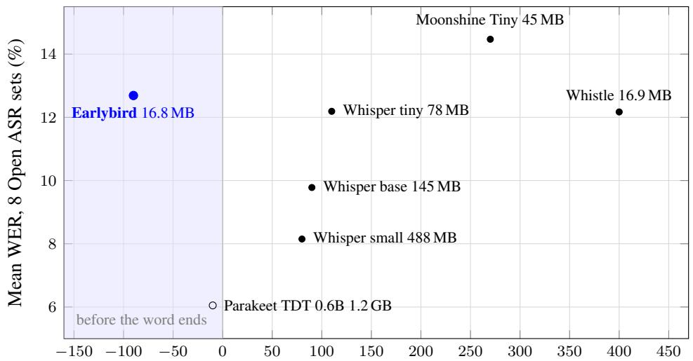
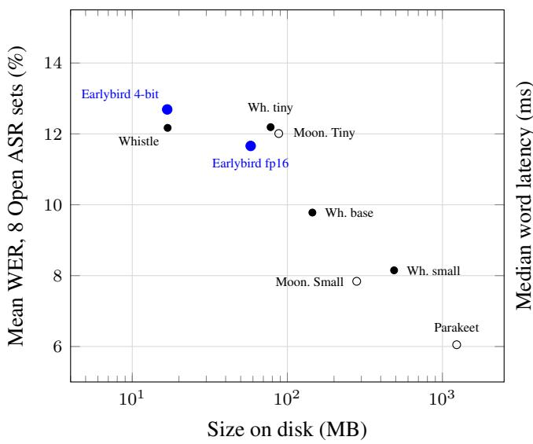
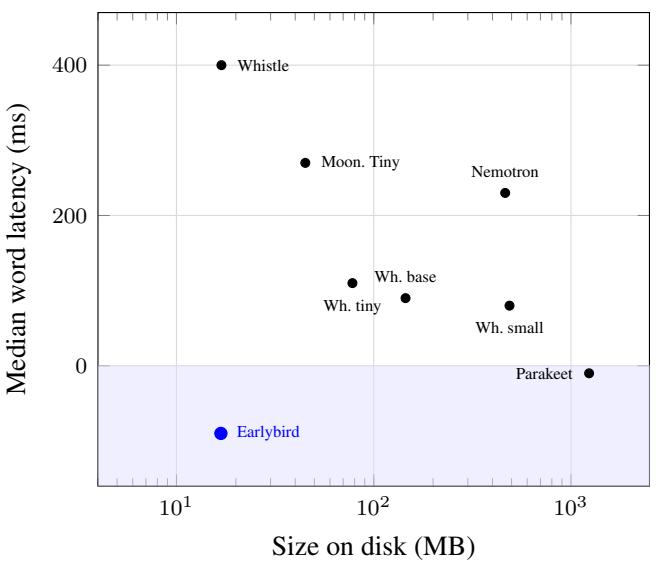
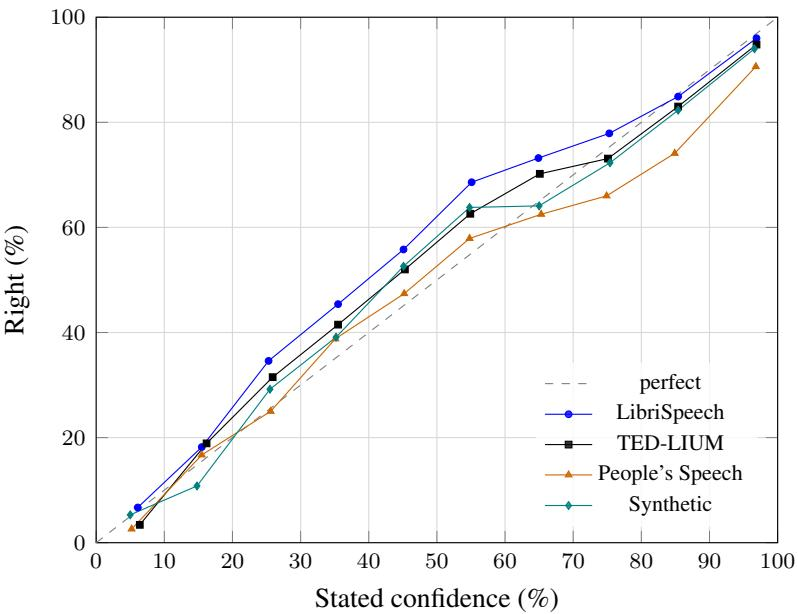

# Earlybird: Predictive Streaming Speech Recognition in 29M Parameters

Sahil Mahendrakar

November 2026

## Abstract

Streaming speech recognizers output a word only after the speaker has finished it, typically 90–400 ms later. For a voice agent every millisecond counts: the sooner the words are outputted, the sooner the agent can start a search or plan its reply. We present Earlybird, a 29M-parameter streaming recognizer (16.8 MB at 4 bits). Earlybird learns from audio cut off at random points, including partway through a word, and is asked to predict every word that is due by then in full, plus a guess of the next two words. Its raw token probabilities give a confidence for every word including the one still being spoken. On clean audiobook speech (LibriSpeech test-clean), the median word is predicted correctly 90 ms before the speaker finishes it, while released streaming models get it 90 to 400 ms after it ends. Earlybird is the earliest on all six test sets we time, covering audiobooks, TED talks, public speech, earnings calls, and synthetic speech. On the same audiobooks, 69% of words are predicted correctly before they end, against 3–25% for the other models. For words still being spoken, confidence is calibrated, with an expected calibration error (ECE) of 3.7 to 5.5. On the eight English Open ASR Leaderboard sets, it is more accurate than Moonshine Tiny on every set and roughly ties Whistle, a model of the same size.

## 1 Introduction

A spoken request to a voice agent reaches the agent as text. With a streaming recognizer, each word of that text arrives a few hundred milliseconds after the speaker finished saying it. For a voice agent, that delay is time it could have spent starting a search or planning a reply while the speaker is still talking.

People listening to speech do not wait for the end of a word to know what it is. Most words can be recognized from their first few phonemes in context, and the next word is often predictable. We ask whether a small on-device recognizer can do the same: predict each word from its first sounds, guess the word after it, and say how sure it is.

Earlybird trains on utterances cut off at random 80 ms steps, which is exactly the position a streaming model is in at each update. The target is every word that is due at that point, written in full even if its audio has only begun, followed by an end marker and the next two words of the transcript as a guess. Because the targets for successive cut points only ever extend one another, the model also learns not to output what it will later take back. Every word it outputs carries the product of its token probabilities as a confidence.

Our contributions are:

• A training recipe that turns a released streaming recognizer (Moonshine streaming Tiny [1, 2]) into one that predicts words correctly before they end, with no change to the architecture and no future audio (Section 3).

• A measurement of earliness, stability and accuracy against released streaming models run with their own code, on six test sets with per-word timings (Section 5.2).

• A 16.8 MB 4-bit release scored on the Open ASR Leaderboard’s English sets (Section 5.3).

• Evidence that the model’s raw confidence is calibrated for words still being spoken and for guessed next words (Section 5.5).

## 2 Related work

Predicting words before they are spoken. Zink et al. [3] train an offline encoder-decoder to predict words in masked audio at the end of an utterance (“predictive speech recognition”) and report useful predictions up to about 300 ms before the utterance ends. Yusuf et al. [4] define speculative speech recognition, in which a language model prompted with audio runs ahead of a streaming recognizer. Baumann and Schlangen [5] predict the remaining duration of the current word for an incremental dialogue system. Earlybird differs in putting prediction inside a small streaming recognizer, training on random cut points rather than only the utterance end, and reporting calibration and stability alongside earliness.

Using early partial results. Chang et al. [6] prefetch downstream responses from partial hypotheses and save about 200 ms when the final result matches. Schwarz et al. [7] predict whole utterances from partial ones to cut assistant latency. Both depend on how early and how stable partial text is, which Earlybird improves.

Low-latency streaming recognition. Work such as FastEmit [8] reduces how long a transducer waits before emitting a token, and LocalAgreement [9] turns an offline model into a streaming one by committing text that consecutive passes agree on. These methods reduce delay toward the end of the word. Earlybird aims to predict the word correctly before it ends.

## 3 Method

## 3.1 Starting point

Earlybird starts from Moonshine streaming Tiny [2] (34M parameters, MIT license), an encoder-decoder that consumes 80 ms audio chunks. We cut its vocabulary to 19,007 tokens: those that occur in a large body of English text (our training transcripts), plus every single-character token, so any word can still be spelled out. This brings it to 29M parameters, and the cut model scores within 0.4 WER points of the original on every test set, including TED-LIUM and Earnings-22, which are not in its training data. The released runtime holds each word back until roughly 300 ms of audio past it has been heard. Earlybird decodes the full transcript at every step with no hold-back.

## 3.2 Training on cut-off audio

Let an utterance have words $w _ { 1 } , \ldots , w _ { n }$ with start and end times $s _ { i }$ and $e _ { i }$ from a forced aligner. Word $w _ { i }$ i due at

$$
\tau _ { i } = \operatorname* { m a x } \bigl ( s _ { i } + \mathrm { m i n } ( 0 . 5 ( e _ { i } - s _ { i } ) , h ) , e _ { i } - \ell \bigr ) ,\tag{1}
$$

with lead ℓ = 300 ms and minimum heard audio $h = 5 0$ ms: a word of ordinary length is due 300 ms before it ends, and a short word once some of it has been heard. Each training example is the utterance cut at a random 80 ms step t. The target is every word with $\tau _ { i } \leq t ,$ spelled as in the transcript, then an end-of-text token, then the next two words as a guess. Trailing punctuation is held back until the next word is due, so a comma never appears and disappears. Since the target at $t ^ { \prime } > t$ always extends the target at $t ,$ the model is never trained to write something it will later remove.

The guessed words follow the end-of-text token, so a decoder that stops at end-of-text produces only the transcript. Continuing past it produces the guess.

## 3.3 Learning from the teacher only where it is right

The original Moonshine Tiny also serves as a teacher through a distillation loss, applied only at token positions where the teacher’s top choice matches the label. Where the teacher is wrong or unsure, its probability is spread over several words, and matching it there taught Earlybird to do the same. With the loss at every position, the guessed words came out less decisive, with their probability spread over several candidates instead of committed to one.

## 3.4 Padding frames

At each step the encoder also sees three frames computed from silence after the audio heard so far. This uses no future audio. It lets the model finish a word as if the speaker might have stopped. Training with padding frames moved the median word from −50 ms to −90 ms on LibriSpeech test-clean (Table 5).

## 3.5 Quantization

Quantization-aware training brings the weights to 4 bits, with the audio front end kept at 8 bits. The weights file is 16.8 MB (17.6 MB with the trimmed tokenizer and configuration).

## 3.6 Confidence

For each word on screen, the confidence is the product of the probabilities of its tokens in the decoder pass that produced it. Guessed words get their confidence the same way. There is no temperature scaling or other calibration step.

## 3.7 Data and schedule

Training uses LibriSpeech [10] (960 h, published Montreal Forced Aligner [11] word times), about 300 h of People’s Speech clean [12] with word times from a wav2vec 2.0 CTC aligner, and about 25 h of synthetic Kokoro [13] speech whose phoneme durations give exact word times, sampled with weights 1:3:3:3:1 (LibriSpeech clean-100, clean-360, other-500, People’s Speech, Kokoro; the first stage below uses the four real sets only, 1:3:3:3). Real transcripts are kept only when a teacher (Moonshine Medium) writes exactly the reference words. No non-commercial corpora are used for training. Training ran in four stages on a single GPU with batch 48, all with the KD term: 10k steps of streaming-cut training after the vocabulary cut (learning rate $5 \times 1 0 ^ { - 5 } )$ , 20k steps of prefix training with two guessed words $( 5 \times 1 0 ^ { - 5 } )$ , 5k steps with the padding frames $( 2 \times 1 0 ^ { - 5 } )$ , and 5k steps of quantization-aware training at 4 bits with the front end at 8 bits $( 2 \times 1 0 ^ { - 5 } )$ .

## 4 Evaluation setup

Test sets. LibriSpeech test-clean and test-other, TED-LIUM 3 [14], a held-out People’s Speech set, Earnings 22 [15], and 500 held-out WikiText sentences synthesized with Kokoro using two voices not seen in training. Word end times come from the Montreal Forced Aligner (LibriSpeech), Kokoro’s durations (synthetic), or our wav2vec 2.0 aligner, whose word ends fall within a median of 4–8 ms of Kokoro’s and 26 ms of MFA’s.

Harness. Each recognizer is fed audio in order in 80 ms chunks and every change to its on-screen text is logged against the audio clock. Processing time is not added for any model, so the numbers measure what each model decides to output, not how fast the hardware runs it. For each reference word we record the time from which it is predicted correctly: the word is in the output, spelled correctly and in the right location, and stays unchanged until the end of the utterance. Its word latency is that time relative to the word’s acoustic end; negative means before the speaker finishes it. We also count revisions (words taken back) per spoken word and word error rate (WER) of the final transcript. Confidence is scored with expected calibration error (ECE) [16] over 10 equal-width bins. Every model is scored on the same utterances within each set. Unless stated otherwise, Earlybird results are for the full-precision model; the 4-bit release is in Tables 3 and 5.

  
Median word latency on LibriSpeech clean (ms, negative is before the word ends)  
Figure 1: Word latency against accuracy; lower left is better. WER is the mean over the full Open ASR sets (Whistle: about 200 clips per set), with Earlybird at 4 bits. Latency is on the same 67 LibriSpeech clean utterances for every model except Parakeet, which was re-decoded every 240 ms on 150 other utterances (Earlybird: −80 ms on those). Hollow: published leaderboard WER.

Baselines. Released models run with their own code: Moonshine Tiny with its official streaming runtime (quantized); Whistle [17] (55M parameters, 16.9 MB) in the Cactus engine’s live mode; and Whisper base.en [18] (74M) re-decoded on all audio so far every 0.48 s, with its raw output shown. For accuracy and on LibriSpeech clean we also run Whisper tiny.en (39M) and small.en (244M) the same way.

## 5 Results

## 5.1 Earliness, accuracy and size

Figures 1 and 2 place Earlybird among released models of every size, using the per-set results in Sections 5.2 and 5.3. It is the only model under 1 GB whose median word is predicted correctly before it ends. The purpose-built streaming Nemotron 0.6B [19] (464 MB at int8) has a median word latency of +230 ms on the same 67 utterances. Parakeet TDT 0.6B v2 [20], an offline model 70 times Earlybird’s size re-decoded every 240 ms, reaches −10 ms with half Earlybird’s error rate. At its own size, Earlybird’s accuracy is in line with Whistle and Whisper tiny.en and ahead of Moonshine Tiny.

## 5.2 Earliness and accuracy

Table 1 shows that Earlybird predicts the median word correctly before the speaker finishes it on all six sets, about 360 ms sooner than the Moonshine Tiny runtime, 490–580 ms sooner than Whistle and 160–200 ms sooner than Whisper base. It makes fewer errors than Moonshine Tiny on every set. Whistle is ahead on two sets, by at most 0.6 points, and Whisper base is the most accurate of the four except on LibriSpeech clean, where they tie. The subsets are small, but the medians hold on full test sets: Earlybird’s median word latency is −90 ms on all 2,620 LibriSpeech clean utterances, −67 ms on all 1,155 TED-LIUM utterances (Moonshine Tiny runtime: +296 ms on the same 1,155), −63 ms on 500 People’s Speech utterances (+301 ms) and −43 ms on 1,000 Earnings-22 utterances (+308 ms). The p95 word latency on LibriSpeech clean is +80 ms for Earlybird against +520 ms for Moonshine Tiny and +925 ms for Whistle. Model size does not buy earliness for re-decoded Whisper: on the same 67 utterances its median word latency is +110 ms (tiny.en), +90 ms (base.en) and +80 ms (small.en).

Figure 2: Size against accuracy (left) and against word latency (right); lower left is better. Full-precision models are shown at their 16-bit size, Nemotron (streaming, 80 ms chunks) at its int8 size. Hollow: published leaderboard WER; filled: our runs. Latency as in Figure 1.
<table><tr><td>Test set</td><td>Earlybird</td><td>Moonshine Tiny</td><td>Whistle</td><td>Whisper base</td></tr><tr><td>LibriSpeech clean (67)</td><td>-90 / 2.3</td><td>+270/3.9</td><td>+400/3.1</td><td>+90 / 2.3</td></tr><tr><td>LibriSpeech other (150)</td><td>-60/ 9.7</td><td>+300 /13.2</td><td>+460 / 10.1</td><td>+140/8.7</td></tr><tr><td>TED-LIUM (150)</td><td>-68 / 5.4</td><td>+298 /6.8</td><td>+505 / 7.3</td><td>+125 / 4.8</td></tr><tr><td>People&#x27;s Speech (150)</td><td>-66 /14.5</td><td>+290 /16.7</td><td>+477 /14.2</td><td>+127 / 10.5</td></tr><tr><td>Earnings-22 (150)</td><td>-46 /18.4</td><td>+309 / 21.6</td><td>+535 /17.8</td><td>+142 /13.3</td></tr><tr><td>Synthetic (67)</td><td>-73/5.6</td><td>+292 /7.0</td><td>+424 /7.5</td><td>+90 / 4.8</td></tr><tr><td>Revisions per word (LS clean)</td><td>1.29</td><td>2.07</td><td>0.16</td><td>0.39</td></tr></table>

Table 1: Median word latency in ms relative to the end of the word (negative is before) / WER %, on the same utterances for every model within a set (count in parentheses). Revisions are words taken back per spoken word.

The cost of showing words early is revisions: Earlybird takes back 1.3 words per spoken word on LibriSpeech clean, fewer than the Moonshine Tiny runtime (2.1) but more than Whistle (0.2) and Whisper base (0.4), and 2–6 per word on spontaneous or noisy speech.

Median timing hides how many words are actually useful early. Table 2 counts words predicted correctly before they end. Moonshine Tiny and Whistle are built to wait for each word to end. Whisper base gets some words early because each re-run hears a little more audio.

<table><tr><td>Test set</td><td>Earlybird</td><td>Moonshine Tiny</td><td>Whistle</td><td>Whisper base</td></tr><tr><td>LibriSpeech clean</td><td>68.8</td><td>3.4</td><td>9.1</td><td>25.4</td></tr><tr><td>TED-LIUM</td><td>52.1</td><td>1.0</td><td>2.6</td><td>17.6</td></tr><tr><td>People&#x27;s Speech</td><td>31.8</td><td>1.0</td><td>2.9</td><td>11.3</td></tr><tr><td>Synthetic</td><td>56.9</td><td>2.2</td><td>6.8</td><td>22.0</td></tr></table>

Table 2: Percent of reference words predicted correctly before they end (right, and not changed afterwards), counting transcript words and guesses output at confidence ≥ 0.5. Utterances where all four models produced output: 50, 38, 100 and 50.
<table><tr><td>System</td><td>TED</td><td>VoxP</td><td>LS-c</td><td>LS-0</td><td>Earn</td><td>AMI</td><td>Giga</td><td>SPGI</td><td>Mean</td></tr><tr><td>Earlybird 4-bit (16.8 MB)</td><td>6.1</td><td>13.6</td><td>3.7</td><td>14.2</td><td>21.7</td><td>21.8</td><td>13.1</td><td>6.8</td><td>12.6</td></tr><tr><td>Earlybird full precision</td><td>5.6</td><td>12.9</td><td>3.4</td><td>12.0</td><td>20.0</td><td>19.4</td><td>11.7</td><td>6.1</td><td>11.4</td></tr><tr><td>Moonshine Tiny runtime</td><td>7.9</td><td>15.4</td><td>5.4</td><td>16.0</td><td>23.3</td><td>24.9</td><td>14.5</td><td>7.3</td><td>14.4</td></tr><tr><td>Whistle</td><td>7.7</td><td>10.8</td><td>4.1</td><td>11.3</td><td>17.9</td><td>24.0</td><td>14.6</td><td>7.1</td><td>12.2</td></tr><tr><td>Whisper tiny.en</td><td>5.9</td><td>13.7</td><td>5.2</td><td>14.0</td><td>17.5</td><td>22.2</td><td>11.8</td><td>5.3</td><td>12.0</td></tr><tr><td>Whisper base.en</td><td>4.9</td><td>9.8</td><td>3.8</td><td>10.2</td><td>14.4</td><td>18.5</td><td>11.6</td><td>4.0</td><td>9.7</td></tr><tr><td>Whisper small.en</td><td>4.0</td><td>8.3</td><td>2.7</td><td>7.8</td><td>11.9</td><td>16.9</td><td>8.7</td><td>3.6</td><td>8.0</td></tr></table>

Table 3: WER (%) on the eight English sets of the Open ASR Leaderboard, scored with its normalizer, every system on the same clips (TED-LIUM in full; about 200 clips of each other set, because Whistle runs at about real time per CPU core). Final transcripts, not streaming timing.

## 5.3 Standard accuracy: Open ASR Leaderboard

Table 3 reports final-transcript WER with the Open ASR Leaderboard’s code [21]. Our Whisper base scores match its published entry (TED-LIUM 4.87, identical), which checks the scoring. Earlybird beats the Moonshine Tiny runtime on all eight sets. The 4-bit release roughly ties Whistle (12.6 vs. 12.2): it wins on five sets and loses on VoxPopuli, LibriSpeech other and Earnings-22. Quantization costs 1.2 points of mean WER on these sets, more than on our own test sets. Moonshine Tiny’s leaderboard entry (12.0) uses full-precision weights. The official Moonshine runtime scores 14.4 here. On the full sets, Earlybird averages 11.7 at full precision and 12.7 at 4 bits. Full-precision Earlybird (29M) is slightly more accurate than Whisper tiny.en (39M, 12.0 here and 12.2 on the full sets), and the 4-bit release slightly less. Whisper small.en (244M) reaches 8.0.

## 5.4 Noise, compute and variance

Earlybird remains the earliest model at every noise level (Table 4) and is more accurate than Moonshine Tiny throughout. Its accuracy degrades most under background speech: at 10 dB, its WER is 32.0% against 8.9% for Whisper base.

On one CPU thread (Intel Xeon Platinum 8488C), Earlybird takes 39 ms on average per 80 ms step (p95 64 ms), about twice as fast as real time, against 47 ms for Moonshine Tiny decoded the same way. Three training runs with different seeds agree within 3 ms of median word latency and 0.5 WER points on every test set.

## 5.5 Confidence

A word output early is only useful if the agent knows when to trust it. Figure 3 and Table 6 show that Earlybird’s raw confidence is calibrated for the hardest case, a word the speaker has not finished: ECE is

<table><tr><td>Condition</td><td>Earlybird</td><td>Moonshine Tiny</td><td>Whisper base</td></tr><tr><td>White noise, 10 dB</td><td>-70/8.7</td><td>+290 / 15.3</td><td>+140 /6.5</td></tr><tr><td>White noise, 5 dB</td><td>-50 /19.5</td><td>+320 / 29.1</td><td>+170 / 13.4</td></tr><tr><td>Chatter, 10 dB</td><td>-20 /32.0</td><td>+350 / 41.5</td><td>+150 / 8.9</td></tr><tr><td>Chatter, 5 dB</td><td>+130 / 65.4</td><td>+490 / 79.0</td><td>+230 / 29.0</td></tr></table>

Table 4: LibriSpeech test-clean with added noise, 150 utterances: median word latency (ms) / WER %.

<table><tr><td>Variant (LibriSpeech clean, 67 utt.)</td><td>Median word latency</td><td>Revisions / word</td><td>WER</td></tr><tr><td>Earlybird (padding frames)</td><td>-90</td><td>1.29</td><td>2.3</td></tr><tr><td>Earlybird, no padding frames</td><td>-50</td><td>1.10</td><td>2.0</td></tr><tr><td>Earlybird 4-bit</td><td>-90</td><td>1.18</td><td>1.7</td></tr></table>

Table 5: Effect of padding frames and quantization on the same utterances.

3.7–5.5 points, and words output at confidence $\geq 0 . 9$ are right 91–96% of the time. Guessed next words are calibrated more tightly (ECE 0.8–3.7). On a set of spoken commands outside the training domain (SLURP), calibration is worse: ECE 8.8 for words still being spoken.

## 6 Limitations

• Accuracy. Whisper base, 2.5 times larger, is more accurate on every test set except LibriSpeech clean, most of all with background chatter.

• Revisions. Outputting words early means taking more words back than models that wait, especially on spontaneous and noisy speech.

• Guesses are rare. At confidence ≥ 0.5, about one word in seven (12–16%) is guessed right before it ends. Most early words come from the transcript itself.

• Timing references. Word end times come from forced aligners, which carry their own error of tens of milliseconds. The synthetic set gives exact times and agrees.

• English only, and calibration degrades on out-of-domain command speech.

## 7 Conclusion

Training a small streaming recognizer on audio cut off at random points, with whole words as targets, is enough to make it predict words correctly before the speaker finishes them, with a confidence an application can act on. The resulting model is 16.8 MB, runs about twice as fast as real time on one CPU thread, and is about as accurate as other models of its size. On LibriSpeech clean, its median word is predicted correctly 90 ms before it ends, while released streaming models get it 90–400 ms after, and it is the earliest model on all six test sets. 69% of audiobook words are predicted correctly before they end, and for words still being spoken its confidence is calibrated, with an expected calibration error of 3.7 to 5.5. On the eight English Open ASR Leaderboard sets it is more accurate than Moonshine Tiny on every set and roughly ties Whistle, a model of the same size. Weights and a loader are released under the MIT license at https://huggingface.co/sahilmahendrakar/Earlybird-29M.

Figure 3: Reliability of the confidence on words still being spoken: every transcript word on screen whose reference word has not ended, with all words before it right, at every 80 ms step, 200 utterances per set.
<table><tr><td></td><td>LibriSpeech</td><td>TED-LIUM</td><td>People&#x27;s Speech</td><td>Synthetic</td></tr><tr><td rowspan="2">Words still being spoken: ECE right (%)</td><td>4.3</td><td>3.7</td><td>5.5</td><td>3.7</td></tr><tr><td>78.8</td><td>75.3</td><td>66.9</td><td>69.0</td></tr><tr><td>Every transcript word: ECE</td><td>4.3</td><td>4.7</td><td>1.4</td><td>4.0</td></tr><tr><td>First guessed word: ECE</td><td>0.8</td><td>1.2</td><td>3.7</td><td>1.1</td></tr><tr><td>Second guessed word: ECE</td><td>2.0</td><td>3.4</td><td>4.4</td><td>2.1</td></tr></table>

Table 6: Expected calibration error (points, 10 bins) of Earlybird’s raw confidence. No calibration step is applied.

## References

[1] Nat Jeffries, Evan King, Manjunath Kudlur, Guy Nicholson, James Wang, and Pete Warden. Moonshine: Speech recognition for live transcription and voice commands. arXiv preprint arXiv:2410.15608, 2024.

[2] Moonshine AI. Moonshine streaming models and runtime. https://github.com/ moonshine-ai/moonshine, 2026. MIT license. Accessed November 2026.

[3] Oswald Zink, Yosuke Higuchi, Carlos Mullov, Alexander Waibel, and Tetsunori Kobayashi. Predictive speech recognition and end-of-utterance detection towards spoken dialog systems. arXiv preprint arXiv:2409.19990, 2024.

[4] Bolaji Yusuf, Murali Karthick Baskar, Andrew Rosenberg, and Bhuvana Ramabhadran. Speculative speech recognition by audio-prefixed low-rank adaptation of language models. In Proc. Interspeech, pages 792–796, 2024.

[5] Timo Baumann and David Schlangen. Predicting the micro-timing of user input for an incremental spoken dialogue system that completes a user’s ongoing turn. In Proc. SIGDIAL, pages 120–129, 2011.

[6] Shuo-Yiin Chang, Bo Li, David Rybach, Yanzhang He, Wei Li, Tara N. Sainath, and Trevor Strohman. Low latency speech recognition using end-to-end prefetching. In Proc. Interspeech, pages 1962–1966, 2020.

[7] Andreas Schwarz, Di He, Maarten Van Segbroeck, Mohammed Hethnawi, and Ariya Rastrow. Personalized predictive ASR for latency reduction in voice assistants. In Proc. Interspeech, 2023.

[8] Jiahui Yu, Chung-Cheng Chiu, Bo Li, Shuo-yiin Chang, Tara N. Sainath, Yanzhang He, Arun Narayanan, Wei Han, Anmol Gulati, Yonghui Wu, and Ruoming Pang. FastEmit: Low-latency streaming ASR with sequence-level emission regularization. In Proc. ICASSP, 2021.

[9] Dominik Machácek, Raj Dabre, and Ond ˇ ˇrej Bojar. Turning Whisper into real-time transcription system. In Proc. IJCNLP-AACL: System Demonstrations, 2023.

[10] Vassil Panayotov, Guoguo Chen, Daniel Povey, and Sanjeev Khudanpur. Librispeech: An ASR corpus based on public domain audio books. In Proc. ICASSP, 2015.

[11] Michael McAuliffe, Michaela Socolof, Sarah Mihuc, Michael Wagner, and Morgan Sonderegger. Montreal forced aligner: Trainable text-speech alignment using Kaldi. In Proc. Interspeech, 2017.

[12] Daniel Galvez, Greg Diamos, Juan Ciro, Juan Felipe Cerón, Keith Achorn, Anjali Gopi, David Kanter, Maximilian Lam, Mark Mazumder, and Vijay Janapa Reddi. The people’s speech: A large-scale diverse English speech recognition dataset for commercial usage. In NeurIPS Datasets and Benchmarks, 2021.

[13] hexgrad. Kokoro-82M. https://huggingface.co/hexgrad/Kokoro-82M, 2025.

[14] François Hernandez, Vincent Nguyen, Sahar Ghannay, Natalia Tomashenko, and Yannick Estève. TED-LIUM 3: Twice as much data and corpus repartition for experiments on speaker adaptation. In Proc. SPECOM, 2018.

[15] Miguel Del Rio, Peter Ha, Quinten McNamara, Corey Miller, and Shipra Chandra. Earnings-22: A practical benchmark for accents in the wild. arXiv preprint arXiv:2203.15591, 2022.

[16] Chuan Guo, Geoff Pleiss, Yu Sun, and Kilian Q. Weinberger. On calibration of modern neural networks. In Proc. ICML, 2017.

[17] Cactus Compute. Whistle. https://huggingface.co/Cactus-Compute/whistle, 2026. Engine build of 2026-10-19.

[18] Alec Radford, Jong Wook Kim, Tao Xu, Greg Brockman, Christine McLeavey, and Ilya Sutskever. Robust speech recognition via large-scale weak supervision. In Proc. ICML, 2023.

[19] NVIDIA. Nemotron speech streaming EN 0.6b. https://github.com/k2-fsa/ sherpa-onnx, 2026. Run as the int8 sherpa-onnx streaming export. Accessed November 2026.

[20] NVIDIA. Parakeet TDT 0.6b v2. https://huggingface.co/nvidia/parakeet-tdt-0. 6b-v2, 2025. Run as the int8 sherpa-onnx export. Accessed November 2026.

[21] Hugging Face. Open ASR leaderboard. https://huggingface.co/spaces/hf-audio/ open\_asr\_leaderboard, 2026. Evaluation code: https://github.com/huggingface/ open\_asr\_leaderboard.