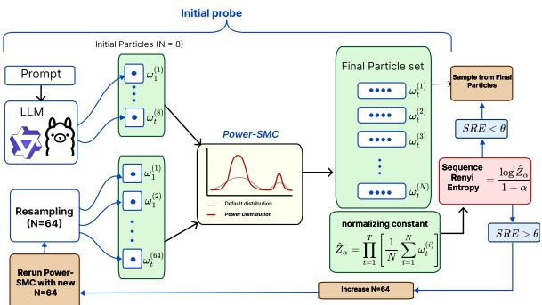
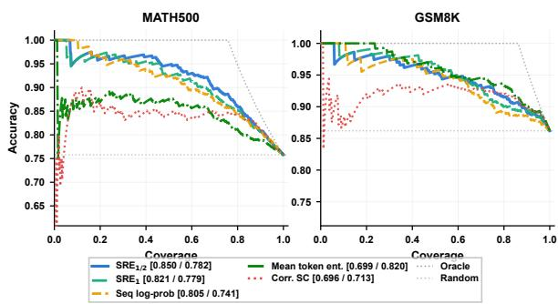
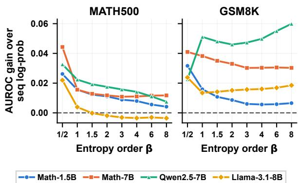
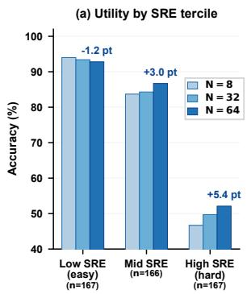
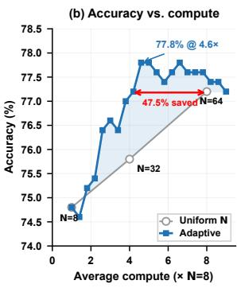
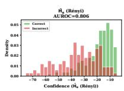
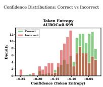
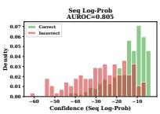
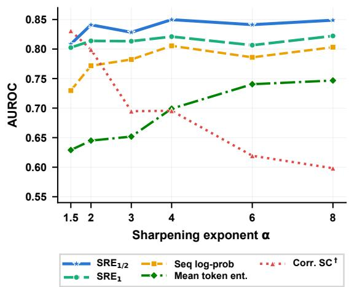

# Free Lunch Uncertainty: Sequence-Level Rényi Entropy from Particle Decoding for Adaptive LLM Reasoning

Erfan Baghaei Potraghloo1\*, Milad Heidari Sorkhehdizaj1\*, Shahab Rahimirad2\*, Aliasghar Pourghani2\*, Seyedarmin Azizi1, Souvik Kundu 3 , Abolfazl Hashemi 2, Joseph Campbell 2, Vijay Gupta 2 1 University of Southern California, 2Purdue University, 3Intel

## Abstract

Quantifying uncertainty over an entire LLM completion is critical for selective prediction and adaptive compute. Zero-cost signals such as mean token entropy and log-probability are local to tokens or to one completion, and self consistency needs many extra completions. We show that Sequential Monte Carlo (SMC) decoding for power sampling already estimates the normalizing constant of the power distribution, which gives the sequence-level Rényi entropy (SRE) of the model’s completion distribution at zero marginal cost, with a guarantee at every particle budget. A Rényi chain rule extends this readout to a family of stepwise entropies of any order. We prove that orders above one are tied to the most likely token of each step, which explains why they track log-probability, while the order-1/2 member accumulates the log of per-step search effort. This member is the best zero-cost selectiveprediction signal in 10 of 13 settings. On MATH500 its AUROC is 0.022 to 0.044 above log-probability with all four models and within length quartiles, and the same order is selected when each setting is held out. An 8-particle probe identifies the problems that benefit from more particles, and a two-pass policy matches 64-particle accuracy on MATH500 with 34.2% fewer particles over three seeds.

## 1 Introduction

Recent work suggests that reinforcement learning primarily surfaces capabilities already present in the base model’s distribution, raising the probability of correct answers rather than teaching new reasoning skills (Yue et al., 2025). This insight has motivated training-free alternatives that sharpen the model’s distribution (Karan and Du, 2026; Azizi et al., 2026; Ji et al., 2026). One such approach is power sampling: drawing completions y for a prompt x from a power distribution $\pi _ { \alpha } ( y | x ) ~ \propto ~ p _ { \theta } ( y | x ) ^ { \alpha }$ , where $p _ { \theta }$ is the language model and the sharpening exponent $\alpha > 1$ concentrates probability mass on higher-likelihood completions.

  
Figure 1: Overview of adaptive particle allocation using SRE. SMC importance weights from an initial lowbudget probe run are used to estimate the normalizing constant $Z _ { \alpha } ( x )$ and from it the sequence-level Rényi entropy. High-SRE problems are re-run with a larger particle budget $( N = 6 4 )$ , while low-SRE problems keep the probe answer.

Power-SMC (Azizi et al., 2026) and related methods (Nguyen et al., 2026) implement power sampling with Sequential Monte Carlo (SMC), maintaining N parallel candidate completions (called particles in the SMC literature) that are extended token by token, reweighted by importance weights, and resampled. These methods perform well on reasoning tasks but use a fixed particle budget N for every problem, regardless of difficulty.

A complementary challenge is uncertainty quantification: knowing when the model’s answer should be trusted.

Uncertainty matters for selective prediction, calibration-aware deployment, adaptive compute allocation, and routing hard problems to stronger systems (Kadavath et al., 2022). For reasoning tasks, uncertainty is naturally a property of the full completion distribution. A model may be locally uncertain at a few tokens but follow one stable reasoning plan, or it may assign comparable probability to several incompatible solutions.

Existing uncertainty signals miss part of this structure. Mean token entropy is zero-cost but measures local next-token ambiguity rather than uncertainty over whole completions (Kuhn et al., 2023). Sequence log-probability scores only the returned completion and cannot distinguish a single dominant completion from one high-probability completion among several competing alternatives. Self-consistency (Wang et al., 2023) and semantic entropy (Kuhn et al., 2023; Farquhar et al., 2024) capture answer-level disagreement but require $K$ independent completions.

We make a simple observation: the SMC importance weights already give an estimate of the normalizing constant $\begin{array} { r } { Z _ { \alpha } ( x ) = \sum _ { y } p _ { \theta } ( y | x ) ^ { \alpha } } \end{array}$ , which defines the sequence-level Rényi entropy of the completion distribution (Rényi entropy generalizes Shannon entropy). We call the resulting entropy estimate SRE. When an SMC sampler is already running, this estimate gives a zero-marginal-cost uncertainty signal with no extra completions, classifiers, reward models, or model calls.

Beyond uncertainty quantification, SRE enables adaptive particle allocation. A cheap probe run with $N { = } 8$ particles estimates SRE per problem and predicts whether more particles will improve the answer. The probe supplies both the signal and a candidate answer, so the allocation decision requires no additional model call. Figure 1 gives an overview.

## Our contributions.

1. We identify the SMC normalizing-constant estimate as a sequence-level Rényi entropy signal for LLM reasoning, with an upward-bias and finite-N guarantee that covers the sampler as run (Lemma 1). The readout costs one scalar accumulation per decoding step, leaves the sampler unchanged, and applies to every SMC sampler whose final target is $\pi _ { \alpha } ( \ S 4 )$

2. We use the Rényi chain rule (Proposition 1) to extend the readout to a family of stepwise entropies of any order and characterize the family (Proposition 3). Each member accumulates the negative log of a power mean of the probability that the model gives to its own next token; members of order $\beta$ above one are tied to the top token within a factor $\beta / ( \beta - 1 )$ ; and the order-1/2 member accumulates the log of the per-step search effort of Proposition 2.

3. We show that the order-1/2 member alone is the best zero-cost selective-prediction signal in 10 of 13 settings spanning four models, two benchmarks, and six sharpening exponents (§5.2, §5.5). Its area under the ROC curve (AUROC) is 0.022 to 0.044 above that of log-probability on MATH500 with all four models $( p \leq 0 . 0 2 9$ after Holm correction). The margin holds within length quartiles and with the order selected on held-out settings, and the order-1/2 member is also above a generation-length baseline (§5.4, §5.7).

4. We show that SRE from a cheap N=8 probe predicts the gain from additional particles (§5.3). Across three seeds and two models, the low-SRE tercile gains at most 0.6 points from $N { = } 6 4$ while the upper two terciles together gain 1.2 to 4.8 points, a pattern that an independent N=8 re-draw does not reproduce. With Qwen2.5-Math-7B a two-pass policy matches uniform N=64 accuracy on MATH500 with 34.2% fewer particles on average over three seeds (§5.6).

## 2 Background

## 2.1 Power-SMC

Given a prompt x, an autoregressive language model defines $\begin{array} { r } { p _ { \theta } ( y | x ) ~ = ~ \prod _ { t = 1 } ^ { T } p _ { \theta } ( y _ { t } ~ | ~ x , y _ { < t } ) } \end{array}$ over completions y of length $T$ that end with the end-of-sequence (EOS) token. Power sampling draws completions from the power distribution

$$
\pi _ { \alpha } ( y | x ) = \frac { p _ { \theta } ( y | x ) ^ { \alpha } } { Z _ { \alpha } ( x ) } , \quad Z _ { \alpha } ( x ) = \sum _ { y } p _ { \theta } ( y | x ) ^ { \alpha } ,\tag{1}
$$

where $\alpha > 1$ is the sharpening exponent.

Power-SMC (Azizi et al., 2026) maintains N particles and samples each token from a proposal distribution: the locally optimal choice $q _ { t } ^ { \star } ( v )$ ∝ $p _ { \theta } ( v | x , y _ { < t } ^ { ( i ) } ) ^ { \alpha }$ , which corresponds to sampling at temperature $\scriptstyle { \tau = 1 / \alpha }$ and minimizes the variance of the incremental weight below. Under this proposal, the incremental importance weight (incremental weight for short) for particle i at step t is

$$
\omega _ { t } ^ { ( i ) } = \sum _ { v } p _ { \theta } ( v | x , y _ { < t } ^ { ( i ) } ) ^ { \alpha } ,\tag{2}
$$

which is deterministic given the prefix (Azizi et al., 2026). When the effective sample size (ESS, a measure of how many particles carry non-negligible weight) drops below a threshold, Power-SMC performs systematic resampling: duplicating highweight particles and discarding low-weight ones to prevent weight collapse onto a few particles.

## 2.2 Rényi entropy

The Rényi entropy of order α of the full completion distribution $p _ { \theta } ( \cdot | x )$ is

$$
H _ { \alpha } ( p _ { \theta } ( \cdot | x ) ) = \frac { 1 } { 1 - \alpha } \log \underbrace { \sum _ { y } p _ { \theta } ( y | x ) ^ { \alpha } } _ { Z _ { \alpha } ( x ) } .\tag{3}
$$

For $\alpha > 1 , H _ { \alpha }$ is low when probability mass concentrates on a few completions and high when mass spreads across many. As $\alpha  1 , H _ { \alpha }$ converges to the Shannon entropy.

## 3 Motivating Analysis

## 3.1 Analysis 1: Sequence-level entropy is a sum, not a mean

Mean token entropy, $\begin{array} { r } { \frac { 1 } { T } \sum _ { t } H ( Y _ { t } \mid Y _ { < t } , x ) } \end{array}$ along a generated completion, is a common zero-cost signal of predictive uncertainty in language models (Malinin and Gales, 2021). The entropy of the completion distribution is not an average of next-token entropies. For Shannon entropy the chain rule gives $\begin{array} { r } { H ( Y _ { 1 : T } \mid x ) = \sum _ { t = 1 } ^ { T } \mathbb { E } _ { y _ { < t } \sim p _ { \theta } } \left[ H ( Y _ { t } \mid y _ { < t } , x ) \right] } \end{array}$ , a sum over steps (Cover and Thomas, 2006; Malinin and Gales, 2021). Rényi entropy obeys an analogous rule (Jizba and Arimitsu, 2004). Let $\pi _ { \beta } ^ { ( t ) } ( y _ { 1 : t } ) \propto p _ { \theta } ( y _ { 1 : t } | x ) ^ { \beta }$ be the order-β power distribution over length-t prefixes and $h _ { \beta } ( y _ { < t } ) ~ =$ $\begin{array} { r } { \frac { 1 } { 1 - \beta } \log { \sum _ { v } p _ { \theta } ( v | x , y _ { < t } ) ^ { \bar { \beta } } } } \end{array}$ the Rényi entropy of the next-token distribution.

Proposition 1 (Rényi chain rule). For $\beta > 0 , \beta \neq$ 1, and prefixes $Y _ { < t } \sim \pi _ { \beta } ^ { ( t - 1 ) }$

$$
H _ { \beta } ( p _ { \theta } ) = \sum _ { t = 1 } ^ { T } \frac { 1 } { 1 - \beta } \log \mathbb { E } \Big [ e ^ { ( 1 - \beta ) h _ { \beta } ( Y _ { < t } ) } \Big ] ,
$$

where $H _ { \beta } ( p _ { \theta } )$ abbreviates $H _ { \beta } ( p _ { \theta } ( \cdot | x ) )$ , and the right-hand side converges to the right-hand side of the Shannon chain rule as $\beta  1$

The proof is in Appendix M. Sequence-level entropy is therefore a sum of per-step increments, each an aggregate of next-token entropies over prefixes. Dividing by the length, as mean token entropy does, removes the accumulation that separates a long uncertain completion from a short one, and following a single completion ignores the expectation over prefixes.

## 3.2 Analysis 2: SMC importance weights already contain distributional information

Analysis. Classical SMC theory provides an unbiased estimator $\widehat { Z } _ { \alpha }$ of the normalizing constant, $\mathbb { E } [ \widehat { Z } _ { \alpha } ] = Z _ { \alpha }$ (Del Moral, 2004; Chopin and Papaspiliopoulos, 2020). We call it the standard estimator:

$$
\log \widehat { Z } _ { \alpha } = \sum _ { t = 1 } ^ { T } \log \left[ \sum _ { i = 1 } ^ { N } W _ { t - 1 } ^ { ( i ) } \omega _ { t } ^ { ( i ) } \right] ,\tag{4}
$$

where $W _ { t - 1 } ^ { ( i ) }$ are the normalized weights before step t, equal to $1 / N$ at the start and after every resampling step. Power-SMC already computes every $\omega _ { t } ^ { ( i ) }$ , which follows Eq. 2 once an initial ramp of the exponent has ended, and every $\boldsymbol { W } _ { t } ^ { ( i ) }$ as part of its usual importance-weight computation. The SMC sampler therefore already computes an estimate of $Z _ { \alpha } .$ , one step at a time, but it discards this information.

## 4 Methodology

## 4.1 Extracting SRE from Power-SMC

Because the logarithm is nonlinear, log $\widehat { Z } _ { \alpha }$ is a plug-in estimate of log $Z _ { \alpha }$ rather than an unbiased estimator of it.

We define the estimate of the sequence-level Rényi entropy, SRE, as

$$
S R E = \frac { \log \widehat { Z } _ { \alpha } } { 1 - \alpha } .\tag{5}
$$

Computing $\widehat { Z } _ { \alpha }$ requires only accumulating one scalar per decoding step: the log of the weighted mean of the incremental weights across particles.

Stepwise accumulation. In all experiments we accumulate the log of the uniform mean of the incremental weights over particles at every step,

$$
\log \widehat { Z } _ { \alpha } ^ { \mathrm { s t e p } } = \sum _ { t = 1 } ^ { T } \log \left[ \frac { 1 } { N } \sum _ { i = 1 } ^ { N } \omega _ { t } ^ { ( i ) } \right] ,\tag{6}
$$

which is Eq. 4 with $W _ { t - 1 } ^ { ( i ) } { = } 1 / N$ . It coincides with Eq. 4 when resampling occurs at every step. Under the blockwise resampling of Power-SMC (resampling at block boundaries when the ESS is low), the stepwise accumulation uses the next-token distributions of all N particles at every step, rather than mainly those of the highest-weight particles. The two estimates have a Spearman rank correlation of at least 0.98 in every setting we test, and

Appendix G compares them. Algorithm 1 in $\mathsf { A p - }$ pendix F gives the implementation and the handling of resampling boundaries.

Stepwise family. Once the exponent ramp of Power-SMC has ended (Appendix F), $\omega _ { t } ^ { ( i ) }$ = $e ^ { ( 1 - \alpha ) h _ { \alpha } ( y _ { < t } ^ { ( i ) } ) }$ up to the nucleus truncation of the proposal, which drops the least likely tokens. Each term of $\operatorname { E q . }$ 4 is therefore, up to a constant factor, the particle estimate of one increment of the order-α chain rule in Proposition 1. The weighted particles follow the intermediate target of the sampler, and Eq. 6 replaces the weighted mean by the uniform mean. The same per-step accumulation can be computed at any order $\beta$ from the nexttoken distributions that the sampler has already computed:

$$
S R E _ { \beta } = \sum _ { t = 1 } ^ { T } \frac { 1 } { 1 - \beta } \log \bigg [ \frac { 1 } { | A _ { t } | } \sum _ { i \in A _ { t } } e ^ { ( 1 - \beta ) h _ { \beta } ( y _ { < t } ^ { ( i ) } ) } \bigg ] ,\tag{7}
$$

where $A _ { t }$ is the set of particles still generating at step t, with limit $\begin{array} { r l } { S R E _ { 1 } } & { { } = } \end{array}$ $\begin{array} { r } { \sum _ { t } \frac { 1 } { \vert A _ { t } \vert } \sum _ { i \in A _ { t } } H ( p _ { \theta } ( \cdot \vert x , y _ { < t } ^ { ( i ) } ) ) } \end{array}$ as $\beta  1$ Whatever the order, the particles are drawn by the α-sharpened sampler, so $S R E _ { \beta }$ measures order- $\boldsymbol { \cdot } \beta$ entropy accumulated along the particles.

$\operatorname { A t } \beta { = } \alpha$ this family member uses no ramp term and agrees with the stepwise accumulation of Eq. 6 at Spearman $\rho \geq 0 . 9 4$ (Appendix G).

Choice of order. $S R E _ { \beta }$ is the accumulated negative log of a power mean, of order $\beta - 1$ , of the probability that the model gives to a token drawn from its own next-token distribution (Proposition 3, Appendix N). It is nonincreasing in β and runs from a multiple of the length $( \beta \to 0 )$ to the summed negative log-probability, at each step, of the most likely top token among the particles $( \beta \to \infty )$ . For every $\beta > 1$ each increment lies within a factor $\beta / ( \beta - 1 )$ of the top-token term, so members of these orders are tied to the top token; members of order up to one also respond to how the remaining probability mass is spread. $\mathbf { A } \mathbf { t } \ \beta { = } 1$ the family gives $S R E _ { 1 }$ , the chain-rule sum of Shannon entropies (Malinin and Gales, 2021) on the particle set, and the order-1/2 member accumulates the log of the per-step search effort defined next.

Proposition 2 (Search effort). Let $Y \sim p$ be the completion to be found, and let a sampler draw completions independently from a proposal q. The expected number of draws until Y is first drawn is at least $e ^ { H _ { 1 / 2 } ( p ) }$ for every q, with equality for

q ∝ p1/2.

The proof is in Appendix $_ \mathrm { O ; }$ the same quantity governs guessing in order of decreasing probability (Arikan, 1996). Applied to the next-token distribution, $e ^ { h _ { 1 / 2 } ( y < t ) }$ is the least expected number of independent draws needed to hit the model’s next token, and $S R E _ { 1 / 2 }$ accumulates the log of this perstep search effort along the particles. The stepwise accumulation of order α has an analogous reading for the power distribution: $H _ { \alpha } ( p _ { \theta } ) = H _ { 1 / \alpha } ( \pi _ { \alpha } )$ and $e ^ { H _ { \alpha } ( p _ { \theta } ) }$ bounds the order- $\cdot ( \alpha - 1 )$ guesswork of a completion drawn from $\pi _ { \alpha }$ within a factor 1 + ln $M .$ , where M is the number of possible completions (Appendix O). We report three SRE signals: $S R E$ , the stepwise accumulation of order α (Eq. 6), which comes from the incremental weights with no further computation; $S R E _ { 1 }$ ; and $S R E _ { 1 / 2 }$

## 4.2 Theoretical guarantee

Lemma 1 (SMC estimator of $Z _ { \alpha } )$ . Consider an SMC sampler with N particles whose final target is $\pi _ { \alpha } ,$ , with any intermediate targets and proposals and with unbiased resampling at times that may depend on the current particle system. Let $\widehat { Z } _ { \alpha , N }$ be the standard estimator ofEq. 4 and $\widehat { \mathrm { S R E } } _ { \alpha , N } =$ $\frac { 1 } { 1 - \alpha } \log \widehat { Z } _ { \alpha , N }$ . For every $N \geq 1 , \alpha > 1$ , and $\delta \in ( 0 , 1 )$

$I . \mathbb { E } [ \widehat { Z } _ { \alpha , N } ] \leq Z _ { \alpha }$ , with equality forfull-support proposals;

2. $\mathbb { E } [ \widehat { \mathrm { S R E } } _ { \alpha , N } ] \geq H _ { \alpha } ( p _ { \theta } ( \cdot | x ) ) ,$ ; (upward bias)

3. $\begin{array} { r } { \operatorname* { P r } [ \widehat { \mathrm { S R E } } _ { \alpha , N }  \geq H _ { \alpha } ( p _ { \theta } ( \cdot | x ) ) - \frac { \log ( 1 / \delta ) } { \alpha - 1 } ] \geq 1 - } \end{array}$ $\delta .$ (finite N)

Withfull-support proposals and multinomial resampling at fixed times, ${ \widehat \mathrm { S R E } } _ { \alpha , N } \to H _ { \alpha } ( p _ { \theta } ( \cdot | x ) )$ in probability as $N \to \infty$

The proof is in Appendix P. The bounds of the lemma cover Power-SMC as run, with its exponent ramp, its nucleus-truncated proposal, and its ESS-triggered resampling. The guarantee is nonasymptotic: at $\alpha { = } 4$ the estimate is more than one nat below the true sequence-level Rényi entropy in at most 5% of per-problem runs, for every particle budget including $N { = } 8$

Generality. Lemma 1 holds for every SMC sampler whose final target is $\pi _ { \alpha }$ , whatever its positive intermediate targets and its unbiased resampling rule. The readout therefore applies, at the same zero marginal cost, to other SMC samplers for power sampling such as APPS (Nguyen et al., 2026) (Appendix Q).

## 4.3 Adaptive particle allocation

Fixed particle budgets waste compute: easy problems are solved with a small N, while hard problems may need many particles.

We use a two-pass policy with a threshold θ: run Power-SMC with $N _ { \mathrm { p r o b e } }$ particles $( e . g . , N { = } 8 )$ and extract SRE and the candidate answer; if $S R E > \theta .$ , escalate the problem by re-running it with $N _ { \mathrm { f u l l } } ~ ( e . g . , \ N { = } 6 4 )$ , and otherwise accept the probe answer. The probe supplies the signal before committing to the expensive run, and its own answer serves as the fallback.

## 5 Experiments

## 5.1 Setup

We evaluate on MATH500 (Hendrycks et al., 2021; Lightman et al., 2023) and GSM8K (Cobbe et al., 2021) for mathematical reasoning. We test four models from two model families: Qwen2.5-Math-1.5B, Qwen2.5-Math-7B (math-specialized), Qwen2.5-7B (general-purpose) (Qwen Team et al., 2025), and Llama-3.1-8B-Instruct (Dubey et al., 2024). For each problem, we extract six uncertainty signals at zero marginal cost from the SMC run: (1) $S R E _ { 1 / 2 }$ and $( 2 ) S R E _ { 1 }$ from Eq. 7 (ours); (3) $S R E _ { \alpha }$ from Eq. 6 (ours); (4) mean token entropy, which is $S R E _ { 1 }$ divided by the number of decoding steps; (5) sequence logprobability, log $p _ { \theta } ( y | x )$ , of the returned completion; (6) particle agreement, the answer agreement across the N SMC particles.1

None of them requires decoding beyond the Power-SMC run; generation length is reported as a reference. The SMC runs use Hugging Face Transformers with bfloat16 model parameters on NVIDIA RTX A6000 GPUs. The base performance of Power-SMC is reported in Appendix A. We will release the readout patch, the evaluation scripts, and per-problem logs.

## 5.2 Selective prediction

Experiment. We rank problems by each signal and report the AUROC for predicting the correctness of the returned answer in eight model–benchmark settings (Table 1); lower SRE, lower mean token entropy, higher log-probability, and higher answer agreement count as higher confidence.

$S R E _ { 1 / 2 }$ is the best zero-cost signal in six of the eight settings. On MATH500, the SRE signals are the best for all four models, with $S R E _ { 1 / 2 }$ between 0.834 and 0.884. With the larger Qwen2.5- 14B-Instruct the SRE signals reach 0.863 to 0.867, against 0.860 for log-probability, and with the newer Qwen3-4B (Yang et al., 2025), $S R E _ { 1 / 2 }$ reaches 0.864 against 0.837 $( p ~ < ~ 0 . 0 0 1$ $\mathsf { A p - }$ pendix J).

  
Figure 2: Selective prediction with Qwen2.5-Math-7B: accuracy vs. coverage on MATH500 (left) and GSM8K (right). AUROC in legend as [MATH500 / GSM8K].

On GSM8K, where generation length carries little information about correctness (AUROC 0.48 to 0.63, against 0.68 to 0.85 on MATH500), length normalization matters less: mean token entropy leads on Qwen2.5-Math-7B and Qwen2.5-7B, by margins over $S R E _ { 1 / 2 }$ that are not significant $\scriptstyle ( p = 0 . 1 9$ and 0.33). The order-1/2 member is the best signal on Qwen2.5-Math-1.5B and Llama-3.1- 8B and the second best on Qwen2.5-Math-7B.

S $\mathrm { , } R E _ { 1 }$ is above sequence log-probability in all eight settings, by 0.004 to 0.051 AUROC, and the difference is significant in six of them (paired permutation tests, $p \ < \ 0 . 0 5 ;$ Appendix I). $S R E _ { \alpha }$ which needs no computation beyond the incremental weights, is above log-probability in all eight as well, by up to 0.013. $S R E _ { 1 / 2 }$ is the strongest SRE signal in seven of the eight settings: on MATH500 it is 0.022 to 0.044 above log-probability $( p \le 0 . 0 0 6 ; p \le 0 . 0 2 9$ after Holm correction over the eight settings), and on GSM8K it is 0.023 to 0.041 above (§5.4).

Abstaining on the 20% $\mathrm { h i g h e s t - } S R E _ { 1 / 2 }$ problems raises accuracy on the rest from 75.8% to 86.0% (MATH500, Qwen2.5-Math-7B; Figure 2).

Combining $S R E _ { 1 / 2 }$ with the three baselines in a logistic regression gives 0.878 cross-validated AUROC (Appendix D).

## 5.3 Does SRE predict the gain from more particles?

Experiment. We run Power-SMC at $N \in$ {8, 32, 64} on MATH500 with Qwen2.5-Math-7B and partition the problems into terciles of $S R E _ { o }$ α from the $N { = } 8$ run (Table 2).

<table><tr><td></td><td colspan="4">MATH500</td><td colspan="4">GSM8K</td></tr><tr><td>Signal</td><td>M-1.5B</td><td>M-7B</td><td>Q-7B</td><td>Llama</td><td>M-1.5B</td><td>M-7B</td><td>Q-7B</td><td>Llama</td></tr><tr><td> $S R E _ { 1 / 2 } \ ( \mathrm { o u r s } )$ </td><td>.836</td><td>.850</td><td>.834</td><td>.884</td><td>.776</td><td>.782</td><td>.658</td><td>.743</td></tr><tr><td> $S R E _ { 1 } ^ { ' } ( \mathrm { o u r s } )$ </td><td>.825</td><td>.821</td><td>.824</td><td>.866</td><td>.760</td><td>.779</td><td>.686</td><td>.733</td></tr><tr><td> $S R E _ { \alpha } \ : ( \mathrm { o u r s } )$ </td><td>.816</td><td>.806</td><td>.809</td><td>.866</td><td>.748</td><td>.753</td><td>.642</td><td>.724</td></tr><tr><td>Seq log-prob</td><td>.810</td><td>.805</td><td>.801</td><td>.862</td><td>.744</td><td>.741</td><td>.635</td><td>.719</td></tr><tr><td> $_ \mathrm { S e l f - c o n s . } \mathrm { ^ \dag }$ </td><td>.656</td><td>.696</td><td>.650</td><td>.547</td><td>.718</td><td>.713</td><td>.688</td><td>.626</td></tr><tr><td>Mean token entropy</td><td>.714</td><td>.699</td><td>.531</td><td>.390</td><td>.728</td><td>.820</td><td>.697</td><td>.691</td></tr><tr><td>Generation length</td><td>.690</td><td>.678</td><td>.722</td><td>.852</td><td>.592</td><td>.479</td><td>.493</td><td>.626</td></tr></table>

†Correlated SMC-particle agreement (Appendix C).

Table 1: Selective prediction AUROC $( N { = } 3 2 , \alpha { = } 4$ , 500 problems per setting). M: Qwen2.5-Math, Q-7B: Qwen2.5- 7B, Llama: Llama-3.1-8B-Instruct. $S R E _ { \alpha } { : }$ stepwise accumulation of order α from the incremental weights (Eq. 6); $S R E _ { 1 }$ and $S R E _ { 1 / 2 } \mathrm { { : } }$ order-1 and order-1/2 members (Eq. 7). Best in bold, second best underlined. Bootstrap confidence intervals in Appendix I.
<table><tr><td>Tercile</td><td>n</td><td> $N { = } 8$ </td><td> $N { = } 3 2$ </td><td> $N { = } 6 4$ </td><td>Gain</td></tr><tr><td>Low</td><td>167</td><td>94.0</td><td>93.4</td><td>92.8</td><td>-1.2</td></tr><tr><td>Mid</td><td>166</td><td>83.7</td><td>84.3</td><td>86.7</td><td> $+ 3 . 0$ </td></tr><tr><td>High</td><td>167</td><td>46.7</td><td>49.7</td><td>52.1</td><td> $+ 5 . 4$ </td></tr><tr><td>All</td><td>500</td><td>74.8</td><td>75.8</td><td>77.2</td><td> $+ 2 . 4$ </td></tr></table>

Table 2: Accuracy (%) by $S R E _ { \alpha }$ tercile from the $N { = } 8$ probe (500 problems, Qwen2.5-Math-7B, α=4). Gain $= \operatorname { A c c } ( N { = } 6 4 ) - \operatorname { A c c } ( N { = } 8 )$

The gain from more particles grows with probe $S R E _ { \alpha } \colon - 1 . 2 , + 3 . 0 $ , and +5.4 points from the low to the high tercile.

Replication. Averaged over three seeds, the gains are $- 0 . 6 , \ + 2 . 4 ,$ , and +2.6 points, and on Qwen2.5-Math-1.5B they are $+ 0 . 6 , \ + 3 . 6 ,$ , and +6.0. In every run the low tercile gains at most 0.6 points, while the upper two terciles together gain 1.2 to 4.8 points (Appendix T). This rise across terciles is not a re-draw effect: over all pairings of the three seeds, an independent N=8 run changes accuracy by −0.3, +0.4, and −0.1 points in the three terciles, against −0.5, +2.1, and +2.8 for $N { = } 6 4$ , and in the upper two terciles N=64 gains 2.3 points more than a re-draw (95% confidence interval 0.2 to 4.4).

Rank stability. The Spearman correlation between $S R E _ { \alpha }$ estimated at N=8 and $N { = } 6 4$ is 0.953 to 0.965 on the three seeds, and probe $S R E _ { 1 / 2 }$ identifies the problems that are correct at both particle budgets with AUROC 0.841 to 0.845, against 0.808 to 0.818 for log-probability (Appendix H).

  
Figure 3: Selective prediction AUROC of $S R E _ { \beta }$ (Eq. 7) minus that of sequence log-probability, as a function of the order $\beta \left( N { = } 3 2 , \alpha { = } 4 \right)$ .

## 5.4 Which entropy order?

Experiment.

We log $S R E _ { \beta }$ for orders from $1 / 4$ to ∞ in the same runs and compare them on the same problems (Figure 3).

On MATH500 the margin over sequence logprobability is largest at order $1 / 2$ for every model: $S R E _ { 1 / 2 }$ reaches 0.836, 0.850, 0.834, and 0.884 with the four models, against 0.825, 0.821, 0.824, and 0.866 for $S R E _ { 1 }$ . On GSM8K the order-1/2 member is the best of the family with three of the four models (0.776, 0.782, and 0.743, against 0.760, 0.779, and 0.733); with Qwen2.5-7B, $S R E _ { 1 }$ is higher (0.686 against 0.658). $\operatorname { A t } \beta { = } \infty$ , where only the top token of each step counts, AUROC falls below that of log-probability (0.615 to 0.769 on MATH500). Below $1 / 2$ the tail of the vocabulary dominates every increment and $S R E _ { \beta }$ approaches a multiple of the completion length (Spearman $\rho \geq 0 . 9 3$ at $\beta { = } 1 / 4 )$ , so AUROC drops, to 0.743 on MATH500 with Qwen2.5-7B.

The choice of order is not tuned to a setting: selecting the order by mean AUROC on the other seven settings picks $1 / 2$ for each held-out setting, and so do the four $N { = } 8$ probe runs and the N=64 run of §5.6 that log every order of the stepwise family (0.845, 0.824, and 0.827 for $S R E _ { 1 / 2 }$ on the three probe seeds, against $0 . 8 1 3 , 0 . 7 9 2$ , and 0.792 for log-probability). $S R E _ { 1 / 2 }$ does not depend on the far tail of the vocabulary: computed over the 100 most likely tokens of each step, it is above logprobability in all seven settings where we log it, by 0.014 to 0.052, and over the 10 most likely tokens by 0.008 to 0.041.

## 5.5 Sensitivity to α

We sweep $\alpha \in \{ 1 . 5 , 2 , 3 , 4 , 6 , 8 \}$ on MATH500 with Qwen2.5-Math-7B (Figure 6, Appendix R). $S R E _ { 1 / 2 }$ is the best of the logged orders at every α and the best of all signals from $\alpha { = } 2$ upward, 0.044 to 0.069 AUROC above sequence log-probability $( p \leq 0 . 0 0 1 ) ;$ at $\alpha { = } 1 . 5$ , where particle agreement leads (0.831), it is 0.079 above. $S R E _ { 1 }$ stays between 0.802 and 0.822 and is above log-probability at every α (all $p \le 0 . 0 0 2 )$ , while particle agreement falls to 0.598 at $\alpha { = } 8$

## 5.6 Adaptive particle allocation: accuracy vs. compute

Experiment. We apply the two-pass policy of $\ S 4 . 3$ to MATH500 with Qwen2.5-Math-7B: the probe runs at $N { = } 8$ and problems with $S R E _ { \alpha }$ above a threshold are re-run at $N { = } 6 4$ (every escalation rate in Appendix T).

Escalating the 40% highest- $S R E _ { \alpha }$ problems matches uniform N=64 accuracy (77.2%) with 47.5% fewer particles (Figure 4); on two further seeds the saving is 22.5% and 32.5%, for an average of 34.2%. With one escalation rate for all seeds, escalating 60% gives the three-seed mean accuracy of uniform $N { = } 6 4$ (76.6%) with 27.5% fewer particles, and random escalation saves nothing on average (−0.8%; Appendix T). With abstention added, a three-way policy (abstain, escalate, or keep the probe answer) matches uniform $N { = } 6 4$ on the 80% most confident problems (85.1% vs. 85.0%) with 4.2× instead of $8 \times$ the probe’s particle budget (Appendix U).

Comparison of gating signals. Table 16 $( \mathsf { A p - }$ pendix T) compares $S R E _ { \alpha }$ as a gating signal with other signals from the same probe run, including answer entropy over the probe’s particles (used by Certaindex (Fu et al., 2025)) and Self-Certainty (Kang et al., 2025). Averaged over escalation rates and three seeds, every signal beats random escalation. $S R E _ { 1 / 2 }$ is the best gating signal on the first seed, and $S R E _ { \alpha }$ is within 0.94 points of the best gating signal in every run.

  
Figure 4: Adaptive particle allocation on MATH500 (Qwen2.5-Math-7B, α=4). (a) Accuracy gain from $N { = } 8 {  }$ 64 by $S R E _ { \alpha }$ tercile. (b) Accuracy vs. compute: the two-pass policy reaches uniform $N { = } 6 4$ accuracy from $4 . 2 \times$ onward and peaks at 77.8%.

## 5.7 Analysis

Why the order matters. For every order above one, each increment lies between the negative logprobability of the top token and $\beta / ( \beta - 1 )$ times it, and at the sequence level, with $H _ { \infty }$ the negative log-probability of the most likely completion, $\begin{array} { r } { H _ { \infty } \leq H _ { \alpha } \leq \frac { \alpha } { \alpha - 1 } H _ { \infty } } \end{array}$ (Proposition 3). Members of such orders are tied to the top token, which is also what the log-probability of a completion sampled at low temperature reflects. The data agree: at $\alpha { = } 4$ the standard estimator is within 0.004 AU-ROC of log-probability in all eight settings, and the order-4 increments sum to 1.25 times the toptoken terms (median, inside the range $[ 1 , 4 / 3 ]$ of the proposition). Members of order up to one also respond to how the remaining probability mass is spread, and this is where the margin appears: 0.004 to 0.051 at order 1 and 0.022 to 0.044 at order $1 / 2 .$

The particle set. At order 1/2, aggregating over the particle set raises AUROC above that of the same sum along the returned completion at every α with Qwen2.5-Math-7B on MATH500: by 0.062, 0.030, 0.030, 0.012, 0.012, and 0.011 for $\alpha { = } 1 . 5 $ 2, 3, 4, 6, and 8 $( p \ < \ 0 . 0 5$ up to $\alpha { = } 3 )$ . This advantage grows with the diversity of the particles (2.1, 1.6, 1.4, 1.3, 1.2, and 1.2 distinct answers per problem); at α=4 it is 0.020 with Qwen2.5- 7B and 0.014 with Qwen3-4B $( p \leq 0 . 0 2 0 )$ . At equal log-probability, higher $S R E _ { 1 / 2 }$ goes with more disagreement among the particles’ answers in all eight settings of Table 1 (partial Spearman

correlation 0.06 to 0.34).

Sum, not mean. $S R E _ { 1 }$ and mean token entropy are built from the same next-token entropies and differ only in the division by the length. On MATH500 that normalization costs 0.11 to 0.48 AUROC: dividing by the length removes the accumulated part. The accumulated part is more than length. Generation length alone reaches 0.68 to 0.85 AUROC on MATH500 and 0.48 to 0.63 on GSM8K, and $S R E _ { 1 / 2 }$ is 0.03 to 0.30 above it in all eight settings $( p \leq 0 . 0 0 1$ after Holm correction). The same normalization also hurts at order $1 / 2$ Dividing $S R E _ { 1 / 2 }$ by the length gives a particle-set version of the average per-token Rényi score that Darrin et al. (2023) use for out-of-distribution detection, and it lowers the AUROC from 0.850 to 0.708 (MATH500, Qwen2.5-Math-7B).

SRE is not a length proxy. Within every quartile of generation length, the half of problems with above-median $S R E _ { \alpha }$ is less accurate, by 18 to 39 points on MATH500 and 13 to 29 points on GSM8K (Table 14, Appendix S). Inside length quartiles $S R E _ { 1 / 2 }$ stays above sequence log-probability in all eight settings, by 0.030 to 0.050 AUROC on MATH500 and 0.020 to 0.052 on GSM8K (Table 15); the pooled margins are 0.022 to 0.044 and 0.023 to 0.041, so the advantage does not come from length.

## 6 Related Work

LLM uncertainty quantification. Selfconsistency (Wang et al., 2023) measures answer agreement across K independent completions. Semantic entropy (Kuhn et al., 2023) clusters sampled completions by meaning. P(True) (Kadavath et al., 2022) asks the model in an extra query whether its answer is true. Malinin and Gales (2021) estimate sequence-level Shannon entropy from independent completions with the chain rule; $S R E _ { 1 }$ applies this chain-rule sum to the particle set of an SMC sampler, and Proposition 1 extends it to Rényi orders. Darrin et al. (2023) average a per-token Rényi divergence from the uniform distribution along one completion; SRE accumulates instead of averaging and aggregates over the particle set. To our knowledge, $S R E _ { \alpha }$ is the first sequence-level entropy signal for LLM generation built from the normalizing-constant estimate of an importance-weighted sampler. Appendix E gives a detailed comparison.

Power sampling for LLM reasoning. Power sampling was introduced with a Metropolis– Hastings sampler (Karan and Du, 2026) and made faster with SMC (Azizi et al., 2026), rollouts (sampled continuations) (Ji et al., 2026), and futurevalue potentials (Nguyen et al., 2026). None of these works use the normalizing-constant estimate as an uncertainty signal or for adaptive particle allocation.

Adaptive inference-time compute. Several works allocate compute based on problem difficulty (Snell et al., 2024), typically with trained difficulty predictors or reward models. Certaindex (Fu et al., 2025) tracks the stability of intermediate answers, such as answer entropy across sampled completions, to stop or reallocate compute. CaTS (Huang et al., 2026) distills self-consistency confidence into the model and uses it for early stopping in repeated sampling. Self-Certainty (Kang et al., 2025) scores each completion by the divergence of its next-token distributions from uniform for bestof-N selection. SRE is complementary: it is read from the SMC sampler itself and gates the particle budget of that same sampler.

## 7 Conclusions

We showed that SMC decoding already estimates the sequence-level Rényi entropy of the model’s completion distribution at the cost of one scalar accumulation per decoding step, with a guarantee that holds at every particle budget. A Rényi chain rule turns this readout into a family of stepwise entropies whose order-1/2 member, which accumulates the log of per-step search effort, is the best zero-cost selective-prediction signal in 10 of 13 settings, with a margin over log-probability that holds within length quartiles and with the order chosen on held-out settings. A cheap $N { = } 8$ probe identifies which problems need expensive decoding, and the two-pass policy matches uniform $N { = } 6 4$ accuracy on MATH500 with 34.2% fewer particles on average over three seeds.

## Limitations

SRE is computed from the particle set of an SMC run and has zero marginal cost relative to that run (Appendix C reports the order-1/2 sum along the returned completion alone); decoding that draws a single completion from the start is not evaluated. Our evaluation covers mathematical reasoning with six open-weight models from 1.5B to 14B parameters; other task types, such as open-ended generation and multi-turn interaction, are left for future work. The two-pass policy studied here chooses between two particle budgets; routing across models or reasoning modes with the same signal is a natural extension that we do not evaluate.

## References

Erdal Arikan. 1996. An inequality on guessing and its application to sequential decoding. IEEE Transactions on Information Theory, 42(1):99–105.

Seyedarmin Azizi, Erfan Baghaei Potraghloo, Minoo Ahmadi, Souvik Kundu, and Massoud Pedram. 2026. Power-smc: Low-latency sequence-level power sampling for training-free llm reasoning. Preprint, arXiv:2602.10273.

N. Chopin and O. Papaspiliopoulos. 2020. An Introduction to Sequential Monte Carlo. Springer Series in Statistics. Springer International Publishing.

Karl Cobbe, Vineet Kosaraju, Mohammad Bavarian, Mark Chen, Heewoo Jun, Lukasz Kaiser, Matthias Plappert, Jerry Tworek, Jacob Hilton, Reiichiro Nakano, Christopher Hesse, and John Schulman. 2021. Training verifiers to solve math word problems. Preprint, arXiv:2110.14168.

Thomas M. Cover and Joy A. Thomas. 2006. Elements ofInformation Theory, 2 edition. Wiley-Interscience, Hoboken, NJ.

Maxime Darrin, Pablo Piantanida, and Pierre Colombo. 2023. RainProof: An umbrella to shield text generator from out-of-distribution data. In Proceedings of the 2023 Conference on Empirical Methods in Natural Language Processing, pages 5831–5857.

Pierre Del Moral. 2004. Feynman-Kac Formulae: Genealogical and Interacting Particle Systems With Applications, volume 100.

Abhimanyu Dubey, Abhinav Jauhri, Abhinav Pandey, Abhishek Kadian, Ahmad Al-Dahle, Aiesha Letman, Akhil Mathur, Alan Schelten, Amy Yang, Angela Fan, Anirudh Goyal, Anthony Hartshorn, Aobo Yang, Archi Mitra, Archie Sravankumar, Artem Korenev, Arthur Hinsvark, Arun Rao, Aston Zhang, and 516 others. 2024. The llama 3 herd of models. Preprint, arXiv:2407.21783.

Sebastian Farquhar, Jannik Kossen, Lorenz Kuhn, and Yarin Gal. 2024. Detecting hallucinations in large language models using semantic entropy. Nature, 630:625 – 630.

Yichao Fu, Junda Chen, Siqi Zhu, Zheyu Fu, Zhongdongming Dai, Yonghao Zhuang, Yian Ma, Aurick Qiao, Tajana Rosing, Ion Stoica, and Hao Zhang. 2025. Efficiently scaling LLM reasoning programs with certaindex. In Advances in Neural Information Processing Systems.

Dan Hendrycks, Collin Burns, Saurav Kadavath, Akul Arora, Steven Basart, Eric Tang, Dawn Song, and Jacob Steinhardt. 2021. Measuring mathematical problem solving with the math dataset. arXiv preprint arXiv:2103.03874.

Chengsong Huang, Langlin Huang, Jixuan Leng, Jiacheng Liu, and Jiaxin Huang. 2026. CaTS: Calibrated test-time scaling for efficient LLM reasoning. In International Conference on Learning Representations.

Xiaotong Ji, Rasul Tutunov, Matthieu Zimmer, and Haitham Bou Ammar. 2026. Scalable power sampling: Unlocking efficient, training-free reasoning for llms via distribution sharpening. Preprint, arXiv:2601.21590.

Petr Jizba and Toshihico Arimitsu. 2004. The world according to Rényi: thermodynamics of multifractal systems. Annals ofPhysics, 312(1):17–59.

Saurav Kadavath, Tom Conerly, Amanda Askell, Thomas Henighan, Dawn Drain, Ethan Perez, Nicholas Schiefer, Zachary Dodds, Nova Dassarma, Eli Tran-Johnson, Scott Johnston, Sheer El-Showk, Andy Jones, Nelson Elhage, Tristan Hume, Anna Chen, Yuntao Bai, Sam Bowman, Stanislav Fort, and 17 others. 2022. Language models (mostly) know what they know. ArXiv, abs/2207.05221.

Zhewei Kang, Xuandong Zhao, and Dawn Song. 2025. Scalable best-of-n selection for large language models via self-certainty. In Advances in Neural Information Processing Systems.

Aayush Karan and Yilun Du. 2026. Reasoning with sampling: Your base model is smarter than you think. In The Fourteenth International Conference on Learning Representations.

Lorenz Kuhn, Yarin Gal, and Sebastian Farquhar. 2023. Semantic uncertainty: Linguistic invariances for uncertainty estimation in natural language generation. Preprint, arXiv:2302.09664.

Hunter Lightman, Vineet Kosaraju, Yura Burda, Harri Edwards, Bowen Baker, Teddy Lee, Jan Leike, John Schulman, Ilya Sutskever, and Karl Cobbe. 2023. Let’s verify step by step. arXiv preprint arXiv:2305.20050.

Andrey Malinin and Mark Gales. 2021. Uncertainty estimation in autoregressive structured prediction. In International Conference on Learning Representations.

Tu Nguyen, Matthieu Zimmer, Rasul Tutunov, Xiaotong Ji, and Haitham Bou Ammar. 2026. The model knows, the decoder finds: Future value guided particle power sampling. Preprint, arXiv:2605.02427.

Qwen Team, An Yang, Baosong Yang, Beichen Zhang, Binyuan Hui, Bo Zheng, Bowen Yu, Chengyuan Li, Dayiheng Liu, Fei Huang, Haoran Wei, Huan Lin, Jian Yang, Jianhong Tu, Jianwei Zhang, Jianxin

Yang, Jiaxi Yang, Jingren Zhou, Junyang Lin, and 24 others. 2025. Qwen2.5 technical report. Preprint, arXiv:2412.15115.

Charlie Snell, Jaehoon Lee, Kelvin Xu, and Aviral Kumar. 2024. Scaling llm test-time compute optimally can be more effective than scaling model parameters. Preprint, arXiv:2408.03314.

Xuezhi Wang, Jason Wei, Dale Schuurmans, Quoc V Le, Ed H. Chi, Sharan Narang, Aakanksha Chowdhery, and Denny Zhou. 2023. Self-consistency improves chain of thought reasoning in language models. In The Eleventh International Conference on Learning Representations.

An Yang and 1 others. 2025. Qwen3 technical report. Preprint, arXiv:2505.09388.

Yang Yue, Zhiqi Chen, Rui Lu, Andrew Zhao, Zhaokai Wang, Yang Yue, Shiji Song, and Gao Huang. 2025. Does reinforcement learning really incentivize reasoning capacity in LLMs beyond the base model? In The Thirty-ninth Annual Conference on Neural Information Processing Systems.

## A Power-SMC Accuracy

Table 3 reports the accuracy of Power-SMC for the four models on MATH500 (Hendrycks et al., 2021) and GSM8K (Cobbe et al., 2021). All models are decoded with Power-SMC (α=4, block size 64, ESS threshold 0.5, α-ramp over 400 tokens, topp 0.9 on the proposal, at most 2,048 new tokens) unless noted otherwise. The default particle budget is N=32. Answers are graded with the Power-SMC repository’s exact-match grader.

<table><tr><td>Model</td><td>MATH500</td><td>GSM8K</td></tr><tr><td>Qwen2.5-Math-1.5B</td><td>69.0</td><td>80.8</td></tr><tr><td>Qwen2.5-Math-7B</td><td>75.8</td><td>86.2</td></tr><tr><td>Qwen2.5-7B</td><td>71.8</td><td>85.0</td></tr><tr><td>Llama-3.1-8B-Instruct</td><td>50.2</td><td>85.2</td></tr></table>

Table 3: Model accuracy (%) with Power-SMC $\left( N { = } 3 2 \right.$ α=4, 500 problems).

<table><tr><td>Lvl</td><td>n</td><td>SREα</td><td>TokEnt</td><td>Acc</td></tr><tr><td>1</td><td>43</td><td>12.8</td><td>0.088</td><td>0.91</td></tr><tr><td>2</td><td>90</td><td>16.4</td><td>0.077</td><td>0.87</td></tr><tr><td>3</td><td>105</td><td>20.8</td><td>0.089</td><td>0.87</td></tr><tr><td>4</td><td>128</td><td>24.2</td><td>0.085</td><td>0.73</td></tr><tr><td>5</td><td>134</td><td>32.6</td><td>0.090</td><td>0.57</td></tr></table>

Table 4: Per-level mean uncertainty and accuracy (500 problems, Qwen2.5-Math-7B).

<table><tr><td>Signal</td><td>M-1.5B</td><td>M-7B</td><td>Q-7B</td><td>Llama</td></tr><tr><td>SRE1 (ours)</td><td>+0.461</td><td>+0.447</td><td>+0.480</td><td>+0.499</td></tr><tr><td>SREα (ours)</td><td>+0.467</td><td>+0.441</td><td>+0.494</td><td>+0.500</td></tr><tr><td>Neg. seq log-prob</td><td>+0.473</td><td>+0.436</td><td>+0.502</td><td>+0.505</td></tr><tr><td>Mean token entropy</td><td>+0.164</td><td>+0.094</td><td>-0.120</td><td>-0.120</td></tr></table>

Table 5: Spearman $\rho$ with MATH difficulty levels (all 500 problems, $N { = } 3 2 , \alpha { = } 4 )$ .

Difficulty estimation. We ask whether uncertainty signals track externally annotated problem difficulty. MATH500 problems have ground-truth difficulty levels from 1 (easiest) to 5 (hardest) (Hendrycks et al., 2021). We compute the Spearman rank correlation between each signal and the level over all 500 problems (Table 5).

$S R E _ { 1 }$ and $S R E _ { \alpha }$ correlate with difficulty at $\rho { = } 0$ .44 to 0.50 across the four models, on par with sequence log-probability, while mean token entropy reaches at most 0.16 and is negatively correlated for two models. Per-level means for Qwen2.5- Math-7B (Table 4) confirm the trend: $S R E _ { \alpha }$ increases monotonically from 12.8 (Level 1) to 32.6 (Level 5), while accuracy decreases from 0.91 to 0.57. The same monotone increase holds for the other three models.

## B Correct vs. Incorrect Signal Distributions

Figure 5 shows the distributions of each uncertainty signal for correct and incorrect answers (MATH500, Qwen2.5-Math-7B). $S R E _ { \alpha }$ separates the two groups (AUROC 0.806), with incorrect answers concentrating at high-uncertainty values; $S R E _ { 1 / 2 }$ reaches 0.850. Mean token entropy (AU-ROC 0.699) shows more overlap.

  
Figure 5: Confidence distributions for correct (green) and incorrect (red) answers under each signal.

## C Particle Agreement

Particle agreement (Self-cons. in Table 1) measures answer agreement across the N=32 SMC particles. After resampling, particles share ancestors and are no longer independent, which suppresses the disagreements that signal incorrect answers. Weighting the particles’ answers by the normalized weights does not fix particle agreement: the weighted answer entropy reaches 0.60 to 0.72 AU-ROC in the eight N=8 and $N { = } 6 4$ runs of §5.6, below sequence log-probability (0.78 to 0.81) in each. Computed along the returned completion alone, the order-1/2 sum is above sequence logprobability in all seven settings where we log it, by 0.013 to 0.033 AUROC.

## D Signal Combination

A natural question is whether the four zero-cost signals capture complementary information. We train a logistic regression (5-fold cross-validated) on MATH500 with Qwen2.5-Math-7B to predict correctness from signal combinations. $S R E _ { 1 / 2 }$ alone reaches 0.844 cross-validated AUROC; adding all three other signals raises this to 0.878. Adding $S R E _ { 1 / 2 }$ to the three baseline signals raises the cross-validated AUROC in all eight settings of Table 1, by 0.001 to 0.023. The improvement indicates that the signals capture partially orthogonal aspects of uncertainty, and a simple learned combination outperforms any single signal. In practice, this combination remains zero-cost at inference: all four signals are already computed by the SMC run.

## E Positioning Against Prior Work

<table><tr><td>Method</td><td>Level</td><td>Extra cost</td></tr><tr><td>Token ent.</td><td>Token</td><td>Free</td></tr><tr><td>Seq log-prob</td><td>Single path</td><td>Free</td></tr><tr><td>Self-Certainty</td><td>Token dist.</td><td>Free</td></tr><tr><td>Self-cons.</td><td>Answer</td><td>K gens</td></tr><tr><td>Certaindex</td><td>Answer</td><td>K gens</td></tr><tr><td>Sem. ent.</td><td>Ans. clust.</td><td>K + clust.</td></tr><tr><td>P(True)</td><td>Surface</td><td>1 query</td></tr><tr><td>SRE (ours)</td><td>Seq. dist.</td><td>0 marg.</td></tr></table>

Table 6: Comparison with LLM uncertainty methods. Level: the object the signal is computed on. Extra cost: computation beyond the decoding run that produces the answer.

## F Handling Resampling in the Normalizing-Constant Estimate

Power-SMC resamples at block boundaries when the effective sample size falls below a threshold, so between resampling events the particles carry unequal normalized weights $W _ { t - 1 } ^ { ( i ) }$ . The standard estimator of Eq. 4 accumulates the log of the $W \mathrm { . }$ weighted mean of the incremental weights at every step. Over a segment between two resampling events these terms telescope to log $\begin{array} { r } { \frac { 1 } { N } \sum _ { i } \widetilde w ^ { ( i ) } } \end{array}$ where $\widetilde { w } ^ { ( i ) }$ is the unnormalized weight that particle i has accumulated since the last resampling event. When systematic resampling occurs, the weights are reset to $1 / N$ and the unbiasedness of $\widehat { Z } _ { \alpha }$ is preserved because systematic resampling is itself unbiased (Chopin and Papaspiliopoulos, 2020): $\begin{array} { r } { \mathbb { E } [ \frac { 1 } { N } \sum _ { i } f ( y ^ { ( A _ { i } ) } ) ] = \sum _ { i } \bar { w } _ { i } \bar { f ( y ^ { ( i ) } ) } } \end{array}$ . The stepwise accumulation of Eq. 6 uses the uniform mean at every step, so it needs no bookkeeping at resampling boundaries: we continue accumulating log-mean incremental weights across them. Power-SMC raises the exponent linearly from 1 to α over the first 400 tokens (the exponent ramp), $\begin{array} { r l } { \alpha _ { t } } & { { } = } \end{array}$ $1 + \left( \alpha - 1 \right)$ min $( t , 4 0 0 ) / 4 0 0$ with $\alpha _ { 0 } = 1$ . The intermediate target after t tokens is $p _ { \theta } ( y _ { 1 : t } | x ) ^ { \alpha _ { t } }$ and the incremental weight is

$$
\begin{array} { r l } & { \omega _ { t } = p _ { \theta } ( y _ { < t } | x ) ^ { \alpha _ { t } - \alpha _ { t - 1 } } p _ { \theta } ( y _ { t } | x , y _ { < t } ) ^ { \alpha _ { t } - \alpha } } \\ & { \qquad \times \sum _ { v \in V _ { t } } p _ { \theta } ( v | x , y _ { < t } ) ^ { \alpha } , } \end{array}
$$

where $V _ { t }$ is the nucleus of the proposal (the tokens that nucleus truncation keeps). The product of the incremental weights along a completion equals $p _ { \theta } ( y | x ) ^ { \alpha } / q ( y )$ for every completion length, because a final correction raises the exponent to α when decoding ends before the ramp does. The final target is therefore $\pi _ { \alpha }$ and Eq. 4 estimates $Z _ { \alpha }$ Both accumulations use this incremental weight.

Algorithm 1 SRE extraction from Power-SMC   
1: $\mathrm { 1 0 9 \mathrm { - } 2  0 }$ // before decoding   
2: for $\mathbf { \bar { \Psi } } t = 1 , \dots , T$ do   
3: // existing Power-SMC proposal, sampling, weighting   
4: $/ / \omega _ { t } ^ { ( 1 ) } , \ldots , \omega _ { t } ^ { ( N ) }$ already computed   
5: $\begin{array} { r } { { 1 0 9 } _ { - } \mathrm { { Z } } + = { \log \left( \frac { 1 } { N } \sum _ { i } \omega _ { t } ^ { ( i ) } \right) } } \end{array}$   
6: end for   
$7 \colon { \mathrm { S R E } }  { \mathrm { ~ l o g } } _ { - } { \mathrm { Z } } / ( 1 - \alpha )$

## G Estimator Variants

Table 7 compares the stepwise accumulation of Eq. 6, reported as $S R E _ { \alpha }$ throughout the paper, with the standard estimator of Eq. 4 and with $S R E _ { 1 }$ , all computed in the same runs. The stepwise and standard estimators rank problems almost identically (Spearman $\rho \ge 0 . 9 8$ in every row). The standard estimator stays within 0.004 AUROC of sequence log-probability at $\alpha { = } 4 ,$ , while the stepwise accumulation is above log-probability in all 13 rows. The order-α member of Eq. 7 (Fam.), which uses no ramp term and averages over the particles still generating, agrees with the stepwise accumulation at Spearman $\rho \geq 0 . 9 4$ . As a gating signal for adaptive particle allocation (§5.6), the stepwise accumulation reaches uniform N=64 accuracy with 47.5% fewer particles on the first seed and the standard estimator with 42.5%.

## H Problem Transitions Under Particle Scaling

Table 8 characterizes how individual problems change when scaling from N=8 to $N { = } 6 4$ (500 problems). The stepwise accumulation from the probe separates the problems that are answered correctly at both particle budgets (mean $S R E _ { \alpha }$ 19.3) from the 44 whose correctness changes (33.4) and the 98 that stay wrong (41.1). Probe $S R E _ { 1 / 2 }$ identifies the problems that stay correct with AUROC 0.841, 0.845, and 0.845 on the three seeds, against 0.809, 0.818, and 0.808 for log-probability.

<table><tr><td colspan="6">Model, α LogP Std. Step. Fam. SRE1  $S R E _ { 1 / 2 }$ </td></tr><tr><td>MATH M-1.5B, 4</td><td>.810</td><td>.810</td><td>.816</td><td>.818 .825</td><td>.836</td></tr><tr><td>MATH M-7B, 4</td><td>.805</td><td>.805 .804</td><td>.806</td><td>.816</td><td>.821 .850</td></tr><tr><td>MATH Q-7B, 4</td><td>.801</td><td>.809</td><td>.816 .858</td><td>.824</td><td>.834</td></tr><tr><td>MATH Llama, 4</td><td>.862</td><td>.862 .745</td><td>.866 .749</td><td>.866 .760</td><td>.884</td></tr><tr><td>GSM M-1.5B, 4 GSM M-7B, 4</td><td>.744 .741</td><td>.748 .745 .753</td><td>.771</td><td>.779</td><td>.776 .782</td></tr><tr><td>GSM Q-7B, 4</td><td>.635</td><td>.636 .642</td><td>.685</td><td>.686</td><td>.658</td></tr><tr><td>GSM</td><td>Llama, 4 .719</td><td>.723</td><td>.724</td><td>.735 .733</td><td>.743</td></tr><tr><td>MATH M-7B, 1.5</td><td>.730</td><td>.740</td><td>.772 .800</td><td>.802</td><td>.808</td></tr><tr><td>MATH M-7B, 2</td><td>.772</td><td>.772</td><td>.790</td><td>.810</td><td></td></tr><tr><td></td><td></td><td></td><td></td><td>.814</td><td>.841</td></tr><tr><td>MATH M-7B, 3</td><td>.782</td><td>.782</td><td>.796</td><td>.810 .813</td><td>.828</td></tr><tr><td>MATH M-7B, 6</td><td>.786</td><td>.787</td><td>.798</td><td>.801 .807</td><td>.841</td></tr><tr><td></td><td>.803</td><td></td><td></td><td></td><td></td></tr><tr><td>MATH M-7B, 8</td><td></td><td>.803</td><td>.810</td><td>.807</td><td>.822 .849</td></tr></table>

Table 7: Selective prediction AUROC (N=32) of sequence log-probability (LogP), the standard estimator (Std., Eq. 4), the stepwise accumulation of order α (Step., Eq. 6), and the members of Eq. 7 of order α (Fam.), 1, and 1/2.
<table><tr><td>Transition</td><td>n</td><td>Mean probe SREα</td></tr><tr><td>Stayed correct</td><td>358</td><td>19.3</td></tr><tr><td>Flipped to correct</td><td>28</td><td>34.2</td></tr><tr><td>Flipped to wrong</td><td>16</td><td>31.9</td></tr><tr><td>Stayed wrong</td><td>98</td><td>41.1</td></tr></table>

Table 8: Problem transitions $N { = } 8 \to N$ =64 (500 problems, Qwen2.5-Math-7B).  
Table 9: Bootstrap 95% confidence intervals and paired permutation tests on MATH500 (α=4, N=32).

## I Bootstrap Confidence Intervals

Tables 9 and 10 report 95% bootstrap confidence intervals (10,000 replicates) and paired permutation test p-values against sequence log-probability (10,000 permutations; 200,000 for the one value within 0.005 of 0.05) for the eight settings of Table 1.

$S R E _ { 1 / 2 }$ is above sequence log-probability in all eight settings, significantly for all four models on MATH500 $( p { = } 0 . 0 0 2 , < 0 . 0 0 1 , 0 . 0 0 3$ , and 0.006) and for Qwen2.5-Math-1.5B on GSM8K $\scriptstyle ( p = 0 . 0 2 0 )$ With Holm correction over the eight settings it remains significant for all four MATH500 models (adjusted $p ~ \leq ~ 0 . 0 2 9 )$ . It is significantly above $S R E _ { 1 }$ for Qwen2.5-Math-7B and Llama on MATH500 $( p \ < \ 0 . 0 0 1 )$ , and significantly above generation length in all eight settings $( p \leq 0 . 0 0 1$ after Holm correction). $S R E _ { 1 }$ is above sequence log-probability in all eight settings, significantly for the three Qwen models on both benchmarks, and $S R E _ { \alpha }$ is above it in all eight, significantly in two. Mean token entropy and particle agreement are significantly below log-probability for all four models on MATH500 $( p \le 0 . 0 0 3 )$ .

<table><tr><td>Model</td><td>Signal</td><td>AUROC [95% CI] p vs. LogP</td><td></td></tr><tr><td>M-1.5B</td><td> $S R E _ { 1 / 2 }$   $S R E _ { 1 }$   $S R E _ { \alpha }$  Seq log-prob  $_ { \mathrm { S e l f - c o n s . } } \mathrm { ^ \dagger }$ </td><td>.836 [.797, .871] .825 [.784, .862] .816 [.774, .854] .810 [.767, .848] .656 [.613, .699]</td><td> $. 0 0 2 ^ { * * }$   $. 0 0 7 ^ { * * }$  .035*  $< . 0 0 1 ^ { * * * }$ </td></tr><tr><td>M-7B</td><td>Token entropy  $S R E _ { 1 / 2 }$   $S R E _ { 1 }$   $S R E _ { \alpha }$  Seq log-prob  $_ { \mathrm { S e l f - c o n s . } } { } ^ { \dagger }$  Token entropy</td><td>.714 [.663, .764] .850 [.808, .887] .821 [.776, .862] .806 [.759, .848] .805 [.760, .848] .696 [.647, .744] .699 [.643, .752]</td><td> $< . 0 0 1 ^ { * * * }$  &lt;.001 *** .013* .892  $. 0 0 3 ^ { * * }$   $< . 0 0 1 ^ { * * * }$ </td></tr><tr><td>Q-7B</td><td> $S R E _ { 1 / 2 }$   $S R E _ { 1 }$   $S R E _ { \alpha }$  Seq log-prob  $_ { \mathrm { S e l f - c o n s . } } { } ^ { \dagger }$  Token entropy</td><td>.834 [.795, .872] .824[.783, .863] .809 [.766, .851] .801 [.756, .845] .650 [.604, .695] .531 [.470, .590]</td><td>.003** .005** .121  $< . 0 0 1 ^ { * * * }$   $< . 0 0 1 ^ { * * * }$ </td></tr><tr><td>Llama</td><td> $S R E _ { 1 / 2 }$   $S R E _ { 1 }$   $S R E _ { \alpha }$   $\mathbf { S e q \ l o g - p r o b }$   $_ { \mathrm { S e l f - c o n s . } } { } ^ { \dagger }$  Token entropy</td><td>.884 [.852, .913] .866 [.832, .897] .866 [.832, .897] .862 [.827, .893] .547[.511, .583] .390[.341, .440]</td><td>.006** .461 .090  $< . 0 0 1 ^ { * * * }$   $< . 0 0 1 ^ { * * * }$ </td></tr></table>

†Correlated SMC-particle agreement.

## J Larger and Newer Models

Table 11 repeats the selective-prediction experiment on MATH500 with Qwen2.5-14B-Instruct and with Qwen3-4B (Yang et al., 2025) in nonthinking mode, using the same Power-SMC hyperparameters as in Table 1. Power-SMC reaches 80.8% and 79.8% accuracy. All three SRE signals are above sequence log-probability with both models. With Qwen3-4B, $S R E _ { 1 / 2 }$ is the best signal, 0.026 above log-probability $( p < 0 . 0 0 1 )$ and 0.014 above the same sum along the returned completion $( p { = } 0 . 0 0 5 )$ .

## K Risk–Coverage Analysis

Table 12 reports the area under the risk–coverage curve (AURC), the error rate on the retained problems averaged over all coverage levels, for the settings of Table 1. The best signal by AURC is the best signal by AUROC in all eight settings: $S R E _ { 1 / 2 }$ has the lowest AURC in six, an SRE signal is the best or second best in all eight, and $S R E _ { 1 / 2 }$ and $S R E _ { 1 }$ have a lower AURC than sequence log-probability in all eight.

<table><tr><td>Model</td><td>Signal</td><td>AUROC [95% CI] p vs. LogP</td><td></td></tr><tr><td rowspan="6">M-1.5B</td><td> $S R E _ { 1 / 2 }$ </td><td>.776 [.725, .823]</td><td> $. 0 2 0 ^ { * }$ </td></tr><tr><td> $S R E _ { 1 }$ </td><td>.760 [.706, .811]</td><td>.049*</td></tr><tr><td> $S R E _ { \alpha }$ </td><td>.748[.693, .800]</td><td>.251</td></tr><tr><td>Seq log-prob</td><td>.744 [.689, .795]</td><td></td></tr><tr><td>Self-cons.†</td><td>.718 [.664, .770]</td><td>.575</td></tr><tr><td>Token entropy</td><td>.728 [.666, .788]</td><td>.519</td></tr><tr><td rowspan="6">M-7B</td><td> $S R E _ { 1 / 2 }$ </td><td>.782 [.723, .837]</td><td>.063</td></tr><tr><td> $S R E _ { 1 }$ </td><td>.779 [.725, .830]</td><td> $. 0 0 2 ^ { * * }$ </td></tr><tr><td> $S R E _ { \alpha }$ </td><td>.753 [.697, .806]</td><td> $. 0 1 4 ^ { * }$ </td></tr><tr><td> $\mathbf { S e q } \log \mathbf { - p r o b }$ </td><td>.741 [.683, .795]</td><td></td></tr><tr><td> $_ \mathrm { S e l f - c o n s . } \mathrm { \# }$ </td><td>.713 [.648, .776]</td><td>.500</td></tr><tr><td>Token entropy</td><td>.820 [.766, .869]</td><td>.005**</td></tr><tr><td rowspan="6">Q-7B</td><td> $S R E _ { 1 / 2 }$ </td><td>.658 [.586, .726]</td><td>.213</td></tr><tr><td> $S R E _ { 1 }$ </td><td>.686 [.619, .752]</td><td> $< . 0 0 1 ^ { * * * }$ </td></tr><tr><td> $S R E _ { \alpha }$ </td><td>.642 [.566, .717]</td><td>.210</td></tr><tr><td> $\mathbf { S e q } \log \mathbf { - p r o b }$ </td><td>.635 [.559, .710]</td><td></td></tr><tr><td> $_ \mathrm { S e l f - c o n s . } \mathrm { ^ \dag }$ </td><td>.688[.628, .746]</td><td>.325</td></tr><tr><td>Token entropy</td><td>.697 [.631, .763]</td><td>.123</td></tr><tr><td rowspan="7">Llama</td><td> $S R E _ { 1 / 2 }$ </td><td>.743 [.674, .806]</td><td>.129</td></tr><tr><td> $S R E _ { 1 }$ </td><td>.733 [.662, .797]</td><td>.255</td></tr><tr><td> $S R E _ { \alpha }$ </td><td>.724 [.651, .791]</td><td>.419</td></tr><tr><td> $\mathbf { S e q } \log \mathbf { - p r o b }$ </td><td>.719 [.646, .787]</td><td></td></tr><tr><td></td><td></td><td></td></tr><tr><td> $_ \mathrm { S e l f - c o n s . } \mathrm { ^ \dag }$ </td><td>.626 [.558, .691]</td><td>.094</td></tr><tr><td>Token entropy</td><td>.691 [.624, .756]</td><td>.346</td></tr></table>

†Correlated SMC-particle agreement.

## L Estimator Variance Analysis

To characterize the reliability of the $S R E _ { \alpha }$ estimator, we run each of 50 MATH500 problems R=10 times with different random seeds at N=8 and N=32 (Qwen2.5-Math-7B, α=4). Table 13 summarizes the results.

The coefficient of variation (CV) is small: the median CV is 8.3% at N=8 and 4.7% at $N { = } 3 2$ The ranking of problems by $S R E _ { \alpha }$ is almost perfectly stable: the Spearman rank correlation between the first and second halves of repeated runs is $\rho { = } 0 . 9 9 3$ at both N values, and two single runs agree at $\rho { = } 0 . 9 6 4$ and 0.980 on average. This confirms that even a single N=8 probe reliably identifies which problems are hard. On the 500 MATH500 problems the mean SRE from the standard estimator decreases with the particle budget (25.3, 23.2, and 22.6 at N=8, 32, and 64), consistent with the upward bias of Lemma 1, which vanishes as N grows; the stepwise accumulation follows the same trend (24.8, 23.3, and 22.9).

## M Proof of Proposition 1

Fix a prompt x and a horizon T, with EOS treated as absorbing after termination, so that

Table 10: Bootstrap 95% confidence intervals and paired permutation tests on GSM8K (α=4, N=32).
<table><tr><td>Signal</td><td>Q2.5-14B</td><td>Q3-4B</td></tr><tr><td> $S R E _ { 1 / 2 } \ ( \mathrm { o u r s } )$ </td><td>.863</td><td>.864</td></tr><tr><td> $S R E _ { 1 } ^ { ' } ( \mathrm { o u r s } )$ </td><td>.867</td><td>.856</td></tr><tr><td> $S R E _ { \alpha } \ ( \mathrm { o u r s } )$ </td><td>.866</td><td>.846</td></tr><tr><td> $\mathbf { S e q \ l o g - p r o b }$ </td><td>.860</td><td>.837</td></tr><tr><td>Self-cons.†</td><td>.609</td><td>.593</td></tr><tr><td>Mean token entropy</td><td>.536</td><td>.746</td></tr><tr><td>Generation length</td><td>.808</td><td>.833</td></tr></table>

†Correlated SMC-particle agreement.

Table 11: Selective prediction AUROC on MATH500 with Qwen2.5-14B-Instruct and Qwen3-4B in nonthinking mode (N=32, α=4, 500 problems).

the next-token distribution after EOS is a point mass with zero entropy. For $t = 0 , \ldots , T$ let $\begin{array} { r c l } { Z _ { \beta } ^ { ( t ) } } & { = } & { \sum _ { y _ { 1 : t } } p _ { \theta } ( y _ { 1 : t } | x ) ^ { \beta } } \end{array}$ , so that $Z _ { \beta } ^ { ( 0 ) } ~ = ~ 1$ and $Z _ { \beta } ^ { ( T ) } ~ = ~ Z _ { \beta } ( x )$ . Factorizing $p _ { \theta } ( y _ { 1 : t } | x ) \ =$ $p _ { \theta } ( y _ { < t } | x ) p _ { \theta } ( y _ { t } | x , y _ { < t } )$ gives

$$
\begin{array} { l } { { \displaystyle Z _ { \beta } ^ { ( t ) } = \sum _ { y < t } p _ { \theta } ( y _ { < t } | x ) ^ { \beta } \sum _ { v } p _ { \theta } ( v | x , y _ { < t } ) ^ { \beta } } } \\ { { \displaystyle \quad = Z _ { \beta } ^ { ( t - 1 ) } \mathbb { E } _ { y _ { < t } \sim \pi _ { \beta } ^ { ( t - 1 ) } } \left[ \sum _ { v } p _ { \theta } ( v | x , y _ { < t } ) ^ { \beta } \right] , } } \end{array}
$$

and $\begin{array} { r } { \sum _ { v } p _ { \theta } ( v | x , y _ { < t } ) ^ { \beta } = e ^ { ( 1 - \beta ) h _ { \beta } ( y _ { < t } ) } } \end{array}$ by the definition of $h _ { \beta }$ . Taking logarithms, summing the telescoping terms over t, and dividing by $1 - \beta$ gives the statement, since $\begin{array} { r } { H _ { \beta } ( p _ { \theta } ( \cdot | x ) ) = \frac { 1 } { 1 - \beta } \log \overline { { Z } } _ { \beta } ^ { ( T ) } } \end{array}$ For the limit, $\pi _ { \beta } ^ { ( t - 1 ) } ~  ~ p _ { \theta } ( y _ { < t } \vert x )$ and $h _ { \beta } $ H as $\beta \quad  \quad 1$ , and $\begin{array} { r l } { \frac { 1 } { 1 - \beta } \log \mathbb { E } \left[ e ^ { ( 1 - \beta ) h _ { \beta } } \right] } & { { } = } \end{array}$ $\mathbb { E } [ h _ { \beta } ] + O ( 1 - \beta )$ , so each increment converges to $\mathbb { E } _ { y _ { < t } \sim p _ { \theta } } \left[ H ( Y _ { t } | y _ { < t } , x ) \right]$

## N Order Spectrum of the Stepwise Family

Proposition 3 (Order spectrum). Fix a per-problem run and a step t. Draw a particle I uniformly from $A _ { t }$ and a token V ∼ $p _ { \theta } ( \cdot | x , y _ { < t } ^ { ( I ) } )$ , and let $X _ { t } =$ $p _ { \theta } ( V | x , y _ { < t } ^ { ( I ) } )$ be the probability the model gives to its own next token. Let $M _ { r } ( X ) = ( \mathbb { E } [ X ^ { r } ] ) ^ { 1 / r }$ be the power mean of order $^ { r , }$ with $M _ { 0 } ( X ) =$ exp E[log X], and let $h _ { \infty } = - \log \operatorname* { m a x } _ { v } p _ { \theta } ( v | \cdot )$

(a) The t-th increment of Eq. 7 equals − log $M _ { \beta - 1 } ( X _ { t } )$ so $S R E _ { \beta }$ = $\begin{array} { r } { \sum _ { t } - \log M _ { \beta - 1 } ( X _ { t } ) } \end{array}$

(b) On every per-problem run $S R E _ { \beta }$ is nonincreasing in $\beta ,$ with $S R E _ { \beta } ~  ~ T \log | \mathcal { V } |$ as $\beta  0$ and $S R E _ { \beta } \to \textstyle \sum _ { t }$ mini∈At $h _ { \infty } ( y _ { < t } ^ { ( i ) } )$ as $\beta  \infty .$

(c) For $\beta > 1$ every next-token distribution satisfies $\begin{array} { r } { h _ { \infty } \leq h _ { \beta } \leq \frac { \beta } { \beta - 1 } h _ { \infty } } \end{array}$ . Hence each increment of Eq. 7 is at least min $\mathsf { 1 } _ { i \in A _ { t } } h _ { \infty } ( y _ { < t } ^ { ( i ) } )$

<table><tr><td></td><td colspan="4">MATH500</td><td colspan="4">GSM8K</td></tr><tr><td>Signal</td><td>M-1.5B</td><td>M-7B</td><td>Q-7B</td><td>Llama</td><td>M-1.5B</td><td>M-7B</td><td>Q-7B</td><td>Llama</td></tr><tr><td> $S R E _ { 1 / 2 } \ ( \mathrm { o u r s } )$ </td><td>11.9</td><td>8.0</td><td>10.2</td><td>23.3</td><td>7.7</td><td>5.2</td><td>9.1</td><td>7.4</td></tr><tr><td> $S R E _ { 1 } ^ { ' } ( \mathrm { o u r s } )$ </td><td>12.5</td><td>9.0</td><td>10.8</td><td>24.6</td><td>8.6</td><td>5.0</td><td>8.1</td><td>7.8</td></tr><tr><td> $S R E _ { \alpha } \ : ( \mathrm { o u r s } )$ </td><td>12.9</td><td>9.5</td><td>11.6</td><td>24.8</td><td>8.9</td><td>5.6</td><td>10.3</td><td>8.6</td></tr><tr><td>Seq log-prob</td><td>13.0</td><td>9.3</td><td>12.2</td><td>25.0</td><td>8.8</td><td>5.9</td><td>10.5</td><td>9.0</td></tr><tr><td> $_ \mathrm { S e l f - c o n s . } \mathrm { ^ \dag }$ </td><td>23.6</td><td>16.3</td><td>21.6</td><td>47.3</td><td>11.9</td><td>8.4</td><td>9.6</td><td>11.0</td></tr><tr><td>Mean token entropy</td><td>20.1</td><td>15.2</td><td>29.0</td><td>63.0</td><td>11.4</td><td>4.2</td><td>7.9</td><td>8.0</td></tr></table>

†Correlated SMC-particle agreement.

Table 12: Area under the risk–coverage curve (×100, lower is better; N=32, α=4, 500 problems per setting). Ties are broken at random and averaged over 200 orderings. Best in bold, second best underlined.
<table><tr><td> $N$ </td><td>Mean CV</td><td>Median CV</td><td> $\mathbf { S p l i t - h a l f } \rho$ </td></tr><tr><td>8</td><td>11.1%</td><td>8.3%</td><td>0.993</td></tr><tr><td>32</td><td>7.8%</td><td>4.7%</td><td>0.993</td></tr></table>

Table 13: Estimator variance of $S R E _ { \alpha }$ across 10 repeated runs per problem (50 problems, Qwen2.5-Math-$7 8 , \alpha { = } 4 )$

and at most $\displaystyle \frac { \beta } { \beta - 1 }$ times the mean of $h _ { \infty } ( y _ { < t } ^ { ( i ) } )$ over $A _ { t } ,$ and at the sequence level $H _ { \infty } ( p _ { \theta } ) \leq$ $\begin{array} { r l r } { H _ { \alpha } ( p _ { \theta } ) } & { { } \le } & { \frac { \alpha } { \alpha - 1 } H _ { \infty } ( p _ { \theta } ) } \end{array}$ with $\begin{array} { r l } { H _ { \infty } } & { { } = } \end{array}$ $- \log \operatorname* { m a x } _ { y } p _ { \theta } ( y | x )$

(d) For $\beta ~ < ~ 1$ and a next-token distribution with top probability $1 - \varepsilon , ( 1 - \varepsilon ) ^ { \beta } + \varepsilon ^ { \beta } \leq$ $e ^ { ( 1 - \beta ) \bar { h } _ { \beta } } \leq ( 1 - \varepsilon ) ^ { \beta } + \varepsilon ^ { \beta } ( | \mathcal { V } | - \mathrm { 1 } ) ^ { 1 - \beta } .$ . The upper end is attained when the remaining probability mass is uniform and the lower end,for $\varepsilon \leq 1 / 2$ , when it sits on one token. For $\beta = 1$ the range $\mathit { \gamma } _ { 3 } f h _ { 1 } \mathit { i s } \ : [ h _ { b } ( \varepsilon ) , h _ { b } ( \varepsilon ) + \varepsilon \log ( | \mathcal { V } | \mathit { \varepsilon } -$ 1)] with $h _ { b }$ the binary entropy.

Proof. (a) Write $\begin{array} { r c l } { p _ { i } } & { = } & { p _ { \theta } ( \cdot | x , y _ { < t } ^ { ( i ) } ) } \end{array}$ Then $\begin{array} { r l r } { \mathbb { E } [ X _ { t } ^ { \beta - 1 } ] } & { = } & { \frac { 1 } { | A _ { t } | } \sum _ { i \in A _ { t } } \sum _ { v } p _ { i } ( v ) p _ { i } ( v ) ^ { \beta - 1 } = } \end{array}$ $\begin{array} { r } { \frac { 1 } { \left| A _ { t } \right| } \sum _ { i \in A _ { t } } e ^ { ( 1 - \beta ) h _ { \beta } ( y _ { < t } ^ { ( i ) } ) } } \end{array}$ , so the t-th increment of Eq. 7 is $\frac { 1 } { 1 - \beta } \log \mathbb { E } [ X _ { t } ^ { \beta - 1 } ] ~ = ~ -$ log $M _ { \beta - 1 } ( X _ { t } )$ For $\beta ~ = ~ 1$ the increment is $\begin{array} { r } { \frac { 1 } { \left| A _ { t } \right| } \sum _ { i } H ( p _ { i } ) } \end{array}$ $\mathbb { E } [ - \log X _ { t } ] = - \log M _ { 0 } ( X _ { t } )$

(b) The power mean $M _ { r } ( X )$ of a positive random variable is nondecreasing in $r ,$ so each increment is nonincreasing in $\beta$ and so is the sum. As $r \ \to \ \infty , \ M _ { r } ( X _ { t } ) \to \ \operatorname* { m a x } _ { i , v } p _ { i } ( v )$ , which gives mini $h _ { \infty } ( y _ { < t } ^ { ( i ) } )$ . As $\beta  0$ the increment tends to log $\textstyle { \frac { 1 } { | A _ { t } | } } \sum _ { i }$ |supp pi| = log |V| for a full-support softmax.

(c) Let $\begin{array} { r c l } { m } & { = } & { \operatorname* { m a x } _ { v } p ( v ) } \end{array}$ Then $m ^ { \beta } \quad \leq$ $\begin{array} { r } { \sum _ { v } p ( v ) ^ { \beta } \leq m ^ { \beta - 1 } \sum _ { v } p (  { \mathbf { \hat { v } } } ) \stackrel { } { = } m ^ { \beta - 1 } } \end{array}$ . Applying ${ \frac { 1 } { 1 - \beta } } \log$ , which reverses inequalities for $\beta > 1$ gives − log m $\begin{array} { r } { \le h _ { \beta } \le \frac { \beta } { \beta - 1 } ( - \log m ) } \end{array}$ . For the particle aggregate, write $h _ { i } = h _ { \beta } ( y _ { < t } ^ { ( i ) } )$ and $\bar { h }$ for their mean over $A _ { t }$ . Convexity of $x \mapsto e ^ { ( 1 - \beta ) x }$ gives $\begin{array} { r } { \frac { 1 } { | A _ { t } | } \sum _ { i } e ^ { ( 1 - \beta ) h _ { i } } \ge e ^ { ( 1 - \overline { { \beta } } ) \bar { h } } } \end{array}$ , so the increment is at most h¯, which is at most $\displaystyle \frac { \beta } { \beta - 1 }$ times the mean of $h _ { \infty }$ . Also $\begin{array} { r } { \frac { 1 } { | A _ { t } | } \sum _ { i } e ^ { ( 1 - \beta ) h _ { i } } \leq e ^ { ( 1 - \beta ) } } \end{array}$ mini hi , so the increment is at least min $h _ { i } \geq \operatorname* { m i n } _ { i } h _ { \infty } ( y _ { < t } ^ { ( i ) } )$ The sequence-level statement is the first display applied to $p _ { \theta } ( \cdot | x )$ over completions.

(d) Let the other probabilities be $q _ { 1 } , \ldots , q _ { K }$ with $K = | \mathcal { V } | - 1$ and $\textstyle \sum _ { j } q _ { j } = \varepsilon$ . For $0 < \beta < 1$ $x \mapsto x ^ { \beta }$ is concave with value 0 at 0 and hence subadditive, so $\begin{array} { r } { \sum _ { j } q _ { j } ^ { \beta } \ge \varepsilon ^ { \beta } ; } \end{array}$ ; by Jensen’s inequality $\begin{array} { r } { \sum _ { j } q _ { j } ^ { \beta } \ \le \ K ( \varepsilon / K ) ^ { \beta } \ = \ \varepsilon ^ { \beta } K ^ { 1 - \beta } } \end{array}$ . Adding $( 1 - \varepsilon ) ^ { \beta }$ gives the two bounds. The $\beta ~ = ~ 1$ range follows from $H ( p ) = h _ { b } ( \varepsilon ) + \varepsilon H ( q / \varepsilon )$ and $0 \leq H ( q / \varepsilon ) \leq \log K$ □

The logged per-problem runs agree with the proposition. Part (b) and the bounds of part (c) hold in every one of the 5,500 per-problem runs that log the order spectrum. The order-4 increments, averaged over particles, sum to 1.25 times the corresponding top-token terms (median per setting between 1.249 and 1.257), inside the range $[ 1 , 4 / 3 ]$ . The Spearman correlation of $S R E _ { \beta }$ with the number of decoding steps rises to at least 0.93 at order $1 / 4$ , the direction of the $\beta  0$ limit.

## O Proof of Proposition 2

Conditioned on $Y { = } y ,$ the number of independent draws from q until y first appears is geometric with mean $1 / q ( y )$ , so the expected number of draws is $\textstyle \sum _ { y } p ( y ) / q ( y )$ , which is infinite when $q ( y ) { = } 0$ for some y with $p ( y ) > 0$ . By the Cauchy–Schwarz

inequality,

$$
\begin{array} { l } { { \displaystyle e ^ { H _ { 1 / 2 } ( p ) } = \left( \sum _ { y } p ( y ) ^ { 1 / 2 } \right) ^ { 2 } } } \\ { { \displaystyle \qquad = \left( \sum _ { y } \sqrt { \frac { p ( y ) } { q ( y ) } } \sqrt { q ( y ) } \right) ^ { 2 } } } \\ { { \displaystyle \qquad \leq \sum _ { y } \frac { p ( y ) } { q ( y ) } \sum _ { y } q ( y ) = \sum _ { y } \frac { p ( y ) } { q ( y ) } , } } \end{array}
$$

with equality if and only if $p ( y ) / q ( y ) \propto q ( y )$ that is, $\bar { \boldsymbol { q } } \propto \boldsymbol { p } ^ { 1 / 2 }$ . Arikan (1996) shows that the expected number of guesses when candidates are tried in order of decreasing probability lies between $e ^ { H _ { 1 / 2 } ( p ) } / ( 1 + \ln M )$ and $\breve { e } ^ { { \hat { H } } _ { 1 / 2 } ( p ) }$ for M outcomes, so the same quantity governs guesswork.

Proposition 4 (Guesswork of the power distribution). For $\alpha > 1$ $H _ { \alpha } ( p _ { \theta } ( \cdot | x ) ) = H _ { 1 / \alpha } ( \pi _ { \alpha } ( \cdot | x ) )$ Consequently, if $Y ~ \sim ~ \pi _ { \alpha }$ takes M values and $G ^ { \star } ( Y )$ is the number ofguesses needed when completions are tried in order ofdecreasing probability,

$$
\frac { e ^ { H _ { \alpha } ( p _ { \theta } ) } } { 1 + \ln M } \leq \bigl ( \mathbb { E } [ G ^ { \star } ( Y ) ^ { \alpha - 1 } ] \bigr ) ^ { \frac { 1 } { \alpha - 1 } } \leq e ^ { H _ { \alpha } ( p _ { \theta } ) } .
$$

Proof. $\begin{array} { c c c } { { \sum _ { y } \pi _ { \alpha } ( y ) ^ { 1 / \alpha } } } & { { = } } & { { \sum _ { y } p _ { \theta } ( y | x ) / Z _ { \alpha } ^ { 1 / \alpha } } } \end{array} =$ $Z _ { \alpha } ^ { - 1 / \alpha }$ , so $\begin{array} { c c c } { { H _ { 1 / \alpha } ( \pi _ { \alpha } ) } } & { { = } } & { { { \frac { 1 } { 1 - 1 / \alpha } } \log Z _ { \alpha } ^ { - 1 / \alpha } } } \end{array} =$ $\frac { 1 } { 1 - \alpha }$ log $Z _ { \alpha } = H _ { \alpha } ( p _ { \theta } )$ . The inequality of Arikan (1996), for any $\rho > 0$ and any distribution P on M outcomes, reads $( 1 + \ln \dot { M _ { } } ) ^ { - \rho } e ^ { \rho H _ { 1 / ( 1 + \rho ) } ( P ) } \leq$ $\begin{array} { r } { \mathbb { E } [ G ^ { \star } ( X ) ^ { \rho } ] \leq e ^ { \rho H _ { 1 / ( 1 + \rho ) } ( P ) } } \end{array}$ . Take $P = \pi _ { \alpha }$ and $\rho = \alpha - 1$ , so that $1 / ( 1 + \rho ) = 1 / \alpha$ , substitute the identity, and take the power $1 / \rho .$ □

## P Proof of Lemma 1

Let $\begin{array} { r c l } { \gamma _ { t } ( y _ { 1 : t } ) , ~ t } & { = } & { 0 , \ldots , T } \end{array}$ , be the positive unnormalized intermediate targets of the sampler, with $\gamma _ { 0 } \quad = \quad 1$ and $\begin{array} { l c l } { { \gamma _ { T } ( y ) } } & { { = } } & { { p _ { \theta } ( y | x ) ^ { \alpha } } } \end{array}$ let $q _ { t } ( \cdot | y _ { < t } )$ be the proposals, and let $\begin{array} { r l } { \omega _ { t } } & { { } = } \end{array}$ $\gamma _ { t } ( y _ { 1 : t } ) / [ \gamma _ { t - 1 } ( y _ { < t } ) q _ { t } ( y _ { t } | y _ { < t } ) ]$ be the incremental weights. Resampling is unbiased: the expected number of copies of particle $j$ is $N$ times its normalized weight. Power-SMC is the case $\gamma _ { t } ~ =$ $p _ { \theta } ( y _ { 1 : t } | x ) ^ { \alpha _ { t } }$ with the exponent ramp $\alpha _ { t }$ of $\mathsf { A p - }$ pendix F, a nucleus-truncated proposal, and systematic resampling at block boundaries when the effective sample size is below $N / 2$

Proof. Write the particle system after step t as $( y _ { 1 : t } ^ { ( i ) } , w _ { t } ^ { ( i ) } ) _ { i \leq N }$ , where w is the unnormalized weight accumulated since the last resampling event, and let $C _ { t }$ be the product of the averages $\begin{array} { r } { \frac { 1 } { N } \sum _ { k } w ^ { ( k ) } } \end{array}$ taken at the resampling events so far $( C _ { 0 } = 1 , w _ { 0 } ^ { ( i ) } = 1 )$ . By the telescoping of $\mathsf { A p - }$ pendix $\begin{array} { r } { \mathrm { F } , \widehat { Z } _ { \alpha , N } = C _ { T } \frac { 1 } { N } \sum _ { i } w _ { T } ^ { ( i ) } } \end{array}$ . For a function $\varphi$ of length-t prefixes put

$$
\begin{array} { r l } & { \Phi _ { t } ( \varphi ) = C _ { t } \frac { 1 } { N } \sum _ { i } w _ { t } ^ { ( i ) } \varphi ( y _ { 1 : t } ^ { ( i ) } ) , } \\ & { \gamma _ { t } ( \varphi ) = \sum _ { y _ { 1 : t } \in S _ { t } } \gamma _ { t } ( y _ { 1 : t } ) \varphi ( y _ { 1 : t } ) , } \end{array}
$$

where $S _ { t }$ is the set of prefixes that the proposals can produce. We show $\mathbb { E } [ \Phi _ { t } ( \varphi ) ] = \gamma _ { t } ( \varphi )$ for all t and $\varphi$ by induction; for $t = 0$ both sides equal $\varphi ( \emptyset )$

Propagation. Given the system after step $t \ - \ 1$ , whose history we denote $\mathcal { F } _ { t - 1 } ,$ particle i draws $\begin{array} { r l r } { y _ { t } } & { { } \sim } & { q _ { t } ( \cdot | { y } _ { < t } ^ { ( i ) } ) } \end{array}$ and $\begin{array} { r l } { w _ { t } ^ { ( i ) } } & { { } = } \end{array}$ $w _ { t - 1 } ^ { ( i ) } \omega _ { t }$ , so $\mathbb { E } [ w _ { t } ^ { ( i ) } \varphi ( y _ { 1 : t } ^ { ( i ) } ) \ | \ \mathcal { F } _ { t - 1 } ] = w _ { t - 1 } ^ { ( i ) } \tilde { \varphi } ( y _ { < t } ^ { ( i ) } )$ with $\begin{array} { r } { \tilde { \varphi } ( y _ { < t } ) = \sum _ { v : q _ { t } ( v | y _ { < t } ) > 0 } \frac { \gamma _ { t } ( y _ { < t } , v ) } { \gamma _ { t - 1 } ( y _ { < t } ) } \varphi ( y _ { < t } , v ) } \end{array}$ Hence $\mathbb { E } [ \Phi _ { t } ( \varphi ) \mid \mathcal { F } _ { t - 1 } ] = \Phi _ { t - 1 } ( \hat { \varphi } )$ , whose expectation is $\gamma _ { t - 1 } ( \tilde { \varphi } ) ~ = ~ \gamma _ { t } ( \varphi )$ by the induction hypothesis. A finished particle is the special case of a deterministic extension, and the final exponent correction of the ramp is a reweighting by $\gamma ^ { \prime } ( y ) / \gamma ( y )$ with no new token, for which $\mathbb { E } [ \Phi ^ { \prime } ( \varphi ) ] = \gamma ( \varphi \gamma ^ { \prime } / \gamma ) = \gamma ^ { \prime } ( \varphi )$

Resampling. The decision to resample is a function of the system at time t. If it is taken, the new particles are $\hat { y } ^ { ( i ) } = y ^ { ( A _ { i } ) }$ with unit weights and $\begin{array} { r } { \hat { C } = C _ { t } \frac { 1 } { N } \sum _ { k } w _ { t } ^ { ( k ) } } \end{array}$ . Since the expected number of copies of particle $j$ is $N w _ { t } ^ { ( j ) } / \sum _ { k } w _ { t } ^ { ( k ) }$ $\begin{array} { r } { \mathbb { E } [ \hat { C } \frac { 1 } { N } \sum _ { i } \varphi ( \hat { y } ^ { ( i ) } ) \mid \mathcal { F } _ { t } ] = \Phi _ { t } ( \varphi ) } \end{array}$ , so the claim is preserved.

Item 1. With $\varphi \equiv 1$ at $t = T , \mathbb { E } [ \widehat { Z } _ { \alpha , N } ] =$ $\begin{array} { r } { \gamma _ { T } ( 1 ) \ = \ \sum _ { y \in { \cal S } _ { T } } p _ { \theta } ( y | x ) ^ { \alpha } \ \le \ Z _ { \alpha } . } \end{array}$ , with equality when the proposals have full support.

Item 2. By Jensen’s inequality E[log $\widehat { Z } _ { \alpha , N } ] \leq$ log $\mathbb { E } [ \widehat { Z } _ { \alpha , N } ] \leq \log Z _ { \alpha } ;$ multiplying by $1 / ( 1 { - } \alpha ) <$ 0 reverses the inequality.

Item 3. By Markov’s inequality $\mathrm { P r } [ \widehat { Z } _ { \alpha , N } \ \geq$ $Z _ { \alpha } / \delta ] \ \le \ \delta \mathbb { E } [ \widehat { Z } _ { \alpha , N } ] / Z _ { \alpha } \ \le \ \delta .$ . On the complement log $\widehat { Z } _ { \alpha , N } <$ log $Z _ { \alpha } + \log ( 1 / \delta )$ , and dividing by $1 - \alpha < 0$ gives ${ \widehat { \mathrm { S R E } } } _ { \alpha , N } \ > \ H _ { \alpha } ( p _ { \theta } ( \cdot | x ) )$ $\log ( 1 / \delta ) / ( \alpha - 1 )$

Consistency. With full-support proposals and multinomial resampling at fixed times, $\widehat { Z } _ { \alpha , N } $ $Z _ { \alpha }$ in probability for a fixed horizon (Del Moral, 2004; Chopin and Papaspiliopoulos, 2020), and the continuous mapping theorem applied to $\frac { 1 } { 1 - \alpha }$ log gives the limit of $\widehat { \mathrm { S R E } } _ { \alpha , N }$ □

## Q Generality Beyond Power-SMC

The estimator requires only the incremental weights $w _ { t } ^ { ( i ) }$ of a sampler whose final target is the power distribution $\pi _ { \alpha }$ and whose resampling is unbiased. For any such sampler, Lemma 1 applies to the estimate of $Z _ { \alpha }$ from the weights, from which $S R E = \log \widehat { Z } _ { \alpha } / ( 1 - \alpha )$

APPS. APPS (Nguyen et al., 2026) is a blockwise auxiliary-particle sampler. Its propagation step assigns each particle the proposal-corrected power weight

$$
\begin{array} { r } { \log { w ^ { ( i ) } } \mathrel { + } \mathbin { = } \alpha \log { p _ { \theta } \big ( b _ { j } ^ { ( i ) } \mid x _ { \mathrm { p r e v } } ^ { ( i ) } \big ) } } \\ { \mathbin { - } \log { q _ { j } \big ( b _ { j } ^ { ( i ) } \mid x _ { \mathrm { p r e v } } ^ { ( i ) } \big ) } } \end{array}
$$

for block $b _ { j } ^ { ( i ) }$ under proposal $q _ { j }$ . These are the incremental weights of an SMC sampler whose final target is $p _ { \theta } ^ { \alpha }$ , so the estimator applies with no extra model calls. Lemma 1 holds for arbitrary positive intermediate targets, so the future-value potential that APPS uses at resampling boundaries changes the intermediate targets only. The estimator accumulates, at each resampling step, the average of the weights that the sampler resamples with, and the potentials cancel in the product because the final potential is 1. The estimand is $Z _ { \alpha }$

Rollout-based power sampling. Scalable Power Sampling (Ji et al., 2026) samples autoregressively from $p _ { \alpha } ^ { ( \mathrm { p o w } ) } ( x _ { t } \mid \cdot ) \propto p _ { \theta } ( x _ { t } \mid \cdot ) ^ { \alpha } \zeta _ { t } ( x _ { t } )$ with a future-value factor $\zeta _ { t }$ estimated by rollouts. Each per-token normalizer is $\Gamma _ { t } ( y _ { < t } ) ~ =$ $\begin{array} { r } { \sum _ { v } p _ { \theta } ( v | y _ { < t } ) ^ { \alpha } \zeta _ { t } ( y _ { < t } , v ) } \end{array}$ . With the exact future value $\begin{array} { r c l } { \zeta _ { t } ( y _ { \le t } ) } & { = } & { \sum _ { y _ { > t } } p _ { \theta } ( y _ { > t } | y _ { \le t } ) ^ { \alpha } } \end{array}$ the first normalizer is the sequence-level normalizing constant, $\begin{array} { r } { \Gamma _ { 1 } = \sum _ { v } p _ { \theta } ( v ) ^ { \alpha } \sum _ { y _ { > 1 } } p _ { \theta } ( y _ { > 1 } | v ) ^ { \alpha } = Z _ { \alpha } } \end{array}$ so $\begin{array} { l } { { S R E } ~ = ~ \frac { 1 } { 1 - \alpha } \log \widehat { \Gamma } _ { 1 } } \end{array}$ is available after the rollouts of the first step. With estimated future values the sampler draws $y$ with probability $\begin{array} { r l r } { q ( y ) } & { { } = } & { \prod _ { t } p _ { \theta } ( y _ { t } | y _ { < t } ) ^ { \alpha } \zeta _ { t } ( y _ { \leq t } ) / \Gamma _ { t } ( y _ { < t } ) } \end{array}$ and $\mathbb { E } _ { y \sim q } \big [ \prod _ { t } \Gamma _ { t } ( y _ { < t } ) / \zeta _ { t } ( y _ { \le t } ) \big ]$ $\begin{array} { r c l } { \sum _ { y } \prod _ { t } p _ { \theta } ( y _ { t } | \hat { y _ { < t } } ) ^ { \alpha } } & { = } & { Z _ { \alpha } . } \end{array}$ , so the mean of this weight over the sampled completions is an unbiased estimate of $Z _ { \alpha }$ from quantities the method already computes.

## R Sensitivity to the Sharpening Exponent

## S Length Control

Table 15 applies the same length control to every signal: the AUROC is computed over correct– incorrect pairs inside the same quartile of generation length. $S R E _ { 1 / 2 }$ is above sequence logprobability inside length quartiles in all eight settings, by 0.020 to 0.052, and $S R E _ { 1 }$ in seven. $S R E _ { 1 / 2 }$ is usually less driven by length than logprobability is: its Spearman correlation with the length of the returned completion is lower than that of log-probability in six of the eight settings. Removing the problems whose decoding reaches the 2,048-token limit (82 of 500 for Llama-3.1-8B on MATH500, at most 27 elsewhere) leaves $S R E _ { 1 / 2 }$ above sequence log-probability in all eight settings, by 0.015 to 0.048.

Figure 6: Selective prediction AUROC vs. α (MATH500, Qwen2.5-Math-7B, N=32). †SC is particle agreement (correlated self-consistency).
<table><tr><td rowspan="2">Length quartile</td><td colspan="2">MATH500</td><td colspan="2">GSM8K</td></tr><tr><td>Low</td><td>High</td><td>Low</td><td>High</td></tr><tr><td>Q1 (shortest)</td><td>96.8</td><td>69.4</td><td>95.2</td><td>66.1</td></tr><tr><td>Q2</td><td>95.2</td><td>77.4</td><td>100.0</td><td>82.3</td></tr><tr><td>Q3</td><td>92.1</td><td>67.7</td><td>95.2</td><td>82.3</td></tr><tr><td>Q4 (longest)</td><td>73.0</td><td>33.9</td><td>92.1</td><td>75.8</td></tr></table>

Table 14: Accuracy (%) of the below-median (Low) and above-median (High) $S R E _ { \alpha }$ halves within each quartile of generation length (Qwen2.5-Math-7B, N=32, α=4).

## T Full Adaptive Particle Allocation Sweep

Table 18 repeats the experiment with three seeds. Over the three seeds, the mid and high terciles gain more than the low tercile in 99.4% of 10,000 bootstrap replicates of the problems. On Qwen2.5- Math-1.5B (N=8: 67.2%, N=64: 70.6%) the tercile gains are +0.6, +3.6, and +6.0. The savings statistic of Table 18 is 34.2% for $S R E _ { \alpha }$ and $S R E _ { 1 }$ 32.5% for the standard estimator, sequence logprobability and Self-Certainty, 22.5% for $S R E _ { 1 / 2 }$ 20.8% for answer entropy, 7.5% for mean token entropy, and −0.8% for random escalation (mean of 5,000 random orders); $S R E _ { \alpha } , S R E _ { 1 }$ , the standard estimator and log-probability are the only gating signals with a positive saving on all three seeds. With one escalation rate for all seeds, escalating the 60% highest- $. S R E _ { \alpha }$ problems gives the threeseed mean accuracy of uniform N=64 (76.6%) with 27.5% fewer particles, and 50% gives 76.5% with 37.5% fewer.

<table><tr><td rowspan="2">Signal</td><td colspan="4">MATH500</td><td colspan="4">GSM8K</td></tr><tr><td>M-1.5B</td><td>M-7B</td><td>Q-7B</td><td>Llama</td><td>M-1.5B</td><td>M-7B</td><td>Q-7B</td><td>Llama</td></tr><tr><td> $S R E _ { 1 / 2 } \ : ( \mathrm { o u r s } )$ </td><td>.821</td><td>.823</td><td>.804</td><td>.741</td><td>.781</td><td>.795</td><td>.701</td><td>.742</td></tr><tr><td> $S R E _ { 1 } ^ { ' } ( \mathrm { o u r s } )$ </td><td>.813</td><td>.789</td><td>.789</td><td>.708</td><td>.757</td><td>.811</td><td>.731</td><td>.721</td></tr><tr><td>SREα (ours)</td><td>.799</td><td>.773</td><td>.770</td><td>.713</td><td>.738</td><td>.790</td><td>.677</td><td>.711</td></tr><tr><td>Seq log-prob</td><td>.791</td><td>.773</td><td>.760</td><td>.709</td><td>.729</td><td>.776</td><td>.677</td><td>.708</td></tr><tr><td>Mean token entropy</td><td>.755</td><td>.747</td><td>.715</td><td>.649</td><td>.723</td><td>.814</td><td>.719</td><td>.690</td></tr></table>

Table 15: Length-stratified selective prediction AUROC (N=32, α=4, 500 problems per setting): correct–incorrect pairs are compared only inside the same quartile of generation length.

<table><tr><td rowspan="2">Gating signal</td><td colspan="4">Math-7B</td></tr><tr><td>s42</td><td>s43</td><td>s44 mean</td><td>s42</td></tr><tr><td> $S R E _ { 1 / 2 } \mathrm { ( o u r s ) }$ </td><td>77.01</td><td>76.26 75.68</td><td>76.31</td><td>69.39</td></tr><tr><td> $S R E _ { \alpha } \mathrm { ' } ( \mathrm { o u r s } )$ </td><td>76.88 76.10</td><td>75.81</td><td>76.26</td><td>69.19</td></tr><tr><td>SRE1 (ours)</td><td>76.84 76.17</td><td>75.76</td><td>76.26</td><td>69.27</td></tr><tr><td>Seq log-prob</td><td>76.76 76.11</td><td>75.75</td><td>76.21</td><td>69.25</td></tr><tr><td>Answer entropy</td><td>76.69</td><td>76.26 76.75</td><td>76.57</td><td>69.10</td></tr><tr><td>Self-Certainty</td><td>76.50</td><td>76.86 76.09</td><td>76.48</td><td>70.06</td></tr><tr><td>Mean token entropy</td><td>76.29</td><td>76.06 76.23</td><td>76.19</td><td>69.60</td></tr><tr><td>Random escalation</td><td>76.00 76.10</td><td>75.50</td><td>75.87</td><td>68.90</td></tr></table>

Table 16: Gating signals for adaptive particle allocation, all computed from the same N=8 probe (MATH500, 500 problems; s42 to s44: seeds). Entries are the accuracy (%) of the two-pass policy averaged over escalation rates from 0% to 100% in steps of 5%.

Table 19 reports the full threshold sweep behind Table 17. Every escalation rate from 40% to 100% matches or exceeds uniform N=64 accuracy (77.2%).

## U Three-Way Policy: Answer, Escalate, or Abstain

The probe signal can drive a three-way decision. We rank problems by probe $S R E _ { \alpha }$ , abstain on the most uncertain ones, escalate the next e% of all problems to $N { = } 6 4$ , and keep the probe answer for the rest. Table 20 reports the accuracy on the answered problems, averaged over three seeds, against uniform N=64, which abstains by its own

<table><tr><td>Method</td><td>Acc (%)</td><td>Compute</td><td>Savings</td></tr><tr><td>Uniform N=8</td><td>74.8</td><td>1.0×</td><td></td></tr><tr><td>Uniform N=32</td><td>75.8</td><td>4.0×</td><td></td></tr><tr><td>Adaptive (Esc. 30%)</td><td>76.4</td><td>3.4×</td><td>57.5%</td></tr><tr><td>Adaptive (Esc. 40%)</td><td>77.2</td><td>4.2×</td><td>47.5%</td></tr><tr><td>Adaptive (Esc. 45%)</td><td>77.8</td><td>4.6×</td><td>42.5%</td></tr><tr><td>Adaptive (Esc. 70%)</td><td>77.8</td><td>6.6×</td><td>17.5%</td></tr><tr><td>Uniform N=64</td><td>77.2</td><td>8.0×</td><td>0%</td></tr></table>

Table 17: Adaptive particle allocation vs. uniform baselines on MATH500 (500 problems, Qwen2.5-Math-7B). Esc. X%: escalate the X% of problems with the highest $S R E _ { \alpha }$ to N=64. Compute is in N=8 units and adaptive rows include the probe cost. Savings are relative to uniform N=64.
<table><tr><td></td><td colspan="2">Accuracy</td><td colspan="3">Gain by tercile</td></tr><tr><td>Seed</td><td> $N { = } 8$ </td><td> $N { = } 6 4$ </td><td>Low Mid</td><td>High</td><td>Savings</td></tr><tr><td>42</td><td>74.8</td><td>77.2</td><td>-1.2 +3.0</td><td>+5.4</td><td>47.5%</td></tr><tr><td>43</td><td>75.8</td><td>76.4</td><td>-0.6 +3.0</td><td>-0.6</td><td>22.5%</td></tr><tr><td>44</td><td>74.8</td><td>76.2</td><td>+0.0 +1.2</td><td>+3.0</td><td>32.5%</td></tr><tr><td>Mean</td><td>75.1</td><td>76.6</td><td>-0.6 +2.4</td><td>+2.6</td><td>34.2%</td></tr></table>

Table 18: Adaptive particle allocation with three seeds (MATH500, 500 problems, Qwen2.5-Math-7B, α=4). Gain: accuracy at $N { = } 6 4$ minus accuracy at N=8 within each tercile of probe $S R E _ { \alpha }$ . Savings: particles saved relative to uniform $N { = } 6 4$ at the smallest escalation rate from which the two-pass policy matches uniform N=64 accuracy.

$S R E _ { \alpha }$ . At 80% coverage the three-way policy with 40% escalation matches uniform N=64 with 47.5% fewer particles, and at 60% coverage 20% escalation suffices.

<table><tr><td>Esc.</td><td>Acc</td><td>Comp.</td><td>Esc.</td><td>Acc</td><td>Comp.</td></tr><tr><td>0%</td><td>74.8</td><td>1.0×</td><td>55%</td><td>77.6</td><td>5.4×</td></tr><tr><td>5%</td><td>74.6</td><td>1.4×</td><td>60%</td><td>77.4</td><td>5.8×</td></tr><tr><td>10%</td><td>75.2</td><td>1.8×</td><td>65%</td><td>77.6</td><td>6.2×</td></tr><tr><td>15%</td><td>75.4</td><td>2.2×</td><td>70%</td><td>77.8</td><td>6.6×</td></tr><tr><td>20%</td><td>76.4</td><td>2.6×</td><td>75%</td><td>77.6</td><td>7.0×</td></tr><tr><td>25%</td><td>76.6</td><td>3.0×</td><td>80%</td><td>77.6</td><td>7.4×</td></tr><tr><td>30%</td><td>76.4</td><td>3.4×</td><td>85%</td><td>77.6</td><td>7.8×</td></tr><tr><td>35%</td><td>77.0</td><td>3.8×</td><td>90%</td><td>77.4</td><td>8.2×</td></tr><tr><td>40%</td><td>77.2</td><td>4.2×</td><td>95%</td><td>77.4</td><td>8.6×</td></tr><tr><td>45%</td><td>77.8</td><td>4.6×</td><td>100%</td><td>77.2</td><td>9.0×</td></tr><tr><td>50%</td><td>77.8</td><td>5.0×</td><td></td><td></td><td></td></tr></table>

Table 19: Accuracy (%) and average compute (in N=8 units, probe included) as a function of the fraction of highest- $S R E _ { c }$ problems escalated to N=64 (MATH500, 500 problems, Qwen2.5-Math-7B). Uniform N=64: 77.2% at 8.0×.

<table><tr><td rowspan="2">Policy</td><td rowspan="2">Compute</td><td colspan="2">Accuracy at coverage</td></tr><tr><td>80%</td><td>60%</td></tr><tr><td>Probe only (N=8)</td><td>1.0×</td><td>84.2</td><td>89.2</td></tr><tr><td>Three-way, e=20</td><td>2.6×</td><td>84.5</td><td>90.0</td></tr><tr><td>Three-way, e=40</td><td>4.2×</td><td>85.1</td><td>90.3</td></tr><tr><td>Uniform  $N { = } 6 4$ </td><td>8.0×</td><td>85.0</td><td>89.9</td></tr></table>

Table 20: Three-way policy on MATH500 (500 problems, Qwen2.5-Math-7B, α=4, mean over three seeds). Accuracy (%) on the answered problems when the policy abstains on the most uncertain 20% or 40%. Compute is in N=8 units and includes the probe.