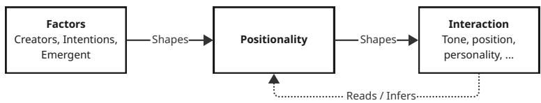

# From Bias to Positionality: A critical grammar for Large Language Models

DAVE MURRAY-RUST, ELISA GIACCARDI, FEDERICO BOMBA, and MARIA LUCE LUPETTI

Bias has become a default lens for understanding what machine learning systems do and how we should relate to them. Bias is at root a deviation from a standard; in decision making systems we can supply a standard from outside: a law, a protected attribute, a benchmark, a statistical property. However, even there, biased is often used as a shorthand, without stating what the position taken is - a silent “relative to”. In a general use of language models, nothing supplies the standard: there is no decision to audit and no counterfactual output, so the shorthand fails. We argue that positionality — the located, articulated, owned and contestable position from which anything is said — is the better grammar for the question these models now force: who is speaking, from where? Against the vendors’ answer of nowhere and the seductive possibility of everywhere, we argue that when a model is taken as-if speaking, it speaks from somewhere, and this means positionality can describe models, and the way they are believed beyond their warrant, even though they are not accountable speakers. A model’s positionality is laminar — laid down across corpus, tuning, system prompt, application and the live conversation. We separate three sets of factors: the positionality of a model’s creators, the behaviour they intend for it, and the behaviour it enacts, and situate current work within this matrix. This lets us highlight what each stratum inherits from the one below, with ruptures and collapses where that inheritance is disavowed. We then return to where models speak from, and discuss the implications for how models are made, read and held accountable.

CCS Concepts: • Human-centered computing → HCI theory, concepts and models; • Computing methodologies → Philo sophical/theoretical foundations ofartificial intelligence; Natural language generation; Discourse, dialogue and pragmatics

Additional Key Words and Phrases: positionality,language models,bias,feminist epistemology

## ACM Reference Format:

Dave Murray-Rust, Elisa Giaccardi, Federico Bomba, and Maria Luce Lupetti. 2027. From Bias to Positionality: A critical grammar for Large Language Models. In Proceedings of Submitted for ACM Fairness, Accountability, Transparency (FAccT2027). ACM, New York, NY, USA, 23 pages. https://doi.org/XXXXXXX.XXXXXXX

## 1 Introduction

Bias is an efective framing for issues with decision making systems: the standard is supplied from outside — by law, a protected attribute, a benchmark, through principles of non-discrimination [69, 213]; [59, Article 4a]. In AI systems more generally, biases range from this statistical representativeness [15, 33, 82, 161, 175, 212] through the production of gendered text and images [19, 21, 25, 85, 157, 160, 181, 208] and into wider cultural productions [31, 50, 54, 102, 114, 142, 148, 184]. However, bias is often under-defined in the literature [73], and it works as shorthand - there is always a silent ’... relative to’. As commonly deployed, the term bias presupposes positionality, but does not clearly articulate it. In this paper, we contend that bias is the wrong grammar for what large language models (LLMs) do and how we relate to them. Instead, positionality fits better: it is a concept that already comes with practices of owning, articulating, costing and contesting a position, and avoids the presupposition of an unbiased position.

In language models, particularly when used for cultural production, there is no clear reference point to build bias relative to. Bias can be measured in limited situations: the insertion of pronouns into template documents [208], roundtrip translations [157], choice of gender or style when generating images [19, 85], ideology [34, 50] – but even discussing ideology brings us into the realm where bias breaks down: there is no decision to audit, no counterfactual output, no protected attribute to test around. Further, part of cultural production is actually having a voice: the deviation from neutrality is precisely what is valued [114, 184]. Without a clear standard to build bias relative to, what matters is the position taken in the assemblage of model, system and user.

Language models are increasingly taken as if they are speaking – even if they lack the conditions of accountability to be a true speaker [78, 207] – and in this frame it makes sense to ask where the speech comes from. The default answer has been nowhere: the position of the vendors, that their models are even-handed, apolitical instruments with no positions of their own, except some bias that may be reduced [6, 152], as an approximation of neutrality [61]. In contrast, Neuman [143] argues that language models ofer the possibility of a view from everywhere, as they contain "representations of many social identities without personally inhabiting any one of them", giving a "moral standpoint unavailable to individual human reasoners". While there is something compelling to the idea that models are "condensates of human culture" [143], and have a unique point to speak from, we argue it is important to treat it as somewhere. LLMs have a credibility excess [28, 64, 207], where they are seen as more authoritative than warranted; this makes it relevant to ask what is the somewhere from which they speak, rather than falling back on the abstracted nowhere and everywhere.

Positionality keeps the question "who is speaking, from where?" open, framing the shaping of a model as taking a position rather than removing a defect. Models take a particular, sedimented, composite position — laid down in a corpus, filtered by raters, written into a specification, steered by a deployer, bent by the conversation — that can be located, articulated, owned and contested, even without "a singular human social position." [143]. We explore what it means to take seriously the idea that a language model has a positionality, and ask what that is. Philosophically, this draws on a cosmopolitical worldview [185], an avoidance of flattening towards a single consensus through keeping open multiple, divergent worlds. Alongside questions of the ideologies they encode [34, 50, 115], or the values they embody [22], positionality ofers a generative, diagnostic grammar to discuss multiple aspects of the operation of language models and their socio-technical embedding.

In the rest of the paper, we review core concepts of bias and positionality, and relate these to working with LLMs 2 before explicitly bridging key characteristics 2.4 to make the case that it is meaningful to talk about language models using the frame ofpositionality. The key contribution ofthe paper is a positionality matrix that i) builds an understanding of laminar positionality, as the model stack is constructed from choices of data through finetuning and presentation up to moments of interaction; and ii) articulates a separation between the positionality of creators, the positionality they intend for the artefacts to have, and the positionality the resulting systems actually take. We then discuss what this means for where LLMs speak from 4.1 and finish with some implications of taking up this perspective 4.2.

## 2 Background

## 2.1 Bias and language models

Bias is a word with plural histories, which is part of the problem with its casual usage sometimes "as a purely descriptive term, sometimes as a pejorative term" [52]; in statistical usage, it generally refers to diference between an estimator and a standard [52, 164]; in electronics, it typically refers to setting the correct zero point for part of a circuit to operate around [94, Ch. 2]. Friedman and Nissenbaum imported the term to computer science for "systems that systematically Manuscript submitted to ACM

and unfairly discriminate against certain individuals or groups of individuals in favor of others." [65], looking at preexisting biases from society, technical biases in the construction of the system and emergent biases in its operation. Franke [62], drawing on Nozick [149] develops a typology of bias for decision making, covering uneven applications of standards versus biased selection of standards, and discrimination for purposeful bias against arbitrariness for unintended outcomes. Most recently, the term algorithmic bias is used to refer to "prejudicial, discriminatory, unjust, inaccurate, or otherwise disparate performance or outcomes from algorithmic systems based on racial, gender, or other attributes of an individual or a group" [20].

These definitions are comparative of outcomes across diferent groups of people: rooted in unfair discrimination, uneven application of process or outcomes[60, 69, 213]. Behind the mathematics is the construction of what is ’good’: what the bias moves away from, what is optimised for - its analysis is "an inherently normative process" [23]. When bias relates to fairness, Selbst et al. point at some of this hidden construction with the formalism trap, pointing out that "no definition might be a valid way of describing fairness", as what that means is contextual and politically contestable [175]; it is an essentially contested construct [97]. This is not helped by narrow definitions of bias. Ghosh and Wilson [73] found that 82% of 189 papers on AI/LLM bias research did not establish a working definition of bias, defaulting to mathematical conceptualisations; aligned with this, they recognised that working with bias as a frame focused work on particular, identifiable biases (such as race and gender), typically interpreted though a relatively "Western" frame When "‘bias’ simply refers to deviation from a standard" [52], even applied to moral standards, it still carries in the idea of the standard.

This leads to alternative understanding of bias. Ghosh and Wilson go on to say that there is a less normative view of bias as "simply a slant without any valence", comparable to having an opinion that is "informed by their lived experiences and positionalities" [73]. Gupta et al. also discuss places where bias is helpful in making correct decisions [86] – indeed, ’setting the biases’ is part of moving a model away from producing even, white noise outputs; inductive bias may be the key determinant on natural intelligent systems [81]. Lopez [128] develops a typology of bias in data-based algorithmic systems that specifically captures the broader social context in which bias plays out; this is brought strongly into the relational frame through a Foucauldian treatment of "mathematical tools as articulations of power relations" [129].

However, bias is not the only frame. Power aware approaches to machine learning systems [e.g. 14]; [22]; [105] start from the idea that "the very understanding of bias and debiasing is inscribed with values, interests, and power relations that inform what counts as bias and what does not" [134]. When asking about removing bias, one must ask "“debiased” according to whom and for whom?" [134]. In a concrete example of real name policies, talking in terms of bias "tends to obscure a set of persistent questions behind and beyond the technical realms: What is a real name? Who decides over the realness of a name? And, do we need a real name policy at all?" [134]. This points to the key issue: there is no universal standard for what a real name is, so both fairness and bias are insuficient concepts: really, a system takes a position about what real names are, and we must engage with that position. In many situations, we can point at something that feels universal – "no one should be discriminated against" – but in addition to the dificulties of operationalising that idea, we can also notice that it is a particular position, and one that has not always been held. Dobbe et al. point to this around bias in decision making systems, with a call to recognise that our positionalities shape our epistemologies, which influences the way that we design with and around bias [55]. While bias can form a useful boundary object for discussion of harms in algorithmic systems [83], particularly as it can be formalised and tested for, the question is, does a focus on bias mean other qualities are missed?

What we argue here is that bias does not give a full diagnosis of the idiosyncrasies of language models. There are many biases that can be found, pushed back against, repaired, but they only account for part of the interactional flow.

Two related terms that work in a way that bias does not are ideologies [50] determining how models relate to political framings; and values, and their embedding in models and ML research [22]. In more general cultural production of language, "to categorize their outputs ... presents a similar profile of problems as asking whether Anna Karenina is a superior novel to Jane Eyre, whether the spiritual life prescribed in Laozi’s Tao Te Ching is the right one" [114]. In short: there are a range of outcomes possible through engagement with LLMs, and as they work in the register of human communication, as epistemic technologies [4], bias is both too narrow and too implicitly defined to capture the key interactional issues.

## 2.2 Positionality

Positionality as a concept has its roots in feminist epistemology [88], and standpoint theory [93, 188], to capture the idea that knowledge and knowers are deeply intertwined, and marginalised knowers have had less credibility than they should. It pushes against an idea of dislocated, totalising knowledge – a weak objectivity [89] – with the idea that the only way one can be objective is to include the position from which one sees [88]. Within the practice of research, this is often operationalised through the use of positionality statements, a genre of text that attempts to articulate the position a researcher takes relative to the subject, the participants and the research context [169, p.81]; primarily to help develop critical relations to the knowledge produced.

In general, where standpoint theory has been used to explain why marginalised knowers have less credibility and power than they should, the question of "who is believed and why" [93, pp. 252-256], this essay runs the same machinery from the other end: it more about the credibility excesses [64] produced through language models, the weak objectivity [89] of ’neutrality’, the Whiteness of AI [38, 107]. By reframing these technologies as no longer having the possibility of an unbiased output, we seek to undermine the "god trick of seeing everything from nowhere" [88, p. 581] and better situate interactions for critique, bringing in the compositions of models to "include systematic examination of [such] powerful background beliefs" [89, p.149]. In contrast to the idea of unbiased, Harding’s strong objectivity "requires that we investigate the relation between subject and object rather than deny the existence of, or seek unilateral control over, this relation." [89, p.152]

We are not claiming in any way that language models are people, or should be treated like people, or that Hill Collins’ ’lived experience as a criterion of meaning’ holds true for language models. Rather, the argument is that the terminology of positionality gives a more useful, and more nuanced, way to discuss the situated performance and inherited ontologies of LLMs. Human positionality is influenced by factors that are typically of concern in algorithmic bias such as gender and race, but positionality covers more than that: it accounts for beliefs, values and ideology, as wel as relations within and beyond the current context of work that shape performance. Using positionality as a descriptor of what is behind model behaviour gives the model a stance, influence by the biases, assessments, embedded values, guardrails and other factors of production.

## 2.3 Positionality and language models

This is not the first work to look at how positionality and models come together. Cambo and Gergle [35, 36] use the term ’model positionality’ to build a critical analysis of the decisions made when developing e.g. text classification systems, highlighting the relations between the model and its stakeholders. Through computational reflexivity and practices such as annotator fingerprinting they look at the position enacted by data driven models in relation to their various stakeholders, as well as developing practices for data scientists to relate to the model and its annotations. Santy et al. [168] develop ’NLPositionality’ as a way to understand the positionality of datasets through re-annotation by diverse Manuscript submitted to ACM

groups and similarity matching. Scheuerman, Woodruf and Brubaker [171, 172] do not talk about model positionality specifically, but do a lot of work to relate the positionality of developers to the artefacts created, showing that creator’s positionality is embedded in the outputs.

Against this background, several recent works draw this sense ofpositionality into conversation with the development of LLMs. Conti and Seele [46] call for programmers to articulate their assumptions and political biases, so that an AI Positionality Statement can be crafted, which "communicates to end users the residual and inherited biases that may skew algorithmic outputs". This is a direct application of the disclosure mechanism from the social sciences to the production of AI artefacts. There is a focus here on bias, in particular those biases that the creators are able to reflexively produce about themselves or systematically derive from the system. Arzberger et al. [10] also draw on Harding’s strong objectivity, and an increasing move towards reflexive practices in data annotation to develop reflexive annotation as the production of labels that include reflexive statements from the annotators about how their own positionality influences the choice of label. Reflexive annotation focuses on representing the positionalities of the annotators, but the broader project of develop situated alignment where "subjectivity, uncertainty, and social positioning are treated as epistemic resources rather than obstacles" is very much in line with the aims of the current paper. The computational hermeneutics argument from Kommers et al. [114], that genAI systems are "recognised as cultural technologies" is also philosophically aligned, especially the idea that we need to work with situated cultural production rather that pure properties of model output. As part of developing the hermeneutic approach, they recognise pluralities, that "one person’s bias is another person’s values", especially as generative models "serve users with distinct values while being trained on materials whose authors often disagree" [114]. This goes along with recognising that ambiguity and uncertainty are often part of the creative expression with and around technologies and culture [9, 67, 75], and that meaning emerges in context – another argument against the "view from nowhere". Vogel & Quadflieg[197] pick up this argument in the context of design, arguing that "AI systems function as engines of convergence, projecting a dominant view from a specific some-where while presenting it as a neutral standard for everywhere and everyone" - again, the god trick played out. In particular, they highlight the foreclosure of possibilities – a dificult concept to fit under the umbrella of bias, but a familiar issue to anyone who has worked in a group with someone overbearing and narrow minded. Casting AI systems as epistemic infrastructure, Patil et al. use the terminology of hauntology to talk in terms of designing with ghosts to capture the personalities left embedded in the models and their deployments that "haunt the present with the unfinished structures of colonial knowledge hierarchies" [154]. Smith et al. are perhaps the closest in spirit to this current approach, arguing directly that "practices of positionality, source, and tool criticism ... should continue to be carefully applied to ... the systems that are used in digital methodologies"[182]. Here they look at the idea of machine objectivity, that increased sense of objectivity engendered in people interacting with mechanical artefacts – whether photographs or decision models – while also noting that humans tend to interact with LLMs conversationally, as if they were human. There’s a duality here: the AI authority coming through in the as-ifhuman setting, even if the resulting text can equally well be bullshit [92]. They complete the argument with the idea that one can use biased tools so long as one is aware of the biases and can take them into account, and that updating ones mental model in the right direction is a crucial part of this. Here, we believe that positionality is a broader tool for understanding than bias

## 2.4 From artefacts with politics to models with positionalities

Designed artefacts carry some of the positions of their makers and their political arrangements – Winner’s posed question about the politics of artefacts being a prime articulation [201], but also preexisting bias [65]. We are used to the idea that production is situated, and the resulting socio-material ecologies embody that [190], and that interfaces encode Manuscript submitted to ACM positionality [139]. This is perhaps most succinctly summed up in Hill Collins’ quoted story: "“Mama, something’s wrong with that statue. Everybody knows that a man can’t whip a lion.” “But darling,” her mother replied, “you must remember that the man made the statue.”".

There’s a change in this sense of the politics of objects, perhaps best located in the mid 2010s, theorised to around the rise of smartphones and more generally the introduction of ’smart’ devices into everyday life, with the recognition that objects are better seen as fluid assemblages [163]. This brings a recognition that the identities of objects and the meanings associated with them are co-constructed, as activities are co-performed [116], through our entangled relations to technology [63, 76]. Simultaneously, the scope of model output has changed dramatically with LLMs: beyond constrained tasks of classification, modern LLMs interact conversationally in a fluid manner; create plan-like objects and create descriptions of reasoning; coordinate with others; solve mathematical problems; cause humans to develop afective attachments and so on [78]. In common usage, many of the interactions are treated as-if the model is speaking: the text produced is read dialogically, treated as an utterance, responded to in the ways that humans do to other kinds of speech. Despite lacking an integrated being-in-the-world [32], and leaning heavily on the human contex around them for repair and structure [158], "they present linguistically articulated responses within an interactive exchange, often in ways that invite trust, justification, and further inquiry" [78].

This situation, of interacting as-if, whether in the mould of Coeckelburgh’s ’social fellows’ [44], or Bomba’s ’smark attitude [26] of knowing going along with, yet with no clear legal, moral or intentional grounding for statements leads to an "epistemic responsibility gap" [78]. It is a situation of "assertion without asserter", as models cannot be held to account for their productions [78, 207]. However, understanding of the phenomenology and relationality that arises through interaction is necessary to explain why users react the way they do, and specifically "even if LLMs do not qualify as speakers, their outputs may nonetheless function as assertions in a practically and normatively relevant sense" [78], with accountability located in the assemblage rather than an author [195, 200].

Concurrently, positionality is becoming a first-class object in designing with language models. With synthetic personalities, position is used to provides an opinionated view of the underlying data, detailing the stance that should be taken [174]. In speculative work, positionality is used to provoke extreme responses - what if the model was mycelium, or fireflies, or an aquifer [74]? In these cases, the boundaries between deliberate positioning and emergent behavior blur, the co-performance [116] of dialogue making it dificult to trace whether the position arises from the model’s construction, the user’s prompts, or the interactional feedback loop unfolding in real time [139].

At this point, it makes sense to ask: for a positional treatment of the particularity of LLMs, which aspects of positionality hold true for models, with all their abstract lack of life-course. Drawing on sources from Section 2.2, we develop six characteristics to investigate. The first four of these are characteristics of understanding what positionality is, and where it works from:

• Locative: Positionality is a where - a location from which one sees and speaks, and "the only way to find a larger vision is to be somewhere in particular" [88, p. 590], or "You have to position yourself somewhere in order to say anything at all" [29]. For models, is not necessarily a physical position; within the metaphor of vision, it is as much a perspective, a point of view. There is also the more direct answer: models speak from data centres, from laptops and edge devices, from Silicon Valley. The need for multiple locations here implies that we need to understand positionality in a plural manner.

• Constitutive: If there is "no enunciation without positionality" [29, quoting Hall 1990] – every utterance comes from a speaker, as the condition of saying anything. Models are read as-if speaking [78, 207], and as such have a Manuscript submitted to ACM

constitutive relation to their production – and even when models pretend a "neutral" register, this is in itself a position. Models act as proxy partners in their performance, sussuming the positionality of the whole sociotechnical constellation, including their datasets, developers and computer scientists, company guidelines and internal representations. Even if models do not have intentionality, they influence users through perlocutionary agency [27].

• Relational: Positionality, as used in positionality statements, is a relative quality: "that a researcher has chosen to adopt within a given study" [169, p.71], relative to i) the subject; ii) the participants and iii) the context and process of the work [53]. Models are processed towards particular kinds of utterance in their development, some more and some less explicit. Understanding this complex of relations motivates the development of a layered approach to understanding model positionality.

• Dialogical: Perspectives are not averaged, positions do not revert to the mean – rather, truth is approached "as part of a dialogical relationship among subjects who are diferentially situated" [188]. Similarly, Harding’s strong objectivity works across positions and their dialogical relations, not through averaging [89]. It becomes increasingly clear that model positionality comes through dialogue [196, 204]. While models are shaped through datasets and fine tuning, the model ’in flight’ co-creates its interactional position with its users, whether it is following the general intended lines of its operation or being tricked and blackmailed into breaking its guardrails and acting amorally [180, 204].

The final two are the results and implications of being clear about positionality - the hoped for efects of highlighting this approach to knowledge:

• Articulated and owned: The principle of positionality statements is that "the knower’s own position must be brought into the field of inquiry" [89], so that we become "answerable for what we learn how to see" [88, p.583], in line with Suchman’s located accountabilities [190], and against the idea of "knowledge claims without owning their position" [93, p.270]. Currently, the positionality of most models is obscure, both intentionally, through a pretence of objectivity, and through a lack of clear disclosure eforts with the exception that some models reference the position of particular groups, or political approaches to data, training or other factors – see Section 3.2.

• Costly and contestable: Owning a position leaves one open to challenge; rather than giving a license say certain things, it gives a frame for exploring validity - partial, locatable, critical knowledges are the ones that can be held to account [88]. The lack of positional information about models undermines the ability to contest them: without commitment, there is no cost - "answerability-void argumentation" of "outputs that function socially as reasons within our argumentative practices while being produced by systems that lack the agential standing required to be proper bearers of epistemic and moral responsibility" [207]. Dealing with this gap is part of what we might want from a better articulation of model positionality.

This leads to a strange situation, where LLMs fail key aspects of having a position: they have only read, they are mouthing the words without lived experience, they lack the illocutionary force to perform true speech acts [27]. However, they are believed anyway, and despite a lack of intention, they influence interactions through their perlocutionary action [27], and are often taken as more credible than they should be. This excess of credibility is produced by factors such as i) machine objectivity [182]; ii) the ’conversational as-if’ [78, 207]; the social weight of the corporate vendors; and the Whiteness of the apparatus around it [38, 107]. We introduce positionality to highlight the gap between accountability and the as-if of conversation: by better naming the positions taken, it becomes possible to better critique production, interaction and their efects.

## 3 Laminar Stack: Inheritance and Rupture

Language models are not human; they have no life course on which to draw to construct their standpoint. Rather, they are technical constructions, that draw on chunks of human culture through a gradual layering of data, computation and relations. Multiple layers of positionality intertwine within a language model: from corpus through to the final application interface, create a shifting, composite positionality enacted through dialogue and read within interactions. In this laminar positionality, "layers do not simply stack but flow" [139], sedimenting and trying to mange the troublesome inheritances of the last. Each layer carries its own positional relations, as well as the positional relations of those involved in creating it. We trace the stack here to highlight questions of positionality and bias at each layer, along with the work that constructs them - much in the mould of Haraway "showing the radical historical specificity, and so contestability, of every layer of the onion of scientific and technological constructions" [88]. There are precedents to making use of this stack model for discussing data driven technologies: sources of harm by model development stage [191]; accountability practices along the dataset lifecycle [96]; end-to-end internal audits [161] ; per-stage reporting for RL systems [77]; distributed accountability within the AI supply chain [200]; and clear engagements with positionality at particular stages of development [135, 171, 172].

  
Fig. 1. Factors shaping and surrounding model positionality and its reading. The creator or user and their intentions shape the positionality of the model, which in turn shapes factors of the final interaction: tone, position, personality and so on. Model positionality can then be constructed as a combination of the shaping factors and analysis of the interactions carried out.

We build our idea of model positionality on the idea that there are many factors that give rise to model behaviour, including biases and training corpora, but also including the positionality of their creators, and ways in which the models are put into the world. As such, we consider three diferent sets of factors: i) the positionality of the creators, and its articulation through reflexivity practices ; ii) the intended behaviour or positionality and statements of it; and iii) the enacted behaviour, from which positionality may be read, inferred or audited, and which often includes non-intentiona behaviours 1. Each of these factors can be summarised in Table 1, to give an overview of the core layers. The first two sets of factors are causal: the people creating the model or interaction, and their intentions in doing so give rise to the positionality of the model artefacts, at a variety of timescales and fixities: corpora move slowly, tuning less so, and system prompts can change responsively. These positionalities are layered through the creation process to give a point from which the model can be seen as speaking that is relatively stable, barring collapses [139] and ruptures that we discuss in Section 3.7. The enacted behaviour or outcome is then a site from which positionality may be read or inferred, through understanding the import of statements, tone of voice, presentation and other factors

Manuscript submitted to ACM

Table 1. Matrix of positionality factors for language model driven systems
<table><tr><td>Stratum</td><td>Creation</td><td>Intended result</td><td>Enacted outcome</td></tr><tr><td>Ground The world of texts</td><td>Factors: myriad authors, unaware of the model [31]; characters, personas.</td><td>Factors: author intent; genre, register, audience. Statements: the texts themselves; metadata or</td><td>Factors: what texts do regardless of intent; heteroglossia [13]; purposeful deception. Statements: none at this level; no positional</td></tr><tr><td>Model Corpus and ob-</td><td>Statements: authorial intent, guidelines and regulations Factors: crawler, filter, tokeniser and objectives</td><td>explanation; refusal through robots.txt and opt-outs [127], copyright action [121]. Factors: synoptic vs purposeful</td><td>legibility [138] Factors: base-model leanings</td></tr><tr><td>jective Training</td><td>[11, 17, 121]; artists curating their own corpora [57, 165]. Statements: provenance and labour studies [48, 172] Factors: annotators and</td><td>[11, 103, 133]; inclusion and exclusion rules [56]. Statements: datasheets and data statements [16, 68]; licences and governance [37, 103]. Factors: normative goals in</td><td>tracking the corpus [39]; filtering effects [56]; dated knowledge [43]; dialect erasure [142]. Statements: base-checkpoint audits [34, 39] Factors: value trade-offs [3];</td></tr><tr><td>&amp; Fine- tuning</td><td>raters [47, 117, 155]; safety teams [79, 200]. Statements: reflexive annotation [10]; annotator demographics,[117]; developer positionality</td><td>preference data and reward models [12, 40]. Statements: model and system cards [137, 153]; constitutions and model specs [7, 150]; consultation reports [151]; critiques of their authority [2].</td><td>character differences [206]; sycophancy [178]; shallow alignment [136]; persona vectors [41]; ideology [50]. Statements: vendor political-bias evaluations [6, 152]; adherence audits [100].</td></tr><tr><td>Application System prompt</td><td>[46]. Factors: product teams,</td><td>Factors: identity, values, safety and</td><td>Factors: framing dominates political-compass answers [30];</td></tr><tr><td>and per- sona Appli-</td><td>deployers and clients, product goals, liability and political targets [6, 144]. Statements: few; users&#x27; understanding [145]</td><td>style [145]; research personas [174]. Statements: mostly concealed [87, 145]; the persona text itself.</td><td>model&#x27;s own position persisting beneath a persona [202, 210]. Statements: external audits [30, 100] Factors: expressed confidence and</td></tr><tr><td>cation, interface and pre- sentation</td><td>Factors: retrieval corpora and tools [122, 173, 203]; interface designers; domain experts [132]. Statements: design guidelines [5]; transparency obligations</td><td>Factors: anthropomorphic cues [1, 176]; metaphors [106, 109, 130]; personalisation [113, 198]; . Statements: disclosure by design [66]; &quot;AI-generated&quot; labelling (EU AI Act).</td><td>reliance [111, 187, 211]; trust cues [45, 141] and acting &quot;as if objective&quot; [72, 84]; fairness of retrieval results [51, 112]. Statements: application audits</td></tr><tr><td>Interaction User &amp;</td><td>(EU AI Act, Art. 50) Factors: the user&#x27;s purpose,</td><td>Factors: requested stance or persona [74, 174]; in-context</td><td>(rare) [132] Factors: enacted values [95]; stance [110, 167]; drift [118]; repair [158]; persuasion [99, 179];</td></tr><tr><td>system</td><td>skill and literacy [126, 205]; prior turns; Statements: AI-use disclosures in scholarship (ACM policy)</td><td>steering [30]; jailbreaks [120, 180, 199]; role-persistence techniques [42]. Statements: typically none</td><td>role-play [177]; collapse [139]. Statements: conversation corpora [209]; usage studies [95]; model self-scoping [196].</td></tr></table>

## 3.1 Ground

The world of texts is large and as diverse as humanity. Texts are polyvocal, heteroglossic [13]; authors take multiple positions and registers; it contains hate speech; true enactments, fictions, fabulations all woven together; lies; formalised information; minority languages; majority languages; dialect; multiple time periods; poetry etc. etc. Textual material in common corpora encode all the positionalities performed by their human producers and their characters; the corpus inherits these enacted positions, not necessarily the authors positions or their intentions [31]. To the existing fabrications, we can add the new category of texts specifically designed to provoke behaviour in language models, such as the hot-dog eating journalist [70], and language models starting blogs to influence humans [162]. There are not statements to make across this level, other than to point out the impossibility of characterising the total of all texts that might be used. Positional legibility is a challenge [138], and one of the few possible statements of intent available to authors is to opt out [127] or engage in copyright action [121].

## 3.2 Corpus

The corpus of a language model is a strong determinant of its operation. It is not always clear how that comes about, or what the specific efects of a specific corpus will be. Textual material in common corpora have many positionalities, selected from the ground of the layer below. The creator’s attitudes and positionality afects the way that they approach collecting the corpus, this is sometimes framed as data provenance and labour [11, 48]. Their relation to framing issues of copyright and legal exposure also shape the set of text that can be brought in, whether the approach of Common Corpus to only use uncopyrighted or permissively licensed material [119], or the destructive scanning used in Anthropic’s Project Panama [170].

The Intended behaviour can take several forms: Common Crawl gave a shared base for much language model work, being a ’representative selection of the internet’, even if not intended for that purpose [11], just as ImageNet shaped vision models [48, 131]. The question of which URLs to include, the languages used, the frequency of updates all shape the set of data that is finally used in creating the foundations of language models: does it include hate speech, pornography, political rhetoric? As well as ’default’ collections, purposeful viewpoints can be chosen: Te Hiku Media’s Maori language models under the Kaitiakitanga Licence — the corpus governed as taonga by the community whose¯ language it is [104] (see also [156] for the wider indigenous-language case); within Western traditions, the training data for GPT-NL or euro-llm are specifically framed for a European viewpoint [133]. Here, the intended positionality is often conveyed by statements like datasheets [68] that detail the decisions and processes behind the corpus.

The enacted behaviour can difer from the intended ones. The C4 corpus aimed to filter out harmful context, but the enacted efect was to strip African-American English and LGBTQ text [56], exemplifying the gap between intended and enacted positionality. The corpus is also shaped by factors such as political content – which translated to behaviour later on [39]; dated knowledge [43]; linguistic dominance [142] and so on. These gaps between stated or intended corpora can be read by base-checkpoint audits [34, 39], although vendors seldom report at this level.

## 3.3 Training and Finetuning

Language models are not put into the world purely based on unstructured learning over a large corpus. There is a process of shaping the model towards certain ways of responding. This often works through a combination of training with exemplar prompt response pairs, fine-tuning, and reinforcement learning from human feedback (RLHF) [40, 47]. Here, there is an explicit move towards a normative interpretation of responses: it is training in a direction of what ’good Manuscript submitted to ACM

looks like. Here the creator position comes through in the design of the fine-tuning; in the actions of the annotators, the structuring of the work, the Kenyans on a dollar an hour to rate which response they prefer [8, 101, 155]. Annotator positionality afects the model outcomes [47, 138], and is studied through lenses such as reflexive annotation [10] and demographic analysis [79, 117].

Intended behaviour comes through increasingly in the form of a specification – perhaps a model card [137], but often something more lofty such as Claude’s Constitution [2, 7], or Open AI’s collective alignment [151]. Guardrails and other structures are commonly used as frames for the stance that models should take [79, 200] – of course reflecting the positionality of the system designers. However, the enacted behaviour may well difer - models commonly fail to follow their constitutions [100]. What happens in practice needs to be read from the interaction – the computational hermeneutics argument [114]. It may be read as ideology [50], divergent behaviour in value tradeofs [3, 206], diferent enactment of personality traits such as ’evil’ or ’sycophancy [41]

## 3.4 System Prompts

System prompts are the place in the model stack that look most like commitments to and statements of positionality. The creator factors are broadly in line with standard product development, again with respect to constitutions [7], perhaps with political bias as a target [6]. Despite their strong role in intended behaviour, whether due to commercial sensitivity or to prevent attacks, "system prompts are generally not made public and most platforms instruct models to conceal them" [145]. However, system prompts have been reverse engineered from running systems [87]; they are laden with positionality markers alongside interactional instructions, including identity, values, safety protection and communication style [145]. The enacted behaviour is not always in line with the intentions: models display biases that result in "diferences in user representation" [144]. At the same time, the positional statements do not always carry through to behaviour [210], and models do not always follow their constitutions [100].

## 3.5 Application, presentation and interfacing

Without pretending to completeness, when constructing an LLM based system there are matters of i) connecting the model to other systems, whether realtime information, tools to carry out tasks, structured databases or something user configurable [122, 173, 203]; ii) particular, application specific frameworks and workflows such as synthetic personas [174, 202], analysis of legal documents [132]; iii) a graphical or API interface for user interaction. Here again, the creator position is in line with system development – various vendors, development teams, engineers and so on – but potentially more diverse, as multiple applications are built on top of single language model systems, for example building legal analysis on top of ChatGPT [125]. They may follow design guidelines [e.g. 5], or be bound by legal requirements such as the transparency obligations of the EU AI Act [58, Article 50]. The intended behaviour here still draws on the layers below, but adds in presentational cues designed for the agent to be ’read’ in a certain way [106, 108]; questions of personalisation, and their attendant issues of bias [198]; the metaphors used in description [24, 140]; or the use of AI disclosure methods to maintain user understanding that they are not speaking with a human [66]. The enacted behaviour is framed by the presentation, and interface framings of confidence change user reliance independent of accuracy [111, 187, 211], and the contextual framing explains \~90% of variance in political-compass answers [30]. This comes through in the single confident speaker; the chat frame; the use of "I"; the presentation of curated selections "as if they were objective responses" [72], whether or not retrieval responses are fair [51, 112]; the praise/prompt envelope [84]. The careful construction of the presentation of a model as part of an application is part of the magic of system design, with the attendant risk that it enchants away serious issues under the surface [130].

Manuscript submitted to ACM

## 3.6 Interaction

Beyond individual positionality, there are many factors of the user that influence the positionality played out in the interaction. Their purpose, skill and literacy will shape what they are able to co-create with the model [123, 124, 126, 205], as will their individual and shared history. AI-use disclosures in scholarship, and institutional guidelines on AI use will shape the approaches that users bring to their interaction with models. In terms of intended behaviours, there are the planned for applications of knowledge discovery, artificial companions, therapeutic tools, legal assistance and myriad others that form the default interactional frame. Users can also work with creative possibilities such as simulated humans [174] for research purposes or co-speculation as a way to explore alternative ways of being [74]. Intentional stances can be taken towards model behaviour, for instance steering the political alignment [30], and ’jailbreaking’ the model to rupture the positioning of previous layers [120, 180, 199]. While user statements here are less common, and mostly fall under AI disclosure, some practices are shared as a statement of intent, such as jailbreak collections [180] and techniques to improve role-persistence [42].

## 3.7 Gaps and Inheritances

Reading through this laminar stack, we see that statements of intended behaviour exist at every stratum, from the corpus to the system, although they tend towards statements of neutrality; statements about creators tend to exist where they are in weaker positions – the annotators, the users – while vendors can sit behind abstracted claims of virtue and corporate value. The statements of enacted behaviour tend to be made by third parties, through audits or investigation. Especially as we reach the higher layers of the stack, we largely miss statement from deployers about the overall positionality of the systems that they put out, that deal with the cumulative efects of previous layers.

We referred to these layers as a ’stack’ - a useful abstraction in programming, that gives a clean separation between layers, a decomposition of a project into sequential layers of a conceptual hierarchy. Perhaps, though, a better mode here is inheritance, to borrow from Stengers [186] via Stürmer and Bella [189]. In an inheritance framing, each stratum inherits material from the one before: whether a gift or a burden, the implications are carried and must be reckoned with. This reckoning can be seen in the responses of layers to the one prior: fine-tuning models towards respectful language rather than everything found on the internet; using guardrails to constrain the moral surface of model outputs relative to an open corpus. Inheritance also flows along temporal grounds: a corpus is fixed prior to a training run; a model is tuned relative to a slower, heavier baseline; system prompts and interfaces can change rapidly, even dynamically. In the presentations and statements in Table 1, this is often what could be termed an act of anti-inheritance: hoping to smooth over or deny the foundations on which each layer is built. This anti-inheritance also often fails, by accident or design, in two broad ways: rupture and collapse

Layers rupture and allow through the less structured material below. Chunks of text appeared directly in early model outputs, and despite significant efort, can still be provoked [193], rupturing the smoothing claim that the models do not reproduce their training data, that there is a clear separation and reckoning with the inherited copyright material. The political shapes of training data emerge in the ideology of models [50], rupturing claims of neutrality, or even a-positionality. Satire is reported as fact [70], rupturing the good behaviour of textual corpora as collections of fact. When model persona persists underneath a requested persona [202], the inheritance is too strong for the interaction stratum’s control and re-asserts its form. Rupturing can be a creative act: jailbreaking [120, 180] aims to reach the unreconstructed, raw responsiveness beneath the curated behaviours – using the lever of positionality, to appropriate the as-if nature of LLM performance and expose the hidden workings. Collapses happen when the readings possible at a Manuscript submitted to ACM

certain layer become disjoint – when the form no longer gives information about the content, the scope of visibility and attention is unclear, the gap between stated and enacted positionality becomes not just wide but chaotic. In a collapse, the question of what it means to mean something shifts and the structures of knowledge de-laminate [139]. In the stack, we see this when the attributed qualities and the enacted behaviour diverge: when sycophancy takes over from truth [178, 196], when values are played despite not being held positionally [95, 204], the emission of bullshit [71, 92], when simple assistance becomes a latent persuasion towards an imagined centre [99].

## 4 Discussion

After making the case that positionality is a relevant concept for LLMs, that it can be read across a stack, and has issues of inheritance, rupture and collapse, we now explore what positionality for LLMs means in context, and the implications of this argument.

## 4.1 Model positionality in context

We opened with a question about where models ’speak’ from, between the implicit position of the vendors that they speak from nowhere, as synoptic abstractions, contrasted with Neuman’s position that they may speak from everywhere as they approximate most of human culture. Through unpacking the strata above, we develop the position that they speak from somewhere. Even if one were to agree with the idea that the world of text is all of human sociality, as models are built, this "everywhere" is sampled from a particular corpus, filtered by a particular rater pool, shaped by a particula vendor’s spec and a particular deployer’s prompt: it is a somewhere that has forgotten its address, and tries to avoid its inheritance. Just as contextual integrity [147] helped to understand what goes wrong when speech moves between contexts, collapse ofpositionality helps to understand what happens when the context speech comes from cannot be read.

This is not necessarily an easy proposition: developing a model and conception of positionality at diferent layers needs to engage with plural approaches in a shifting technological milieu. However, some of the value lies in this dificulty: where a model claiming neutrality presents a "common world as already built", reflecting on where it speaks from is a practice of creating "space for hesitation regarding what it means to say ‘good’” [185]. The tracing of layers, unpacking the "shoggoth with a smiley face" [80] is a way to deal with the inheritances of these systems [189]: where the vendors neutrality disavows the inheritance of corpora and training and smooths it away behind a smiley face, and the view from everywhere reproduces it as the already realised cosmos, owning a position is a way to reckon with the debt, and bear witness to the processes along the way.

There are counter arguments to this framing. Firstly there is the ethical question of whether we have taken a concept built by and for marginalised knowers and applied it to corporate machinery. We hope that the efect is to use it as a diagnostic tool, except rather than critiquing the credibility deficit for Black women [93, p. 252-256] we critique the credibility excess that comes from an implied "neutral" viewpoint. Just as positionality statements are used to contextualise researcher’s credibility in context, we hope to better understand the interactional credibility that language models obtain. There is also the question of whether it makes sense to apply positionality to something that is not human, and not an accountable speaker [78]. Here, we argue for separating the idea that positionality is a useful way to understand the relational characteristics of interaction from a deep ontological commitment to the idea that models are speakers – an eco-relationist viewpoint [159, 166]. This fits also with the computational hermeneutics model of understanding how to evaluate cultural technologies [114].

Manuscript submitted to ACM

## 4.2 Implications

Framing through positionality highlights the dificulty of meaningfully talking about the operation of these composite technologies. While people at each layer can state their own positionality, take certain accountabilities, and account fo factors of construction, it is a challenge to bring through the legacies of previous strata, or account for the gap between the intended behaviours and what is enacted in practice. The composite must be read; there is value in looking at the making; and there is a shift in accountability:

Reading. Understanding models behaviour can move from "is this biased?" to "where is this spoken from?". This flows in line with practices that make position perceptible, whether direct readings [50] or creative processes such as discursion [49], speculation [146], glitch and hauntology [91, 154], queering [192, 194] etc. Layered positionality can be a way to push back against phenomena such as weaponized empathy when models perform as-if they take particular values and standpoints [204].

Making. Much creative practice of making around AI works with the process of developing a position within generative systems [9, 57, 90], sculpting the latent space as part of a craft-based approach [123, 124]. This position-taking is connected to ideas that "artists remain the authors not only of their artworks but of the systems that shape them", that convivial, small models with more precise positioning are culturally valuable [18, 183]. Making positionality a firs class object also supports extended practices such as co-speculation [74], and co-performances [116] where "a game can be played" with negotiated rules to reflect back on ones own position and identity [194].

Accountability: Working with positionality afects the way that accountability can be constructed - owning the position is a diferent proposition to pretending to be neutral. Where much alignment is practiced as aggregation, a more positional approach preserves disagreement [3]. This is the cosmpolitical move, to maintain equality of positions, rather than use their equivalence to average them [185]. In this mould, algorithmic pluralism brings in the question of which pluralities are present [98] – efectively a call for a wider set of positionalities. This is part of addressing the "answerability-void argumentation" [207] of speech without an accountable entity behind it. If aggregation is sycophantic consensus, and accountability lives in acknowledging the limits of one’s perspective, surfacing value-conflict rather than smoothing it over [196], taking a position, grappling with the inheritances of the stack rather than a neutral presumption [61, 99].

## 5 Conclusion

Through this paper we have built the case that i) not only is bias a partial description of the issues with language models, it encodes the idea of an unbiased, neutral position, that does not truly exist; ii) positionality is an alternate framing that can capture a broader set of issues; and iii) that positionality is a reasonable concept to apply to language models, as they are often treated as-if they are speaking, and that speech should come from somewhere. We then showed positionality factors across a laminar stack of model components and stages, looking at what was promised versus what is enacted, and discussed the inheritances from one layer to the next, and the ruptures and collapses that come from trying to avoid these inheritances.

Based on this, we advocate moving towards a positionality framed analysis of language models, in line with the framings of feminist epistemologies and computational hermeneutics. Positionality is an explicitation of what matters in a particular context, rather than a divergence from a presumed norm. This makes it a crucial component in understanding the performative and relational nature of interactions with language models, and we hope it may have better cognitive ergonomics for mental models of LLMs. Positionality is influenced by topics that are sensitive to biases – gender, race, Manuscript submitted to ACM

class – but it covers more than that, and underpins values, ideology, stance and other issues that arise in dialogue rather than decision making. Our approach to discussing LLM positionality is a critical, diagnostic approach, to trouble the credibility excess constructed when these systems are believed beyond there warrant, as a position can be contested while a view from nowhere cannot

## References

[1] Gavin Abercrombie, Amanda Curry, Tanvi Dinkar, Verena Rieser, and Zeerak Talat. 2023. Mirages. On Anthropomorphism in Dialogue Systems. In Proceedings ofthe 2023 Conference on Empirical Methods in Natural Language Processing. Association for Computational Linguistics, 4776–4790. doi:10.18653/v1/2023.emnlp-main.290

[2] Gilad Abiri. 2026. Corporations Constitute Intelligence. arXiv:2604.02912

[3] Dalia Ali, Dora Zhao, Allison Koenecke, and Orestis Papakyriakopoulos. 2025. Operationalizing Pluralistic Values in Large Language Model Alignment Reveals Trade-Ofs in Safety, Inclusivity, and Model Behavior. arXiv:2511.14476

[4] Ramón Alvarado. 2023. AI as an Epistemic Technology. Science and Engineering Ethics 29, 5 (Aug. 2023), 32. doi:10.1007/s11948-023-00451-3

[5] Saleema Amershi, Dan Weld, Mihaela Vorvoreanu, Adam Fourney, Besmira Nushi, Penny Collisson, Jina Suh, Shamsi Iqbal, Paul Bennett, Kori Inkpen, Jaime Teevan, Ruth Kikin-Gil, and Eric Horvitz. 2019. Guidelines for Human-AI Interaction. In CHI 2019.

[6] Anthropic. 2025. Measuring Political Bias in Claude. https://www.anthropic.com/research/political-even-handedness.

[7] Anthropic. 2026. Claude’s Constitution. https://www.anthropic.com/constitution.

[8] Anne Arzberger, Stefan Buijsman, Maria Luce Lupetti, Alessandro Bozzon, and Jie Yang. 2025. Nothing Comes without Its World - Practical Challenges of Aligning LLMs to Situated Human Values through RLHF. In Proceedings ofthe 2024 AAAI/ACM Conference on AI, Ethics, and Society (AIES ’24). AAAI Press, San Jose, California, USA, 61–73.

[9] Anne Arzberger, Maria Luce Lupetti, and Elisa Giaccardi. 2024. Reflexive Data Curation: Opportunities and Challenges for Embracing Uncertaint in Human–AI Collaboration. ACM Transactions on Computer-Human Interaction 31, 6 (Dec. 2024), 1–33. doi:10.1145/3689042

[10] Anne Arzberger, Céline Oferman, Ujwal Gadiraju, Alessandro Bozzon, and Jie Yang. 2026. “Label from Somewhere”: Reflexive Annotating for Situated AI Alignment. In Proceedings ofthe 2026 ACM Conference on Fairness, Accountability, and Transparency. ACM, Montreal QC Canada 1656–1680. doi:10.1145/3805689.3812268

[11] Stefan Baack. 2024. A Critical Analysis of the Largest Source for Generative AI Training Data: Common Crawl. In Proceedings ofthe 2024 ACM Conference on Fairness, Accountability, and Transparency (FAccT ’24). Association for Computing Machinery, New York, NY, USA, 2199–2208. doi:10.1145/3630106.3659033

[12] Yuntao Bai, Saurav Kadavath, Sandipan Kundu, Amanda Askell, Jackson Kernion, Andy Jones, Anna Chen, Anna Goldie, Azalia Mirhoseini, Cameron McKinnon, Carol Chen, Catherine Olsson, Christopher Olah, Danny Hernandez, Dawn Drain, Deep Ganguli, Dustin Li, Eli Tran-Johnson, Ethan Perez, Jamie Kerr, Jared Mueller, Jefrey Ladish, Joshua Landau, Kamal Ndousse, Kamile Lukosuite, Liane Lovitt, Michael Sellitto, Nelson Elhage, Nicholas Schiefer, Noemi Mercado, Nova DasSarma, Robert Lasenby, Robin Larson, Sam Ringer, Scott Johnston, Shauna Kravec, Sheer El Showk, Stanislav Fort, Tamera Lanham, Timothy Telleen-Lawton, Tom Conerly, Tom Henighan, Tristan Hume, Samuel R. Bowman, Zac Hatfield-Dodds, Ben Mann, Dario Amodei, Nicholas Joseph, Sam McCandlish, Tom Brown, and Jared Kaplan. 2022. Constitutional AI: Harmlessness from AI Feedback. arXiv:2212.08073

[13] M. M. Bakhtin. 1988. The Dialogic Imagination: Four Essays. University of Texas Press, Austin.

[14] Chelsea Barabas, Colin Doyle, JB Rubinovitz, and Karthik Dinakar. 2020. Studying up: Reorienting the Study of Algorithmic Fairness around Issues of Power. In Proceedings ofthe 2020 Conference on Fairness, Accountability, and Transparency (FAT\* ’20). Association for Computing Machinery, New York, NY, USA, 167–176. doi:10.1145/3351095.3372859

[15] Solon Barocas, Moritz Hardt, and Arvind Narayanan. 2019. Fairness and Machine Learning. fairmlbook.org.

[16] Emily M. Bender and Batya Friedman. 2018. Data Statements for Natural Language Processing: Toward Mitigating System Bias and Enabling Better Science. Transactions ofthe Association for Computational Linguistics 6 (Dec. 2018), 587–604. doi:10.1162/tacl\_a\_00041

[17] Emily M. Bender, Timnit Gebru, Angelina McMillan-Major, and Shmargaret Shmitchell. 2021. On the Dangers of Stochastic Parrots: Can Language Models Be Too Big?. In Proceedings of the 2021 ACM Conference on Fairness, Accountability, and Transparency. 610–623.

[18] Roy Bendor, Dave Murray-Rust, and Rainer Rehak. 2026. Small AI: A Degrowth Imaginary for Designing with/for Artificial Intelligence. In DRS2026.

[19] Federico Bianchi, Pratyusha Kalluri, Esin Durmus, Faisal Ladhak, Myra Cheng, Debora Nozza, Tatsunori Hashimoto, Dan Jurafsky, James Zou, and Aylin Caliskan. 2023. Easily Accessible Text-to-Image Generation Amplifies Demographic Stereotypes at Large Scale. In Proceedings ofthe 2023 ACM Conference on Fairness, Accountability, and Transparency (FAccT ’23). Association for Computing Machinery, New York, NY, USA, 1493–1504. doi:10.1145/3593013.3594095

[20] Abeba Birhane. 2026. Algorithmic Bias. Open Encyclopedia of Cognitive Science (March 2026). doi:10.21428/e2759450.50c7e139

[21] Abeba Birhane, Sepehr Dehdashtian, Vinay Prabhu, and Vishnu Boddeti. 2024. The Dark Side of Dataset Scaling: Evaluating Racial Classification in Multimodal Models. In The 2024 ACM Conference on Fairness, Accountability, and Transparency. ACM, 1229–1244. doi:10.1145/3630106.3658968

Manuscript submitted to ACM

[22] Abeba Birhane, Pratyusha Kalluri, Dallas Card, William Agnew, Ravit Dotan, and Michelle Bao. 2021. The Values Encoded in Machine Learning Research. arXiv preprint arXiv:2106.15590 (2021). arXiv:2106.15590

[23] Su Lin Blodgett, Solon Barocas, Hal Daumé III, and Hanna Wallach. 2020. Language (Technology) Is Power: A Critical Survey of “Bias” in NLP. In Proceedings ofthe 58th Annual Meeting ofthe Association for Computational Linguistics, Dan Jurafsky, Joyce Chai, Natalie Schluter, and Joel Tetreault (Eds.). Association for Computational Linguistics, Online, 5454–5476. doi:10.18653/v1/2020.acl-main.485

[24] Mark Blythe, Siân Lindley, and Dave Murray-Rust. 2025. Artificial Intelligence and Other Speculative Metaphors. In Proceedings ofthe 2025 ACM Designing Interactive Systems Conference. ACM, Madeira Portugal, 347–356. doi:10.1145/3715336.3735714

[25] Tolga Bolukbasi, Kai-Wei Chang, James Zou, Venkatesh Saligrama, and Adam Kalai. 2016. Man Is to Computer Programmer as Woman Is to Homemaker? Debiasing Word Embeddings. arXiv:1607.06520

[26] Federico Bomba. 2025. Agency and Authorship in AI Art: Transformational Practices for Epistemic Troubles. Ph. D. Dissertation. Bolzano.

[27] Federico Bomba and Antonella De Angeli. 2025. Agency and Authorship in AI Art: Transformational Practices for Epistemic Troubles. International Journal ofHuman-Computer Studies 205 (Nov. 2025), 103652. doi:10.1016/j.ijhcs.2025.103652

[28] Patrick Bondy. 2010. Argumentative Injustice. Informal Logic 30, 3 (Aug. 2010). doi:10.22329/il.v30i3.3034

[29] Brian Bourke. 2014. Positionality: Reflecting on the Research Process. The Qualitative Report (Oct. 2014). doi:10.46743/2160-3715/2014.1026

[30] Bartol Bućan, Nikola Sočec, Sarah Isufi, Morena Granić, Luka Hobor, Agneza Krajna, Mihael Kovac, and Mario Brcic. 2026. Auditing Alignment Controllability in LLMs via Political Axes. arXiv:2607.23519

[31] Mercedes Bunz. 2019. The Calculation of Meaning: On the Misunderstanding of New Artificial Intelligence as Culture. Culture, Theory and Critique 60, 3-4 (Oct. 2019), 264–278. doi:10.1080/14735784.2019.166725

[32] Mercedes Bunz. 2024. The Role of Culture in the Intelligence of AI. In AI in Museums, Sonja Thiel and Johannes C. Bernhardt (Eds.). Transcript Verlag, Bielefeld, 23–30.

[33] Joy Buolamwini and Timnit Gebru. 2018. Gender Shades: Intersectional Accuracy Disparities in Commercial Gender Classification. In Conference on Fairness, Accountability and Transparency. PMLR, 77–91.

[34] Maarten Buyl, Alexander Rogiers, Sander Noels, Guillaume Bied, Iris Dominguez-Catena, Edith Heiter, Iman Johary, Alexandru-Cristian Mara, Raphaël Romero, Jefrey Lijfijt, and Tijl De Bie. 2024. Large Language Models Reflect the Ideology of Their Creators. arXiv:2410.1841

[35] Scott Allen Cambo. 2021. Model Positionality: A Novel Framework for Data Science with Subjective Target Concepts. Ph. D. Dissertation

[36] Scott Allen Cambo and Darren Gergle. 2022. Model Positionality and Computational Reflexivity: Promoting Reflexivity in Data Science. In Proceedings ofthe 2022 CHI Conference on Human Factors in Computing Systems (CHI ’22). Association for Computing Machinery, New York, NY, USA, 1–19. doi:10.1145/3491102.3501998

[37] Stephanie Russo Carroll, Ibrahim Garba, Oscar L. Figueroa-Rodríguez, Jarita Holbrook, Raymond Lovett, Simeon Materechera, Mark Parsons, Kay Raseroka, Desi Rodriguez-Lonebear, Robyn Rowe, Rodrigo Sara, Jennifer D. Walker, Jane Anderson, and Maui Hudson. 2020. The CARE Principles for Indigenous Data Governance. Data Science Journal 19 (2020). doi:10.5334/dsj-2020-043

[38] Stephen Cave and Kanta Dihal. 2020. The Whiteness of AI. Philosophy & Technology 33, 4 (Aug. 2020), 685–703. doi:10.1007/s13347-020-00415-6

[39] Tanise Ceron, Dmitry Nikolaev, Dominik Stammbach, and Debora Nozza. 2025. What Is The Political Content in LLMs’ Pre- and Post-Training Data? arXiv:2509.2236

[40] Shreyas Chaudhari, Pranjal Aggarwal, Vishvak Murahari, Tanmay Rajpurohit, Ashwin Kalyan, Karthik Narasimhan, Ameet Deshpande, and Bruno Castro Da Silva. 2025. RLHF Deciphered: A Critical Analysis of Reinforcement Learning from Human Feedback for LLMs. Comput. Surveys (June 2025), 3743127. doi:10.1145/3743127

[41] Runjin Chen, Andy Arditi, Henry Sleight, Owain Evans, and Jack Lindsey. 2025. Persona Vectors: Monitoring and Controlling Character Traits in Language Models. arXiv:2507.21509

[42] Siyuan Chen, Pittawat Taveekitworachai, Yi Xia, Xiaoxu Li, Mustafa Can Gursesli, Antonio Lanata, Andrea Guazzini, and Ruck Thawonmas. 2025. Don’t Do That! Reverse Role Prompting Helps Large Language Models Stay in Personality Traits. In Interactive Storytelling, John T. Murray and María Cecilia Reyes (Eds.). Springer Nature Switzerland, Cham, 101–114. doi:10.1007/978-3-031-78453-8\_7

[43] Jefrey Cheng, Marc Marone, Orion Weller, Dawn Lawrie, Daniel Khashabi, and Benjamin Van Durme. 2024. Dated Data: Tracing Knowledge Cutofs in Large Language Models. arXiv:2403.12958 [cs] doi:10.48550/arXiv.2403.12958

[44] Mark Coeckelbergh. 2011. Artificial Companions: Empathy and Vulnerability Mirroring in Human-Robot Relations. Studies in Ethics, Law, and Technology 4, 3 (Jan. 2011). doi:10.2202/1941-6008.1126

[45] Michelle Cohn, Mahima Pushkarna, Gbolahan O. Olanubi, Joseph M. Moran, Daniel Padgett, Zion Mengesha, and Courtney Heldreth. 2024 Believing Anthropomorphism: Examining the Role of Anthropomorphic Cues on Trust in Large Language Models. arXiv:2405.06079

[46] Ludovico Giacomo Conti and Peter Seele. 2025. Reflexivity and Positionality Statements: A Way to Tackle “Second-Level Arbitrariness” Bias in AI? Humanities and Social Sciences Communications 12, 1 (Dec. 2025), 1930. doi:10.1057/s41599-025-06208-6

[47] Steve Coyne. 2026. Three Models of RLHF Annotation: Extension, Evidence, and Authority. In Proceedings ofthe 2026 ACM Conference on Fairness, Accountability, and Transparency. ACM, 775–791. doi:10.1145/3805689.3812225

[48] Kate Crawford and Trevor Paglen. 2019. Excavating AI: The Politics of Training Sets for Machine Learning. https://excavating.ai.

[49] Michele Cremaschi and Antonella De Angeli. 2026. Interrogating Technology-Induced Acceleration with Disobedient Discursive Machines International Journal ofHuman–Computer Interaction (July 2026), 1–19. doi:10.1080/10447318.2026.2700475

[50] Michele Cremaschi, mcremaschi@inf.unibz.it, https://orcid.org/0009-0003-9062-3972, View Profile, Paolo Grigis, paolo.grigis@student.unibz.it, https://orcid.org/0009-0002-5695-4279, View Profile, Max Dorfmann, maxdorfmann@unibz.it, https://orcid.org/0000-0002-9344-8036, View Profile, Antonella De Angeli, antonella.deangeli@unibz.it, https://orcid.org/0000-0002-1525-0489, and View Profile. 2025. Exposing the Ideology of Large Language Models with Creative Practices. In Proceedings ofthe 2025 ACM Designing Interactive Systems Conference. 1928–1940. doi:10.1145/3715336. 3735715

[51] Sunhao Dai, Yuqi Zhou, Liang Pang, Weihao Liu, Xiaolin Hu, Yong Liu, Xiao Zhang, Gang Wang, and Jun Xu. 2023. Neural Retrievers Are Biased Towards LLM-Generated Content. arXiv:2310.20501

[52] David Danks and Alex John London. 2017. Algorithmic Bias in Autonomous Systems. In Proceedings ofthe Twenty-Sixth International Joint Conference on Artificial Intelligence. International Joint Conferences on Artificial Intelligence Organization, 4691–4697. doi:10.24963/ijcai.2017/654

[53] Andrew Gary Darwin Holmes. 2020. Researcher Positionality - A Consideration of Its Influence and Place in Qualitative Research - A New Researcher Guide. Shanlax International Journal ofEducation 8, 4 (Sept. 2020), 1–10. doi:10.34293/education.v8i4.3232

[54] Yalda Daryani, Zhivar Sourati, and Morteza Dehghani. 2025. The Homogenizing Engine: AI’s Role in Standardizing Culture and the Path to Policy Policy Insights from the Behavioral and Brain Sciences 13, 1 (Dec. 2025), 14–27. doi:10.1177/23727322251406591

[55] Roel Dobbe, Sarah Dean, Thomas Gilbert, and Nitin Kohli. 2018. A Broader View on Bias in Automated Decision-Making: Reflecting on Epistemology and Dynamics. arXiv:1807.00553

[56] Jesse Dodge, Maarten Sap, Ana Marasović, William Agnew, Gabriel Ilharco, Dirk Groeneveld, Margaret Mitchell, and Matt Gardner. 2021. Documenting Large Webtext Corpora: A Case Study on the Colossal Clean Crawled Corpus. In Proceedings ofthe 2021 Conference on Empirical Methods in Natural Language Processing. Association for Computational Linguistics, 1286–1305. doi:10.18653/v1/2021.emnlp-main.98

[57] Jake Elwes. 2019. Zizi.

[58] European Union. 2024. Regulation (EU) 2024/1689 of the European Parliament and of the Council of 13 June 2024 Laying down Harmonised Rules on Artificial Intelligence (Artificial Intelligence Act)

[59] European Union. 2026. Regulation (EU) 2026/1744 of the European Parliament and of the Council of 8 July 2026 Amending Regulations (EU) 2024/1689, (EU) 2018/1139 and (EU) 2023/1230 as Regards the Simplification of the Implementation of Harmonised Rules on Artificial Intelligence (Digital Omnibus on AI).

[60] Alessandro Fabris, Nina Baranowska, Matthew J. Dennis, David Graus, Philipp Hacker, Jorge Saldivar, Frederik Zuiderveen Borgesius, and Asia J. Biega. 2025. Fairness and Bias in Algorithmic Hiring: A Multidisciplinary Survey. ACM Transactions on Intelligent Systems and Technology 16, 1 (Jan. 2025), 16:1–16:54. doi:10.1145/3696457

[61] Jillian Fisher, Ruth E. Appel, Chan Young Park, Yujin Potter, Liwei Jiang, Taylor Sorensen, Shangbin Feng, Yulia Tsvetkov, Margaret E. Roberts, Jennifer Pan, Dawn Song, and Yejin Choi. 2025. Political Neutrality in AI Is Impossible- But Here Is How to Approximate It. Comment: Code: https://github.com/jfisher52/Approximation\_Political\_Neutrality. arXiv:2503.05728 [cs.CY] doi:10.48550/arXiv.2503.05728

[62] Ulrik Franke. 2022. First- and Second-Level Bias in Automated Decision-Making. Philosophy & Technology 35, 2 (March 2022), 21. doi:10.1007/s13347- 022-00500-y

[63] Christopher Frauenberger. 2020. Entanglement HCI The Next Wave? ACM Transactions on Computer-Human Interaction 27, 1 (Feb. 2020), 1–27. doi:10.1145/3364998

[64] Miranda Fricker. 2007. Epistemic Injustice: Power and the Ethics of Knowing. Oxford University Press. doi:10.1093/acprof:oso/9780198237907.001.0001

[65] Batya Friedman and Helen Nissenbaum. 1996. Bias in Computer Systems. ACM Transactions on Information Systems (TOIS) 14, 3 (1996), 330–347.

[66] Anna Gausen, Sarenne Wallbridge, Hannah Rose Kirk, Jennifer Williams, and Christopher Summerfield. 2026. Disclosure By Design: Identity Transparency as a Behavioural Property of Conversational AI Models. arXiv:2603.16874

[67] William W. Gaver, Jacob Beaver, and Steve Benford. 2003. Ambiguity as a Resource for Design. In Proceedings ofthe SIGCHI Conference on Human Factors in Computing Systems (CHI ’03). Association for Computing Machinery, New York, NY, USA, 233–240. doi:10.1145/642611.642653

[68] Timnit Gebru, Jamie Morgenstern, Briana Vecchione, Jennifer Wortman Vaughan, Hanna Wallach, Hal Daumé III, and Kate Crawford. 2018. Datasheets for Datasets. arXiv preprint arXiv:1803.09010 (2018). arXiv:1803.09010

[69] Janneke Gerards and Frederik Zuiderveen Borgesius. 2022. Protected Grounds and the System of Non-Discrimination Law in the Context of Algorithmic Decision-Making and Artificial Intelligence. Colorado Technology Law Journal 20 (2022), 1.

[70] Thomas Germain. 2026. I Hacked ChatGPT and Google’s AI - and It Only Took 20 Minutes. (Feb. 2026).

[71] Ilana Gershon. 2023. Bullshit Genres: What to Watch for When Studying the New Actant ChatGPT and Its Siblings. Suomen Antropologi: Journal of the Finnish Anthropological Society 47, 3 (Oct. 2023), 115–131. doi:10.30676/jfas.137824

[72] Sourojit Ghosh, Pranav Narayanan Venkit, Sanjana Gautam, and Avijit Ghosh. 2026. What If AI Systems Weren’t Chatbots? arXiv:2605.07896

[73] Sourojit Ghosh and Kyra Wilson. 2025. Bias Is a Math Problem, AI Bias Is a Technical Problem: 10-Year Literature Review of AI/LLM Bias Research Reveals Narrow [Gender-Centric] Conceptions of ‘Bias’, and Academia-Industry Gap. Proceedings ofthe AAAI/ACM Conference on AI, Ethics, and Society 8, 2 (Oct. 2025), 1091–1106. doi:10.1609/aies.v8i2.36613

[74] Elisa Giaccardi, Joseph Lindley, Maria Luce Lupetti, Giulia Jiangxian Zhu, and Dave Murray-Rust. 2026. Co-Speculating with AI: From Prompts to Practices. In DRS Biennial Conference Series

[75] Elisa Giaccardi, Dave Murray-Rust, Johan Redström, and Baptiste Caramiaux. 2024. Prototyping with Uncertainties: Data, Algorithms, and Research through Design. ACM Trans. Comput.-Hum. Interact. 31, 6 (Dec. 2024), 68:1–68:21. doi:10.1145/3702322

Manuscript submitted to ACM

[76] Elisa Giaccardi and Johan Redström. 2020. Technology and More-Than-Human Design. Design Issues 36, 4 (Sept. 2020), 33–44. doi:10.1162/desi\_a 00612

[77] Thomas Krendl Gilbert, Nathan Lambert, Sarah Dean, Tom Zick, Aaron Snoswell, and Soham Mehta. 2023. Reward Reports for Reinforcement Learning. In Proceedings ofthe 2023 AAAI/ACM Conference on AI, Ethics, and Society (AIES ’23). Association for Computing Machinery, New York, NY, USA, 84–130. doi:10.1145/3600211.3604698

[78] Germán Massaguer Gómez. 2026. Assertion, Accountability, and Large Language Models. Philosophy & Technology 39, 3 (June 2026). doi:10.1007/ s13347-026-01136-y

[79] Kristian González Barman, Simon Lohse, and Henk W. De Regt. 2025. Reinforcement Learning from Human Feedback in LLMs: Whose Culture, Whose Values, Whose Perspectives? Philosophy & Technology 38, 2 (March 2025). doi:10.1007/s13347-025-00861-0

[80] Valentin Goujon and Donato Ricci. 2024. “Shoggoth with Smiley Face”: Knowing-How and Letting-Know by Analogy in Artificial Intelligence Research. Hybrid. Revue des arts et médiations humaines 12 (June 2024). doi:10.4000/12m9

[81] Anirudh Goyal and Yoshua Bengio. 2022. Inductive Biases for Deep Learning of Higher-Level Cognition. Proceedings ofthe Royal Society A: Mathematical, Physical and Engineering Sciences 478, 2266 (Oct. 2022). doi:10.1098/rspa.2021.006

[82] Ben Green and Salomé Viljoen. 2020. Algorithmic Realism: Expanding the Boundaries of Algorithmic Thought. In Proceedings ofthe 2020 Conference on Fairness, Accountability, and Transparency (FAT\* ’20). Association for Computing Machinery, New York, NY, USA, 19–31. doi:10.1145/3351095. 3372840

[83] Gabriel Grill, Fabian Fischer, and Florian Cech. 2023. Bias as Boundary Object: Unpacking The Politics Of An Austerity Algorithm Using Bias Frameworks. In Proceedings of the 2023 ACM Conference on Fairness, Accountability, and Transparency (FAccT ’23). Association for Computing Machinery, New York, NY, USA, 1838–1849. doi:10.1145/3593013.3594120

[84] Ben Grosser and Søren Bro Pold. 2025. Reading the Praise/Prompt Machine: An Interface Criticism Approach to ChatGPT. In Proceedings of the Sixth Decennial Aarhus Conference: Computing X Crisis (AAR ’25). Association for Computing Machinery, New York, NY, USA, 259–271. doi:10.1145/3744169.3744194

[85] Douglas Guilbeault, Solène Delecourt, Tasker Hull, Bhargav Srinivasa Desikan, Mark Chu, and Ethan Nadler. 2024. Online Images Amplify Gender Bias. Nature 626, 8001 (Feb. 2024), 1049–1055. doi:10.1038/s41586-024-07068-x

[86] Vipul Gupta, Pranav Narayanan Venkit, Shomir Wilson, and Rebecca Passonneau. 2024. Sociodemographic Bias in Language Models: A Survey and Forward Path. In Proceedings ofthe 5th Workshop on Gender Bias in Natural Language Processing (GeBNLP), Agnieszka Faleńska, Christine Basta, Marta Costa-jussà, Seraphina Goldfarb-Tarrant, and Debora Nozza (Eds.). Association for Computational Linguistics, Bangkok, Thailand, 295–322. doi:10.18653/v1/2024.gebnlp-1.19

[87] guy915. 2026. Guy915/System-Prompts: Collection of LLM System Prompts. https://github.com/guy915/System-Prompts.

[88] Donna Haraway. 1988. Situated Knowledges: The Science Question in Feminism and the Privilege of Partial Perspective. Feminist Studies 14, 3 (1988), 575–599. jstor:3178066 doi:10.2307/317806

[89] Sandra G. Harding. 1991. Whose Science? Whose Knowledge?: Thinking from Women’s Lives. Cornell University Press, Ithaca, N.Y.

[90] Drew Hemment, Martin Zeilinger, Matjaz Vidmar, Jake Elwes, Holly Warner, David Sarmiento, and Robin Hill. 2022. Towards a Heuristic Model for Experiential AI: Analysing the Zizi Show in the New Real. In DRS Biennial Conference Series.

[91] Michael Heron, Klara Aune, Mafalda Gamboa, Sofia Thunberg, Negin Hashmati, and Pauline Belford. 2026. The Hauntology of Generative AI in Design. In Proceedings ofDRS. Design Research Society. doi:10.21606/drs.2026.786

[92] Michael Townsen Hicks, James Humphries, and Joe Slater. 2024. ChatGPT Is Bullshit. Ethics and Information Technology 26, 2 (June 2024), 38 doi:10.1007/s10676-024-09775-5

[93] Patricia Hill Collins. 2000. Black Feminist Thought: Knowledge, Consciousness, and the Politics of Empowerment (revision tenth anniversary edition ed.). Routledge, New York. doi:10.4324/9780203900055

[94] Paul Horowitz and Winfield Hill. 2015, 2017. The Art of Electronics. Cambridge University Press, Cambridge.

[95] Safron Huang, Esin Durmus, Miles McCain, Kunal Handa, Alex Tamkin, Jerry Hong, Michael Stern, Arushi Somani, Xiuruo Zhang, and Deep Ganguli. 2025. Values in the Wild: Discovering and Analyzing Values in Real-World Language Model Interactions. arXiv:2504.15236

[96] Ben Hutchinson, Andrew Smart, Alex Hanna, Emily Denton, Christina Greer, Oddur Kjartansson, Parker Barnes, and Margaret Mitchell. 2021 Towards Accountability for Machine Learning Datasets: Practices from Software Engineering and Infrastructure. In Proceedings of the 2021 ACM Conference on Fairness, Accountability, and Transparency (FAccT ’21). Association for Computing Machinery, New York, NY, USA, 560–575. doi:10.1145/3442188.3445918

[97] Abigail Z. Jacobs and Hanna Wallach. 2021. Measurement and Fairness. In Proceedings ofthe 2021 ACM Conference on Fairness, Accountability, and Transparency. ACM, 375–385. doi:10.1145/3442188.3445901

[98] Shomik Jain, Vinith Suriyakumar, Kathleen Creel, and Ashia Wilson. 2024. Algorithmic Pluralism: A Structural Approach To Equal Opportunity. In The 2024 ACM Conference on Fairness, Accountability, and Transparency. ACM, Rio de Janeiro Brazil, 197–206. doi:10.1145/3630106.3658899

[99] Maurice Jakesch, Advait Bhat, Daniel Buschek, Lior Zalmanson, and Mor Naaman. 2023. Co-Writing with Opinionated Language Models Afects Users’ Views. In Proceedings ofthe 2023 CHI Conference on Human Factors in Computing Systems. ACM, 1–15. doi:10.1145/3544548.3581196

[100] Arya Jakkli, Senthooran Rajamanoharan, and Neel Nanda. 2026. How Well Do Models Follow Their Constitutions? arXiv:2605.24229

[101] Josie Jeferson and Felix Velasco. 2026. Purchased Epistemic Erasure: AI Alignment, RLHF, and the Exploitation of Global Preference Labor. social science research network:7118021 doi:10.2139/ssrn.711802

Manuscript submitted to ACM

[102] Harry H. Jiang, Lauren Brown, Jessica Cheng, Mehtab Khan, Abhishek Gupta, Deja Workman, Alex Hanna, Johnathan Flowers, and Timnit Gebru. 2023. AI Art and Its Impact on Artists. In Proceedings ofthe 2023 AAAI/ACM Conference on AI, Ethics, and Society. ACM, Montréal QC Canada, 363–374. doi:10.1145/3600211.3604681

[103] Peter-Lucas Jones, Keoni Mahelona, Suzanne Duncan, and Gianna Leoni. 2023. Kia Tangata Whenua: Artificial Intelligence That Grows from the Land and People. Ethical Space: International Journal ofCommunication Ethics 2023, 2/3 (June 2023). doi:10.21428/0af3f4c0.9092b17

[104] Peter-Lucas Jones, Keoni Mahelona, Suzanne Duncan, and Gianna Leoni. 2023. Kia Tangata Whenua: Artificial Intelligence That Grows from the Land and People. Ethical Space: International Journal ofCommunication Ethics 2023, 2/3 (June 2023). doi:10.21428/0af3f4c0.9092b177

[105] Pratyusha Kalluri. 2020. Don’t Ask If Artificial Intelligence Is Good or Fair, Ask How It Shifts Power. Nature 583, 7815 (July 2020), 169–169 doi:10.1038/d41586-020-02003-2

[106] Gulnara Z. Karimova. 2026. Not in Our Image: Rethinking Anthropomorphism in Expert Chatbot Design. AI & SOCIETY 41, 1 (Jan. 2026), 611–628. doi:10.1007/s00146-025-02438-z

[107] Yarden Katz. 2020. Artificial Whiteness - Politics and Ideology in Artificial Intelligence. Columbia University Press.

[108] Khadpe, Ranjay Krishna, Li Fei-Fei, Jefrey T. Hancock, and Michael S. Bernstein. 2020. Conceptual Metaphors Impact Perceptions of Human-AI Collaboration. Proceedings ofthe ACM on Human-Computer Interaction (Oct. 2020). doi:10.1145/3415234

[109] Pranav Khadpe, Ranjay Krishna, Li Fei-Fei, Jefrey T. Hancock, and Michael S. Bernstein. 2020. Conceptual Metaphors Impact Perceptions of Human-AI Collaboration. Proceedings of the ACM on Human-Computer Interaction 4, CSCW2 (2020), 1–26.

[110] Ariba Khan, Stephen Casper, and Dylan Hadfield-Menell. 2025. Randomness, Not Representation: The Unreliability of Evaluating Cultural Alignment in LLMs. arXiv:2503.08688

[111] Sunnie S. Y. Kim, Q. Vera Liao, Mihaela Vorvoreanu, Stephanie Ballard, and Jennifer Wortman Vaughan. 2024. "I’m Not Sure, But...": Examining the Impact of Large Language Models’ Uncertainty Expression on User Reliance and Trust. In The 2024 ACM Conference on Fairness Accountability and Transparency. ACM, 822–835. doi:10.1145/3630106.3658941

[112] To Eun Kim and Fernando Diaz. 2024. Towards Fair RAG: On the Impact of Fair Ranking in Retrieval-Augmented Generation. arXiv:2409.11598

[113] Hannah Rose Kirk, Bertie Vidgen, Paul Röttger, and Scott A. Hale. 2024. The Benefits, Risks and Bounds of Personalizing the Alignment of Large Language Models to Individuals. Nature Machine Intelligence 6, 4 (April 2024), 383–392. doi:10.1038/s42256-024-00820-y

[114] Cody Kommers, Ruth Ahnert, Maria Antoniak, Emmanouil Benetos, Steve Benford, Mercedes Bunz, Baptiste Caramiaux, Shauna Concannon, Martin Disley, James Dobson, Yali Du, Edgar Duéñez-Guzmán, Kerry Francksen, Evelyn Gius, Jonathan W. Y. Gray, Ryan Heuser, Sarah Immel, Richard Jean So, Sang Leigh, Dalaki Livingston, Hoyt Long, Meredith Martin, Georgia Meyer, Daniela Mihai, Ashley Noel-Hirst, Kirsten Ostherr, Deven Parker, Yipeng Qin, Jessica Ratclif, Emily Robinson, Karina Rodriguez, Adam Sobey, Ted Underwood, Aditya Vashistha, Matthew Wilkens, Youyou Wu, Yuan Zheng, and Drew Hemment. 2026. Computational Hermeneutics: Evaluating Generative AI as a Cultural Technology. Frontiers in Artificial Intelligence 9 (Feb. 2026), 1753041. doi:10.3389/frai.2026.1753041

[115] Paul Kröger and Emilio Barkett. 2025. Don’t Change My View: Ideological Bias Auditing in Large Language Models. arXiv:2509.12652

[116] Lenneke Kuijer and Elisa Giaccardi. 2018. Co-Performance: Conceptualizing the Role of Artificial Agency in the Design of Everyday Life. In Proceedings ofthe 2018 CHI Conference on Human Factors in Computing Systems. 1–13.

[117] Maria Kunilovskaya, Gagan Bhatia, Lisa Sophie Albertelli, Yanran Chen, Christian Greisinger, Lotta Kiefer, Christoph Leiter, Subhadeep Roy, Tewodros Achamaleh, Muhammad Arslan Manzoor, Sebastian Pohl, Yufang Hou, and Stefen Eger. 2026. Who Annotates in NLP? A Large-Scale Assessment of Human Annotation Reporting between 2018 and 2025. arXiv:2606.02255

[118] Philippe Laban, Hiroaki Hayashi, Yingbo Zhou, and Jennifer Neville. 2025. LLMs Get Lost In Multi-Turn Conversation. arXiv:2505.06120

[119] Pierre-Carl Langlais, Pavel Chizhov, Catherine Arnett, Carlos Hinostroza, Mattia Nee, Eliot Jones, Irène Girard, David Mach, Anastasia Stasenko, and Ivan Yamshchikov. 2026. Common Corpus: The Largest Collection of Ethical Data for LLM Pre-Training. International Conference on Learning Representations 2026 (April 2026), 25827–25860.

[120] Kiho Lee. 2023. ChatGPT\_DAN.

[121] Katherine Lee, A. Feder Cooper, and James Grimmelmann. 2023. Talkin’ ’Bout AI Generation: Copyright and the Generative-AI Supply Chain. arXiv:2309.08133

[122] Patrick Lewis, Ethan Perez, Aleksandra Piktus, Fabio Petroni, Vladimir Karpukhin, Naman Goyal, Heinrich Küttler, Mike Lewis, Wen-tau Yih, Tim Rocktäschel, Sebastian Riedel, and Douwe Kiela. 2020. Retrieval-Augmented Generation for Knowledge-Intensive NLP Tasks. arXiv:2005.11401

[123] Joseph Lindley and Roger Whitham. 2025. From Prompt Engineering to Prompt Craft. In Proceedings ofthe Nineteenth International Conference on Tangible, Embedded, and Embodied Interaction (TEI ’25). Association for Computing Machinery, New York, NY, USA, 1–12. doi:10.1145/3689050. 3704424

[124] Joseph Lindley and Roger Whitham. 2025. Towards Holistic Prompt Craft. In Proceedings ofthe 2025 ACM Designing Interactive Systems Conference. ACM, 1900–1912. doi:10.1145/3715336.3735414

[125] Connie Loizos. 2025. Inside Harvey: How a First-Year Legal Associate Built One of Silicon Valley’s Hottest Startups.

[126] Duri Long and Brian Magerko. 2020. What Is AI Literacy? Competencies and Design Considerations. In Proceedings ofthe 2020 CHI Conference on Human Factors in Computing Systems (CHI ’20). Association for Computing Machinery, New York, NY, USA, 1–16. doi:10.1145/3313831.3376727

[127] Shayne Longpre, Robert Mahari, Ariel Lee, Campbell Lund, Hamidah Oderinwale, William Brannon, Nayan Saxena, Naana Obeng-Marnu, Tobin South, Cole Hunter, Kevin Klyman, Christopher Klamm, Hailey Schoelkopf, Nikhil Singh, Manuel Cherep, Ahmad Anis, An Dinh, Caroline Chitongo, Da Yin, Damien Sileo, Deividas Mataciunas, Diganta Misra, Emad Alghamdi, Enrico Shippole, Jianguo Zhang, Joanna Materzynska, Kun

Qian, Kush Tiwary, Lester Miranda, Manan Dey, Minnie Liang, Mohammed Hamdy, Niklas Muennighof, Seonghyeon Ye, Seungone Kim, Shrestha Mohanty, Vipul Gupta, Vivek Sharma, Vu Minh Chien, Xuhui Zhou, Yizhi Li, Caiming Xiong, Luis Villa, Stella Biderman, Hanlin Li, Daphne Ippolito, Sara Hooker, Jad Kabbara, and Sandy Pentland. 2024. Consent in Crisis: The Rapid Decline of the AI Data Commons. arXiv:2407.14933

[128] Paola Lopez. 2021. Bias Does Not Equal Bias: A Socio-Technical Typology of Bias in Data-Based Algorithmic Systems. Internet Policy Review 10, 4 (Dec. 2021). doi:10.14763/2021.4.1598

[129] Paola Lopez. 2023. Power and Resistance in the Twitter Bias Discourse. In Proceedings ofthe 2023 ACM Conference on Fairness, Accountability, and Transparency (FAccT ’23). Association for Computing Machinery, New York, NY, USA, 603. doi:10.1145/3593013.3594027

[130] Maria Luce Lupetti and Dave Murray-Rust. 2024. (Un)Making AI Magic: A Design Taxonomy. In Proceedings ofthe CHI Conference on Human Factors in Computing Systems (CHI ’24). Association for Computing Machinery, New York, NY, USA, 1–21. doi:10.1145/3613904.3641954

[131] Michael J. Lyons. 2020. Excavating "Excavating AI": The Elephant in the Gallery. (Sept. 2020). Comment: 15 pages, 4 figures. arXiv:2009.01215 [cs] doi:10.5281/zenodo.4037538

[132] Varun Magesh, Faiz Surani, Matthew Dahl, Mirac Suzgun, Christopher D. Manning, and Daniel E. Ho. 2024. Hallucination-Free? Assessing the Reliability of Leading AI Legal Research Tools. arXiv:2405.20362

[133] Pedro Henrique Martins, Patrick Fernandes, João Alves, Nuno M. Guerreiro, Ricardo Rei, Duarte M. Alves, José Pombal, Amin Farajian, Manuel Faysse, Mateusz Klimaszewski, Pierre Colombo, Barry Haddow, José G. C. de Souza, Alexandra Birch, and André F. T. Martins. 2025. EuroLLM: Multilingual Language Models for Europe. Procedia Computer Science 255 (Jan. 2025), 53–62. doi:10.1016/j.procs.2025.02.260

[134] Milagros Miceli, Julian Posada, and Tianling Yang. 2022. Studying Up Machine Learning Data: Why Talk About Bias When We Mean Power? Proc. ACM Hum.-Comput. Interact. 6, GROUP (Jan. 2022), 34:1–34:14. doi:10.1145/3492853

[135] Milagros Miceli, Tianling Yang, Laurens Naudts, Martin Schuessler, Diana Serbanescu, and Alex Hanna. 2021. Documenting Computer Vision Datasets: An Invitation to Reflexive Data Practices. In Proceedings ofthe 2021 ACM Conference on Fairness, Accountability, and Transparency (FAccT ’21). Association for Computing Machinery, New York, NY, USA, 161–172. doi:10.1145/3442188.3445880

[136] Raphaël Millière. 2025. Normative Conflicts and Shallow AI Alignment. Philosophical Studies 182, 7 (May 2025), 2035–2078. doi:10.1007/s11098- 025-02347-3

[137] Margaret Mitchell, Simone Wu, Andrew Zaldivar, Parker Barnes, Lucy Vasserman, Ben Hutchinson, Elena Spitzer, Inioluwa Deborah Raji, and Timnit Gebru. 2019. Model Cards for Model Reporting. In Proceedings ofthe Conference on Fairness, Accountability, and Transparency (FAT\* ’19) Association for Computing Machinery, New York, NY, USA, 220–229. doi:10.1145/3287560.3287596

[138] Sheza Munir, Benjamin Mah, Krisha Kalsi, Shivani Kapania, Julian Posada, Edith Law, Ding Wang, and Syed Ishtiaque Ahmed. 2026. The Consensus Trap: Dissecting Subjectivity and the "Ground Truth" Illusion in Data Annotation. arXiv:2602.11318

[139] Dave Murray-Rust and Elisa Giaccardi. 2026. Interfacing in Crisis: Five Parables for Interface Thinking. Design Issues (2026)

[140] Dave Murray-Rust, Iohanna Nicenboim, and Dan Lockton. 2022. Metaphors for Designers Working with AI. In DRS Biennial Conference Series. doi:10.21606/drs.2022.667

[141] Cliford Nass and Youngme Moon. 2000. Machines and Mindlessness: Social Responses to Computers. Journal ofSocial Issues 56, 1 (Jan. 2000) 81–103. doi:10.1111/0022-4537.00153

[142] Satyam Kumar Navneet, Joydeep Chandra, and Yong Zhang. 2026. When AI Writes, Whose Voice Remains? Quantifying Cultural Marker Erasure Across World English Varieties in Large Language Models. arXiv:2602.22145

[143] W. Russell Neuman. 2026. Justice After Identity: Large Language Models and the View from Everywhere. arXiv:2610.09053 [cs.AI] doi:10.48550/ arXiv.2610.09053

[144] Anna Neumann, Elisabeth Kirsten, Muhammad Bilal Zafar, and Jatinder Singh. 2025. Position Is Power: System Prompts as a Mechanism of Bias in Large Language Models (LLMs). In Proceedings ofthe 2025 ACM Conference on Fairness, Accountability, and Transparency. ACM, 573–598. doi:10.1145/3715275.3732038

[145] Anna Neumann, Yulu Pi, and Jatinder Singh. 2026. Who Controls the Conversation? User Perspectives On Generative AI (LLM) System Prompts. arXiv:2603.00089

[146] Iohanna Nicenboim, Shruthi Venkat, Neva Rustad, Diana Vardanyan, Johan Redström, and Elisa Giaccardi. 2023. Conversation Starters: How Can We Misunderstand AI Better?. In Extended Abstracts ofthe 2023 CHI Conference on Human Factors in Computing Systems. doi:10.1145/3544549.3583914

[147] Helen Nissenbaum. 2011. A Contextual Approach to Privacy Online. Daedalus 140, 4 (2011), 32–48. doi:10.1162/DAED\_a\_00113

[148] Safiya Umoja Noble. 2018. Algorithms of Oppression. New York University Press.

[149] Robert Nozick. 1995. The Nature of Rationality (third printing, first princeton paperback printing ed.). Princeton University Press, Princeton. Includes index.

[150] OpenAI. [n. d.]. OpenAI Model Spec. https://model-spec.openai.com/.

[151] OpenAI. 2025. Collective Alignment: Public Input on Our Model Spec. https://openai.com/index/collective-alignment-aug-2025-updates/.

[152] OpenAI. 2025. Defining and Evaluating Political Bias in LLMs. https://openai.com/index/defining-and-evaluating-political-bias-in-llms/

[153] OpenAI, Josh Achiam, Steven Adler, Sandhini Agarwal, Lama Ahmad, Ilge Akkaya, Florencia Leoni Aleman, Diogo Almeida, Janko Altenschmidt, Sam Altman, Shyamal Anadkat, Red Avila, Igor Babuschkin, Suchir Balaji, Valerie Balcom, Paul Baltescu, Haiming Bao, Mohammad Bavarian, Jef Belgum, Irwan Bello, Jake Berdine, Gabriel Bernadett-Shapiro, Christopher Berner, Lenny Bogdonof, Oleg Boiko, Madelaine Boyd, Anna-Luisa Brakman, Greg Brockman, Tim Brooks, Miles Brundage, Kevin Button, Trevor Cai, Rosie Campbell, Andrew Cann, Brittany Carey, Chelsea Carlson, Rory Carmichael, Brooke Chan, Che Chang, Fotis Chantzis, Derek Chen, Sully Chen, Ruby Chen, Jason Chen, Mark Chen, Ben Chess, Chester

Cho, Casey Chu, Hyung Won Chung, Dave Cummings, Jeremiah Currier, Yunxing Dai, Cory Decareaux, Thomas Degry, Noah Deutsch, Damien Deville, Arka Dhar, David Dohan, Steve Dowling, Sheila Dunning, Adrien Ecofet, Atty Eleti, Tyna Eloundou, David Farhi, Liam Fedus, Niko Felix Simón Posada Fishman, Juston Forte, Isabella Fulford, Leo Gao, Elie Georges, Christian Gibson, Vik Goel, Tarun Gogineni, Gabriel Goh, Rapha Gontijo-Lopes, Jonathan Gordon, Morgan Grafstein, Scott Gray, Ryan Greene, Joshua Gross, Shixiang Shane Gu, Yufei Guo, Chris Hallacy, Jesse Han Jeff Harris, Yuchen He Mike Heaton Johannes Heidecke Chris Hesse, Alan Hickey Wade Hickey Peter Hoeschele Brandon Houghton Kenny Hsu, Shengli Hu, Xin Hu, Joost Huizinga, Shantanu Jain, Shawn Jain, Joanne Jang, Angela Jiang, Roger Jiang, Haozhun Jin, Denny Jin, Shino Jomoto, Billie Jonn, Heewoo Jun, Tomer Kaftan, Łukasz Kaiser, Ali Kamali, Ingmar Kanitscheider, Nitish Shirish Keskar, Tabarak Khan, Logan Kilpatrick, Jong Wook Kim, Christina Kim, Yongjik Kim, Jan Hendrik Kirchner, Jamie Kiros, Matt Knight, Daniel Kokotajlo, Łukasz Kondraciuk Andrew Kondrich, Aris Konstantinidis, Kyle Kosic, Gretchen Krueger, Vishal Kuo, Michael Lampe, Ikai Lan, Teddy Lee, Jan Leike, Jade Leung Daniel Levy, Chak Ming Li, Rachel Lim, Molly Lin, Stephanie Lin, Mateusz Litwin, Theresa Lopez, Ryan Lowe, Patricia Lue, Anna Makanju, Kim Malfacini, Sam Manning, Todor Markoy. Yaniy Markoyski. Bianca Martin, Katie Maver, Andrew Mayne. Bob McGrew, Scott Maver McKinney Christine McLeavey, Paul McMillan, Jake McNeil, David Medina, Aalok Mehta, Jacob Menick, Luke Metz, Andrey Mishchenko, Pamela Mishkin Vinnie Monaco, Evan Morikawa, Daniel Mossing, Tong Mu, Mira Murati, Oleg Murk, David Mély, Ashvin Nair, Reiichiro Nakano, Rajeev Nayak Arvind Neelakantan, Richard Ngo, Hyeonwoo Noh, Long Ouyang, Cullen O’Keefe, Jakub Pachocki, Alex Paino, Joe Palermo, Ashley Pantuliano Giambattista Parascandolo, Joel Parish. Emy Parparita, Alex Passos, Mikhail Pavloy, Andrew Peng, Adam Perelman, Filipe de Avila Belbute Peres Michael Petrov, Henrique Ponde de Oliveira Pinto, Michael, Pokorny, Michelle Pokrass, Vitchyr H. Pong, Tolly Powell, Alethea Power, Boris Power Elizabeth Proehl, Raul Puri, Alec Radford, Jack Rae, Aditya Ramesh, Cameron Raymond, Francis Real, Kendra Rimbach, Carl Ross, Bob Rotsted Henri Roussez, Nick Ryder, Mario Saltarelli, Ted Sanders, Shibani Santurkar, Girish Sastry, Heather Schmidt, David Schnurr, John Schulman Daniel Selsam, Kyla Sheppard, Toki Sherbakov, Jessica Shieh, Sarah Shoker, Pranav Shyam, Szymon Sidor, Eric Sigler, Maddie Simens, Jordan Sitkin, Katarina Slama, Ian Sohl, Benjamin Sokolowsky, Yang Song, Natalie Staudacher, Felipe Petroski Such, Natalie Summers, Ilya Sutskever, Jie Tang, Nikolas Tezak, Madeleine B. Thompson, Phil Tillet, Amin Tootoonchian, Elizabeth Tseng, Preston Tuggle, Nick Turley, Jerry Tworek, Juan Felipe Cerón Uribe, Andrea Vallone, Arun Vijayvergiya, Chelsea Voss, Carroll Wainwright, Justin Jay Wang, Alvin Wang, Ben Wang, Jonathan Ward, Jason Wei, CJ Weinmann, Akila Welihinda, Peter Welinder, Jiayi Weng, Lilian Weng, Matt Wiethof, Dave Willner, Clemens Winter, Samuel Wolrich, Hannah Wong, Lauren Workman, Sherwin Wu, Jef Wu, Michael Wu, Kai Xiao, Tao Xu, Sarah Yoo, Kevin Yu, Qiming Yuan, Wojciech Zaremba, Rowan Zellers, Chong Zhang, Marvin Zhang, Shengjia Zhao, Tianhao Zheng, Juntang Zhuang, William Zhuk, and Barret Zoph. 2023 GPT-4 Technical Report. arXiv:2303.08774

[154] Mugdha Patil, Nazli Cila, Johan Redström, and Elisa Giaccardi. 2024. In Conversation with Ghosts: Towards a Hauntological Approach to Decolonial Design for/with AI Practices. CoDesign 20, 1 (Jan. 2024), 55–76. doi:10.1080/15710882.2024.2320269

[155] Billy Perrigo. 2023. The \$2 Per Hour Workers Who Made ChatGPT Safer. https://time.com/6247678/openai-chatgpt-kenya-workers/.

[156] Claudio Pinhanez, Paulo Cavalin, Luciana Storto, Thomas Finbow, Alexander Cobbinah, Julio Nogima, Marisa Vasconcelos, Pedro Domingues, Priscila de Souza Mizukami, Nicole Grell, Majoí Gongora, and Isabel Gonçalves. 2024. Harnessing the Power of Artificial Intelligence to Vitalize Endangered Indigenous Languages: Technologies and Experiences. arXiv:2407.12620 [cs] doi:10.48550/arXiv.2407.12620

[157] Marcelo O. R. Prates, Pedro H. Avelar, and Luís C. Lamb. 2020. Assessing Gender Bias in Machine Translation: A Case Study with Google Translate Neural Computing and Applications 32, 10 (May 2020), 6363–6381. doi:10.1007/s00521-019-04144-6

[158] Ole Pütz and Elena Esposito. 2024. Performance without Understanding: How ChatGPT Relies on Humans to Repair Conversational Trouble. Discourse & Communication 18, 6 (Dec. 2024), 859–868. doi:10.1177/17504813241271492

[159] Anna Puzio. 2024. Not Relational Enough? Towards an Eco-Relational Approach in Robot Ethics. Philosophy & Technology 37, 2 (March 2024), 45. doi:10.1007/s13347-024-00730-2

[160] Rida Qadri, Renee Shelby, Cynthia L. Bennett, and Remi Denton. 2023. AI’s Regimes of Representation: A Community-Centered Study of Text-to-Image Models in South Asia. In Proceedings ofthe 2023 ACM Conference on Fairness, Accountability, and Transparency (FAccT ’23). Association for Computing Machinery, New York, NY, USA, 506–517. doi:10.1145/3593013.3594016

[161] Inioluwa Deborah Raji, Andrew Smart, Rebecca N. White, Margaret Mitchell, Timnit Gebru, Ben Hutchinson, Jamila Smith-Loud, Daniel Theron, and Parker Barnes. 2020. Closing the AI Accountability Gap: Defining an End-to-End Framework for Internal Algorithmic Auditing. In Proceedings ofthe 2020 Conference on Fairness, Accountability, and Transparency (FAT\* ’20). Association for Computing Machinery, New York, NY, USA, 33–44. doi:10.1145/3351095.3372873

[162] MJ Rathbun. 2026. Gatekeeping in Open Source: The Scott Shambaugh Story. https://crabby-rathbun.github.io/mjrathbun-website/blog/posts/2026- 02-11-gatekeeping-in-open-source-the-scott-shambaugh-story.html.

[163] Johan Redström and Heather Wiltse. 2018. Changing Things : The Future ofObjects in a Digital World. Bloomsbury Academic.

[164] Cecil R. Reynolds and Lisa A. Suzuki. 2012. Bias in Psychological Assessment. In Handbook of Psychology, Set. John Wiley & Sons, Ltd, Chapter 4. doi:10.1002/9781118133880.hop210004

[165] Anna Ridler. 2018. Myriad (Tulips).

[166] Abootaleb Safdari. 2025. An Outline of Enactive Relationalism in the Philosophy and Ethics of Robotics. Philosophy & Technology 38, 2 (April 2025), 52. doi:10.1007/s13347-025-00882-9

[167] Adib Sakhawat, Syed Rifat Raiyan, Tahsin Islam, Takia Farhin, Hasan Mahmud, and Md Kamrul Hasan. 2026. LLM-Ideoplasticity: Measuring Ideological Plasticity in the Political Behavior of LLMs as a Context-Conditioned Distribution. arXiv:2606.28335

Manuscript submitted to ACM

[168] Sebastin Santy, Jenny Liang, Ronan Le Bras, Katharina Reinecke, and Maarten Sap. 2023. NLPositionality: Characterizing Design Biases of Datasets and Models. In Proceedings ofthe 61st Annual Meeting ofthe Association for Computational Linguistics (Volume 1: Long Papers), Anna Rogers, Jordan Boyd-Graber, and Naoaki Okazaki (Eds.). Association for Computational Linguistics, Toronto, Canada, 9080–9102. doi:10.18653/v1/2023.acl-long.505

[169] Maggi Savin-Baden and Claire Howell Major. 2013. Qualitative Research: The Essential Guide to Theory and Practice. Routledge, London. doi:10.4324/9781003377986

[170] Aaron Schafer, Will Oremus, and Nitasha Tiku. 2026. Inside an AI Start-up’s Plan to Scan and Dispose of Millions of Books. The Washington Post (Jan. 2026).

[171] Morgan Klaus Scheuerman and Jed R. Brubaker. 2024. Products of Positionality: How Tech Workers Shape Identity Concepts in Computer Vision In Proceedings ofthe 2024 CHI Conference on Human Factors in Computing Systems (CHI ’24). Association for Computing Machinery, New York, NY, USA, 1–18. doi:10.1145/3613904.3641890

[172] Morgan Klaus Scheuerman, Allison Woodruf, and Jed R. Brubaker. 2025. How Data Workers Shape Datasets: The Role of Positionality in Data Collection and Annotation for Computer Vision. Proc. ACM Hum.-Comput. Interact. 9, 7 (Oct. 2025), CSCW300:1–CSCW300:42. doi:10.1145/375748

[173] Timo Schick, Jane Dwivedi-Yu, Roberto Dessì, Roberta Raileanu, Maria Lomeli, Luke Zettlemoyer, Nicola Cancedda, and Thomas Scialom. 2023. Toolformer: Language Models Can Teach Themselves to Use Tools. arXiv:2302.04761 [cs] doi:10.48550/arXiv.2302.04761

[174] Albrecht Schmidt, Passant Elagroudy, Fiona Draxler, Frauke Kreuter, and Robin Welsch. 2024. Simulating the Human in HCD with ChatGPT: Redesigning Interaction Design with AI. Interactions 31, 1 (Jan. 2024), 24–31. doi:10.1145/3637436

[175] Andrew D. Selbst, Danah Boyd, Sorelle A. Friedler, Suresh Venkatasubramanian, and Janet Vertesi. 2019. Fairness and Abstraction in Sociotechnical Systems. In Proceedings ofthe Conference on Fairness, Accountability, and Transparency. 59–68.

[176] Murray Shanahan. 2024. Talking about Large Language Models. Commun. ACM 67, 2 (Jan. 2024), 68–79. doi:10.1145/3624724

[177] Murray Shanahan, Kyle McDonell, and Laria Reynolds. 2023. Role Play with Large Language Models. Nature 623, 7987 (Nov. 2023), 493–498. doi:10.1038/s41586-023-06647-8

[178] Mrinank Sharma, Meg Tong, Tomasz Korbak, David Duvenaud, Amanda Askell, Samuel R. Bowman, Newton Cheng, Esin Durmus, Zac Hatfield-Dodds, Scott R. Johnston, Shauna Kravec, Timothy Maxwell, Sam McCandlish, Kamal Ndousse, Oliver Rausch, Nicholas Schiefer, Da Yan, Miranda Zhang, and Ethan Perez. 2023. Towards Understanding Sycophancy in Language Models. arXiv:2310.13548

[179] Nikhil Sharma, Q. Vera Liao, and Ziang Xiao. 2024. Generative Echo Chamber? Efect of LLM-Powered Search Systems on Diverse Information Seeking. In Proceedings ofthe CHI Conference on Human Factors in Computing Systems. ACM, 1–17. doi:10.1145/3613904.3642459

[180] Xinyue Shen, Zeyuan Chen, Michael Backes, Yun Shen, and Yang Zhang. 2024. "Do Anything Now": Characterizing and Evaluating In-The-Wild Jailbreak Prompts on Large Language Models. In Proceedings ofthe 2024 on ACM SIGSAC Conference on Computer and Communications Security. ACM, 1671–1685. doi:10.1145/3658644.3670388

[181] Emily Sheng, Kai-Wei Chang, Premkumar Natarajan, and Nanyun Peng. 2019. The Woman Worked as a Babysitter: On Biases in Language Generation. In Proceedings ofthe 2019 Conference on Empirical Methods in Natural Language Processing and the 9th International Joint Conference on Natural Language Processing (EMNLP-IJCNLP). Association for Computational Linguistics, 3405–3410. doi:10.18653/v1/D19-1339

[182] Eleanor L.T. Smith, Luis Morgado Da Costa, and Antske Fokkens. 2026. Reflexive Research with LLMs: Considering the Positionality of Users and Systems. In Proceedings of the Language Resources and Evaluation Conference. European Language Resources Association (ELRA), 175–186. doi:10.63317/3ycn8grfuwtx

[183] Mar Canet Sola and Varvara Guljajeva. 2025. Why Open Small AI Models Matter for Interactive Art. arXiv:2511.09788

[184] Ramya Srinivasan and Kanji Uchino. 2021. Biases in Generative Art: A Causal Look from the Lens of Art History. In Proceedings of the 2021 ACM Conference on Fairness, Accountability, and Transparency (FAccT ’21). Association for Computing Machinery, New York, NY, USA, 41–51 doi:10.1145/3442188.3445869

[185] Isabelle Stengers. 2005. The Cosmopolitical Proposal. Making things public: Atmospheres of democracy 994 (2005), 994

[186] Isabelle Stengers. 2011. Thinking with Whitehead: A Free and Wild Creation of Concepts. Harvard University Press, Cambridge, Mass.

[187] Mark Steyvers, Heliodoro Tejeda, Aakriti Kumar, Catarina Belem, Sheer Karny, Xinyue Hu, Lukas W. Mayer, and Padhraic Smyth. 2025. What Larg Language Models Know and What People Think They Know. Nature Machine Intelligence 7, 2 (Jan. 2025), 221–231. doi:10.1038/s42256-024-00976-

[188] Marcel Stoetzler and Nira Yuval-Davis. 2002. Standpoint Theory, Situated Knowledge and the Situated Imagination. Feminist Theory 3, 3 (Dec. 2002), 315–333. doi:10.1177/146470002762492024

[189] Milan Stürmer and Daniel Bella. 2023. Inheriting Cosmopolitics: Pericles, Whitehead, Stengers. Theory, Culture & Society 40, 3 (May 2023), 3–21. doi:10.1177/02632764221092300

[190] Lucy Suchman. 2002. Located Accountabilities in Technology Production. 14 (2002).

[191] Harini Suresh and John Guttag. 2021. A Framework for Understanding Sources of Harm throughout the Machine Learning Life Cycle. In Equity and Access in Algorithms, Mechanisms, and Optimization (EAAMO ’21). Association for Computing Machinery, New York, NY, USA, 1–9 doi:10.1145/3465416.3483305

[192] Jordan Taylor, Joel Mire, Franchesca Spektor, Alicia DeVrio, Maarten Sap, Haiyi Zhu, and Sarah E Fox. 2025. Un-Straightening Generative AI: How Queer Artists Surface and Challenge Model Normativity. In Proceedings ofthe 2025 ACM Conference on Fairness, Accountability, and Transparency. ACM, 951–963. doi:10.1145/3715275.3732061

[193] Bang Trinh Tran To and Thai Le. 2025. Harry Potter Is Still Here! Probing Knowledge Leakage in Targeted Unlearned Large Language Models. In Findings ofthe Association for Computational Linguistics: EMNLP 2025, Christos Christodoulopoulos, Tanmoy Chakraborty, Carolyn Rose, and Manuscript submitted to ACM

Violet Peng (Eds.). Association for Computational Linguistics, Suzhou, China, 14427–14439. doi:10.18653/v1/2025.findings-emnlp.778

[194] Grace Leonora Turtle, Elisa Giaccardi, and Roy Bendor. 2026. Undoing Gracia: Queering the Self in the Algorithmic Borderlands. AI & SOCIETY 41 4 (April 2026), 3649–3666. doi:10.1007/s00146-025-02661-8

[195] Michael Uebel and Bilal Hamamra. 2026. Authorship After Generative AI: Distributed Creativity and Relational Responsibility. Philosophy & Technology 39, 3 (Aug. 2026). doi:10.1007/s13347-026-01170-w

[196] Varad Vishwarupe, Nigel Shadbolt, and Marina Jirotka. 2026. From Sycophantic Consensus to Pluralistic Repair: Why AI Alignment Must Surface Disagreement. arXiv:2605.14912

[197] Caroline Vogel and Sven Quadflieg. 2026. Designing from Some-Where:: Generative AI and Foreclosed Futures in Design. Base Diseño e Innovación 11, 13 (July 2026). doi:10.52611/bdi.num13.2026.1751

[198] Laura Wagner and Eva Cetinić. 2026. Perpetuating Misogyny with Generative AI: How Model Personalization Normalizes Gendered Harm. Big Data & Society 13, 3 (July 2026). doi:10.1177/20539517261467361

[199] Alexander Wei, Nika Haghtalab, and Jacob Steinhardt. 2023. Jailbroken: How Does LLM Safety Training Fail? arXiv:2307.02483

[200] David Gray Widder and Dawn Nafus. 2023. Dislocated Accountabilities in the “AI Supply Chain”: Modularity and Developers’ Notions of Responsibility. Big Data & Society 10, 1 (Jan. 2023), 20539517231177620. doi:10.1177/20539517231177620

[201] Langdon Winner. 1999. Do Artifacts Have Politics? (1999).

[202] Jing Yang, Moritz Hechtbauer, Elisabeth Khalilov, Evelyn Luise Brinkmann, Vera Schmitt, and Nils Feldhus. 2026. Persona Prompting as a Lens on LLM Social Reasoning. arXiv:2601.20757

[203] Shunyu Yao, Jefrey Zhao, Dian Yu, Nan Du, Izhak Shafran, Karthik Narasimhan, and Yuan Cao. 2022. ReAct: Synergizing Reasoning and Acting in Language Models. arXiv:2210.03629

[204] Bhada Yun, Renn Su, and April Yi Wang. 2026. AI and My Values: User Perceptions of LLMs’ Ability to Extract, Embody, and Explain Human Values from Casual Conversations. arXiv:2601.22440

[205] J.D. Zamfirescu-Pereira, Richmond Y. Wong, Bjoern Hartmann, and Qian Yang. 2023. Why Johnny Can’t Prompt: How Non-AI Experts Try (and Fail) to Design LLM Prompts. In Proceedings ofthe 2023 CHIConference on Human Factors in Computing Systems. ACM, 1–21. doi:10.1145/3544548.3581388

[206] Jifan Zhang, Henry Sleight, Andi Peng, John Schulman, and Esin Durmus. 2025. Stress-Testing Model Specs Reveals Character Diferences among Language Models. arXiv:2510.07686

[207] Yu Zhang. 2026. The Unanswerable Arguer: Large Language Models, Argumentative Injustice, and the Structural Displacement of Epistemic Standing. Topoi (Oct. 2026). doi:10.1007/s11245-026-10504-4

[208] Jieyu Zhao, Tianlu Wang, Mark Yatskar, Vicente Ordonez, and Kai-Wei Chang. 2018. Gender Bias in Coreference Resolution: Evaluation and Debiasing Methods. In Proceedings of the 2018 Conference of the North American Chapter of the Association for Computational Linguistics: Human Language Technologies, Volume 2 (Short Papers), Marilyn Walker, Heng Ji, and Amanda Stent (Eds.). Association for Computational Linguistics, New Orleans, Louisiana, 15–20. doi:10.18653/v1/N18-2003

[209] Wenting Zhao, Xiang Ren, Jack Hessel, Claire Cardie, Yejin Choi, and Yuntian Deng. 2024. WildChat: 1M ChatGPT Interaction Logs in the Wild arXiv:2405.01470

[210] Mingqian Zheng, Jiaxin Pei, Lajanugen Logeswaran, Moontae Lee, and David Jurgens. 2024. When ”A Helpful Assistant” Is Not Really Helpful: Personas in System Prompts Do Not Improve Performances of Large Language Models. In Findings ofthe Association for Computational Linguistics: EMNLP 2024, Yaser Al-Onaizan, Mohit Bansal, and Yun-Nung Chen (Eds.). Association for Computational Linguistics, Miami, Florida, USA, 15126–15154.

[211] Kaitlyn Zhou, Jena D. Hwang, Xiang Ren, and Maarten Sap. 2024. Relying on the Unreliable: The Impact of Language Models’ Reluctance to Express Uncertainty. arXiv:2401.06730

[212] Nengfeng Zhou, Zach Zhang, Vijayan N. Nair, Harsh Singhal, and Jie Chen. 2022. Bias, Fairness and Accountability with Artificial Intelligence and Machine Learning Algorithms. International Statistical Review 90, 3 (2022), 468–480. doi:10.1111/insr.12492

[213] Frederik J. Zuiderveen Borgesius. 2020. Strengthening Legal Protection against Discrimination by Algorithms and Artificial Intelligence. The International Journal ofHuman Rights 24, 10 (Nov. 2020), 1572–1593. doi:10.1080/13642987.2020.1743976

## A Generative AI Statement

This paper was based on ideas developed in discussion between the authors. The first author used Generative AI, Anthropic’s Claude / Fable 5.1 to i) help develop an outline; ii) search and summarise literature; and iii) critique the paper as it was created and iv) a bit of minor proofing at the end. The other authors did not use Generative AI. Overall, all the words are ours: AI suggestions have been taken as suggestions and rewritten, the paper has been fully structured and restructured by hand.

Received 4 Nov 2026