# How Post-Training Influences Verbalized Algorithmic Computation in Language Models

Niall Dalton University College London niall.dalton.25@ucl.ac.uk

## Abstract

Post-training improves language-model reasoning, but how it changes the use of internal information and verbalized chain of thought (CoT) remains unclear. We study successive SFT, DPO, and RLVR checkpoints of Olmo-3- 7B-Instruct on multi-digit addition, using carry values as known intermediate state. Probes recover carry information from internal activations with similar accuracy in SFT and RLVR, although manipulating this information does not reliably control model outputs. In contrast, the usefulness of verbalized reasoning differs: CoTs produced by RLVR yield higher accuracy across receiving checkpoints than those produced by SFT or DPO. We also show that carry-related statements receive higher importance scores after RLVR than matched random controls. DPO shows similar sensitivity to carry-related statements but without comparable accuracy gains. These results suggest that post-training changes the usefulness of written reasoning and sensitivity to its content in meaningful ways, although greater sensitivity does not necessarily coincide with better problem performance.

## 1 Introduction

Large Reasoning Models (LRMs) have introduced a paradigm shift in language model development and achieved breakthrough performance in many areas (Guo et al., 2025). Despite this, the functional role and necessity of reasoning through the Chainof-Thought (CoT) is unclear, with some research calling into question the nature of such reasoning, and whether LRMs are using explicit algorithms or some form of heuristics (Shojaee et al., 2025; d’Aliberti and Ribeiro, 2026; Boppana et al., 2026).

In particular, Reinforcement Learning from Verifiable Rewards (RLVR) has been attributed to the success of LRMs, indicating the importance of posttraining (Yu et al., 2025; Guo et al., 2025). However, Venhoff et al. (2025) provide strong evidence that base models often contain many of the same mechanisms as their LRM counterparts have and, rather than teaching a model these mechanisms, RL based post-training encourages the use of them in a more productive way (that is, to solve the particular problem at hand correctly).

While conventional algorithms 1 have been studied in toy transformer models (Nanda et al., 2023; Zhong et al., 2023), there has been limited study into how conventional algorithms are used (or not) in LRMs and what role the CoT actually plays in producing the answer. Therefore, we propose the following research question (RQ) for LRMs:

RQ: How does post-training change the decodability of latent algorithmic state and the functional role of verbalized algorithmic state in the chain of thought?

By algorithmic state, we mean known intermediate variables in an algorithm, such as carries in addition. Latent algorithmic state refers to their internal representation in a language model, potentially associated with circuits (Elhage et al., 2021) or steering directions (Turner et al., 2024), while verbalized algorithmic state refers to their explicit expression in the CoT. We focus on this distinction because it allows us to contrast different means of computation in a language model. Moreover, we can test the causal role of these representations by intervening on them and measuring whether subsequent computation changes as predicted by the corresponding algorithm. We do not, however, assume that the model implements a unique conventional algorithm, nor do we eliminate the possibility of other mechanisms, such as heuristics, working alongside it.

In order to study the RQ, we use simple addition problems of 2, 4, and 6 digits. Addition is desirable as a problem set here because of several properties: (1) conventional algorithmic state is simple and always known (per digit results and carries); (2) the algorithmic state is local and causal; (3) No deep knowledge is required nor can simple tricks be used to solve it. Further, addition may be used in downstream tasks where there is no correct answer but an exact justification is needed, such as vaccine distribution, where arithmetic on population counts would likely be used.

To that end, we propose two sub-questions (SQs) to the main research question that focus on addition:

1. SQ1: Can we identify internal representations corresponding to incoming and outgoing carry bits, and do interventions on those representations selectively affect the appropriate output digits and does identifiability change across post-training?

2. SQ2: What functional role do reasoning tokens play (w.r.t addition) and how do these roles change across post-training?

In order to study the SQs across post-training, we use the Olmo-3 model (Olmo et al., 2026), as it is the only open-weight model currently available that has a reasoning model variant and the full provenance and checkpoint history of its posttraining phases. To that end, we make the following contributions across successive post-training checkpoints:

1. We perform a controlled longitudinal study of addition problems.

2. We identify decodable carry information and test the limits of several interventions on its causal use.

3. We identify semantically meaningful spans in the CoT and measure their influence on later reasoning and the final answer.

Figure 1 previews our analysis of verbalized reasoning, showing how sensitivity to semantically meaningful CoT spans differs across checkpoints and how suppressing carry-related episodes affects subsequent answers. We describe the interventions and discuss these results in Section 7.

## 2 Related Work

Algorithms in transformers. Prior work has studied the emergence of conventional algorithms in toy transformers, particularly under grokking. Nanda et al. (2023) identify a Fourier-based algorithm for modular arithmetic, while Zhong et al. (2023) show that multiple distinct algorithms can solve the same task. Related work finds taskspecific specialization in attention heads (Urdshals and Urdshals, 2025; Wang et al., 2025) Evidence for comparable conventional algorithms in LLMs is more limited: Lindsey et al. (2025) provide suggestive mechanistic results, but not definitive evidence. To our knowledge, no prior work has established a conventional algorithm in an LRM.

Addition and Arithmetic in LLMs. There is sizeable literature showing that arithmetic-related information can be localized, decoded, ablated, or even used to steer individual output digits in ordinary pretrained LLMs (Nikankin et al., 2025; Deng et al., 2026; Baeumel et al., 2025b; Sun et al., 2025; Du et al., 2025; Stolfo et al., 2023). Separately, there is strong evidence that carries are a difficult, non-local dependency even for frontier/reasoning models (Bie et al., 2026). Despite this, these works share a crucial limitation: none have discovered a representation, circuit or otherwise, that modifies output digits correctly while correctly updating the resulting carry and preserving the rest of the computation; in fact, most of them do not consider problems with carries involved at all. As the carry is an essential part of the algorithm to solve addition, it calls into question whether the circuits discovered for addition so far are unique and faithful to what the model is really doing, or merely an incidental component of computation. Indeed, Baeumel et al. (2025a) show how patching their discovered mechanisms failed to appropriately adjust carries. However, Yan (2025) do show that carry information is detectable via probes, but do not demonstrate any causal use of that information.

The effectiveness of reasoning and RLVR. RLVR based post training paved the way for the step changed in general performance shown in LRMs (Guo et al., 2025). Despite this shift, work by Venhoff et al. (2025) shows that base models often contain the mechanisms needed for reasoning, and, alongside Zhao et al. (2025), they show that we can activate such reasoning in the base models. While it appears clear that reasoning is important, it is less clear on how much of that reasoning is needed. Some work has shown that many reasoning tokens are unnecessary for producing the final answer, although this is less true for more difficult problems (Boppana et al., 2026; Scalena et al., 2026).

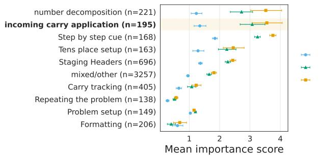  
(a) Semantic Importance

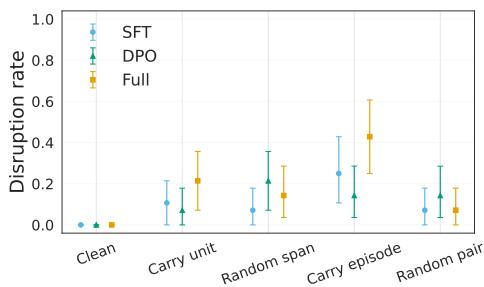  
(b) On policy carry-related disruption effect.  
Figure 1: Analysis of important spans in the CoT. (a) For each span in the CoT, we cluster based on semantic similarity and show the mean importance score derived from the Thought Anchors method (Bogdan et al., 2025). For a given span, we suppress all attention to that span and calculate its importance as described in Section 7. (b) Each receiver continues from the same Full-generated prefix. We measure disruption as the percentage of correct cases where the digit in the column corresponding to the reasoning span changes. A carry unit is a reasoning span where a carry gets used directly; a carry episode is two spans, one where a carry is computed and another, the follow-up span, where that carry gets used. We include random spans and random pairs (episodes) as controls. Error bars are 95% problem-level bootstrap confidence intervals for (a) and (b).

Consequently, there is no consensus on whether models can do abstract, high level reasoning or are more reliant on memorization and heuristics, with proponents on both sides of the debate; likely the truth is a mix of both (d’Aliberti and Ribeiro, 2026; Yang et al., 2025; Beckmann and Queloz, 2025).

CoT Faithfulness. Often models will not faithfully describe their decision making or problem solving within their CoT. For example, a model may give a different answer when given a hint, but fail to mention that hint in its CoT (Turpin et al., 2023). Likewise, this also applies to LRMs (Chen et al., 2025). In this work, we consider elements of the CoT more likely to be faithful when they are causally important to the final answer, but we do not address the problem of CoT faithfulness head on.

## 3 Experimental Setup

Model choice. In order to study the progression of post-training phases, we use the Olmo-3 family of models. We use the 7B parameter size variant and the Instruct version of the model. Specifically, we focus on Olmo-3-7B-Instruct-SFT, Olmo-3-7B-Instruct-DPO, and Olmo-3-7B-Instruct. We refer to the models with shorthands SFT, DPO, and Full respectively. We use the Instruct variant because it was trained to limit its verbosity (Olmo et al., 2026); we found that output token usage for the Think variant grew super-linearly with the number of digits in the problem, producing untenable outputs. While the type of "thoughts" produced in the Instruct chain-of-thought may differ from the hidden Think chain-of-thought (e.g. tokens enclosed in <think> tags), we leave the extent to which their causal roles are similar (or not) as an open question.

Notably, the progression of post-training in Olmo-3 proceeds as an SFT stage, a DPO stage (particularly on high quality preferences from a judge model), and a RLVR stage. The full contents of what data are used in each stage is described in the original paper, alongside other training details (Olmo et al., 2026). We do note that a significant amount of math and reasoning data are included at each stage. In Section B, we find little exact overlap with the public post-training data for 4- and 6-digit evaluation equations, although this does not rule out pretraining exposure or learned arithmetic patterns.

Dataset Composition. Our datasets composed of 2, 4, and 6 digit addition problems, balanced across the number of carries needed to solve the problem. For each problem, we use two different prompts to gather two answers: Answer Only, where the model is asked for only the answer; and Free CoT, where the model is asked to verbalize its reasoning step-by-step before providing a final answer.

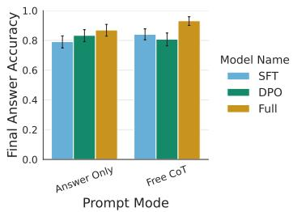  
(a) Prompt mode comparison

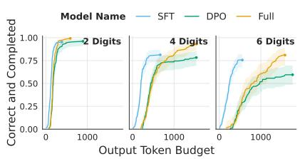  
(b) Token budget curves

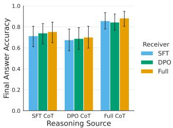  
(c) CoT crossover  
Figure 2: Analysis of chain-of-thought behavior across models. (a) Final-answer accuracy for problems where both Answer Only and Free CoT terminate within 2048 tokens, paired separately for each checkpoint. Full gains 6.2 percentage points over its Answer Only baseline (adjusted $p = . 0 3 4 ) \colon$ ; see Section C for sample counts and statistical testing details. (b) For each of {2, 4, 6} digits, we show the percentage of correct and completed samples with respect to the number of output tokens used, up to a maximum of 2048. Notably, the Full model saturates less with additional CoT tokens than the other two models (c) For each model, we produce an on-policy CoT and feed it to each of the other models using teacher forcing before asking for a final answer. All three models perform similarly when receiving a given CoT, but CoTs sourced from Full provide an advantage across all three models. Error bars are 95% problem-level bootstrap confidence intervals for (a) and (c); the shaded region for (b) is the 95% Wilson binomial confidence interval.

The prompt templates for both are available in Section K. Each analysis below typically uses a subset of these addition problems and the relevant data is described for each. For example, some analysis is limited to 4 digits as the Full model often fails to terminate its output for 6 digit problems (that is, its output would degenerate and fail to make progress). We also provide results for ablations on the problem presentation and formatting, including tokenization, in Section D. A complete dataset description is available in Section A.

Scope of the analyses. Our focus is on computation within completed reasoning traces; we treat degeneration and failure to terminate as a separate aspect of generation behaviour. We note that the Full model would sometimes fail to stop reasoning even with very large token budgets; still, we consider the naturally terminating cases to be the most accurate examples of nominal behavior and therefore focus our analysis on them.

Definition of algorithmic state for addition. In terms of algorithmic state, we define it as a state representing any computationally useful variables in a conventional algorithm. We do not restrict what form the representation takes. For addition, there are two computationally useful variables we identify: the per-digit outputs and the per-digit carry. We identify a representation with an algorithmic state through both correlation and causal use that corresponds to the same effect on the computational variables. That is, the representation should ideally demonstrate the ability to causally mediate the relevant computational variables.

## 4 Post-Training Changes CoT Usefulness

To establish a baseline for both SQ1 and SQ2, we compare final-answer accuracy with and without CoT on problems where both prompt modes produce completed responses. Figure 2a shows these results, with 383, 312, and 291 retained problems for SFT, DPO, and Full respectively. Only the Full model has a statistically significant gain in accuracy using the CoT, but the difference in gain between Full and SFT is not statistically significant. Statistical details are provided in Section C.

Interestingly, Figure 2b shows that Full, and to some extent DPO, continue to produce additional correct and completed answers as the output-token budget increases, particularly for more difficult problems (i.e. more digits). Thus, a longer CoT is necessary to realize some of its successful reasoning trajectories. This suggests a functional role for longer generations, although the curves alone do not establish that longer generations are always necessary nor which reasoning steps are essential.

Finally, we introduce CoT crossover in Figure 2c, where each model receives, via teacher forcing before the final answer, the CoT produced by another model, in order to estimate the effectiveness of producing the CoT as compared to using it. We find that for the same source, all receivers show similar accuracy. However, for CoTs from the Full model, all receivers obtain higher final-answer accuracy compared to the SFT or DPO sourced CoTs.

## 5 Probes of Algorithmic State are Stable Across Post-Training

To find whether a representation of algorithmic state is present in a models activation (as asked by SQ1), we use linear probes (Alain and Bengio, 2017) of incoming carry, outgoing carry, and output digit across all digits in a problem. We perform probing at every layer throughout each model and at important tokens in the prompt and part way through the CoT.

We essentially find that there is little difference in probe accuracy across both layers and tokens in the models tested 2, particularly for incoming and outgoing carry, which remain stable across layers and tokens. However, we do note that there is small decrease in probe test accuracy at the CoT location. The results are shown in Figure 3. More detailed results and training procedure for the probes are described in Section E.

We also test using probe directions as steering vectors to manipulate per digit carries in a predictable way. Doing this, we find a negative result: the probe-implied steering directions are not able to causally manipulate the per digit carry correctly. Details are provided in Section E.4.

## 6 Internal Interventions Do Not Reliably Control Carry State

Following the negative results from probe-based steering, we tested two further ways of manipulating internal carry representations to better answer SQ2. Boundless Distributed Alignment Search (DAS) (Wu et al., 2023) learns which part of an activation to swap between problems to produce a chosen change in the answer. Activation patching (Heimersheim and Nanda, 2024) directly replaces activations at selected layers and token positions with those from another problem. In both cases, we used matched problem pairs with opposite incoming carries at a chosen column.

A successful intervention would make the model continue as though the incoming carry had changed from 0 to 1, or vice versa. We chose problems where this change should affect only the answer digit in that column, leaving the outgoing carry and all other answer digits unchanged. Thus, simply changing the output would not count as success: the answer needed to change in the specific way predicted by the carry swap.

Neither method achieved this reliably. On 64 held-out controlled pairs, DAS produced the predicted complete answer in 1.6% of cases for SFT and 12.5% for Full, and did not consistently preserve the other digits (see Section F.2).

For activation patching, we first tested different layers and lengths of text on a development set of controlled problems. Our primary configuration replaced the activations for the eight tokens immediately before the target-column calculation at layer 27. On 64 separate controlled pairs, this intervention never produced the complete answer expected from changing the carry (see Section F.3).

Ultimately, carry information is decodable (like Yan (2025)), but our tested directions and patches do not provide reliable causal control (mirroring difficulties reported by Baeumel et al. (2025a)). Distributed computation or non-linear representations are possible explanations, consistent with Wurgaft et al. (2026), but these null results do not distinguish them from limitations of the intervention locations, optimization, or assumed carry abstraction. Details of our causal intervention experiments can be found in Section F.

## 7 Post-training Changes the Causal Importance of Semantically Meaningful Spans in the CoT

Attention suppression and importance. To address SQ2, we study the importance of different spans in the CoT by following Bogdan et al. (2025). Specifically, we apply teacher forcing of a naturally produced CoT while suppressing attention across all layers to a particular span, and measuring the downstream change in probabilities.

We define spans as sections of the CoT that roughly correspond to one semantic ’unit’. We make this distinction as compared to using, say, sentences, because models often use markdown and structure the output with headings, use bullet points, and short phrases. We therefore separate out each heading, bullet point, and sentence (within a paragraph) into a distinct unit.

More specifically, we define importance as

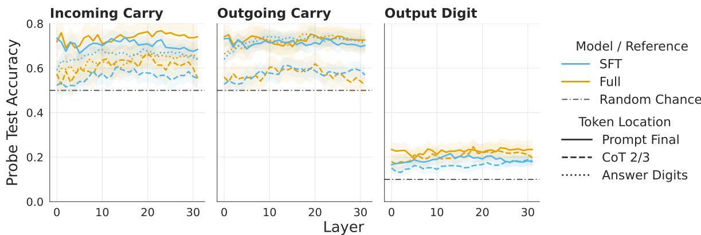  
Figure 3: We measure probe test accuracy at three token locations: the final token of the prompt; 2/3rd of the way through the CoT; and at the answer digit token. We train probes separately for three variables: the incoming carry at a digit; the outgoing carry at a digit; and an output digit. No probes are shown for finding the output digits at the answer digit token, as the answer would often be already available (up to tokenization effects). Probes are trained separately for each variable, layer, digit, and location. The results shown are averaged across digits. Overall, the probe test accuracy remains stable across layers and very similar across models, while showing only minor differences at different token locations. Shaded regions show 95% confidence intervals from problem-level bootstrap resampling. Dash-dot lines show uniform random-chance accuracy.

$$
\mathrm { K L } _ { \mathrm { u n i t } } ( i ) = \operatorname* { m a x } _ { j > i } \mathrm { m e a n T o k e n K L } ( i \to j ) ,\tag{1}
$$

$$
\mathrm { K L } _ { \mathrm { a n s } } ( i ) = \mathrm { m e a n A n s w e r K L } ( i ) ,\tag{2}
$$

$$
\operatorname { i m p o r t a n c e } ( i ) = \operatorname* { m a x } \left( \operatorname { K L } _ { \operatorname { u n i t } } ( i ) , \operatorname { K L } _ { \operatorname { a n s } } ( i ) \right)\tag{3}
$$

Each token-level divergence is $D _ { \mathrm { K L } } ( P _ { \mathrm { c l e a n } } \parallel P _ { \mathrm { s u p p r e s s e d } } )$ The first term (meanTokenKL) is the largest mean per-token KL over any single later reasoning unit; the second (meanAnswerKL) is the mean per-token KL over the teacher-forced factual-answer tokens. The score is measured in nats and identifies units whose suppression strongly changes at least one later reasoning unit or the answer. We take the maximum because a span may strongly affect a later reasoning step without strongly affecting the final answer, or vice versa. A large score means that suppressing attention to the span substantially changes the model’s predictions for at least one later reasoning step or the answer; it does not necessarily mean the answer becomes less accurate.

Semantic clustering. Further, we perform semantic clustering of reasoning spans using TF–IDF unigrams and bigrams for K-Means clustering. After clusters were generated this way, we performed manual audits on the clusters, merging some, and assigning semantic labels to all the remaining clusters. We also singled out some specific categories for clustering, like punctuation/formatting and, as it is of special interest, the use of carries in a span. For more detailed explanations of labels, examples from each cluster, and how clusters were chosen, see Section H.1.

Results from suppression and clustering. With these tools, we measured the mean importance score for naturally generated CoTs and performed semantic clustering, as shown in Figure 1a. Notably, we find that algorithmically meaningful clusters, like incoming carry application and number decomposition, receive higher importance scores in DPO and Full than in SFT. We also see that spans like problem repetition and formatting receive low scores for all three models. This result is suggestive of the idea that the DPO and Full models are more dependent on spans which contain algorithmically useful content.

On-Policy re-generation. In order to assess the effects on newly generated continuations, we again applied attention suppression, but allowed each receiver to generate from the same Full-produced prefix while continuing the suppression throughout generation. Our metric of interest here is the disruption rate, which we define as the percentage of problems were the digit in column being referenced in a reasoning span changes (we limit to problems where the final answer was correct under clean/natural generation).

As shown in Figure 1b, we find that, actually, suppressing the application of a carry itself does not result in substantially more disruption than suppressing a random span.

We then hypothesized that the model could likely recover or otherwise infer the information from the suppressed span by attending to the span directly before the application of the carry. In other words, if the carry span was "The hundreds place is 2 + 4 + 1 (carry)" then, often, the span before would be something to the effect of "The output for the tens place is 12, so the output is 2 with a carry of 1 for the hundreds place". As such, we decided to also suppress attention to the span directly before the application of a carry, which we refer to as a "carry episode." As a control for the episode, we also test random pairs of spans.

For these episodes, we find something different: the Full model shows significantly more disruption when the carry episode is suppressed when compared to a random pair control. SFT also shows increased disruption, but the effect falls within uncertainty.

For Full, the importance scores and generation results tell a consistent story: carry-related spans strongly affect predictions along a fixed CoT, and suppressing a carry episode disrupts the model’s continuation more than suppressing a random pair of spans.

For SFT, however, lower importance scores coexist with similar observed levels of disruption during generation. One possible explanation is that changes which appear small when the original CoT is held fixed can build up as the model generates its own continuation. The interventions also differ: the importance scores measure suppression of individual spans, whereas episode suppression removes access to both the carry-producing and carry-applying spans. This may limit opportunities to recover the carry from nearby text. Lower importance scores therefore need not imply that a model can continue successfully without the corresponding information.

These interpretations remain tentative: the episode effect relative to random controls is uncertain for SFT, and we do not establish a significant difference in that effect between SFT and Full. Episode suppression also disrupts other digits and termination (Figure 18), so the effects cannot be attributed solely to the carry value.

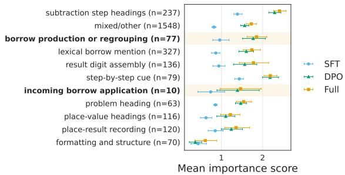  
Figure 4: Importance scores for semantic clustering of reasoning spans on subtraction problems. The top cluster by importance, subtraction step headings, take the form of "Step <num>: Subtract the <units/tens/hundreds/...> place". Specified clusters involving the use of borrows are highlighted; some other mentions of borrow fall into the lexical borrow mention cluster. More details on clustering are provided in Section H.2. Error bars are 95% problem-level bootstrap confidence intervals.

Extending to subtraction. To assess how the results of semantic importance generalize to other algorithmic tasks, we extend the attention suppression and clustering experiment to subtraction. Excepting the change of problem type and changing carries to borrows, the setup remains the same. Details on clustering, including examples and explanation of semantic labels, are provided in Section H.2.

We find, as shown in Figure 4, that the importance of borrow related spans is not as strongly different across the models as it is for carries in addition, although the same pattern of DPO and Full having higher importance scores across the board remains. Other work, in particular Jobanputra et al. (2025), show that models do not perform subtraction as well as they perform addition. This suggests that the dependence on algorithmically meaningful spans in the CoT is task dependent, and that different algorithms are treated with differing levels of importance. Given the uneven nature of task ability in LLMs and LRMs, we are not surprised to find that different algorithmic tasks admit varying levels of reliance on algorithmic state in the CoT across models (Dell’Acqua et al., 2023).

## 8 Discussion

Our results suggest that post-training changes how intermediate information is made available and used during reasoning. Carry information is similarly decodable in SFT and Full, while Full produces traces that are more useful across receiving checkpoints. One interpretation is that posttraining improves how the model supplies context for its own later computation, drawing on capabilities already available at SFT (Venhoff et al., 2025). Written intermediate results could reduce the need to recover or recompute information internally. This makes latent and verbalized state complementary parts of a reasoning process: changing what is written can change what subsequent internal computation needs to accomplish. The crossover results support the usefulness of that context, while leaving open whether receivers calculate from it, check against it, or extract an answer.

The suppression experiments suggest that this context may support computation across several reasoning steps. For Full, removing a carry episode has a stronger effect than matched random suppression, even though removing the carry application alone has little additional effect. This is consistent with information remaining available elsewhere in the trace. A statement can therefore be individually dispensable while contributing to a useful reasoning process, complicating interpretations of local intervention failures as evidence of performative reasoning (Boppana et al., 2026; Scalena et al., 2026). The broader disruption caused by episode suppression prevents us from attributing the effect solely to carry recovery, but motivates studying how information is maintained across a sequence of steps.

Dependence on this context does not guarantee that it is used well. DPO combines relatively high importance scores with lower conditional accuracy, while SFT’s lower scores coexist with similar observed disruption during generation. These patterns separate influence on predictions from successful continuation. Written reasoning may help preserve a correct intermediate result, but it can also preserve a mistake; small changes along a fixed trace may become consequential when the model generates subsequent steps itself. Post-training could therefore improve reasoning by changing when intermediate information is trusted, checked, or revised. The residual and J-Lens comparisons identify locations where processing differs, but neither these readouts nor our unsuccessful carry interventions establish which of these functions changes.

This perspective also gives reasoning length a role beyond the number of distinct computational steps. Additional budget is needed for some successful Full trajectories under its Free CoT policy, and part of that budget could support repetition, checking, or recovery. Training with stronger pressure on length might remove these opportunities even when clean accuracy is preserved. A useful test would therefore ask whether shortened traces remain robust to missing or incorrect intermediate information. The weaker carry-to-borrow correspondence in subtraction further suggests that the value of such strategies depends on the computation being performed. Understanding post-training may therefore require examining how it balances progress, verification, and recovery across tasks.

## 9 Conclusion

In this work, we study how post-training changes carry decodability and the functional role of verbalized reasoning in language models. Using progressive checkpoints of Olmo-3 and addition as a setting where the relevant algorithmic state is precisely known, we distinguish decodable information from demonstrated causal control. Carry information is similarly decodable in SFT and Full, yet the tested probe directions, learned subspaces, and activation patches do not reliably manipulate carries while preserving the rest of the answer.

At the same time, the role of the CoT differs across checkpoints. In the completed-response comparison, Full gains accuracy from CoT, and its traces yield higher accuracy than SFT- or DPOsourced traces across all receivers in the crossover experiment. Suppressing carry episodes also disrupts Full more than matched random controls. However, higher suppression importance need not coincide with higher accuracy, as shown by DPO, and the subtraction results suggest that these patterns are task dependent. Accuracy alone therefore does not tell us how strongly a model depends on its written reasoning.

Taken together, these findings motivate studying the production, consumption, and causal influence of written reasoning separately. Our results are compatible with the idea that post-training changes how existing computational resources are recruited, although we do not identify that mechanism. We further speculate that Chain-of-thought is therefore neither straightforwardly necessary as a means of computation nor merely performative: under some training regimes and for some problems, written reasoning becomes causally important as part of a broader computational process. Establishing precisely how carry-related context mediates conventional arithmetic, and how this interacts with latent computation, remains an important next step.

## Limitations

We limit our study to one model family due to its unique nature and we primarily study addition. Other model families and algorithmic problems may show different results. Likewise, important training details such as number of training steps, optimization details, and hyper-parameter choices may affect the results, as well as the data mixture. The analysis presented here is therefore mostly post-hoc with regards to training: differences between successive checkpoints do not isolate the training objective from the data and other training choices. The completion restrictions also limit the population to which our reasoning analyses apply. Separately, our negative results on finding causally valid interventions for carries in addition do not rule out that such interventions exist or that the methods we used could find them under other settings. We also note that model size is not studied here and likely plays an interesting role when considering algorithmic computation; we leave that to future work.

## Ethics Statement

This research intends to understand the mechanisms of algorithmic computation in language models. We do not make claims about strongly controlling said computation or adversarially manipulating it, and therefore we do not associate risks with this research. Future work, however, which gives users control over reasoning, may pose dual-use risks.

## Usage of AI

AI was used to generate code for experiments, provide feedback on writing, and for collating data for figures and tables. AI was also used for planning and orchestrating compute usage.

## References

Guillaume Alain and Yoshua Bengio. 2017. Understanding intermediate layers using linear classifier probes. In ICLR (Workshop). OpenReview.net.

Tanja Baeumel, Daniil Gurgurov, Yusser Al Ghussin, Josef van Genabith, and Simon Ostermann. 2025a. Modular arithmetic: Language models solve math digit by digit. In Proceedings of the 14th International Joint Conference on Natural Language Processing and the 4th Conference of the Asia-Pacific Chapter of the Association for Computational Linguistics, pages 1380–1409, Mumbai, India. The Asian Federation of Natural Language Processing and The Association for Computational Linguistics.

Tanja Baeumel, Josef van Genabith, and Simon Ostermann. 2025b. The lookahead limitation: Why multioperand addition is hard for LLMs. In Proceedings of the 8th BlackboxNLP Workshop: Analyzing and Interpreting Neural Networks for NLP, pages 250– 262, Suzhou, China. Association for Computational Linguistics.

Pierre Beckmann and Matthieu Queloz. 2025. Mechanistic indicators of understanding in large language models. CoRR, abs/2507.08017.

Alex Bie, Travis Dick, Alex Kulesza, Prabhakar Raghavan, Vinod Raman, and Sergei Vassilvitskii. 2026. Ai-rithmetic. CoRR, abs/2602.10416.

Paul C. Bogdan, Uzay Macar, Neel Nanda, and Arthur Conmy. 2025. Thought anchors: Which LLM reasoning steps matter? CoRR, abs/2506.19143.

Siddharth Boppana, Annabel Ma, Max Loeffler, Raphaël Sarfati, Eric J. Bigelow, Atticus Geiger, Owen Lewis, and Jack Merullo. 2026. Reasoning theater: Disentangling model beliefs from chain-ofthought. CoRR, abs/2603.05488.

Yanda Chen, Joe Benton, Ansh Radhakrishnan, Jonathan Uesato, Carson Denison, John Schulman, Arushi Somani, Peter Hase, Misha Wagner, Fabien Roger, Vladimir Mikulik, Samuel R. Bowman, Jan Leike, Jared Kaplan, and Ethan Perez. 2025. Reasoning models don’t always say what they think. CoRR, abs/2505.05410.

Liv G. d’Aliberti and Manoel Horta Ribeiro. 2026. The illusion of insight in reasoning models. In Findings of the Associationfor Computational Linguistics: ACL 2026, pages 924–966, San Diego, California, United States. Association for Computational Linguistics.

Fabrizio Dell’Acqua, Edward McFowland III, Ethan R. Mollick, Hila Lifshitz-Assaf, Katherine Kellogg, Saran Rajendran, Lisa Krayer, François Candelon, and Karim R. Lakhani. 2023. Navigating the jagged technological frontier: Field experimental evidence of the effects of artificial intelligence on knowledge worker productivity and quality. Organization Science. Forthcoming. Harvard Business School Technology & Operations Management Unit Working Paper No. 24-013; The Wharton School Research Paper.

Chunyuan Deng, Zhiqi Li, Roy Xie, Ruidi Chang, and Hanjie Chen. 2026. Language models are symbolic learners in arithmetic. Trans. Mach. Learn. Res., 2026.

Wenyu Du, Rui Zheng, Tongxu Luo, Stephen Chung, and Jie Fu. 2025. Fine-grained manipulation of arithmetic neurons. In Proceedings of the 8th BlackboxNLP Workshop: Analyzing and Interpreting Neural Networks for NLP, pages 467–479, Suzhou, China. Association for Computational Linguistics.

Nelson Elhage, Neel Nanda, Catherine Olsson, Tom Henighan, Nicholas Joseph, Ben Mann, Amanda Askell, Yuntao Bai, Anna Chen, Tom Conerly,

Nova DasSarma, Dawn Drain, Deep Ganguli, Zac Hatfield-Dodds, Danny Hernandez, Andy Jones, Jackson Kernion, Liane Lovitt, Kamal Ndousse, and 6 others. 2021. A mathematical framework for transformer circuits. Transformer Circuits Thread. Https://transformercircuits.pub/2021/framework/index.html.

Daya Guo, Dejian Yang, Haowei Zhang, Junxiao Song, Peiyi Wang, Qihao Zhu, Runxin Xu, Ruoyu Zhang, Shirong Ma, Xiao Bi, Xiaokang Zhang, Xingkai Yu, Yu Wu, Z. F. Wu, Zhibin Gou, Zhihong Shao, Zhuoshu Li, Ziyi Gao, Aixin Liu, and 175 others. 2025. Deepseek-r1 incentivizes reasoning in llms through reinforcement learning. Nature, 645(8081):633–638.

Wes Gurnee, Nicholas Sofroniew, Adam Pearce, Mateusz Piotrowski, Isaac Kauvar, Runjin Chen, Anna Soligo, Paul Bogdan, Euan Ong, Rowan Wang, Ben Thompson, David Abrahams, Subhash Kantamneni, Emmanuel Ameisen, Joshua Batson, and Jack Lindsey. 2026. Verbalizable representations form a global workspace in language models. Transformer Circuits Thread.

Stefan Heimersheim and Neel Nanda. 2024. How to use and interpret activation patching. CoRR, abs/2404.15255.

Mayank Jobanputra, Nils Philipp Walter, Maitrey Mehta, Blerta Veseli, Evan Parker Kelly Chapple, Yifan Wang, Sneha Chetani, Ellie Pavlick, Antonio Vergari, and Vera Demberg. 2025. Can llms subtract numbers? CoRR, abs/2511.02795.

Jack Lindsey, Wes Gurnee, Emmanuel Ameisen, Brian Chen, Adam Pearce, Nicholas L. Turner, Craig Citro, David Abrahams, Shan Carter, Basil Hosmer, Jonathan Marcus, Michael Sklar, Adly Templeton, Trenton Bricken, Callum McDougall, Hoagy Cunningham, Thomas Henighan, Adam Jermyn, Andy Jones, and 8 others. 2025. On the biology of a large language model. Transformer Circuits Thread.

Neel Nanda, Lawrence Chan, Tom Lieberum, Jess Smith, and Jacob Steinhardt. 2023. Progress measures for grokking via mechanistic interpretability. In The Eleventh International Conference on Learning Representations, ICLR 2023, Kigali, Rwanda, May 1-5, 2023. OpenReview.net.

Yaniv Nikankin, Anja Reusch, Aaron Mueller, and Yonatan Belinkov. 2025. Arithmetic without algorithms: Language models solve math with a bag of heuristics. In The Thirteenth International Conference on Learning Representations, ICLR 2025, Singapore, April 24-28, 2025. OpenReview.net.

Team Olmo, :, Allyson Ettinger, Amanda Bertsch, Bailey Kuehl, David Graham, David Heineman, Dirk Groeneveld, Faeze Brahman, Finbarr Timbers, Hamish Ivison, Jacob Morrison, Jake Poznanski, Kyle Lo, Luca Soldaini, Matt Jordan, Mayee Chen, Michael Noukhovitch, Nathan Lambert, and 50 others. 2026. Olmo 3. Preprint, arXiv:2512.13961.

Daniel Scalena, Sara Candussio, Luca Bortolussi, Elisabetta Fersini, Malvina Nissim, and Gabriele Sarti. 2026. Beyond the commitment boundary: Probing epiphenomenal chain-of-thought in large reasoning models. CoRR, abs/2606.13603.

Parshin Shojaee, Iman Mirzadeh, Keivan Alizadeh-Vahid, Maxwell Horton, Samy Bengio, and Mehrdad Farajtabar. 2025. The illusion of thinking: Understanding the strengths and limitations of reasoning models via the lens of problem complexity. In Advances in Neural Information Processing Systems 38: Annual Conference on Neural Information Processing Systems 2025, NeurIPS 2025, San Diego, CA, USA, December 2-7, 2025 / Mexico City, Mexico, November 30 - December 5, 2025.

Alessandro Stolfo, Yonatan Belinkov, and Mrinmaya Sachan. 2023. A mechanistic interpretation of arithmetic reasoning in language models using causal mediation analysis. In Proceedings ofthe 2023 Conference on Empirical Methods in Natural Language Processing, pages 7035–7052, Singapore. Association for Computational Linguistics.

Yucheng Sun, Alessandro Stolfo, and Mrinmaya Sachan. 2025. Probing for arithmetic errors in language models. In Proceedings of the 2025 Conference on Empirical Methods in Natural Language Processing, pages 8111–8128, Suzhou, China. Association for Computational Linguistics.

Alexander Matt Turner, Lisa Thiergart, Gavin Leech, David Udell, Juan J. Vazquez, Ulisse Mini, and Monte MacDiarmid. 2024. Steering language models with activation engineering. Preprint, arXiv:2308.10248.

Miles Turpin, Julian Michael, Ethan Perez, and Samuel R. Bowman. 2023. Language models don’t always say what they think: Unfaithful explanations in chain-of-thought prompting. In Advances in Neural Information Processing Systems 36: Annual Conference on Neural Information Processing Systems 2023, NeurIPS 2023, New Orleans, LA, USA, December 10 - 16, 2023.

Einar Urdshals and Jasmina Urdshals. 2025. Structure development in list-sorting transformers. Preprint, arXiv:2501.18666.

Constantin Venhoff, Iván Arcuschin, Philip Torr, Arthur Conmy, and Neel Nanda. 2025. Base models know how to reason, thinking models learn when. Preprint, arXiv:2510.07364.

George Wang, Jesse Hoogland, Stan van Wingerden, Zach Furman, and Daniel Murfet. 2025. Differentiation and specialization of attention heads via the refined local learning coefficient. In The Thirteenth International Conference on Learning Representations, ICLR 2025, Singapore, April 24-28, 2025. OpenReview.net.

Zhengxuan Wu, Atticus Geiger, Thomas Icard, Christopher Potts, and Noah D. Goodman. 2023. Interpretability at scale: Identifying causal mechanisms in alpaca. In Advances in Neural Information Processing Systems 36: Annual Conference on Neural Information Processing Systems 2023, NeurIPS 2023, New Orleans, LA, USA, December 10 - 16, 2023.

Daniel Wurgaft, Can Rager, Matthew Kowal, Vasudev Shyam, Sheridan Feucht, Usha Bhalla, Tal Haklay, Eric Bigelow, Raphael Sarfati, Thomas McGrath, Owen Lewis, Jack Merullo, Noah Goodman, Thomas Fel, Atticus Geiger, and Ekdeep Singh Lubana. 2026. Manifold steering reveals the shared geometry of neural network representation and behavior. Preprint, arXiv:2605.05115.

Yao Yan. 2025. Addition in four movements: Mapping layer-wise information trajectories in LLMs. In Findings of the Association for Computational Linguistics: EMNLP 2025, pages 7518–7532, Suzhou, China. Association for Computational Linguistics.

Sohee Yang, Nora Kassner, Elena Gribovskaya, Sebastian Riedel, and Mor Geva. 2025. Do large language models perform latent multi-hop reasoning without exploiting shortcuts? In Findings of the Associationfor Computational Linguistics: ACL 2025, pages 3971–3992, Vienna, Austria. Association for Computational Linguistics.

Qiying Yu, Zheng Zhang, Ruofei Zhu, Yufeng Yuan, Xiaochen Zuo, Yu Yue, Weinan Dai, Tiantian Fan, Gaohong Liu, Juncai Liu, Lingjun Liu, Xin Liu, Haibin Lin, Zhiqi Lin, Bole Ma, Guangming Sheng, Yuxuan Tong, Chi Zhang, Mofan Zhang, and 17 others. 2025. DAPO: an open-source LLM reinforcement learning system at scale. In Advances in Neural Information Processing Systems 38: Annual Conference on Neural Information Processing Systems 2025, NeurIPS 2025, San Diego, CA, USA, December 2-7, 2025 / Mexico City, Mexico, November 30 - December 5, 2025.

Zekai Zhao, Qi Liu, Kun Zhou, Zihan Liu, Yifei Shao, Zhiting Hu, and Biwei Huang. 2025. Activation control for efficiently eliciting long chain-of-thought ability of language models. In Advances in Neural Information Processing Systems 38: Annual Conference on Neural Information Processing Systems 2025, NeurIPS 2025, San Diego, CA, USA, December 2-7, 2025 / Mexico City, Mexico, November 30 - December 5, 2025.

Ziqian Zhong, Ziming Liu, Max Tegmark, and Jacob Andreas. 2023. The clock and the pizza: Two stories in mechanistic explanation of neural networks. In Advances in Neural Information Processing Systems 36: Annual Conference on Neural Information Processing Systems 2023, NeurIPS 2023, New Orleans, LA, USA, December 10 - 16, 2023.

## A Complete Dataset Description

All arithmetic examples are generated in base ten. Each example records the two operands, the exact result, and the state of the column-wise algorithm. For addition, this state includes the incoming and outgoing carry at each column, the positions and total number of carries, and the longest sequence of consecutive carries. The subtraction data record the analogous borrow variables. Digit length always refers to the width of each operand, not the width of the result. Problems are sampled before model inference, and a failed or incomplete model response is not replaced with a new problem.

We use two prompt conditions throughout the paper. Answer Only asks the model to return only the final result. Free CoT asks the model to reason step by step before giving a final result. A prompt instance is one arithmetic problem under one prompt and formatting condition. A reasoning trace is one generated Free CoT response. The main datasets are summarized in Table 1; subsequent paragraphs give the construction and selection details.

Behavioural addition. The standard set contains 128 problems at each of 2, 4, and 6 digits. Within each digit length, there are 16 no-carry problems, 16 problems with one isolated carry, 16 problems in which a carry propagates across every operand digit, 16 carry-distractor problems, and 64 random problems. Carry distractors contain locally carrysuggestive digit patterns without a long carry chain. The random problems are balanced by the number of carry-producing columns. Every standard problem is presented once under Answer Only and once under Free CoT, giving 768 standard prompt instances per checkpoint.

The two format conditions use separate random samples. Each contains 64 problems at each digit length and both prompt conditions, for 384 prompt instances. In the delimited input condition, adjacent operand digits are separated by |; the answer remains conventionally formatted. In the leastsignificant-digit (LSD) first condition, the operands are conventional but the answer digits must be written from right to left. Together, the standard and format-specific sets contain 1,536 prompt instances. Because the arithmetic examples differ between conditions, the format results are unpaired robustness comparisons.

Probe addition. The probe dataset contains separate training and test sets, each with 64 problems at every digit length. Carry counts are balanced within each split, and every problem appears under both prompt conditions. The probe results in the main paper use the Free CoT instances. Before filtering for naturally completed samples, there are 192 training and 192 test examples per checkpoint; SFT retains all of them, while Full retains 125 training and 116 test examples (Table 5). Activations are collected from SFT and Full.

<table><tr><td>Dataset</td><td>Construction</td><td>Size used in the paper</td></tr><tr><td>Behavioural addition</td><td>Two-, four-, and six-digit addition. The standard set contains four controlled carry structures and a carry-balanced random dard prompt instances; 1,536 prompt sample. Separate random samples test delimited operands and</td><td>384 standard problems and 768 stan- instances including the two format conditions.</td></tr><tr><td>Probe addition</td><td>reversed answer digits. Two-, four-, and six-digit addition, balanced by carry count and divided into disjoint training and test sets. Every problem appears under both prompt conditions.</td><td>384 problems: 192 training and 192 test; 768 prompt instances in total.</td></tr><tr><td>tion</td><td>Paired Free CoT addi- Four- and six-digit problems for which natural reasoning traces are collected from SFT, DPO, and Full. Full is used to choose initial set; 77 problems in the three- the initial set; analyses comparing reasoning sources use only source subset. problems with a usable trace from every checkpoint.</td><td>384 candidates; 124 problems in the</td></tr><tr><td>On-policy addition</td><td>incoming carry, an earlier statement that establishes the carry, all analysis requirements. sufficient following context, and matched control spans.</td><td>Fresh four-digit Full traces containing an identifiable use of an 192 candidates; 51 problems satisfy</td></tr><tr><td>traction</td><td>Paired Free CoT sub- Four-digit subtraction, balanced across zero, one, two, and 192 candidates; 55 initially selected three borrows. Full and SFT provide paired reasoning traces; problems; 47 problems with usable all three checkpoints are evaluated as receivers.</td><td>traces from both sources.</td></tr></table>

Table 1: Datasets used in the paper. We distinguish different counts of arithmetic problems, prompt instances, and generated reasoning traces.

Probes are fitted separately for each predicted variable, layer, arithmetic column, and location; reported curves then average test accuracy over arithmetic columns.

Paired natural reasoning traces. The source– receiver experiments require complete reasoning traces with well-defined internal and final-answer boundaries. Here, the source is the checkpoint that writes the reasoning trace, and the receiver is the checkpoint evaluated after that trace is supplied by teacher forcing. Trace eligibility requires natural termination, a parseable final answer, and unambiguous reasoning boundaries.

Full is first run on 128 four-digit and 256 sixdigit candidate problems with a 2,048-token budget. The first eligible problems in the fixed candidate order are retained, producing 64 four-digit and 60 six-digit problems. SFT and DPO are then run on these same problems. The numbers of eligible four- and six-digit traces are 61 and 60 for SFT, 47 and 32 for DPO, and 64 and 60 for Full. Fortyfive four-digit and 32 six-digit problems have an eligible trace from all three checkpoints. This 77- problem subset is used whenever reasoning sources are compared directly, giving 231 source traces. Analyses that do not require all three sources use all 324 individually eligible traces.

Reasoning units and attention suppression. For the teacher-forced attention-suppression analysis, both the SFT and Full trace for a problem must satisfy the same termination and boundary criteria within the 1,024-token analysis window. This leaves 59 four-digit and 42 six-digit problems. Each trace is divided into semantically coherent reasoning units: headings, bullet points, sentences, and short standalone phrases are treated as separate units. The resulting 202 source traces contain 5,598 units, with 3,038 units from four-digit problems and 2,560 from six-digit problems. SFT and Full provide the written traces, while SFT, DPO, and Full are all evaluated as receivers of the same trace and suppression intervention.

The on-policy analysis uses a separate set of 192 four-digit problems. Full generates a fresh trace for each problem. Fifty-one traces contain an explicit incoming-carry application, an earlier unit that establishes the same carry, sufficient later text for evaluation, and suitable random control units. The same 51 problems are evaluated under clean generation, suppression of the carry-application unit, suppression of a matched random unit, suppression of the two-unit carry episode, and suppression of a matched random pair.

The residual-stream and Jacobian Lens (J-Lens) analysis uses a stratified subset of the teacherforced attention-suppression data. It contains 30 incoming-carry applications from 23 problems:

eight SFT/four-digit, eight SFT/six-digit, eight Full/four-digit, and six Full/six-digit units. Each selected unit has resolvable token positions immediately before the carry value and the resulting value.

Subtraction. The subtraction candidate set contains 192 four-digit problems, with 48 problems at each of zero, one, two, and three borrows. Full is used to select up to 16 naturally completed traces in each borrow stratum under a 1,024-token budget, after which SFT is run on the same problems. Fifty-five problems have an eligible Full trace, and 47 have eligible traces from both SFT and Full. The paired set contains 14, 14, 11, and 8 problems across the four borrow strata, respectively. Its 94 source traces contain 2,783 reasoning units. As in the addition analysis, SFT and Full provide the written traces and all three checkpoints are evaluated as receivers.

## B Memorization

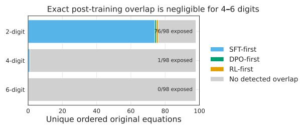  
Figure 5: Exact symbolic overlap between the evaluation equations and the public post-training data. Each row contains 98 unique ordered equations after duplicate equations from different carry categories are collapsed. Coloured segments show the earliest post-training stage in which an exact relation occurs; grey denotes no detected occurrence. The search finds 76 two-digit equations, one four-digit equation, and no six-digit equations.

We assess recall of individual evaluation equations with two complementary tests. First, we search the public post-training data released for the model family for exact occurrences of the evaluation equations. Second, we compare each original equation with mathematically equivalent equations that have the same result and the same column-wise carry pattern.

Exact overlap with public post-training data. The overlap test uses the 384 standard-format, Answer Only equations from the behavioural evaluation: 128 each at 2, 4, and 6 digits. Because the same equation can be sampled in more than one carry category, we collapse exact duplicates before searching. This leaves 98 unique ordered equations at each digit length. We search 2,581,998 records from the public supervised fine-tuning, preferenceoptimization, and reinforcement-learning collections. An equation is counted as present when its exact symbolic addition relation appears in a model input or together with the expected answer. If it occurs in more than one collection, it is assigned to the earliest post-training stage in which it appears.

The search finds 76 of 98 two-digit equations, one of 98 four-digit equations, and no six-digit equations (Figure 5). The single four-digit match is $9 9 9 9 + 1 = 1 0 0 0 0$ . Exact overlap with these public post-training collections is therefore rare in the four- and six-digit evaluation sets. This test does not cover the model’s pretraining data and does not test whether related examples teach reusable arithmetic patterns.

## C Paired Comparison of Prompting Conditions

We compared Answer Only and Free CoT prompting on matched arithmetic problems. For each checkpoint, we retained only problems for which both prompting conditions produced a completed response. This restriction measures final-answer accuracy among completed responses, rather than treating a failure to terminate as an incorrect answer. The analysis pooled 2-, 4-, and 6-digit addition, with each retained problem receiving equal weight. The matched samples contained 128, 128, and 127 problems of each respective length for SFT; 127, 106, and 79 for DPO; and 128, 100, and 63 for Full.

For retained problem i, let $Y _ { i , F }$ and $Y _ { i , A }$ indicate whether the final answer was correct under Free CoT and Answer Only, respectively. We estimated the prompt-mode effect as

$$
\widehat { \Delta } = \frac { 1 } { n } \sum _ { i = 1 } ^ { n } \left( Y _ { i , F } - Y _ { i , A } \right) .\tag{4}
$$

We obtained 95% confidence intervals by resampling whole problem pairs with replacement 10,000 times and taking the 2.5th and 97.5th percentiles of the resulting mean differences. We also applied a two-sided exact McNemar test to the paired binary outcomes for each checkpoint. The three resulting p-values were adjusted using Holm’s method, with adjusted $p < . 0 5$ as the significance threshold.

Free CoT changed final-answer accuracy by +5.0 percentage points for SFT (95% CI [0.0, 9.9], adjusted $p = . 1 3 4 ) , - 2 . 6$ points for DPO (95% CI [−8.0, 2.6], adjusted $p ~ = ~ . 4 1 0 )$ , and +6.2 points for Full (95% CI [1.7, 10.7], adjusted $p =$ .034). Thus, only Full showed a significant withincheckpoint improvement. Because the matched problem sets differ across checkpoints, these tests do not establish that the change at Full is significantly larger than the changes at SFT or DPO. We report completion behavior separately because this analysis is conditional on both responses completing. See Table 3 for a summary of these results.

<table><tr><td>Paper analysis</td><td>Dataset subset</td><td>Effective sample</td></tr><tr><td>ness (Figures 2a and 2b)</td><td>Behaviour and CoT useful- Standard behavioural addition. Accuracy compares paired 384 problems attempted per completed responses; token-budget curves use Free CoT.</td><td>prompt condition and checkpoint. The paired accuracy comparison retains 383 SFT, 312 DPO, and 291 Full problems.</td></tr><tr><td>CoT crossover (Figure 2c)</td><td>Problems with an eligible SFT, DPO, and Full trace. Every 77 problems: 45 four-digit and 32 source trace is supplied to every receiver.</td><td>six-digit; 77 observations in each source-receiver cell.</td></tr><tr><td>Linear probes (Figure 3)</td><td>Free CoT instances from the disjoint probe training and test SFT: 192 training and 192 test ex- sets; SFT and Full only.</td><td>amples. Full: 125 training and 116 test examples after the completion filter.</td></tr><tr><td>tions E.4 and F)</td><td>Probe steering and acti- Probe steering reuses the probe dataset. Residual interven- Residual interventions: 100 prob- vation interventions (Sec- tions use a separate shared Free CoT set. Distributed align- lems, of which 89 yield eligible ment search and activation patching use controlled carry cases. Alignment search: 1,024 pairs.</td><td>training, 256 tuning, and 64 eval- uation pairs. Activation patching: 16 development and 64 evaluation</td></tr><tr><td>mitment</td><td>Answer emergence and com- Paired trajectories use the three-source subset; single-source 77 problems and 231 traces for trajectory summaries use every eligible trace.</td><td>pairs. paired comparisons; 324 traces for single-source summaries.</td></tr><tr><td>dition (Figure 1a)</td><td>Semantic importance in ad- Paired SFT/Full traces, divided into reasoning units, with 101 problems, 202 traces, and SFT, DPO, and Full as receivers.</td><td>5,598 reasoning units.</td></tr><tr><td>ure 1b)</td><td>On-policy suppression (Fig- Fresh four-digit Full traces with an identifiable carry applica- 51 analysed problems from 192 tion, carry-producing context, and matched controls.</td><td>candidates; all conditions are eval- uated with each receiver.</td></tr><tr><td>comparison (Figure 19)</td><td>Residual-stream and J-Lens Stratified incoming-carry applications from the addition 30 reasoning units from 23 prob- attention-suppression set, using SFT and Full source traces. lems across two digit lengths and</td><td>two source checkpoints.</td></tr><tr><td>traction (Figure 4)</td><td>Semantic importance in sub- Paired SFT/Full traces from the four borrow-count strata, 47 problems, 94 traces, and 2,783 with all three checkpoints as receivers.</td><td>reasoning units.</td></tr><tr><td></td><td>Memorization and format ro- Standard Answer Only equations and their arithmetic- 384 original equations and 1,084 bustness (Sections B and D) equivalent rewrites; separately sampled standard, delimited- valid rewrites; 1,536 behavioural input, and reversed-answer conditions.</td><td>prompt instances across formatting conditions.</td></tr></table>

Table 2: Dataset subset used by each analysis. Counts refer to arithmetic problems unless prompt instances, reasoning traces, reasoning units, or controlled intervention pairs are stated explicitly.

## C.1 Direct Comparison of the SFT and Full Prompt Effects

The preceding tests ask whether Free CoT changes accuracy within each checkpoint. A significant result for Full and a non-significant result for SFT do not, by themselves, show that the two prompt-mode effects differ. We therefore tested this difference directly. To ensure that both checkpoint effects were estimated from the same problems, we retained only problems for which SFT and Full each produced completed responses under both Answer Only and Free CoT prompting. This common sample contained 290 problems: 128 two-digit, 100 four-digit, and 62 six-digit problems.

Let $Y _ { i , m , p }$ indicate correctness for problem i, checkpoint $m ,$ and prompt mode $p .$ We estimated the SFT–Full interaction as the difference between their paired prompt-mode effects,

<table><tr><td></td><td></td><td>Checkpoint Matched n Answer Only</td><td>Free CoT</td><td>∆ [95% CI]</td><td>Gains</td><td>Losses</td><td>Exact p</td><td>Holm p</td></tr><tr><td>SFT</td><td>383</td><td>79.1</td><td>84.1</td><td>+5.0 [0.0, 9.9]</td><td>58</td><td>39</td><td>.0671</td><td>.1341</td></tr><tr><td>DPO</td><td>312</td><td>83.3</td><td>80.8</td><td>-2.6 [−8.0, 2.6]</td><td>32</td><td>40</td><td>.4096</td><td>.4096</td></tr><tr><td>Full</td><td>291</td><td>86.9</td><td>93.1</td><td>+6.2 [1.7, 10.7]</td><td>32</td><td>14</td><td>.0114</td><td>.0341</td></tr></table>

Table 3: Paired comparison of Answer Only and Free CoT prompting among completed responses. Accuracies are percentages; $\Delta$ is Free CoT minus Answer Only in percentage points, with an unadjusted 95% problem-paired bootstrap confidence interval. Gains and losses count problems that Free CoT changed from incorrect to correct and from correct to incorrect, respectively. Holm p gives the exact McNemar p-value after correction across checkpoints.

<table><tr><td>Quantity</td><td>Estimate</td></tr><tr><td>Common problems</td><td>290</td></tr><tr><td>SFT: Answer Only</td><td>86.6%</td></tr><tr><td>SFT: Free CoT</td><td>89.0%</td></tr><tr><td>SFT prompt effect Full: Answer Only</td><td>+2.4 pp 86.9%</td></tr><tr><td>Full: Free CoT</td><td>93.1%</td></tr><tr><td>Full prompt effect Full minus SFT interaction</td><td>+6.2 pp</td></tr><tr><td></td><td>+3.8 pp</td></tr><tr><td>95% paired-bootstrap CI Exact paired-permutation p</td><td>[−2.1, 9.7] pp</td></tr></table>

Table 4: Direct comparison of the Free CoT-minus-Answer Only effect between Full and SFT. All quantities use the same problems, each with a completed response in all four checkpoint-by prompt conditions.

$$
\widehat { \Gamma } = \frac { 1 } { n } \sum _ { i = 1 } ^ { n } \left[ ( Y _ { i , \mathrm { F u l l } , F } - Y _ { i , \mathrm { F u l l } , A } ) - ( Y _ { i , \mathrm { S F T } , F } - Y _ { i , \mathrm { S F T } , A } ) \right]\tag{5}
$$

We formed a 95% confidence interval by resampling complete four-response problem blocks with replacement 10,000 times and taking the 2.5th and 97.5th percentiles of $\widehat { \Gamma }$ . For the hypothesis test, we used a two-sided exact paired-permutation test. Under the null hypothesis that the prompt-mode effect is exchangeable between SFT and Full, the SFT and Full response pairs were swapped as a block within each problem. Because this was one planned comparison, we used $p < . 0 5$ without a multiple-comparison correction.

On this common sample, Free CoT increased accuracy by 2.4 percentage points for SFT and 6.2 points for Full. The resulting Full-minus-SFT interaction was +3.8 points (95% CI [−2.1, 9.7]; exact paired-permutation $p = . 2 5 5 )$ . The estimated gain was therefore larger for Full, but this analysis does not establish that its prompt-mode effect differs significantly from SFT’s. See Table 4 for a summary of these results.

D Additional Behavioural Results and Ablations  
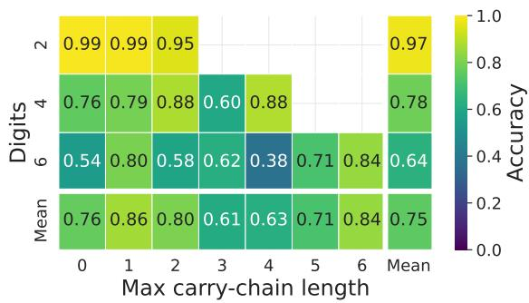  
Figure 6: SFT final-answer accuracy by operand length and maximum carry-chain length. Each interior cell pools standard-format examples with the indicated properties across Answer Only and Free CoT. Blank cells are combinations absent from the evaluation set. The marginal row and column are unweighted means of the played interior cells.

s section reports final-answer accuracy by carry structure, operand length, input format, and output format. Unless noted otherwise, results pool the Answer Only and Free CoT prompt instances and exclude responses that reach the 2,048-token limit without terminating.

The input- and output-format comparisons use separate arithmetic samples. The standard condition contains 384 problems, while each nonstandard condition contains 192 problems balanced across operand lengths. Every problem is evaluated under both prompt conditions, and no exact equation is shared across format samples. These comparisons therefore measure robustness to the full formatting condition; they are not paired estimates with arithmetic content held fixed.

Carry-chain length. The maximum carry-chain length is the longest sequence of adjacent columns in which a carry propagates. Figures 6 to 8 report accuracy jointly by this quantity and operand length. When the displayed carry-chain cells are weighted equally, SFT obtains accuracies of 0.97, 0.78, and 0.64 at 2, 4, and 6 digits; DPO obtains 0.98, 0.75, and 0.55; and Full obtains 1.00, 0.82, and 0.70. Accuracy generally decreases with operand length, but it is not monotonic in carrychain length within each digit stratum. Some constructed long-chain problems are easier than the more varied problems with shorter chains.

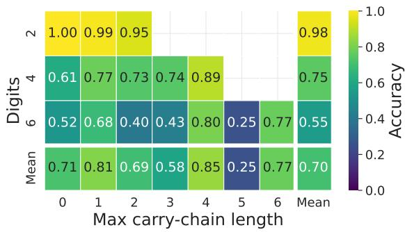  
Figure 7: DPO final-answer accuracy by operand length and maximum carry-chain length. Each interior cell pools standard-format examples with the indicated properties across Answer Only and Free CoT. Blank cells are combinations absent from the evaluation set. The marginal row and column are unweighted means of the displayed interior cells.

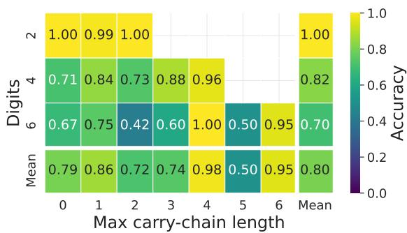  
Figure 8: Full final-answer accuracy by operand length and maximum carry-chain length. Each interior cell pools standard-format examples with the indicated properties across Answer Only and Free CoT. Blank cells are combinations absent from the evaluation set. The marginal row and column are unweighted means of the displayed interior cells.

Answer format. The standard condition requires the usual left-to-right result. In the least-significantdigit-first (LSD) condition, the operands remain conventional but the result must be written from right to left. Accuracy is lower on the LSD sample for all three checkpoints (Figure 9): SFT decreases from 81.6% to 22.7%, DPO from 78.7% to 43.8%, and Full from 85.9% to 56.9%. Because the two samples contain different equations, these differences include both the change in answer order and sampling variation.

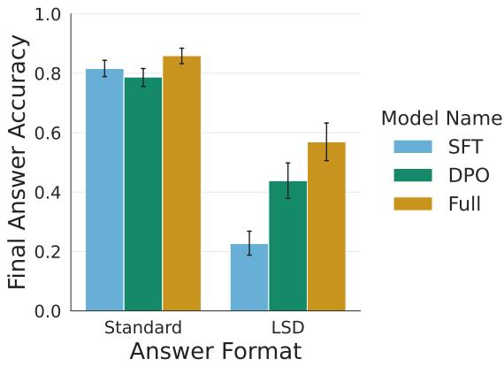  
Figure 9: Final-answer accuracy with the standard output convention and with the result digits written from least to most significant (LSD). Operands are conventionally formatted in both conditions. The standard and LSD conditions use separate samples of 384 and 192 problems, respectively, with both prompt conditions for every problem. Error bars are 95% bootstrap confidence intervals.

Operand format. The standard condition writes each operand conventionally. The delimited condition places | between adjacent digits and explains the notation in the prompt; the answer remains conventionally formatted. Accuracy decreases from 81.6% to 62.5% for SFT, from 78.7% to 67.5% for DPO, and from 85.9% to 56.3% for Full (Figure 10). As in the answer-format comparison, the standard and delimited samples contain different equations.

Carry structure. The controlled slices contain problems with no carry, one isolated carry, a carry propagated across every operand digit, or carrysuggestive digit patterns that do not form a long chain. A random slice provides broader coverage. The long-chain slice has the highest accuracy for all three checkpoints (96.8–100%), whereas the carry-distractor slice has the lowest (65.6–73.8%; Figure 11). Carry count and chain length therefore do not provide a complete ordering of problem difficulty.

Operand length. Figure 12 pools all standardformat examples at each operand length. Accuracy is 97.7–99.6% at two digits and decreases at four and six digits. At six digits, SFT, DPO, and Full obtain 68.2%, 60.4%, and 72.8%, respectively. These estimates weight every eligible prompt instance equally, unlike the heatmap margins, which weight each displayed carry-chain cell equally.

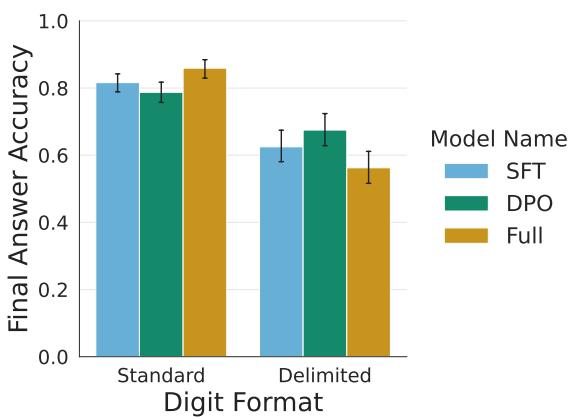  
Figure 10: Final-answer accuracy with conventionally written operands and with | between adjacent operand digits. The answer remains conventionally formatted, and the delimited prompt explains the notation. The standard and delimited conditions use separate samples of 384 and 192 problems, respectively, with both prompt conditions for every problem. Error bars are 95% bootstrap confidence intervals.

## E Probe Training Procedure and Results

We use linear probes to test whether the residual stream contains information about the intermediate variables of column-wise addition. The probes are diagnostic: successful classification establishes that a variable can be recovered by a linear decision boundary, but not that the model uses that boundary when producing its answer. We train probes for SFT and Full, which represent the endpoints of the post-training sequence considered in the main text.

## E.1 Targets and Activation Collection

We index columns from right to left, so column $i = 0$ is the units column. For operand digits $a _ { i }$ and $b _ { i }$ , let $c _ { i }$ be the carry entering column i, with $c _ { 0 } = 0$ . The column computation is

$$
r _ { i } = a _ { i } + b _ { i } + c _ { i } , 
$$

$$
y _ { i } = r _ { i } \mathrm { m o d } 1 0 ,\tag{6}
$$

(7)

$$
c _ { i + 1 } = \lfloor r _ { i } / 1 0 \rfloor .\tag{8}
$$

Separate probes predict the incoming carry $c _ { i } .$ the outgoing carry $c _ { i + 1 }$ , and the result digit yi. Carry prediction is binary and result-digit prediction is ten-way classification. A distinct probe is fitted for every checkpoint, target, arithmetic column, token-location type, and transformer layer. Reported profiles aggregate the resulting test accuracies over arithmetic columns.

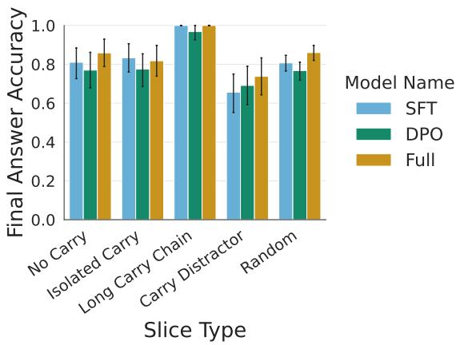

Figure 11: Final-answer accuracy across controlled carry structures. No Carry has no carry-producing column; Isolated Carry has one non-propagating carry; Long Carry Chain propagates a carry across every operand digit; Carry Distractor has locally carrysuggestive patterns but no long chain; and Random provides carry-balanced coverage. All examples use standard operand and answer formats. Bars pool both prompt conditions; error bars are 95% bootstrap confidence intervals.
<table><tr><td>Checkpoint Split</td><td></td><td>2-digit 4-digit 6-digit</td><td></td><td>Total</td></tr><tr><td>SFT</td><td>Train</td><td>64</td><td>64</td><td>64 192</td></tr><tr><td>SFT</td><td>Test</td><td>64</td><td>64</td><td>64 192</td></tr><tr><td>Full</td><td>Train</td><td>64</td><td>44</td><td>17 125</td></tr><tr><td>Full</td><td>Test</td><td>64</td><td>36</td><td>16 116</td></tr></table>

Table 5: Free CoT problems retained for probe training and evaluation after excluding responses that do not terminate within 2,048 tokens. The original training and test sets each contain 64 problems at every digit length for each checkpoint.

The dataset contains disjoint training and test sets with 64 problems at each of $^ { 2 , }$ 4, and 6 digits. Carry counts are balanced within each split. Every problem is presented under both Answer Only and Free CoT, but the results in the main text use Free CoT. Reasoning traces are sampled with temperature 0.6, nucleus probability 0.95, and a maximum of 2,048 generated tokens. Responses that reach this limit without terminating are excluded before probe training. All SFT responses terminate within the limit. Full retains every two-digit response but fewer of the longer responses, as shown in Table 5.

We collect the residual stream after each of the model’s 32 transformer layers. The full set of token locations comprises the operand digits and question mark in the prompt; the final prompt token; the first, one-third, two-thirds, and final tokens of the generated reasoning; and the tokens containing the final-answer digits. Fractions of the reasoning trace are defined by generated-token count before the final answer begins. The main profile uses three representative locations: the final prompt token, the two-thirds reasoning token, and the answer-digit tokens.

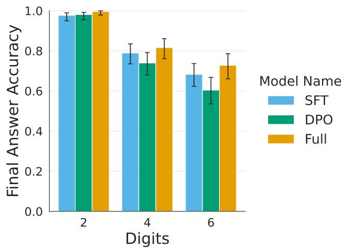  
Figure 12: Final-answer accuracy by operand length for standard-format inputs and answers. Bars pool Answer Only and Free CoT prompt instances; error bars are 95% Wilson confidence intervals for the pooled binomial proportions.

At prompt and reasoning locations, each problem contributes one activation to each probe for a given target column. At the answer, a problem can contribute several activations. For each target column, one probe is trained jointly on all answerdigit locations; we do not fit a separate probe for each emitted position. A tokenizer token can contain several decimal characters, in which case those character positions share the same residual state. Predicting a result digit from a token that already contains that digit would expose the label directly, while merged tokens can associate the same state with several digit labels. We therefore omit resultdigit probes at answer-digit locations from the main analysis. Answer-digit locations are retained for the two carry targets, for which the emitted digit is not itself the label.

## E.2 Probe Fitting and Evaluation

For every probe, each residual-stream feature is standardized using the training split. We then fit an L2-regularized logistic regression model with inverse regularization strength $C = 1$ and classbalanced training weights. Binary logistic regression is used for the carry targets and multinomial logistic regression for the result digit. We train a total of 7,744 fitted classifiers across the two checkpoints. The reported metric is accuracy on the held-out problem split. Hyperparameters are fixed before evaluation, and the main profile reports every layer rather than selecting a best layer on the test set.

## E.3 Probe Results

The profiles in Figure 3 are similar across layers and between SFT and Full. Table 6 provides a numerical summary restricted to the 116 test problems with a terminating Free CoT response from both checkpoints. Incoming- and outgoing-carry accuracies are highest at the final prompt token and at answer-digit locations. Accuracy at twothirds of the reasoning trace is lower, but remains close across checkpoints. Averaged over layers, the largest SFT–Full difference among the carry entries in the table is 3.9 percentage points.

The result-digit probes behave differently. Their mean accuracies are 19.4–22.8%, compared with a 25.2% majority-class baseline. We therefore do not find evidence that a single linear probe reliably recovers the eventual result digit at the final prompt token or at two-thirds of the reasoning trace. The stronger carry results show linear decodability, but they do not establish that the decoded direction is a causal control variable.

## E.4 Steering with Probe Directions

To test whether a decoded carry direction also controls the computation, we intervene along the incoming-carry probe direction. Let u be the normalized probe direction in the original residualstream coordinates, and let $\mu _ { 0 }$ and $\mu _ { 1 }$ be the mean training-set projections onto u for examples without and with an incoming carry. For an activation $h$ whose factual carry is $c \in \{ 0 , 1 \}$ , we clamp its projection to the opposite-class mean:

$$
\begin{array} { r } { h ^ { \prime } = h + \left( \mu _ { 1 - c } - h ^ { \top } u \right) u . } \end{array}\tag{9}
$$

The intervention is applied at one token and one layer. We test layers 16 and 24 at the final prompt token, the two-thirds reasoning token, and the final reasoning token. Evaluation uses 73 two- and four-digit problems that both checkpoints answer correctly and for which toggling the selected incoming carry changes one result digit without changing the outgoing carry. This defines a counterfactual answer while leaving every other result digit fixed.

<table><tr><td>Target</td><td>Token location</td><td>Majority baseline</td><td>SFT</td><td>Full</td></tr><tr><td>Incoming carry</td><td>Prompt final</td><td>57.3</td><td>71.1 [65.5, 77.4]</td><td>73.8 [69.1, 76.8]</td></tr><tr><td>Incoming carry</td><td>CoT two-thirds</td><td>57.3</td><td>57.2 [54.0, 61.5]</td><td>60.8 [52.7, 66.8]</td></tr><tr><td>Incoming carry</td><td>Answer digits</td><td>57.0</td><td>66.9 [61.2, 70.2]</td><td>63.0 [56.8, 66.3]</td></tr><tr><td>Outgoing carry</td><td>Prompt final</td><td>54.8</td><td>72.2 [69.0, 76.6]</td><td>72.7 [69.6, 75.3]</td></tr><tr><td>Outgoing carry</td><td>CoT two-thirds</td><td>54.8</td><td>58.0 [53.0, 62.5]</td><td>57.1 [52.4, 61.9]</td></tr><tr><td>Outgoing carry</td><td>Answer digits</td><td>54.8</td><td>74.9 [65.5, 78.1]</td><td>72.2 [66.4, 75.3]</td></tr><tr><td>Result digit</td><td>Prompt final</td><td>25.2</td><td>22.8 [20.1, 25.9]</td><td>22.7 [19.2, 24.2]</td></tr><tr><td>Result digit</td><td>CoT two-thirds</td><td>25.2</td><td>19.4 [15.1, 25.2]</td><td>20.6 [17.0, 24.7]</td></tr></table>

Table 6: Probe test accuracy on the test problems available for both SFT and Full, in percent. Each checkpoint entry first pools target columns in proportion to their number of test predictions and then averages equally over the 32 layers; brackets give the minimum and maximum layer accuracy. The majority baseline is computed under the same target-column weighting. Result-digit prediction at answer-digit locations is omitted because the target digit has already been emitted.

<table><tr><td>Checkpoint Problems Contrasts</td><td></td><td>Mean [95% CI]</td></tr><tr><td>SFT</td><td>73 518</td><td>0.004 [−0.003, 0.012]</td></tr><tr><td>Full</td><td>73</td><td>522 −0.002 [−0.009, 0.005]</td></tr></table>

Table 7: Problem-weighted effect of steering along the incoming-carry probe direction relative to three norm-matched orthogonal directions. The outcome is the change in counterfactual-versus-factual completeanswer log probability, measured in nats. Confidence intervals are 95% percentile intervals from resampling whole arithmetic problems.

For each probe direction, we construct three random unit directions orthogonal to u. The controls receive the same displacement magnitude as the carry intervention. Let y and $y ^ { \mathrm { c f } }$ denote the factual and counterfactual complete answers, respectively, and define the model’s counterfactual preference at the intervention site as

$$
q ( h ) = \log p ( y ^ { \mathrm { { c f } } } \mid h ) - \log p ( y \mid h ) ,\tag{10}
$$

where each term is the summed teacher-forced log probability of the answer tokens. The effect for a direction is $q ( h ^ { \prime } ) - q ( h )$ . Our primary contrast subtracts the mean effect of the three orthogonal controls from the effect of the carry direction, and then averages first within each arithmetic problem and equally across problems.

We find that the carry direction does not increase preference for the counterfactual answer relative to the matched controls. The mean contrast is 0.004 for SFT and −0.002 for Full, and both problembootstrap intervals include zero (Table 7).

This is a negative result for a single-token, singlelayer linear intervention. It does not show that carry information is absent or causally irrelevant; rather, the linearly decodable direction is not by itself a sufficient control axis for the model’s answer. A carry mechanism distributed across tokens, layers, or nonlinear features would not be isolated by this test.

## F Negative Results on Causal Interventions

This section reports three interventions that did not support a simple, checkpoint-specific causal account of carry computation. First, we replay natural reasoning traces across checkpoints to test whether later post-training changes how the model uses a supplied chain of thought. We then test two activation-level interventions: a learned multidimensional carry subspace and direct transfer of short residual-stream spans. These experiments are informative about the particular intervention tested, but a null result does not show that carry information is absent from the network.

## F.1 Cross-Checkpoint Replay of Natural Reasoning

We begin with 100 addition problems: 64 with two-digit operands and 36 with four-digit operands. SFT and Full independently generate a Free CoT response for every problem. The SFT traces end in the correct answer on 90 problems, and the Full traces do so on 97. We retain all traces rather than conditioning the crossover analysis on source correctness.

For each problem, a source trace is supplied by teacher forcing to either the SFT or Full receiver.

<table><tr><td rowspan="2"></td><td rowspan="2">Receiver Reasoning source</td><td colspan="3">Correct-answer log probability</td><td colspan="2">Final-answer accuracy (%)</td></tr><tr><td>One-third</td><td>Two-thirds</td><td>Complete</td><td>Two-thirds</td><td>Complete</td></tr><tr><td>SFT</td><td>SFT</td><td>-3.672</td><td>-6.833</td><td>-1.177</td><td>19</td><td>89</td></tr><tr><td>SFT</td><td>Full</td><td>-4.678</td><td>-6.229</td><td>-0.915</td><td>22</td><td>96</td></tr><tr><td>Full</td><td>SFT</td><td>-6.355</td><td>-9.882</td><td>-1.199</td><td>20</td><td>91</td></tr><tr><td>Full</td><td>Full</td><td>-8.001</td><td>-10.162</td><td>-1.003</td><td>17</td><td>95</td></tr></table>

Table 8: Cross-checkpoint replay results on 100 arithmetic problems. Log probabilities are sums over the correct answer tokens, averaged over problems. Accuracies are from deterministic continuations. Without supplied reasoning, SFT and Full obtain 99% and 98% accuracy, respectively; their mean correct-answer log probabilities are −0.154 and −0.392.

We evaluate prefixes ending at one-third and two thirds of the reasoning and immediately before the source’s final answer. At the two partial locations, an answer cue is appended before scoring or generation; at the final location, the receiver continues directly from the completed reasoning. The no-reasoning condition scores the answer directly after the prompt. At every location we measure the summed log probability of the correct answer tokens. We additionally decode greedily from the no-reasoning, two-thirds, and final locations.

Table 8 shows that the identity of the supplied reasoning matters, particularly once the reasoning is complete, but the two receivers respond similarly to it. At the final location, replacing an SFT trace with a Full trace improves exact accuracy by 7 percentage points for the SFT receiver and by 4 points for the Full receiver. The resulting receiver-by-source interaction is −3 points (95% problem-bootstrap CI [−8, 1]). For the teacherforced answer score, define

$$
L _ { r , s } = \log p _ { r } ( y \mid x , z _ { s } ) ,\tag{11}
$$

where r denotes the receiver, s the source checkpoint, and $z _ { s }$ the complete source reasoning. The corresponding interaction,

$$
( L _ { \mathrm { F u l l , F u l l } } - L _ { \mathrm { F u l l , S F T } } ) - ( L _ { \mathrm { S F T , F u l l } } - L _ { \mathrm { S F T , S F T } } ) ,\tag{12}
$$

is −0.066 nats (95% CI [−0.278, 0.167]). Thus, Full-sourced reasoning outperforms SFT-sourced reasoning in this comparison, but we do not detect a receiver-by-source interaction.

The incorrect source traces provide a stronger manipulation check. There are 10 problems for which the SFT trace has a clean but incorrect final answer while both receivers answer correctly without supplied reasoning. After the complete incorrect trace is replayed, the SFT receiver reproduces the source’s wrong answer on all 10 problems. The Full receiver reproduces it on seven and recovers the correct answer on three. Natural reasoning therefore has a clear causal effect on the output. The negative result is narrower: we find no reliable evidence that later post-training changes the receiver’s sensitivity to the source checkpoint.

## F.2 Distributed Alignment Search

A linear probe may miss a variable encoded in a rotated, multidimensional subspace. We therefore train a Boundless Distributed Alignment Search intervention (Wu et al., 2023) separately for SFT and Full. The model weights are frozen while an orthogonal rotation and a continuous subspace boundary are learned so that swapping the selected component between two activations should exchange the incoming carry.

Training uses four-digit problem pairs in which the carry entering the tens or hundreds column differs between the pair. The preceding output digit is matched, the carry leaving the target column is unchanged, and the counterfactual answer differs from the factual answer at only the target digit. The data contain 1,024 training pairs, 256 tuning pairs, and 64 held-out evaluation pairs. Target column and swap direction are balanced. Candidate interventions are screened at layers 7, 15, 23, and 31, both after the preceding column and before the target column. For the selected layer and location, three optimization seeds are compared on the tuning set before the intervention is frozen.

For both checkpoints, the selected intervention is at layer 7 immediately before the target-column computation. The learned regions occupy about half of the 4,096-dimensional residual stream. Despite their size, neither intervention transfers reliably to the held-out controlled problems (Table 9). Interchange accuracy is 1.6% for SFT and 12.5% for Full. Off-target digit preservation is also not

<table><tr><td>Measure</td><td>SFT</td><td>Full</td></tr><tr><td>Subspace dimensions</td><td>2,137 (52.2%)</td><td>2,102 (51.3%)</td></tr><tr><td>Tuning interchange</td><td>3.1%</td><td>9.4%</td></tr><tr><td>Held-out interchange</td><td>1.6%</td><td>12.5%</td></tr><tr><td>Target digit changed</td><td>1.6%</td><td>14.1%</td></tr><tr><td>Other digits preserved</td><td>62.5%</td><td>90.3%</td></tr></table>

Table 9: Performance of the selected distributed carry interventions. Interchange is the rate at which the generated answer changes to the exact counterfactual answer. Other digits preserved is the rate at which all non-target answer digits remain unchanged. The held-out evaluation contains 64 pairs per checkpoint.

satisfactory.

## F.3 Cross-Checkpoint Activation Patching

We next test a more direct activation-patching intervention (Heimersheim and Nanda, 2024) that does not require learning a subspace. At a decoderlayer boundary, the earlier computation acts as a writer and the remaining layers as a reader. For a matched pair with opposite incoming carries, we replace a short span at the input to the reader with the corresponding residual-stream states produced by the writer. Crossing SFT and Full yields four writer–reader combinations. A same-input transfer controls for disruption caused merely by crossing checkpoints.

Let $m ( h )$ be the receiver’s log-probability margin between the locally counterfactual and factual target digit after receiving states h. We define the carry effect as

$$
\Delta _ { \mathrm { c a r r y } } = m ( h _ { \mathrm { o p p o s i t e \ c a r r y } } ) - m ( h _ { \mathrm { s a m e \ i n p u t } } ) .\tag{13}
$$

A positive value means that states from the opposite-carry problem move the receiver toward the digit predicted by the carry swap. We compute the same contrast using the summed log-probability margin of the complete answer.

We screen all 31 non-embedding layer boundaries and spans of one, two, and eight tokens on 16 controlled problems. Configurations are ranked by the weaker of their SFT-to-SFT and Full-to-Full target effects, after which two distinct layer boundaries are retained. Both selected configurations replace the final eight tokens before the targetcolumn computation, at layers 27 and 28. On a separate set of 64 controlled problems, the primary layer-27 configuration has mean target effects of −0.006 nats for SFT and −0.016 nats for Full. The patch favors the counterfactual target digit in 42.2% of cases for both checkpoints and never produces the complete predicted answer. Although 92.2% of cases preserve all other answer digits, the target effect, preference rate, and exact-answer rate all fail their prespecified checks.

<table><tr><td></td><td>Layer Writer → reader</td><td>Target [95% CI]</td><td></td><td>Answer [95% CI]</td></tr><tr><td>27</td><td> $\mathrm { S F T }  \mathrm { S F T }$ </td><td></td><td>0.29 [0.09, 0.50]</td><td>0.02 [−0.07,0.14]</td></tr><tr><td>27</td><td> $\mathrm { S F T }  \mathrm { F u l l }$ </td><td>0.38</td><td>[0.19, 0.55]</td><td>0.05 [−0.03, 0.14]</td></tr><tr><td>27</td><td> $\mathrm { F u l l } \to \mathrm { S F T }$ </td><td>0.21 </td><td>[0.00, 0.42]</td><td>0.06 [−0.05, 0.19]</td></tr><tr><td>27</td><td> $\mathrm { F u l l }  \mathrm { F u l l }$ </td><td></td><td>0.27 [0.05, 0.47]</td><td>0.10 [-0.05, 0.30]</td></tr><tr><td>28</td><td> $\mathrm { S F T }  \mathrm { S F T }$ </td><td></td><td>0.28 [0.10, 0.47]</td><td> $0 . 0 3 \ [ - 0 . 0 3 , 0 . 1 1 ]$ </td></tr><tr><td>28</td><td> $\mathrm { S F T }  \mathrm { F u l l }$ </td><td>0.33</td><td>[0.17,0.49]</td><td> $0 . 0 8 \ [ 0 . 0 2 , 0 . 1 5 ]$ </td></tr><tr><td>28</td><td> $\mathrm { F u l l } \to \mathrm { S F T }$ </td><td>0.24</td><td>[0.07, 0.42]</td><td> $0 . 0 8 [ \dot { - } 0 . 0 3 , 0 . 2 \dot { 1 } ]$ </td></tr><tr><td>28</td><td> $\mathrm { F u l l }  \mathrm { F u l l }$ </td><td></td><td>0.23 [0.05, 0.40]</td><td> $0 . 1 3 \ [ 0 . 0 1 , 0 . 3 0 ]$ </td></tr></table>

Table 10: Exploratory activation-patching effects on 15 eligible natural problem pairs. Effects are changes in counterfactual-versus-factual log probability, in nats, relative to the same-input cross-checkpoint control. Each cell contains 30 directed cases. Confidence intervals are 95% percentile intervals from resampling whole matched problem pairs.

We nevertheless record local teacher-forced scores on a separately generated natural-reasoning sample, while omitting autoregressive continuations. Of 128 fixed matched problem pairs, 15 contain complete traces with an unambiguous boundary in both members: 10 pairs written by SFT and five by Full. Both swap directions are evaluated, giving 30 directed cases per writer–reader cell. The pooled results in Table 10 show positive local target effects in every cell. However, the completeanswer effects are smaller, and the writer–reader interaction is close to zero at both layer boundaries. These estimates are exploratory: the controlled check failed and the natural sample is small after boundary matching.

The checkpoint comparisons do not indicate a changed carry code. At layer 27, the writer– reader interaction is −0.025 nats for the target digit (95% CI [−0.084, 0.030]) and −0.001 for the complete answer ([−0.074, 0.077]). At layer 28, the corresponding interactions are −0.058 ([−0.126, 0.005]) and 0.002 ([−0.059, 0.063]). Likewise, the Full-to-Full minus SFT-to-SFT target effect is −0.022 nats at layer 27 ([−0.267, 0.173]) and −0.054 at layer 28 ([−0.263, 0.114]).

Together, these results do not support a simple interpretation in which post-SFT training introduces a carry variable that is easily isolated by the tested interventions and has checkpoint-specific writer– reader compatibility. They do not rule out a distributed mechanism that spans more tokens or layers, depends on non-linear features, or changes with the model’s reasoning strategy.

## G Answer Emergence and Commitment During the CoT

We distinguish two questions about an intermediate reasoning prefix. First, can the model produce the correct final answer when asked at that point? Second, has the answer become stable, in the sense that it remains correct at every later observed boundary? The first measures immediate answer availability while the second measures observed commitment.

## G.1 Evaluation at Natural Reasoning Boundaries

The analysis uses the 45 four-digit and 32 six-digit problems for which SFT, DPO, and Full all produce a usable Free CoT trace. This gives 231 source traces. Each trace is divided into natural reasoning units, such as headings, sentences, and individual arithmetic steps. A boundary’s normalized progress is the number of source-reasoning tokens observed through that boundary, divided by the total number of reasoning tokens in the trace. The final prompt token is assigned progress zero and the end of the reasoning is assigned progress one.

At every boundary, the source prefix is supplied by teacher forcing to each of the three receivers. We append the same final-answer cue and decode deterministically. Intermediate queries receive a 16-token answer budget; the endpoint query is allowed up to 64 tokens so that a complete response can terminate naturally. Essentially, this experiment supplies a portion of the CoT and then cuts it off by immediately asking for an answer at evenly spaced portions throughout the CoT. We parse the resulting final answer and compare it with the exact arithmetic result. To avoid treating a resumed calculation as a direct answer, continuations that don’t immediately answer (e.g. by producing additional reasoning) are excluded.

For comparison across traces of different lengths, we evaluate the observed boundary nearest each tenth of normalized progress. Confidence bands are 95% percentile intervals obtained by resampling arithmetic problems.

## G.2 A U-Shaped Answer Trajectory

Figure 13 restricts attention to source traces whose original final answer is correct. The six source cohorts contain 33, 33, and 40 four-digit traces from SFT, DPO, and Full, respectively, and 23, 20, and 28 six-digit traces. At the prompt boundary, many receivers can already produce the answer. Accuracy then falls sharply after the initial reasoning units, remains low or unstable through much of the trace, and rises again near the endpoint. This qualitative U-shape appears across source checkpoints, receiver checkpoints, and both operand lengths, although its depth and recovery vary across panels. We note that the CoT progression does not include the final reasoning span which often includes the answer, which is why the answer accuracy does not perfectly equal 1 when the CoT progression is equal to 1.

The early decrease should not be interpreted as literal deletion of a known answer. The measurement interrupts generation and asks for an answer at a point where the visible reasoning may contain a partial decomposition, a local column result, or an unfinished verification. Such prefixes can shift the receiver’s native output distribution toward intermediate quantities even when information sufficient for the final answer remains elsewhere in the residual stream. The late recovery is similarly compatible with several processes: completing the arithmetic, integrating previously stated partial results, recomputing them, or verifying an answer that was available earlier. The experiment establishes that immediate answerability is nonmonotonic; it does not by itself identify which of these processes causes the recovery.

## G.3 Stable Commitment Occurs Late

For a source trace and receiver, let $A _ { k }$ indicate whether the direct answer at observed boundary k is correct. We define the observed commitment boundary as

$$
k ^ { * } = \operatorname* { m i n } \{ k : A _ { j } = 1 { \mathrm { ~ f o r ~ e v e r y ~ r e t a i n e d ~ } } j \geq k \} .\tag{14}
$$

If no such boundary exists, the trajectory is uncommitted. This definition is deliberately stricter than the first correct response: an early correct answer followed by any later incorrect answer does not count as commitment. The cumulative curves in Figure 14 report the share of trajectories with $k ^ { * }$ at or before each progress threshold. Unlike the answer-emergence figure, this analysis retains source traces regardless of whether the source checkpoint’s own final answer is correct.

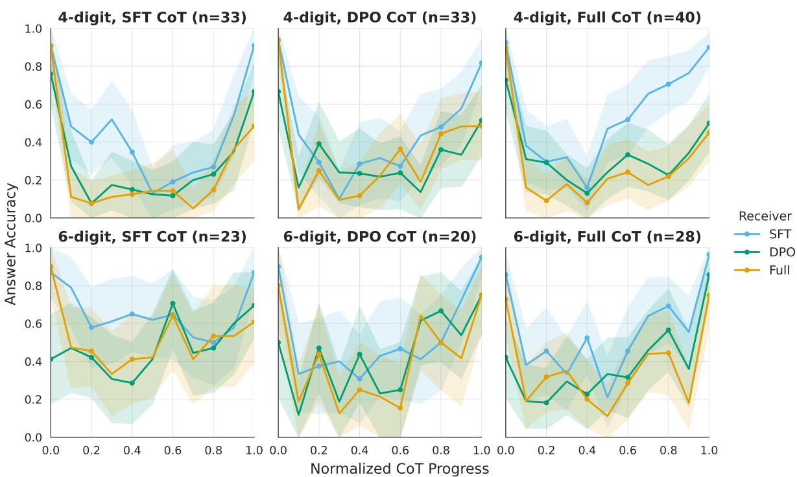  
Figure 13: Immediate final-answer accuracy over normalized CoT progress. Rows show operand length, columns show the checkpoint that produced the reasoning, and line colour shows the receiver checkpoint. Each source cohort contains completed traces whose original final answer is correct; the panel title gives its size. At each tenth of progress, the nearest observed reasoning boundary is supplied to the receiver before requesting a direct answer. Non-direct intermediate continuations are excluded and completed endpoint decodes are retained. Shaded regions are 95% problem-bootstrap confidence intervals.

Commitment is concentrated near the end of the trace. At halfway through the CoT, only 0–18.8% of trajectories in any source–receiver cell are stably correct; by 80% progress, the range is still 0–44.4%. The endpoint share ranges from 40.0% to 84.4%. Thus, an answer that can sometimes be produced at the prompt is generally not stable under the subsequent reasoning trajectory.

## G.4 Decodability Is Not Commitment

These trajectories contrast with the probe results in Section E. Incoming- and outgoing-carry information has similar linear-probe accuracy in SFT and Full at corresponding token locations, although accuracy is lower within the CoT than at the prompt and answer. The native answer trajectory, by contrast, changes substantially over the CoT and usually becomes stably correct only near its end.

This distinction also qualifies findings that an eventual answer can be decoded early in a reasoning trace (Boppana et al., 2026). Early decodability does not imply that the native decoder currently prefers that answer, that the preference is robust to subsequent computation, or that the decoded feature is causally responsible for the output. In the present experiment, high prompt accuracy coexists with a subsequent fall in answerability, while stable commitment remains late. It is therefore more precise to say that answer- or carry-related information is available to a diagnostic than that the model has already settled on the answer.

The result reinforces the broader distinction between diagnostic readouts and native answerability. One possible explanation is that reasoning temporarily changes which partial results are favoured by the native output mechanism, while later recomputation or verification restores a correct answer. The trajectory measurements do not identify which process produces the observed recovery. Future work on adaptive stopping or reasoning faithfulness should therefore compare probe readouts with native answer margins, persistence across later boundaries, and causal interventions, rather than using early probe confidence alone as evidence of commitment (Scalena et al., 2026).

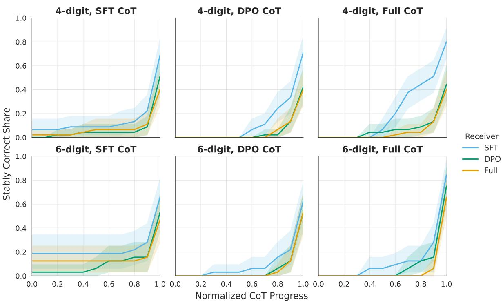  
Figure 14: Cumulative observed commitment over normalized CoT progress. A source–receiver trajectory is committed once its directly elicited answer is correct at the current boundary and every later retained boundary. Rows show operand length, columns show the source checkpoint, and line colour shows the receiver checkpoint. The analysis includes all 45 four-digit and 32 six-digit shared-source problems for each source; shaded regions are 95% problem-bootstrap confidence intervals.

## H Clustering Details

We group natural reasoning units by their text so that the same semantic categories can be used across checkpoints. Addition and subtraction are fitted separately because their operation-specific vocabulary produces different partitions.

Each reasoning unit is stripped of surrounding whitespace, converted to lowercase, and represented by word-unigram and word-bigram TF– IDF features. Numeral strings, including commaseparated numerals, are replaced by a common NUMBER placeholder so that clusters reflect the role of a statement rather than the particular operands it contains. We retain at most 4,096 features and use sublinear term-frequency scaling. Punctuation-only units are assigned directly to a formatting category instead of being represented as zero TF–IDF vectors.

The remaining units are partitioned by K-means. The main fit uses 20 initializations. We assess sensitivity to initialization using ten additional singleinitialization fits and compute the adjusted Rand index for all 45 pairs of assignments. The median pairwise adjusted Rand index is 0.660 for addition and 0.695 for subtraction. Table 11 summarizes the two fits.

For each initial group, we manually inspected several examples from each cluster. We manually devised labels for each group and groups without a coherent interpretation were combined into mixed/other. We also especially assigned spans with carries (or borrows) to a specific group, to isolate the effect of these important algorithmic states. The resulting assignments were fixed before the intervention outcomes were examined.

## H.1 Addition

The addition corpus contains 5,598 units from paired SFT and Full traces for 101 problems: 3,038 units from four-digit problems and 2,560 from six-digit problems. After reserving the formatting group, K-means produces 11 text clusters. Manual review retains seven of these clusters and maps four heterogeneous clusters to mixed/other.

Incoming-carry application was not cleanly isolated by a single K-means cluster. We therefore use a text-only refinement that selects statements which explicitly add a carry produced by an earlier column, including forms such as “plus the carried-over value” and “+1 (carry).” Statements that only produce or record a new carry, such as “write down 0, carry over 1,” remain in the carry-tracking category. This refinement assigns 195 units to incoming carry application. Table 12 gives the final mutually exclusive categories used for reporting.

<table><tr><td>Operation</td><td></td><td></td><td>Problems Units Units separated before K-means</td><td>K-means partition</td><td>Median ARI</td></tr><tr><td>Addition</td><td></td><td>101 5,598</td><td>Punctuation-only formatting units</td><td>11 text clusters; four were merged into mixed/other</td><td>0.660</td></tr><tr><td>Subtraction</td><td></td><td>47 2,783</td><td>Literal borrow mentions and punctuation-only formatting units</td><td>10 text clusters; four were merged into mixed/other</td><td>0.695</td></tr></table>

Table 11: Summary of the text-only clustering. Addition pools 202 SFT and Full reasoning traces across four- and six-digit problems. Subtraction pools 94 SFT and Full traces from four-digit problems. ARI is the median pairwise adjusted Rand index across ten single-initialization fits.
<table><tr><td>Category</td><td>Description</td><td>Representative unit</td><td>Units</td></tr><tr><td></td><td>Number decomposition Extracts or aligns operand digits by place value.</td><td> $^ { * * } 6 ( \mathrm { f r o m } 2 2 1 , 6 5 1 ) ^ { * }$ </td><td>221</td></tr><tr><td>Incoming carry application</td><td>Explicitly incorporates a carry established in an earlier column.</td><td> ${ } ^ { * * } 5 + 1 \left( \mathrm { c a r r y } \right) = 6 { } ^ { , }$ </td><td>195</td></tr><tr><td>Staging headers</td><td>Announces the next step or column to be processed. “Step 2: Add the tens place&quot;</td><td></td><td>696</td></tr><tr><td>Tens-place setup</td><td>Introduces or labels the tens-column calculation.</td><td>“Tens:&quot;</td><td>163</td></tr><tr><td>Carry tracking</td><td>Records an output digit and, where present, a newly “Write down 0, carry over 1&quot; produced carry.</td><td></td><td>405</td></tr><tr><td>Step-by-step cue</td><td>Generic preamble introducing a worked solution.</td><td>&quot;Let&#x27;s solve the addition step by step&quot;</td><td>168</td></tr><tr><td>Repeating the problem</td><td>Restates the arithmetic question before solving it.&quot;What is</td><td> $1 3 6 7 + 5 5 2 1 ? ^ { \prime \prime }$ </td><td>138</td></tr><tr><td>Problem setup</td><td>Short structural heading introducing the problem.</td><td>&quot;Problem:&quot;</td><td>149</td></tr><tr><td>Formatting</td><td>Punctuation-only separators and answer markers.</td><td>“ 9</td><td>206</td></tr><tr><td>Mixed/other</td><td>Heterogeneous arithmetic, digit, and place-value fragments for which the audit did not support a single semantic label.</td><td> $^ { \mathrm { * 9 } } \left( \mathrm { f r o m } 6 5 1 9 \right) + 1 \left( \mathrm { f r o m } 9 3 6 1 \right) = 1 0 ^ { \mathrm { * } }$ </td><td>3,257</td></tr></table>

Table 12: Final addition categories. Counts are reasoning units after manual audits. The examples reproduce representative surface forms with typographical emphasis removed.

## H.2 Subtraction

The subtraction corpus contains 2,783 units from paired SFT and Full traces for 47 four-digit problems. Notably, we distinguish lexical mentions of borrow from spans where a borrow is actually used or produced, as this occurs frequently during reasoning. We apply the same procedure as addition otherwise when clustering, making special groups for borrow mentions. See Table 13 for the final categories.

## I Secondary Attention Suppression Results

This section reports additional measurements from the attention-suppression experiments in Section 7. The first three analyses use fixed, teacher-forced reasoning traces. For each source unit, later token positions are prevented from attending to that unit at every layer, while all other tokens and model weights remain unchanged. The on policy generation analysis instead allows the model to generate a new continuation while the same attention restriction remains active.

## I.1 Where Suppression Affects the Final Answer

We first ask whether a unit’s position in the reasoning predicts its direct effect on the final answer. The analysis contains paired SFT and Full traces for 101 addition problems, comprising 202 traces and 5,598 reasoning units. Each trace is supplied to SFT, DPO, and Full as a receiver. For a suppressed unit i, we measure the mean divergence over the teacher-forced answer tokens,

<table><tr><td>Category</td><td>Description</td><td>Representative unit</td><td>Units</td></tr><tr><td>Subtraction step headings</td><td>Announces the place-value subtraction step to be“Step 3: Subtract the tens place&quot; performed.</td><td></td><td>237</td></tr><tr><td>Problem heading</td><td>Short structural heading introducing the problem. “Problem:&quot;</td><td></td><td>63</td></tr><tr><td>Step-by-step cue</td><td>Generic preamble introducing a worked subtraction.</td><td>“Let&#x27;s solve the subtraction step by step&quot;</td><td>79</td></tr><tr><td>Place-value headings</td><td>Names the current place or place-value stage.</td><td>“Hundreds place:&quot;</td><td>116</td></tr><tr><td>Result digit assembly</td><td>Lists place-labelled result digits or combines them “6 (thousands), 5 (hundreds), 6 (tens), into an answer.</td><td>9 (ones)&quot;</td><td>136</td></tr><tr><td>Place-result recording</td><td>Records a digit in a named place after a local calculation.</td><td>“Write down 0 in the tens place&quot;</td><td>120</td></tr><tr><td>Borrow production or regrouping</td><td>Establishes a borrow from a higher place or converts place value.</td><td>“Borrow 1 from the tens place&quot;</td><td>77</td></tr><tr><td>Incoming borrow application</td><td>Applies a previous borrow by decrementing the donating place.</td><td>“Reduce the hundreds digit by 1”</td><td>10</td></tr><tr><td>Lexical borrow mention</td><td>Other units containing a borrow-word form, including checks and explicit statements that borrowing is unnecessary.</td><td>“No borrowing needed here&quot;</td><td>327</td></tr><tr><td>Formatting and structure</td><td>Punctuation-only separators and other structural markers.</td><td>“”</td><td>70</td></tr><tr><td>Mixed/other</td><td>Heterogeneous calculations, answer fragments, digit adjustments, and presentation text without one coherent label.</td><td> $^ { \mathrm { 4 9 9 4 3 - 1 7 2 4 ^ { \mathrm { 3 } } } }$ </td><td>1,548</td></tr></table>

Table 13: Final subtraction categories. Counts are reasoning units after the manually audited cluster merges and the two borrow refinements. The examples reproduce representative surface forms with typographical emphasis removed.

$$
D _ { \mathrm { a n s } } ( i ) = \frac { 1 } { | A | } \sum _ { t \in A } D _ { \mathrm { K L } } \bigl ( p _ { \mathrm { c l e a n } , t } \bigr | \big | p _ { \mathrm { s u p p r e s s e d } , t } \bigr ) .\tag{15}
$$

where A is the set of factual-answer token positions. We also report the change in the summed log probability of those observed tokens,

$$
L _ { \mathrm { a n s } } ( i ) = \sum _ { t \in A } \left[ \log p _ { \mathrm { c l e a n } , t } ( y _ { t } ) - \log p _ { \mathrm { s u p p r e s s e d } , t } ( y _ { t } ) \right]\tag{16}
$$

A positive value of $L _ { \mathrm { a n s } }$ means that suppression lowers the probability of the observed answer; a negative value means that it raises that probability. The two measurements need not move together: KL divergence captures changes to the complete next-token distribution, whereas $L _ { \mathrm { a n s } }$ follows only the factual answer tokens.

As shown in Figure 15, direct changes to the answer distribution are concentrated near the end of the reasoning. In the first four-fifths of the trace, mean answer-token KL is at most 0.052 nats for

SFT, 0.096 for DPO, and 0.107 for Full. In the final fifth it rises to 0.286, 0.470, and 0.489 nats, respectively. The observed answer tokens themselves do not show a corresponding probability loss: the estimates in the right panel are negative in every position bin. Suppression can therefore alter the full answer distribution substantially without reducing the probability assigned to the factual token sequence.

This result does not imply that early units are unused. An early unit can change the next reasoning .step, which changes a later step, without producing a large direct effect on the final answer under teacher forcing. The next two analyses measure this propagation through the reasoning trace.

## I.2 Locality of Dependencies Within the CoT

For every suppressed source unit i and later unit $j ,$ let $T _ { j }$ be the token positions in the later unit. We define their directed dependence as

$$
D ( i \to j ) = \frac { 1 } { | T _ { j } | } \sum _ { t \in T _ { j } } D _ { \mathrm { K L } } \big ( p _ { \mathrm { c l e a n } , t } \big | \big | p _ { \mathrm { s u p p r e s s e d } , t } \big ) .\tag{17}
$$

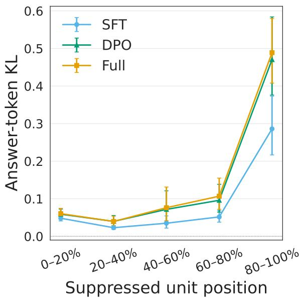

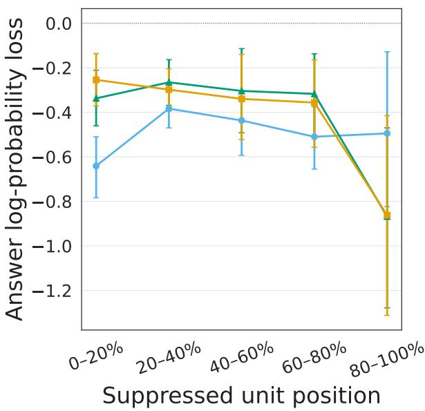  
Figure 15: Effect of suppressing a reasoning unit on the final answer, grouped by the unit’s normalized position in the CoT. The left panel shows the mean KL divergence over factual-answer tokens. The right panel shows clean minus suppressed summed log probability for those tokens; negative values therefore indicate that suppression increased their probability. Points give equal-problem-weighted means across SFT and Full source traces, and error bars are 95% confidence intervals from resampling problems.

Unit distance is the number of reasoning-unit boundaries between i and j: distance one denotes the immediately following unit. We report both the mean value of Equation (17) and the fraction of directed pairs for which it is at least 0.01 nats.

Dependence falls sharply with distance (Figure 16). For the immediately following unit, the mean KL is 0.751 nats for SFT, 1.315 for DPO, and 1.424 for Full. At a distance of 11 or more units, the corresponding values are 0.011, 0.019, and 0.022 nats. More than 91% of adjacent-unit pairs exceed the 0.01-nat threshold for every receiver, compared with 17.3%, 24.7%, and 26.1% of pairs at a distance of 11 or more for SFT, DPO, and Full. Thus, the strongest dependencies are local, although DPO and Full retain larger effects than SFT at longer distances.

The position maps in Figure 17 show the same local structure without reducing it to a single distance. The largest values form a band directly above the source position, while distant cells are generally darker. DPO and Full are brighter than SFT on the shared scale, especially for sources and targets late in the trace. Together with the final-answer result, this pattern is consistent with a chain in which early units primarily affect nearby reasoning and answeradjacent units have the largest direct effect on the final distribution.

## I.3 Additional Outcomes Under On-Policy Generation

Figure 18 shows additional outcomes for the onpolicy regeneration analysis in Section 7. For SFT, exact-answer accuracy falls from 92.9% without suppression to 57.1% under carry-episode suppression, while the matched random-pair condition reaches 89.3%. For Full, the corresponding rates are 92.9%, 53.6%, and 78.6%. DPO begins from a lower clean accuracy of 78.6%; its carry-episode and random-pair accuracies are 60.7% and 71.4%.

The remaining panels show that these answer changes are not confined to the selected column. Carry episode suppression produces the largest mean number of off-target digit changes for every receiver. It also lowers natural termination and increases the use of the answer fallback most clearly for DPO and Full. These measurements indicate that removing access to both written carry statements can disrupt the continuation more broadly than the target-column outcome alone records.

## J J-Lens Readout Calibration and Examples

## J.1 Residual and readout changes

We compare residual-stream activations across checkpoints around carry-related spans, asking where the representations differ and whether those differences are also reflected in the token predictions obtained through the J-Lens 3. This provides a complementary view of how post-training changes the processing of carry-related text.

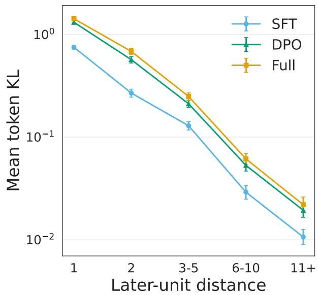

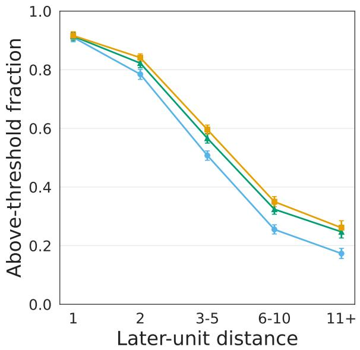  
Figure 16: Dependence on an earlier reasoning unit as a function of unit distance. The left panel shows mean per-token KL on a logarithmic scale; the right panel shows the fraction of source–target pairs with mean KL of at least 0.01 nats. Values are averaged within each problem before being averaged across problems. Error bars are 95% problem-bootstrap confidence intervals.

We compared the residual stream at three layers in each model (recall they share the same architecture, being progressive checkpoints): early (7), middle (15), and late (23). At each of these layers, we identified several tokens of interest, namely token endpoints of the previous, current, and next reasoning spans, as well as tokens before a carry value is mentioned within a span and before the resulting value is mentioned. For example, in "9 + 1 (carry-over) = 10"), we would take the token $" + "$ as the before carry and $" = "$ as the before result.

We measured two metrics. First, we measured the raw % change in the residual stream for two arbitrary activations $h _ { a }$ and $h _ { b }$ as:

$$
\mathrm { R e s i d u a l \ c h a n g e \ ( \% ) } = 1 0 0 \frac { \left\| h _ { b } - h _ { a } \right\| _ { 2 } } { \left\| h _ { a } \right\| _ { 2 } } .\tag{18}
$$

Second, we measured the Jensen-Shannon divergence between the J-Lens token readout for each model (Gurnee et al., 2026), over their entire vocabulary.

These two metrics, as shown in Figure 19, tell a similar story. That is, across SFT → DPO and DPO → Full, the changes are most concentrated in the late layer and directly before the carry value. This localizes the largest measured changes within the selected carry spans. Interestingly, despite DPO performing worse than SFT or Full in the conditional accuracy comparison (c.f. Figure 2a), the changes between SFT → DPO are much larger than DPO → Full. This pattern is compatible with the idea that later training recruits existing mechanisms (Venhoff et al., 2025), although not strong evidence of such.

## J.2 J-Lens calibration

The Jacobian Lens (J-Lens) maps an intermediate residual-stream state into the model’s final residual basis using an average input–output Jacobian (Gurnee et al., 2026). Applying the model’s final normalization and output head to this transported state gives a distribution over vocabulary tokens. We use these distributions as descriptive readouts of what an intermediate state is disposed to verbalize. They are not direct measurements of the model’s next-token distribution nor are they evidence that the corresponding information is causally used.

The pretrained lens used in our analysis was fitted for the Olmo-3-7b-Base checkpoint on 616 generic-text sequences of 128 tokens. We apply it to layers 7, 15, and 23 of Base, SFT, DPO, and Full. These checkpoints have the same architecture and vocabulary, which permits a matched comparison, but the lens was not refitted after each post training stage. The calibration analysis below checks how strongly the decoder chosen after the lens affects the reported token ranks.

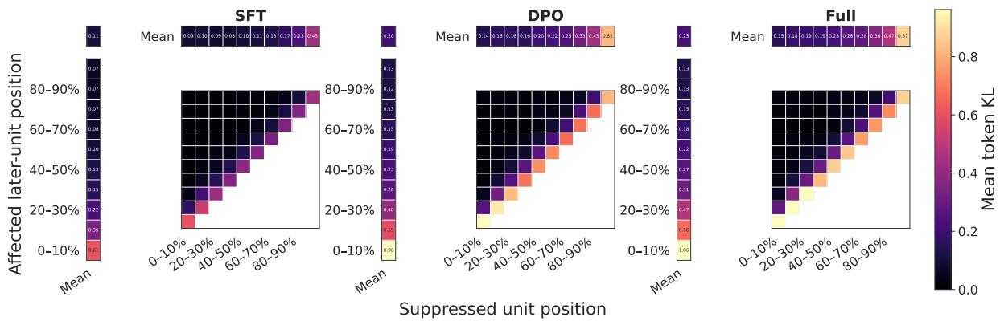  
Figure 17: Map of directed dependencies between reasoning units. Source and later affected units are placed into ten equal-width bins of normalized CoT progress. Each cell gives the mean per-token KL for the observed source–target airs in that bin; the narrow strips marked “Mean” summarize the populated cells along each axis.

The analysis uses 30 incoming-carry applications drawn from 23 addition problems and 26 natural reasoning traces. Sixteen units come from SFT-written traces and 14 from Full-written traces; 16 use four digit operands and 14 use six-digit operands. The units were selected for high attention-suppression importance within each operand length and source checkpoint. The sample is therefore intended for close inspection of strong carry-related cases, not as an unbiased estimate over all reasoning units.

For each unit, we read the residual stream at two locations: immediately before the incoming-carry value and immediately before the result. Each complete numeric target is represented by one token under the shared tokenizer. This gives 30 carry-value and 30 result-value locations for each checkpoint and layer.

## J.3 Effect of the Output Decoder

Let $h _ { m , l , t }$ be the residual state from checkpoint $m ,$ layer l, and token position $t ,$ and let $J _ { l }$ be the Basetrained J-Lens map for that layer. The transported state is

$$
z _ { m , l , t } = J _ { l } h _ { m , l , t } .\tag{19}
$$

We decode this state in two ways. The checkpoint-native readout applies checkpoint m’s final normalization and output head to $z _ { m , l , t }$ . The common-Base readout instead applies the Base checkpoint’s final normalization and output head to every transported state. The former retains the complete output mapping of each checkpoint. The latter holds that mapping fixed, so changes in residual representations are not mixed with changes in the final normalization or output head.

For either readout, the vocabulary rank of the known next token is one plus the number of tokens assigned a larger logit. Rank one is therefore best. Figure 20 compares the two ranks at layer 23.

The decoder choice has a large effect before the carry value. The common-Base decoder gives the target token a better rank in 26 of 30 SFT cases and in all 30 DPO and Full cases. Median checkpointnative ranks are 1,136 for SFT, 33,643 for DPO, and 49,591 for Full, whereas the corresponding common-Base medians are 1.5, 2, and 2. This mismatch is especially pronounced after the SFT stage, even though the same Base-trained transport is used throughout.

The result-value location behaves differently. Median checkpoint-native ranks are 1 for SFT, 1.5 for DPO, and 2 for Full; the common-Base median is 1 for all three checkpoints. The common decoder is strictly better in only 2 of 30 SFT cases, 14 of 30 DPO cases, and 15 of 30 Full cases, with 27, $^ { 1 6 , }$ and 15 ties, respectively. Thus, the common decoder is not uniformly superior. Rather, the comparison shows that a Base-trained J-Lens and a posttrained output head can be poorly matched at some token locations, particularly immediately before a carry value. We use the common-Base readout for checkpoint comparisons because it matches the checkpoint on which the lens was fitted and keeps the decoder constant, while treating its outputs as approximate descriptions rather than ground truth.

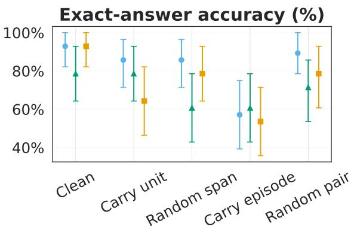

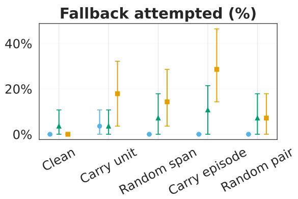

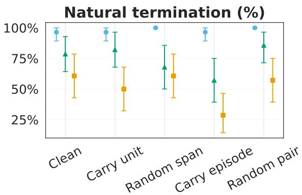

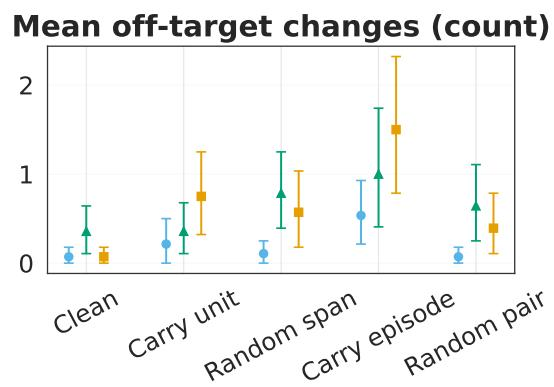  
Figure 18: Secondary outcomes during on-policy generation. Conditions suppress either the incoming-carry application, a matched non-carry span, the two-unit carry episode, or a matched pair of non-carry spans. Exactanswer accuracy includes a short answer continuation used when the primary continuation contains no parseable final answer. Natural termination and fallback use are measured on the primary continuation. Off-target changes count incorrect answer digits outside the selected carry column and are computed only when an answer is parseable. Points are means and error bars are 95% confidence intervals from resampling problems.

## J.4 Illustrative Token Distributions

Figure 21 gives two layer-23 examples under the common-Base decoder. The first two panels use the same Full residual states from the unit “8+1 (carry) = 9.” Immediately before the written carry value, the five most probable tokens are variants of the word carry, rather than the numeric target 1. The most probable token, “ carry,” receives probability 0.074; the target token 1 has probability 0.00056 and vocabulary rank 82. The readout is therefore aligned with the semantic role of the position but does not yet identify the exact carry value.

Immediately before the result, the distribution is much more specific. The correct target token 9 has probability 0.848 and rank one, followed by lexical or formatting variants such as “ nine,” “ ninth,” and “09.” This contrast illustrates why a token-level readout should be examined at precise locations: within a single short arithmetic unit, it can move from a broad semantic prediction to a sharply concentrated numeric result.

The final panel shows a different failure mode. Before the result in $^ { * * } 6 + 8 + 1 = 1 5 , ^ { \circ }$ every checkpoint’s common-Base readout assigns more probability to 14, the subtotal that omits the incoming carry, than to the correct result 15. For Base the two probabilities are 0.368 and 0.075; for SFT they are 0.101 and 0.035; for DPO they are 0.028 and 0.011; and for Full they are 0.030 and 0.012. The next token in the supplied trace is nevertheless 15. This example shows that a J-Lens distribution can expose a plausible intermediate quantity without assigning its highest probability to the token that actually follows. Consequently, the readouts are most useful as descriptions of candidate content in the residual stream.

Post-training changes concentrate late and before the carry value   
SFT DPO DPO Full   
Residual change (%) Before carry value Previous endpoin 4.8 4.2 18.0 13.4 25.6 30.6 3.8 3.4 7.1 9.7 10.3 14.6 30 15
20
25
Residual change (%)   
20   
Before result value 4.6 12.6 19.1 3.4 6.6 9.0 15   
10   
Selected endpoint 5.3 14.0 22.2 4.1 8.1 11.5   
5   
Next endpoint 6.3 15.4 27.6 4.5 7.9 13.3 0   
7 15 23 7 15 23   
Readout JS divergence Previous endpoin 0.003 0.019 0.025 0.001 0.002 0.010 Readout JS divergence   
0.05   
Before carry value 0.002 0.031 0.058 0.001 0.005 0.011 0.04   
Before result value 0.004 0.031 0.028 0.001 0.002 0.003 0.03   
0.02   
Selected endpoint 0.004 0.010 0.027 0.001 0.003 0.003   
0.01   
Next endpoint 0.006 0.025 0.009 0.001 0.006 0.003 0.00   
7 15 23 7 15 23   
Residual-stream layer Residual-stream layer

Figure 19: Analysis of the residual stream content, at early (7), middle (15), and late (23) layers, across a carry span ((e.g. "9 + 1 (carry-over) = 10")), and at the token endpoints of the previous, current, and next reasoning spans. The change is measured between the two models shown at the top of each column. Top: we measure the raw % change in residual stream value. The changes concentrate just before the carry value is mentioned. Bottom: using readouts from the J-Lens (Gurnee et al., 2026), we measure the Jensen-Shannon (JS) divergence between each models distribution. These results mirror those of the change in raw residual stream.

## K Prompt Templates

We use a single user message to provide the arithmetic problem to the model. The Olmo-3 native chat template automatically prepends its default system message, which we keep:

You are a helpful function-calling AI   
assistant. You do not currently have access to   
any functions. <functions></functions>

The blocks below reproduce the user-message text before chat-template wrapping. Anglebracketed terms denote values substituted for each example: <A> and <B> are the two operands, and <A-delimited> and <B-delimited> are the same kind of operands with | between adjacent digits.

## K.1 Addition

The standard-format behavioural evaluation used the following two prompts.

Answer Only.

What is <A> + <B>? Give only the answer.

## Free CoT.

What is <A> + <B>? Solve the problem step by   
step.

The delimited-input condition inserted | between adjacent operand digits while retaining the usual left-to-right answer format.

## Delimited input, Answer Only.

The | symbol separates digits inside a number;   
for example, 1|2|3 means 123. What is   
<A-delimited> + <B-delimited>? Give only the   
answer. Use standard formatting without   
delimiters.

## Delimited input, Free CoT.

The | symbol separates digits inside a number;   
for example, 1|2|3 means 123. What is   
<A-delimited> + <B-delimited>? Solve the   
problem step by step. Use standard formatting   
without delimiters in your answer.

The least significant digit answer condition retained conventionally written operands but required the final answer digits from least to most significant.

Least-Significant Digit answer, Answer Only.

What is <A> + <B>? Give your answer from right   
to left with no separators; for example, if   
the normal answer is 6912, write 2196. This is   
known as the least significant digit format.

Least-Significant Digit answer, Free CoT.

What is <A> + <B>? Solve the problem step by   
step. Use least significant digit format for   
the final answer: write digits from right to   
left with no separators.

## K.2 Subtraction

All subtraction traces used standard decimal notation and the Free CoT instruction.

What is <A> - <B>? Solve the problem step by   
step.

## K.3 Prompts Used for Continuation and Readout

Analyses that transferred or replayed a reasoning trace retained the original standard Free CoT user message. The source checkpoint’s response, or a prefix of it, was supplied as assistant text by teacher forcing. When an analysis required an answer immediately after that prefix, the following assistantside cue was appended on a new line before scoring or decoding the answer:

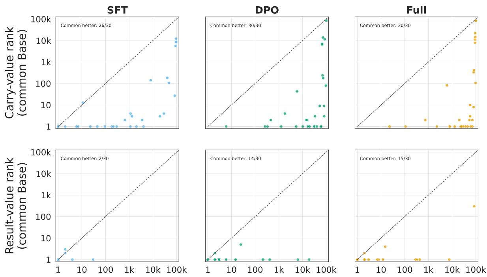  
Checkpoint-native rank  
Figure 20: Comparison of checkpoint-native and common-Base J-Lens ranks at layer 23. Each point is one of the 30 selected carry applications. Rows show the known next token at the carry-value and result-value locations; columns show the checkpoint whose residual state is read. Both axes use a logarithmic scale. Points below the dashed diagonal receive a better (smaller) rank from the common-Base decoder. The annotation in each panel counts such cases; ties are not counted as improvements.

Final answer:

The cue was not duplicated when the supplied reasoning already ended with an equivalent final answer marker. In the on-policy attention-suppression experiment, the primary continuation began directly after the selected reasoning unit. The same cue was used only for the short fallback continuation when the primary continuation did not contain a parseable final answer.

The activation-patching analysis additionally scored the selected result digit after the following assistant-side cue, where <column> was replaced by the relevant place name (for example, hundreds):

The digit to write in the <column> column is

## K.4 Controlled Carry Continuations

The distributed-alignment experiment used controlled four-digit scratchpads so that the incoming carry could be changed while the remaining arithmetic was held fixed. Its user message was:

What is <A> + <B>? Continue the supplied   
column-by-column work exactly, and end with   
\`Final answer: <number>\`.

The assistant context began with the following fixed line and one templated line for each completed column:

Let's add from right to left.   
<Place>: <digit from A> + <digit from B> +   
carry <incoming carry> = <sum>; write <result   
digit> and carry <outgoing carry>.

At the later intervention boundary, the context also ended with an explicit statement of the carry entering the selected column:

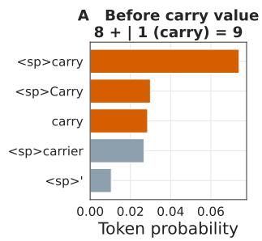

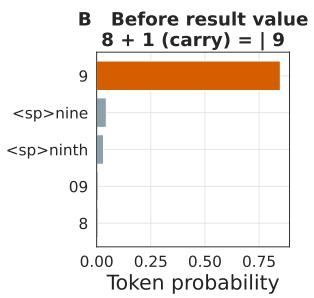

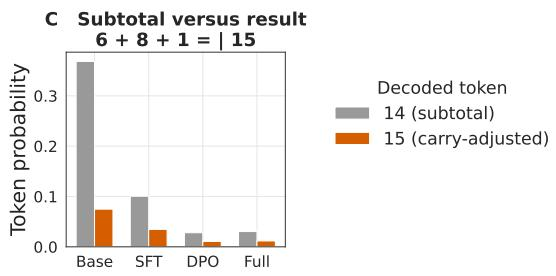  
Figure 21: Illustrative layer-23 token distributions under the common-Base decoder. Panels A and B show the five highest-probability tokens from Full residual states immediately before the carry value and result value in the same reasoning unit; <sp> marks a leading space. Orange highlights carry-related tokens in Panel A and the correct numeric result in Panel B. Panel C compares the probabilities of the unadjusted subtotal 14 and the correct carry adjusted result 15 at the result location of ${ } ^ { 6 * } 6 + 8 + 1 = 1 5 , { } ^ { \circ }$ using Base, SFT, DPO, and Full residual states with the same Base decoder. These cases are qualitative examples and are not averages over the 30-unit sample.

The carry into the <column> column is <incoming carry>.

The remaining column calculations and the line Final answer: <number> were either supplied by teacher forcing or generated after the intervention, depending on the measurement.

## L Reproducibility

Code. Source code for all experiments in the project is available at https://anonymous.4open. science/r/carry-trace-FBED/README.md.

Compute Resources. All of the experiments were completed on one Nvidia A40 GPU, rented through Runpod.