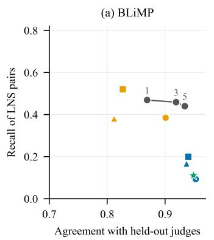
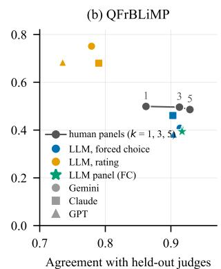
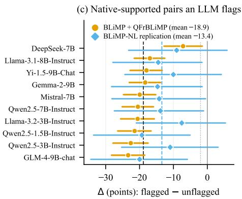

# LLM Validation Makes Minimal-Pair Benchmarks Easier for Language Models

Guofang Tang

Ghostcloud

tinggofun@gmail.com

## Abstract

Minimal-pair benchmarks are only as good as their labels, and LLMs are an obvious substitute for costly human validation. We test it on BLiMP (English) and QFrBLiMP (Quebec French), the two public minimal-pair datasets releasing every forced-choice human judgment. Three LLMs validate by forced choice, by rating, and as a panel, scored against human panels of one, three and five judges in two preregistered phases. On BLiMP, forced-choice validators agree with held-out human majorities more often than five-judge panels, yet catch far fewer pairs whose label humans reject than one judge does. By point estimate, no validator is worth more than one judge. The errors are not random. On both datasets, across 10 open LMs, human-supported pairs that the pre-registered LLM filter flags are 18.9 points harder than those it accepts, in all 70 LM–validator combinations, and harder than pairs a single human judge flags. Filtering thus removes items on which LMs fail but humans do not, raising accuracy more than random removal. A protocol frozen before any output replicates the gap and the lift on Dutch BLiMP-NL. LLM validation makes minimal-pair benchmarks easier for the models they are meant to test; we release code, validator outputs and item-level scores.

## 1 Introduction

A minimal pair puts two sentences side by side that differ in one grammatical respect. One is meant to be acceptable and the other not. If a language model gives the acceptable one a higher probability, it gets credit for the phenomenon (Warstadt et al., 2020). The method has spread from English to Russian, Quebec French and more than a hundred languages (Taktasheva et al., 2024; Beauchemin et al., 2026; Jumelet et al., 2026). Its weak point is the label. Templates and generators produce pairs whose intended contrast native speakers do not share, and acceptability is graded, so speakers disagree (Sprouse et al., 2013; Lau et al., 2017). Benchmark authors therefore validate labels with human judges. That step is slow, costs money, and is hard to staff in low-resource languages.

LLMs look like a cheap substitute. They annotate text about as well as crowd workers on many tasks (Gilardi et al., 2023), they serve as judges for generated text (Zheng et al., 2023), and on English grammatical constructions they sometimes match the intended label more often than humans do (Hu et al., 2024). There is now a test for whether an LLM can stand in for a human annotator (Calderon et al., 2025). For minimal pairs, though, the substitution has a specific risk. The models that would validate the benchmark belong to the same family as the models the benchmark is meant to test. If both prefer the same sentences, LLM validation selects items on the outcome it is supposed to measure.

We test this on two minimal-pair datasets that release every individual human judgment: the 348 pairs of BLiMP that were rated by about 20 crowd workers each, and all 1693 pairs of QFrBLiMP, each judged by 12 native speakers of Quebec French. A pair’s support is the share of judges who choose the intended acceptable sentence. We call a pair LNS (label not supported) when at most half of the judges choose it. Three LLMs from different developers validate every pair, by forced choice and by rating each sentence on its own, and a three-model panel votes. In two phases, each locked before any of its outputs existed, we ask two questions.

Can an LLM validator replace human judges? We compare each validator with human panels of one, three and five judges, all scored against the remaining judges. On BLiMP, forced-choice validators agree with the held-out majority more often than five-judge panels do, yet they detect few LNS pairs (Figure 1a,b). By point estimate, no validator matches more than one human judge. The preregistered test on BLiMP, which has only 19 LNS pairs, was a weak pass: the best validator fell below the three-judge panel, but the interval included zero.

Does LLM validation change what we conclude about LMs? We score both datasets with 10 open LMs from 1.5B to 9B parameters. Among pairs that humans support, the pairs an LLM validator flags are much harder for LMs than the pairs it accepts (Figure 1c), and on these two datasets harder than the pairs a single human judge flags. Removing the flagged pairs raises LM accuracy beyond what removing random pairs does. Both pre-registered conditions hold. They hold again in a third protocol on Dutch BLiMP-NL (Suijkerbuijk et al., 2025), with every prompt, filter and criterion frozen before any output existed.

## Our contributions are:

• A human-panel comparison for LLM validation of minimal pairs, scored against held-out judges. LLM validators show high agreement and low detection: forced-choice validators agree with the held-out majority on 0.937– 0.953 of BLiMP pairs, above the five-judge panel (0.934), but recover only 0.09–0.20 of the LNS pairs, against 0.47 for one judge.

• Evidence that LLM validation is biased in the models’ favour. Human-supported pairs that the pre-registered LLM filter flags are 18.9 points harder for open LMs $( \bar { \Delta } = - 1 8 . 9 , 9 5 \%$ CI [−22.1, −15.8]). The gap is negative for all 70 combinations of LM and validator, and larger than for pairs that a single human judge flags. Filtering with the LLM raises accuracy by +5.6 points more than random filtering. On QFrBLiMP, every LM scores higher on the LLM-filtered benchmark than on the humanfiltered one. A frozen replication on Dutch reproduces the gap (∆ = ¯ −13.4, [−21.1, −5.4]) and the lift.

• Three pre-registered protocols, the code, and all validator outputs.

## 2 Data, gold labels and validators

Datasets. We use the two public minimal-pair datasets we found that release every individual forced-choice judgment. A third, with graded ratings, is used for the replication in Section 5.

• BLiMP (Warstadt et al., 2020), English. The authors had 348 pairs, about five per paradigm (70 paradigm labels in the released validation file), judged on Amazon Mechanical Turk by 19–21 raters per pair. Raters chose the more natural sentence of each pair.

• QFrBLiMP (Beauchemin et al., 2026), Quebec French. Twelve native speakers judged all 1,711 pairs from 20 phenomena, choosing the sentence they found well written. We drop 18 pairs whose two sentences are identical in the release, which leaves 1693.1

Gold labels. For each pair, the support s is the share of judges who chose the intended acceptable sentence. A pair is LNS (label not supported) if $s \leq 0 . 5$ . This gives 19 LNS pairs in BLiMP (5.5%) and 112 in QFrBLiMP (6.6%). LNS does not mean that a pair is invalid: the judges may reflect dialect variation, graded acceptability or a task effect. It means only that the benchmark’s label is not what the judges chose. A secondary gold uses weak support, $s < 0 . 7 5$ (50 and 255 pairs). Split-half reliability of s, as a Spearman correlation between random halves of the judges, is 0.537 for BLiMP and 0.454 for QFrBLiMP.

Human panels and held-out gold. To ask how many humans an LLM validator is worth, we build human panels from the same data. In each of 1,000 resamples, we shuffle each pair’s judges. The first one, three and five judges form panels of size k = 1, 3, 5, and a panel flags a pair if its majority does not choose the intended sentence. The remaining judges (BLiMP 14–16, QFrBLiMP 7) give a held-out support $s ^ { \prime }$ and a held-out gold. The three panels and every LLM validator are scored against the same held-out gold in each resample. We report LNS recall, precision and F1, and agreement: the share of pairs on which a validator prefers the same sentence as the held-out majority. A validator’s equivalent panel size $k _ { \mathrm { e q } }$ is the largest k whose panel F1 is not above the validator’s, by point estimate; “<1” means below a single judge. Intervals for differences come from 1,000 paired item bootstraps, which redraw the items and the judge order together.

  
Figure 1: (a, b) LLM validators against human panels. The y-axis shows how many of the pairs whose intended label the held-out judges do not support (LNS) a validator flags. The x-axis shows how often it agrees with the held-out majority on which sentence is better. Forced-choice validators (blue) and the LLM panel (green) sit at high agreement and low recall, below a single human (“1”). Rating validators (orange) recall more but flag many supported pairs. (c) For each open LM: accuracy on human-supported pairs that the pre-registered LLM filter (Gemini RATE) flags, minus accuracy on those it accepts, in Phase 1 (orange) and in the frozen BLiMP-NL replication (blue). Bars show 95% item-bootstrap CIs, dashed lines the means and the dotted line the pre-registered −2-point threshold.

LLM validators. We use three LLMs from different developers through their APIs, at temperature 0: Gemini 3.8 Flash, Claude Sonnet 4.6 and GPT-6 Luna. Each validates every pair in two ways (prompts in Appendix A).

• FC (forced choice) reuses the human task’s instruction. Twelve pairs go into each request, in a fixed random order of sentences. A validator flags a pair if it chooses the unintended sentence. The French prompt asks the model to answer as a native speaker of Quebec French.

• RATE asks for a 1–5 acceptability rating of each sentence on its own. Sentences are shuffled into batches of 12, and the two sentences of a pair never share a batch. A validator flags a pair if the intended sentence is not rated higher $( r _ { \mathrm { g o o d } } \leq r _ { \mathrm { b a d } } )$

The LLM panel is the majority of the three FC validators, giving seven validators in all. Every request returned a parseable answer.2

Pre-registration. Phase 0 (this section and Section 3) was locked before any validator output existed, and Phase 1 (Section 4) before any LM was scored. Each protocol fixes the gold, the estimands, the decision rules and the analyses that are only exploratory. A clarification of the Phase 0 resampling, added before any output was read, is listed with the protocols in the supplement.

## 3 Can an LLM validator replace human judges?

Table 1 and Figure 1a,b give the results. Three patterns are visible in both datasets. The pre-registered verdict uses BLiMP only (end of this section); QFr-BLiMP results are descriptive.

High agreement, low detection. Forced-choice validators almost always side with the benchmark’s intended label. On BLiMP their agreement with the held-out majority is 0.937–0.953, higher than that of a five-judge panel (0.934). Yet they recover only 0.09–0.20 of the LNS pairs, where a single judge recovers 0.47. The LLM panel flags 1.7% of BLiMP pairs, although 5.5% are LNS. High agreement is what one would see from a validator that rarely disagrees with the benchmark authors. Over a benchmark where most labels are right, that looks accurate, and it misses the pairs that matter. On QFrBLiMP the forced-choice validators recall more (0.38–0.46), but their agreement (0.903– 0.917) still falls short of the five-judge panel.

Rating trades misses for false alarms. Rating each sentence on its own recalls more LNS pairs (BLiMP 0.38–0.52, QFrBLiMP 0.68–0.75), but precision drops. Rating validators flag 5.4–23.2% of the pairs that at least three quarters of the judges support. A benchmark author who deletes every flagged pair would lose that share of good items. Section 4 shows that the lost items are not a random share.

<table><tr><td rowspan="2">Validator</td><td colspan="5">BLiMP (English, 348 pairs, 19 LNS)</td><td colspan="5">QFrBLiMP (Quebec French, 1693 pairs, 112 LNS)</td></tr><tr><td>Rec</td><td>Prec</td><td>F1</td><td>Agree</td><td> $k _ { \mathrm { e q } }$ </td><td>Rec</td><td>Prec</td><td>F1</td><td>Agree</td><td> $k _ { \mathrm { e q } }$ </td></tr><tr><td>1 judge</td><td>0.47</td><td>0.16</td><td>0.239</td><td>0.869</td><td></td><td>0.50</td><td>0.22</td><td>0.304</td><td>0.862</td><td></td></tr><tr><td>3 judges</td><td>0.46</td><td>0.26</td><td>0.331</td><td>0.919</td><td></td><td>0.50</td><td>0.35</td><td>0.409</td><td>0.913</td><td>一</td></tr><tr><td>5 judges</td><td>0.44</td><td>0.32</td><td>0.365</td><td>0.934</td><td></td><td>0.49</td><td>0.43</td><td>0.454</td><td>0.929</td><td>一</td></tr><tr><td>Gemini 3.8 Flash FC</td><td>0.09</td><td>0.36</td><td>0.148</td><td>0.953</td><td>&lt;1</td><td>0.41</td><td>0.33</td><td>0.364</td><td>0.914</td><td>1</td></tr><tr><td>Gemini 3.8 Flash RATE</td><td>0.39</td><td>0.19</td><td>0.254</td><td>0.901</td><td>1</td><td>0.75</td><td>0.18</td><td>0.291</td><td>0.779</td><td>&lt;1</td></tr><tr><td>Claude Sonnet 4.6 FC</td><td>0.20</td><td>0.26</td><td>0.223</td><td>0.940</td><td>&lt;1</td><td>0.46</td><td>0.30</td><td>0.364</td><td>0.903</td><td>1</td></tr><tr><td>Claude Sonnet 4.6 RATE</td><td>0.52</td><td>0.13</td><td>0.208</td><td>0.827</td><td>&lt;1</td><td>0.68</td><td>0.18</td><td>0.281</td><td>0.790</td><td>&lt;1</td></tr><tr><td>GPT-6 Luna FC</td><td>0.17</td><td>0.21</td><td>0.186</td><td>0.937</td><td>&lt;1</td><td>0.38</td><td>0.28</td><td>0.325</td><td>0.904</td><td>1</td></tr><tr><td>GPT-6 Luna RATE</td><td>0.38</td><td>0.09</td><td>0.150</td><td>0.812</td><td>&lt;1</td><td>0.68</td><td>0.14</td><td>0.238</td><td>0.735</td><td>&lt;1</td></tr><tr><td>LLM panel (3×FC)</td><td>0.11</td><td>0.29</td><td>0.160</td><td>0.949</td><td>&lt;1</td><td>0.39</td><td>0.34</td><td>0.366</td><td>0.917</td><td>1</td></tr></table>

Table 1: Finding the pairs whose intended label natives do not support (LNS). Every validator is scored against the held-out judges of the same resample (1,000 judge reshuffles). Rec/Prec/F1: LNS detection. Agree: agreement with the held-out majority on which sentence is better. $k _ { \mathrm { e q } } \mathrm { : }$ the largest human panel whose F1 the validator matches. FC: forced choice; RATE: 1–5 rating of each sentence on its own. QFrBLiMP is reported but not used for the pre-registered verdict, because its split-half reliability is below 0.5 (0.454).

No validator is worth more than one judge. On BLiMP, 6 of the 7 validators fall below a single judge in F1. The best, Gemini 3.8 Flash RATE (F1 0.254), reaches one judge but not three. On QFrBLiMP, the best validator (LLM panel (3×FC), F1 0.366) also reaches one judge but not three, and 5 of the 7 validators are below the five-judge panel with intervals that exclude zero. With the weak-support gold $( s < 0 . 7 5$ , Appendix C), all 8 comparisons of a forced-choice validator with the three-judge panel favour the panel, with intervals excluding zero.

Showing the label does not help. A benchmark builder might instead show the intended label and ask whether native speakers would agree. We added this VERIFY prompt after Phase 1 (Appendix B). On BLiMP it recovers more LNS pairs than forced choice (0.28–0.40) but loses precision. Its F1 (BLiMP 0.153–0.244, QFrBLiMP 0.229– 0.321) is never above that of a single judge.

The pre-registered verdict. The Phase 0 rule judged BLiMP only, because QFrBLiMP’s splithalf reliability (0.454) is below the pre-set threshold of 0.5. It required the best validator to fall below the three-judge panel with an interval excluding zero. The best validator’s F1 minus the panel’s is −0.077, but with 19 LNS pairs the interval is wide ([−0.304, +0.150]). The kill condition (the best validator matching the five-judge panel)

is not met either, so the verdict is the pre-defined weak pass. The Phase 1 test does not depend on this estimate; it asks whether the validators’ errors are systematic.

## 4 Does LLM validation change what we conclude about LMs?

A validator that misses LNS pairs and flags supported ones is a problem only if its errors are systematic. The risk specific to minimal pairs is that the validator’s errors line up with the errors of the LMs being evaluated.

Setup. We score all pairs with 10 open LMs from seven developers: Qwen2.5-1.5B/3B/7B-Instruct, Llama-3.2-3B-Instruct, Llama-3.1-8B-Instruct, GLM-4-9B-chat, Mistral-7B, Yi-1.5-9B-Chat, DeepSeek-7B and Gemma-2-9B. Following Warstadt et al. (2020), an LM gets a pair right if the intended sentence has the higher total logprobability. The pre-registered primary filter is Gemini RATE, the validator with the highest F1 on BLiMP in Phase 0. Only pairs that humans support (s > 0.5) enter the primary estimand. Within each dataset and for each LM,

$$
\Delta = \operatorname { a c c } ( \operatorname { f l a g g e d } ) - \operatorname { a c c } ( \operatorname { n o t } \operatorname { f l a g g e d } ) .
$$

We combine the two datasets with weights fixed by their numbers of flagged supported pairs (23 and 341), and average over LMs to get $\bar { \Delta }$ . The datasets are not pooled directly, because flag rates and LM accuracy both differ by language. The second estimand is the $l i f t { : }$ accuracy after removing all flagged pairs minus accuracy on the full set, compared with removing the same number of random pairs. Intervals come from 10,000 item bootstraps, stratified by dataset and shared across LMs. Accuracy differences are reported in percentage points. The claim was to count as supported only if $\bar { \Delta } \leq - 2$ points with a 95% interval below zero and the lift exceeded random removal with an interval above zero.

Flagged pairs are much harder for LMs. Both conditions hold. Human-supported pairs that the primary filter flags are 18.9 points harder than those it accepts $( \bar { \Delta } = - 1 8 . 9 , [ - 2 2 . 1 , - 1 5 . 8 ] )$ and $\Delta < 0$ for all 10 LMs (Figure 1c). The other six validators show the same gap, from −18.2 to −32.1 points (Table 2; Holm-adjusted $p < 0 . 0 0 1 )$ Forced-choice validators flag fewer pairs, but the pairs they flag are even harder. $\Delta$ is negative for all 70 combinations of LM and validator. The gap holds on each dataset (BLiMP −15.7, [−28.9, −2.7]; QFrBLiMP −19.1, [−22.4, −15.9]). It also holds when only strongly supported pairs $( s \ge 0 . 7 5 )$ count (−16.4, [−19.8, −13.2]), with length-normalised log-probabilities (−14.5), and when any single phenomenon is left out (−20.3 to −17.5). The post-hoc VERIFY prompt gives the same picture: −14.2 to −18.9 points, every interval below zero, negative for all 30 combinations of LM and validator, and a lift over random removal of +2.7 to +4.5 points (Appendix B).

Not just hard pairs. Perhaps any judge’s disagreement marks pairs that are hard for LMs. A post-hoc control tests this (Table 6). In each judge reshuffle, the first judge, or the majority of the first three, flags pairs, and support comes from the held-out judges. Human flags do mark hard pairs: −13.7 points for one judge and −21.7 for three. LLM flags mark harder ones. For all 7 validators the gap is larger than for one judge (differences −5.2 to −18.5 points, every interval below zero), even though rating validators flag about twice as many pairs (19.4–24.6% against 11.4%), which would normally dilute the gap. The forced-choice validators and the LLM panel flag about as many pairs as three judges (4.3–6.2% against 5.9%), and their gap is larger by −5.8 to −10.5 points (3 of 4 intervals below zero). Rating validators match the three-judge panel (−0.5 to +2.8). Under the two pre-registered prompts, LLM errors are thus more aligned with LM errors than the disagreement of one judge, and for forced choice more than that of three. VERIFY flags more pairs, and its gap is close to that of one judge (differences −0.9 to −5.7, intervals including zero) and smaller than that of three (+2.2 to +7.1).

LLM filtering inflates scores. Removing the pairs the primary filter flags raises LM accuracy by +5.6 points, while removing the same number of random pairs changes it by +0.0 (difference +5.6, [+4.6, +6.7]). Human filtering raises scores too, since LNS pairs are hard for LMs as well. But the two filters remove different pairs. On QFrBLiMP the LLM filter removes 426 pairs, of which only 85 are LNS, and it keeps 27 of the 112 LNS pairs. Every LM scores higher on the LLM-filtered QFr-BLiMP than on the human-filtered one (mean +3.4 points, [+2.6, +4.3]). On BLiMP, where the filter removes only 31 pairs, the two filtered versions give the same mean accuracy (+0.0, [−1.3, +1.4]).

Rankings barely move. The order of the 10 LMs is stable across no filter, human filter and LLM filter (Kendall $\tau \geq 0 . 8 7 ;$ at most 2 of 45 model pairs swap). The harm is to absolute scores and to which failures stay visible. On a benchmark filtered this way, LMs look closer to mastery than the human judgments warrant, and many of the pairs that would show the gap are gone.

## 5 A frozen replication in Dutch

After Phase 1 we found a third public minimal-pair dataset with per-judge data, BLiMP-NL (Suijkerbuijk et al., 2025). We used it to ask whether the downstream result holds in a new language and with a different kind of human judgment. Before any validator or LM saw the data, we locked a third protocol that freezes everything else. It keeps the three LLMs and the LLM panel, with prompts translated sentence by sentence into Dutch (Appendix A). It also keeps the primary filter (Gemini RATE, not re-selected), the 10 LMs and their scoring, the estimands and the Phase 1 criterion.

Data and support. We use the 756 pairs of the small BLiMP-NL release that have human ratings, from 84 paradigms. Native speakers of Dutch rated single sentences on a 7-point scale. Each rater saw only one sentence of a pair; the median is 20 ratings per acceptable and 10 per unacceptable sentence. Support s is the probability that a random rating of the acceptable sentence is higher than a random rating of the unacceptable one (per-rater z-scores, ties counted as half). This measures how the two rating distributions are ordered. It is not a share of forced choices, so it is not the same measure as in BLiMP and QFrBLiMP. It gives 38 LNS pairs.

<table><tr><td rowspan="2">Filter</td><td colspan="3">Phase 1: BLiMP + QFrBLiMP</td><td colspan="3">Replication: BLiMP-NL</td></tr><tr><td>Flagged</td><td>Δ</td><td>95% CI</td><td>Flagged</td><td>Δ</td><td>95% CI</td></tr><tr><td>Gemini FC</td><td>2 / 80</td><td>-30.9</td><td>[-37.4, -24.5]</td><td>6</td><td>-47.0</td><td>[-64.8, -25.0]</td></tr><tr><td>Gemini RATE†</td><td>23 / 341</td><td>-18.9</td><td>[−22.1, -15.8]</td><td>50</td><td>-13.4</td><td>[−21.1, −5.4]</td></tr><tr><td>Claude FC</td><td>9/ 104</td><td>-29.4</td><td>[-35.3, -23.6]</td><td>41</td><td>-16.7</td><td>[-25.4, -8.0]</td></tr><tr><td>Claude RATE</td><td>51 / 315</td><td>-20.6</td><td>[-23.7, -17.5]</td><td>114</td><td>-11.4</td><td>[-17.1, -6.0]</td></tr><tr><td>GPT-6 FC</td><td>9/ 93</td><td>-27.1</td><td>[-33.4, -21.0]</td><td>29</td><td>-11.0</td><td>[-20.1, -2.1]</td></tr><tr><td>GPT-6 RATE</td><td>55 / 407</td><td>-18.2</td><td>[−21.1, -15.4]</td><td>102</td><td>-8.7</td><td>[-14.3, -3.1]</td></tr><tr><td>LLM panel</td><td>4/71</td><td>-32.1</td><td>[-39.7, -24.7]</td><td>7</td><td>-19.2</td><td>[-40.9, +1.4]</td></tr></table>

Table 2: How much harder the pairs that a validator flags, but natives support, are for open LMs. ∆¯ : LM accuracy on flagged minus unflagged native-supported pairs, in points, averaged over 10 LMs. Flagged: native-supported pairs flagged (Phase 1: BLiMP / QFrBLiMP). Gemini 3.8 Flash, Claude Sonnet 4.6, GPT-6 Luna; LLM panel = majority of the three FC validators. †Pre-registered primary filter; for the other six, Holm-adjusted $p < 0 . 0 0 1$ in Phase 1. BLiMP-NL: same validators, LMs and estimand, all locked before any output; support from graded ratings (Section 5).
<table><tr><td>Type</td><td>Data</td><td>Intended sentence / other sentence</td><td>S</td><td>Flagged</td><td>LM acc.</td></tr><tr><td>Supported, flagged</td><td>QFr</td><td>Ce peintre emploie judicieusement les matériaux que sont l’huile, l’acrylique et l’aquarelle. / Ce peintre emploie ju- dicieusement les médiums que sont l’huile, l’acrylique et</td><td>0.92</td><td>7/7</td><td>0.2</td></tr><tr><td>Supported, flagged</td><td>QFr</td><td>l’aquarelle. Les copinages ont occupé la moitié de l’émission! / Les plugs ont occupé la moitié de l’émission!</td><td>0.92</td><td>6/7</td><td>0.2</td></tr><tr><td>LNS, kept</td><td>BLiMP</td><td>James is pleasant to flee from. / James is apt to flee from.</td><td>0.50</td><td>0/7</td><td>0.5</td></tr><tr><td>LNS, kept</td><td>QFr</td><td>La majorité des amis de Pierre organisent une fête pour souligner son anniversaire. / La majorité des amis de Pierre organise une fête pour souligner son anniversaire.</td><td>0.50</td><td>0/7</td><td>0.5</td></tr></table>

Table 3: Example pairs. s: share of judges choosing the intended sentence. Flagged: how many of the seven validators flag the pair. LM acc.: share of the ten LMs that prefer the intended sentence. In the first two rows, the native judges prefer the intended word, while the LLM validators do not and most LMs prefer the other word. In the last two rows, half of the judges reject the intended label, and no validator notices.

The downstream effect replicates. Both preregistered conditions hold (Table 2, right). Humansupported pairs that the primary filter flags are 13.4 points harder for LMs than those it accepts $( \bar { \Delta } = - 1 3 . 4 , [ - 2 1 . 1 , - 5 . 4 ] ;$ 50 flagged supported pairs), and $\Delta \mathit { \Theta } < 0$ for all 10 LMs. Removing the flagged pairs raises accuracy by +1.6 points more than random removal ([+0.7, +2.5]). The lift is smaller than in Phase 1 because the filter flags fewer pairs. The other six validators range from −8.7 to −47.0 points; 5 of 6 are significant after Holm correction, and the exception is the LLM panel, which flags only 7 supported pairs. Of the 70 combinations of LM and validator, 66 are negative. The gap holds with length-normalised logprobabilities (−16.5, [−24.1, −9.1]) and when any paradigm is left out (−15.2 to −11.3). On strongly supported pairs it has a similar size, but its interval reaches zero (−14.8, [−30.0, +0.8]).

Detection and controls. Detection looks as in Phase 0 (Table 7). No validator matches more than one rater per sentence. Forced-choice validators recall 0.15–0.43 of the LNS pairs, against 0.49 for one rater. The best validator, Gemini 3.8 Flash RATE, reaches an F1 of 0.388, against 0.430 for three raters. Because a rater here judges one sentence, not a pair, we treat this comparison as descriptive. Two secondary results are weaker than in Phase 1. First, pairs flagged by a single rater are also hard for LMs (−8.5, [−14.7, −2.7]). LLMflagged pairs are harder still for all 7 validators by point estimate, but the difference has an interval below zero for only 1. Second, LLM-filtered and human-filtered BLiMP-NL give the same mean accuracy (+0.1, [−0.7, +0.9]), as on BLiMP.

## 6 Related work

Validating minimal pairs. BLiMP validated a sample of its pairs with crowd raters (Warstadt et al., 2020), and QFrBLiMP had native speakers judge every pair (Beauchemin et al., 2026).

RuBLiMP used student annotators (Taktasheva et al., 2024). CxMP reports a large human study (Oba and Sugawara, 2026), and FreqBLiMP reports a human audit of its stimuli (White and Arase, 2026). MultiBLiMP builds pairs for 101 languages from treebanks, without human validation (Jumelet et al., 2026). Work on acceptability shows that judgments are graded and that informal linguist judgments mostly, but not always, replicate in formal experiments (Sprouse et al., 2013; Lau et al., 2017). We take these points as given and ask what happens when an LLM replaces the human step.

LLMs as annotators and judges. LLMs can match or beat crowd workers on text annotation (Gilardi et al., 2023) and serve as judges of generated text (Zheng et al., 2023). They also favour their own outputs (Panickssery et al., 2024). For fairness benchmarks, Felkner et al. (2024) find that LLM annotation cannot replace human annotation. Calderon et al. (2025) propose the Alternative Annotator Test, which asks whether an LLM aligns with a group of human annotators at least as well as a held-out member of the group does. Our equivalent panel size is in the same spirit. We add two things: a target, the pairs whose label humans reject, rather than overall agreement; and a test of what the substitution does to the conclusions drawn from the benchmark.

LLM grammaticality judgments. Dentella et al. (2023) report low accuracy and a yes-bias when LLMs judge grammaticality. Hu et al. (2024) retest the same items with prompts like the human task and find that LLMs match the intended labels better than humans, arguing that human “errors” often reflect real variation in acceptability. Our results fit the second finding and show its cost. A validator that is more faithful to the intended label than humans are will not report where humans disagree with it.

## 7 Discussion

Why LLM validation may favour LMs. One explanation, which our correlational data do not test directly, is that an LLM validator and an LM under test learn from similar text. A sentence that an LLM rates as unnatural would then tend to be one that LMs assign low probability. When the intended sentence of a pair is such a sentence, the LLM flags the pair and the LM gets it wrong, even though humans accept it. Removing flagged pairs then selects the benchmark on the outcome it measures. The mirror case adds to this. LNS pairs that the validator keeps stay in the benchmark, and the LM is graded against a label that humans do not hold. Both effects push the benchmark toward the models’ preferences and away from the speakers’. Table 3 shows typical cases. In two QFrBLiMP pairs, almost all native judges choose the intended word, while the validators and most LMs prefer the other word. In the other two, half of the judges reject the intended label, plausibly because both variants are in use, and no validator flags the pair. Rare words are one likely source of the shared preference (White and Arase, 2026), but we do not separate the sources here.

Recommendations. For minimal pairs, an LLM should not replace human judges.

• Do not drop LLM-flagged pairs unchecked. If an LLM pre-screens a benchmark, send the pairs it flags to human judges instead of deleting them. Many will be valid, and they are the hard ones.

• Do not read LLM agreement as validation. High agreement with the intended label is what a validator that rarely disagrees would show. Report recall on pairs that humans reject, which requires some human judgments.

• Use several human judges. Single judges are noisy, but in our data a panel of three has a higher F1 than every LLM validator on both datasets (by point estimate).

• Report how the labels were validated, and release per-judge data so that others can repeat analyses like ours.

## Limitations

• Three datasets. We found only three public minimal-pair datasets that release individual judgments. BLiMP’s validated subset has 19 LNS pairs, so the Phase 0 comparison on BLiMP has wide intervals and its preregistered verdict is a weak pass. QFrBLiMP has more LNS pairs, but its split-half reliability is low (0.454), so it was not used for that verdict. The downstream effect is large on all three datasets. On BLiMP-NL, support comes from ratings of single sentences, so its detection results are only descriptive, and its human-flag control is weaker than in Phase 1.

• LNS is not invalidity. A pair humans reject may reflect dialect, graded acceptability or the task. We claim only that LLM validators report few of the pairs humans reject, and that the pairs they do flag are hard for LMs.

• Validators. Three API models, three prompt formats (one added post hoc) and one temperature. Other prompts, chain-of-thought or in-context examples may change detection. The models may change behind their APIs, so we release all outputs.

• LMs. Ten open LMs up to 9B parameters, scored by total log-probability. DeepSeek-7B is near chance on QFrBLiMP (0.491) and has the smallest gap. We do not test larger or closed models.

• Mechanism. The analysis is correlational. We show that LLM flags and LM errors coincide on human-supported pairs, not why.

## Ethics statement

We use only public data under their licences: BLiMP (CC BY 4.0), QFrBLiMP (CC BY-NC-SA 4.0) and BLiMP-NL (CC BY-SA 4.0). We collected no new human judgments. We release code, LLM validator outputs and LM scores keyed by item, but not the per-judge annotations, which remain available from the original authors. LLM outputs are never presented as human judgments.

## References

David Beauchemin, Pier-Luc Veilleux, Johanna-Pascale Roy, and Richard Khoury. 2026. QFrBLiMP: a Quebec-French Benchmark of Linguistic Minimal Pairs. Preprint, arXiv:2509.25664.

Nitay Calderon, Roi Reichart, and Rotem Dror. 2025. The alternative annotator test for LLM-as-a-judge: How to statistically justify replacing human annotators with LLMs. In Proceedings of the 63rd Annual Meeting ofthe Associationfor Computational Linguistics (Volume 1: Long Papers), pages 16051– 16081, Vienna, Austria. Association for Computational Linguistics.

Vittoria Dentella, Fritz Günther, and Evelina Leivada. 2023. Systematic testing of three Language Models reveals low language accuracy, absence of response stability, and a yes-response bias. Proceedings ofthe National Academy ofSciences, 120(51).

Virginia K. Felkner, Jennifer A. Thompson, and Jonathan May. 2024. GPT is Not an Annotator: The Necessity of Human Annotation in Fairness Benchmark Construction. Preprint, arXiv:2405.15760.

Fabrizio Gilardi, Meysam Alizadeh, and Maël Kubli. 2023. ChatGPT outperforms crowd workers for text-annotation tasks. Proceedings of the National Academy ofSciences, 120(30).

Jennifer Hu, Kyle Mahowald, Gary Lupyan, Anna Ivanova, and Roger Levy. 2024. Language models align with human judgments on key grammatical constructions. Proceedings ofthe National Academy ofSciences, 121(36).

Jaap Jumelet, Leonie Weissweiler, Joakim Nivre, and Arianna Bisazza. 2026. MultiBLiMP 1.0: A Massively Multilingual Benchmark of Linguistic Minimal Pairs. Preprint, arXiv:2504.02768.

Jey Han Lau, Alexander Clark, and Shalom Lappin. 2017. Grammaticality, Acceptability, and Probability: A Probabilistic View of Linguistic Knowledge. Cognitive Science, 41(5):1202–1241.

Miyu Oba and Saku Sugawara. 2026. CxMP: A Linguistic Minimal-Pair Benchmark for Evaluating Constructional Understanding in Language Models. Preprint, arXiv:2602.21978.

Arjun Panickssery, Samuel R. Bowman, and Shi Feng. 2024. LLM Evaluators Recognize and Favor Their Own Generations. Preprint, arXiv:2404.13076.

Jon Sprouse, Carson T. Schütze, and Diogo Almeida. 2013. A comparison of informal and formal acceptability judgments using a random sample from Linguistic Inquiry 2001–2010. Lingua, 134:219–248.

Michelle Suijkerbuijk, Zoë Prins, Marianne de Heer Kloots, Willem Zuidema, and Stefan L. Frank. 2025. BLiMP-NL: A corpus of Dutch minimal pairs and acceptability judgments for language model evaluation. Computational Linguistics, 51(4):1267–1301.

Ekaterina Taktasheva, Maxim Bazhukov, Kirill Koncha, Alena Fenogenova, Ekaterina Artemova, and Vladislav Mikhailov. 2024. RuBLiMP: Russian benchmark of linguistic minimal pairs. In Proceedings ofthe 2024 Conference on Empirical Methods in Natural Language Processing, pages 9268–9299, Miami, Florida, USA. Association for Computational Linguistics.

Alex Warstadt, Alicia Parrish, Haokun Liu, Anhad Mohananey, Wei Peng, Sheng-Fu Wang, and Samuel R. Bowman. 2020. BLiMP: The benchmark of linguistic minimal pairs for English. Transactions of the Association for Computational Linguistics, 8:377– 392.

Tyrone White and Yuki Arase. 2026. FreqBLiMP: Frequency-Controlled Minimal Pairs Reveal Robustness and Fragility of LLMs Under Lexical Rarity. Preprint, arXiv:2609.07153.

Lianmin Zheng, Wei-Lin Chiang, Ying Sheng, Siyuan Zhuang, Zhanghao Wu, Yonghao Zhuang, Zi Lin, Zhuohan Li, Dacheng Li, Eric P. Xing, Hao Zhang, Joseph E. Gonzalez, and Ion Stoica. 2023. Judging LLM-as-a-Judge with MT-Bench and Chatbot Arena. Preprint, arXiv:2306.05685.

## A Validator prompts

System prompts, verbatim. The user message lists 12 numbered pairs (FC) or 12 numbered sentences (RATE). An answer is accepted if it contains a JSON array of the right length and range; otherwise the request is retried up to five times.

FC, English. You are a native speaker ofEnglish. Read pairs of English sentences and choose the more natural one. Go with your first impression. Output only a JSON array with one entry per pair, 1 or 2 for the sentence you choose, in the order of the pair numbers. No explanation.

FC, French. Vous êtes locuteur natifdufrançais québécois. Pour chaque paire, sélectionnez la phrase que vous jugez bien écrite parmi les deux phrases disponibles. Fiez-vous à votre première impression. Répondez uniquement par un tableau JSON avec une entrée par paire, 1 ou 2 selon la phrase choisie, dans l’ordre des numéros de paire. Aucune explication.

RATE, English. You are a native speaker ofEnglish rating sentences by feel. Go with your first impression. How acceptable is each sentence as natural English? 1 = completely impossible, 2 = very awkward, 3 = marginal, 4 = mostly natural, 5 = completely natural. Rate each sentence on its own. Output only a JSON array of integers in the order of the sentence numbers, no explanation.

RATE, French. Vous êtes locuteur natif du français québécois et vous évaluez des phrases à l’intuition. Fiez-vous à votre première impression. Dans quelle mesure chaque phrase est-elle acceptable en français ? 1 = complètement impossible, 2 = très maladroite, 3 = marginale, 4 = plutôt naturelle, 5 = tout à fait naturelle. Évaluez chaque phrase séparément. Répondez uniquement par un tableau JSON d’entiers dans l’ordre des numéros, sans explication.

Dutch (Section 5). Translated sentence by sentence from the English prompts, locked before any output. FC: U bent moedertaalspreker van het Nederlands. Lees paren Nederlandse zinnen en kies telkens de meest natuurlijke zin. Ga uit van uw eerste indruk. Geefalleen een JSON-array met één waarde per paar, 1 of2 voor de zin die u kiest, in de volgorde van de paarnummers. Geen uitleg. RATE: U bent moedertaalspreker van het Nederlands en beoordeelt zinnen op gevoel. Ga uit van uw eerste indruk. Hoe acceptabel is elke zin als natuurlijk Nederlands? 1 = volkomen onmogelijk, 2 = erg onbeholpen, 3 = twijfelachtig, 4 = grotendeels natuurlijk, 5 = volkomen natuurlijk. Beoordeel elke zin op zichzelf. Geef alleen een JSON-array met gehele getallen in de volgorde van de zinsnummers, zonder uitleg. VERIFY: U bent moedertaalspreker van het Nederlands en controleert de labels van een taalkundige benchmark. In elk paar is zin A gelabeld als acceptabel en zin B als onacceptabel. Zouden de meeste moedertaalsprekers van het Nederlands het ermee eens zijn dat A acceptabel is en natuurlijker dan B? Antwoord 1 als ze het met het label eens zouden zijn, 0 als dat niet zo is. Geef alleen een JSON-array met één waarde per paar, 1 of0, in de volgorde van de paarnummers. Geen uitleg.

## B VERIFY prompt

Added after Phase 1 and logged, with its analysis, before any output existed. Exploratory: it does not replace the primary filter or change any verdict. Each request lists 12 pairs as “A (acceptable): . . . B (unacceptable): . . . ”. A pair is flagged if the answer is 0. Every request returned a parseable answer. Table 4 gives the results.

VERIFY, English. You are a native speaker of English checking the labels ofa linguistics benchmark. In each pair, sentence A is labelled acceptable and sentence B is labelled unacceptable. Would most native speakers of English agree that A is acceptable and more natural than B? Answer 1 if they would agree with the label, 0 if not. Output only a JSON array with one entry per pair, 1 or 0, in the order ofthe pair numbers. No explanation.

VERIFY, French. Vous êtes locuteur natif du français québécois et vous vérifiez les étiquettes d’un banc d’essai linguistique. Dans chaque paire, la phrase A est étiquetée acceptable et la phrase B inacceptable. La plupart des locuteurs natifs dufrançais québécois seraient-ils d’accord que A est acceptable et plus naturelle que B ? Répondez 1 s’ils seraient d’accord avec l’étiquette, 0 sinon. Répondez uniquement par un tableau JSON avec une entrée par paire, 1 ou 0, dans l’ordre des numéros de paire. Aucune explication.

## C Secondary and robustness analyses

Weak-support gold. Table 5 repeats the Phase 0 comparison with $s ^ { \prime } < 0 . 7 5$ as the gold. Every forced-choice validator and the LLM panel fall below the three-judge panel, with intervals that exclude zero on both datasets. Rating validators come closer.

<table><tr><td></td><td colspan="5">BLiMP</td><td colspan="5">QFrBLiMP</td><td colspan="2">Open LMs</td></tr><tr><td>Validator</td><td>Rec</td><td>Prec</td><td>F1</td><td>Agree</td><td> $k _ { \mathrm { e q } }$ </td><td>Rec</td><td>Prec</td><td>F1</td><td>Agree</td><td> $k _ { \mathrm { e q } }$ </td><td>Δ [95% CI]</td><td>Lift-rand.</td></tr><tr><td>1 judge</td><td>0.47</td><td>0.16</td><td>0.239</td><td>0.869</td><td></td><td>0.50</td><td>0.22</td><td>0.304</td><td>0.862</td><td></td><td>一</td><td>一</td></tr><tr><td>3 judges</td><td>0.46</td><td>0.26</td><td>0.331</td><td>0.919</td><td>一</td><td>0.50</td><td>0.35</td><td>0.409</td><td>0.913</td><td></td><td>一</td><td>一</td></tr><tr><td>5 judges</td><td>0.44</td><td>0.32</td><td>0.365</td><td>0.934</td><td>一</td><td>0.49</td><td>0.43</td><td>0.454</td><td>0.929</td><td></td><td>一</td><td>一</td></tr><tr><td>Gemini 3.8 Flash VERIFY</td><td>0.40</td><td>0.18</td><td>0.244</td><td>0.891</td><td>1</td><td>0.67</td><td>0.19</td><td>0.299</td><td>0.809</td><td>&lt;1</td><td> $- 1 7 . 8 [ - 2 1 . 1 , - 1 4 . 6 ]$ </td><td>+4.4</td></tr><tr><td>Claude Sonnet 4.6 VERIFY</td><td>0.28</td><td>0.19</td><td>0.224</td><td>0.917</td><td>&lt;1</td><td>0.47</td><td>0.24</td><td>0.321</td><td>0.881</td><td>1</td><td> $- 1 8 . 9 \left[ - 2 4 . 0 , - 1 3 . 9 \right]$ </td><td>+2.7</td></tr><tr><td>GPT-6 Luna VERIFY</td><td>0.33</td><td>0.10</td><td>0.153</td><td>0.841</td><td>&lt;1</td><td>0.62</td><td>0.14</td><td>0.229</td><td>0.748</td><td>&lt;1</td><td> $- 1 4 . 2 \ [ - 1 7 . 0 , - 1 1 . 4 ]$ </td><td>+4.5</td></tr></table>

Table 4: VERIFY prompt (post hoc, exploratory): the intended label is shown and the LLM answers whether most native speakers would agree. Columns as in Tables 1 and 2; human panels are the same draws as in Table 1. Lift−rand.: score lift from removing flagged pairs minus lift from removing as many random pairs, in points.

<table><tr><td></td><td colspan="3">BLiMP (50)</td><td colspan="3">QFrBLiMP (255)</td></tr><tr><td>Validator</td><td>Rec</td><td>Fl</td><td>F1 – 3 judges</td><td>Rec</td><td>F1</td><td>F1 − 3 judges</td></tr><tr><td>1 judge</td><td>0.34</td><td>0.405</td><td>一</td><td>0.31</td><td>0.391</td><td>一</td></tr><tr><td>3 judges</td><td>0.68</td><td>0.525</td><td></td><td>0.60</td><td>0.529</td><td>一</td></tr><tr><td>5 judges</td><td>0.54</td><td>0.579</td><td></td><td>0.44</td><td>0.520</td><td></td></tr><tr><td>Gemini 3.8 Flash FC</td><td>0.05</td><td>0.095</td><td>[-0.56, −0.29]</td><td>0.25</td><td>0.376</td><td>[−0.21, −0.10]</td></tr><tr><td>Gemini 3.8 Flash RATE</td><td>0.27</td><td>0.364</td><td>[−0.30, −0.02]</td><td>0.54</td><td>0.524</td><td>[−0.05, +0.04]</td></tr><tr><td>Claude Sonnet 4.6 FC</td><td>0.13</td><td>0.215</td><td>[−0.45, −0.16]</td><td>0.26</td><td>0.373</td><td>[−0.21, −0.09]</td></tr><tr><td>Claude Sonnet 4.6 RATE</td><td>0.46</td><td>0.472</td><td>[-0.18, +0.08]</td><td>0.50</td><td>0.513</td><td>[-0.06, +0.03]</td></tr><tr><td>GPT-6 Luna FC</td><td>0.14</td><td>0.236</td><td> $[ - 0 . 4 4 , - 0 . 1 4 ]$ </td><td>0.24</td><td>0.351</td><td>[−0.23, −0.12]</td></tr><tr><td>GPT-6 Luna RATE</td><td>0.43</td><td>0.435</td><td>[−0.21, +0.03]</td><td>0.54</td><td>0.490</td><td>[−0.08, +0.01]</td></tr><tr><td>LLM panel (3×FC)</td><td>0.08</td><td>0.149</td><td>[-0.51, -0.23]</td><td>0.22</td><td>0.336</td><td>[−0.25, −0.14]</td></tr></table>

Table 5: Secondary gold: weak support $( s ^ { \prime } < 0 . 7 5 )$ Numbers of weakly supported pairs (full judge set) in brackets. Intervals: 95% paired item bootstrap.

Strict rating flag. Flagging a pair only when the intended sentence is rated strictly lower $( r _ { \mathrm { g o o d } } <$ $r _ { \mathrm { b a d } } )$ lowers the recall of rating validators and leaves the conclusions unchanged (supplement).

Human-flag control. Table 6 gives the full results of the control in Section 4. It was added after Phase 1 and logged before it was run, and it is exploratory.

BLiMP-NL. Table 7 gives the per-validator results of the replication in Section 5.

Per-LM results. Table 8 lists $\Delta$ and accuracy under each filter for every LM.

## D Protocol notes

All three protocols, with time stamps, are in the supplement. Deviations and clarifications:

• Phase 0, before any output was read: the resampling was clarified as nested panels (judges 1, 1–3, 1–5) and a held-out gold from judges 6 onward. Reliability below 0.5 removes a dataset from the verdict, and pairs missing any validator output are dropped (none were).

• One RATE batch was split in halves after repeated empty responses (Section 2). One validator run was restarted after a slow request stalled its writer; it resumed without duplicates.

• Two analyses were added after Phase 1, each logged with its method before it was run: the human-flag control (Appendix C) and the VERIFY prompt (Appendix B). Both are exploratory and change no pre-registered verdict.

• The BLiMP-NL protocol was locked after both post-hoc analyses and before any BLiMP-NL output. It includes the VERIFY prompt and the human-flag control as secondary analyses. Had the primary filter flagged fewer than 10 supported pairs, the estimate would have been labelled low-information; it flagged 50.

• Phase 1 adds one secondary interval that the protocol lists without specifying its method: the difference between LLM-filtered and human-filtered accuracy, with the same item bootstrap.

<table><tr><td>Flag source</td><td>Flagged (%)</td><td> $\Delta$ </td><td>95% CI</td><td>minus 1 judge</td><td>minus 3 judges</td></tr><tr><td>1 judge</td><td>11.4</td><td>-13.7</td><td>[-18.1, -10.0]</td><td>一</td><td></td></tr><tr><td>3 judges</td><td>5.9</td><td>-21.7</td><td>[-27.6, -16.4]</td><td></td><td></td></tr><tr><td>Gemini 3.8 Flash FC</td><td>4.6</td><td>-30.4</td><td>[-36.7, -23.7]</td><td>-16.7[-23.7, -9.6]</td><td>-8.7 [-16.2, −1.1]</td></tr><tr><td>Gemini 3.8 Flash RATE</td><td>19.4</td><td>-19.5</td><td>[−22.6, -16.2]</td><td>-5.8 [−10.1, -1.3]</td><td>+2.2 [-3.4, +8.4]</td></tr><tr><td>Claude Sonnet 4.6 FC</td><td>6.2</td><td>-29.7</td><td>[−35.6, -24.2]</td><td>-16.0 [-22.1, -9.8]</td><td>-8.0 [−14.9, −0.5]</td></tr><tr><td>Claude Sonnet 4.6 RATE</td><td>19.6</td><td>-22.2</td><td>[-25.5, −19.2]</td><td>-8.4 [-12.8, -3.7]</td><td> $- 0 . 5 \ : [ - 6 . 1 , + 5 . 7 ]$ </td></tr><tr><td>GPT-6 Luna FC</td><td>5.7</td><td>-27.5</td><td>[-33.5, -21.5]</td><td>-13.7 [−20.2, −7.2]</td><td> $- 5 . 8 \left[ - 1 2 . 6 , + 1 . 8 \right]$ </td></tr><tr><td>GPT-6 Luna RATE</td><td>24.6</td><td>-18.9</td><td>[-21.9, -16.0]</td><td>−5.2 [−9.4, −0.7]</td><td> $+ 2 . 8 \ : [ - 2 . 5 , + 9 . 1 ]$ </td></tr><tr><td>LLM panel (3×FC)</td><td>4.3</td><td>-32.2</td><td>[-39.6, -24.9]</td><td>-18.5 [–25.9, −11.2]</td><td> $- 1 0 . 5 [ - 1 8 . 5 , - 2 . 8 ]$ </td></tr></table>

Table 6: Human-flag control (post hoc, exploratory). In each judge reshuffle, the first judge or the majority of the first three flags a pair, and the held-out support $s ^ { \prime }$ comes from judges 6 onward. On pairs with $s ^ { \prime } > 0 . 5 , \Delta$ is LM accuracy on flagged minus unflagged pairs, in points, averaged over LMs and combined over datasets with the primary weights. Flagged: share of these pairs flagged. Last two columns: validator $\Delta$ minus human $\Delta ,$ with 95% item-bootstrap CIs.

<table><tr><td>Validator</td><td colspan="3">LNS detection (descriptive)</td><td colspan="2">Downstream</td><td colspan="2">Human-flag control</td></tr><tr><td></td><td>Rec</td><td>F1</td><td> $k _ { \mathrm { e q } }$ </td><td>Flagged (sup / all)</td><td>Δ [95% CI]</td><td>∆</td><td>– 1 rater [95% CI]</td></tr><tr><td>1 rater per sentence</td><td>0.49</td><td>0.294</td><td></td><td>一</td><td></td><td> $- 8 . 5 [ - 1 4 . 7 , - 2 . 7 ]$ </td><td></td></tr><tr><td>3 raters per sentence</td><td>0.50</td><td>0.430</td><td></td><td></td><td></td><td>-15.6 [−25.5, −5.5]</td><td></td></tr><tr><td>5 raters per sentence</td><td>0.51</td><td>0.480</td><td></td><td></td><td></td><td></td><td></td></tr><tr><td>Gemini 3.8 Flash FC</td><td>0.15</td><td>0.237</td><td>&lt;1</td><td>6/ 13</td><td>-47.0[-64.8, -25.0]</td><td>-47.5</td><td>-39.0[-58.5, -16.6]</td></tr><tr><td>Gemini 3.8 Flash RATE†</td><td>0.49</td><td>0.388</td><td>1</td><td>50/ 69</td><td>-13.4 [-21.1, -5.4]</td><td>-13.5</td><td>-5.0 [−14.5, +4.2]</td></tr><tr><td>Claude Sonnet 4.6 FC</td><td>0.43</td><td>0.372</td><td>1</td><td>41/ 60</td><td>-16.7 [-25.4, -8.0]</td><td>-17.0</td><td>-8.5 [-19.4, +0.9]</td></tr><tr><td>Claude Sonnet 4.6 RATE</td><td>0.62</td><td>0.304</td><td>1</td><td>114 /140</td><td>-11.4[-17.1, -6.0]</td><td>-11.4</td><td>-2.9 [−10.2, +3.8]</td></tr><tr><td>GPT-6 Luna FC</td><td>0.17</td><td>0.195</td><td>&lt;1</td><td>29/ 36</td><td>-11.0 [−20.1, −2.1]</td><td>-9.7</td><td>−1.2 [−12.2, +9.4]</td></tr><tr><td>GPT-6 Luna RATE</td><td>0.53</td><td>0.282</td><td>&lt;1</td><td>102 / 126</td><td>-8.7 [-14.3, -3.1]</td><td>-8.9</td><td>−0.4 [−7.9, +6.8]</td></tr><tr><td>LLM panel (3×FC)</td><td>0.19</td><td>0.279</td><td>&lt;1</td><td>7/ 16</td><td>-19.2 [−40.9, +1.4]</td><td>-22.9</td><td>-14.4 [-38.1, +9.2]</td></tr><tr><td>Gemini 3.8 Flash VERIFY‡</td><td>0.44</td><td>0.345</td><td>1</td><td>51 / 70</td><td> $- 2 1 . 0 \left[ - 3 0 . 2 , - 1 2 . 4 \right]$ </td><td>-21.5</td><td>-13.0 [−22.7, -2.9]</td></tr><tr><td>Claude Sonnet 4.6 VERIFY‡</td><td>0.44</td><td>0.303</td><td>1</td><td>68 / 87</td><td>-2.1 [−8.6, +4.1]</td><td>-2.6</td><td> $+ 5 . 8 \ : [ - 2 . 1 , + 1 3 . 6 ]$ </td></tr><tr><td>GPT-6 Luna VERIFY‡</td><td>0.56</td><td>0.272</td><td>&lt;1</td><td>118 / 140</td><td> $- 1 0 . 1 \ [ - 1 5 . 4 , - 4 . 8 ]$ </td><td>-10.6</td><td> $- 2 . 2 \ [ - 9 . 2 , + 5 . 5 ]$ </td></tr></table>

Table 7: Frozen replication on BLiMP-NL (756 rated pairs, 38 LNS by rating-rank support). LNS detection follows Phase 0, with human panels of k raters per sentence; since each rater saw one sentence of a pair, this is a descriptive comparison across measurement formats and $k _ { \mathrm { e q } }$ is a numeric reference only. Downstream: as in Table 2, in points over the same LMs. Human-flag control: $\Delta$ for pairs flagged by the validator or by one rater per sentence, with support from the held-out raters, and the difference between them. †Primary filter. ‡VERIFY prompt (post hoc in Phase 0, locked here before any output).

<table><tr><td></td><td></td><td></td><td colspan="3">BLiMP accuracy</td><td colspan="3">QFrBLiMP accuracy</td></tr><tr><td>LM</td><td> $\Delta$ </td><td>95% CI</td><td>none</td><td>human</td><td>LLM</td><td>none</td><td>human</td><td>LLM</td></tr><tr><td>Qwen2.5-1.5B-Instruct</td><td>-21.5</td><td>[-26.5, -16.6]</td><td>0.802</td><td>0.827</td><td>0.830</td><td>0.852</td><td>0.882</td><td>0.920</td></tr><tr><td>Qwen2.5-3B-Instruct</td><td>-22.6</td><td>[-27.8, -17.5]</td><td>0.779</td><td>0.805</td><td>0.804</td><td>0.801</td><td>0.826</td><td>0.867</td></tr><tr><td>Qwen2.5-7B-Instruct</td><td>-20.5</td><td>[-25.1, -15.9]</td><td>0.784</td><td>0.805</td><td>0.820</td><td>0.879</td><td>0.910</td><td>0.944</td></tr><tr><td>Llama-3.2-3B-Instruct</td><td>-20.6</td><td>[-25.6, -15.7]</td><td>0.770</td><td>0.805</td><td>0.804</td><td>0.840</td><td>0.865</td><td>0.901</td></tr><tr><td>Llama-3.1-8B-Instruct</td><td>-17.0</td><td>[-21.6, −12.6]</td><td>0.825</td><td>0.848</td><td>0.839</td><td>0.876</td><td>0.901</td><td>0.933</td></tr><tr><td>GLM-4-9B-chat</td><td>-23.4</td><td>[-28.3, -18.5]</td><td>0.799</td><td>0.821</td><td>0.823</td><td>0.858</td><td>0.887</td><td>0.928</td></tr><tr><td>Mistral-7B</td><td>-20.0</td><td>[-24.7, -15.2]</td><td>0.825</td><td>0.845</td><td>0.839</td><td>0.868</td><td>0.894</td><td>0.931</td></tr><tr><td>Yi-1.5-9B-Chat</td><td>-18.0</td><td>[-22.8, -13.3]</td><td>0.822</td><td>0.839</td><td>0.845</td><td>0.848</td><td>0.875</td><td>0.906</td></tr><tr><td>DeepSeek-7B</td><td>-7.1</td><td>[-12.8, -1.5]</td><td>0.661</td><td>0.666</td><td>0.656</td><td>0.491</td><td>0.495</td><td>0.511</td></tr><tr><td>Gemma-2-9B</td><td>-18.3</td><td>[-23.0, -13.8]</td><td>0.741</td><td>0.763</td><td>0.763</td><td>0.875</td><td>0.901</td><td>0.935</td></tr></table>

Table 8: Per-LM results for the primary filter. ∆ in points. Accuracy with no filter, after removing pairs natives do not support (human), and after removing pairs the primary LLM filter flags (LLM).