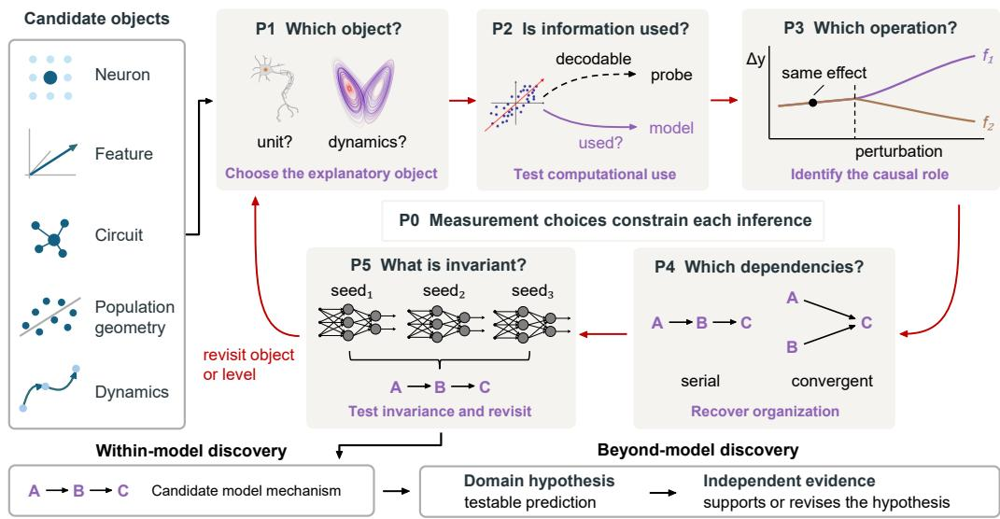

# Mechanistic Interpretability Needs a Logic of Inference

Zhimin Hu1∗ Chen Jiang2 Hanbo Xie1 N.Apurva Ratan Murty1 Sashank Varma1

1 Georgia Tech 2 McGill University

## Abstract

Neural networks are increasingly studied not merely as predictive systems, but as complex systems whose internal computations are themselves objects of scientific inquiry. Recent progress in mechanistic interpretability (MI) has made it possible to identify neurons, features, circuits, population structures, and dynamical patterns associated with model behavior. As these tools improve, attention is shifting from what can be observed inside a model to how those observations support mechanistic explanations. We examine the parallel efforts of neuroscience and MI to address this question and identify recurring inferential bottlenecks when inferring mechanisms from complex neural systems. We propose five principles and organize them into a recursive logic for a more rigorous procedure of mechanistic inference. These principles provide a framework that supports scientific discovery in two senses: it helps turn local interpretability findings into cumulative knowledge of mechanisms within models, and it makes those mechanisms sufficiently precise to generate testable hypotheses about domains beyond the models. Evidence beyond MI is ultimately required to establish what model mechanisms reveal about the world.

## 1 Introduction

Mechanistic interpretability (MI) research for artificial neural networks (ANNs) has generated remarkable advances in new methodologies over the past decades. These techniques are increasingly used to study internal representations and computations. However, the success of these observational tools has made the gap between seeing a feature and understanding the computation larger and more subtle. In earlier studies, researchers were tempted to conclude from probing that information is recoverable from a representation without showing that the model actually uses that information in its computations. Likewise, interventions have been used to establish that a component is causally relevant without identifying the computational role that component plays [Sharkey et al., 2025]. Recent works have attempted to address these concerns through high-level conceptual frameworks [Vilas et al., 2024] or localized practices [Geiger et al., 2025, Joshi et al., 2026], but a general logic for moving from interpretability results to formal mechanistic claims remains missing.

We address this gap by examining the parallel efforts of neuroscientists to understand the brain and MI researchers to understand ANNs. Neuroscience has repeatedly confronted the same problem about what can be inferred from different kinds of observations about a neural system. Over decades, broad questions about neural mechanisms were factorized into more precise questions that separate what a component represents from how information is organized across populations, transformed over stages, picked up by downstream neurons, and preserved across different implementations[Pouget et al., 2000, Quian Quiroga and Panzeri, 2009, Kriegeskorte and Douglas, 2019, Diedrichsen and Kriegeskorte, 2017]. This thinking revealed a fundamental inferential bottleneck of connecting one class of evidence to the next when dissecting complex neural systems. We coalesce these insights into five principles for ‘mechanistic’ inference. They concern identifying the appropriate explanatory object (P1), determining whether represented information is used in computation (P2), broadening from causal relevance to causal role (P3), moving from component role to organization (P4), and testing the invariance among levels of analysis and opening up new mechanistic questions (P5). Measurement conditions each of these inferences (P0).

  
Figure 1: A recursive logic for mechanistic inference. For a given neural system with behavior of interest, it can be investigated by different candidate objects of study: neurons, features, circuits, population geometry, and dynamics. We propose five principles to organize mechanistic research as a recursive process in which evidence informs further questions and revisions to earlier claims. An individual study may address a subset of these questions and revisit them as needed. Red arrows connect these five inferential questions: which object explains the phenomenon (P1), whether represented information is used in computation (P2), what computational role it plays (P3), how roles are organized (P4), and what remains invariant across conditions or implementations (P5; illustrated here across random seeds). Measurement choices constrain every inference (P0). A, B, and C denote computational roles. This process supports the discovery of candidate model mechanisms (within-model discovery), which can generate domain hypotheses and establish their plausibility beyond the model requires independent evidence (beyond-model discovery).

Our principles support MI as a science of discovery in two related senses. First, when neural networks are the object of study, the principles provide a recursive logic for turning local interpretability findings into more constrained and cumulative accounts of model mechanisms. Second, models trained on scientific data can be analyzed mechanistically to produce knowledge beyond themselves. Our framework explains how MI can identify precise candidate mechanisms, which can serve as sources of precise hypotheses and discriminating predictions about that domain.

## 2 A Brief Tour of Mechanistic Interpretability

MI refers to a set of techniques for succinctly explaining the behavior of neural networks by reference to their internal representations and computations. These objects of explanation are the ‘mechanisms’. MI approaches differ in what they treat as the object of explanation.

Early work often focused on individual neurons or units. For example, Simonyan et al. [2013], Olah et al. [2017, 2018] identified units whose activations aligned with human-interpretable visual concepts. Such findings are straightforward; however, neural representations may not always align with individual neurons [Rigotti et al., 2013]. The possibility of distributed representations thus motivated the search for explanatory objects beyond individual neurons [Morcos et al., 2018].

A newer approach is to recover alternative feature bases. Sparse autoencoders (SAEs) learn sparse decompositions of model activations and can identify features that are more interpretable than individual neurons [Huben et al., 2024]. Related approaches identify feature directions that can be intervened to steer model behaviors [Li et al., 2023]. However, such features do not constitute a unique decomposition of model activity [Leask et al., 2025]; as mechanisms, they are underdetermined.

Circuit-level approaches instead ask how multiple components interact to implement a computation. For example, Wang et al. [2023] identified a circuit of interacting attention heads underlying identification of the indirect objects of clauses. More recent work builds circuits over learned sparse features rather than raw model components, illustrating the insights offered by combining featureand circuit-level descriptions [Marks et al., 2025].

One level up in complexity are population-level analyses, which characterize the geometry and lowdimensional structure of activity across many units [Chung and Abbott, 2021, Hu et al., 2026, Feng and Steinhardt, 2024]. For recurrent or temporally extended computation, the relevant mechanism may instead be described as trajectories through a dynamical state space [Sussillo and Barak, 2013].

These approaches are not mutually exclusive, but describe neural computation at different scales and in different forms. The growing diversity of explanatory objects raises a more basic question: what does a given result establish about a mechanism, and what remains to be resolved?

## 3 Principles for Mechanistic Research

As shown in Figure 1, we organize how the principles below organize mechanistic research into a recursive logic of inference. P0 concerns the measurement choices underlying every inference, while P1 – P5 address distinct gaps between observations and mechanistic claims. An individual study may address a subset of these gaps, without following a fixed sequence.

## Principle 0: Mechanistic inference is measurement-dependent.

Before any mechanistic inference, researchers should always ask how much of the interpretation depends on how it is measured. This point undergirds all five of the principles below.

Empirical studies have shown that measurement matters. Saliency and feature-visualization methods can produce compelling structure that is only weakly tied to the model computation they are intended to explain [Adebayo et al., 2018, Geirhos et al., 2024]. Activation patching can vary with the corruption procedure and evaluation metric [Zhang and Nanda, 2024]. Different measurement choices can yield different views of the same underlying system. As in other sciences, measurements are not neutral – what we observe depends partly on the operations and assumptions we use to make them [Bechtel, 1988, Bridgman, 1927] and are therefore part of the evidence for the interpretation.

## Principle 1: Treat the explanatory object as a hypothesis.

In MI studies, researchers typically start with a privileged explanatory object, such as the single neuron, feature, attention head, or circuit. In practice, however, there is a tendency to assume that the phenomenon of interest is also organized at the level where the method returned promising results, without considering other levels of analysis.

Evidence from both brains and ANNs shows why this assumption can be misleading. In the prefrontal cortex, task variables remain decodable from population activity even after individually selective neurons are excluded [Rigotti et al., 2013], indicating that organizational structure can be easily missed at the level of single neurons. A similar pattern appears in ANNs where unit selectivity is sometimes a poor predictor of downstream task performance [Morcos et al., 2018]. Meanwhile, this does not necessarily mean that the single neuron is the wrong object. Bau et al. [2020], for example, found semantically interpretable units whose causal manipulation affected model behavior. Thus, researchers should treat the explanatory object as an empirical hypothesis, not an a priori assumption.

The choice of explanatory object or level of analysis is constrained in two directions. First, it depends on the phenomena being explained. Researchers should specify the explanandum precisely enough to determine what kind of organization an explanation needs to capture. Second, evidence at adjacent levels can test whether the proposed object is sufficient. For example, when a selective unit is found, one can ask whether the relevant computation remains in the population code; conversely, when a population-level structure is identified, one can ask whether localized circuits or neurons are sufficient to explain the behavior. This need not be an exhaustive search over all possible levels.

## Principle 2: Distinguish represented from computationally implicated information.

Once a candidate representation has been identified, a next step is to ask what information it encapsulates. Here, it is important to distinguish between information that is merely represented (total decodable information) versus information that is used by downstream computations (actual decoded information). Decodability is often used as evidence for the former. However, a variable may be decodable from an internal representation without playing a functional role in producing the behavior [Diedrichsen and Kriegeskorte, 2017, Ritchie et al., 2019, Kriegeskorte and Douglas, 2019].

This distinction has been demonstrated empirically. In human vision, information of visual category can be decoded across broad parts of the visual system, yet only a subset of these representations predicts categorization behavior [Grootswagers et al., 2018]. A similar dissociation appears in ANNs. Models can encode linguistic properties even when those properties are not needed for the task on which the model was trained [Ravichander et al., 2021], and probing accuracy does not necessarily track the importance of that information for model behavior [Elazar et al., 2021]. Thus, finding that a variable is represented identifies information available in the system, but leaves open whether and where that information enters the computation.

The practical upshot is that researchers should explicitly link information identified upstream with downstream states or behavior. Most commonly, one can selectively remove or change the information to see if the downstream computations change as expected.

## Principle 3: Distinguish causal relevance and causal role.

Interventions move mechanistic inference from asking whether information is present to asking how the system depends on it. Ablating, patching, or steering a component can establish that changing it affects the behavior of interest. But the same intervention effect may be consistent with different accounts of what that component does.

Neuroscience provides a clear example. In zebra finches, acute silencing of a song region disrupts singing immediately, whereas permanent lesions cause only transient deficits that are then recovered. This is because acute interventions disrupt downstream circuits rather than isolate local function [Otchy et al., 2015, Young et al., 2000]. Similarly in ANNs. After attention heads are ablated, downstream components can partially compensate for the perturbation, and the amount of this selfrepair varies across inputs [Rushing and Nanda, 2024]. Thus, an observed change after intervention reflects both the targeted component and how the rest of the system responds to the manipulation.

Identifying causal role requires designing interventions that can distinguish between competing explanations of what a component does. Researchers should state the operation a component is hypothesized to perform and derive predictions that follow from that account. For example, under perturbations, one can ask where and when the effect should appear, which downstream quantities should change and how, and which should remain relatively unaffected.

## Principle 4: Distinguish causal roles from mechanistic organization.

The next step in elevating components and their causal roles in target computations to the status of ‘mechanism’ is to explore the dependencies among those roles. This step shifts the focus from individual component-role mappings to the relations among them.

Neuroscience provides an example in the case of motor planning in the mouse’s anterior lateral motor cortex (ALM). During a delayed-response task, neurons in both ALM hemispheres exhibit preparatory activity that predicts the upcoming movement. There are three possibilities for such preparatory activity: it depends on local recurrent dynamics within one hemisphere, it is maintained redundantly across the two hemispheres, or the two hemispheres depend on each other. Li et al. [2016] distinguished among them by comparing the results of different perturbations. When one ALM hemisphere was transiently silenced, the population activity was displaced, but after the perturbation ended, the activity pattern rapidly recovered. Meanwhile, bilateral silencing showed that activity did not recover by the end of the delay period. The contrasting outcomes of the two perturbations therefore revealed that the computation was not simply tied to the uninterrupted activity of a particular local population. Rather, these results supported an organization of selectively coupled and partially redundant modules where either hemisphere could maintain the preparatory dynamics, while coupling between them allowed activity in one module to restore the other after a transient perturbation.

This suggests a practical strategy for moving from causal roles to mechanistic organization. Once several components have been assigned candidate roles, researchers can ask what possible dependencies must hold between them. Then, one can perform a series of perturbations on particular inputs, outputs, or paths and measure the intermediate quantities predicted to depend on them.

## Principle 5: Recurse to search for invariants and revisit the explanatory object.

The organization recovered above provides evidence about the question which began the analysis: whether the original explanatory object was the appropriate level. A level that appeared natural when individual components were first identified might turn out to capture implementation-specific details, but the stable organization might lie elsewhere [Marr, 1982]. For example, circuit-level algorithms remained relatively consistent across training, task, and model scale even when the specific components implementing them change [Tigges et al., 2024, Merullo et al., 2024]. Similarly, across independently trained SAEs, individual features may be unstable while the subspaces occupied remain reproducible [Gerasimov et al., 2026]. Thus, an explanation might remain stable and generalize at a higher level of computation while changing at the lower level of individual components.

In practice, a recursive approach can potentially reveal which aspects of a mechanism are stable by testing how its validity changes across conditions. The result might support the original level, require a more abstract description, or reveal that several levels capture different parts of the mechanism. Therefore, the principles are better viewed as recursively applied than as a static checklist.

## 4 A Historical Warning: When Interpretable Units Become Mechanisms

## A look to the history of neuroscience shows how the distinctions between the five principles emerged.

Early work asked what a selective neuron (e.g., one responding to an oriented bar or a face) in the brain explained. Gnostic cells and face cells were initially offered as an answer to the question of how objects are represented [Barlow, 1972, Konorski, 1967, Gross et al., 1972]. The idea of population coding (i.e., distributed representations) shifted the focus from the tuning of individual neurons to the information carried jointly by many cells [Georgopoulos et al., 1986, Haxby et al., 2001, Kriegeskorte et al., 2008]. Dynamical system accounts ask how population activity evolves over time to explain how the structure of the information within the population is made accessible to downstream neural populations that read that information out to support behavior [Churchland et al., 2012, Mante et al., 2013, Sussillo and Barak, 2013] . Progress was made as a broad question such as “how does the brain recognize objects” was progressively factored into a set of more precise mechanistic questions: what latent factors are represented, how is information organized, how is it transformed, and how does it ultimately support readout to guide vision-dependent behaviors? Notice that each question admits a different object of description (P1) and its own evidence that the represented information is read out (P2). The notion of ‘causal’ evidence (P3) also went through waves of refinement. Brain lesions, pharmacological inactivations, or microstimulation studies could establish that selective neurons like those for faces were indeed causally involved in face perception behaviors [Afraz et al., 2006, Sadagopan et al., 2017, Moeller et al., 2017, Parvizi et al., 2012]. However, knowing that a region is causally involved still leaves open the questions of what computation it performs and how downstream regions interact to support this behavior (P4). Answering these questions requires explicit models and carefully designed experiments [Chang and Tsao, 2017].

Despite these precedents from neuroscience, interpretability work on convolutional neural network (CNN) models of computer vision has followed a remarkably similar historical path. Early visualization studies revealed a progression from lower-level visual features to more complex patterns across CNN layers [Zeiler and Fergus, 2014], and individual units within layers were found to detect objects and human-interpretable concepts [Zhou et al., 2014, Bau et al., 2017]. But unit interpretability was basis-dependent, and selectivity was later shown to be a poor predictor of task importance [Morcos et al., 2018, Dipani and Ratan Murty, 2026]. At the same time, causal interventions demonstrated that some interpretable units do have functional roles [Bau et al., 2018, 2020]. Again, selectivity (P1) and causal contribution (P2 and 3) answer different questions, and neither alone determines the full organization of the computation (P4). The shared historical pattern across neuroscience and MI points to a general challenge in mechanistic research. An object revealed by an interpretability method should not automatically be treated as a ‘mechanism’ in the scientific or computational sense. The five principles make explicit the required inferential steps, bridging from what an interpretability method reveals to valid mechanistic claims built on that evidence.

## 5 What Comes Next: Mechanistic Interpretability as a Science of Discovery

MI should be viewed as a science of discovery in two distinct senses.

First, discovering how a neural network represents information, performs computations, and produces behavior itself constitutes scientific discovery. The historical parallel between neuroscience and MI illustrates that progress requires repeatedly refining the explanatory object and the inferences drawn from each class of evidence. Thus, for MI to become a cumulative science of such mechanisms, empirical findings must be connected to mechanistic claims through a shared logic of inference. Our five principles are intended to provide the structure for making such inference validly. They locate what a result establishes, what remains unresolved, and which mechanistic question follows.

The second sense of scientific discovery is using models as instruments to learn about domains beyond themselves. In this case, models trained on data from a target domain are then analyzed by MI techniques to extract candidate mechanisms about the external domain [Simon and Zou, 2025]. Here, recovering the computation or mechanism of a model is an intermediate step because a science of model mechanisms is not automatically a science of models of the external world. A mechanism found in the model is, first, a source of hypotheses about that domain. The gap between an MI mechanism and a scientific hypothesis exists because the model might exploit representations or computations that differ from those that generated its training data, so correspondence cannot be assumed. The five principles of our framework also explain what a model mechanism can contribute to scientific discovery beyond the model by turning interpretability results into a precise candidate hypothesis and set of predictions. These predictions can be tested independently of the interpretability analysis and, where possible, independently of the model itself. Behavioral experiments, new datasets, interventions, or domain-specific measurements can determine whether the identified structure reflects the model alone or captures a general regularity of a scientific domain.

In summary, the five principles of our framework guide the potential contributions of MI to scientific discovery along two linked cycles. First, they describe a recursive and rigorous science of mechanisms within models. Second, they serve within a broader scientific cycle in which these mechanisms generate testable hypotheses about the scientific domains the models capture. Although mechanisms found in models can expose candidate explanations, subsequent independent evidence ultimately determines what they reveal beyond the model and of the external world.

## 6 Responsible Use

Mechanistic interpretations may be overgeneralized beyond the evidence supporting them, particularly when model mechanisms are taken to reflect mechanisms in an external scientific domain. We emphasize that model-derived mechanisms should generate testable hypotheses rather than substitute for independent, domain-specific empirical validation.

## Acknowledgments

We would like to sincerely thank Professor Guillaume Lajoie from Mila and the University of Montreal for his invaluable guidance, thoughtful suggestions, and continuous support. We also express our deep gratitude to Zhiyue Han from the University of Washington-Seattle for insightful discussions and valuable feedback throughout this project.

## References

Julius Adebayo, Justin Gilmer, Michael Muelly, Ian Goodfellow, Moritz Hardt, and Been Kim. Sanity checks for saliency maps. Advances in neural information processing systems, 31, 2018.

Seyed-Reza Afraz, Roozbeh Kiani, and Hossein Esteky. Microstimulation of inferotemporal cortex influences face categorization. Nature, 442(7103):692–695, 2006.

Horace B Barlow. Single units and sensation: a neuron doctrine for perceptual psychology? Perception, 1(4):371–394, 1972.

David Bau, Bolei Zhou, Aditya Khosla, Aude Oliva, and Antonio Torralba. Network dissection: Quantifying interpretability of deep visual representations. In IEEE Conference on Computer Vision and Pattern Recognition (CVPR), pages 3319–3327. IEEE, 2017.

David Bau, Jun-Yan Zhu, Hendrik Strobelt, Bolei Zhou, Joshua B Tenenbaum, William T Freeman, and Antonio Torralba. Gan dissection: Visualizing and understanding generative adversarial networks. In International Conference on Learning Representations, 2018.

David Bau, Jun-Yan Zhu, Hendrik Strobelt, Agata Lapedriza, Bolei Zhou, and Antonio Torralba. Understanding the role of individual units in a deep neural network. Proceedings of the National Academy ofSciences, 117(48):30071–30078, 2020.

William Bechtel. Philosophy of science: An overview for cognitive science. Psychology Press, 1988.

Percy Williams Bridgman. The logic ofmodern physics, volume 3. Macmillan, 1927.

Le Chang and Doris Y Tsao. The code for facial identity in the primate brain. Cell, 169(6):1013–1028, 2017.

SueYeon Chung and L.F. Abbott. Neural population geometry: An approach for understanding biological and artificial neural networks. Current Opinion in Neurobiology, 70:137–144, 2021. ISSN 0959-4388. Computational Nceuroscience.

Mark M Churchland, John P Cunningham, Matthew T Kaufman, Justin D Foster, Paul Nuyujukian, Stephen I Ryu, and Krishna V Shenoy. Neural population dynamics during reaching. Nature, 487 (7405):51–56, 2012.

Jörn Diedrichsen and Nikolaus Kriegeskorte. Representational models: A common framework for understanding encoding, pattern-component, and representational-similarity analysis. PLoS computational biology, 13(4):e1005508, 2017.

Alish Dipani and N Apurva Ratan Murty. Category selectivity observed in the human brain is distinct from category selectivity observed in artificial neural networks. bioRxiv, pages 2026–05, 2026.

Yanai Elazar, Shauli Ravfogel, Alon Jacovi, and Yoav Goldberg. Amnesic probing: Behavioral explanation with amnesic counterfactuals. Transactions of the Association for Computational Linguistics, 9:160–175, 2021.

Jiahai Feng and Jacob Steinhardt. How do language models bind entities in context? In International Conference on Learning Representations, 2024.

Atticus Geiger, Duligur Ibeling, Amir Zur, Maheep Chaudhary, Sonakshi Chauhan, Jing Huang, Aryaman Arora, Zhengxuan Wu, Noah Goodman, Christopher Potts, et al. Causal abstraction: A theoretical foundation for mechanistic interpretability. Journal of Machine Learning Research, 26 (83):1–64, 2025.

Robert Geirhos, Roland S. Zimmermann, Blair Bilodeau, Wieland Brendel, and Been Kim. Don’t trust your eyes: on the (un)reliability of feature visualizations. In International Conference on Machine Learning, 2024.

Apostolos P Georgopoulos, Andrew B Schwartz, and Ronald E Kettner. Neuronal population coding of movement direction. Science, 233(4771):1416–1419, 1986.

Gleb Gerasimov, Timofei Rusalev, Nikita Balagansky, Daniil Laptev, Vadim Kurochkin, and Daniil Gavrilov. Unstable features, reproducible subspaces: Understanding seed dependence in sparse autoencoders. In Mechanistic Interpretability Workshop at ICML 2026, 2026.

Tijl Grootswagers, Radoslaw M Cichy, and Thomas A Carlson. Finding decodable information that can be read out in behaviour. NeuroImage, 179:252–262, 2018.

Charles G Gross, CE de Rocha-Miranda, and DB Bender. Visual properties of neurons in inferotemporal cortex of the macaque. Journal ofneurophysiology, 35(1):96–111, 1972.

James V Haxby, M Ida Gobbini, Maura L Furey, Alumit Ishai, Jennifer L Schouten, and Pietro Pietrini. Distributed and overlapping representations of faces and objects in ventral temporal cortex. Science, 293(5539):2425–2430, 2001.

Zhimin Hu, Lanhao Niu, and Sashank Varma. Language models represent and transform concepts with shared geometry. In Mechanistic Interpretability Workshop at ICML 2026, 2026.

Robert Huben, Hoagy Cunningham, Logan Smith, Aidan Ewart, and Lee Sharkey. Sparse autoencoders find highly interpretable features in language models. In International Conference on Learning Representations, pages 7827–7845, 2024.

Shruti Joshi, Aaron Mueller, David Klindt, Wieland Brendel, Patrik Reizinger, and Dhanya Sridhar. Position: Causality is key for interpretability claims to generalise. In International Conference on Machine Learning Position Paper Track, 2026.

Jerzy Konorski. Integrative activity of the brain. 1967.

Nikolaus Kriegeskorte and Pamela K Douglas. Interpreting encoding and decoding models. Current opinion in neurobiology, 55:167–179, 2019.

Nikolaus Kriegeskorte, Marieke Mur, and Peter A Bandettini. Representational similarity analysisconnecting the branches of systems neuroscience. Frontiers in systems neuroscience, 2:249, 2008.

Patrick Leask, Bart Bussmann, Michael T Pearce, Joseph Isaac Bloom, Curt Tigges, Noura Al Moubayed, Lee Sharkey, and Neel Nanda. Sparse autoencoders do not find canonical units of analysis. In International Conference on Learning Representations, 2025.

Kenneth Li, Oam Patel, Fernanda Viégas, Hanspeter Pfister, and Martin Wattenberg. Inference-time intervention: Eliciting truthful answers from a language model. In Advances in neural information processing systems, 2023.

Nuo Li, Kayvon Daie, Karel Svoboda, and Shaul Druckmann. Robust neuronal dynamics in premotor cortex during motor planning. Nature, 532(7600):459–464, 2016.

Valerio Mante, David Sussillo, Krishna V Shenoy, and William T Newsome. Context-dependent computation by recurrent dynamics in prefrontal cortex. nature, 503(7474):78–84, 2013.

Samuel Marks, Can Rager, Eric J Michaud, Yonatan Belinkov, David Bau, and Aaron Mueller. Sparse feature circuits: Discovering and editing interpretable causal graphs in language models. In International Conference on Learning Representations, 2025.

David Marr. Vision: A computational investigation into the human representation and processing of visual information. The MIT Press, 1982.

Jack Merullo, Carsten Eickhoff, and Ellie Pavlick. Circuit component reuse across tasks in transformer language models. In International Conference on Learning Representations, 2024.

Sebastian Moeller, Trinity Crapse, Le Chang, and Doris Y Tsao. The effect of face patch microstimulation on perception of faces and objects. Nature neuroscience, 20(5):743–752, 2017.

Ari S. Morcos, David G.T. Barrett, Neil C. Rabinowitz, and Matthew Botvinick. On the importance of single directions for generalization. In International Conference on Learning Representations, 2018.

Chris Olah, Alexander Mordvintsev, and Ludwig Schubert. Feature visualization. Distill, 2017. doi: 10.23915/distill.00007.

Chris Olah, Arvind Satyanarayan, Ian Johnson, Shan Carter, Ludwig Schubert, Katherine Ye, and Alexander Mordvintsev. The building blocks of interpretability. Distill, 2018. doi: 10.23915/distill. 00010.

Timothy M Otchy, Steffen BE Wolff, Juliana Y Rhee, Cengiz Pehlevan, Risa Kawai, Alexandre Kempf, Sharon MH Gobes, and Bence P Ölveczky. Acute off-target effects of neural circuit manipulations. Nature, 528(7582):358–363, 2015.

Josef Parvizi, Corentin Jacques, Brett L Foster, Nathan Withoft, Vinitha Rangarajan, Kevin S Weiner, and Kalanit Grill-Spector. Electrical stimulation of human fusiform face-selective regions distorts face perception. The Journal ofNeuroscience, 32(43):14915–14920, 2012.

Alexandre Pouget, Peter Dayan, and Richard Zemel. Information processing with population codes. Nature Reviews Neuroscience, 1(2):125–132, 2000.

Rodrigo Quian Quiroga and Stefano Panzeri. Extracting information from neuronal populations: information theory and decoding approaches. Nature Reviews Neuroscience, 10(3):173–185, 2009.

Abhilasha Ravichander, Yonatan Belinkov, and Eduard Hovy. Probing the probing paradigm: Does probing accuracy entail task relevance? In Proceedings of the 16th Conference of the European Chapter ofthe Associationfor Computational Linguistics: Main Volume, pages 3363–3377, 2021.

Mattia Rigotti, Omri Barak, Melissa R Warden, Xiao-Jing Wang, Nathaniel D Daw, Earl K Miller, and Stefano Fusi. The importance of mixed selectivity in complex cognitive tasks. Nature, 497 (7451):585–590, 2013.

J Brendan Ritchie, David Michael Kaplan, and Colin Klein. Decoding the brain: Neural representation and the limits of multivariate pattern analysis in cognitive neuroscience. The British journalfor the philosophy of science, 2019.

Cody Rushing and Neel Nanda. Explorations of self-repair in language models. In International Conference on Machine Learning, 2024.

Srivatsun Sadagopan, Wilbert Zarco, and Winrich A Freiwald. A causal relationship between face-patch activity and face-detection behavior. Elife, 6:e18558, 2017.

Lee Sharkey, Bilal Chughtai, Joshua Batson, Jack Lindsey, Jeffrey Wu, Lucius Bushnaq, Nicholas Goldowsky-Dill, Stefan Heimersheim, Alejandro Ortega, Joseph Isaac Bloom, Stella Biderman, Adrià Garriga-Alonso, Arthur Conmy, Neel Nanda, Jessica Mary Rumbelow, Martin Wattenberg, Nandi Schoots, Joseph Miller, William Saunders, Eric J Michaud, Stephen Casper, Max Tegmark, David Bau, Eric Todd, Atticus Geiger, Mor Geva, Jesse Hoogland, Daniel Murfet, and Thomas McGrath. Open problems in mechanistic interpretability. Transactions on Machine Learning Research, 2025. ISSN 2835-8856.

Elana Simon and James Zou. Interplm: discovering interpretable features in protein language models via sparse autoencoders. Nature methods, 22(10):2107–2117, 2025.

Karen Simonyan, Andrea Vedaldi, and Andrew Zisserman. Deep inside convolutional networks: Visualising image classification models and saliency maps. arXiv preprint arXiv:1312.6034, 2013.

David Sussillo and Omri Barak. Opening the black box: Low-dimensional dynamics in highdimensional recurrent neural networks. Neural Computation, 25(3):626–649, 03 2013. ISSN 0899-7667.

Curt Tigges, Michael Hanna, Qinan Yu, and Stella Biderman. Llm circuit analyses are consistent across training and scale. Advances in neural information processing systems, 37:40699–40731, 2024.

Martina G. Vilas, Federico Adolfi, David Poeppel, and Gemma Roig. Position: An inner interpretability framework for AI inspired by lessons from cognitive neuroscience. In International Conference on Machine Learning, volume 235 of Proceedings of Machine Learning Research, pages 49506–49522. PMLR, 21–27 Jul 2024.

Kevin Ro Wang, Alexandre Variengien, Arthur Conmy, Buck Shlegeris, and Jacob Steinhardt. Interpretability in the wild: a circuit for indirect object identification in GPT-2 small. In International Conference on Learning Representations, 2023.

Malcolm P Young, Claus-C Hilgetag, and Jack W Scannell. On imputing function to structure from the behavioural effects of brain lesions. Philosophical Transactions ofthe Royal Society B: Biological Sciences, 355(1393):147, 2000.

Matthew D Zeiler and Rob Fergus. Visualizing and understanding convolutional networks. In European Conference on Computer Vision, pages 818–833. Springer, 2014.

Fred Zhang and Neel Nanda. Towards best practices of activation patching in language models: Metrics and methods. In International Conference on Learning Representations, volume 2024, pages 1651–1678, 2024.

Bolei Zhou, Aditya Khosla, Agata Lapedriza, Aude Oliva, and Antonio Torralba. Object detectors emerge in deep scene cnns. In International Conference on Learning Representations, 2014.