# OpticalRAG: Pixel-Space Compression for Token-Efficient Retrieval-Augmented Generation

Senhao Liu1∗ Yuheng Zhang1,2∗ Chunyu Wei1† Yueguo Chen1 Xinran Zhang3 1School of Information, Renmin University of China, Beijing, China 2ComindX

3Claremont McKenna College, Claremont, CA, USA liusenhao@ruc.edu.cn, zhangyuheng@ruc.edu.cn, weicy15@icloud.com, chenyueguo@ruc.edu.cn, xzhang26@cmc.edu

## Abstract

Retrieval-augmented generation (RAG) is bottlenecked by the token budget of large language models: feeding long documents into the context window is expensive, while aggressive textual compression discards fine-grained information that is irreversibly lost in a one-dimensional token sequence. We argue that this bottleneck is not fundamental to information density but to the choice of compression modality. Modern visual encoders can pack the contents of a rendered text page into roughly a hundred visual tokens with little semantic loss, opening a new compression-fidelity tradeoff that purely textual methods cannot reach. We present OpticalRAG, a framework that renders documents as page images, encodes them with a frozen vision encoder, and distills the retrieved visual tokens into as few as 16 injected tokens before passing them to the LLM. Two ingredients make this work without expensive cross-modal training: (i) Encoder-Bridged Retrieval, which projects text-query states into the visual feature space of the frozen encoder, through a projection shared with the compressor, to retrieve visual tokens from a text query, with no contrastive training; and (ii) Query-Driven Distillation, a lightweight crossattention compressor that condenses the retrieved visual tokens into a small set of query-conditioned prefix tokens. On LongBench-v2, BAMBOO, and LooGLEv2, OpticalRAG achieves the best compression-aware accuracy (CAP) on all three benchmarks while injecting only 16 tokens, and improves the closed-book Qwen2.5-7B-Instruct backbone by 5.17 points on LongBench-v2. 1

## 1 Introduction

Large language models (LLMs) have demonstrated remarkable capabilities across knowledgeintensive tasks, yet they remain fundamentally constrained by finite context windows [Wei et al., 2025a]. When faced with long documents or large corpora, practitioners must either truncate the input or resort to retrieval-augmented generation (RAG), which introduces challenges around how retrieved content is represented and consumed by the LLM.

Existing approaches fall into two broad families (Figure 1a-b). Textual compression methods, including prompt compression [Pan et al., 2024], extractive summarization [Xu et al., 2024], and token pruning [Li et al., 2023b], operate on text sequences, selectively discarding or merging tokens to fit within budgets. While effective at moderate compression ratios, they struggle to preserve fine-grained information at aggressive ratios because each removed token represents an irreversible loss in a one-dimensional sequence. A parallel line of work, exemplified by xRAG [Cheng et al., 2024], attempts to bypass the token bottleneck by encoding entire documents into single dense embeddings injected into the LLM’s representation space. Despite this progress, both families are modality-blind: they ignore the structural redundancy inherent in how information is spatially laid out on a page. Single-embedding approaches collapse all document content into one vector, discarding fine-grained detail. Token-level methods treat text as a flat sequence, ignoring the rich 2D spatial relationships that humans naturally exploit when scanning a document.

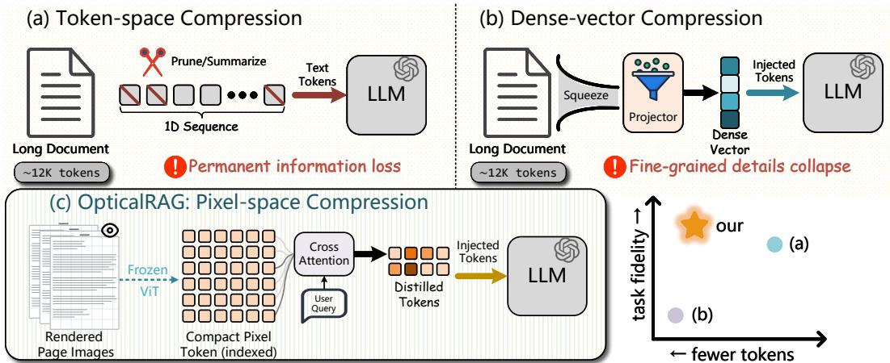  
Figure 1: Illustration of OpticalRAG. (a) Token-space methods prune or summarize the 1D text sequence, causing permanent information loss at high compression ratios. (b) Dense-vector methods squeeze each document into a single embedding, collapsing fine-grained details. (c) Our OpticalRAG renders documents into page images and encodes them into compact visual tokens via a frozen ViT. At query time, a cross-attention module distills retrieved visual tokens into a small set of injected tokens conditioned on the user query.

We start from a simple observation: a single rendered page image, when processed by a modern visual encoder, can compress hundreds of text tokens into just a hundred visual tokens while preserving most semantic content. This motivates our core idea: instead of compressing text in the token space, compress it in the pixel space (Figure 1c). Concretely, we render documents into page images, encode them into compact visual tokens for retrieval, and at query time distill the retrieved visual tokens through query-aware cross-attention into as few as 16 tokens injected directly into the LLM.

Realizing this idea effectively requires addressing two core challenges. Challenge 1: Cross-Modal Alignment. Documents are encoded as visual tokens, but user queries arrive as text. How can we build an effective retrieval bridge between text queries and visual document representations without costly end-to-end alignment training? Challenge 2: Token-Budget Injection. Even after retrieval, the retrieved visual tokens can still number in the hundreds or thousands. How can we distill only the query-relevant information into a minimal set of tokens?

To address Cross-Modal Alignment, we introduce Encoder-Bridged Retrieval, which bridges the frozen visual encoder and the frozen LLM (Qwen2.5-7B-Instruct [Yang et al., 2024]): document chunks are rendered and encoded by the frozen visual encoder, while text queries are encoded by the LLM and projected into the same visual feature space via a lightweight projection shared with the compressor, requiring no contrastive training.

To tackle Token-Budget Injection, we propose Query-Driven Distillation, a lightweight crossattention module that uses the query’s semantic representation to condense retrieved visual tokens into a fixed small set of learned compression queries. Adapted from the Q-Former paradigm [Li et al., 2023a], it dynamically routes information based on what the question demands, achieving compression from 256 retrieved visual tokens down to just 16 with minimal loss of task-relevant information.

Contribution. (1) We present OpticalRAG, a framework that reimagines document compression for RAG through visual encoding. By rendering text as images and operating entirely in the visual token space, we unlock a new compression-fidelity trade-off unavailable to purely textual methods. (2) Our two core techniques, Encoder-Bridged Retrieval and Query-Driven Distillation, address the crossmodal alignment and token-budget challenges respectively, enabling extreme compression while preserving task-critical information. (3) On LongBench-v2 (503 samples), OpticalRAG achieves an overall score of 35.79 with only 16 injected tokens, compared to 30.62 for the closed-book Qwen2.5-7B-Instruct backbone, a 5.17-point improvement while consuming orders of magnitude fewer tokens than textual retrieval and compression baselines.

## 2 Related Work

Context compression for RAG. Retrieval-augmented generation [Borgeaud et al., 2022, Qin et al., 2026, Wei et al., 2026a] enhances LLMs with external knowledge but introduces long contexts that are computationally expensive; we refer readers to Li et al. [2025b] and Verma [2024] for comprehensive surveys. Hard prompt compression methods reduce token counts by pruning or rewriting text, including self-information-based selection [Li et al., 2023b], the LLMLingua family for query-aware compression [Jiang et al., 2023, 2024], and RAG-specific extractive compressors such as RECOMP [Xu et al., 2024], EXIT [Hwang et al., 2025], Provence [Chirkova et al., 2025], Refiner [Li et al., 2024b], and FiD-Light [Hofstätter et al., 2023], with information-theoretic perspectives explored in [Zhu et al., 2024, Wang et al., 2025]. Soft embedding methods instead compress contexts into continuous representations through Gist tokens [Mu et al., 2023], ICAE [Ge et al., 2024], AutoCompressors [Chevalier et al., 2023], Activation Beacon [Zhang et al., 2025], 500xCompressor [Li et al., 2025c], and CEPE [Yen et al., 2024], with RAG-tailored variants including PISCO [Louis et al., 2025], CompAct [Yoon et al., 2024], Self-RAG [Asai et al., 2024], LLoCO [Tan et al., 2024], GritLM [Muennighoff et al., 2025], and ECoRAG [Jeong et al., 2025]. Most relevant to our work, xRAG [Cheng et al., 2024] reinterprets dense retrieval embeddings as a cross-modal signal and injects each document as a single token, but the single-token bottleneck severely limits fine-grained information retention. KV-cache compression provides an orthogonal axis through token-eviction policies [Zhang et al., 2023, Xiao et al., 2024, Li et al., 2024a, Fu et al., 2025], channel pruning [Xu et al., 2025], quantization [Liu et al., 2024b], cross-layer merging [Liu et al., 2024a], and RAG-specific KV reuse [Yao et al., 2025, Ma et al., 2025, Hu et al., 2025b]. All these methods operate in the text token space; our work departs from this paradigm by compressing documents in the pixel space via visual encoding.

Visual document understanding. Visual document understanding has evolved from specialized Document AI models to general-purpose multimodal LLMs; see Ding et al. [2026] for a recent survey. Early multimodal transformers including LayoutLMv3 [Huang et al., 2022], DocFormer [Appalaraju et al., 2021, 2024], and UDoc [Gu et al., 2021] jointly modeled text, layout, and image patches, while the OCR-free paradigm pioneered by Donut [Kim et al., 2022] and extended by Pix2Struct [Lee et al., 2023] demonstrated that documents can be read directly from pixels. Modern multimodal LLMs further advance this direction through unified structure learning in DocOwl 1.5 [Hu et al., 2024], the high-resolution compressor of DocOwl2 [Hu et al., 2025a], OCR-augmented frozen VLMs in DocVLM [Nacson et al., 2025], similarity-based token filtering in TextMonkey [Liu et al., 2026], vision-language alignment in AlignVLM [Masry et al., 2025], dual visual encoders in LLaVA-Read [Zhang et al., 2024b], and hierarchical cross-attentive pooling in HVFA [Park et al., 2024]. For multi-page and multi-document scenarios, M3DocRAG [Cho et al., 2024] and SimpleDoc [Jain et al., 2025] embed document understanding in a RAG pipeline with visual retrievers, while Docopilot [Duan et al., 2025] pursues native long-context understanding without retrieval. Most directly related is the emerging line of optical text compression: DeepSeek-OCR [Wei et al., 2025b] maps rendered text into as few as 100 visual tokens per page while maintaining high OCR accuracy, its successor [Wei et al., 2026b] introduces causal reordering of visual tokens, and GOT-OCR [Wei et al., 2024] proposes a unified end-to-end encoder-decoder for general OCR. On the visual token compression front, TokenCarve [Tan et al., 2025] and TCC [Zhang et al., 2024a] prune tokens via information-preservation and correlation criteria, PVC [Yang et al., 2025] introduces progressive compression across frames, and the Q-Former connector [Kim et al., 2024] provides the foundational query-token bottleneck architecture. Most closely, QueCC [Li et al., 2025a] employs query-based convolutional cross-attention to compress visual tokens down to as few as one token, establishing scaling laws favoring extreme visual token reduction. Our work differs in that we do not aim to build a better document VLM; instead, we repurpose pretrained visual encoders as a compression and retrieval mechanism for general text-based RAG, adapting QueCC-style query-conditioned compression from a within-model setting to a cross-modal retrieval setting where the compressed content is retrieved documents rather than a currently observed image.

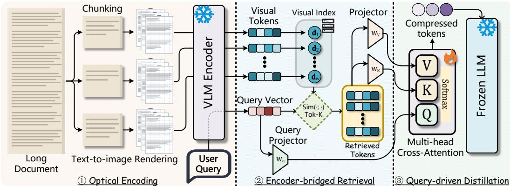  
Figure 2: OpticalRAG framework overview. ① Optical Encoding: document chunks are rendered as page images and encoded by a frozen VLM encoder into visual tokens; each visual token is indexed individually. ② Encoder-Bridged Retrieval: the query is projected into visual space via $\mathbf { W } _ { q }$ and matched to the index by inner product to retrieve top-K visual tokens. ③ Query-Driven Distillation: a cross-attention module with learned compression queries distills retrieved visual tokens into a compact prefix fed into the frozen LLM.

## 3 Preliminary

Problem setting. We consider the standard retrieval-augmented generation scenario. Given a long document (or corpus) D consisting of N text tokens and a user query q, the goal is to produce an answer a by conditioning a frozen large language model M on a compressed representation of the relevant content in $\mathcal { D } ,$ subject to a strict token budget $B \ll N$ . In the multiple-choice QA setting we primarily evaluate on, the answer $a ^ { * } \in \{ A , B , C , \mathsf { \bar { D } } \}$ is selected by scoring the next-token logits of M over the candidate labels.

Notation. We denote the visual encoder as ${ \mathcal { E } } _ { \mathrm { v i s } } .$ , the language model as M with hidden dimension $d _ { \mathrm { l l m } } .$ , and the visual token dimension as $d _ { \mathrm { v i s } }$ . Bold lowercase letters (e.g., v, q) denote vectors, bold uppercase letters (e.g., V, Q) denote matrices, and calligraphic letters $( \boldsymbol { \mathrm { e } } . \boldsymbol { \mathrm { g } } . , \mathcal { D } , \mathcal { M } )$ denote sets or models. We use $[ \cdot ; \cdot ]$ for sequence concatenation along the token dimension.

## 4 Methodology

As illustrated in Figure 2, OpticalRAG consists of three stages: (1) Optical Encoding (§4.1), which renders text into page images and encodes them into compact visual tokens via a frozen visual encoder; (2) Encoder-Bridged Retrieval (§4.2), which retrieves relevant visual tokens by projecting the query into the visual feature space; and (3) Query-Driven Distillation (§4.3), which compresses the retrieved visual tokens into a small set of query-conditioned tokens injected as a prefix into the frozen LLM. The visual encoder remains frozen; retrieval reuses the learned query projection from the distillation module.

## 4.1 Optical Encoding

The first stage converts a text document into a set of compact visual token sequences through text-to-image rendering followed by visual encoding.

Text-to-image rendering. Given a document D with character length $| \mathcal { D } |$ , we partition it into W non-overlapping text windows by sequential splitting, where each window $\mathcal { D } _ { w }$ contains at most $L _ { \mathrm { w i n } }$ characters: $\mathcal { D } \to \{ \mathcal { D } _ { 1 } , . . . , \dot { \mathcal { D } } _ { W } \}$ with $| \mathcal { D } _ { w } ^ { \phantom { } } | \leq \bar { L } _ { \mathrm { w i n } }$ . Each window $\mathcal { D } _ { w }$ is then rendered into a sequence of $P _ { w }$ page images $\{ \mathbf { I } _ { w , 1 } , \ldots , \mathbf { I } _ { w , P _ { w } } \}$ at a fixed resolution of $H \times H$ pixels using a deterministic typesetting engine. The rendering is controlled by three parameters: font size $s _ { f } .$

margin width $s _ { m }$ , and line-height scale $s _ { l } .$ , which together determine the information density per page. These parameters are hyperparameters of the compression pipeline. Rendering the windows yields $\sum { _ w = 1 ^ { W } P _ { w } }$ pages in total.

Visual encoding. Each page image $\mathbf { I } _ { w , p } \in \mathbb { R } ^ { H \times H \times 3 }$ is passed through a frozen visual encoder ${ \mathcal E } _ { \mathrm { v i s } }$ to produce a fixed-length sequence of $_ T$ visual tokens, $\mathbf { V } _ { w , p } = \mathcal { E } _ { \mathrm { v i s } } ( \mathbf { I } _ { w , p } ) \in \mathbb { R } ^ { T \times d _ { \mathrm { v i s } } }$ , where $T$ is the number of output patches and $d _ { \mathrm { v i s } }$ is the visual embedding dimension. We adopt the DeepEncoder architecture [Wei et al., 2025b], which combines SAM and CLIP visual features to produce $\dot { T }$ tokens per page. The concrete encoding and inference settings are provided in Appendix D.7. All visual tokens from the same window are concatenated along the token dimension to form a window-level representation $\mathbf { V } _ { w } = [ \mathbf { V } _ { w , 1 } ; ~ . ~ . ~ . ~ ; ~ \mathbf { V } _ { w , P _ { w } } ] \in \mathbb { R } ^ { ( P _ { w } \cdot T ) ^ { - } \times d _ { \mathrm { v i s } } }$ . Across all windows, the complete visual representation of D is $\{ \mathbf { V } _ { 1 } , \hdots , \mathbf { V } _ { W } \}$ , containing $\begin{array} { r } { N _ { \mathrm { v i s } } = T \sum _ { w = 1 } ^ { W } P _ { w } } \end{array}$ visual tokens. This is the core insight ofOpticalRAG: by movingfrom 1D text sequences to 2D rendered images, we exploit the spatial compression ability ofvisual encoders to achieve afundamentally different compressionfidelity trade-off.

## 4.2 Encoder-Bridged Retrieval

Given the visual token representation of D and a text query $q ,$ we must identify the most relevant visual tokens for downstream answering. The key challenge is cross-modal alignment: queries are text while documents are visual tokens. We address this by learning a projection from language-model hidden states into the visual feature space.

Document indexing. Each visual token $\mathbf { v } _ { i } \in \mathbb { R } ^ { d _ { \mathrm { v i s } } } , i = 1 , \dots , N _ { \mathrm { v i s } }$ , is stored individually in an inner-product index for the current document, together with its original position. This indexing step is entirely offline and parameter-free: we reuse the frozen visual encoder’s output without any additional training.

Query encoding. The query prompt $q ,$ including the question, candidate choices, and instructions, is tokenized and passed through the embedding layer and transformer blocks of the frozen language model M with a maximum prompt length of $L _ { q }$ tokens to obtain its last-layer hidden states ${ \mathbf { H } } _ { q } \in$ Rnq×dllm . Since $d _ { \mathrm { l l m } } \neq d _ { \mathrm { v i s } }$ in general, we first apply a learned linear projection $\mathbf { W } _ { q } \in \mathbb { R } ^ { d _ { \mathrm { v i s } } }$ ×dllm to each hidden state, then max-pool over the token dimension to obtain $\tilde { \mathbf { h } } _ { q } ^ { \top } = \mathbf { M a x P o o l } ( \mathbf { H } _ { q } \mathbf { W } _ { q } ^ { \top } )$ The projection $\mathbf { W } _ { q }$ is part of the QueryDrivenCompressor module and is jointly trained with the distillation stage.

Retrieval. We retrieve the top-K visual tokens by inner product: $\mathcal { R } ( q ) = \mathrm { t o p - K } _ { i \in \{ 1 , \dots , N _ { \mathrm { v i s } } \} } \tilde { \mathbf { h } } _ { q } ^ { \top } \mathbf { v } _ { i }$ retaining all candidates if fewer than $K$ are available.

The selected tokens are sorted by their original positions before being passed to the query-driven distillation module.

## 4.3 Query-Driven Distillation

Retrieval selects $S = \mathrm { m i n } ( K , N _ { \mathrm { v i s } } )$ visual tokens. The Query-Driven Distillation module compresses this selected sequence into M query-conditioned visual-prefix tokens, reducing the amount of document-derived context passed to the frozen LLM.

Visual token preparation. We first stack all retrieved visual tokens into a single sequence $\mathbf { V } _ { \mathrm { a l l } } =$ $[ \mathbf { v } _ { r _ { 1 } } ^ { \top } ; ~ . ~ . ~ . ~ ; ~ \mathbf { v } _ { r _ { S } } ^ { \top } ] \in \mathbb { R } ^ { S \times d _ { \mathrm { v i s } } }$ s , where $\left\{ r _ { 1 } , \dots , r _ { S } \right\} = { \mathcal { R } } ( q ) , r _ { 1 } < \dots < r _ { S }$ , and $\bar { S } = \mathrm { m i n } ( K , N _ { \mathrm { v i s } } )$ is the number of selected visual tokens.

Query-global fusion. To inform the compression with query semantics, we use the same projected and pooled query representation as in retrieval: $\mathbf { q } _ { \mathrm { g l o b a l } } = \tilde { \mathbf { h } } _ { q } \in \mathbb { R } ^ { d _ { \mathrm { v i s } } }$ . The query-global vector is broadcast and added to each visual token before downsampling to produce query-fused visual representations $\mathbf { V } _ { \mathrm { f u s e d } } = \mathbf { V } _ { \mathrm { a l l } } + \mathbf { 1 } \mathbf { q } _ { \mathrm { g l o b a l } } ^ { \top } \in \mathbb { R } ^ { S \times d _ { \mathrm { v i s } } }$ , where $\mathbf { 1 } \in \mathbb { R } ^ { S }$ is the all-ones vector. This step introduces query information into the token representations. Query-dependent attention weights are also enabled by conditioning the compression queries below; token-side addition alone does not guarantee query-dependent selection (Appendix A.4).

When downsampling is enabled and S is a perfect square, the implementation reshapes the fused sequence into a square grid and applies a depthwise convolution with kernel size and stride s. This operation requires $\sqrt { S } \geq s ;$ ; for valid square inputs,

$$
\hat { \mathbf { V } } _ { \mathrm { f u s e d } } = \mathrm { D W C o n v } _ { \downarrow s } ( \mathbf { V } _ { \mathrm { f u s e d } } ) \in \mathbb { R } ^ { S ^ { \prime } \times d _ { \mathrm { v i s } } } , \quad S ^ { \prime } = \left\lfloor \frac { \sqrt { S } } { s } \right\rfloor ^ { 2 } .\tag{1}
$$

For non-square sequence lengths or when downsampling is disabled, $\hat { \mathbf { V } } _ { \mathrm { f u s e d } } = \mathbf { V } _ { \mathrm { f u s e d } } .$ , with $S ^ { \prime } = S$ The implementation does not add a separate guard for square inputs whose side length is smaller than the kernel. The grid is formed from the ordered retrieved sequence and does not necessarily preserve adjacency on the original pages.

Learned compression queries. We introduce M learnable query tokens $\mathbf { Z } \in \mathbb { R } ^ { M \times d _ { \mathrm { v i s } } }$ , randomly initialized and trained end-to-end. These serve as the “information sinks” that absorb compressed knowledge from the visual tokens. We initialize ${ \bf Z } ^ { ( 0 ) } = { \bf Z } + { \bf 1 } _ { M } { \bf q } _ { \mathrm { g l o b a l } } ^ { \top }$ , where ${ \bf 1 } _ { M }$ is the all-ones vector of length M, and form keys and values using learned projections: $\mathbf { K } _ { \mathrm { v i s } } = \hat { \mathbf { V } } _ { \mathrm { f u s e d } } \mathbf { W } _ { K } ^ { \top }$ and $\mathbf { V } _ { \mathrm { v a l } } = \hat { \mathbf { V } } _ { \mathrm { f u s e d } } \mathbf { W } _ { V } ^ { \top }$ , with $\mathbf { W } _ { K } , \mathbf { W } _ { V } \in \mathbb { R } ^ { d _ { \mathrm { v i s } } \times d _ { \mathrm { v i s } } }$ . The compression is performed by a stack of L multi-head cross-attention layers:

$$
\begin{array} { r } { { \bf Z } ^ { ( \ell ) } = { \bf Z } ^ { ( \ell - 1 ) } + { \bf M } { \bf H } { \bf A } ^ { ( \ell ) } \left( { \bf Z } ^ { ( \ell - 1 ) } , ~ { \bf K } _ { \mathrm { v i s } } , ~ { \bf V } _ { \mathrm { v a l } } \right) , \quad \ell = 1 , \ldots , L , } \end{array}\tag{2}
$$

where $\mathbf { M H A } ^ { ( \ell ) } ( \mathbf { Q } , \mathbf { K } , \mathbf { V } )$ denotes multi-head cross-attention at layer ℓ with Q as queries and K, V as keys and values, using $n _ { h }$ attention heads. The output $\mathbf { Z } _ { \mathrm { o u t } } = \mathrm { L N } ( \mathbf { Z } ^ { ( L ) } ) \in \mathbb { R } ^ { M \times d _ { \mathrm { v i s } } }$ contains M compressed tokens trained to retain query-relevant information from the retrieved visual tokens. These $S ^ { \prime }$ query-fused visual tokens are distilled into M compressed tokens through learned cross-attention, with the query guiding which information to preserve.

Bridge to LLM space. The compressed tokens $\mathbf { Z _ { \mathrm { o u t } } }$ reside in the visual embedding space $( d _ { \mathrm { v i s } } )$ and must be projected into the LLM’s input space $( d _ { \mathrm { l l m } } )$ . We employ a two-layer MLP with LayerNorm:

$$
\begin{array} { r l } & { \mathbf { U } = \mathrm { G E L U } \left( \mathbf { Z } _ { \mathrm { o u t } } \mathbf { W } _ { 1 } ^ { \top } + \mathbf { 1 } _ { M } \mathbf { b } _ { 1 } ^ { \top } \right) , } \\ & { \mathbf { P } = \mathrm { L N } \left( \mathrm { D r o p o u t } _ { p _ { \mathrm { d r o p } } } ( \mathbf { U } ) \mathbf { W } _ { 2 } ^ { \top } + \mathbf { 1 } _ { M } \mathbf { b } _ { 2 } ^ { \top } \right) . } \end{array}\tag{3}
$$

Here $\mathbf { W } _ { 1 } \in \mathbb { R } ^ { d _ { h } \times d _ { \mathrm { v i s } } } , \mathbf { W } _ { 2 } \in \mathbb { R } ^ { d _ { \mathrm { l l m } } \times d _ { h } } , \mathbf { b } _ { 1 } \in \mathbb { R } ^ { d _ { h } }$ , and $\mathbf { b } _ { 2 } \in \mathbb { R } ^ { d _ { \mathrm { l l m } } }$ are learned parameters; ${ \bf 1 } _ { M }$ broadcasts the biases across prefix positions. For the chosen backbones, $d _ { \mathrm { v i s } } = 1 0 2 4$ and $d _ { \mathrm { l l m } } = 3 5 8 4$ $d _ { h }$ and $p _ { \mathrm { d r o p } }$ denote the bridge hidden width and dropout probability. Dropout is active during training and disabled during evaluation, and $\mathbf { P } \in \mathbb { R } ^ { M \times d _ { \mathrm { l l m } } }$ . The resulting P serves as a soft prefix prepended to the query’s text token embeddings: $\mathbf { X } _ { \mathrm { i n p u t } } = [ \mathbf { P } ;$ Embed $\boldsymbol { \mathscr { M } } ( \boldsymbol { q } ) \overline { { \mathop { } \in \mathbb { R } ^ { ( M + n _ { q } ) \times d _ { \mathrm { l l m } } } } }$ , where Embed $\boldsymbol { \mathscr { M } } ( \boldsymbol { q } )$ denotes the token embeddings of the query prompt obtained from the frozen $\mathcal { M }$ . Here $n _ { q }$ is the prompt length after tokenization and truncation. The budget M counts only the visual prefix; the answer-scoring forward pass receives $M + n _ { q }$ input embedding positions.

Answer prediction. The composite input $\mathbf { X } _ { \mathrm { i n p u t } }$ is fed into the frozen language model $\mathcal { M } .$ . For multiple-choice $\mathrm { Q A } ,$ , the model selects an answer from the candidate options associated with each question.

## 4.4 Training

Only the QueryDrivenCompressor (including the projection $\mathbf { W } _ { q } ,$ the depthwise convolution in Eq. 1, the L-layer cross-attention, and the learnable queries Z) and the VisualToLLMBridge $( \mathrm { E q } . 3 )$ are trained. The visual encoder ${ \mathcal E } _ { \mathrm { v i s } }$ and the language model M remain entirely frozen throughout.

Stage 1: Reconstruction pretraining. We first pretrain the compressor and bridge on a text reconstruction objective. Given a document chunk rendered into visual tokens, the model must reconstruct the original text from the compressed prefix tokens. The training data consists of passages sampled from Wikipedia and C4. The loss is the standard next-token prediction loss:

$$
\mathcal { L } _ { \mathrm { r e c o n } } = - \sum _ { t = 1 } ^ { n } \log p _ { \mathcal { M } } ( x _ { t } \mid \mathbf { P } , x _ { < t } ) ,\tag{4}
$$

where $x _ { 1 } , \ldots , x _ { n }$ are the tokens of the original text and P is the compressed prefix. This stage teaches the compressor tofaithfully encode document content into the prefix tokens, establishing a strong initialization before task-specific adaptation.

Stage 2: Task-aware fine-tuning. We then fine-tune on reading comprehension datasets (SQuAD v2, $\mathrm { D R O P , C o Q A ) }$ . The loss is computed over the answer:

$$
\mathcal { L } _ { \mathrm { t a s k } } = - \sum _ { t = 1 } ^ { n _ { a } } \log p _ { \mathcal { M } } ( a _ { t } \mid \mathbf { P } , \ q , a _ { < t } ) ,\tag{5}
$$

where $a _ { 1 } , \ldots , a _ { n _ { c } }$ are the answer tokens. We use early stopping based on a held-out development set, selecting the checkpoint with the best development performance. Training hyperparameters and data split sizes are reported in Table 11. The two-stage strategy decouples content-preservation learning from task-specific reasoning, allowing the compressor tofirst learn “what to remember” and then “what matters for answering.”

## 5 Theoretical Analysis

We show that Query-Driven Distillation can compress $S ^ { \prime }$ retrieved visual tokens into M prefix tokens with arbitrarily small loss in task-relevant information (exactly lossless in the hard-attention limit), provided M is at least the intrinsic query-conditioned rank r of the answer distribution.

Theorem 5.1 (Lossless Query-Conditioned Compression). Let $\hat { \mathbf { V } } _ { f u s e d } \in \mathbb { R } ^ { S ^ { \prime } \times d _ { v i s } }$ with rows $\hat { \mathbf { v } } _ { s }$ satisfying $\begin{array} { r } { \| \hat { \mathbf { v } } _ { s } \| _ { 2 } \leq R , } \end{array}$ and $\mathbf { q } _ { g l o b a l } \in \mathbb { R } ^ { d _ { v i } }$ s . Suppose there exist $\mathbf { U } \in \mathbb { R } ^ { d _ { v i s } \times r }$ with orthonormal columns, probe vectors $\mathbf { z } _ { 1 } ^ { \star } , \ldots , \mathbf { z } _ { r } ^ { \star } \in \mathbb { R } ^ { d _ { \nu i s } }$ , a margin $\gamma > 0 ,$ , and afunction g that is $L _ { g } .$ Lipschitz in itsfirst argument (from the Frobenius to the Euclidean norm), such thatfor every input: (i)for each $j ,$ the evidence position $\sigma ( j ) : = \arg \operatorname* { m a x } _ { s } ( \mathbf { z } _ { j } ^ { \star } + \mathbf { q } _ { g l o b a l } ) ^ { \top } \hat { \mathbf { v } } _ { s }$ satisfies $( \mathbf { z } _ { j } ^ { \star } + \mathbf { q } _ { g l o b a l } ) ^ { \top } \left( \hat { \mathbf { v } } _ { \sigma ( j ) } - \hat { \mathbf { v } } _ { s } \right) \geq \gamma$ for all s $\neq \sigma ( j )$ ; and (ii)

$$
p \Big ( a ^ { \star } \mid \hat { \mathbf { V } } _ { f u s e d } , \mathbf { q } _ { g l o b a l } \Big ) = g \big ( \mathbf { U } ^ { \top } \big [ \hat { \mathbf { v } } _ { \sigma ( 1 ) } , \dots , \hat { \mathbf { v } } _ { \sigma ( r ) } \big ] , \ \mathbf { q } _ { g l o b a l } \big ) .\tag{6}
$$

Then for any $M \geq r a n d \varepsilon > 0 ,$ , there exist a single-layer MHA, learnable queries $\mathbf { Z } \in \mathbb { R } ^ { M \times d _ { v i s } }$ conditioned as ${ \bf Z } ^ { ( 0 ) } = { \bf Z } + { \bf 1 } _ { M } { \bf q } _ { g l o b a l } ^ { \top }$ (Section 4.3), and a readout Φ such that, uniformly over all such inputs,

$$
\left\| \Phi \Big ( \mathrm { M H A } \Big ( \mathbf { Z } ^ { ( 0 ) } , \hat { \mathbf { V } } _ { f u s e d } , \hat { \mathbf { V } } _ { f u s e d } \Big ) , \mathbf { q } _ { g l o b a l } \Big ) - p \Big ( a ^ { \star } \mid \hat { \mathbf { V } } _ { f u s e d } , \mathbf { q } _ { g l o b a l } \Big ) \right\| _ { 2 } \leq \varepsilon ,\tag{7}
$$

with equality ofthe two distributions in the limit ofthe attention temperature $\tau  \infty$

Proof. Write $\mathbf { u } _ { 1 } , \ldots , \mathbf { u } _ { r }$ for the columns of U. By assumption (6), it suffices to construct MHA and Φ such that the rows of $\mathbf { Z } ^ { ( 1 ) }$ encode the matrix $\mathbf { A } : = \mathbf { U } ^ { \top } [ \widehat { \mathbf { v } } _ { \sigma ( 1 ) } , \dotsc , \widehat { \mathbf { v } } _ { \sigma ( r ) } ] \in \mathbb { R } ^ { r \times r }$ , since Φ can then apply g to obtain the answer distribution.

Choose $n _ { h } \geq r$ (allowing each head full width $d _ { \mathrm { v i s } } )$ and, without loss of generality, take $M = r ;$ additional queries and heads are ignored by Φ. For each head $i \in \{ 1 , \ldots , r \}$ , define

$$
\mathbf { W } _ { K } ^ { ( i ) } = \mathbf { I } _ { d _ { \mathrm { v i s } } } , \qquad \mathbf { W } _ { Q } ^ { ( i ) } = \tau \mathbf { I } _ { d _ { \mathrm { v i s } } } , \qquad \mathbf { W } _ { V } ^ { ( i ) } = \mathbf { u } _ { i } \mathbf { u } _ { i } ^ { \top } ,\tag{8}
$$

with the $j \mathrm { - t h }$ learnable query set to the fixed probe $\mathbf { z } _ { j } = \mathbf { z } _ { j } ^ { \star }$ , so that the j-th row of $\mathbf { Z } ^ { ( 0 ) }$ is z⋆j + qglobal. The attention logit between query j and token s is

$$
\alpha _ { j , s } = \tau \left( \mathbf { z } _ { j } ^ { \star } + \mathbf { q } _ { \mathrm { g l o b a l } } \right) ^ { \top } \hat { \mathbf { v } } _ { s } ,\tag{9}
$$

which by (i) attains its unique maximum at $s = \sigma ( j )$ with margin $\tau \gamma$ . Hence the softmax weights $\beta _ { j , s }$ place total mass at most $( S ^ { \prime } - 1 ) e ^ { - \tau \gamma }$ on $s \neq \sigma ( j )$ , and the head-i output satisfies

$$
\mathbf { o } _ { j } ^ { ( i ) } = \sum _ { s } \beta _ { j , s } \left( \mathbf { u } _ { i } ^ { \top } \hat { \mathbf { v } } _ { s } \right) \mathbf { u } _ { i } , \qquad \left| \mathbf { u } _ { i } ^ { \top } \mathbf { o } _ { j } ^ { ( i ) } - \mathbf { u } _ { i } ^ { \top } \hat { \mathbf { v } } _ { \sigma ( j ) } \right| \leq 2 R ( S ^ { \prime } - 1 ) e ^ { - \tau \gamma } .\tag{10}
$$

Concatenating all r heads and reading off the coefficients along the orthonormal basis $\mathbf { u } _ { 1 } , \ldots , \mathbf { u } _ { r }$ yields an estimate $\hat { \bf A } [ : , j ]$ of $\mathbf { A } [ : , j ] = \mathbf { U } ^ { \top } \hat { \mathbf { v } } _ { \sigma ( j ) } \in \mathbb { R } ^ { r }$ for each query $j ,$ so that $\| \hat { \mathbf { A } } - \mathbf { A } \| _ { F } \leq$ $2 r R ( S ^ { \prime } - 1 ) e ^ { - \tau \gamma }$ . Let Φ return $g ( \hat { \mathbf { A } } , \mathbf { q } _ { \mathrm { g l o b a l } } )$ . By (6) and the Lipschitz continuity of $^ { g , }$ the error in (7) is at most $2 L _ { q } r R ( S ^ { \prime } - 1 ) e ^ { - \tau \gamma }$ , which is at most ε for $\tau \geq \gamma ^ { - 1 } \log \bigl ( 2 L _ { g } r R ( S ^ { \prime } - 1 ) / \varepsilon \bigr )$ and vanishes as $\tau  \infty$ , establishing (7). □ □

Table 1: Main results on LongBench-v2, Bamboo, and LooGLE-v2.
<table><tr><td colspan="8">BACKBONE STD. RAG SEL. CONTEXT LLMLINGUA-V2 XRAG RECOMP</td></tr><tr><td rowspan="3">LongBench-v2</td><td>Score</td><td>30.62</td><td>31.41</td><td>32.40</td><td>28.23</td><td>26.24</td><td>32.01</td><td>OURS 35.79</td></tr><tr><td>Len</td><td>0</td><td>1622.68</td><td>5511.73</td><td>2669.19</td><td>1</td><td>6953.93</td><td>16</td></tr><tr><td>CAP↑</td><td>30.62</td><td>34.71</td><td>33.69</td><td>28.23</td><td>26.24</td><td>32.90</td><td>49.68</td></tr><tr><td rowspan="3">Bamboo</td><td>Score</td><td></td><td>69.50</td><td>70.00</td><td>73.50</td><td>51.00</td><td>75.50</td><td></td></tr><tr><td>Len</td><td>56.75 0</td><td>814.22</td><td>3141.29</td><td>1667.27</td><td>1</td><td>2415.46</td><td>61.00 16</td></tr><tr><td>CAP↑</td><td>56.75</td><td>79.50</td><td>74.85</td><td>81.12</td><td>51.00</td><td>81.80</td><td>84.67</td></tr><tr><td rowspan="3">LooGLE-v2</td><td>Score</td><td></td><td>23.24</td><td>22.49</td><td>22.79</td><td>21.06</td><td></td><td></td></tr><tr><td>Len</td><td>20.76 0</td><td>1621.56</td><td>5253.94</td><td>3090.29</td><td>1</td><td>22.56 6987.13</td><td>23.54 16</td></tr><tr><td>CAP↑</td><td>20.76</td><td>25.69</td><td>23.44</td><td>24.39</td><td>32.54</td><td>23.18</td><td>32.67</td></tr><tr><td>Avg. CAP↑</td><td></td><td>36.04</td><td>46.63</td><td>43.99</td><td>44.58</td><td>36.59</td><td>45.96</td><td>55.67</td></tr></table>

The theorem gives an answer to “how small can M be?”: M need only match the query-conditioned intrinsic rank r, not the size of the visual token pool. This is consistent with $M { = } 1 6$ sufficing in practice (multiple-choice questions rarely require more than a handful of semantic factors), and explains why query-conditioning of the compression queries is essential (it lets fixed probes select questiondependent evidence) and why a single cross-attention layer is theoretically sufficient under these assumptions (deeper stacks aid optimization rather than being required for this construction).

## 6 Experiments

Evaluation datasets. To ensure a unified objective-question evaluation setting, we evaluate all methods on multiple-choice data only. We use the full LongBench-v2 benchmark [Bai et al., 2025] with 503 challenging samples covering diverse long-context reasoning scenarios, the choice-question subsets of BAMBOO [Dong et al., 2024] , and the choice subsets of LooGLE-v2 [He et al., 2025] .

Evaluation protocol. We evaluate each method by task score S and inference-time token budget B. To account for compression efficiency, we report CAP, which combines performance with a compression multiplier. Let $S _ { 0 }$ be the closed-book backbone score and $B _ { 0 } = 1 2 \mathrm { { k } }$ be its token budget. For a method with score S and budget B, we define $m ( B ) = ( ( B _ { 0 } + 1 ) / ( B + 1 ) ) ^ { \delta } \mathrm { w i t h } \delta = 0 . \mathsf { \bar { 0 } } 5$ following the inference-time VLM scaling trend for OCR-style document tasks [Li et al., 2025a]. The final score is $\mathrm { C A P } ( S , B ) = S \cdot m ( B ) \ \mathrm { i } \bar { \mathrm { f } } \ S \geq S _ { 0 }$ , and $\mathrm { C A } \dot { \mathrm { P } } ( S , B ) = S$ otherwise. This score-floor follows the Resilience-Rate principle [Cheng et al., 2024], granting compression credit only when the method does not underperform the closed-book backbone.

Baselines. We compare against several representative baselines under the same backbone, Qwen2.5-7B-Instruct: a closed-book Backbone that answers without long context (measuring parametric knowledge and choice bias); Standard RAG that retrieves textual chunks and feeds them to the backbone; and the compression baselines xRAG [Cheng et al., 2024], LLMLingua-2 [Pan et al., 2024], Selective Context [Li et al., 2023b], and RECOMP [Xu et al., 2024], which respectively use retrieval embedding injection, prompt compression, information-based filtering, and evidence condensation.

## 6.1 Main Results

Table 1 reports results across the three benchmarks. OpticalRAG achieves the highest CAP on all three benchmarks while using only 16 injected tokens, demonstrating a strong balance between task accuracy and inference-time compression efficiency. On LongBench-v2, it obtains the highest raw score of 35.79, improving the closed-book backbone by 5.17 points while using orders of magnitude fewer tokens than textual retrieval and compression baselines. On BAMBOO, although RECOMP and LLMLingua-v2 attain higher raw scores by retaining hundreds to thousands of textual tokens, our 16-token method still reaches a competitive 61.00 and the best CAP of 84.67, indicating the most favorable accuracy-efficiency trade-off. On LooGLE-v2, OpticalRAG achieves both the best raw score (23.54) and the best CAP (32.67); xRAG attains a similar CAP only because its singletoken budget inflates the multiplier, while its raw score remains close to the closed-book backbone, suggesting limited evidence preservation. Overall, conventional textual retrieval and compression methods rely on large token budgets to maintain accuracy, while extremely aggressive compression can lose task-critical information; by compressing long documents into a small number of querydriven visual tokens, OpticalRAG attains a better balance between long-context understanding and inference efficiency.

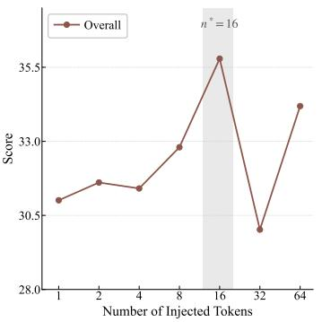  
(a) Overall

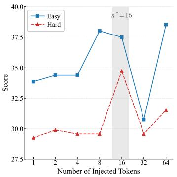  
(b) Easy & Hard  
Figure 3: Ablation on the number of injected tokens.

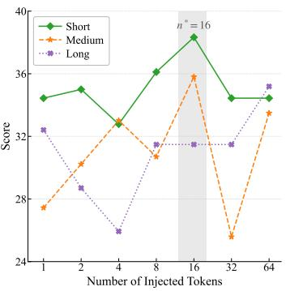  
(c) Short, Medium & Long

## 6.2 Ablation Study

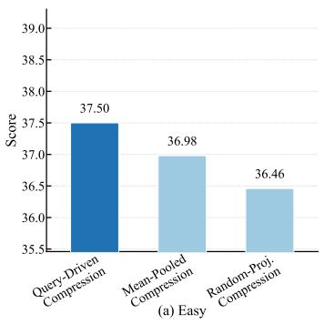

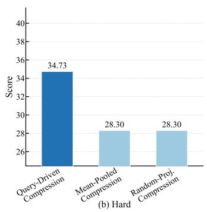

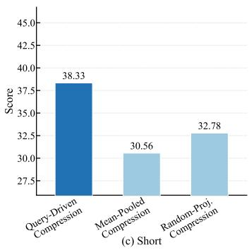

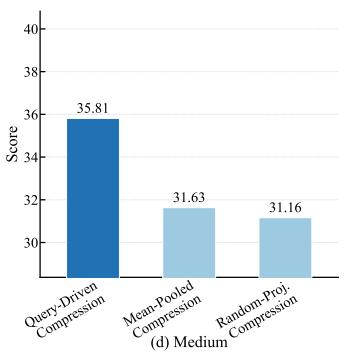

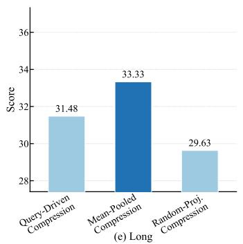

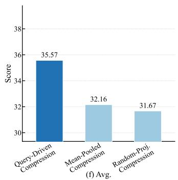  
Figure 4: Ablation on query-driven versus query-agnostic compression on LongBench-v2.

Number of Injected Tokens. As shown in Figure 3, increasing the token budget from 1 to 16 generally improves performance, with $N { = } 1 6$ achieving the best overall score of 35.79. Larger budgets do not consistently help: $N { = } 3 2$ leads to a substantial drop and $N { = } 6 4$ only partially recovers, although $N { = } 6 4$ achieves the best score on long examples, suggesting that longer inputs benefit from a slightly larger compressed representation. Overall, $N { = } 1 \bar { 6 }$ provides the best trade-off across difficulty levels and input lengths, indicating that the optimal token budget should balance evidence coverage against noise.

Query-Driven Compression. We evaluate the importance of query conditioning by comparing Query-Driven Compression with two query-agnostic alternatives under the same compression budget. As shown in Figure 4, Query-Driven Compression achieves a score of 35.57, outperforming Mean-Pooled Compression and Random-Projection Compression, which obtain 32.16 and 31.67, respectively. This confirms that query-conditioned compression retains task-relevant evidence more effectively than query-agnostic alternatives, consistent with the theoretical analysis in Section 5.

## 7 Conclusion and Limitations

We presented OpticalRAG, a framework that reimagines context compression for retrieval-augmented generation by operating in the pixel space rather than the text token space. Through Encoder-Bridged Retrieval, which projects text queries into the frozen visual feature space through a projection shared with the compressor, without additional contrastive training, and Query-Driven Distillation, which condenses retrieved visual tokens into a minimal query-conditioned prefix, OpticalRAG attains the best CAP across LongBench-v2, BAMBOO, and LooGLE-v2 with only 16 injected tokens.

While OpticalRAG uses a compact fixed-size visual prefix, a single token budget may not suit all queries, particularly those requiring evidence from multiple distant document segments. Our evaluation focuses on multiple-choice QA; extending the method to open-ended generation and exploring adaptive prefix budgets remain directions for future work.

## Acknowledgments and Disclosure of Funding

This research was supported by the National Natural Science Foundation of China (NSFC) under Grants No. 62506366, No. 62272466, U24A20233 and No. 62572268, the Ministry of Science and Technology of China under contract No. 2024YFB2809103, the Fundamental Research Funds for the Central Universities, and the Research Funds of Renmin University of China. It was also supported by Big Data and Responsible Artificial Intelligence for National Governance, Renmin University of China, and by the Public Computing Cloud, Renmin University of China. This work was sponsored by the CIPS-SMP-Zhipu Large Model Fund.

## References

S. Appalaraju, B. Jasani, B. U. Kota, Y. Xie, and R. Manmatha. Docformer: End-to-end transformer for document understanding. In 2021 IEEE/CVF International Conference on Computer Vision, ICCV 2021, Montreal, QC, Canada, October 10-17, 2021, pages 973–983. IEEE, 2021.

S. Appalaraju, P. Tang, Q. Dong, N. Sankaran, Y. Zhou, and R. Manmatha. Docformerv2: Local features for document understanding. In M. J. Wooldridge, J. G. Dy, and S. Natarajan, editors, Thirty-Eighth AAAI Conference on Artificial Intelligence, AAAI 2024, Thirty-Sixth Conference on Innovative Applications ofArtificial Intelligence, IAAI 2024, Fourteenth Symposium on Educational Advances in Artificial Intelligence, EAAI 2024, February 20-27, 2024, Vancouver, Canada, pages 709–718. AAAI Press, 2024.

A. Asai, Z. Wu, Y. Wang, A. Sil, and H. Hajishirzi. Self-rag: Learning to retrieve, generate, and critique through self-reflection. In The Twelfth International Conference on Learning Representations, ICLR 2024, Vienna, Austria, May 7-11, 2024. OpenReview.net, 2024.

Y. Bai, S. Tu, J. Zhang, H. Peng, X. Wang, X. Lv, S. Cao, J. Xu, L. Hou, Y. Dong, J. Tang, and J. Li. Longbench v2: Towards deeper understanding and reasoning on realistic long-context multitasks. In W. Che, J. Nabende, E. Shutova, and M. T. Pilehvar, editors, Proceedings ofthe 63rd Annual Meeting of the Association for Computational Linguistics (Volume 1: Long Papers), ACL 2025, Vienna, Austria, July 27 - August 1, 2025, pages 3639–3664. Association for Computational Linguistics, 2025.

S. Borgeaud, A. Mensch, J. Hoffmann, T. Cai, E. Rutherford, K. Millican, G. van den Driessche, J. Lespiau, B. Damoc, A. Clark, D. de Las Casas, A. Guy, J. Menick, R. Ring, T. Hennigan, S. Huang, L. Maggiore, C. Jones, A. Cassirer, A. Brock, M. Paganini, G. Irving, O. Vinyals, S. Osindero, K. Simonyan, J. W. Rae, E. Elsen, and L. Sifre. Improving language models by

retrieving from trillions of tokens. In K. Chaudhuri, S. Jegelka, L. Song, C. Szepesvári, G. Niu, and S. Sabato, editors, International Conference on Machine Learning, ICML 2022, 17-23 July 2022, Baltimore, Maryland, USA, volume 162 of Proceedings of Machine Learning Research, pages 2206–2240. PMLR, 2022.

X. Cheng, X. Wang, X. Zhang, T. Ge, S. Chen, F. Wei, H. Zhang, and D. Zhao. xrag: Extreme context compression for retrieval-augmented generation with one token. In A. Globersons, L. Mackey, D. Belgrave, A. Fan, U. Paquet, J. M. Tomczak, and C. Zhang, editors, Advances in Neural Information Processing Systems 37: Annual Conference on Neural Information Processing Systems 2024, NeurIPS 2024, Vancouver, BC, Canada, December 10 - 15, 2024, 2024.

A. Chevalier, A. Wettig, A. Ajith, and D. Chen. Adapting language models to compress contexts. In H. Bouamor, J. Pino, and K. Bali, editors, Proceedings of the 2023 Conference on Empirical Methods in Natural Language Processing, EMNLP 2023, Singapore, December 6-10, 2023, pages 3829–3846. Association for Computational Linguistics, 2023.

N. Chirkova, T. Formal, V. Nikoulina, and S. Clinchant. Provence: efficient and robust context pruning for retrieval-augmented generation. In The Thirteenth International Conference on Learning Representations, ICLR 2025, Singapore, April 24-28, 2025. OpenReview.net, 2025.

J. Cho, D. Mahata, O. Irsoy, Y. He, and M. Bansal. M3docrag: Multi-modal retrieval is what you need for multi-page multi-document understanding. CoRR, abs/2411.04952, 2024.

Y. Ding, S. Luo, Y. Dai, Y. Jiang, Z. Li, Q. Sun, G. Martin, W. Liu, and Y. Peng. A survey on mllm-based visually rich document understanding: Methods, challenges, and emerging trends. In M. Liakata, V. P. Moreira, J. Zhang, and D. Jurgens, editors, Findings of the Association for Computational Linguistics, ACL 2026, San Diego, California, United States, July 2-7, 2026, pages 13319–13340. Association for Computational Linguistics, 2026.

Z. Dong, T. Tang, J. Li, W. X. Zhao, and J. Wen. BAMBOO: a comprehensive benchmark for evaluating long text modeling capacities of large language models. In N. Calzolari, M. Kan, V. Hoste, A. Lenci, S. Sakti, and N. Xue, editors, Proceedings of the 2024 Joint International Conference on Computational Linguistics, Language Resources and Evaluation, LREC/COLING 2024, 20-25 May, 2024, Torino, Italy, pages 2086–2099. ELRA and ICCL, 2024.

Y. Duan, Z. Chen, Y. Hu, W. Wang, S. Ye, B. Shi, L. Lu, Q. Hou, T. Lu, H. Li, J. Dai, and W. Wang. Docopilot: Improving multimodal models for document-level understanding. In IEEE/CVF Conference on Computer Vision and Pattern Recognition, CVPR 2025, Nashville, TN, USA, June 11-15, 2025, pages 4026–4037. Computer Vision Foundation / IEEE, 2025.

Y. Fu, Z. Cai, A. Asi, W. Xiong, Y. Dong, and W. Xiao. Not all heads matter: A head-level KV cache compression method with integrated retrieval and reasoning. In The Thirteenth International Conference on Learning Representations, ICLR 2025, Singapore, April 24-28, 2025. OpenReview.net, 2025.

T. Ge, J. Hu, L. Wang, X. Wang, S. Chen, and F. Wei. In-context autoencoder for context compression in a large language model. In The Twelfth International Conference on Learning Representations, ICLR 2024, Vienna, Austria, May 7-11, 2024. OpenReview.net, 2024.

J. Gu, J. Kuen, V. I. Morariu, H. Zhao, R. Jain, N. Barmpalios, A. Nenkova, and T. Sun. Unidoc: Unified pretraining framework for document understanding. In M. Ranzato, A. Beygelzimer, Y. N. Dauphin, P. Liang, and J. W. Vaughan, editors, Advances in Neural Information Processing Systems 34: Annual Conference on Neural Information Processing Systems 2021, NeurIPS 2021, December 6-14, 2021, virtual, pages 39–50, 2021.

Z. He, Y. Wang, J. Li, K. Liang, and M. Zhang. Loogle v2: Are llms ready for real world long dependency challenges? In D. Belgrave, C. Zhang, L. N. Montoya, H. Lin, R. Pascanu, P. Koniusz, M. Ghassemi, N. Chen, I. V. M. Ruíz, and A. Loaiza-Bonilla, editors, Advances in Neural Information Processing Systems 38: Annual Conference on Neural Information Processing Systems 2025, NeurIPS 2025, San Diego, CA, USA, December 2-7, 2025 / Mexico City, Mexico, November 30 - December 5, 2025, 2025.

S. Hofstätter, J. Chen, K. Raman, and H. Zamani. Fid-light: Efficient and effective retrieval-augmented text generation. In H. Chen, W. E. Duh, H. Huang, M. P. Kato, J. Mothe, and B. Poblete, editors, Proceedings ofthe 46th International ACM SIGIR Conference on Research and Development in Information Retrieval, SIGIR 2023, Taipei, Taiwan, July 23-27, 2023, pages 1437–1447. ACM, 2023.

A. Hu, H. Xu, J. Ye, M. Yan, L. Zhang, B. Zhang, J. Zhang, Q. Jin, F. Huang, and J. Zhou. mplugdocowl 1.5: Unified structure learning for ocr-free document understanding. In Y. Al-Onaizan, M. Bansal, and Y. Chen, editors, Findings of the Association for Computational Linguistics: EMNLP 2024, Miami, Florida, USA, November 12-16, 2024, volume EMNLP 2024 of Findings of ACL, pages 3096–3120. Association for Computational Linguistics, 2024.

A. Hu, H. Xu, L. Zhang, J. Ye, M. Yan, J. Zhang, Q. Jin, F. Huang, and J. Zhou. mplug-docowl2: Highresolution compressing for ocr-free multi-page document understanding. In W. Che, J. Nabende, E. Shutova, and M. T. Pilehvar, editors, Proceedings of the 63rd Annual Meeting of the Association for Computational Linguistics (Volume 1: Long Papers), ACL 2025, Vienna, Austria, July 27 - August 1, 2025, pages 5817–5834. Association for Computational Linguistics, 2025a.

J. Hu, W. Huang, W. Wang, H. Wang, T. Hu, Q. Zhang, H. Feng, X. Chen, Y. Shan, and T. Xie. EPIC: efficient position-independent caching for serving large language models. In A. Singh, M. Fazel, D. Hsu, S. Lacoste-Julien, F. Berkenkamp, T. Maharaj, K. Wagstaff, and J. Zhu, editors, Fortysecond International Conference on Machine Learning, ICML 2025, Vancouver, BC, Canada, July 13-19, 2025, volume 267 of Proceedings ofMachine Learning Research. PMLR / OpenReview.net, 2025b.

Y. Huang, T. Lv, L. Cui, Y. Lu, and F. Wei. Layoutlmv3: Pre-training for document AI with unified text and image masking. In J. Magalhães, A. D. Bimbo, S. Satoh, N. Sebe, X. Alameda-Pineda, Q. Jin, V. Oria, and L. Toni, editors, MM ’22: The 30th ACM International Conference on Multimedia, Lisboa, Portugal, October 10 - 14, 2022, pages 4083–4091. ACM, 2022.

T. Hwang, S. Cho, S. Jeong, H. Song, S. Han, and J. C. Park. EXIT: context-aware extractive compression for enhancing retrieval-augmented generation. In W. Che, J. Nabende, E. Shutova, and M. T. Pilehvar, editors, Findings ofthe Associationfor Computational Linguistics, ACL 2025, Vienna, Austria, July 27 - August 1, 2025, volume ACL 2025 of Findings of ACL, pages 4895–4924. Association for Computational Linguistics, 2025.

C. Jain, Y. Wu, Y. Zeng, J. Liu, S. Dai, Z. Shao, Q. Wu, and H. Wang. Simpledoc: Multi-modal document understanding with dual-cue page retrieval and iterative refinement. In C. Christodoulopoulos, T. Chakraborty, C. Rose, and V. Peng, editors, Proceedings ofthe 2025 Conference on Empirical Methods in Natural Language Processing, EMNLP 2025, Suzhou, China, November 4-9, 2025, pages 28410–28427. Association for Computational Linguistics, 2025.

Y. Jeong, J. Kim, D. Lee, and S. Hwang. Ecorag: Evidentiality-guided compression for long context RAG. In W. Che, J. Nabende, E. Shutova, and M. T. Pilehvar, editors, Findings ofthe Association for Computational Linguistics, ACL 2025, Vienna, Austria, July 27 - August 1, 2025, volume ACL 2025 of Findings ofACL, pages 26607–26628. Association for Computational Linguistics, 2025.

H. Jiang, Q. Wu, C. Lin, Y. Yang, and L. Qiu. Llmlingua: Compressing prompts for accelerated inference of large language models. In H. Bouamor, J. Pino, and K. Bali, editors, Proceedings ofthe 2023 Conference on Empirical Methods in Natural Language Processing, EMNLP 2023, Singapore, December 6-10, 2023, pages 13358–13376. Association for Computational Linguistics, 2023.

H. Jiang, Q. Wu, X. Luo, D. Li, C. Lin, Y. Yang, and L. Qiu. Longllmlingua: Accelerating and enhancing llms in long context scenarios via prompt compression. In L. Ku, A. Martins, and V. Srikumar, editors, Proceedings of the 62nd Annual Meeting of the Association for Computational Linguistics (Volume 1: Long Papers), ACL 2024, Bangkok, Thailand, August 11-16, 2024, pages 1658–1677. Association for Computational Linguistics, 2024.

G. Kim, T. Hong, M. Yim, J. Nam, J. Park, J. Yim, W. Hwang, S. Yun, D. Han, and S. Park. Ocr-free document understanding transformer. In S. Avidan, G. J. Brostow, M. Cissé, G. M. Farinella, and T. Hassner, editors, Computer Vision - ECCV 2022 - 17th European Conference, Tel Aviv, Israel,

October 23-27, 2022, Proceedings, Part XXVIII, volume 13688 of Lecture Notes in Computer Science, pages 498–517. Springer, 2022.

S. Kim, A. Lee, J. Park, A. Chung, J. Oh, and J. Lee. Towards efficient visual-language alignment of the q-former for visual reasoning tasks. In Y. Al-Onaizan, M. Bansal, and Y. Chen, editors, Findings ofthe Associationfor Computational Linguistics: EMNLP 2024, Miami, Florida, USA, November 12-16, 2024, volume EMNLP 2024 of Findings ofACL, pages 15155–15165. Association for Computational Linguistics, 2024.

K. Lee, M. Joshi, I. R. Turc, H. Hu, F. Liu, J. M. Eisenschlos, U. Khandelwal, P. Shaw, M. Chang, and K. Toutanova. Pix2struct: Screenshot parsing as pretraining for visual language understanding. In A. Krause, E. Brunskill, K. Cho, B. Engelhardt, S. Sabato, and J. Scarlett, editors, International Conference on Machine Learning, ICML 2023, 23-29 July 2023, Honolulu, Hawaii, USA, volume 202 of Proceedings ofMachine Learning Research, pages 18893–18912. PMLR, 2023.

J. Li, D. Li, S. Savarese, and S. C. H. Hoi. BLIP-2: bootstrapping language-image pre-training with frozen image encoders and large language models. In A. Krause, E. Brunskill, K. Cho, B. Engelhardt, S. Sabato, and J. Scarlett, editors, International Conference on Machine Learning, ICML 2023, 23-29 July 2023, Honolulu, Hawaii, USA, volume 202 of Proceedings ofMachine Learning Research, pages 19730–19742. PMLR, 2023a.

K. Y. Li, S. Goyal, J. D. Semedo, and J. Z. Kolter. Inference optimal vlms need fewer visual tokens and more parameters. In The Thirteenth International Conference on Learning Representations, ICLR 2025, Singapore, April 24-28, 2025. OpenReview.net, 2025a.

Y. Li, B. Dong, F. Guerin, and C. Lin. Compressing context to enhance inference efficiency of large language models. In H. Bouamor, J. Pino, and K. Bali, editors, Proceedings of the 2023 Conference on Empirical Methods in Natural Language Processing, EMNLP 2023, Singapore, December 6-10, 2023, pages 6342–6353. Association for Computational Linguistics, 2023b.

Y. Li, Y. Huang, B. Yang, B. Venkitesh, A. Locatelli, H. Ye, T. Cai, P. Lewis, and D. Chen. Snapkv: LLM knows what you are looking for before generation. In A. Globersons, L. Mackey, D. Belgrave, A. Fan, U. Paquet, J. M. Tomczak, and C. Zhang, editors, Advances in Neural Information Processing Systems 37: Annual Conference on Neural Information Processing Systems 2024, NeurIPS 2024, Vancouver, BC, Canada, December 10 - 15, 2024, 2024a.

Z. Li, X. Hu, A. Liu, K. Zheng, S. Huang, and H. Xiong. Refiner: Restructure retrieved content efficiently to advance question-answering capabilities. In Y. Al-Onaizan, M. Bansal, and Y. Chen, editors, Findings ofthe Associationfor Computational Linguistics: EMNLP 2024, Miami, Florida, USA, November 12-16, 2024, volume EMNLP 2024 of Findings of ACL, pages 8548–8572. Association for Computational Linguistics, 2024b.

Z. Li, Y. Liu, Y. Su, and N. Collier. Prompt compression for large language models: A survey. In L. Chiruzzo, A. Ritter, and L. Wang, editors, Proceedings ofthe 2025 Conference ofthe Nations of the Americas Chapter of the Association for Computational Linguistics: Human Language Technologies, NAACL 2025 - Volume 1: Long Papers, Albuquerque, New Mexico, USA, April 29 - May 4, 2025, pages 7182–7195. Association for Computational Linguistics, 2025b.

Z. Li, Y. Su, and N. Collier. 500xcompressor: Generalized prompt compression for large language models. In W. Che, J. Nabende, E. Shutova, and M. T. Pilehvar, editors, Proceedings of the 63rd Annual Meeting of the Association for Computational Linguistics (Volume 1: Long Papers), ACL 2025, Vienna, Austria, July 27 - August 1, 2025, pages 25081–25091. Association for Computational Linguistics, 2025c.

A. Liu, J. Liu, Z. Pan, Y. He, R. Haffari, and B. Zhuang. Minicache: KV cache compression in depth dimension for large language models. In A. Globersons, L. Mackey, D. Belgrave, A. Fan, U. Paquet, J. M. Tomczak, and C. Zhang, editors, Advances in Neural Information Processing Systems 37: Annual Conference on Neural Information Processing Systems 2024, NeurIPS 2024, Vancouver, BC, Canada, December 10 - 15, 2024, 2024a.

Y. Liu, B. Yang, Q. Liu, Z. Li, Z. Ma, S. Zhang, and X. Bai. Textmonkey: An ocr-free large multimodal model for understanding document. IEEE Trans. Pattern Anal. Mach. Intell., 48(5): 6008–6019, 2026.

Z. Liu, J. Yuan, H. Jin, S. H. Zhong, Z. Xu, V. Braverman, B. Chen, and X. Hu. KIVI: A tuning-free asymmetric 2bit quantization for KV cache. In R. Salakhutdinov, Z. Kolter, K. A. Heller, A. Weller, N. Oliver, J. Scarlett, and F. Berkenkamp, editors, Forty-first International Conference on Machine Learning, ICML 2024, Vienna, Austria, July 21-27, 2024, volume 235 of Proceedings of Machine Learning Research, pages 32332–32344. PMLR / OpenReview.net, 2024b.

M. Louis, H. Déjean, and S. Clinchant. PISCO: pretty simple compression for retrieval-augmented generation. In W. Che, J. Nabende, E. Shutova, and M. T. Pilehvar, editors, Findings of the Associationfor Computational Linguistics, ACL 2025, Vienna, Austria, July 27 - August 1, 2025, volume ACL 2025 of Findings of ACL, pages 15506–15521. Association for Computational Linguistics, 2025.

D. Ma, Y. Wang, and T. Lan. Block-attention for efficient prefilling. In The Thirteenth International Conference on Learning Representations, ICLR 2025, Singapore, April 24-28, 2025. OpenReview.net, 2025.

A. Masry, J. A. Rodríguez, T. Zhang, S. Wang, C. Wang, A. Feizi, A. K. Suresh, A. Puri, X. Jian, P. Noël, S. T. Madhusudhan, M. Pedersoli, B. Liu, N. Chapados, Y. Bengio, E. Hoque, C. Pal, I. H. Laradji, D. Vázquez, P. Taslakian, S. Gella, and S. Rajeswar. Alignvlm: Bridging vision and language latent spaces for multimodal understanding. CoRR, abs/2502.01341, 2025.

J. Mu, X. Li, and N. D. Goodman. Learning to compress prompts with gist tokens. In A. Oh, T. Naumann, A. Globerson, K. Saenko, M. Hardt, and S. Levine, editors, Advances in Neural Information Processing Systems 36: Annual Conference on Neural Information Processing Systems 2023, NeurIPS 2023, New Orleans, LA, USA, December 10 - 16, 2023, 2023.

N. Muennighoff, H. Su, L. Wang, N. Yang, F. Wei, T. Yu, A. Singh, and D. Kiela. Generative representational instruction tuning. In The Thirteenth International Conference on Learning Representations, ICLR 2025, Singapore, April 24-28, 2025. OpenReview.net, 2025.

M. S. Nacson, A. Aberdam, R. Ganz, E. Ben-Avraham, A. Golts, Y. Kittenplon, S. Mazor, and R. Litman. Docvlm: Make your VLM an efficient reader. In IEEE/CVF Conference on Computer Vision and Pattern Recognition, CVPR 2025, Nashville, TN, USA, June 11-15, 2025, pages 29005– 29015. Computer Vision Foundation / IEEE, 2025.

Z. Pan, Q. Wu, H. Jiang, M. Xia, X. Luo, J. Zhang, Q. Lin, V. Rühle, Y. Yang, C. Lin, H. V. Zhao, L. Qiu, and D. Zhang. Llmlingua-2: Data distillation for efficient and faithful task-agnostic prompt compression. In L. Ku, A. Martins, and V. Srikumar, editors, Findings of the Association for Computational Linguistics, ACL 2024, Bangkok, Thailand and virtual meeting, August 11-16, 2024, volume ACL 2024 of Findings of ACL, pages 963–981. Association for Computational Linguistics, 2024.

J. Park, J. Y. Choi, J. Park, and B. Han. Hierarchical visual feature aggregation for ocr-free document understanding. In A. Globersons, L. Mackey, D. Belgrave, A. Fan, U. Paquet, J. M. Tomczak, and C. Zhang, editors, Advances in Neural Information Processing Systems 37: Annual Conference on Neural Information Processing Systems 2024, NeurIPS 2024, Vancouver, BC, Canada, December 10 - 15, 2024, 2024.

H. Qin, C. Wei, Y. Chen, and Y. Wang. Counterfactual reasoning for retrieval-augmented generation. In C. Vondrick, B. Hariharan, C. Raffel, L. Pinto, D. Yang, and A. Faust, editors, The Fourteenth International Conference on Learning Representations, ICLR 2026, Rio de Janeiro, Brazil, April 23-27, 2026. proceedings.iclr.cc, 2026.

M. Sun, S. Zhao, J. Chen, H. Wang, and B. Qin. META-RAG: meta-analysis-inspired evidencere-ranking method for retrieval-augmented generation in evidence-based medicine. CoRR, abs/2510.24003, 2025.

S. Tan, X. Li, S. G. Patil, Z. Wu, T. Zhang, K. Keutzer, J. Gonzalez, and R. A. Popa. Lloco: Learning long contexts offline. In Y. Al-Onaizan, M. Bansal, and Y. Chen, editors, Proceedings of the 2024 Conference on Empirical Methods in Natural Language Processing, EMNLP 2024, Miami, FL, USA, November 12-16, 2024, pages 17605–17621. Association for Computational Linguistics, 2024.

X. Tan, P. Ye, C. Tu, J. Cao, Y. Yang, L. Zhang, D. Zhou, and T. Chen. Tokencarve: Informationpreserving visual token compression in multimodal large language models. CoRR, abs/2503.10501, 2025.

S. Verma. Contextual compression in retrieval-augmented generation for large language models: A survey. CoRR, abs/2409.13385, 2024.

Y. Wang, X. Huang, B. Tian, Y. Su, L. Yu, H. Liao, Y. Fan, J. Guo, and X. Cheng. QUITO-X: A new perspective on context compression from the information bottleneck theory. In C. Christodoulopoulos, T. Chakraborty, C. Rose, and V. Peng, editors, Findings of the Association for Computational Linguistics: EMNLP 2025, Suzhou, China, November 4-9, 2025, pages 6841–6856. Association for Computational Linguistics, 2025.

C. Wei, W. Hu, X. Hao, X. Wang, Y. Yang, Y. Wang, Y. Tian, and Y. Chen. Graphchain: Large language models for large-scale graph analysis via tool chaining. In D. Belgrave, C. Zhang, L. N. Montoya, H. Lin, R. Pascanu, P. Koniusz, M. Ghassemi, N. Chen, I. V. M. Ruíz, and A. Loaiza-Bonilla, editors, Advances in Neural Information Processing Systems 38: Annual Conference on Neural Information Processing Systems 2025, NeurIPS 2025, San Diego, CA, USA, December 2-7, 2025 / Mexico City, Mexico, November 30 - December 5, 2025, 2025a.

C. Wei, H. Qin, S. He, Y. Wang, and Y. Chen. T-retriever: Tree-based hierarchical retrieval augmented generation for textual graphs. In S. Koenig, C. Jenkins, and M. E. Taylor, editors, Fortieth AAAI Conference on Artificial Intelligence, Thirty-Eighth Conference on Innovative Applications of Artificial Intelligence, Sixteenth Symposium on Educational Advances in Artificial Intelligence, AAAI 2026, Singapore, January 20-27, 2026, pages 15924–15932. AAAI Press, 2026a.

H. Wei, C. Liu, J. Chen, J. Wang, L. Kong, Y. Xu, Z. Ge, L. Zhao, J. Sun, Y. Peng, C. Han, and X. Zhang. General OCR theory: Towards OCR-2.0 via a unified end-to-end model. CoRR, abs/2409.01704, 2024.

H. Wei, Y. Sun, and Y. Li. Deepseek-ocr: Contexts optical compression. CoRR, abs/2510.18234, 2025b.

H. Wei, Y. Sun, and Y. Li. Deepseek-ocr 2: Visual causal flow. CoRR, abs/2601.20552, 2026b.

G. Xiao, Y. Tian, B. Chen, S. Han, and M. Lewis. Efficient streaming language models with attention sinks. In The Twelfth International Conference on Learning Representations, ICLR 2024, Vienna, Austria, May 7-11, 2024. OpenReview.net, 2024.

F. Xu, W. Shi, and E. Choi. RECOMP: improving retrieval-augmented lms with context compression and selective augmentation. In The Twelfth International Conference on Learning Representations, ICLR 2024, Vienna, Austria, May 7-11, 2024. OpenReview.net, 2024.

Y. Xu, Z. Jie, H. Dong, L. Wang, X. Lu, A. Zhou, A. Saha, C. Xiong, and D. Sahoo. Think: Thinner key cache by query-driven pruning. In The Thirteenth International Conference on Learning Representations, ICLR 2025, Singapore, April 24-28, 2025. OpenReview.net, 2025.

A. Yang, B. Yang, B. Zhang, B. Hui, B. Zheng, B. Yu, C. Li, D. Liu, F. Huang, H. Wei, H. Lin, J. Yang, J. Tu, J. Zhang, J. Yang, J. Yang, J. Zhou, J. Lin, K. Dang, K. Lu, K. Bao, K. Yang, L. Yu, M. Li, M. Xue, P. Zhang, Q. Zhu, R. Men, R. Lin, T. Li, T. Xia, X. Ren, X. Ren, Y. Fan, Y. Su, Y. Zhang, Y. Wan, Y. Liu, Z. Cui, Z. Zhang, and Z. Qiu. Qwen2.5 technical report. CoRR, abs/2412.15115, 2024.

C. Yang, X. Dong, X. Zhu, W. Su, J. Wang, H. Tian, Z. Chen, W. Wang, L. Lu, and J. Dai. PVC: progressive visual token compression for unified image and video processing in large visionlanguage models. In IEEE/CVF Conference on Computer Vision and Pattern Recognition, CVPR 2025, Nashville, TN, USA, June 11-15, 2025, pages 24939–24949. Computer Vision Foundation / IEEE, 2025.

J. Yao, H. Li, Y. Liu, S. Ray, Y. Cheng, Q. Zhang, K. Du, S. Lu, and J. Jiang. Cacheblend: Fast large language model serving for RAG with cached knowledge fusion. In Proceedings of the Twentieth European Conference on Computer Systems, EuroSys 2025, Rotterdam, The Netherlands, 30 March 2025 - 3 April 2025, pages 94–109. ACM, 2025.

H. Yen, T. Gao, and D. Chen. Long-context language modeling with parallel context encoding. In L. Ku, A. Martins, and V. Srikumar, editors, Proceedings of the 62nd Annual Meeting of the Association for Computational Linguistics (Volume 1: Long Papers), ACL 2024, Bangkok, Thailand, August 11-16, 2024, pages 2588–2610. Association for Computational Linguistics, 2024.

C. Yoon, T. Lee, H. Hwang, M. Jeong, and J. Kang. Compact: Compressing retrieved documents actively for question answering. In Y. Al-Onaizan, M. Bansal, and Y. Chen, editors, Proceedings ofthe 2024 Conference on Empirical Methods in Natural Language Processing, EMNLP 2024, Miami, FL, USA, November 12-16, 2024, pages 21424–21439. Association for Computational Linguistics, 2024.

P. Zhang, Z. Liu, S. Xiao, N. Shao, Q. Ye, and Z. Dou. Long context compression with activation beacon. In The Thirteenth International Conference on Learning Representations, ICLR 2025, Singapore, April 24-28, 2025. OpenReview.net, 2025.

R. Zhang, Y. Lyu, R. Shao, G. Chen, W. Guan, and L. Nie. Token-level correlation-guided compression for efficient multimodal document understanding. CoRR, abs/2407.14439, 2024a.

R. Zhang, Y. Zhou, J. Chen, J. Gu, C. Chen, and T. Sun. Llava-read: Enhancing reading ability of multimodal language models. CoRR, abs/2407.19185, 2024b.

Z. Zhang, Y. Sheng, T. Zhou, T. Chen, L. Zheng, R. Cai, Z. Song, Y. Tian, C. Ré, C. W. Barrett, Z. Wang, and B. Chen. H2O: heavy-hitter oracle for efficient generative inference of large language models. In A. Oh, T. Naumann, A. Globerson, K. Saenko, M. Hardt, and S. Levine, editors, Advances in Neural Information Processing Systems 36: Annual Conference on Neural Information Processing Systems 2023, NeurIPS 2023, New Orleans, LA, USA, December 10 - 16, 2023, 2023.

K. Zhu, X. Feng, X. Du, Y. Gu, W. Yu, H. Wang, Q. Chen, Z. Chu, J. Chen, and B. Qin. An information bottleneck perspective for effective noise filtering on retrieval-augmented generation. In L. Ku, A. Martins, and V. Srikumar, editors, Proceedings of the 62nd Annual Meeting of the Association for Computational Linguistics (Volume 1: Long Papers), ACL 2024, Bangkok, Thailand, August 11-16, 2024, pages 1044–1069. Association for Computational Linguistics, 2024.

## A Extended Theoretical Analysis

This appendix expands on the theorem in Section 5 along three directions: (i) an information-theoretic restatement in terms of mutual information and a sufficient-statistic interpretation, (ii) a robustness result for the approximate low-rank case where Eq. (6) holds only up to a residual, and (iii) discussion of the assumptions and their empirical plausibility for the OpticalRAG pipeline.

## A.1 Information-Theoretic Restatement

Let $A ^ { \star } , V$ , and $Q$ denote the random variables corresponding to the answer, the query-fused visual tokens $\hat { \mathbf { V } } _ { \mathrm { f u s e d } }$ , and the query-global vector $\mathbf { q } _ { \mathrm { g l o b a l } }$ , respectively, and let $T : = \mathbf { U } ^ { \top } [ V _ { \sigma ( 1 ) } , \ldots , V _ { \sigma ( r ) } ]$ denote the statistic in Eq. (6), which is a function of $( V , Q )$ . The sufficiency assumption (6) is equivalent to the conditional independence

$$
A ^ { \star } ~ \bot \bot ~ V ~ | ~ ( T , Q ) ,\tag{11}
$$

which by the data-processing inequality implies

$$
I ( A ^ { \star } ; V \mid Q ) = I ( A ^ { \star } ; T \mid Q ) .\tag{12}
$$

Thus $T$ is a conditional sufficient statistic of V for $A ^ { \star }$ given $Q .$ The constructive proof in the main text shows that the cross-attention output $\mathbf { Z } ^ { ( 1 ) }$ encodes this statistic up to an error that vanishes as $\tau  \infty$ . Whenever $T$ can be recovered from $( \mathbf { Z } ^ { ( 1 ) } , Q )$ , as in this hard-attention limit, $I ( A ^ { \star } ; \mathbf { Z } ^ { ( 1 ) } \mid$ $Q ) \ = \ I ( A ^ { \star } ; V \ | \ Q )$ , i.e., no task-relevant information is lost; for finite $\tau ,$ the guarantee is the ε-approximation in Eq. (7).

## A.2 Approximate Low-Rank Case

In practice, Eq. (6) holds only approximately. Suppose

$$
p ( a ^ { \star } \mid V , Q ) \ : = \ : g ( T , Q ) + \varepsilon ( V , Q ) ,\tag{13}
$$

where $\varepsilon ( V , Q )$ is a residual with bounded $L ^ { 2 }$ norm $\| \varepsilon \| _ { 2 } \leq \delta$ uniformly in $V , Q$ . Then by the triangle inequality and the construction in the proof of Theorem 5.1, whose attention error is at most $\varepsilon _ { \tau } : = 2 L _ { g } \dot { r R } ( S ^ { \dot { \prime } } - 1 ) e ^ { - \tau \gamma }$ , the output distribution under the cross-attention compressor satisfies

$$
\left\| \Phi ( \mathbf { Z } ^ { ( 1 ) } , Q ) - p ( a ^ { \star } \mid V , Q ) \right\| _ { 2 } \leq \delta + \varepsilon _ { \tau } ,\tag{14}
$$

i.e., the error degrades gracefully with the residual energy. Since $\begin{array} { r } { \mathrm { T V } \leq \frac { \sqrt { C } } { 2 } \| \cdot \| _ { 2 } = \| \cdot \| _ { 2 } } \end{array}$ for $C = 4$ candidate labels, this suggests that $M = 1 6$ remains adequate when the true conditional rank slightly exceeds $r { : }$ as long as the residual δ left by the dominant M query-conditioned factors is small, the compression remains near-lossless in total variation.

## A.3 Assumption Plausibility

The low-rank sufficiency assumption is mild for multiple-choice QA over long documents. The four candidate labels lie on a 3-dimensional probability simplex, so the answer distribution itself has at most three degrees of freedom. The query specifies which document fragments are relevant, and the correct answer typically depends on only a handful of facts—names, dates, numerical comparisons, or causal relations. Empirically, this matches the observation that $M = 1 6$ already saturates performance in our ablations: increasing M beyond this point does not improve overall performance (Table 14), consistent with $r \leq 1 6$ for the LongBench- $\mathbf { \nabla } \cdot \mathbf { v } 2$ distribution. A more refined analysis would estimate r directly via the spectrum of the query-conditioned Jacobian of $^ { g , }$ which we leave to future work.

## A.4 Relation to the Q-Former Bottleneck

The construction in the proof generalizes the Q-Former design: the learnable queries Z act as “probes” into the visual token pool, with cross-attention selecting r informative locations. The key new ingredient relative to the original Q-Former is the query-conditioning of the bottleneck through qglobal, which makes the selected locations $\sigma ( j )$ depend on the question. Without this conditioning, a single fixed bottleneck would have to cover the union of all task-relevant evidence across queries, forcing

M to scale with the diversity of possible questions rather than the per-query intrinsic rank. Note that adding $\mathbf { q } _ { \mathrm { g l o b a l } }$ to every visual token alone does not provide this: with a linear key projection, it shifts all attention logits of a query by the same constant and leaves the softmax weights unchanged. The query dependence of the selection therefore comes from conditioning the compression queries, $\mathbf { Z } ^ { ( 0 ) } = \dot { \mathbf { Z } } + \bar { \mathbf { 1 } } _ { M } \mathbf { q } _ { \mathrm { g l o b a l } } ^ { \top }$ . This explains why query conditioning in OpticalRAG’s main pipeline is not merely a heuristic but a structural requirement for the bound $M \geq r$ to apply per query rather than globally.

## B Evaluation Datasets and Protocol

## B.1 Dataset Details

This appendix provides details of the datasets used in our baseline reproduction and evaluation. We conduct experiments on three long-context multiple-choice benchmarks: LongBench-v2 [Bai et al., 2025], the BAMBOO choice subset [Dong et al., 2024] , and the LooGLE-v2 [He et al., 2025] choice subset.

## B.1.1 Dataset Splits

We use the following dataset splits and subsets in our experiments:

• LongBench-v2: the official train split.

• BAMBOO: the merged choice-question subset.

• LooGLE-v2: the merged choice-question subset.

## B.1.2 Dataset Statistics

Table 2 summarizes the scale and file format of each dataset used in our experiments.

<table><tr><td>Dataset</td><td>Format</td><td>Samples</td><td>Notes</td></tr><tr><td>LongBench-v2 train</td><td>HuggingFace Arrow</td><td>503</td><td>6 domains / 16 sub-domains</td></tr><tr><td>BAMBOO choice subset</td><td>JSONL</td><td>400</td><td>4 tasks, 100 samples each</td></tr><tr><td>LooGLE-v2 choice subset</td><td>JSONL</td><td>1334</td><td>6 tasks with mixed label spaces</td></tr></table>

Table 2: Statistics of the datasets used in our experiments.

## B.1.3 LongBench-v2

We use the train split of LongBench-v2, which contains 503 samples. Each sample is a four-way multiple-choice question paired with a long context and a single gold answer label from A/B/C/D. The dataset covers 6 coarse domains and 16 sub-domains.

The local data fields include: \_id, domain, sub\_domain, difficulty, length, question, choice\_A, choice\_B, choice\_C, choice\_D, answer, and context.

## B.1.4 BAMBOO Choice Subset

We evaluate on the choice-question subset of BAMBOO. According to the dataset README, this subset contains four tasks:

• meetingqa\_4k: 100 samples;

• meetingqa\_16k: 100 samples;

• paperqa\_4k: 100 samples;

• paperqa\_16k: 100 samples.

This results in 400 samples in total.

The merged evaluation file preserves the original option set of each sample. Therefore, the number of options is not fixed across samples. In our local copy, most examples are four-way multiple-choice questions, while some samples contain 1, 2, 3, 5, 6, or 7 options.

Representative fields include: id, benchmark, task, question, context, options, option\_labels, and answer\_label.

## B.1.5 LooGLE-v2 Choice Subset

We also evaluate on the choice-question subset of LooGLE-v2. According to the dataset README, this subset contains six tasks:

• Call Graph Analysis: 376 samples;

• Environment Understanding: 176 samples;

• Legal Article Extraction: 186 samples;

• Legal Case Retrieval: 267 samples;

• Rule Understanding: 165 samples;

• User Behavior Analysis: 164 samples.

This results in 1334 samples in total.

Unlike standard four-way multiple-choice benchmarks, LooGLE-v2 contains mixed answer-label spaces. While many samples use labels such as $\mathtt { A } / \mathtt { B } / \mathtt { C } / \mathtt { D }$ , some legal tasks use task-specific labels such as CASE\_x or LAW\_x. Therefore, the option cardinality varies across samples, including 2, 4, 5, 6, 7, and larger option sets.

Representative fields include: sample\_uid, benchmark, task, task\_slug, question, context, options, option\_labels, and answer\_label.

## B.2 Evaluation Protocol

We evaluate each method along two axes: task performance and context efficiency. For LongBenchv2, we use the official Overall metric defined by LongBench-v2 as the reported task score. For the remaining datasets, the reported score is accuracy. The model is required to predict the option label string, and a prediction is considered correct only when the predicted label exactly matches the ground-truth label.

To measure context efficiency, we log lm\_context\_tokens, which denotes the number of contextonly tokens fed into the final language model. This count excludes the question and candidate options, and therefore reflects the actual document context budget used by each method. This allows us to compare methods not only by their raw task scores, but also by the amount of context they require at inference time.

Compression-aware score. Raw task score alone does not distinguish between methods that achieve strong performance by using a large amount of context and methods that achieve comparable performance with a much smaller token budget. To jointly evaluate task performance and context efficiency, we additionally report CAP, a compression-aware metric used as a complementary measure to the raw task score.

For each benchmark, let S denote the benchmark-specific task score, and let B denote the contexttoken budget measured by lm\_context\_tokens. Let $S _ { 0 }$ be the closed-book backbone score on the same benchmark, and let $B _ { 0 } = 1 2 \mathrm { k \Omega }$ be the reference backbone context budget, corresponding to the truncation limit used by Qwen2.5-7B-Instruct. We first define the compression multiplier as:

$$
m ( B ) = \left( \frac { B _ { 0 } + 1 } { B + 1 } \right) ^ { \delta } , \qquad \delta = 0 . 0 5 .\tag{15}
$$

The +1 term avoids numerical instability when $B$ is very small. The exponent $\delta$ controls the strength of the compression reward. We set $\delta = 0 . 0 5$ to make the compression reward conservative: a 10× reduction in context budget gives a multiplier of approximately 1.122, while a 100× reduction gives a multiplier of approximately 1.259.

The final CAP score is defined as:

$$
\operatorname { C A P } ( S , B ) = { \left\{ \begin{array} { l l } { S \cdot m ( B ) , } & { { \mathrm { i f ~ } } S \geq S _ { 0 } , } \\ { S , } & { { \mathrm { i f ~ } } S < S _ { 0 } . } \end{array} \right. }\tag{16}
$$

The lower branch implements a score floor. When a method performs worse than the closed-book backbone, it receives no compression credit, even if it uses fewer tokens. This prevents a method from being rewarded for reducing context length while discarding task-critical information. In other words, compression is credited only when the method preserves at least the closed-book level of task performance.

Above this floor, CAP rewards both higher task score and lower context-token budget. When $B = B _ { 0 }$ the multiplier m(B) is approximately 1, so CAP reduces to the raw task score for methods that use the same budget as the backbone. As B decreases, m(B) increases according to a mild power law, giving efficient methods additional credit while preventing the metric from being dominated by token reduction alone.

Computation protocol. We compute CAP separately for each benchmark using the corresponding closed-book backbone score $S _ { 0 } .$ . The same reference budget $B _ { 0 } = 1 2 \mathrm { k \Omega }$ is used across all benchmarks. The task score S is kept in its original benchmark scale, so CAP is reported in the same score units as the raw benchmark metric, with an additional compression-aware adjustment. In all result tables, we report the raw score, the context-token budget, and CAP, so that task performance and compression efficiency can be inspected independently.

## B.3 Existing Assets and Licenses

Tables 3 and 4 identify the upstream sources and their published license notices for the training data, evaluation benchmarks, pretrained components, and rendering font described in this paper. The linked source pages provide the license texts or associated terms; a repository license does not supersede separate rights in third-party content.

Table 3: Dataset sources and published license notices. Source-specific qualifications are explained below.
<table><tr><td>Asset</td><td>Source / provider</td><td>Published license notice</td></tr><tr><td>LongBench-v2</td><td>THUDM / Z.ai</td><td>Apache-2.0 (dataset card).</td></tr><tr><td>BAMBOO</td><td>RUCAIBox</td><td>MIT (repository release); underlying source content retains its own terms.</td></tr><tr><td>LooGLE-v2</td><td>GraphPKU</td><td>CC BY-SA 4.0 (dataset card).</td></tr><tr><td>Wikipedia C4</td><td>Atlas / Wikimedia</td><td>CC BY-SA 3.0; enwiki-dec2021 release.</td></tr><tr><td></td><td>Google / Ai2 distribu- tion</td><td>ODC-BY for the Ai2 distribution, together with Common Crawl terms.</td></tr><tr><td>SQuAD v2</td><td>Stanford SQuAD</td><td>CC BY-SA 4.0.</td></tr><tr><td>DROP</td><td>UCI NLP / Hugging Face</td><td>CC BY-SA 4.0; drop / ucinlp/drop.</td></tr><tr><td>CoQA</td><td>Stanford CoQA</td><td>Source-dependent: CC BY-SA 4.0, MSR-LA, RACE terms, and Apache terms.</td></tr></table>

Source-specific data terms. The Wikipedia passages use the Atlas enwiki-dec2021 release, whose data license is CC BY-SA 3.0. DROP is obtained through the Hugging Face drop / ucinlp/drop distribution, whose dataset card specifies CC BY-SA 4.0. The C4 distribution’s ODC-BY notice additionally refers to Common Crawl’s terms of use; those terms preserve separate conditions on crawled content. CoQA’s official page assigns CC BY-SA 4.0 to literature and Wikipedia passages, MSR-LA to MCTest children’s stories, RACE-specific terms to exam passages, and Apache terms to CNN news passages. CoQA is therefore not represented as a uniformly licensed corpus.

The SAM/CLIP visual weights used here are loaded from the DeepSeek-OCR checkpoint; their upstream implementation notices are listed separately from the checkpoint release license. Applicable attribution, license-notice, share-alike, and source-specific conditions remain attached to the corresponding assets and are not replaced by the OpticalRAG release license.

Table 4: Pretrained components and rendering font: upstream license notices.
<table><tr><td>Asset</td><td>Source / provider</td><td>Published license notice</td></tr><tr><td>DeepSeek-OCR</td><td>DeepSeek</td><td>MIT (model card and repository).</td></tr><tr><td>Qwen2.5-7B-Instruct</td><td>Qwen / Alibaba</td><td>Apache-2.0.</td></tr><tr><td>SAM implementation</td><td>Meta</td><td>Apache-2.0.</td></tr><tr><td>CLIP implementation</td><td>OpenAI</td><td>MIT.</td></tr><tr><td>DejaVu Sans Mono</td><td>DejaVu / Bit- stream</td><td>Bitstream Vera font terms; DejaVu modifications are public domain, with additional notices for imported glyphs.</td></tr></table>

## C Baseline Details

This appendix provides additional details on how we adapt and reproduce the baseline methods under a unified evaluation setting. For fair comparison, all reproduced methods use Qwen2.5-7B-Instruct as the final answer model. Our adaptation follows a minimal-modification principle: we preserve the core mechanism of each baseline as much as possible, and only modify components required for compatibility with the unified backbone, input format, and multiple-choice evaluation protocol.

## C.1 Unified Backbone and Evaluation Interface

Backbone. All baselines use Qwen2.5-7B-Instruct as the final decoder for answer generation. This avoids performance differences caused by using different downstream language models and allows us to focus on the effectiveness of each compression or retrieval mechanism.

Evaluation interface. All methods are evaluated under the same multiple-choice setting. After method-specific context compression, selection, or representation injection, we construct a unified choice prompt and require the model to output one label from the valid option set of each dataset.

Adaptation principle. We do not replace baseline-specific mechanisms with a generic retrieval or summarization pipeline. Instead, each method keeps its original design pattern, such as direct prompt compression, self-information-based filtering, retrieval-embedding injection, or compressthen-generate inference. Only the final decoding interface and necessary dimensional or formatting components are adapted.

## C.2 Baseline Methods

Backbone. For the Backbone baseline, we directly use Qwen2.5-7B-Instruct [Yang et al., 2024] for multiple-choice answer generation. No additional training, retrieval, compression, or context injection is performed. The model is prompted only with the question and candidate options, without access to the long input context. This baseline measures the backbone model’s parametric knowledge, choice bias, and direct multiple-choice answering ability in the absence of external evidence.

StandardRAG. For StandardRAG, we reproduce the naive RAG setting following the original Meta-RAG execution path [Sun et al., 2025]. The long input context is first split into overlapping character chunks, which are ranked by a BM25-style scorer using the question and, when applicable, the option text. We then select the top-k chunks as the retrieved context and feed them, together with the question and candidate options, into Qwen2.5-7B-Instruct for final label generation. No additional compression module, learned retriever, or representation injection mechanism is introduced. Unless otherwise specified, we use k = 5, a chunk size of 1200 characters, and an overlap of 200 characters.

LLMLingua-2. For LLMLingua-2 [Pan et al., 2024], we preserve its original direct prompt compression pipeline implemented by PromptCompressor(..., use\_llmlingua2=True). The full input context is compressed by LLMLingua-2 without adding an extra retrieval or top-k preselection stage. The resulting compressed context is then inserted into the unified multiple-choice prompt and decoded by Qwen2.5-7B-Instruct.

xRAG. For xRAG [Cheng et al., 2024], we preserve its retrieval-embedding injection paradigm, where retrieved document representations are projected into the language model hidden space and used to replace the embeddings of special <xRAG> placeholders before decoding. To make this mechanism compatible with our unified backbone, we implement a Qwen-compatible xRAG wrapper and train only the projector that aligns the retriever embedding dimension with the hidden dimension of Qwen2.5-7B-Instruct. The final answer is generated by the same Qwen decoder used by all other methods.

Selective Context. For Selective Context [Li et al., 2023b], we preserve its original lexical filtering pipeline: the input is segmented into lexical units, self-information scores are estimated, and less informative units are filtered according to the specified reduce\_ratio and reduce\_level. Since the original implementation relies on GPT-2 for self-information estimation, we replace GPT-2 with Qwen2.5-7B-Instruct to maintain backbone consistency. The method is still treated as full-context compression rather than retrieval-based top-k selection.

RECOMP. For RECOMP [Xu et al., 2024], we preserve its compress-then-generate inference structure. Because our evaluation setting contains long single-document contexts rather than standard multi document retrieval outputs, we adapt the compression stage by splitting the context into sentence-level candidates, scoring them by query relevance, and retaining the top-ranked sentences according to a fixed compression ratio. The compressed context is then passed to Qwen2.5-7B-Instruct for multiple-choice answer generation.

## D Implementation Details

This appendix describes the implementation and fixed LongBench-v2 inference configuration in the accompanying code package. Library defaults and optional variants are distinguished from this configuration. We organise the material as follows: §D.1 covers the full architecture and parameter budget; §D.2 details the text-to-image rendering pipeline; §D.3 describes the DEEPENCODER; §D.4 specifies the QUERYDRIVENCOMPRESSOR in full; §D.5 enumerates all retrieval scoring functions; §D.6 describes context-window sampling; §D.7 lists the inference configuration and training procedure; §D.8 documents the answer-extraction protocol.

## D.1 Full Model Architecture and Parameter Budget

OPTICALRAG comprises four modules with clearly separated roles and training regimes. Table 5 summarises each module, its sub-components, allocated parameter count where verified, and training status.

Table 5: Model architecture and parameter budget. Compressor and bridge counts are computed from the instantiated modules. Their allocated parameters total 30,716,928 (≈ 30.72 M).
<table><tr><td>Module</td><td>Sub-components</td><td>Params</td><td>Status Role</td><td></td></tr><tr><td>DeepEncoder</td><td>SAM-ViT-B + CLIP-L; loaded from DeepSeek-OCR checkpoint via safetensors</td><td></td><td>FROZEN</td><td>Maps 640×640 page images to T=100 visual tokens of dim dyis=1024.</td></tr><tr><td>Qwen2.5-7B- Instruct</td><td>Hidden dim 3584; loaded from the pinned Qwen checkpoint</td><td></td><td>FROZEN</td><td>Provides query hidden states; scores final answer choices via next-token logits.</td></tr><tr><td>QueryDriven Compressor</td><td>Wq ∈R1024×3584, DSConv↓2, 2×MHA (8 heads, dim 1024), learned queries Z∈R16×1024, LN</td><td>14,187,520</td><td>TRAINABLE</td><td>Projects query into visual space; down- samples and cross-attends visual tokens into M=16 compressed tokens condi- tioned on the query.</td></tr><tr><td>VisualToLLM Bridge</td><td>Linear(1024→3584), GELU, Dropout(0.1), Linear(3584→3584), LN</td><td>16,529,408</td><td>TRAINABLE</td><td>Projects 16 compressed visual tokens into the LLM&#x27;s embedding space; prepended as a soft prefix to the query.</td></tr></table>

The compressor contains 14,187,520 parameters and the bridge contains 16,529,408; the bridge accounts for 53.81% of their combined count. Each PyTorch multi-head attention layer includes its own input and output projections, in addition to the explicit ${ \bf W } _ { K }$ and $\mathbf { W } _ { V }$ . The compressor count includes the 1,024-parameter attention-pooling scorer, which is allocated in every configuration but unused with max pooling. Frozen-backbone counts and a training-to-total ratio are not reported here pending a count from the exact model weights.

## D.2 Text-to-Image Rendering Pipeline

Each text window is rendered to a sequence of page images by a deterministic typesetting engine (render.py) using fixed density parameters in the released inference entry point. The library also exposes an optional piecewise policy (render\_density\_policy.py).

Font and canvas. Pages use DEJAVUSANSMONO, selected via V23\_RENDER\_FONT\_PATH or one of two standard Linux font paths. A missing font raises an error; there is no default-font fallback. The reproduction entry point verifies the font SHA256 recorded in configs/longbench.json. Every page is rendered at a fixed resolution of $H \times H = 6 4 0 \times 6 4 0$ pixels with a white background and black text.

Fixed density and estimated capacity. The released configuration uses $s _ { f } = 1 5$ pixels, $s _ { m } = 2 0$ pixels, and $s _ { l } = 1 . 3$ . The renderer computes

$$
h _ { \mathrm { l i n e } } = \lfloor 1 5 \cdot 1 . 3 \rfloor = 1 9 , \quad w _ { \mathrm { c h a r } } = \operatorname* { m a x } ( 6 , \lfloor 0 . 6 \cdot 1 5 \rfloor ) = 9 , \quad H - 2 s _ { m } = 6 0 0 .
$$

Thus the nominal capacity is $\lfloor 6 0 0 / 9 \rfloor = 6 6$ characters per line and $\lfloor 6 0 0 / 1 9 \rfloor = 3 1$ lines per page, or 2,046 characters per page. This is a wrapping estimate, not an exact count of rendered characters: the implementation strips outer whitespace, replaces tabs with spaces, splits on spaces, wraps words, and hard-wraps overlong words. The library defaults of (16, 24, 1.45) instead give an estimated width of 9 pixels, 65 characters per line, and 25 lines per page (1,625 nominal characters); these defaults are overridden by the released entry point.

Length-adaptive density policy. The optional policy below increases font size, margins, or line spacing as context length increases, thereby decreasing nominal page density. It is not used by the fixed LongBench-v2 reproduction configuration. Table 6 shows the three-tier schedule activated when the environment variable V23\_RENDER\_POLICY\_MODE=length is set.

Table 6: Length-adaptive rendering density tiers.
<table><tr><td>Tier</td><td>Context length threshold</td><td>sf (px)</td><td>sm (px)</td><td>Sl</td></tr><tr><td>1</td><td>≤ 300,000 chars</td><td>15</td><td>20</td><td>1.30</td></tr><tr><td>2</td><td>≤ 900,000 chars</td><td>15</td><td>22</td><td>1.35</td></tr><tr><td>3</td><td>&gt; 900,000 chars</td><td>16</td><td>24</td><td>1.45</td></tr></table>

Bytepack mode. An alternative mode (full\_visual\_render\_mode=bytepack) encodes raw UTF-8 bytes directly into pixel intensity values, packing up to $6 4 0 ^ { 2 } = 4 0 9 , \dot { 6 } 0 0$ bytes per grayscale page, later converted to RGB. This is the capacity of this byte-to-pixel scheme, not a general information-theoretic upper bound, and it discards all typographic structure that the visual encoder was originally trained on. It is an optional implementation and is not selected by the released LongBench-v2 entry point.

Image pre-processing. Before entering DEEPENCODER, each page image is: (1) resized to 640×640 via bicubic interpolation; (2) converted to float32 in [0, 1]; (3) normalised as $x \gets$ $( x - 0 . 5 ) / 0 . 5$ , yielding values in [−1, 1]. Images are batched in groups of 4 to balance GPU memory usage with throughput.

## D.3 DeepEncoder Architecture

The visual encoder (encoder.py) loads two sub-networks from the DeepSeek-OCR safetensors checkpoint: a SAM-ViT-B backbone (weights prefixed model.sam\_model.\*) and a CLIP-L visual tower (weights prefixed model.vision\_model.\*). The complete forward pass is:

$$
\mathbf { F } _ { \mathrm { s a m } } = \mathbf { S } \mathbf { A } \mathbf { M } ( \mathbf { I } ) \in \mathbb { R } ^ { B \times C \times H ^ { \prime } \times W ^ { \prime } } ,\tag{17}
$$

$$
\begin{array} { r } { \hat { \mathbf { F } } _ { \mathrm { s a m } } = \mathbf { F } _ { \mathrm { s a m } } . \mathbf { f } \mathbf { l a t t e n } ( 2 ) . \mathbf { p e r m u t e } ( 0 , 2 , 1 ) \in \mathbb { R } ^ { B \times T \times C } , } \end{array}\tag{18}
$$

$$
\begin{array} { r } { \mathbf { C } _ { \mathrm { c l i p } } = \mathbf { C } \mathbf { L } \mathbf { I } \mathbf { P } ( \mathbf { I } , \mathbf { F } _ { \mathrm { s a m } } ) \in \mathbb { R } ^ { B \times ( T + 1 ) \times 1 0 2 4 } , } \end{array}\tag{19}
$$

$$
\mathbf { e } _ { \mathrm { i d x } } = \boldsymbol { \ell } _ { 2 } \mathbf { - n o r m } ( \mathbf { C } _ { \mathrm { c l i p } } [ : , 0 , : ] ) \in \mathbb { R } ^ { B \times 1 0 2 4 } ,\tag{20}
$$

$$
\begin{array} { r } { \mathbf { V } = \hat { \mathbf { F } } _ { \mathrm { s a m } } + \mathbf { C } _ { \mathrm { c l i p } } [ : , 1 : , : ] \in \mathbb { R } ^ { B \times T \times 1 0 2 4 } , \quad T = 1 0 0 . } \end{array}\tag{21}
$$

$\mathbf { e } _ { \mathrm { i } \mathrm { d } \mathbf { x } }$ (Eq. 20) is the L2-normalised CLS token returned by the encoder but discarded by the released cache builder. The index instead stores each fused patch token in V individually, without L2 normalisation in dot mode, together with its original position. A separate FAISS IndexIDMap2(IndexFlatIP) is built for each sample context; retrieval is restricted to the current context. V (Eq. 21) is the additivefusion of SAM spatial tokens with CLIP patch tokens, forming the 100-token compressed visual representation passed to the compressor. All encoder parameters remain frozen throughout training.

## D.4 QueryDrivenCompressor: Detailed Forward Pass

Shared projection Wq   
The weight matrix $\mathbf { W } _ { q } \in \mathbb { R } ^ { 1 0 2 4 \times 3 5 8 4 } \ ( \mathrm { p r o j \_ q ) }$ is reused by retrieval and compression. Both   
stages use the same projected query states; compared with allocating a second projection of the   
same shape, this saves 3,670,016 parameters.

Algorithm 1 provides the complete forward pass of QueryDrivenCompressor with explicit tensor shapes.

Algorithm 1 QueryDrivenCompressor forward pass (from query\_driven.py)   
Require: Visual tokens $\mathbf { V } \in \mathbb { R } ^ { B \times N \times 1 0 2 4 } ,$ , query hidden states $\mathbf { H } _ { q } \in \mathbb { R } ^ { B \times n _ { q } }$ ×3584   
Ensure: Compressed tokens Zˆ ∈RB×M×1024   
1: $\tilde { \mathbf { H } } _ { q } \gets \mathbf { H } _ { q } \mathbf { W } _ { q } ^ { \top }$ # LLM→visual space: $\mathbb { R } ^ { B \times n _ { q } \times 3 5 8 4 } \to \mathbb { R } ^ { B \times n _ { q } \times 1 0 2 4 }$   
2: $\mathbf { q } _ { \mathrm { g } }  \mathrm { P o o L } ( \tilde { \mathbf { H } } _ { q } )$ # global query vector: $\mathbb { R } ^ { B \times 1 \times 1 0 2 4 } ;$ ; see Table 7   
3: $\mathbf { \Delta } \hat { \mathbf { V } } \gets \mathbf { V } + \mathbf { q } _ { \mathrm { g } }$ # additive query-global bias over all visual tokens   
4: $\mathbf { V }  \mathrm { P R E F I L T E R } ( \mathbf { V } , \mathbf { q } _ { \mathrm { g } } )$ # optional hard or soft query-guided token pruning (§D.4)   
5: $\mathbf { V } \gets \mathrm { D S C O N V } _ { \downarrow 2 } ( \mathbf { V } )$ # depthwise conv: $\bar { N }  \lfloor \sqrt { N } / 2 \rfloor ^ { \bar { 2 } }$ for square N   
6: $\mathbf { K }  \mathbf { V } \mathbf { W } _ { K } ^ { \top } ; ~ \mathbf { V a l }  \mathbf { V } \mathbf { W } _ { V } ^ { \top }$ # $\mathbf { W } _ { K } , \mathbf { W } _ { V } ^ { - } \in \mathbb { R } ^ { 1 0 2 4 \times 1 0 2 4 } ,$ , no bias   
7: ${ \bf Z } ^ { ( 0 ) }  { \bf Z } + { \bf q } _ { \mathrm { g } }$ # M=16 learned latents, init std 0.02, query-biased   
8: for $\ell = 1 , \ldots , \overset { \smile } { L }$ do # $L { = } 2$ cross-attention layers   
9: $\mathbf { Z } ^ { ( \ell ) } \gets \mathbf { Z } ^ { ( \ell - 1 ) } + \mathbf { M H A } ^ { ( \ell ) } \left( \mathbf { Z } ^ { ( \ell - 1 ) } , \mathbf { K } , \mathbf { V a l } \right)$ # residual cross-attention, 8 heads   
10: end for   
11: return $\hat { \mathbf { Z } } \gets \mathrm { L A Y E R N O R M } \Big ( \mathbf { Z } ^ { ( L ) } \Big )$

Depthwise spatial downsampling (line 5). The downsampler is a single nn.Conv2d with in\_channels = out\_channels = 1024, kernel $\bf \Pi _ { - } s i z e \ = \ \bf { s t r i d e } \ = \ 2 ,$ , groups = 1024 (strictly depthwise; no cross-channel mixing), and $\mathtt { b i a s } \ = \ \mathtt { F a l s e }$ . When downsampling is enabled, it is applied to square token counts $( { \sqrt { N } } \in \mathbb { Z } )$ . The convolution requires ${ \sqrt { N } } \geq 2 ;$ the implementation has no separate guard for smaller square inputs. Tokens are reshaped $[ B , N , d ] $ $[ B , d , \sqrt { N } , \sqrt { N } ]$ , convolved, and reshaped back to $[ B , \lfloor \sqrt { N } / 2 \rfloor ^ { 2 } , d ]$ . In the released configuration, Top-256 retrieval is followed by sorting the selected tokens by their original positions. The resulting 256 tokens are reshaped to a $1 6 \times 1 6$ grid and downsampled to 64 tokens. This grid is a rearrangement of selected tokens, potentially spanning pages and gaps; it does not reconstruct the original page neighbourhoods. When fewer than 256 tokens are available, the actual count is used; non-square counts bypass downsampling, as do all counts when downsampling is disabled.

Query pooling strategies. Table 7 documents all six options for POOL(·) in line 2 of Algorithm 1.

Table 7: Query pooling strategies. Input: $\tilde { \mathbf { H } } _ { q } \in \mathbb { R } ^ { B \times n _ { q } \times 1 0 2 4 }$ . Output: $\mathbf { q } _ { \mathrm { g } } \in \mathbb { R } ^ { B \times 1 \times 1 0 2 4 }$ . The max strategy (shaded) is used by the released LongBench-v2 entry point.
<table><tr><td>Flag value</td><td>Formula</td><td>Notes</td></tr><tr><td>mean</td><td> $\frac { 1 } { n _ { q } } \sum _ { i } \tilde { \mathbf { h } } _ { q , i }$ </td><td>Smooth global average; the natural default.</td></tr><tr><td>max</td><td> $\operatorname* { m a x } _ { i } \mathbf { h } _ { q , i }$  (element-wise)</td><td>Released inference configuration. Element- wise maximum; pooling does not mask padding positions.</td></tr><tr><td>last</td><td> $\tilde { \mathbf { h } } _ { q , n _ { q } }$ </td><td>Last-token summary; analogous to causal LM hidden state.</td></tr><tr><td>max_mean</td><td> $\begin{array} { r } { \frac { 1 } { 2 } \left( \operatorname* { m a x } _ { i } \tilde { \mathbf { h } } _ { q , i } + \frac { 1 } { n _ { q } } \sum _ { i } \tilde { \mathbf { h } } _ { q , i } \right) } \end{array}$ </td><td>Arithmetic mean of max and mean pooling.</td></tr><tr><td>attn</td><td> $\sum _ { i } w _ { i } \tilde { \mathbf { h } } _ { q , i } , \ w _ { i } = \mathrm { s o f t m a x } _ { i } \Big ( \mathbf { a } ^ { \top } \tilde { \mathbf { h } } _ { q , i } \Big )$ </td><td>Learned scalar scoring with  $\mathbf { a } \in \mathbb { R } ^ { 1 0 2 4 }$  . Allo- cated in all modes, but used only in this mode.</td></tr><tr><td>none</td><td> $\mathbf { 0 } \in \mathbb { R } ^ { B \times 1 \times 1 0 2 4 }$ </td><td>Disables query bias in the compressor only; retrieval still uses max-pooled projected query states.</td></tr></table>

Pre-filtering visual tokens. Before downsampling, an optional first-pass query-guided filter prunes or reweights visual tokens based on query relevance (pre\_filter\_topk, pre\_filter\_mode).

• Hard top-K (hard): score each token as $s _ { i } = \mathbf { v } _ { i } ^ { \top } \mathbf { q } _ { \mathrm { g } } ,$ , retain the top-K tokens and discard the rest. Enabled by setting pre\_filter\_topk $> 0$ . The released entry point uses hard with $K = 0$ disabling this filter. Hard selection uses unsorted top-K indices.

• Soft sigmoid gating (soft): compute per-token relevance weights and rescale:

$$
\tilde { \mathbf { v } } _ { i } = \mathbf { v } _ { i } \cdot \boldsymbol { \sigma } \bigg ( \lambda \cdot \frac { \mathbf { v } _ { i } ^ { \top } \mathbf { q } _ { \mathrm { g } } } { \sqrt { d } } \bigg ) , \quad \lambda = \operatorname* { m a x } ( 1 0 ^ { - 6 } , \mathbf { p r e } _ { - } \mathbf { f i l t e r } _ { - } \mathbf { s o f t } _ { - } \mathbf { s c a l e } ) ( \mathbf { d e f a u l t \ 1 . 0 } ) .
$$

This branch applies even when pre\_filter\_topk=0. All tokens are retained; low-relevance tokens are multiplicatively suppressed rather than discarded.

## D.5 Retrieval Scoring Functions

The QueryVisualScorer (query\_visual\_scoring.py) defines scores for the online retriever, offline cache scans, and candidate reranking. Table 8 lists its scoring functions. The main offline FAISS dot path instead returns the raw inner product $\mathbf { v } ^ { \top } \mathbf { q } ,$ without the $1 / \sqrt { d }$ factor; this positive scaling preserves rankings but changes the numerical scores. For optional multi-vector modes, the offline index first recalls candidates with the global query (up to retrieval\_rerank\_factor×K, default factor 4), then applies the listed function within that candidate set. The released single-vector dot path retrieves K directly without reranking.

Adaptive top-K retrieval. When retrieval\_adaptive\_k=True, the number of tokens forwarded to the compressor is governed by a power-law schedule:

$$
k ^ { * } = \mathrm { c l i p } \left( \mathrm { r o u n d } \left( k _ { \mathrm { b a s e } } \cdot \left( \frac { N } { N _ { \mathrm { r e f } } } \right) ^ { \alpha } \right) , ~ k _ { \mathrm { m i n } } , ~ k _ { \mathrm { m a x } } \right) ,\tag{22}
$$

Table 8: Scoring functions in QueryVisualScorer (FAISS scaling differs). $\mathbf { v } \in \mathbb { R } ^ { d }$ is a visual token; ˆ(·) denotes L2 normalisation; ${ \bf q } _ { j }$ is the j-th query vector; d=1024. The dot entry (shaded) is the default.
<table><tr><td>score_type</td><td colspan="3">Token score formula s(v) Multi-Q? Notes</td></tr><tr><td>dot</td><td> $\mathbf { v } ^ { \top } \mathbf { q } _ { 1 } / \sqrt { d }$ </td><td>No</td><td>Default. Single global query; plain inner product.</td></tr><tr><td>cosine</td><td> $\hat { \mathbf { v } } ^ { \top } \hat { \mathbf { q } } _ { 1 } / \sqrt { d }$ </td><td>No</td><td>L2-normalised dot product; scale- invariant.</td></tr><tr><td>maxsim</td><td> $\operatorname* { m a x } _ { j } \ \mathbf { v } ^ { \top } \mathbf { q } _ { j } / \sqrt { d }$ </td><td>Yes</td><td>ColBERT-style MaxSim over the full projected query sequence.</td></tr><tr><td>maxsim_cosine</td><td> $\operatorname* { m a x } _ { j } \hat { \textbf { v } } ^ { \top } \hat { \mathbf { q } } _ { j } / \sqrt { d }$ </td><td>Yes</td><td>Normalised MaxSim.</td></tr><tr><td>dot_multi</td><td> $\textstyle { \frac { 1 } { | Q | } } \sum _ { j } \mathbf { v } ^ { \top } \mathbf { q } _ { j } / { \sqrt { d } }$ </td><td>Yes</td><td>Mean dot product across all query vectors.</td></tr><tr><td>cosine_multi</td><td> $\begin{array} { r } { \frac { 1 } { \left| Q \right| } \sum _ { j } \hat { \mathbf { v } } ^ { \top } \hat { \mathbf { q } } _ { j } / \sqrt { d } } \end{array}$ </td><td>Yes</td><td>Mean cosine similarity.</td></tr><tr><td>12</td><td> $- \lVert \mathbf { v } - \mathbf { q } _ { 1 } \rVert ^ { 2 }$ </td><td>No</td><td>Single-vector negative squared dis- tance (cache/scorer path).</td></tr><tr><td>12_multi</td><td> $\begin{array} { r } { - { \frac { 1 } { | Q | } } \sum _ { j } \| \mathbf { v } - \mathbf { q } _ { j } \| ^ { 2 } } \end{array}$ </td><td>Yes</td><td>Negative mean squared Euclidean distance.</td></tr><tr><td>dot_hybrid_max</td><td> $( 1 - \alpha ) \mathbf { v } ^ { \top } \mathbf { q } _ { \mathrm { g } } / \sqrt { d } + \alpha \operatorname* { m a x } _ { j > 0 } \mathbf { v } ^ { \top } \mathbf { q } _ { j } / \sqrt { d }$ </td><td>Yes</td><td>Convex combination of global and MaxSim scores; α retrieval_score_alpha (default 0.25).</td></tr></table>

with defaults $k _ { \mathrm { b a s e } } { = } 1 2 8 , N _ { \mathrm { r e f } } { = } 4 0 , 0 0 0 , \alpha { = } 0 . 5 , k _ { \mathrm { m i n } } { = } 6 4 , k _ { \mathrm { m a x } } { = } 3 8 4$ . This optional schedule is disabled in the released entry point. Retrieval itself remains enabled with fixed $\dot { K } = 2 5 6$ (clipped to the number of available tokens), and selected tokens are sorted by original position before compression. The implementation also lower-bounds the adaptive base by M × retrieval\_topk\_factor and clips the final count to available tokens. The package documentation states that $K = 2 5 6$ was selected using feedback from this benchmark; it should not be interpreted as a hyperparameter chosen independently of the evaluation benchmark.

## D.6 Full-Context Construction and Optional Sampling

The released cache builder strips outer whitespace and sequentially splits all context into chunks of at most $L _ { \mathrm { w i n } } = 2 4 \small { , } 0 0 0$ characters. For nonempty text, $\dot { W } = \lvert \lvert \dot { \mathrm { s t r i p } } ( \mathcal { D } ) \rvert / L _ { \mathrm { w i n } } \rvert$ ; the last chunk may be shorter. Each chunk is rendered without a page limit (max\_pages=0, max\_chars=0). The resulting page count $P _ { w }$ varies, and $\begin{array} { r } { N _ { \mathrm { v i s } } = 1 0 0 \sum _ { w } \mathsf { \bar { P } } _ { w } . } \end{array}$ Pages are encoded in batches of at most four. Empty text follows the renderer’s placeholder path. The offline-index evaluation path reads this cache; the legacy head, window-count, and pages-per-window constructor arguments do not restrict its coverage.

The library also retains \_sample\_context\_windows for the optional online sampling path. Its windows have at most $L _ { \mathrm { w i n } }$ characters and may overlap; only duplicate start positions are removed. Three placement strategies are supported:

Duplicate start positions (which can arise near document boundaries) are deduplicated before rendering. The optional online path defaults to $W = 1$ and at most four pages per window, giving at most 400 visual tokens. These are not the coverage limits of the released full-context offline cache.

## D.7 Inference Configuration and Training Procedure

Table 10 specifies the default inference configuration.

Numerical precision. The cache builder runs image preprocessing and the visual encoder in float32, then stores fused visual tokens as float16 NumPy shards. Index construction casts these cached values to float32, and retrieved tokens are likewise converted to float32. The LLM’s last-layer query states are converted to float32 for projection, retrieval, compression, and the bridge. The resulting prefix is cast to the LLM dtype before concatenation with text embeddings. Evaluation calls eval(), including on the bridge.

Table 9: Context-window placement strategies. D is the full document of length $| \mathcal { D } | ;$ windows are of width $L _ { \mathrm { w i n } } .$ The head strategy is the library default for this optional path.
<table><tr><td>context_sampling</td><td>Window start positions</td><td>Description</td></tr><tr><td>head</td><td>{0}</td><td>Default. Always encodes the first  $L _ { \mathrm { w i n } }$  char- acters. Appropriate when evidence is front- loaded (e.g. news articles, paper abstracts, legal preambles).</td></tr><tr><td>uniform</td><td> $\begin{array} { r } { \left\{ \mathrm { r o u n d } \left( \frac { i \left( | \mathcal { D } | - L _ { \mathrm { w i n } } \right) } { W - 1 } \right) \right\} _ { i = 0 } ^ { W - 1 } } \end{array}$ </td><td>Evenly-spaced windows spanning the full document length. When  $W { = } 1$  , reduces identically to head.</td></tr><tr><td>head_tail</td><td> $\{ 0 , \vert { \mathcal D } \vert { - } L _ { \mathrm { w i n } } \} + W { - } 2$  uniform midpoints</td><td>Anchors at the document&#x27;s head and tail, with uniformly-spaced intermediate win- dows. Useful when critical evidence is con- centrated near document boundaries.</td></tr></table>

Table 10: Default inference configuration.
<table><tr><td>Setting</td><td>Value</td></tr><tr><td>Page size  $H ^ { 2 } ;$  font size  $s _ { f } ;$  margin  $s _ { m } ;$  line-height scale sl</td><td> $6 4 0 ^ { 2 } ;$  15 px; 20 px; 1.3 24,000 chars; unlimited; at most 4 pages</td></tr><tr><td>Chunk size  $L _ { \mathrm { w i n } } ;$  page limit; encoding batch</td><td></td></tr><tr><td>Visual tokens per page; dimension</td><td>100; 1024</td></tr><tr><td>Retrieval backend; score; fixed top-K</td><td>Offline FAISS index; dot; 256</td></tr><tr><td>Restore original token order; adaptive-K</td><td>Yes; disabled</td></tr><tr><td>Query pooling; compressor prefilter</td><td>Max; hard with K = 0 (disabled)</td></tr><tr><td>Downsample kernel / stride s / groups</td><td>2/2/1024</td></tr><tr><td>Compression queries M; MHA heads  $n _ { h }$  / layers L</td><td>16;8/2</td></tr><tr><td>Query initialisation standard deviation</td><td>0.02</td></tr><tr><td>External query/key/value projection biases</td><td>False</td></tr><tr><td>Bridge dimensions  $d _ { \mathrm { v i s } } / \bar { d } _ { h } / \bar { d } _ { \mathrm { l l m } }$ </td><td>1024/3584/3584</td></tr><tr><td>Bridge activation; dropout pdrop</td><td>GELU; 0.1 (inactive during evaluation)</td></tr><tr><td>Question-prompt truncation  $L _ { q }$ </td><td>1,024 tokens</td></tr><tr><td>LLM; configurèd LLM dtype</td><td>Qwen2.5-7B-Instruct; bfloat16</td></tr></table>

Trainable modules. Following the training procedure in the main text, only the QUERYDRIVEN-COMPRESSOR and VISUALTOLLMBRIDGE are trained. The compressor includes the query projection, depthwise downsampler, cross-attention layers, and learned compression queries. The visual encoder and language model remain frozen in both stages.

Stage 1: Reconstruction pretraining. The first stage trains the compressor and bridge to reconstruct the original text of a rendered document chunk from its compressed visual prefix. Training passages are sampled from Wikipedia and C4, totaling approximately 4,000 examples (3,800 training and 200 development examples). Let $x _ { 1 } , \ldots , x _ { n }$ denote the original text tokens and P the compressed prefix. The next-token prediction objective is

$$
\mathcal { L } _ { \mathrm { r e c o n } } = - \sum _ { t = 1 } ^ { n } \log p _ { \mathcal { M } } ( x _ { t } \mid \mathbf { P } , x _ { < t } ) .\tag{23}
$$

This stage provides content-preservation pretraining before task-aware fine-tuning.

Stage 2: Task-aware fine-tuning. The second stage fine-tunes the compressor and bridge on reading comprehension examples from SQuAD v2, DROP, and CoQA, totaling approximately 12,000

examples (11,400 training and 600 development examples). Given a question q and answer tokens $a _ { 1 } , \ldots , a _ { n _ { a } }$ , the loss is computed over the answer:

$$
\mathcal { L } _ { \mathrm { t a s k } } = - \sum _ { t = 1 } ^ { n _ { a } } \log p _ { \mathcal { M } } ( a _ { t } \mid \mathbf { P } , q , a _ { < t } ) .\tag{24}
$$

Two-stage training configuration. Table 11 lists the Stage 1 and Stage 2 training configurations. Both stages train the QDC and bridge while keeping the DeepSeek-OCR visual encoder and Qwen language model frozen. Batch size is specified per GPU; it does not specify an effective batch size across devices or gradient-accumulation steps.

Table 11: Two-stage training settings for reconstruction pretraining and task-aware fine-tuning.
<table><tr><td>Parameter</td><td>Stage 1</td><td>Stage 2</td></tr><tr><td>Data</td><td>Wikipedia + C4</td><td>SQuAD v2 + DROP + CoQA</td></tr><tr><td>Training / development examples 3,800 / 200</td><td></td><td>11,400 / 600</td></tr><tr><td>Learning rate</td><td> $1 \times 1 0 ^ { - 4 }$ </td><td> $3 \times 1 0 ^ { - 6 }$ </td></tr><tr><td>Optimizer</td><td>Adam</td><td>AdamW</td></tr><tr><td>Batch size per GPU</td><td>1</td><td>1</td></tr><tr><td>Gradient clipping (max norm)</td><td>1.0</td><td>1.0</td></tr><tr><td>Trainable modules</td><td>QDC + Bridge</td><td>QDC + Bridge</td></tr><tr><td>Frozen modules</td><td>DeepSeek-OCR + Qwen</td><td>DeepSeek-OCR + Qwen</td></tr></table>

Checkpoint selection. For Stage 2, the held-out development set contains 600 examples. Following the main text, early stopping is based on development performance, and the checkpoint with the best development performance is selected.

## D.8 Answer Extraction Protocol

The released LongBench-v2 entry point uses the choice-scoring protocol: no text is generated; the predicted label is $\hat { a } = \arg \operatorname* { m a x } _ { a \in \{ A , B , C , D \} } p _ { \mathcal { M } } ( a \mid \mathbf { X } _ { \mathrm { i n p u t } } )$ evaluated at the next-token logit of the frozen LLM. For each candidate letter a, its token ID is resolved by trying the space-prefixed form first (" A") and falling back to the bare form ("A"), returning the first form that tokenises to a single token. If neither form does, the implementation returns the first token ID of the bare form. The IDs are resolved on each prediction call.

Exact multiple-choice prompt. The same prompt supplies the query hidden states used for retrieval and compression and the text embeddings following the visual prefix:

Please answer this multiple-choice question.   
Question: {question}   
(A) {choice\_A}   
(B) {choice\_B}   
(C) {choice\_C}   
(D) {choice\_D}   
Output only one option label in parentheses.   
The correct answer is (

It is tokenized directly, without a chat template, with truncation at 1,024 tokens. The 16-token budget counts only the visual prefix, not the additional question, choice, and instruction tokens.

For text-generation baselines, the extract\_choice function (eval.py) parses the output with the following priority cascade:

Ground-truth extraction (gold\_choice) uppercases the annotation, scans for all occurrences of A–D, and returns the last one. The released data preparation validates single-letter A/B/C/D annotations. This helper is not a general explanation parser: letters inside words can match and override an earlier answer label.

Table 12: Answer-extraction regex cascade (eval.py). All patterns are applied case-insensitively via re.IGNORECASE. The first match is returned; if none match, the empty string is returned.
<table><tr><td>Priority</td><td>Regex pattern</td><td>Example match</td></tr><tr><td>1</td><td>The correct answer is\s*\(([A-D])\)</td><td>“The correct answer is (B)&quot;</td></tr><tr><td>2</td><td>The correct answer is\s*([A-D])</td><td>“The correct answer is B”</td></tr><tr><td>3</td><td>\(([A-D])\)</td><td>“... the choice (C) is. ..&quot;</td></tr><tr><td>4</td><td>\b([A-D])\b</td><td>“... therefore D.&quot;</td></tr></table>

Assets and execution. scripts/run\_pipeline.py orchestrates cache construction, index construction, choice scoring, and auditing. Its –stage all path constructs caches when absent; –stage eval reuses a cache. Model and dataset revisions, checkpoint/font/data hashes, and fixed settings are recorded in configs/longbench.json; per-model file hashes are stored in the accompanying model manifests. The entry point verifies required assets and records commands and Python source hashes per run. All experiments were conducted on 8× NVIDIA A100 (80 GB) GPUs. The recorded software environment is Linux, Python 3.10, PyTorch 2.8.0 with CUDA 12.8, and the pinned dependencies in requirements.txt.

## E Additional Experimental Results

Table 13: Ablation on query-driven compression on LongBench-v2.
<table><tr><td>Method</td><td>EASY</td><td>HARD</td><td>SHORT</td><td>MEDIUM</td><td>LONG</td><td>AVG.↑</td></tr><tr><td>Mean-Pooled</td><td>36.98</td><td>28.30</td><td>30.56</td><td>31.63</td><td>33.33</td><td>32.16</td></tr><tr><td>Random-Proj.</td><td>36.46</td><td>28.30</td><td>32.78</td><td>31.16</td><td>29.63</td><td>31.67</td></tr><tr><td>QUERY-DRIVEN</td><td>37.50</td><td>34.73</td><td>38.33</td><td>35.81</td><td>31.48</td><td>35.57</td></tr></table>

Table 14: Ablation on the number of injected tokens.
<table><tr><td colspan="2">Cat.</td><td>1</td><td>2</td><td>4</td><td>16*</td><td>8</td><td>32</td><td>64</td></tr><tr><td colspan="2">Overall</td><td>31.0</td><td>31.6</td><td>31.4</td><td>35.8</td><td>32.8</td><td>30.0</td><td>34.2</td></tr><tr><td rowspan="2">Diff.</td><td>Easy</td><td>33.9</td><td>34.4</td><td>34.4</td><td>37.5</td><td>38.0</td><td>30.7</td><td>38.5</td></tr><tr><td>Hard</td><td>29.3</td><td>29.9</td><td>29.6</td><td>34.7</td><td>29.6</td><td>29.6</td><td>31.5</td></tr><tr><td rowspan="3">Len.</td><td>Sht.</td><td>34.4</td><td>35.0</td><td>32.8</td><td>38.3</td><td>36.1</td><td>34.4</td><td>34.4</td></tr><tr><td>Med.</td><td>27.4</td><td>30.2</td><td>33.0</td><td>35.8</td><td>30.7</td><td>25.6</td><td>33.5</td></tr><tr><td>Lng.</td><td>32.4</td><td>28.7</td><td>25.9</td><td>31.5</td><td>31.5</td><td>31.5</td><td>35.2</td></tr><tr><td>Avg.↑</td><td></td><td>31.4</td><td>31.6</td><td>31.2</td><td>35.6</td><td>33.1</td><td>30.3</td><td>34.6</td></tr></table>

## NeurIPS Paper Checklist

## 1. Claims

Question: Do the main claims made in the abstract and introduction accurately reflect the paper’s contributions and scope?

## Answer: [Yes]

Justification: The abstract and introduction explicitly state all three contributions of Optical-RAG: (1) a pixel-space visual compression pipeline via the Optical Encoder that eliminates the need for an OCR preprocessing stage; (2) Encoder-Bridged Retrieval (EBR), which projects text-query states into the visual feature space for retrieval-without-recognition; (3) Query-Driven Distillation (QDD), which conditions token compression on the query via a cross-attention Q-Former with theoretical guarantee (Theorem 5.1). All claims are directly supported by the experiments in Section 6 on LongBench-v2, BAMBOO, and LooGLE-v2, and the stated limitations (a fixed prefix budget for queries requiring distant evidence, and the focus on multiple-choice QA) are acknowledged in §7.

## 2. Limitations

Question: Does the paper discuss the limitations of the work performed by the authors? Answer: [Yes]

Justification: §7 (Conclusion and Limitations) explicitly identifies: (i) the fixed token budget of the Q-Former may be suboptimal for queries requiring multi-hop reasoning across distant document segments; (ii) current experiments focus on multiple-choice QA benchmarks, and generalization to open-ended generation tasks is left for future work.

## 3. Theory assumptions and proofs

Question: For each theoretical result, does the paper provide the full set of assumptions and a complete (and correct) proof?

Answer: [Yes]

Justification: Theorem 5.1 in Section 5 is stated with explicit assumptions (query-conditioned sufficiency, a selection margin, bounded token norms, and a Lipschitz decoder g) and proved in full in Section 5, with extensions in Appendix A (Extended Theoretical Analysis), including an information-theoretic restatement, the approximate low-rank case, assumption plausibility discussion, and the relation to the Q-Former architecture. All lemmas used are self-contained within the appendix.

## 4. Experimental result reproducibility

Question: Does the paper fully disclose all the information needed to reproduce the main experimental results of the paper to the extent that it affects the main claims and/or conclusions of the paper (regardless of whether the code and data are provided or not)?

## Answer: [Yes]

Justification: Section 4.1–4.3 and Appendix D provide: model architecture specifications (Optical Encoder = DeepEncoder with SAM and CLIP features from DeepSeek-OCR; Q-Former-style compressor with 16 query tokens; LLM backbone = Qwen2.5-7B-Instruct), training hyperparameters (Adam with lr $1 0 ^ { - 4 }$ for Stage 1, AdamW with lr $3 \times 1 0 ^ { - 6 }$ for Stage 2, batch size, gradient clipping), dataset splits, and the inference configuration; Appendix B gives the evaluation protocol (CAP metric, deterministic next-token logit scoring). Appendix C details all baseline configurations. Source code is publicly available at https://github.com/brighterr/OpticalRAG.

## 5. Open access to data and code

Question: Does the paper provide open access to the data and code, with sufficient instructions to faithfully reproduce the main experimental results, as described in supplemental material?

Answer: [Yes]

Justification: The source code (evaluation and inference scripts) and the trained model weights are publicly available at https://github.com/brighterr/OpticalRAG. All evaluation benchmarks (LongBench-v2, BAMBOO, LooGLE-v2) are publicly available and cited; no proprietary datasets are used.

## 6. Experimental setting/details

Question: Does the paper specify all the training and test details (e.g., data splits, hyperparameters, how they were chosen, type of optimizer) necessary to understand the results?

Answer: [Yes]

Justification: Appendix D.7 reports the optimizers (Adam / AdamW), learning rates, batch size, gradient clipping, split sizes, checkpoint selection procedure, and inference configuration; experiments are run on 8×NVIDIA A100 80 GB GPUs. Appendix B details dataset statistics and the CAP evaluation protocol. Appendix C describes each baseline’s configuration to ensure fair comparison.

## 7. Experiment statistical significance

Question: Does the paper report error bars suitably and correctly defined or other appropriate information about the statistical significance of the experiments?

Answer: [No]

Justification: We do not report error bars. All three evaluation benchmarks use multiplechoice or closed-set QA formats with deterministic scoring (next-token logit comparison). There is no stochastic sampling in the evaluation pipeline, so repeated evaluation of a fixed checkpoint yields the same score; variance across training seeds is not reported. This is consistent with standard practice for these benchmarks in the long-context LLM literature.

## 8. Experiments compute resources

Question: For each experiment, does the paper provide sufficient information on the computer resources (type of compute workers, memory, time of execution) needed to reproduce the experiments?

Answer: [No]

Justification: Appendix D.8 states that all experiments are conducted on 8×NVIDIA A100 (80 GB) GPUs. Training time and total GPU-hours are not reported.

## 9. Code of ethics

Question: Does the research conducted in the paper conform, in every respect, with the NeurIPS Code of Ethics?

Answer: [Yes]

Justification: The paper proposes a retrieval-augmented visual document understanding framework evaluated on publicly available benchmarks under their official licenses. No human subjects were involved. The work does not involve data scraping, surveillance, or applications with direct potential for harm. The authors have reviewed the NeurIPS Code of Ethics and confirm full compliance.

## 10. Broader impacts

Question: Does the paper discuss both potential positive societal impacts and negative societal impacts of the work performed?

Answer: [No]

Justification: The paper does not include a dedicated broader-impacts discussion. The work targets reducing the computational cost of long-document understanding; as with any retrieval system, it could in principle be used to automate large-scale document processing, though it introduces no new capabilities beyond existing open LLMs.

## 11. Safeguards

Question: Does the paper describe safeguards that have been put in place for responsible release of data or models that have a high risk for misuse?

## Answer: [N/A]

Justification: OpticalRAG is built entirely on frozen pretrained components (the DeepSeek-OCR DeepEncoder, Qwen2.5-7B-Instruct). The system compresses visual document tokens for efficient long-context QA and does not generate novel content, produce synthetic media, or enable capabilities with elevated risk of misuse. No new dataset of sensitive content is collected or released.

## 12. Licenses for existing assets

Question: Are the creators or original owners of assets used in the paper properly credited and are the license and terms of use explicitly mentioned and properly respected?

Answer: [Yes]

Justification: All datasets (LongBench-v2, BAMBOO, LooGLE-v2, and the training corpora), pretrained models (DeepSeek-OCR, Qwen2.5-7B-Instruct), and baseline implementations are cited in the main text and references; Appendix B.3 lists their sources and published licenses, which we respect. No proprietary assets are employed.

## 13. New assets

Question: Are new assets introduced in the paper well documented and is the documentation provided alongside the assets?

## Answer: [Yes]

Justification: The paper does not introduce a new benchmark or dataset. The code and trained model weights released at https://github.com/brighterr/OpticalRAG are documented in Appendix D and the repository README, including architecture details, training configurations, loading instructions, and license (MIT).

## 14. Crowdsourcing and research with human subjects

Question: For crowdsourcing experiments and research with human subjects, does the paper include the full text of instructions given to participants and screenshots, if applicable, as well as details about compensation (if any)?

## Answer: [N/A]

Justification: The paper does not involve crowdsourcing or research with human subjects.   
All evaluation is conducted fully automatically on pre-existing public benchmarks.

## 15. Institutional review board (IRB) approvals or equivalent for research with human subjects

Question: Does the paper describe potential risks incurred by study participants, whether such risks were disclosed to the subjects, and whether Institutional Review Board (IRB) approvals were obtained?

## Answer: [N/A]

Justification: The paper does not involve research with human subjects, and therefore no IRB approval or equivalent review was required or sought.

## 16. Declaration of LLM usage

Question: Does the paper describe the usage of LLMs if it is an important, original, or non-standard component of the core methods in this research?

## Answer: [Yes]

Justification: The LLM Qwen2.5-7B-Instruct is a core frozen component of OpticalRAG: its hidden states provide the query representation and its next-token logits score the candidate labels, as described in Sections 4.2 and 4.3. Separately, an LLM-based assistant was used only for manuscript editing.