# Orthographic depth at two scales, with English also matched for lexicon size

Adam Y. Shavit

Hunter College and the Graduate Center, City University of New York ORCID 0009-0008-1235-0995 · Correspondence: as1127@hunter.cuny.edu

## Abstract

A reader can struggle to read in only one of their languages, and one proposed reason is how predictably spelling maps to sound. We measure that predictability as conditional entropy, the pronunciation uncertainty left once the spelling is seen, at two grain sizes (unit sizes): the alignment unit, an aligned spelling-sound chunk, and the syllable, bounded in the pronunciation. We analyse word lists in twelve alphabetic orthographies and report five in full, with English pronunciations from a dictionary and the rest from the synthesizer eSpeak-ng, length marks removed. Among the five, English has the most uncertainty and Finnish the least at both grains. Across all twelve, Portuguese and Danish exceed English per alignment unit, and German and Italian order diferently by grain and transcription. These orders hold when English is transcribed by eSpeak-ng with u allowed to spell /j/ plus a vowel. Uncertainty per unit has no shared direction as units grow: it falls in Spanish and, less securely, German, is level in Finnish, depends on transcription in Italian and on the word list in English, and rises in Norwegian and Swedish. Summed uncertainty per word falls in all twelve, but that score is handed the pronunciation’s boundaries and mixes context with in-sample memorisation, so it is no evidence of what a reader computes. An exact identity states when discarded spelling boundaries could reverse that fall. A uniform 20,000-word English sample holds 35% of the dictionary’s syllable spellings and has syllable entropy 0.098 bits lower, so lexicons must be matched in size. In an exploratory check over eleven languages, syllable-scale entropy tracked first-year reading accuracy (rho = −0.74, falling to −0.25 if English is given the lowest entropy instead), without separating the syllable scale from the alignment unit. These estimates describe sampled writing systems, not readers.

## 1. Introduction

A reader can have reading dificulty in one of their languages and not in another. AS (Wydell & Butterworth, 1999), a 16-year-old English-Japanese bilingual, had reading and writing dificulties confined to English, while his reading of Japanese kanji and kana was equivalent to that of Japanese undergraduates or graduates (p. 273). To account for the dissociation Wydell and Butterworth proposed a “hypothesis of granularity and transparency”: an orthography whose print-to-sound mapping is one-to-one, or whose smallest unit representing sound is coarse (a whole character or word), should not produce a high incidence of phonological dyslexia (p. 280). Read probabilistically, its transparency dimension concerns how predictably spelling maps to sound. That predictability is a property of the writing system, and it can be estimated from a word list. Its granularity dimension concerns the size of the unit over which the mapping is read.

Orthographic depth, how consistently a writing system’s spelling represents its pronunciation, is a central variable in cross-language research on learning to read and on developmental dyslexia. Languages that difer in it difer in first-year word-reading accuracy (diferences that Seymour et al., 2003, attribute to orthographic depth, with syllabic complexity afecting decoding), in the weight phonological awareness carries as a predictor of reading (Ziegler et al., 2010) and, on one account, in children’s reading strategies and the form dyslexia takes (Ziegler & Goswami, 2005). At least one study that needed depth as a number found the available measures wanting. Landerl et al. (2013), comparing predictors of dyslexia across six orthographies in the NEURODYS study, judged the available entropy figures insuficiently valid to use as a continuous predictor and fell back on a three-way complexity classification. Their reason was that Borgwaldt’s entropy measure is “based only on word onsets” and so “vastly underestimates some language diferences” (p. 688), missing irregularity elsewhere in the word.

Entropy measures of depth. Entropy, here the uncertainty left in a pronunciation once its spelling is known, described spelling-to-sound mappings before it was used to compare many languages. Treiman et al. (1995) computed it for the onsets, nuclei, codas, bodies and rimes of English CVC monosyllables, and Martensen et al. (2000) replicated that analysis for Dutch (both as cited in Borgwaldt et al., 2004, p. 168; Lange and Content, 1999, p. 438, likewise name Treiman et al. as earlier users of the entropy statistic). Lange and Content (1999, pp. 437–438) computed the entropy of each French grapheme’s pronunciation over 18,510 words of one to three syllables. Kessler and Borgwaldt (in preparation, as reported in Borgwaldt, 2003, §6.6, p. 105) computed grapheme entropy for 23,250 English words, scoring each word by the sum of its graphemes’ entropies. Borgwaldt, Hellwig and De Groot (2004, 2005), applying a method of Smith and Silverberg’s (as cited in Borgwaldt et al., 2004, pp. 168–169), took entropy across five languages and then seven as onset entropy: uncertainty in mapping a word’s first letter to its first phoneme. That onset restriction is the one Landerl et al. objected to. Borlefs, Maassen, Lyytinen and Zwarts (2017), reviewing regularity, consistency and entropy measures of transparency, likewise note that word-initial entropy “may still fail to represent the full spectrum of potential mapping complexities in diferent parts of the word” (their Discussion).

The unit is a choice, and the choice moves the estimate. Protopapas and Vlahou (2009) computed entropy for Greek in both directions, over every position in the word and over word onsets, with the reading direction at both the letter and the grapheme level (their Table 4), exploiting Greek’s complete sequential alignability. Their feedforward consistency, the proportion of mappings that agree with the dominant spelling-to-sound correspondence, is 95.1% at the grapheme grain and 80.3% at the letter grain (token counts, reading direction). The choice of unit alone moved one language’s estimate in one direction by 14.8 percentage points, which is direct published evidence that a transparency estimate is not invariant to grain. They report it as a methodological note: “The grapheme unit size was selected as most appropriate because the corresponding calculation, using single letters instead of graphemes, resulted in a very substantially lower consistency estimate (80.3%) and a greater number of mappings (173) in the reading direction” (p. 996). They treat the unit as a decision with a right answer. We treat grain as a measurement parameter to be varied explicitly.

Others have varied the unit within the syllable. Siegelman, Kearns and Rueckl (2020) built a fuller framework for English monosyllables. Holding the unit fixed at the vowel grapheme and varying only the context supplied, they report 0.69 bits with no neighbouring context, 0.37 bits when the onset is given and 0.25 bits when the coda is given. Additional context can therefore cut residual uncertainty by nearly two thirds without the unit changing at all. Lim, O’Brien and Onnis (2024) compared consistency, in monosyllabic words, across several sub-syllabic English units (grapheme, onset, vowel, coda, rime) that had previously been studied in isolation. In monomorphemic Dutch and German words of one or more syllables, Borgwaldt and De Groot (2002, pp. 54–56) scored the consistency of overlapping clusters of onsets, nuclei and codas that cross syllable boundaries. They set aside analysing each syllable separately because an ambisyllabic consonant, which closes one syllable and opens the next (the /m/ of German ⟨Hummer⟩), blurs the boundary (p. 52). English consistency norms already syllabify multisyllabic words, by the maximum onset principle, and score five segments within each syllable (onset, nucleus, coda, oncleus and rime) position by position. Their composite for a multisyllabic word is a segment’s mean consistency across its syllables, so no measure is defined on the whole syllable, and they cover one language and measure consistency rather than entropy (Chee, Chow, Yap & Goh, 2020, pp. 2540–2541).

Schmalz, Rueckl and Siegelman (2026) provide the nearest comparison. Across eight European orthographies they compute consistency at two grain sizes (the vowel grapheme and the body/rime) and vowel entropy with and without the neighbouring onset or coda as context. Over letters, bigrams and graphemes aligned at every position, they also compute the conditional entropy of a phonological unit given its orthographic unit, which falls in all eight languages when the unit grows from the letter to the bigram (their Table 5, pp. 10–11). They argue that unit size and mapping systematicity are separable dimensions of depth. They restrict their main cross-language comparisons to monosyllabic words and state that extending to polysyllabic words would exceed their scope. They also raise two problems any such comparison inherits. Their corpora range from 1,155 to 8,027 monosyllabic words across languages, a roughly sevenfold spread, large enough that observed unit counts and the inclusion of rare word types are not directly comparable. And apparent orthographic irregularity can instead come from phonological context rules: in Russian, a language outside their sample, consonant devoicing and palatalization would inflate an automated estimate such as onset entropy although they are predictable from phonology (p. 4), a confound automated entropy cannot separate without inspection. Siegelman et al. (2020, p. 1309), in their Discussion, name the cross-writing-system extension as their own scope limit, “here we only examined a single writing system – English”, and hand it on: “future cross-linguistic studies are left with the task of comparing the information distributions of orthography-to-phonology of diferent writing systems”, citing Borgwaldt et al. and Ziegler et al. as the restricted-input work their metrics could generalise.

Whole-word and computational measures. A second line of work scores depth over the whole word. Van den Bosch, Content, Daelemans and De Gelder (1994) compared Dutch, English and French by how well letter-to-phoneme models trained on each generalise to unseen words, storing for each letter the minimal context that makes its pronunciation unambiguous and ordering the context letters by their information gain, an entropy reduction (pp. 5 and 8 of the authors’ preprint). Marjou (2021, p. 1) trained a neural network on whole words to predict their readings and spellings in 17 orthographies. Schmalz, Marinus, Coltheart and Castles (2015, abstract) propose that orthographic depth is “a conglomerate of two separate constructs: the complexity of print-tospeech correspondences and the unpredictability of the derivation of the pronunciations of words on the basis of their orthography”. Torres and Futrell (2025) measure orthographic transparency as compressibility across 22 languages, with one input representation (characters, with sub-character components split out for Chinese, Japanese and Korean) that they do not vary across grain sizes. They do control sample size: they keep the 5,032 most frequent forms per language, ranked on a separate news corpus, because “highly infrequent forms might be nonrepresentative in terms of orthography and phonotactics” (their §4.1). These measures count rules, score consistency or score a trained model’s accuracy. Van den Bosch et al.’s information gain is an entropy measure, but it varies the context around a fixed one-letter unit and serves to order a decision tree. None of these whole-word works reports a conditional entropy at a unit size the analysis varies. In computationa linguistics the immediate context is the SIGMORPHON 2022 shared task (McCarthy et al., 2023), which benchmarks grapheme-to-phoneme conversion across ten related, script-sharing language pairs. The task used the same languages in every setting so that its results could be compared, chose them “to avoid particularly pathological languages noted in previous years (English, Croatian)” and phenomena such as Danish stød, and omitted English data over quality concerns (McCarthy et al., 2023, p. 231).

This paper. We measure how predictably spelling maps to sound in twelve alphabetic orthographies and report five of them in full: English, German, Italian, Spanish and Finnish. The measure is conditional entropy, H(P | G), the entropy of a unit’s pronunciation P given its spelling G. We compute it over every aligned unit in every word of full polysyllabic lexicons, at two grain sizes, the alignment unit (a spelling chunk and its pronunciation) and the syllable, and we match English to the other lexicons for size. A measure’s grain size here is the size of the aligned spelling–pronunciation unit over which the conditional distribution is computed. It is not the amount of surrounding context supplied to a unit of fixed size, as in Siegelman et al., and not the reader-side grain of psycholinguistic grain size theory (Ziegler & Goswami, 2005). Each estimate describes a writing system as sampled by a particular word list and transcription. The paper reports three results. English is highest and Finnish lowest of the five at both grains (§3.1). Per-unit entropy has no common direction as units grow from the alignment unit to the syllable (§3.2). Lexicon size changes the syllable-grain estimate: a uniform 20,000-word sample of the English dictionary holds 35% of its syllable spellings and has syllable entropy 0.098 bits lower, on average over 1,000 draws (§3.3).

The work adds three things to the literature above.

1. All-position conditional entropy over full polysyllabic lexicons. Each aligned unit in each word contributes to the measure, so it covers the irregularity outside the word onset, which Landerl et al. found onset entropy to miss and which Borlefs et al. note it may fail to represent. Covering that irregularity is not the same as predicting reading better (§3.5). “Allposition” means that every unit contributes, not that the quantity is a whole-word conditional entropy, which it is not (§2). Protopapas and Vlahou computed this all-position entropy for Greek letters and graphemes, Lange and Content for French graphemes over words of up to three syllables, Kessler and Borgwaldt for English graphemes and Schmalz et al. for the monosyllables of eight languages. We compute it over full polysyllabic lexicons in five languages with one aligner. A measure defined over the whole word is the one every grain-size result below is computed on, because a syllable grain has no onset-only counterpart.

2. The syllable grain over polysyllabic vocabulary. Prior work that varies the unit uses monosyllables (Treiman et al. and Martensen et al., as cited above; Lim et al.; Schmalz et al.). Protopapas and Vlahou vary the letter against the grapheme over every position in Greek words, and Borgwaldt and De Groot score clusters that cross syllable boundaries. Within the work we located, none of these takes the whole syllable as the scored unit. We syllabify ful polysyllabic lexicons in five languages and take the syllable itself as the unit, which is the extension Schmalz et al. explicitly decline. Our syllabifier handles the ambisyllabic consonant that Borgwaldt and De Groot set aside by one convention, giving it and all its letters to the following syllable (§2), so ⟨Hummer⟩ divides as ⟨Hu⟩ + ⟨mmer⟩, and §3.4 measures how much that convention matters.

3. The lexicon-size control, applied rather than flagged, and one measured transcription artefact. Schmalz et al. identify corpus-size spread as a distortion. We match on it, and for English on lexicon composition too, and report English both matched and unmatched (§3.3; Table 1 is unmatched), because N is far from saturating at the syllable grain. Our control difers from that of Torres and Futrell. Truncating by frequency rank removes the rare tail, and a uniform random sample of word types only thins it. §3.3 and §4.4 concern that rare tail: 38% to 59% of observed syllable-spelling types occur exactly once in the full lexicon (in these five lexicons, equivalently, in a single word type), so the two controls measure diferent things, and they give diferent answers here. Four of our five lexicons are themselves frequency truncations, so §3.3 matches English both ways and prints both. Schmalz et al. also name the phonotactic confound (pronunciation predictable from phonological context rather than from spelling) in general terms. We find one instance in our own data, produced by the transcription tool rather than by Finnish phonology, and measure it. eSpeak-ng transcribes the Finnish grapheme $\langle \mathrm { i } \rangle$ as $\left/ \mathrm { I } \right/$ in 72% of its occurrences in the word list and $/ \mathrm { i } /$ in 28%, and Finnish has one $/ \mathrm { i } /$ phoneme (Suomi, Toivanen & Ylitalo, 2008, p. 20), so the transcription creates two output categories where the analysis intends one. We merge the two throughout and report what the merge changes (§3.4). Italian shows the same split, but its status there is not established, so we report Italian both ways. We release the candidate list, the merge and the unmerged transcription so the correction is auditable.

## 2. Method

Lexicons. English from CMUdict 0.7a (Carnegie Mellon University, 2008; 113,724 of 114,954 words aligned); German, Italian, Spanish and Finnish phonemized with eSpeak-ng (eSpeak NG contributors, 2024) over 20,000-word frequency lists each. The lexicons therefore difer in composition as well as size: English’s is a whole pronouncing dictionary, two thirds of whose aligned words are absent from the 50,000 most frequent words of the OpenSubtitles English list (Dave, 2018; Lison, Tiedemann & Kouylekov, 2018), the source of the other four lists, while each of the other four is the most frequent 20,000 words of its list. §3.3 matches English on both. Matching how a list was built does not match its words’ morphology, length or syllable structure, which still difer across languages (Table 1 gives syllables per word). The aligner drops the words it cannot align: 1,230 in English, almost all with more phonemes than letters (MUSIC, HUMAN, the $\langle { \mathrm { u } } \rangle \to / { \mathrm { j u } } /$ class), and 75 to 129 in each of the other four. Before alignment we remove CMUdict’s stress digits and eSpeak-ng’s stress marks, combining diacritics and length mark (the IPA symbol :), so a long and a short sound share one symbol, which merges length contrasts (vowels and consonants alike: eSpeak-ng marks the long $/ \mathrm { t } /$ of Italian ⟨notte⟩ with it), and every letter and phoneme belongs to exactly one unit (a silent letter forms a unit with no phoneme or joins a many-to-one unit); §3.1 reports what keeping the length mark changes. The eSpeak-ng version that transcribed the eleven non-English lists was not recorded; for German it was a release older than 1.52.0, which wrote one phoneme, the vowel of ⟨ur⟩ (wurde, durch), as a placeholder of two question marks in 201 words; we replace it with the symbol eSpeak-ng 1.52.0 writes for that phoneme, which gives those syllables their vowel and leaves every alignment’s segmentation unchanged. A scan of every phoneme token in the twelve languages’ alignments finds no other placeholder apart from one token in one German word. The pronunciation sources are therefore not matched, and we state the asymmetry rather than claiming it away: English pronunciations are lexicographic, the other four are rule-generated, and §3.4 shows that the transcription layer can move an entropy estimate by 69% of its unmerged value (Finnish). A source-matched check, defined after the alignment paragraphs below and reported in §3.4, measures that confound for English end to end.

Sampling distribution. Each lexicon is a list of word types, and every type contributes once; the averages below are over aligned unit tokens (each occurrence of a unit in the list, every word counted once) pooled across types, not over corpus frequency. Estimates weighted by how often words occur in running text are not reported, and “corpus” below means this word list.

Alignment. An aligner trained by EM (expectation maximization, an iterative method for fitting probabilities when alignments are unknown) over units that pair several letters with one phoneme, with one letter spelling several phonemes allowed only for ⟨x⟩ (and ⟨z⟩ in German) — forward– backward over an alignment lattice, then Viterbi decoding — implemented using only the Python standard library; every table below counts each word’s single Viterbi alignment. An alignment is a sequence of paired spelling and pronunciation chunks; each candidate pair is an edge in the lattice. Two constraints apply: an edge may not contain multiple letters and multiple phonemes at once, and only the listed letters may spell more than one phoneme. Without the first the likelihood favours unnaturally large chunks, because a segmentation with fewer multiplicative sub-one factors can receive a higher path probability, and EM collapses toward whole-word chunks. The restriction yields units that resemble familiar grapheme–phoneme correspondences while still allowing the one-to-many case $\langle { \bf x } \rangle  \langle { \bf k } { \bf s } \rangle$ . It is a modelling choice, not a definition of a grapheme, and we do not present it as one. EM and EM-like estimation of letter-to-phoneme alignments is established work (Black, Lenzo & Pagel, 1998; Damper et al., 2005), as are non-one-to-one correspondence units (Bisani & Ney, 2003), with Galescu and Allen (2001) and Jiampojamarn, Kondrak and Sherif (2007) combining both: multi-letter, multi-phoneme units inferred by EM, the second by forward–backward training, as here. Ours is a self-contained reimplementation of that family, chosen so the pipeline has no build dependencies.

Settings. English: CMUdict 0.7a as distributed with NLTK, keeping lower-case alphabetic entries of at most 14 letters (114,954 of 115,533 alphabetic entries) with the first listed pronunciation. Other languages: the most frequent 20,000 entries of each OpenSubtitles 2018 list that are written in that language’s letters and are 2 to 14 letters long, phonemized by eSpeak-ng with --ipa --sep=\_, so a phoneme is whatever token eSpeak-ng emits between separators: an africate such as German $/ \mathrm { t s } /$ or a diphthong is one token, and so one syllable nucleus at most. Voices: de, it, es and fi for the four; hu, nl, pt (European Portuguese, not pt-br), fr-fr, da, sv and nb for the other seven. EM runs 8 iterations with no convergence test, from initial weights spread over every unit pair the lattice allows with one-letter-to-one-phoneme pairs weighted 20 to 1; a unit holds at most 4 letters and at most 2 phonemes. English, the only lexicon above 25,000 words, is trained on a random 25,000-word subsample (seed 31) and every word is then decoded; the uniform 20,000-word English sample of §3.3 is also drawn with seed 31, from the aligned words, and keeps their alignments. The sonority scale is stop < africate < fricative < nasal < liquid < glide < vowel. Every symbol eSpeak-ng emits is assigned to one of these classes; two needed care. eSpeak-ng writes one Danish vowel with the Greek letter epsilon, which the syllabifier counts as a vowel, and the labiodental approximant it writes for Danish ⟨v⟩ and Dutch ⟨w⟩ ranks as a glide. Finnish ⟨i⟩ is written with two symbols, $\left/ \mathrm { I } \right/$ and $/ \mathrm { i } /$ , which we merge into one (§3.4); the merge relabels symbols and leaves every alignment’s segmentation unchanged.

Alignment check. A uniform random sample of 300 English and 200 German aligned words (run\_alignment\_audit.py, seed 20261020) was judged word by word against a stated criterion by a separate Claude instance that had not seen the aligner’s code or this paper’s results: an alignment is correct when every unit pairs letters with the phonemes those letters spell in that word, and, where two placements are both standard (a silent ⟨e⟩ joined to the vowel or left on its own; a doubled consonant’s second letter silent or merged), either is accepted. 19 of 300 English words (6.3%, Wilson 95% interval 4.1% to 9.7%) and 3 of 200 German words (1.5%, 0.5% to 4.3%) are misaligned. Of the English 19, 14 misplace a boundary between neighbouring units without moving a phoneme past its letter (the schwa of ⟨-le⟩ on the ⟨l⟩, a vowel letter joined to a consonant); 5 move phonemes onto letters that do not spell them. The check estimates how often an alignment departs from that criterion; it is one model reader’s application of standard grapheme–phoneme analysis (a second Claude session re-judged all 22 errors and 13 of the correct words and agreed on each), not an annotated corpus or a second aligner, and it does not by itself say how far the misalignments move an entropy.

A forced misalignment, measured. Only ⟨x⟩ (and German $\langle \mathbf { z } \rangle )$ may spell two phonemes, but English $\langle { \mathrm u } \rangle$ often spells two, $/ \mathrm { j } /$ and $/ \mathrm { u } /$ (CUBE). If such a word has as many letters as phonemes, the only alignment the constraints allow gives ⟨u⟩ the $/ \mathrm { j } /$ and moves every later phoneme one letter on (ABUSE pairs $\langle \mathrm { s } \rangle$ with $/ \mathrm { u } /$ and $\langle \mathrm { e } \rangle$ with $/ \mathrm { { s } / ) }$ ; in some other words a consonant letter takes the $/ \mathrm { j } /$ (ACCU). This touches 1,503 English words (1.3% of the aligned dictionary’s words, which hold 1.8% of its unit tokens) and no other language. Re-running the aligner with one added permission, that ⟨u⟩ may spell $/ \mathrm { j } /$ and a following vowel as one unit, lowers English $H _ { \mathrm { a l i g n } }$ by 0.042 to 0.046 bits (0.936 to 0.890 over the same words, to 0.894 over all the words it aligns) and $H _ { \mathrm { s y l l } }$ by 0.002 to 0.008 bits. Every ranking reported below holds under that rule, but one sign does not: in the frequency-matched English list the per-unit change from alignment unit to syllable becomes a 0.035-bit rise instead of a 0.015-bit fall (§3.2, §3.3). The tables keep the alignment specified above; run\_ju\_check.py reports both alignments, with a control that retraining without the rule reproduces the released English alignment exactly.

A source-matched English check. We also transcribed the same 114,954 English words with eSpeak-ng, so that the intended change is the transcription process alone. The comparison is still an end-to-end source sensitivity, not an isolated source efect: the aligner is retrained on each transcription, and the set of words it aligns difers. The voice is en-us, because CMUdict transcribes General American. We aligned the transcriptions with the settings above (113,454 aligned). The syllabifier’s vowel set gains the three vowel symbols only eSpeak-ng’s English emits, a reduced vowel and two r-coloured vowels. eSpeak-ng also writes the $/ \mathrm { j u } /$ of ⟨u⟩ as two phonemes, so the forced misalignment measured above is in its alignment too, in 2,002 words. We therefore use as the source-matched check the eSpeak-ng run with the $/ \mathrm { j u } /$ permission defined above (114,353 words aligned under it). We compare it with the dictionary under the same permission, and §3.4 reports the comparison. The tables keep the dictionary. run\_espeak\_english.py transcribes, aligns and reruns every deposited script on both alignments, with a control that the rerun reproduces the released outputs exactly on the dictionary alignment. run\_ju\_check\_espeak.py applies the $/ \mathrm { j u } /$ permission to the eSpeak-ng alignment and reruns the scripts behind these claims, with a control that retraining without the permission reproduces the eSpeak-ng alignment exactly. Transcribing needs eSpeak-ng, so the transcriptions and all three eSpeak-ng English alignments (the one without the permission and the two that run\_ju\_check\_espeak.py re-aligns under it) ship in the deposit.

Syllabification. We first identify vowel nuclei on the pronunciation side. Intervocalic consonants are then assigned to the following syllable whenever that produces an onset the sonority-sequencing heuristic allows (“maximal onset”), with a separate rule for $/ \mathrm { s / { - c l u s t e r s } }$ and a ban on splitting an aligned unit. Boundaries fall between units, so a syllable is a concatenation of alignment units and syllable-scale entropy is computed exactly as alignment-unit entropy is. The spelling of such a syllable is what we call a syllable spelling: the letters of a syllable whose boundaries are found on the pronunciation side, not a spelling-defined unit such as the orthographic syllables of reading research. A reader who sees only the printed word is not guaranteed to recover a syllable spelling, because its boundaries are fixed with the pronunciation in hand. Figure 3 labels it the key for short.

Entropy. At grain $^ { g , }$ spelling unit x has probability $p ( x )$ ; its aligned pronunciation y has conditional probability $p ( y \mid x )$ . The average pronunciation uncertainty is

$$
H _ { g } = - \sum _ { x } p ( x ) \sum _ { y } p ( y \mid x ) \log _ { 2 } p ( y \mid x ) ,
$$

over aligned unit tokens, where x ranges over spelling units and y over the pronunciation units aligned to them. In words: $H _ { g }$ is the expected number of bits of pronunciation uncertainty that remain once the spelling unit is known, averaging over spelling units in proportion to how often they occur in the analysed lexicon. It is a per-unit quantity at the chosen grain, and it is not the conditional entropy of a whole word’s pronunciation given its spelling. Computed, as throughout, from observed proportions, $H _ { g }$ is the plug-in estimate, written $\hat { H } _ { g }$ where its role as an estimate matters (§3.2).

N is the number of distinct spelling units observed at least once in the analysed lexicon — observed support, not a census of the units a reader has stored. We reserve “inventory” for an explicitly qualified phrase.

The entropies are in-sample corpus descriptions. The alignment probabilities are estimated from the same lexicon on which entropy is then computed, so every figure below describes the analysed word list rather than predicting unseen words. The average is also weighted by how many times each spelling unit occurs across the list’s words, so $H _ { g }$ is a property of a writing system as sampled by this word list and not a corpus-free constant of the orthography. Held-out conditional cross-entropy is the quantity a predictive claim would need, and §4.4 says why the need is greatest at the syllable scale.

Reading direction only. The released alignments also permit $H ( G \mid P )$ , which we leave to future analysis.

## 3. Results

## 3.1 Depth at two grains

Table 1: Conditional entropy of pronunciation given spelling and the number of observed spelling types, at the alignment-unit and syllable grains, with syllables per word, for the five reported languages (English from the dictionary, unmatched for lexicon size and aligned without the $/ \mathrm { j u } /$ permission of $\ S 2 ;$ Finnish with eSpeak-ng’s $\left/ \mathrm { I } \right/$ and $/ \mathrm { i } /$ merged, Italian as eSpeak-ng writes it, with merged values in §3.4).
<table><tr><td>language</td><td> $H _ { \mathrm { a l i g n } }$   $( \mathrm { b i t s / a l i g n m e n t }$  unit)</td><td> $N _ { \mathrm { a l i g n } } ~ \mathrm { ( t y p e s ) }$ </td><td> $H _ { \mathrm { s y l l } }$   $( \mathrm { b i t s / s y l l a b l e } )$ </td><td> $N _ { \mathrm { s y l l } } ~ \mathrm { ( t y p e s ) }$ </td><td>syllables/word</td></tr><tr><td>English</td><td>0.936</td><td>532</td><td>1.103</td><td>27,162</td><td>2.43</td></tr><tr><td>German</td><td>0.604</td><td>174</td><td>0.510</td><td>6,252</td><td>2.46</td></tr><tr><td>Italian</td><td>0.432</td><td>182</td><td>0.510</td><td>2,690</td><td>3.13</td></tr><tr><td>Spanish</td><td>0.323</td><td>97</td><td>0.249</td><td>2,965</td><td>2.96</td></tr><tr><td>Finnish</td><td>0.029</td><td>68</td><td>0.039</td><td>2,889</td><td>2.95</td></tr></table>

Every value in Table 1 is generated directly from the released analysis files. The full-lexicon rankings and the calibration in this section also hold with English transcribed by eSpeak-ng, as the other eleven languages are, under the $/ \mathrm { j u } /$ permission of $\ S 2 ; \ S 3 . 4$ gives those values.

Among these five languages, the extremes are stable; the middle is not. English is highest and Finnish lowest at both grains (Figure 1 shows which English units carry its alignment entropy). The full ordering is not identical: at the alignment-unit grain German (0.604) sits above Italian (0.432), and at the syllable grain the two are equal to four decimals (0.5104 bits each; Italian is higher in the fifth decimal place). A gap that small sits far inside the 0.0249 bits the syllabification heuristic alone moves Italian (§3.4), so the syllable-scale measure does not order German and Italian, while the alignment-unit measure puts German 0.17 bits above Italian; the two grains do not agree, and we report no order that holds at both grains. With Italian’s $\left/ \mathrm { I } \right/$ and $/ \mathrm { i } /$ merged as Finnish’s are (§3.4), German is higher at both grains (0.604 against 0.350, and 0.510 against 0.368). Restoring eSpeak-ng’s length mark (§2) to the same alignments puts German above Italian at both grains (0.558 against 0.530 at the syllable grain), with English still highest and Finnish lowest. The pipeline’s uppercasing also writes German ß as SS. Keeping the 275 ß words apart lowers German’s syllable entropy to 0.5094 bits, 0.0010 below Italian and still far inside Italian’s 0.0249-bit syllabifier spread, and leaves its alignment-unit value unchanged (run\_eszett\_check.py). The same collapse-in-the-middle pattern appears in the prior work: Borgwaldt et al. (2004, p. 178) report that “at a grain size of three letters, English remains more ambiguous than the other orthographies in the spelling-to-sound direction, whereas French, Dutch, and German approximate one another”. Their larger grain is the first two or three letters against the first phoneme, so this is word-initial contextual entropy rather than entropy at every position — the same collapse in the middle, in a narrower measurement.

Against published rankings, with the disagreements named. Caravolas (2022, p. 330) summarises a convergence across published cross-linguistic comparisons — she calls the estimates between the two extremes “indicative”, and they characterise other studies rather than report her own measurement. Scored against that summary, our alignment-unit measure $H _ { \mathrm { a l i g n } }$ orders 19 of 21 cross-band language pairs in the same direction, with Spearman rho $= - 0 . 8 0$ between band index (1 = least consistent, 4 = most, so a negative rho is agreement) and $H _ { \mathrm { a l i g n } }$ over the 8 of our twelve languages she places (English, Portuguese, Danish, German, Dutch, Italian, Spanish, Finnish). French is scored apart because she places it in no band, describing its feedback consistency as the lowest and its feedforward consistency as “moderately high”; our measure, in the same feedforward (reading) direction, gives it the seventh-highest entropy of twelve, below every language of her low-to-moderate band and above Spanish and Italian. Shufling the band labels across the same 8 languages 20,000 times (seed 20260807) puts the rho at one-sided $\mathrm { p } = 0 . 0 1 0$ and the 19-of-21 pair count at one-sided $\mathbf { p } = \mathbf { 0 . 0 1 4 } ;$ we report each statistic with its own p-value. Read these as calibration, not as a hypothesis test (the p-values say how often shufled bands do as well): $\mathrm { n } = 8$ , the bands are indicative, and Danish, Dutch and German share a family and much of their orthographic history. Both violations are the same disagreement: our measure puts Portuguese (0.985) and Danish (0.980) above English (0.936), the reverse of the summary’s order. For Danish, published orders vary with the measure: Schmalz et al. (2026) place Danish above English on vowel entropy but not on onset entropy (their Table 4), so agreement with us depends on which measure is compared. For Portuguese, a bounded web search of published depth, consistency and entropy rankings (October 2026; not a systematic review) found no published comparison that agrees, and we report an open discrepancy rather than a result. Danish’s place depends on one transcription choice. eSpeak-ng marks Danish stød, a glottal feature, on 18.6% of Danish phoneme tokens, and deleting the marker lowers Danish $H _ { \mathrm { a l i g n } }$ from 0.980 to 0.829, below English. Portuguese is then the only violation (20 of 21 pairs, rho = −0.87, both one-sided $\mathrm { p < 0 . 0 1 } )$ . Every table keeps the marker, because whether Danish spelling signals stød is a question this paper does not settle.

These five languages are a subset, and no principled rule picks them out. The pipeline computes twelve (these five plus Danish, Dutch, French, Hungarian, Norwegian, Portuguese and Swedish) and the released tables carry all twelve; the five reported here are the set this analysis was built on, not a selection justified by a criterion. The twelve-language results show why this selection matters. In the twelve-language table English is third at the alignment-unit grain, behind Portuguese (0.985) and Danish (0.980) (English is second if Danish’s stød marker is deleted). At the syllable grain it is highest of all twelve (1.103 bits, against Danish’s 0.984). Matched on size alone (1.005, Table 3) it is 0.021 bits above Danish, more than either language’s own spread across the five syllabifier settings of §3.4 (0.004 and 0.011 bits over the full lexicons), and the central 95% of 1,000 further uniform draws (0.994 to 1.016 bits, §3.3) all lie above Danish’s 0.984. Matched on composition as well (0.879), it is 0.105 bits below Danish, so we do not order the two. Finnish is lowest of the twelve per alignment unit (0.0292 against Hungarian’s 0.0465, an order that holds only with Finnish’s two i symbols merged, §3.4) and Hungarian per syllable. We have measured no spread for alignment-unit diferences, because no syllabifier setting acts on them and we fitted the aligner once (§4.4); the smallest gap we read as an order is Finnish’s 0.017 bits below Hungarian, and we do not order the 0.0004-bit gap of §3.4. Any criterion we could write down that admits these five — holding a published outcome measure, a published depth band and a syllabification check — admits Danish, Dutch and Portuguese as well, which is to say it admits the languages that break the framing (Portuguese, and Danish while its stød marker is kept). Every claim about the extremes and the full ordering in this section is therefore scoped to the five, apart from the eight-language calibration above and the twelve-language positions this paragraph states; the twelve-language table is released, and the extremes should be read as a property of this five-language set rather than of alphabetic orthographies in general. The five are the set the analysis was developed on, and the twelve-language table is the full result. Agreement of either with published depth bands calibrates the measure. It does not test the transparency hypothesis of $\ S 1$ , because a language-level opacity label, language family or a simple vowel-irregularity count could produce the same agreement.

## 3.2 Entropy per unit has no common direction across grain sizes

$H _ { \mathrm { s y l l } }$ falls below $H _ { \mathrm { a l i g n } }$ in German and Spanish under all five syllabifier settings of §3.4, by more than each language’s spread across them (Figure 2); German’s fall is the less secure of the two. It keeps its sign under all three bias corrections (Miller–Madow, a delete-one-word jackknife and extrapolation to an unlimited lexicon), but when a simulated rise is planted in German’s own syllables, none of them reads it as a rise beyond German’s 0.013-bit spread (§4.4). In Finnish the two are level. At baseline $H _ { \mathrm { s y l l } }$ exceeds $H _ { \mathrm { a l i g n } }$ by 0.010 bits, no more than the 0.010-bit spread of the five settings. With sonority plateaux allowed, the diference is 0.000 bits. In Italian the direction depends on the transcription. With eSpeak-ng’s symbols, $H _ { \mathrm { s y l l } }$ exceeds $H _ { \mathrm { a l i g n } }$ by 0.079 bits, beyond Italian’s 0.025-bit spread. With $\left/ \mathrm { I } \right/$ and $/ \mathrm { i } /$ merged (§3.4), the excess is 0.018 bits, within that spread. With the merge and sonority plateaux allowed, $H _ { \mathrm { s y l l } }$ lies 0.007 bits below $H _ { \mathrm { a l i g n } }$ . Of the other seven languages, $H _ { \mathrm { s y l l } }$ exceeds $H _ { \mathrm { a l i g n } }$ in Norwegian and Swedish (by 0.186 and 0.161 bits) and falls below it in Portuguese, French and Hungarian, each beyond its own spread and keeping its sign under the Miller–Madow and jackknife corrections (run\_fall\_bias\_check.py). Dutch’s plug-in fall (0.020 bits) does not survive the jackknife, which reads the two grains as level (+0.004 bits). Danish is level (+0.004 bits, inside its 0.011-bit spread). We read every direction of the plug-in value, and the Miller–Madow and jackknife corrections move the three near-level languages to small rises beyond their spreads: Danish by +0.031 and +0.049 bits, Finnish by +0.0114 and +0.0125 (spread 0.0100) and Italian with $\left/ \mathrm { I } \right/$ and $/ \mathrm { i } /$ merged by +0.0263 and +0.0309 (its merged spread, 0.0253). English’s sign depends on how its lexicon is built (§3.3). Over the full dictionary, $H _ { \mathrm { s y l l } }$ exceeds $H _ { \mathrm { a l i g n } }$ by 0.167 bits. Over a uniform 20,000-word sample, the excess is 0.080 bits. Over a frequency-matched 20,000-word list, $H _ { \mathrm { s y l l } }$ is 0.015 bits below $H _ { \mathrm { a l i g n } } ,$ so the plug-in sign difers between the two 20,000-word lists. As §4.4 shows, this frequency-matched fall is smaller than its leading-order bias correction. That sign also depends on the aligner’s treatment of $/ \mathrm { j u } / \mathrm { : }$ when ⟨u⟩ may spell $/ \mathrm { j u } /$ as one unit (§2) the frequency-matched comparison is a 0.035-bit rise. The sign of that comparison carries little information on its own, and the reason is mathematical. A syllable contains several alignment units — 2.23 to 2.61 of them across these five languages — so entropy measured per syllable and entropy measured per alignment unit have diferent denominators. If a block of k units carried k residual uncertainties of h bits each, independent of one another once the units’ spellings are known, the block’s entropy would be exactly kh: larger per syllable than per unit, with nothing having become less systematic. A rise from the alignment-unit to the syllable scale can therefore occur mechanically, from the unit’s size alone. The comparison with kh can be made directly, by scoring each syllable’s units one at a time against the alignment-unit table: in every language the measured syllable entropy falls below that summed score (English 1.10 against 2.40 bits per syllable, the 5.84-bit per-word alignment-unit score below divided by 2.43 syllables per word). So, in sample, a per-unit rise need not reflect a loss of systematicity: the in-sample syllable table assigns lower surprisal than the alignment-unit table gives the same units scored one at a time, and that gain mixes the context a syllable takes in with memorisation of sparsely observed syllables. §4.4 shows that these in-sample figures are most sensitive to sparse observations at the syllable grain.

English: $H _ { \mathsf { a l i g n } } = 0 . 9 3 6$ bits per unit; 532 observed spelling units Vowels: 77% of top-18 entropy contributions  
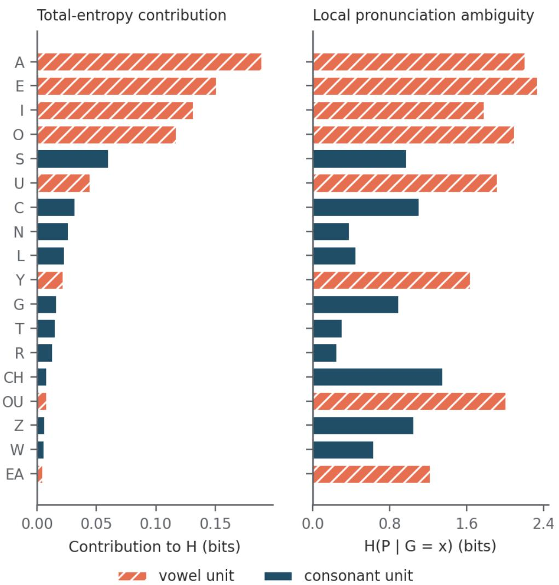  
Figure 1 — English’s $H _ { \mathrm { a l i g n } } = 0 . 9 3 6$ bits, with the 18 largest contributors shown among 532 observed spelling units. Left: each unit’s contribution to $H _ { ; }$ , its share of the list’s unit tokens times its local entropy. Right: each unit’s own local entropy $H ( P \mid G = x )$ (“local pronunciation $\mathrm { \ a m b i g u i t y ^ { * } ) }$ , read in isolation. Vowel units (spelled only with A, E, I, O, U or Y) carry $7 7 \%$ of the top-18 units’ contribution; in the left panel, most consonant units contribute little to $H .$ Ranking is by contribution rather than by local entropy, so rare but ambiguous units do not appear expensive. Computed from the same EM-aligned lexicon as the table, adding no parameters beyond the aligner settings of $\ S 2 .$

The quantity comparable across the two grains is the additive conditional surprisal per word, called the per-word score below. Let the lexicon hold W entries, let word w contain $K _ { w }$ units at grain $^ { g , }$ and let $\bar { K } _ { g }$ be the mean units per word. Since the plug-in entropy $\hat { H } _ { g }$ (the $H _ { g }$ of §2, computed from observed proportions) averages the unit-level surprisal $- \log _ { 2 } { \hat { p } } ( y \mid x )$ over all $\textstyle \sum _ { w } K _ { w }$ tokens, multiplying by $\bar { K } _ { g }$ cancels the token count and leaves

$$
\bar { K } _ { g } \hat { H } _ { g } = \frac { 1 } { W } \sum _ { w } \sum _ { j } - \log _ { 2 } \hat { p } _ { g } ( y _ { w j } \mid x _ { w j } ) .
$$

In words: the product is the average, over words, of the summed surprisals of that word’s units, each scored against the pooled conditional distribution for its grain.

Additive conditional surprisal per word is an oracle score, not a code length. Each word’s segmentation into units comes from the EM alignment of that word’s own pronunciation, so the number is scored with the answer already in hand. A decoder holding only the spelling would not know the segmentation, and nothing here charges it for finding one. Two segmentations of one spelling condition on diferent events, so their probability masses need not sum to one across that spelling’s possible pronunciations. In the smallest case, a spelling ab read as a single unit and the same spelling read as a then b can each receive probability 1 from one trained model, which puts a total mass of 2 on the readings of a single spelling, summed over its two segmentations, and violates Kraft’s inequality (for a decodable code, the probabilities $2 ^ { - \ell }$ implied by its codeword lengths ℓ sum to at most 1); each segmentation alone is normalised (Appendix A). These numbers are therefore not bits anyone could transmit. They are comparable across the two grains because the same kind of oracle, each grain’s own segmentation, is granted at each, which is all the comparison below asks of them; the term I below is the information the spelling segmentation carries about the pronunciation, which the syllable spelling discards. The quantity is also not the whole-word conditional entropy, and the independence across units is a property of the arithmetic rather than a claim

about the language.

Under this unit-by-unit scoring the average per-word surprisal falls from 5.84 to 2.68 bits in English and from 0.20 to 0.11 bits in Finnish when the representation changes from alignment units to syllables. It falls in all five reported languages, and in all twelve the released table covers.

Only the spelling-boundary term I can reverse the per-word fall, and here it is small. For any lexicon, per syllable block, the diference between the two scores decomposes exactly (Appendix A; Figure 3); the five lexicons determine only the sizes of its terms. Write X for the spellings of the block’s alignment units, Y for their pronunciations, G for the syllable spelling and P for its whole pronunciation (from here on, G and P denote the syllable’s spelling and pronunciation, so $H ( P \mid G )$ is the syllable entropy $H _ { \mathrm { s y l l } } )$ , and $L _ { f }$ (f for fine) for the block’s expected summed alignment-unit surprisal. Then

$$
L _ { f } - H ( P \mid G ) = D + H ( Y \mid P , X ) - I ( P ; X \mid G ) .
$$

In words: the alignment-unit score exceeds the syllable entropy by three terms. D, the withinsyllable term, is the context and dependence inside the syllable that scoring its units one at a time ignores, together with in-sample memorisation; $H ( Y \mid P , X )$ , the pronunciation-boundary term, is the information lost about where the pronunciation’s internal boundaries fall; I, which is subtracted, is the information the spelling segmentation carries about the pronunciation, which the syllable spelling discards. D and $H ( Y \mid P , X )$ are never negative, and $H ( Y \mid P , X )$ is zero in all five lexicons. Multiplying by syllables per word gives the lexicon’s mean per-word fall, which in these five lexicons therefore occurs if and only if D exceeds I (in general, if and only if $D + H ( Y \mid P , X )$ exceeds $I ;$ Appendix A).

Only I can make coarsening raise the score, and it is positive only where one syllable spelling arises from several segmentations: the syllable spelling is built by concatenating the units’ spellings, which discards the boundaries between them, and 1,473 of English’s 27,162 syllable spellings, 5.42%, arise from more than one distinct fine segmentation (German 2.30%, Italian 1.67%, Spanish 0.37%, Finnish 0.24%). So the fall is not forced in general, and Appendix A gives a two-word lexicon in which coarsening raises the score. In these lexicons, though, I is small. Each column of Table 2 is a mean over the lexicon’s words, the per-block term times syllables per word (2.43 in English).

Table 2: The lexicon’s mean per-word fall in additive conditional surprisal from alignment unit to syllable, with its within-syllable term D and spelling-boundary term I, each per word.
<table><tr><td>language</td><td>per-word fall</td><td>D per word I per word</td></tr><tr><td>English</td><td>3.158</td><td>3.358 0.200</td></tr><tr><td>German</td><td>2.623</td><td>2.735 0.112</td></tr><tr><td>Italian</td><td>1.415</td><td>1.426 0.011</td></tr><tr><td>Spanish</td><td>1.525</td><td>1.527 0.002</td></tr><tr><td>Finnish</td><td>0.083</td><td>0.085 0.002</td></tr></table>

Averaged over a lexicon’s words, I is largest in English, 0.20 bits against English’s 3.16-bit fall, then 0.112 bits in German and at most 0.011 bits in Italian, Spanish and Finnish; these are lexicon means, not a bound on any single word. The fall’s positive sign therefore rests on the identity plus two measured terms: by the identity, a lexicon’s mean per-word rise is at most its mean per-word

I, which is at most 0.2004 bits here (English; 0.200 in Table 2), and the fall itself is the measured D minus I. D is in-sample: a syllable seen once is scored at zero surprisal, so D inherits the sparseobservation sensitivity §4.4 describes. Values come from pipeline/run\_grain\_decomposition.py, which computes each term by its own route.

So per-unit entropy and additive per-word surprisal need not move together as grain changes: the per-word score falls in all twelve languages, while per-unit entropy falls in German and Spanish, is level in Finnish, rises in Italian only with eSpeak-ng’s symbols, and in English depends on the lexicon. Anyone comparing per-unit entropy across grain sizes, as a dificulty index or otherwise, is comparing quantities with diferent units; none of these entropies is ofered as a measure of what a reader computes.

Against the nearest published direction. Schmalz et al. (2026, pp. 10–11, Table 5) find per-unit conditional entropy falling in all eight of their languages when the unit grows from the letter to the bigram, over monosyllables. Of the seven languages both studies cover, our per-unit change from alignment unit to syllable also falls in French, German and Dutch (Dutch not under the jackknife). Under our syllabification convention (§3.4), it is level in Danish by the plug-in but rises under both corrections. It depends on the word list in English and rises in Norwegian and Swedish. The designs difer at both ends. Their smaller unit is the letter aligned one-to-one with phonemes, which they note misaligns multi-letter spellings (p. 11), while ours is an aligned unit that may span several letters; their larger unit is the bigram of a monosyllable, ours the syllable of a polysyllabic word. We have not tested which diference produces the disagreement in Norwegian, Swedish and Danish.

The per-word fall is not evidence that larger units are more systematic. Enlarging a unit does two things at once: it changes the size of the thing being predicted, and it moves context from outside the conditioning event to inside it. A two-word toy shows the second. Let a language hold only the two word types AB and AC, pronounced $/ \mathrm { p } \ \mathrm { r } / $ and $/ \mathrm { q } \ \mathrm { s } /$ . At the alignment-unit grain A is ambiguous while B and C are not, so $H _ { \mathrm { a l i g n } }$ is 0.5 bits per unit over two units a word, which is 1 bit per word; at the syllable grain each block is deterministic and the figure is 0. Every letter maps exactly as before, so the whole fall is context included in the larger unit: D is 1 bit per word and I is 0. In a real lexicon D mixes that context with in-sample memorisation, and the decomposition does not separate the two. We make no claim about reading dificulty here either: the per-word figure is an in-sample oracle score, and §4.4 records why it is sensitive to sparse observations at the syllable scale.

## 3.3 Observed unit support is confounded with lexicon size

N is far from saturating at the syllable grain (coverage below), and our English lexicon holds about 5.7 times as many word types as the others, so raw counts of distinct syllable units are not comparable without a common sample size. We match English at 20,000 words in two ways — a uniform random sample of the dictionary, which matches size only, and the 20,000 most frequent dictionary words in the OpenSubtitles list, which matches the way the other four lexicons were built (Table 3).

English is the only real contrast here, because it is the only language whose lexicon exceeds the 20,000-word cap; the other four rows are unchanged by construction. The uniform row varies corpus size alone, within one language (Figure 4). The frequency-matched row varies composition too. It moves English’s syllable entropy a further 0.126 bits below the uniform row, and 0.224 bits below the full dictionary (0.138 with eSpeak-ng English, §2).

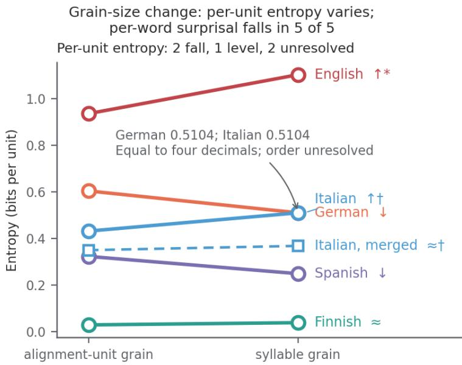  
≈ Within the spread of the five syllabifier settings. \* Rises over the full dictionary, as drawn, and a uniform 20,000-word sample. Over a frequency-matched list, a 0.015-bit plug-in fall, smaller than its bias correction. † Solid: eSpeak-ng's symbols. Dashed: its /I/ and /i/ merged, as for Finnish. Whether they are one phoneme in Italian is not settled.

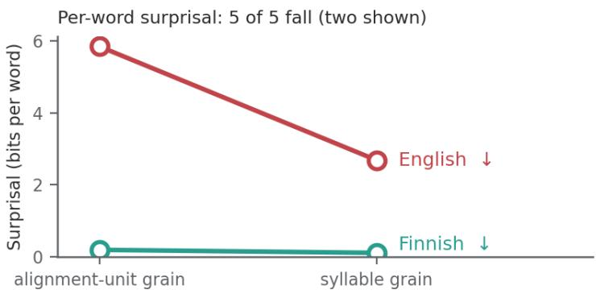  
Figure 2 — Top: all five languages’ $H _ { \mathrm { a l i g n } }$ beside $H _ { \mathrm { s y l l } }$ , one line per language, from Table 1, with Italian drawn twice: solid with eSpeak-ng’s symbols (the table’s row) and dashed with its $\left/ \mathrm { I } \right/$ and $/ \mathrm { i } /$ merged as Finnish’s are (§3.4). An arrow marks a direction only when its sign holds under all five syllabifier settings of §3.4 and its size exceeds that language’s spread across them; ≈ marks a change within that spread (Finnish, and Italian merged). The vertical axis is bits per unit of each grain, per alignment unit at the left point and per syllable at the right. All markers are drawn unfilled and at their unrounded computed values; German and Italian are equal to four decimals, so their markers overlap and the panel labels the tie rather than separating the two points. English’s rise holds over the full dictionary and a uniform 20,000-word sample but not over a frequency-matched list (where the plug-in per-unit fall is smaller than its §4.4 bias correction, which establishes neither a fall nor a rise), so the panel title counts English, with Italian, as unresolved and English’s label carries an asterisk (§3.3). Bottom: additive conditional surprisal per word at each grain, for the two languages whose per-word figures appear in prose above; all five per-word falls are in Table 2 and Figure 3.

(a) Toy lexicon: BEAD and HEAD, equal weight  
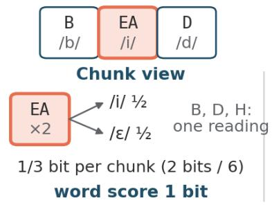

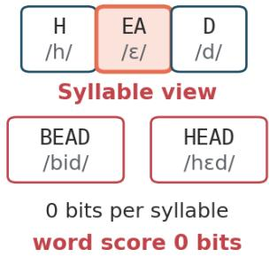

(b) Two toy lexicons: what D and I measure  
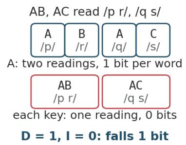

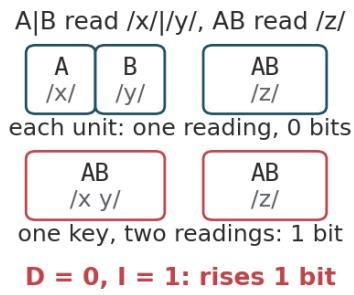

(c) The five lexicons: I is a sliver against D  
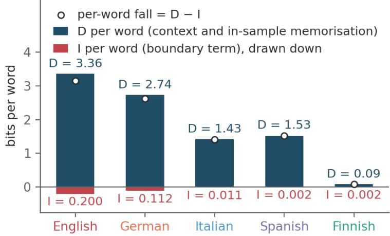  
Figure 3 — The per-word decomposition of §3.2 and its spelling-boundary term. (a) Two made-up words, BEAD read /bid/ and HEAD read /hEd/. Chunk by chunk, EA has two readings, so alignment-unit entropy is 1/3 bit per chunk and the unit score 1 bit per word. As whole syllables, each spelling has one reading, so both syllable measures are 0. The toy shows what each measure counts, not how a reader segments print. (b) The two toy lexicons of §3.2 and Appendix A, exact. Left: in AB and AC the unit A has two readings, so the unit score is 1 bit per word, while each syllable has one reading; the context the syllable takes in is D = 1 bit, I is 0, and the score falls. Right: A|B and the single unit AB are each read one way, but the syllable spelling AB (the key in panel b), which forgets where the unit boundary was, has two readings; D is 0, I is 1 bit, and the score rises. Only I can raise the score. (c) D and I per word in the five lexicons, from run\_grain\_decomposition.py. The dot is the per-word fall, D minus I, because $H ( Y \mid P , X )$ is zero in all five. I’s lexicon mean is largest in English, 0.20 bits per word. D is in-sample and inherits the plug-in’s sparse-observation sensitivity §4.4 describes.

Table 3: Syllable-spelling types and syllable entropy with each lexicon at full size and matched at 20,000 words; only English’s two rows change.
<table><tr><td>language</td><td> $N _ { \mathrm { s y l l } }$  (full)</td><td> $N _ { \mathrm { s y l l } }$  (matched)</td><td> $H _ { \mathrm { s y l l } }$  (matched)</td></tr><tr><td>English, uniform sample</td><td>27,162</td><td>9,508</td><td>1.005</td></tr><tr><td>English, frequency-matched</td><td>27,162</td><td>9,084</td><td>0.879</td></tr><tr><td>German</td><td>6,252</td><td>6,252</td><td>0.510</td></tr><tr><td>Italian</td><td>2,690</td><td>2,690</td><td>0.510</td></tr><tr><td>Spanish</td><td>2,965</td><td>2,965</td><td>0.249</td></tr><tr><td>Finnish</td><td>2,889</td><td>2,889</td><td>0.039</td></tr></table>

Entropy is less sample-sensitive than N, and it is not invariant. Matching English by uniform sample moves H by 0.011 bits (1.1%) at the alignment-unit grain and 0.098 bits (8.9%) at the syllable grain — the syllable scale is 9.3 times more corpus-sensitive in bits, and 7.9 times more as a share of its own entropy (ratios from the unrounded shifts, 0.0106 and 0.0984 bits). That matters for §3.2: English’s own gap $H _ { \mathrm { s y l l } } - H _ { \mathrm { a l i g n } }$ halves under the uniform match, from 0.167 to 0.080 bits. So in this uniform draw the gap is about half its full-dictionary size. Over 1,000 further uniform 20,000-word draws (seeds 1 to 1,000) the matched gap averages 0.073 bits, with a standard deviation of 0.0056 and the central 95% of draws between 0.063 and 0.084, and it is positive in every draw. The halving therefore does not depend on seed 31, whose 0.080 is at the 87th percentile of the 1,000. These draws hold the dictionary and its alignments fixed and vary only which words are sampled, so the spread measures word sampling within this dictionary, not uncertainty about English spelling as a whole (run\_entropy\_sampling\_spread.py). With eSpeak-ng English (§2) the syllable shift is 0.083 bits and the gap goes from 0.169 to 0.087, again about half. Under a composition match, per-unit entropy does not establish English’s sign. In the uniform sample entropy still rises from the alignment-unit to the syllable grain in English, as it does in Italian with eSpeak-ng’s symbols, and still falls in German and Spanish. In the frequency-matched list, without the $/ \mathrm { j u } /$ permission, $H _ { \mathrm { a l i g n } }$ is 0.894 bits and $H _ { \mathrm { s y l l } } \ 0 . 8 7 9$ bits. That 0.894 is the list’s own value; it rounds to the same figure as the full dictionary’s under the permission (§3.4), a diferent quantity. The list therefore shows a 0.015-bit per-unit fall. The uniform sample shows a 0.080-bit rise. If ⟨u⟩ may spell $/ \mathrm { j u } /$ as one unit (§2), the frequency-matched list shows a 0.035-bit rise. Under the same permission, the uniform sample shows a 0.121-bit rise. So per-unit entropy does not establish English’s sign, the status §3.1 gives the German–Italian order. Cut further by frequency, English’s syllable entropy falls below its alignment-unit entropy, by 0.091 bits at 10,000 words and 0.189 at 5,000. German, Italian and Spanish, whose alignments are stored in frequency order, keep their signs at 5,000 and 10,000 words and over their full lists, and Finnish’s change stays within 0.007 bits of zero at both cuts (0.010 over its full list, §3.2). The tests were one uniform draw of 20,000 English words and frequency cuts: at 5,000 and 10,000 words in all five languages, at 20,000 for English, and at the full lists of about 19,900 words for the other four. English is the only one of the five whose direction changed under any cut we tested. Any claim comparing unit counts across languages must compare them at a common lexicon size. The matched column supplies one only by reducing English, since the other four rows are their full lists.

N counts observed units, not a cognitive inventory. N counts the distinct spelling units that actually occur in the lexicon we analyse. Matching lexicon size removes the gross asymmetry between a 114,000-word English list and a 20,000-word one. That removal is necessary before N could be read as a cognitive inventory in this design, and nowhere near suficient.

The uniform English row of the matched column uses a sample of m word types drawn uniformly without replacement from the lexicon’s M types. Its expected support is therefore a rarefaction over a finite lexicon — ecology’s sample-based rarefaction, with word types as the sampling units and spelling units as the species (Colwell, Mao & Chang, 2004, Eq. 5) — and not an occupancy count under repeated independent draws (draws with replacement, uniform over word types). Below, $C ( \boldsymbol { a } , \boldsymbol { b } )$ counts the ways to choose b items from $^ { a , }$ and is zero when b exceeds a. Let $c _ { u }$ be the number of word types that contain unit u at least once. After drawing m of the M types the expected number of distinct units observed is

$$
\mathbb { E } [ N _ { m } ] = \sum _ { u } \Bigl ( 1 - \frac { C ( M - c _ { u } , m ) } { C ( M , m ) } \Bigr ) .
$$

In words: $C ( M - c _ { u } , m ) / C ( M , m )$ is the chance that a sample of m types misses every word carrying $u ,$ so one minus it is the chance u has been seen, and adding those chances across units gives the expected count. The same expression gives the expected number of new units in the next word:

$$
\mathbb { E } [ N _ { m + 1 } ] - \mathbb { E } [ N _ { m } ] = \sum _ { u } \frac { c _ { u } } { M - m } \cdot \frac { C ( M - c _ { u } , m ) } { C ( M , m ) } .
$$

In words again: each unit contributes its chance of being still unseen, times the chance the next draw reaches one of the $c _ { u }$ words that carry it.

One condition is necessary and suficient for both the strict rise and the shortfall (the expected number of observed units the sample misses) at a given $m < M$ : that some unit occurs in at most M − m of the M word types. It is suficient because any such unit has a positive chance of being missed, which makes the shortfall positive and the next word’s expected yield positive with $\mathrm { i t } ;$ it is necessary because if every unit occurs in more than $M - m$ types, every unit is certain to appear in the sample, the shortfall is exactly zero and the curve has stopped rising. Concavity needs no further hypothesis: term by term, for every m from 0 to $M - 2 .$ , each unit’s next first diference equals its current one times $( M - c _ { u } - m ) / ( M - m - 1 )$ , a factor at most 1 because $c _ { u } \geq 1$ (a term whose factor would be negative is already zero). So the expected count never falls, rises strictly at every m that meets the condition above, and the rate of new discoveries never rises. Unlike an infinite-population occupancy model, the curve reaches its ceiling: at $m = M$ the sum is exactly the observed support, since a sample of the whole lexicon sees every unit in it. Two languages matched on m can also difer in expected N because their $c _ { u }$ distributions difer, so the matched column compares coverage at 20,000 words rather than inventory size.

A realised plateau is not saturation. A strict shortfall at every sample size is not automatic: in a lexicon of the two words ab and ba, one draw already shows every unit. It holds for all twelve lexicons analysed here, because each contains at least one alignment unit that occurs in a single word type (one in Finnish, 119 in English), and such a unit satisfies the condition above for every $m < M$ . So at every sample size $m < M$ , at both grains (each lexicon also holds syllable-spelling types that occur in a single word type, from 1,102 in Finnish to 16,094 in English), the expectation stays strictly below what the whole lexicon shows; the grains difer in how far below, which the next paragraph measures, and an observed flattening of N is a point on a discovery curve and not evidence that the unit system has been fully seen. Establishing saturation would need a coverage or unseen-support analysis, which we do not report. Every N in this paper should be read as observed support at the stated corpus size.

The matched column is far from full coverage. Measuring $c _ { u }$ directly from the English lexicon — the number of word types that contain unit u at least once — and evaluating the rarefaction above gives the share of the observed support a sample of m words is expected to reach. At $m = 2 0 { , } 0 0 0$ , that is 65% of the alignment-unit spellings but only 35% of the syllable spellings (Figure 5). At the same point a new syllable spelling arrives every 3.4 words, against one new alignment unit every 214. The syllable grain is not near the end of its discovery curve at the size every other lexicon here is capped to.

At the syllable grain the rarefaction is about 0.3 points from the observed sample. The uniform English sample contains 9,508 (Table 3) of the 27,162 observed syllable-spelling types, which is 35.0%. The rarefaction predicts 34.7%, about 0.3 percentage points below it; the independent-draws occupancy expectation predicts 32.8%, which is 2.2 points low. A further 1,000 uniform 20,000-word samples (seeds 1000 to 1999) give the scale: their syllable counts spread with a standard deviation of 55 types (0.20 points), so the sample sits 1.6 standard deviations above the rarefaction and the occupancy expectation sits 9.1 standard deviations below the rarefaction, and at this grain the sample tells the two models apart. At the alignment-unit grain the agreement is weaker. The same sample holds 331 of the 532 observed alignment-unit spellings (62.2%) against the 65.0% the rarefaction predicts, 1.9 standard deviations low (exact standard deviation 7.7 units, 1.45 points); 37 of the 1,000 further samples held 331 units or fewer. The occupancy expectation, 63.5%, lies only 1.0 standard deviation below the rarefaction there, so one draw cannot separate the two models at that grain. The sample is within two standard deviations of the rarefaction at both grains, high at one and low at the other. This comparison uses one realised draw against an expectation, not a distributional test, and it confirms only that the rarefaction model is consistent with the procedure that drew the uniform English sample. run\_rarefaction\_check.py prints every number in this paragraph, with a control that must fail and does: the first 20,000 words in the dictionary’s alphabetical order fall 25 standard deviations short at the syllable grain.

## 3.4 Robustness

Syllabification. We ran a baseline (maximum onset length of 3 consonants, /s/-cluster exception on, strict sonority) and four variants of it: maximum onset 2, maximum onset 4, /s/-exception of, and sonority plateaux allowed. The largest entropy shift any variant produces in these five languages is 0.025 bits, 2.3% of the 1.065-bit spread between English and Finnish at the syllable scale. English stays highest and Finnish lowest under every variant. The full ordering does not survive every variant: under maximum onset 2 and under sonority plateaux allowed, German moves above Italian. That is §3.1’s four-decimal tie resolving one way, and it is the one place the spread across syllabifier settings exceeds a between-language diference.

One coupling these five syllabifier settings cannot test, and its size. The syllabifier works on whole alignment units, so a boundary falling inside a unit is never proposed and therefore never refused; varying the onset rules cannot probe it. We bound it instead of testing it. Every intervocalic consonant chunk spanning more than one phoneme (under $\ S 2 \mathrm { ^ { \circ } s }$ constraint only $\langle \mathbf { x } \rangle$ and $\langle \mathbf { z } \rangle$ in German) is a place where the ban could refuse a boundary, and counting those gives an upper bound of 0.59% of English’s 215,919 intervocalic consonant chunks (German 0.25%, Spanish 0.49%, Italian 0.06%, Finnish 0.03%). That is a ceiling on how many boundaries the ban could block, not a count of boundaries it did block, and even the ceiling is under one chunk in a hundred.

Lone intervocalic consonants. Giving every lone consonant between two vowels to the preceding syllable, an extreme reversal of the rule all five settings share (§2), shifts syllable entropy by up to 0.12 bits (English, down), almost five times the 0.025-bit spread above, enough to put German above Italian and to bring Italian’s rise (§3.2) to level (−0.019 bits, inside its 0.025-bit spread). Counting only doubled-letter consonants in both syllables, as ambisyllabic (⟨Hum⟩ + ⟨mer⟩, with Spanish ⟨ll and ⟨rr⟩ kept whole because each spells a sound its single letter does not, and Spanish never divides it), moves the five by at most 0.035 bits (Italian, up), leaves English highest and Finnish lowest, puts Italian above German (0.546 against 0.510), outside the 0.025-bit band, and reverses no sign of §3.2 among the five. Outside the five, the same variant turns Dutch’s jackknife reading from level (+0.004 bits) to a fall (−0.067) and Danish’s plug-in diference from level to a fall (−0.020), while the jackknife still reads a Danish rise (+0.025) and Miller–Madow a level diference (+0.007).

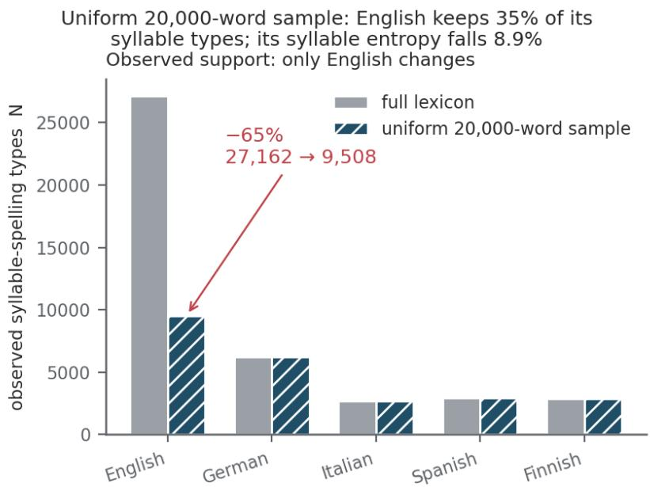

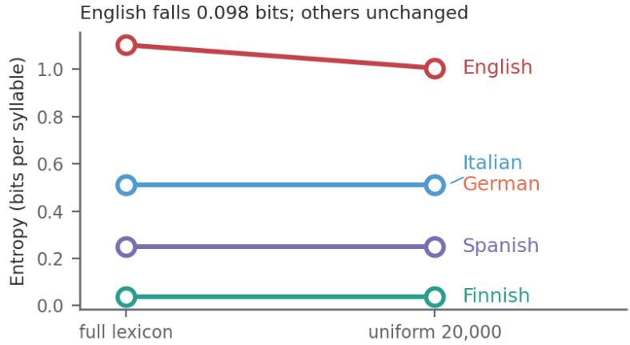  
Figure 4 — Top: observed syllable-spelling support $N _ { \mathrm { s y l l } }$ at the full lexicon and at the uniform 20,000-word sample, per language. Only English moves, from 27,162 to 9,508 types, because it is the only lexicon above the cap. Bottom: the paired syllable-scale entropies, where English falls 1.103 → 1.005 bits while the other four are unchanged by construction. The contrast between the panels is the point: the uniform sample keeps only 35% of English’s observed syllable-spelling types (9,508 of 27,162) yet lowers its syllable entropy by only 8.9%, so the two quantities are not equally sample-dependent. German and Italian (0.5104 bits per syllable each, equal to four decimals) carry separated labels (all markers are open); their diference does not establish an ordering.

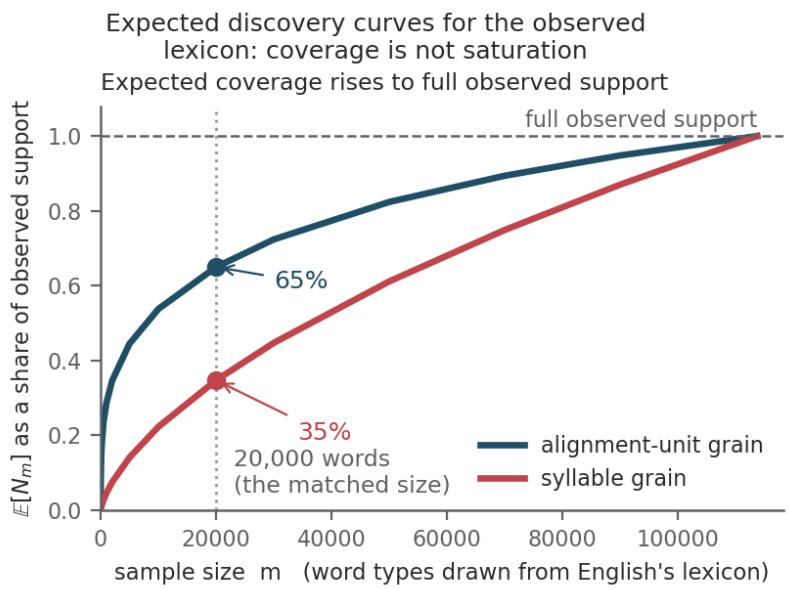

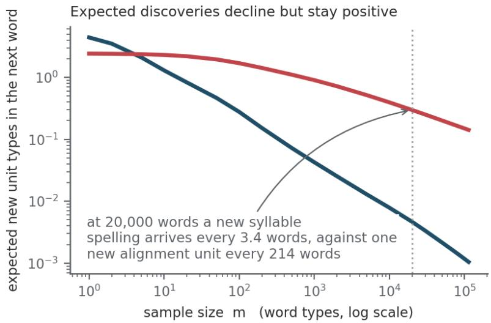  
Figure 5 — An intuition figure for the rarefaction $\begin{array} { r } { \mathbb { E } [ N _ { m } ] = \sum _ { u } ( 1 - C ( M - c _ { u } , m ) / C ( M , m ) ) } \end{array}$ with $c _ { u }$ measured from the English lexicon, not assumed: $c _ { u }$ is the number of word types containing unit u at least once, and $C ( \boldsymbol { a } , \boldsymbol { b } )$ counts the ways to choose b items from $^ { a , }$ zero when b exceeds $a .$ Top: expected observed support against sample size m, as a fraction of the support the full lexicon exposes, at both grains. Both curves rise, both are concave, and both meet the dashed line only at the last word, where a sample of the whole lexicon has by definition seen every unit in it. The dotted line marks the 20,000-word matched size, where the alignment-unit grain has reached 65% of its observed support and the syllable grain 35%. Bottom: the expected number of new unit types the next word contributes, which stays strictly positive at every size short of the full lexicon — at 20,000 words a new syllable spelling still arrives every 3.4 words. Because $\mathbf { } c _ { u }$ is counted on the same lexicon, each curve is a rarefaction of the support already seen and cannot reach past it — which only strengthens the point: even restricted to units already observed, a 20,000-word sample is expected to reach only 35% of the syllable grain.

Pronunciation source, English. In the source-matched check of §2 the forced $/ \mathrm { j u } /$ misalignment costs more than in the dictionary: it raises English $H _ { \mathrm { a l i g n } }$ by 0.066 to 0.072 bits (the low end over all the words the corrected alignment covers, the high end over the original run’s words), against 0.042 to 0.046 in the dictionary. For the next four values we apply the $/ \mathrm { j u } /$ permission to both sources and count each source over all the words it aligns. English $H _ { \mathrm { a l i g n } }$ is 0.919 bits with eSpeak-ng. With the dictionary it is 0.894 bits. English $H _ { \mathrm { s y l l } }$ is 1.088 bits with eSpeak-ng. With the dictionary it is 1.101 bits. The tables, which use the dictionary without the permission, print 0.936 and 1.103. End to end, switching the source to eSpeak-ng, with its own retrained alignment and aligned word set, raises English’s alignment-unit entropy by 0.025 bits and lowers its syllable entropy by 0.013. English stays highest and Finnish lowest of the five at both grains, under each of the five syllabifier settings above. Of the twelve, English is third at the alignment-unit grain (second if Danish’s stød marker is deleted) and highest at the syllable grain over its full, unmatched lexicon (§3.1). The Caravolas calibration of §3.1 is unchanged (19 of 21 pairs, rho = −0.80). Every per-unit sign of §3.2 and §3.3 is the one the dictionary gives under the same permission. So are the per-word fall and its decomposition: I, the spelling-boundary term of §3.2, averages 0.129 bits per word, against 0.200 for the dictionary without the permission (Table 2). Without the permission, eSpeak-ng English and Portuguese difer by 0.0004 bits at the alignment-unit grain (0.9855 against 0.9851), too little to order them, so the Caravolas count then turns on that gap (21 of 21 if it is read as an order, which this paper does not do), and eSpeak-ng English lies 0.0057 bits above Danish (0.9855 against 0.9798), where the dictionary puts it 0.044 bits below. All three are $/ \mathrm { j u } /$ efects and go once the permission is applied. One result depends on the source: the first-unit position check (§3.5), with or without the permission, which is given both ways there. The composition-matched English–Danish syllable comparison of §3.1 does not: both sources put Danish above English (0.984 against 0.879 bits with the dictionary, and against 0.951 with eSpeak-ng under the permission). A few efect sizes move, and are also given both ways.

Transcription artefacts. eSpeak-ng encodes allophonic detail. It transcribes the Finnish grapheme ⟨i⟩ as $\left/ \mathrm { I } \right/$ in 72% of its occurrences in the word list and $/ \mathrm { i } /$ in 28%. Suomi, Toivanen and Ylitalo (2008, p. 20) give Finnish eight vowel phonemes with a single $/ \mathrm { i } /$ among them. In these transcriptions the split follows syllable position, not vowel length: ⟨i⟩ and ⟨ii⟩ are $/ \mathrm { i } /$ in every first-syllable token and $\left/ \mathrm { I } \right/$ in 90% of later ones. So the two symbols are one phoneme, and the transcription records allophonic detail as conditional uncertainty the language does not have. Lyytinen et al. (2015, p. 331) put Finnish grapheme–phoneme consistency at 100% in both directions, which agrees. We therefore merge the pair throughout: every table and figure, and every Finnish entropy quoted outside this paragraph, uses the merged Finnish transcription, and the unmerged one ships in the deposit. Merging lowers Finnish $H _ { \mathrm { a l i g n } }$ by 0.0655 bits, from 0.0947 to 0.0292 — 69% of its unmerged value — and $H _ { \mathrm { s y l l } }$ from 0.141 to 0.039 bits, so the per-unit rise of 0.046 bits under eSpeak-ng’s symbols becomes 0.010 bits, within the spread of the five syllabifier settings (§3.2).

It raises the English–Finnish absolute diference from 0.8413 to 0.9068 bits. Expressed as a ratio the same change reads 9.9× to 32.1×, and we report the absolute diference first and the ratio second, because entropy is bounded below by zero and a ratio against a denominator this close to it is unstable: a further 0.0001-bit shift in Finnish would move the ratio by 0.11 while moving the absolute diference by 0.0001. Finnish is quoted to four decimals here for that reason — at three, 0.029 gives 32.3× and 0.0292 gives 32.1×, and the ratio inherits a rounding the diference does not.

The same output contrast appears in Italian and German. In Italian, which has no $\left/ \mathrm { I } \right/$ phoneme, the pattern is consistent with a shared transcription convention; in German, once length is stripped, $\left/ \mathrm { I } \right/$ against $/ \mathrm { i } /$ is also the phonemic lax–tense contrast (⟨mit⟩ against ⟨Miete⟩), so there the pair can carry real orthographic uncertainty as well as any convention. It does not establish the convention; language-specific phonological review would. We therefore leave German unmerged, report Italian both ways (the tables keep eSpeak-ng’s symbols; merging lowers Italian’s $H _ { \mathrm { a l i g n } }$ from 0.432 to 0.350 bits and its $H _ { \mathrm { s y l l } }$ from 0.510 to 0.368), and release the candidate list for that review. Finnish alone is merged in the tables, because only there do a phonology source and the position split above both show the two symbols to be one phoneme.

Choices we did not vary, and which way each could move the orders. For the eleven languages other than English we used no second pronunciation source: eSpeak-ng transcribed every one of those lists, and we looked none of their words up in a pronouncing dictionary. Hand-built dictionaries exist for some of them (Schmalz et al., 2026, p. 4, used CELEX for German and Dutch, the NST lexicon for the Scandinavian languages and Lexique 2 for French), so for those languages the check is possible and was not done. For all eleven, the four reported in full (German, Italian, Spanish and Finnish) among them, the transcription layer is unmeasured. A dictionary could move an eSpeak-ng entropy either way: its lexical exceptions, which deterministic rules suppress, would raise it, and dropping allophonic splits such as Finnish’s would lower it (§4.4). For English, the one language measured both ways, the switch left every order intact once the $/ \mathrm { j u } /$ permission was applied to both sources; without it, eSpeak-ng English and Portuguese are 0.0004 bits apart and not ordered, and eSpeak-ng English lies 0.0057 bits above Danish, which the dictionary puts above English (Pronunciation source, English, above). The aligner was fitted once, from one starting point, and its two chunk constraints (§2) were never relaxed. A refit from another starting point could settle on other segmentations and move any language’s entropy in either direction. The one alignment change we did measure, the $/ \mathrm { j u } /$ permission, moved English’s dictionary $H _ { \mathrm { a l i g n } }$ by 0.042 to 0.046 bits, changing no order between languages but reversing English’s frequency-matched per-unit sign (§3.3), and its eSpeak-ng $H _ { \mathrm { a l i g n } }$ by 0.066 to 0.072 bits, taking eSpeak-ng English from first of the twelve, level with Portuguese, to third, below Portuguese and Danish. Relaxing the constraints would let a unit absorb neighbouring letters. For a fixed prediction target, absorbing them moves context inside the unit, and added context cannot raise uncertainty (§3.2’s two-word toy), but a larger unit is also a larger target, with more to predict, and §3.2 finds per-unit entropy rising from alignment unit to syllable in Norwegian and Swedish; we have measured neither the net direction nor its size in any language. Either choice can reverse an order only by shifting two languages apart by more than the gap between them. Per alignment unit, English lies 0.33 bits above German and Finnish 0.29 bits below Spanish, the gaps behind the five-language extremes; German lies 0.17 bits above Italian; English lies 0.044 bits below Danish and 0.049 bits below Portuguese, the gaps behind its third place among the twelve; and Finnish lies 0.017 bits below Hungarian. So the extremes are the orders least exposed to either choice, and English’s third place and Finnish’s lowest place among the twelve are the most exposed.

## 3.5 External validity checks

The statement about outcome prediction in §1 (contribution 1) and §4.4 rests on the Seymour, position and Ziegler analyses, with the Caravolas calibration beside them, four in all, reported in Table 4 with their methods rather than asserted in passing. In every row, “our measure” is the alignment-unit entropy $H _ { \mathrm { a l i g n } }$ . All four use published cross-language data (reading outcomes in two, reading-predictor weights in one, depth bands in one) from which neither $H _ { \mathrm { a l i g n } }$ nor onset entropy is computed, and all four are exploratory rather than prespecified. Spearman rank correlations throughout; code in pipeline/ as named.

Table 4: The four external validity checks of §3.5: for each, the script, the published outcome measure, the languages compared and the statistics.
<table><tr><td>check (script)</td><td>outcome measure</td><td>languages</td><td>statistic</td></tr><tr><td>Published depth bands (run_caravolas.py)</td><td>Caravolas (2022, p. 330) indicative bands</td><td>8 that she places</td><td>19 of 21 cross-band pairs ordered correctly, p = 0.014 by 20,000-permutation label shuffle; rho =  $- 0 . 8 0 , \mathrm { p } = 0 . 0 1 0 ;$  with Danish&#x27;s stød marker deleted (§3.1), 20 of 21 and rho = −0.87; the same 19 of 21 and rho =</td></tr><tr><td>Our measure  $\left( H _ { \mathrm { a l i g n } } \right)$  against onset entropy (run_seymour.py)</td><td>Seymour et al. (2003) Grade 1 familiar content-word reading accuracy (their Table 5, the P1 rows, end of the first school year)</td><td>6 — the whole intersection of Borgwaldt&#x27;s seven, Seymour&#x27;s groups and</td><td>onset entropy rho = −0.66 (n = 6; exact one-sided  $\mathrm { p = 0 . 0 8 8 }$  two-sided 0.175), all-position rho = −0.31 (n = 6; one-sided  $\mathrm { p = 0 . 2 8 2 }$  , two-sided 0.564, the same with eSpeak-ng English, §2), exact over all 720 orderings</td></tr><tr><td>Position, holding corpus, aligner and units fixed (run_position.py)</td><td>al. (2003) outcome</td><td></td><td> $H _ { \mathrm { a l i g n } }$  over non-initial alignment units  $\mathrm { r h o } = - 0 . 7 5$  (exact two-sided p = 0.010), over all units (the all-position measure) rho = −0.66 (n = 11; two-sided  $\mathrm { p = 0 . 0 3 1 ) }$  , over each word&#x27;s first alignment unit only rho = -0.64 (two-sided  $\mathrm { p } = 0 . 0 4 0 )$  , exact over all 39,916,800 orderings; with eSpeak-ng English (§2) −0.75 (p = 0.010), −0.66</td></tr><tr><td>(run_ziegler.py)</td><td>Ziegler et al. (2010) published phonological- awareness slope weights (their Table 2, p. 555)</td><td>only Finnish is among the five this paper reports</td><td>onset entropy agrees better on three of their four outcomes and ties on decoding speed (reading speed, reading accuracy, decoding speed, decoding accuracy; a positive rho is agreement, higher entropy with a larger phonological-awareness weight): rho +0.80, +0.90, +0.67 and +0.97 against</td></tr></table>

The hypothesis the Seymour and Ziegler checks were built to test is not supported, and the position check leaves it open. Landerl et al. (2013) decline entropy as a continuous predictor because onset entropy misses irregularity outside the word onset, and an all-position measure might have answered that. These comparisons do not show that it does. Across the six languages both measures cover, Borgwaldt’s onset entropy has the stronger negative rank correlation with Seymour et al.’s (2003) Grade 1 familiar content-word accuracy (onset entropy rho $= - 0 . 6 6 , \mathrm { n } = 6 )$ than our all-position measure $( \mathrm { r h o } = - 0 . 3 1 , \mathrm { n } = 6 )$ . These are correlations between language means, and Seymour et al. (2003, abstract and p. 167) attribute familiar-word diferences mainly to orthographic depth, and the slower start in English (as in Danish) to syllabic complexity and depth combined, so neither measure’s correlation isolates depth. The head-to-head cannot be widened past those six, and it cannot include Finnish: Borgwaldt et al. measured Dutch, English, French, German, Hungarian, Italian and Portuguese, so Finnish is absent from their set, and neither Finnish value that circulates in this literature is a Borgwaldt measurement: Landerl et al. (2013, p. 688 and Table S1) supply an upper bound on the number of word-initial letter-to-phoneme mappings (at most 21), not an entropy, and Ziegler et al. (2010, Table 1) an onset entropy of 0.0 computed from their own Finnish corpus (p. 553). A seventh language would rest on one of those cells, so we quote the six. The Ziegler check below does admit Ziegler et al.’s Finnish cell, because it uses the onset-entropy column those authors analysed beside their own outcomes (their Table 1: their corpus value for Finnish, Borgwaldt et al.’s for the other four); the Seymour head-to-head, by contrast, is against Borgwaldt’s measure itself.

The same direction appears in a second published outcome set, and the second set is weaker corroboration than its four outcomes suggest. Against Ziegler et al.’s (2010) published phonological-awareness slope weights, onset entropy (Borgwaldt et al.’s values for four languages, and Ziegler et al.’s own corpus value for Finnish, their p. 553) agrees better than our measure on three of their four outcomes and ties on the fourth, decoding speed $( \mathrm { r h o } = + 0 . 6 7$ for both). But those four outcomes come from the same five languages and the same 1,265 children, and in Ziegler et al.’s Table 2 three of the four phonological-awareness weight vectors are near-collinear: reading speed, reading accuracy and decoding speed correlate at Pearson $\mathrm { r = 0 . 9 2 }$ to 0.99 across the five languages, while decoding accuracy departs from them $( \mathrm { r } = 0 . 4 0 \ \mathrm { t o } \ 0 . 6 7 )$ . These are not four independent tests. At five languages the exact one-sided permutation test has a floor of 1/120 $= 0 . 0 0 8$ without ties $( 2 / 1 2 0 = 0 . 0 1 7$ for the two decoding outcomes, which carry tied weights), but the binding constraint is the coarseness above that floor: for every one of these four outcomes the p-value grid holds at most two rungs below 0.05, and its third rung is 0.067, so one swapped pair of languages carries a result across the conventional threshold. Two of the four onset-entropy comparisons do fall below $\mathrm { i t } - \mathrm { p } = 0 . 0 4 2$ for reading accuracy and $\mathrm { p } = 0 . 0 1 7$ for decoding accuracy, both printed in the released comparison table — so a small p is attainable at this sample size, and it is not what this check is short of. And of those five languages only Finnish is among the five the present paper reports. We record it as corroboration and never as replication.

Two further points bear on the hypothesis: one fails to support it, and one leaves it open. First, the stronger behavioural correlation comes from Borgwaldt’s first-letter-to-first-phoneme onset entropy despite its restricted positional scope. Its authors had already extended it to two- and three-letter contexts across the five languages of the 2004 study, finding that “the pattern of relative ambiguity of the five languages as compared to one another remains about the same” (Borgwaldt et al., 2004, p. 178). That extension widened the word-initial context but kept the first phoneme as the target, so it does not test whether measuring non-initial positions adds anything. Our same-corpus position comparison addresses that separate question. Second, on the eleven languages Seymour et al. cover (our twelve less Hungarian) the point estimates do not favour the word’s initial position. Holding corpus, aligner and units fixed and varying only which part of the word is measured, the correlation with Grade 1 accuracy is strongest for the non-initial units $( \mathrm { r h o } = - 0 . 7 5 , \mathrm { n } = 1 1 )$ ), against −0.66 for the all-position measure (n = 11; equal by coincidence to onset entropy’s six-language rho) and −0.64 for initial units alone. On these point estimates the rest of the word predicts the outcome at least as well as the initial units do, though we report no test of the diference between the correlations. The diferences in rho (non-initial minus initial −0.11, non-initial minus all-position −0.09) are descriptive, not tested advantages. Deleting Danish’s stød marker (§3.1) moves each of these three correlations by at most 0.01. Their order is unchanged, and so it is with English transcribed by eSpeak-ng (§2), which leaves the other two correlations at their dictionary values. The first-unit p is 0.040 with the dictionary and 0.052 with eSpeak-ng, with or without the /ju/ permission, so it falls below 0.05 under one source only; the other two stay below 0.05 under both.

Our measure’s association difers with the language set, by an amount six languages cannot resolve. The all-position measure correlates with Grade 1 accuracy at rho = −0.31 over the six languages shared with Borgwaldt and rho = −0.66 over all eleven Seymour covers — the same measure and outcome, and a diference that a six-language estimate is too imprecise to establish. Covering more of the word did not predict reading outcomes better than Borgwaldt’s onset entropy in these checks, and this paper does not claim it does. At n = 6 neither measure’s correlation rejects zero association: onset entropy’s exact one-sided p is 0.088, and ours is 0.282. The head-to-head therefore compares two estimates neither of which rejects zero association, and we read it as a failure to support the hypothesis, not as evidence against it. At n = 11 our measure’s correlation does reject zero association, with an exact two-sided p of 0.031 (the same with eSpeak-ng English, §2) over all 39,916,800 orderings of the eleven languages, uncorrected for the three position measures tested against the same outcome. A Holm adjustment over those three tests gives 0.030 for the non-initial measure and 0.061 for the all-position and first-unit measures, under either English source, so only the non-initial association clears 0.05 after adjustment, and clearing it does not make that measure the better predictor. Onset entropy cannot be set against it there, because Borgwaldt et al. measured only six of those eleven languages.

## 4. Discussion

The three findings and §3.5’s validity checks each matter for reading research (§4.1). §4.4 sets out their limitations, §4.5 reports an exploratory check, and §5 concludes.

## 4.1 Implications for reading research

Name the grain for any contrast in the middle of the range. English is highest and Finnish lowest of the five at both grains, under either English pronunciation source and with the length mark restored (§3.1, §3.4), as in first-year accuracy: the Scottish English-speaking group read 33% of familiar content words correctly, Finnish children 98% (Seymour et al., 2003, Table 5, p. 153). Some mid-range contrasts change with the grain. German lies 0.17 bits above Italian per alignment unit and level with it per syllable (§3.1), or above it at both grains if Italian’s two i symbols are merged; Portuguese lies above English per alignment unit and below it per syllable, and so does Danish while stød is marked, against English’s full dictionary. Matched on size and composition, English lies below Danish per syllable too (0.879 against 0.984 bits, §3.1). A study using a mid-range depth diference as a predictor must name the grain. German, Italian and Spanish children read 94% to 97% of their familiar content words correctly, and per alignment unit these three languages reverse the order depth predicts (higher entropy, lower accuracy), a three-language pattern we do not test: German, the most accurate of the three (97%), has the highest entropy.

Test the efect of a larger unit in each language. Ziegler and Goswami (2005, p. 11) write that smaller grain sizes tend to be more inconsistent than larger ones, “at least in English”. Per-unit entropy falls from alignment unit to syllable in Spanish and, less securely (§4.4), German, is level in Finnish, rises in Italian only with eSpeak-ng’s symbols, and in English depends on the word list (§3.2, §3.3). Schmalz et al. (2026) find it falling from letter to bigram in all eight of their languages; of the seven languages both studies cover, ours falls in three, French, German and Dutch (Dutch not under the jackknife, §3.2). A cross-grain comparison should state unit, word list and denominator: per unit, a larger unit can raise entropy through its size alone; per word, the score falls in all twelve languages but is an oracle score (§3.2). Our syllable is not Ziegler and Goswami’s rime, so their claim stays untested.

Match lexicons on size and composition. Cutting English to 20,000 words lowers its syllable entropy by 0.098 bits on average over 1,000 uniform draws (size alone) and by 0.224 bits under a frequency cut, which changes composition too (§3.3). The larger shift exceeds the full-lexicon English–Danish gap (1.103 against 0.984 bits, §3.1) and is about the size of the Spanish–Finnish gap (0.210 bits, Table 1). Syllable-scale comparisons should match word-type count, list construction, unit and pronunciation source, and state the matched size. Corpora difering several-fold in size, such as Schmalz et al.’s (2026) 1,155 to 8,027 monosyllables, need the same matching, though we did not test their measures.

Measuring every position did not predict better than the onset. Landerl et al. (2013, p. 688) set entropy aside because Borgwaldt’s measure is “based only on word onsets”. Over the six languages both measures cover, onset entropy correlated with first-year accuracy at rho = −0.66 and our all-position measure at −0.31; at n = 6 neither rejects zero association, and no test compared the two (§3.5). Over the eleven languages Seymour et al. cover, ours is −0.66 (two-sided p = 0.031), equal to onset entropy’s six-language value only by coincidence. A continuous depth measure needs testing in more than six languages; §4.5 reports an exploratory check over eleven.

## 4.2 Cue reading, cipher reading and neighbouring fields

Philip Gough distinguished cue reading, in which a beginner recognises a word by a salient visual cue in or around it, from cipher reading, which replaces it once the child decodes through letter–sound relations (Gough & Hillinger, 1980; Gough, Juel, & Grifith, 1992, as cited in Ehri, 2005, p. 138). Children read their first 40 or so words by cues, and the strategy breaks down because visual cues run out (Gough & Hillinger, 1980, as cited in Ehri, 2005, p. 142). In those terms the conditional entropy describes the cipher itself, not cipher reading: how variable its correspondences are across a lexicon. It does not measure a learner’s uncertainty while inferring them, nor the efort of learning them. Nor is an orthography a cipher in the cryptographic sense, which its keyholder can invert exactly: a reader who knows English spelling well still cannot tell from ⟨ea⟩ alone whether it is read as in bead or head. We use the analogy to mark what the measure covers, not as a formal result.

Cryptography. Shannon (1949) separated a cryptanalyst’s uncertainty about the key, the key equivocation, from uncertainty about the message, the message equivocation. Our aligner works as a cryptanalyst handed known plaintext: it receives spellings paired with their pronunciations and infers the correspondences between them. In those terms the fitted correspondence table plays the key, and the entropy we report is the uncertainty about the message that remains once the key is known. For a true cipher that quantity is zero. For English it is not, and it says nothing about how hard the table is to learn.

Coding theory. Coding theory first fixes what each decoder is given. Slepian and Wolf (1973) derived the coding rates, in bits per source character, needed for two correlated sources under sixteen arrangements of what each encoder and decoder has access to. In those terms our per-word score is a decoder handed the pronunciation’s syllable boundaries, and a reading model must instead say how boundaries are recovered from print. We do not identify the score with a Slepian–Wolf rate.

Grapheme-to-phoneme conversion. Speech technology predicts a pronunciation from a spelling and scores the prediction on words withheld from training. Joint-sequence models (Bisani & Ney, 2008) learn the alignment and the probabilities together from training words, then predict the pronunciations of words withheld from training. Fitting such a model with the training vocabulary, the alignment constraints and the handling of unseen units all fixed in advance would test whether the grain-dependent patterns here hold on unseen words. Our alignments were learned on every word, so that test needs a new fit and is left to later work (§4.5).

Learning models. Connectionist models make spelling–sound consistency matter through learning. The networks of Plaut, McClelland, Seidenberg and Patterson (1996) reproduced the interaction of word frequency and spelling–sound consistency, in naming latency for their recurrent network, through how often each mapping was met in training and how spelling and sound were represented. Our estimates describe distributions such a model could learn from, under stated choices of vocabulary and unit, with every word type weighted equally. They do not assume that readers represent the aligner’s units or compute its entropy. Weighting each word by its frequency, which the deposited alignments do not carry, would show how much the weighting choice matters.

## 4.3 Granularity and transparency

Wydell and Butterworth’s hypothesis has two dimensions, and these measurements bear on one. Transparency, how close to one-to-one the print-to-sound translation is at whatever level it operates (their p. 280), is a property of the writing system, estimated here from word lists at two scales. Their Table 2 (p. 280) places Italian, German, English and Danish along it in that order, from transparent to opaque, and the twelve-language alignment-unit entropies order the four the same way (0.432, 0.604, 0.936 and 0.980 bits), Danish above English only while its stød marker is kept (§3.1). At the syllable scale the order does not hold: German and Italian tie (0.510 bits each; merging Italian’s two i symbols puts it lower, at 0.368), and Danish (0.984) falls below English’s full dictionary (1.103), though not below English matched on size and composition (0.879) (§3.1). Granularity in their sense, the size of the smallest orthographic unit representing sound (at the coarse end, a whole character or word), is a property of the script. It does not vary among alphabetic orthographies and is untested here. The grain we vary is our own unit of analysis inside an alphabetic script, not the script’s granularity. The reader’s grain lies outside these measurements: whether a reader such as AS (Wydell & Butterworth, 1999) has acquired the sub-syllabic mappings whose failure those authors tie to phonological dyslexia (p. 280) is a fact about that reader.

## 4.4 Limitations

Word lists and readers. The measurements describe writing systems as sampled by particular word lists. They do not describe readers, and they do not explain dyslexia. We tested no readers. The pronunciations are transcriptions, not any reader’s phonology, and one transcription convention moved Finnish’s alignment-unit entropy by 69% of its uncorrected value until we corrected it (§3.4). The main results cover only five European alphabetic languages. The lexicons are a pronouncing dictionary and frequency lists from film subtitles, not the vocabularies children meet while learning to read. We do not claim that broader positional coverage predicts reading outcomes better. A direct validity check against Borgwaldt’s onset entropy did not support the hypothesis that broader coverage predicts better, a same-corpus position comparison leaves it open, and §3.5 reports both.

Unit size and context. Enlarging the unit necessarily includes context, so reporting both grains in §3.2 does not separate the contributions of unit size and context. §3.2 also interprets the direction of per-unit entropy cautiously, for a reason that is mathematical rather than empirical: the unit has changed size, so the two numbers are not in the same units.

Estimation, transcription and method.

• Finite-sample error, largest at the syllable grain. With a fixed alignment, conditiona entropy calculated from pooled alignment-unit tokens is the descriptive plug-in statistic of the observed lexicon. Sparse spelling units often contribute zero observed conditional entropy, which can produce substantial downward error: a spelling unit seen once receives empirica conditional entropy of exactly zero, which records that no second pronunciation was observed and not that none exists. For independent sampling of individual unit tokens, the plug-in conditional entropy is downward biased in expectation. Our sampling unit, however, is the complete word, and words contribute unequal numbers of unit tokens. Under that design the pooled estimator is a ratio statistic whose finite-sample bias does not have a guaranteed sign. Two equally likely word types, drawn independently, show it: one holds 14 tokens of a spelling unit, all read one way, and the other holds two tokens of it, read two ways. Pooled over tokens, the population value is 0.337 bits, yet the plug-in from one sampled word averages 0.5 bits and from two words 0.419, both above it. The Miller–Madow and synthetic-lexicon checks below illustrate sensitivity to sparse observations but establish neither a bias direction nor a bound for the word-sampled estimator. At the syllable grain, 38% to 59% of observed syllable-spelling types occur exactly once (Finnish 38%, English’s full dictionary 59%), against 1.5% (Finnish) to 41% (Italian) of alignment-unit spellings seen as a single token at the alignment-unit grain. The leading Miller–Madow correction (Miller, 1955, p. 97, eqs. 10 and 12), (r − 1)/(2t ln 2) for a spelling unit seen t times with r readings and averaged over units by their share of unit tokens, is +0.0001 to +0.0008 bits at the alignment-unit grain and +0.002 to +0.024 bits at the syllable grain, in the five full lexicons. That correction does not estimate the error, and the sparse case shows it can fall far short of it: on synthetic lexicons built to have a true conditional entropy of exactly 1.000 bit, a dense one (50 units seen 2,000 times each) recovers 1.0000, while a sparse one (20,000 units seen twice each) reads 0.503 and the correction raises it only to 0.684 — recovering 36% of the 0.497-bit shortfall and leaving 0.316 bits uncorrected. We make no claim that the correction bounds the error from below. Miller’s leading term counts the outcomes that have nonzero probability (his k, p. 95); applied, as is standard practice, with the observed number of readings in their place, it is a leading-order term in the observed support count, and we supply no hypotheses under which it is a lower bound. The corrections quantify sensitivity under their assumptions and do not establish the sign of bias in the actual word sampling design. The volume’s editor adds that Miller’s formulas “are not to be used when number of observations and number of categories are of similar sizes” (editor’s note in Miller, 1955, p. 100), the case of a syllable spelling seen only once or twice. The full-dictionary sign of $H _ { \mathrm { s y l l } } - H _ { \mathrm { a l i g n } }$ in each of the five languages of §3.2 survives the correction, while English’s frequency-matched per-unit fall does not (−0.015 becomes +0.019 bits), and the $/ \mathrm { j u } /$ treatment of §2 alone also reverses it (to +0.035 bits). So the frequency-matched per-unit fall is smaller than the 0.034-bit shift its leading-order bias correction produces and establishes neither a fall nor a rise. German’s and Spanish’s falls also keep their sign under two stronger corrections: a delete-one-word jackknife, which reads 1.006 bits on the sparse synthetic lexicon above where Miller–Madow reads 0.684, gives −0.065 and −0.068 bits respectively, and extrapolating the plug-in to an unlimited lexicon gives −0.074 and −0.069 (run\_fall\_bias\_check.py). The check is weaker for German. With pronunciations planted on each language’s real syllables so that the true syllable entropy lies 0.05 bits above $H _ { \mathrm { a l i g n } } ,$ every estimator detects the planted rise in Spanish, but in German none reads it as a rise beyond German’s 0.0131-bit spread: the jackknife reads the two grains as level (+0.004 bits) and the others read a fall. Under that planted model, adding each estimator’s planted shortfall to its German estimate leaves a fall beyond that spread only for the jackknife (−0.020 bits), while Miller–Madow and extrapolation read level (−0.0129 and −0.0111 bits). Under the Miller–Madow correction, at the syllable grain, German lies above Italian (0.528 against 0.520), but inside Italian’s 0.025-bit spread, so the correction no more orders the two than baseline does (§3.1). No bracket on the population value is claimed. For a fully prespecified probability model (an aligner trained only on the training words and a prespecified backof that gives every unseen syllable some probability), the population cross-entropy, the expected surprisal under the same token-weighted joint distribution, upper-bounds the population conditional entropy. A realised held-out score only estimates that expectation, and neither its value nor, when words of unequal length are sampled, its own expectation is guaranteed to lie above the population entropy. Nor does the bound furnish a finite-sample bracket here, because the in-sample plug-in has no guaranteed bias sign under word sampling. Our in-sample figures, whose alignment is learned on the same words, are claimed as a bound in neither direction, and no held-out cross-entropy is computed here.

• The entropy is an in-sample corpus statistic. The alignment is learned from the same words on which entropy is computed, so the figures describe the analysed lexicon. Multiple EM restarts and a cross-validated aligner would estimate the efect of fitting the alignment on the same words, and are not reported; §3.4 states which way a refit could move each order.

• Automatic phonemization may bias entropy in either direction, and the direction is language-specific. Deterministic rules can suppress lexical exceptions, which lowers entropy; allophonic detail can introduce distinctions that are not phonemic for the target language, which raises it. §3.4 documents one instance of the second kind, which moved Finnish’s alignment-unit entropy by 69% of its unmerged value. Because neither direction nor magnitude is general, cross-language comparison needs phonemic normalization or sourcematched sensitivity analysis.

• English’s pronunciations come from a diferent source than the other four. CMUdict against eSpeak-ng, as $\ S 2$ states. For English it is measured (§2, §3.4): compared end to end, with the $/ \mathrm { j u } /$ permission applied to both sources and each alignment retrained on its own transcription, the switch leaves every ranking, the Caravolas calibration and every per-unit sign; switching the source moves one position p-value across 0.05 (0.040 with the dictionary, 0.052 with eSpeak-ng, with or without the permission). For the other four it is unmeasured, because we used no second pronunciation source for them (§3.4), so every cross-language comparison here compares transcription processes as well as orthographies: the depth measured is depth as these transcriptions represent it.

• The two chunk constraints are linguistic assumptions made to defeat a likelihood length bias, not something the data forced, and we report no ablation for them; §3.4 states which way relaxing them could move the orders.

• The syllabifier is a heuristic, and its baseline and four variants are a local perturbation analysis rather than a gold-standard validation. Syllable structure and phonotactic legality difer by language; a stratified comparison against a trusted syllabified resource per language would be

better.

• We report the reading direction only. Spelling-direction entropy is not covered here.

• We have not separated orthographic from phonotactic unpredictability in general. §3.4 handles one instance; the general problem Schmalz et al. raise requires per-language inspection and is unsolved here.

• The aligner is a restricted reimplementation of established many-to-many EM methods (Jiampojamarn et al., 2007; the restrictions are $\ S 2 \mathrm { ^ { \circ } s }$ two chunk constraints), not a new algorithm. It is released for reproducibility, not as a contribution.

• Apart from the Wilson intervals of the alignment check (§2), the spread of the 1,000 further uniform samples of syllable counts (§3.3), which scales one comparison, and the spread of English’s entropy over 1,000 uniform draws (§3.3), which holds the dictionary fixed, no inferential interval accompanies any entropy, count or correlation estimate above. Repeated subsampling of the other languages would give one. The rank correlations in §3.5 are computed over five to eleven languages, so their estimates are imprecise and sensitive to which languages are included. We report exact permutation p-values for them and no inferential intervals.

• We located the prior work through the reference lists of the reviews and comparisons cited here and through targeted literature-database and web searches. It is not a systematic review.

## 4.5 Future directions

The limits above name their own next steps: a second pronunciation source for the eleven eSpeak-ng languages (§3.4), a held-out cross-entropy, repeated subsampling for languages other than English and for lexicons matched on composition, a per-language comparison against a trusted syllabified resource, and tests with readers. One check needs no new data, and we report it below as exploratory.

An exploratory check against first-year accuracy. We ran it after its inputs were in hand, so it is exploratory, not a prespecified test, and its p-value carries no confirmatory weight. It covers the eleven languages of §3.5’s position check. English enters cut to its 20,000 most frequent words, transcribed by eSpeak-ng as the other ten lists are, and aligned under the $/ \mathrm { j u } /$ permission of $\ S 2$ (the letter u may spell $/ \mathrm { j } /$ plus a vowel as one unit). Across the eleven, syllable-scale entropy rankcorrelates with Seymour et al.’s (2003, Table 5, p. 153) Grade 1 (first-year) familiar content-word accuracy at rho = −0.74, exact one-sided $\mathrm { p } = 0 . 0 0 6$ over all 11! orderings: the languages whose syllables leave more pronunciation uncertainty had lower first-year accuracy. With the dictionary transcription, rho $\mathrm { ~ s ~ } { - } 0 . 7 5 \ ( \mathrm { p } = 0 . 0 0 6 )$ for the uniform draw (seed 31) and −0.74 under the frequency cut, so the English source and matching do not move the result. Two controls behave as they must: reversing the accuracies gives rh $\mathrm { 1 0 } = \mathrm { + 0 . 7 4 ~ ( p = 0 . 9 9 ) }$ , and placing English lowest drops the association to rho $= - 0 . 2 5 \ ( \mathrm { p } = 0 . 2 3 )$ , so the association depends heavily on where the two extreme languages fall. Its alignment-unit counterpart is already reported $( \mathrm { r h o } = - 0 . 6 6 , \mathrm { n } = 1 1 , \ S 3 . 5 )$ , and Seymour et al. group their languages by syllable complexity, so the correlation may track syllable complexity rather than depth. The two scales order the eleven languages too alike to separate them. The check shows only that the syllable-scale value tracks this outcome in these eleven languages. run\_syllable\_accuracy.py recomputes it from the deposit.

## 5. Conclusion

We measured how predictably spelling maps to sound, as conditional entropy over every aligned unit in every word of full polysyllabic lexicons, in twelve alphabetic orthographies at two grain sizes, the alignment unit and the syllable. English is highest and Finnish lowest of the five reported in full at both grains. Per-unit entropy has no common direction as units grow, and some mid-range contrasts change with the grain: Portuguese lies above English per alignment unit and below it per syllable, so a study using a mid-range depth diference as a predictor must name the grain. Lexicon size changes the syllable-grain estimate: a uniform 20,000-word sample of the English dictionary has syllable entropy 0.098 bits lower, averaged over 1,000 draws whose standard deviation is 0.006 bits, so syllable-scale comparisons should match lexicons on size and composition. For reading research, the measure gives cross-language studies a continuous depth value at a stated grain, with every position in the word contributing rather than the onset alone, though over six languages it tracked first-year accuracy no better than onset entropy (§3.5), and §4.5 reports an exploratory check in which its syllable-scale value tracked first-year reading accuracy, an association that depends heavily on where English and Danish fall.

AS’s dissociation (§1) is a fact about one reader, and these estimates describe the spelling-sound patterns a reader of each language meets. English is highest of the five at both grains, which fits the transparency half of Wydell and Butterworth’s hypothesis, but a word-list statistic cannot say which grain AS read by or why his dificulty stayed in English. Because the estimates move with the grain, the vocabulary and the transcription, those three choices belong in any claim about orthographic depth. The exploratory association with first-year accuracy establishes neither a cause of reading dificulty nor an advantage for the syllable. Settling the granularity half needs readers. One test would fit syllable-scale scores without the evaluation words and ask whether they predict word-naming accuracy beyond alignment-unit scores, word frequency and length. A failure would count against a syllable advantage.

## References

Bisani, M., & Ney, H. (2003). Multigram-based grapheme-to-phoneme conversion for LVCSR. In Proceedings of Eurospeech 2003 (pp. 933–936). ISCA. https://doi.org/10.21437/Eurospeech.2003-326

Bisani, M., & Ney, H. (2008). Joint-sequence models for grapheme-to-phoneme conversion. Speech Communication, 50 (5), 434–451. https://doi.org/10.1016/j.specom.2008.01.002

Black, A. W., Lenzo, K., & Pagel, V. (1998). Issues in building general letter to sound rules. In Proceedings of the Third ESCA/COCOSDA Workshop on Speech Synthesis (pp. 77–80). ISCA.

Borgwaldt, S. R. (2003). From onset to entropy: Spelling-pronunciation patterns in six languages [Doctoral thesis, Universiteit van Amsterdam]. https://pure.uva.nl/ws/files/3949148/49099\_Thesis. pdf

Borgwaldt, S. R., & De Groot, A. M. B. (2002). Beyond the Rime: Measuring the Consistency of Monosyllabic and Polysyllabic Words. In M. Neef, A. Neijt, & R. Sproat (Eds.), The Relation of Writing to Spoken Language (pp. 49–69). Niemeyer. https://doi.org/10.1515/9783110918601.49

Borgwaldt, S. R., Hellwig, F. M., & De Groot, A. M. B. (2004). Word-initial entropy in five languages — letter to sound and sound to letter. Written Language and Literacy, 7 (2), 165–184. https://doi.org/10.1075/wll.7.2.03bor

Borgwaldt, S. R., Hellwig, F. M., & De Groot, A. M. B. (2005). Onset entropy matters — letter-to-phoneme mappings in seven languages. Reading and Writing, 18 (3), 211–229. https://doi.org/10.1007/s11145-005-3001-9

Borlefs, E., Maassen, B. A. M., Lyytinen, H., & Zwarts, F. (2017). Measuring orthographic

transparency and morphological-syllabic complexity in alphabetic orthographies: A narrative review. Reading and Writing, 30 (8), 1617–1638. https://doi.org/10.1007/s11145-017-9741-5 (read in the open-access full text, Europe PMC PMC5574968, which carries no page numbers, so the pinpoint names a section)

Caravolas, M. (2022). Reading and reading disorders in alphabetic orthographies. In M. J. Snowling, C. Hulme, & K. Nation (Eds.), The science of reading: A handbook (2nd ed., pp. 327–353). Wiley-Blackwell. https://doi.org/10.1002/9781119705116.ch15

Carnegie Mellon University. (2008). The CMU Pronouncing Dictionary (Version 0.7a) [Data set]. http://www.speech.cs.cmu.edu/cgi-bin/cmudict

Chee, Q. W., Chow, K. J., Yap, M. J., & Goh, W. D. (2020). Consistency norms for 37,677 english words. Behavior Research Methods, 52 (6), 2535–2555. https://doi.org/10.3758/s13428-020-01391-7

Colwell, R. K., Mao, C. X., & Chang, J. (2004). Interpolating, extrapolating, and comparing incidence-based species accumulation curves. Ecology, 85 (10), 2717–2727. https://doi.org/10.1890/03-0557

Damper, R. I., Marchand, Y., Marsters, J.-D. S., & Bazin, A. I. (2005). Aligning text and phonemes for speech technology applications using an EM-like algorithm. International Journal of Speech Technology, 8, 147–160. https://doi.org/10.1007/s10772-005-2166-6

Dave, H. (2018). FrequencyWords (2018 OpenSubtitles frequency lists) [Data set]. GitHub. https://github.com/hermitdave/FrequencyWords

Ehri, L. C. (2005). Development of sight word reading: Phases and findings. In M. J. Snowling & C. Hulme (Eds.), The science of reading: A handbook (pp. 135–154). Blackwell. https://doi.org/10.1002/9780470757642.ch8

eSpeak NG contributors. (2024). eSpeak NG (Version 1.52 for the English transcriptions; earlier, unrecorded releases for the other eleven lists, §2) [Computer software]. https://github.com/espeakng/espeak-ng

Galescu, L., & Allen, J. F. (2001). Bi-directional conversion between graphemes and phonemes using a joint N-gram model. In Proceedings of the 4th ISCA Tutorial and Research Workshop on Speech Synthesis. ISCA.

Jiampojamarn, S., Kondrak, G., & Sherif, T. (2007). Applying many-to-many alignments and hidden Markov models to letter-to-phoneme conversion. In Proceedings of NAACL HLT 2007 (pp. 372–379). Association for Computational Linguistics. https://aclanthology.org/N07-1047/

Landerl, K., Ramus, F., Moll, K., Lyytinen, H., Leppänen, P. H. T., Lohvansuu, K., et al. (2013). Predictors of developmental dyslexia in European orthographies with varying complexity. Journal of Child Psychology and Psychiatry, 54 (6), 686–694. https://doi.org/10.1111/jcpp.12029

Lange, M., & Content, A. (1999). The grapho-phonological system of written French: Statistical analysis and empirical validation. In Proceedings of the 37th Annual Meeting of the Association for Computational Linguistics (pp. 436–442). Association for Computational Linguistics. https://aclanthology.org/P99-1056/

Lim, A., O’Brien, B., & Onnis, L. (2024). Orthography–phonology consistency in English: Theoryand data-driven measures and their impact on auditory vs. visual word recognition. Behavior Research Methods, 56 (3), 1283–1313. https://doi.org/10.3758/s13428-023-02094-5

Lison, P., Tiedemann, J., & Kouylekov, M. (2018). OpenSubtitles2018: Statistical rescoring of sentence alignments in large, noisy parallel corpora. In Proceedings of the Eleventh International Conference on Language Resources and Evaluation (LREC 2018). European Language Resources Association. https://aclanthology.org/L18-1275/

Lyytinen, H., Erskine, J., Hämäläinen, J., Torppa, M., & Ronimus, M. (2015). Dyslexia — Early identification and prevention: Highlights from the Jyväskylä Longitudinal Study of Dyslexia. Current Developmental Disorders Reports, 2 (4), 330–338. https://doi.org/10.1007/s40474-015-0067-1

Marjou, X. (2021). OTEANN: Estimating the transparency of orthographies with an artificial neural network. In Proceedings of the Third Workshop on Computational Typology and Multilingual NLP (pp. 1–9). Association for Computational Linguistics. https://doi.org/10.18653/v1/2021.sigtyp-1.1

McCarthy, A. D., Lee, J. L., DeLucia, A., Bartley, T., Agarwal, M., Ashby, L. F. E., Del Signore, L., Gibson, C., Raf, R., & Wu, W. (2023). The SIGMORPHON 2022 shared task on cross-lingual and low-resource grapheme-to-phoneme conversion. In Proceedings of the 20th SIGMORPHON Workshop on Computational Research in Phonetics, Phonology, and Morphology (pp. 230–238). Association for Computational Linguistics. https://doi.org/10.18653/v1/2023.sigmorphon-1.27

Miller, G. A. (1955). Note on the bias of information estimates. In H. Quastler (Ed.), Information theory in psychology: Problems and methods (pp. 95–100). Free Press. (read in the Internet Archive lending copy, item informationtheor0000henr)

Plaut, D. C., McClelland, J. L., Seidenberg, M. S., & Patterson, K. (1996). Understanding normal and impaired word reading: Computational principles in quasi-regular domains. Psychological Review, 103 (1), 56–115. https://doi.org/10.1037/0033-295X.103.1.56

Protopapas, A., & Vlahou, E. L. (2009). A comparative quantitative analysis of Greek orthographic transparency. Behavior Research Methods, 41 (4), 991–1008. https://doi.org/10.3758/BRM.41.4.991

Schmalz, X., Marinus, E., Coltheart, M., & Castles, A. (2015). Getting to the bottom of orthographic depth. Psychonomic Bulletin & Review, 22(6), 1614–1629. https://doi.org/10.3758/s13423-015- 0835-2 (read in the author copy on OSF, osf.io/vxw8c)

Schmalz, X., Rueckl, J. G., & Siegelman, N. (2026). How we should measure orthographic depth: Or should we? Psychonomic Bulletin & Review, 33, 45. https://doi.org/10.3758/s13423-025-02831-1

Seymour, P. H. K., Aro, M., & Erskine, J. M. (2003). Foundation literacy acquisition in European orthographies. British Journal of Psychology, 94 (2), 143–174. https://doi.org/10.1348/0007126033 21661859

Shannon, C. E. (1949). Communication theory of secrecy systems. Bell System Technical Journal, 28(4), 656–715. https://doi.org/10.1002/j.1538-7305.1949.tb00928.x

Siegelman, N., Kearns, D. M., & Rueckl, J. G. (2020). Using information-theoretic measures to characterize the structure of the writing system: The case of orthographic-phonological regularities in English. Behavior Research Methods, 52 (3), 1292–1312. https://doi.org/10.3758/s13428-019-01317-y

Slepian, D., & Wolf, J. K. (1973). Noiseless coding of correlated information sources. IEEE Transactions on Information Theory, 19(4), 471–480. https://doi.org/10.1109/TIT.1973.1055037

Suomi, K., Toivanen, J., & Ylitalo, R. (2008). Finnish sound structure: Phonetics, phonology, phonotactics and prosody (Studia Humaniora Ouluensia 9). University of Oulu.

Torres, C. J., & Futrell, R. (2025). Clarifying orthography: Orthographic transparency as compressibility (arXiv:2505.13657). arXiv. https://doi.org/10.48550/arXiv.2505.13657

Van den Bosch, A., Content, A., Daelemans, W., & De Gelder, B. (1994). Measuring the complexity of writing systems. Journal of Quantitative Linguistics, 1 (3), 178–188. https://doi.org/10.1080/09296179408590015 (read in the authors’ preprint, whose page numbers the pinpoints give)

Wydell, T. N., & Butterworth, B. (1999). A case study of an English-Japanese bilingual with monolingual dyslexia. Cognition, 70 (3), 273–305. https://doi.org/10.1016/S0010-0277(99)00016-5

Ziegler, J. C., Bertrand, D., Tóth, D., Csépe, V., Reis, A., Faísca, L., Saine, N., Lyytinen, H., Vaessen, A., & Blomert, L. (2010). Orthographic depth and its impact on universal predictors of reading: A cross-language investigation. Psychological Science, 21 (4), 551–559. https://doi.org/10.1177/0956797610363406

Ziegler, J. C., & Goswami, U. (2005). Reading acquisition, developmental dyslexia, and skilled reading across languages: A psycholinguistic grain size theory. Psychological Bulletin, 131 (1), 3–29. https://doi.org/10.1037/0033-2909.131.1.3

Note on Borgwaldt et al. (2004). Obtained and read at primary. Both quotations above are from its page 178, read of the rendered page rather than a text layer. The second author’s initial is given as “F. M.”, from this article’s own byline; the 2005 article’s reference list prints it as “F.”

Note on sources. Every other cited work was also checked against a held copy of the source for the use made of it here (claim-support check, 2026-10-16; Colwell et al., Jiampojamarn et al. and Marjou on 2026-10-20; Chee et al. and Miller on 2026-10-21, Miller in full, pp. 95–100, in the Internet Archive lending copy; Ehri, and the pages of Seymour et al., Ziegler and Goswami and Wydell and Butterworth that §4 cites, on 2026-10-22; Lange and Content, pp. 437–438, Borgwaldt et al. (2004), pp. 167–169 and 182, and Schmalz et al. (2026), pp. 10–11, on 2026-10-22, and Borgwaldt and De Groot (2002), pp. 49–56, on 2026-10-29, read as rendered pages), except Van den Bosch et al. (1994), read in the authors’ preprint, and Schmalz et al. (2015), read in an author copy, both on 2026-10-20; Borlefs et al. (2017), read in its open-access full text on 2026-10-20; and the four entries for the data and software used (CMUdict, eSpeak NG, FrequencyWords and OpenSubtitles2018), checked against their own repositories or records.

## Appendix A. The decomposition of the per-word fall

Setting. Draw a syllable block uniformly from all syllable tokens in a lexicon. Let $X = ( X _ { 1 } , \ldots , X _ { J } )$ be its alignment units’ spellings and $Y = ( Y _ { 1 } , \dots , Y _ { J } )$ their aligned pronunciations; the number of units J varies from block to block and is fixed by X. Let G be the syllable spelling, the concatenation of the $X _ { i } ,$ and P its concatenated pronunciation. Let $q ( y \mid x )$ be the pooled alignment-unit table of $\ S 2$ , and let $\begin{array} { r } { L _ { f } = \mathbb { E } \big [ \sum _ { i } - \log _ { 2 } q ( Y _ { i } \mid X _ { i } ) \big ] } \end{array}$ , the block’s summed surprisal when its units are scored one at a time.

Claim. For the empirical block distribution of any lexicon, exactly (the proof uses only that J is fixed by X, P is a function of Y and G a function of X),

$$
\begin{array} { r } { L _ { f } - H ( P \mid G ) = D + H ( Y \mid P , X ) - I ( P ; X \mid G ) , ~ } \\ { D = \mathbb { E } _ { X } { \mathrm { K L } } \Big ( p ( Y \mid X ) \Big \| ~ \prod _ { i } q ( Y _ { i } \mid X _ { i } ) \Big ) . } \end{array}
$$

In words: the alignment-unit score exceeds the syllable entropy by how far the unit-by-unit predictor is from the lexicon’s own (empirical) distribution of a block’s pronunciations, plus the pronunciation boundary information that concatenating the pronunciations discards, minus the information the spelling segmentation carries about the pronunciation, which the syllable spelling discards.

Proof. Because J is fixed by X, the product $\textstyle \prod _ { i } q ( y _ { i } \mid X _ { i } )$ is a normalised distribution over pronunciation sequences given X, so $L _ { f }$ is a conditional cross-entropy, and a cross-entropy is the entropy plus the divergence: $L _ { f } = H ( Y \mid X ) + D$ . The whole pronunciation P is a function of Y, so $H ( Y \mid X ) = H ( P \mid X ) + H ( Y \mid P , X )$ . The syllable spelling G is a function of X, so $H ( P \mid X ) = H ( P \mid X , G ) = H ( P \mid G ) - I ( P ; X \mid G )$ . Substituting the third equation into the second, and the second into the first, gives the claim. ■

From blocks to words. Both scores in §3.2 use the same words, every alignment unit lies in exactly one syllable, and the syllable score is the plug-in $H ( P \mid G )$ of the empirical block distribution. So the alignment-unit score per word is $\bar { \boldsymbol { S } } \cdot \boldsymbol { L } _ { f }$ and the syllable score per word is ${ \bar { S } } \cdot H ( P \mid G )$ , where S¯ is the mean number of syllables per word $( \bar { K } _ { g }$ of §3.2 at the syllable grain), and the per-word fall is S¯ times the left side of the claim.

Sign. D and $H ( Y \mid P , X )$ are never negative, and I is subtracted. The lexicon’s mean per-word score falls under coarsening if and only if $D + H ( Y \mid P , X ) > I$ . A syllable spelling that determines its segmentation, so that X is a function of G, makes I zero; that is suficient for the score not to rise, and it is not necessary. Without it the fall is not forced. Take two word types, both spelled AB (homographs), one made of the units A and B, read $/ \mathrm { x } /$ and $/ { \mathrm { y } } / { \mathrm { . } }$ , and one made of the single unit AB, read $/ \mathbf { z } / .$ . Every unit is deterministic, so the alignment-unit score is 0, while the syllable spelling AB now has two readings and the syllable entropy is 1 bit: D is 0, I is 1 bit, and coarsening raises the score by 1 bit per word. Homographs are not needed: in the two words ABC, with units A, B, C read $/ \mathrm { k } / , / \mathrm { a } / , / \mathrm { e } /$ and syllables AB and C, and ABD, with units AB, D read $/ \mathrm { o } / \mathrm { , / e } / \mathrm { , }$ every unit is again deterministic, the syllable spelling AB has two readings, and coarsening again raises the score by 1 bit per word.

Computation. pipeline/run\_grain\_decomposition.py computes D as a divergence, I as $H ( X \mid$ $G ) - H ( X \mid G , P )$ and $H ( Y \mid P , X )$ from triple counts, so the two sides of the claim are reached by diferent routes; they agree to within $1 0 ^ { - 1 1 }$ bits in all five languages. $H ( Y \mid P , X )$ is zero in all five, a measured fact rather than a structural one: in these alignments, a syllable’s spelling units and whole pronunciation always determine how the pronunciation divides among the units. Two controls can fail. Dropping I must leave a residual equal to −I, and it does, nonzero in every language. A syllable spelling rebuilt to keep the boundaries between units must give I exactly zero, and it does. The decomposition’s terms, the Miller–Madow figures of $\ S 4 . 4$ and the exact tests of §3.5 were also recomputed with separately written parsing, syllabification and entropy code that imports nothing from pipeline/. That code is in the deposit, in independent/. The two routes share the deposited alignment files, and the phoneme-class tables, which are data.

## Appendix B. Deposit contents and the script behind each computed number

The deposit named in the availability statement holds the aligner, the per-language alignments, the alignment-unit and syllable entropy tables for all twelve languages, the lexicon-size control table (Table 3), the syllabification sensitivity table, the allophony candidate list (transcription symbol pairs that may record one phoneme as two, §3.4) and the scripts named below. The pronunciations behind the tables ship inside the alignments, but no deposited script can regenerate the eSpeak-ng transcriptions without eSpeak-ng, and the eleven non-English ones were made with a version that was not recorded (§2), so a rerun may not reproduce them exactly.

We do not release the frequency lists themselves (the words with their counts). The lists are derived from OpenSubtitles, so the archive’s NOTICES.md names the lists’ source (FrequencyWords, built from OpenSubtitles2018) and links it rather than copying it, and corpora.py refetches each one with its counts. The word lists do ship, inside the deposited alignments: each alignment file carries every aligned word’s spelling and pronunciation. The eleven non-English files keep their lists’ rank order, carry no counts, and are released under the lists’ own CC BY-SA 4.0 licence (LICENSE-DATA.md). The English files (five alignments and espeak\_en\_lexicon.tsv) carry CMUdict’s word forms, and CMUdict’s own BSD-style licence is reproduced in NOTICES.md. The deposit also carries the twelve-language tables and the per-language chunk reports (each language’s 20 largest contributors to its entropy, with their commonest pronunciations) the allophony candidates are read of.

Recomputed from the deposited files alone. With no network access and no frequency list: the syllabification variants of §3.4 (run\_syll\_sensitivity.py); the Miller– Madow, singleton and synthetic-lexicon figures of §4.4 (run\_entropy\_bias.py); the decomposition and collision counts of §3.2 and the uniform matched-control row of §3.3 (run\_grain\_decomposition.py); the coverage figures of §3.3 and Figure 1’s per-unit contributions and 77% vowel share (figures\_paper2.py); the allophony correction of §3.4, with Italian both ways and the per-unit change under each syllabifier setting and, for Finnish and Italian, under the Miller–Madow and jackknife corrections (run\_allophony.py); the released Finnish alignment, written from eSpeak-ng’s unmerged transcription, which ships as transcription\_raw/align\_fi.txt (run\_transcription\_merge.py); the Danish stød values of §3.1 and §3.5 (run\_allophony.py, run\_caravolas.py, run\_position.py); the ceiling on blocked boundaries of §3.4 (run\_boundary\_ceiling.py); the twelve-language table’s alignment-unit and syllable rows, with how its word counts reconcile (run\_entropy\_table\_check.py); the rarefaction comparison of §3.3 at both grains (run\_rarefaction\_check.py); the alignment check of §2, with its fixed sample and the reader’s verdicts (run\_alignment\_audit.py); the /ju/ comparison of §2, with the re-aligned English file it reads (run\_ju\_check.py); the sourcematched English check of §2 and §3.4, with the eSpeak-ng transcriptions and alignment it reads (run\_espeak\_english.py; its --rerun-pipeline outputs ship in espeak\_rerun/); the same check under the /ju/ permission of §2, with the two re-aligned eSpeak-ng files it reads (run\_ju\_check\_espeak.py; its --rerun outputs ship in ju\_espeak\_rerun/); the stronger bias corrections of §3.2 and §4.4, for all eleven eSpeak-ng languages (run\_fall\_bias\_check.py); the single-occurrence counts of §1, §3.3 and §4.4 (run\_singleton\_counts.py); the Finnish position split of §3.4 (run\_finnish\_position.py); the placeholder scan of §2 and its 201 German words (run\_placeholder\_scan.py); English’s entropy over 1,000 uniform 20,000-word draws, §3.3 and §4.4 (run\_entropy\_sampling\_spread.py); the exploratory check of §4.5 against first-year accuracy, exact p-values and controls included (run\_syllable\_accuracy.py); and the four checks of §3.5, exact p-values included (run\_caravolas.py, run\_seymour.py, run\_position.py, run\_ziegler.py). All of them use only the Python standard library except figures\_paper2.py, which needs matplotlib. The second route of Appendix A ships beside them in independent/ (p31\_g02\_recompute.py, p31\_independent\_check.py); it needs mpmath and imports nothing from pipeline/. The frequency-matched English row of §3.3 and its §4.4 correction (−0.015 to +0.019) need the English frequency list, which run\_grain\_decomposition.py reads once corpora.py has refetched it. The length-mark comparison of §3.1 (0.558 against 0.530) needs eSpeak-ng, because the deposited alignments have the length mark removed: run\_lengthmark.py re-phonemizes each word and restores the mark onto the deposited segmentation wherever the re-phonemized tokens match the deposited ones (all but 117 German words), and the output it printed for this paper ships as lengthmark\_both\_ways.txt. The ß comparison of §3.1 needs the German frequency list, because the deposited alignments carry the uppercased spellings: run\_eszett\_check.py reads the list once fetch\_sources.py has fetched it, and its printed output ships as eszett\_check.txt. Every other number the paper prints is one of four kinds: a value quoted from a cited source, with its page; a setting of the aligner or of a sample (§2); the CMUdict entry counts of §2 (114,954 of 115,533 alphabetic entries), counted on the NLTK copy that corpora.py reads; or a frequency-list figure (the share of dictionary words absent from the list in §2, the frequency-matched row and frequency cuts of §3.3, the §4.4 correction, and the 0.224 of §3.3 and §4.1), which run\_grain\_decomposition.py prints once corpora.py has refetched the list.

## Data and code availability

The aligner, the per-language alignments, the alignment-unit and syllable entropy tables for all twelve languages, the lexicon-size and syllabification tables, the allophony candidate list and the scripts named in Appendix B are released as p31\_paper2\_osf\_bundle.zip in the OSF project at https://doi.org/10.17605/OSF.IO/A9T3C. The frequency lists themselves (the words with their counts) are not released: the deposit names their source, and a deposited script refetches each one from it. The words themselves ship, with their pronunciations, inside the alignment files. Regenerating the eleven non-English pronunciations needs eSpeak-ng, whose version for them was not recorded (§2), so a rerun may not reproduce them exactly. Appendix B lists what the deposit holds, which script recomputes each computed number, which numbers no deposited script recomputes, and what the scripts need in order to run.

## Use of AI tools

AI tools assisted under the author’s direction. Claude (Anthropic) wrote analysis and verification code to the author’s specification and gave drafting and editorial support. A separate Claude instance judged the alignment-check sample of §2. ChatGPT (OpenAI) was used for adversarial review and mathematical derivation, Perplexity for literature search and citation verification, and Wolfram Mathematica for checking derivations.

Each grain of spelling holds a clue to sound,

more context comes when separate grains are bound.

Finnish speaks plainly, English veils its cues,

the measure shifts with grain and words we choose.