# POEM: OUTPUT-RELATIVE BLOCK-SPARSE ATTENTION FOR LONG-CONTEXT PREFILLING

Haoyi Wu1,∗ Yunkai Dang1,∗ Wanyu Zhang1 Lei Wang3 Wenbin Li1,2,†

1State Key Laboratory of Novel Software Technology, Nanjing University, Nanjing, China

2Shenzhen Research Institute of Nanjing University, Shenzhen, China

3University of Wollongong, Australia

## ABSTRACT

As large language models (LLMs) evolve to support increasingly long contexts, accelerating prefilling without compromising output accuracy becomes a critical challenge. Block-sparse attention addresses this by retaining only the most important key-value blocks, but existing importance proxies often discard blocks and cause output errors. These proxies generally estimate a block’s contribution to the dense attention output (i.e., attention-weighted value), implicitly assuming that removing the block loses exactly this contribution. In this work, we show that this assumption does not hold because attention renormalization amplifies the retained blocks’ contributions. As a result, the output error depends not only on the removed attention mass but also on the distance between the removed block’s output and the dense output. We call the distance output deviation and empirically find that it varies by over 20× even among blocks with comparable attention mass, so existing proxies often discard blocks whose large output deviation leads to large output errors. To address this gap, we propose Prefilling via Output Error Minimization (POEM), a training-free method that combines each block’s contribution and output deviation into an output-relative score, reducing the output error of each head. To connect the head-level optimization to the model’s predictions, we derive a bound on the prediction divergence that weights each head’s output error by its sensitivity, which guides POEM to calibrate the retention threshold of each head. On long-context benchmarks, POEM maintains accuracy parity with dense attention while achieving up to a 6.5× attention speedup over FlashAttention-2.

## 1 INTRODUCTION

Large language models (LLMs) (Brown et al., 2020; Touvron et al., 2023) have achieved striking advances in recent years, demonstrating strong performance across a wide range of tasks. These advances have enabled their deployment in increasingly ambitious applications, from scientific discovery (Novikov et al., 2025; Yamada et al., 2025) to autonomous agents (Wang et al., 2023; Zhang et al., 2026). Such applications often demand processing information across extremely long sequences such as extensive scientific corpora and long-horizon task trajectories (Bai et al., 2025). However, as context lengths continue to grow, the quadratic cost of self-attention (Vaswani et al., 2023) makes prefilling prohibitively expensive, rendering attention the dominant computational bottleneck in LLM inference (Fu, 2024). To alleviate this bottleneck, recent studies have developed efficient attention mechanisms (Yuan et al., 2025; Hatamizadeh et al., 2026; Sun et al., 2025), ranging from sparsifying token interactions to reformulating attention with subquadratic alternatives.

Among these mechanisms, block-sparse attention is particularly attractive, as it retains exact attention over the relevant regions while entirely skipping the rest. Block-sparse attention (Child et al., 2019) operates by partitioning the key–value sequence into fixed-size blocks, retaining only important blocks for each query, and computing exact attention over the retained subset. A key challenge is to accurately identify the most important blocks without computing the full attention matrix (Roy et al., 2021). Recent works on block-sparse attention have explored a wide range of strategies. Some methods incorporate block selection into model training (Yuan et al., 2025; Lu et al., 2026) or train auxiliary gates to predict block importance (Gao et al., 2024b). However, these methods incur additional training costs, complicating their application to existing pretrained LLMs. To avoid this overhead, training-free methods instead estimate block importance using lightweight proxies (Lai et al., 2025). These methods select blocks by measuring their contribution to dense attention. Most of them estimate attention mass (Jiang et al., 2024; Lai et al., 2025; Xu et al., 2025; Wang et al., 2026a), while STEM (Niu et al., 2026) further incorporates value to account for differences in value contributions. Nevertheless, a block’s contribution to dense attention is not equivalent to the output shift by its removal. When a block is dropped, softmax renormalization amplifies the contribution of the retained blocks, compensating for part of the removed blocks’ contribution.

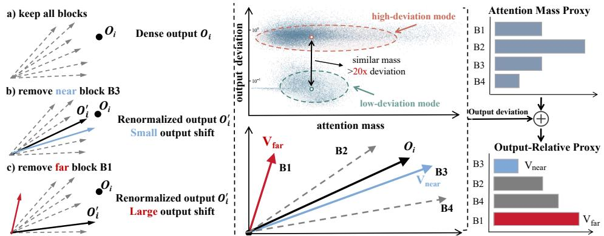  
Figure 1: Through experiments, we observe that blocks with similar attention mass can differ by over 20× in output deviation. Removing a high-deviation block (B1) shifts the attention output far more than removing a low-deviation one (B3) of comparable mass. We therefore combine attention mass with output deviation into our output-relative proxy. V denotes the exact output of a block.

So what determines whether a removed block’s contribution is easily compensated? As Figure 1 (left) illustrates, if a block’s output lies close to the dense output, renormalization amplifies the retained blocks’ contributions while largely preserving the output direction, resulting in only a small output shift. However, if the block’s output points away from the dense output, the same amplification cannot compensate for its removal, and the output shifts substantially. We call the distance between a block’s output and the dense output the block’s output deviation. Empirically, we observe that output deviation varies by more than 20× across blocks of comparable attention mass, forming distinct low-deviation and high-deviation modes (center). Therefore, existing proxies that rely on block contribution alone cannot distinguish safely removable blocks from critical ones.

To address this gap, we propose Prefilling via Output Error Minimization (POEM), a training-free block-sparse attention method. (1) Output-relative block selection: Motivated by the renormalization analysis above, we derive a head-level output-relative score that combines each block’s attention mass with the deviation of its output from the dense head output. A two-stage pipeline makes this score practical: mass estimates identify a candidate pool at low cost, and the output-relative score then selects the final blocks within it. To connect this head-level optimization to model predictions, we derive a theoretical bound on predictive divergence that weights each head’s output error by its sensitivity. This bound motivates (2) Offline threshold calibration: POEM calibrates a separate retention threshold for each head group according to its sensitivity. Because calibrating every head group independently would be prohibitively expensive, POEM ranks heads by sensitivity and jointly calibrates similarly ranked heads via an efficient batched bisection procedure.

Experiments on LongBench (Bai et al., 2024) and RULER (Hsieh et al., 2024) using Llama-3.1- 8B (Grattafiori et al., 2024), Qwen3-8B, and Qwen3-14B (Yang et al., 2025) show that POEM maintains accuracy comparable to that of full attention at high sparsity. On RULER at 128K context, POEM achieves a 2.4-point gain over our mass-only baseline, demonstrating the effectiveness of the output-relative score. POEM also achieves the lowest attention latency among the compared methods, achieving up to a 6.5× speedup over FlashAttention-2 (Dao, 2024) at a 128K context.

Our contributions can be summarized as:

• We propose POEM, a training-free block-sparse attention method that combines attention mass with output deviation for output-relative block selection, optimizing output error within heads.

• To bridge head-level optimization and model-level prediction, we derive a bound on output diver gence in terms of head error weighted by sensitivity, motivating our offline threshold calibration.

• Across three LLMs on LongBench and RULER, POEM almost matches full-attention accuracy at high sparsity and achieves up to a 6.5× attention speedup at 128K prefill.

## 2 RELATED WORK

Training-free sparse attention. Training-free methods use the sparsity already present in pretrained attention. Prefilling must select blocks for every query position, so the selector itself has to be cheap yet accurate. To score blocks, SALE (Ji et al., 2025) uses low-bit estimates, Sketch&Walk (Le et al., 2026) propagates randomized sketches across layers, UniSparse (Liu et al., 2025b) compresses and routes at multiple granularities, and Prism (Wang et al., 2026a) keeps high-frequency positional signals with spectral-aware scores. Other work lowers cost elsewhere: SpargeAttention (Zhang et al., 2025) co-designs the selector with the kernel, Pbs-Attn (Wang et al., 2026b) packs important tokens into fewer blocks, and ProxyAttn (Wang et al., 2026c) lets a few representative heads score for the rest. These selectors rank blocks mainly by attention mass, and STEM (Niu et al., 2026) adds value norms to estimate how much each block contributes to dense attention. POEM instead aims to minimize the output error caused by removal, combining attention mass and output deviation together to select the blocks.

Training-based sparse attention. Training-based methods learn sparsity patterns during pretraining or adaptation. More recent designs include Native Sparse Attention (Yuan et al., 2025), which combines compression, selection, and local attention; MoBA (Lu et al., 2026), which routes each query to its top-k blocks. InfLLM-V2 (Zhao et al., 2026), which switches between dense and sparse attention depending on sequence length, and HiLS (Hu et al., 2026), which learns hierarchical retrieval from the language-modeling loss. SeerAttention (Gao et al., 2024b) instead trains block-level gates on a frozen backbone for prefilling, and SeerAttention-R (Gao et al., 2025) extends them to decoding. The selectors also differ in supervision: DeepSeek Sparse Attention (Liu et al., 2025a) uses a token-level indexer with attention scores, whereas SAS (Li et al., 2026) ranks context with the language-modeling loss. All of these methods train either the model or an auxiliary selector, while POEM is training-free and applies directly to pretrained models at no additional training cost.

## 3 PRELIMINARIES

Attention and block-sparse formulation. Let Q, K, $\mathbf { V } \in \mathbb { R } ^ { N \times d _ { h } }$ be the query, key, and value matrices with row vectors q, k, v, where N is the sequence length and $d _ { h }$ the head dimension. Under causal masking, the attention weight and output are defined for each query position as follows:

$$
A _ { i t } = \frac { \exp ( \mathbf { q } _ { i } \mathbf { k } _ { t } ^ { \top } / \sqrt { d _ { h } } ) } { \sum _ { u = 1 } ^ { i } \exp ( \mathbf { q } _ { i } \mathbf { k } _ { u } ^ { \top } / \sqrt { d _ { h } } ) } , \qquad \mathbf { o } _ { i } = \sum _ { t = 1 } ^ { i } A _ { i t } \mathbf { v } _ { t } .\tag{1}
$$

Block-sparse attention (Xu et al., 2025) partitions KV sequences into B blocks $\{ B _ { b } \} _ { b = 1 } ^ { B }$ and restricts each query i to a retained block set $S _ { i } \subseteq \{ 1 , \dots , B \}$ . For block b, define the block attention mass $\begin{array} { r } { m _ { i b } = \sum _ { t \in B _ { b } } A _ { i t } } \end{array}$ and the block output $\begin{array} { r } { \bar { \mathbf { v } } _ { i b } = m _ { i b } ^ { - 1 } \sum _ { t \in \mathcal { B } _ { b } } A _ { i t } \mathbf { v } _ { t } , } \end{array}$ so that $\begin{array} { r } { \mathbf { o } _ { i } = \sum _ { b } m _ { i b } \bar { \mathbf { v } } _ { i b } } \end{array}$ . Given the discarded mass $\begin{array} { r } { \delta _ { i } = \sum _ { b \notin S _ { i } } m _ { i b } } \end{array}$ , the renormalised sparse output and the projected output of a layer ℓ with H heads are respectively given by the following expressions:

$$
\widetilde { \mathbf { o } } _ { i } = \frac { \sum _ { b \in S _ { i } } m _ { i b } \overline { { \mathbf { v } } } _ { i b } } { 1 - \delta _ { i } } , \qquad \mathbf { o } _ { \ell } ^ { \mathrm { o u t } } = \sum _ { h = 1 } ^ { H } \mathbf { o } _ { \ell , h } \mathbf { W } _ { \mathcal { O } , \ell } ^ { ( h ) } ,\tag{2}
$$

where $\mathbf { W } _ { O , \ell } ^ { ( h ) } \in \mathbb { R } ^ { d _ { h } \times d }$ projects the output $\mathbf { o } _ { \ell , h }$ of head h to the model dimension d.

## 4 METHOD

In this section, we first present the output-relative block score (Section 4.1). We then introduce a hierarchical error decomposition (Section 4.2) that connects predictive divergence to head output error, followed by the offline headwise threshold calibration (Section 4.3). Finally, we summarize the resulting POEM pipeline with two stages (Section 4.4) and show it in Figure 2.

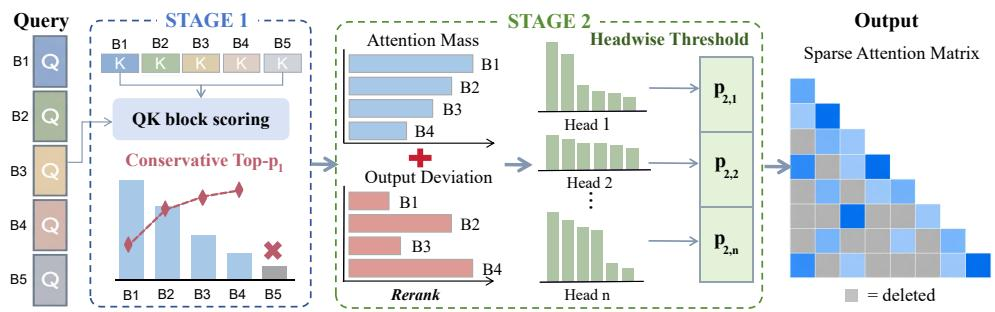  
Figure 2: Overview of POEM. Stage 1 preselects candidate blocks using coarse attention mass. Stage 2 reranks candidates with output-relative scores and selects blocks using calibrated headwise thresholds. $p _ { 1 }$ is the Stage 1 threshold, and $p _ { 2 , h }$ is the calibrated threshold for head h.

## 4.1 OUTPUT-RELATIVE BLOCK SELECTION

A central design question for training-free blocksparse attention is how to reliably select significant blocks under a fixed budget while preserving the dense output. Existing methods such as MInference (Jiang et al., 2024), FlexPrefill (Lai et al., 2025), and XAttention (Xu et al., 2025) score each block solely by the attention mass. STEM (Niu et al., 2026) furthermore augments the QK score with the largest value norm inside the block, which makes the proxy value-aware. However, all of existing methods overlook the effect of renormalization, leaving out output deviation, except POEM. POEM’s proxy scores each block by combining attention mass with output deviation, making the proxy both value-aware and output-relative, as summarized in Table 1. This subsection then introduces POEM’s output-relative proxy and describes how it is ultimately used in the complete POEM pipeline.

Table 1: Comparison of proxies. ∗ means antidiagonal scoring, and $v ^ { \mathrm { m a x } }$ denotes the maximum value norm within the block.
<table><tr><td>Method</td><td>Proxy Score</td><td></td><td>Value- Aware</td><td>Output- Relative</td></tr><tr><td>MInference</td><td rowspan="4">qkT  $\overline { { \sqrt { d } } }$  kT</td><td></td><td>x</td><td>×</td></tr><tr><td>FlexPrefill</td><td></td><td>x</td><td>×</td></tr><tr><td>XAttention</td><td> $\frac { \underset { \mathbf { q } \mathbf { k } ^ { \intercal } } { \nu \underline { d } } } { \sqrt { d } } \ast$ </td><td>x</td><td>×</td></tr><tr><td>STEM</td><td> $\frac { \mathbf { q } \mathbf { k } ^ { \top } } { \sqrt { d } } \ast + \beta \operatorname { R e L U } ( \log v ^ { \operatorname* { m a x } } )$ </td><td>√</td><td>×</td></tr><tr><td>POEM</td><td></td><td> $\frac { \mathbf { q } \mathbf { k } ^ { \top } } { \sqrt { d } } \ast + \beta \log \left\| \mathbf { v } + \frac { \mathbf { q } } { \sqrt { d } } \mathbf { C } - \widehat { \mathbf { o } } \right\|$ </td><td>√</td><td>√</td></tr></table>

From output error to block importance. Our objective is to select a subset of blocks $s _ { i }$ that minimizes the output error between the sparse output $\widetilde { \mathbf { o } } _ { i }$ and the dense output $\mathbf { o } _ { i }$ . As defined in Section 3, we express this objective as the following subset selection problem:

$$
\operatorname* { m i n } _ { S _ { i } } \left\| \mathbf { o } _ { i } - \widetilde { \mathbf { o } } _ { i } \right\| _ { 2 } = \operatorname* { m i n } _ { S _ { i } } \frac { \left\| \sum _ { b \notin S _ { i } } m _ { i b } ( \widetilde { \mathbf { v } } _ { i b } - \mathbf { o } _ { i } ) \right\| _ { 2 } } { 1 - \sum _ { b \notin S _ { i } } m _ { i b } } .\tag{3}
$$

The numerator couples all discarded blocks inside a single norm, so the objective cannot be decomposed into independent per-block scores. To measure each block’s contribution to the output error, we apply the triangle inequality and obtain:

$$
\left\| \mathbf { o } _ { i } - \widetilde { \mathbf { o } } _ { i } \right\| _ { 2 } \leq \frac { \sum _ { b \notin { \cal S } _ { i } } m _ { i b } \left\| \widetilde { \mathbf { v } } _ { i b } - \mathbf { o } _ { i } \right\| _ { 2 } } { 1 - \sum _ { b \notin { \cal S } _ { i } } m _ { i b } } .\tag{4}
$$

Let $p$ denote the overall mass threshold used to determine the retained block set. Under a fixed threshold $\begin{array} { r } { p , 1 - \sum _ { b \notin { S _ { i } } } m _ { i b } } \end{array}$ remains almost constant around $p .$ Thus, minimizing the bound reduces to minimizing $\begin{array} { r } { \sum _ { b \notin \mathcal { S } _ { i } } \dot { m } _ { i b } \| \bar { \mathbf { v } } _ { i b } - \mathbf { o } _ { i } \| _ { 2 } } \end{array}$ . We therefore adopt $i _ { i b } = m _ { i b } \lVert \bar { \mathbf { v } } _ { i b } - \mathbf { o } _ { i } \rVert _ { 2 }$ as the importance proxy of block b, which combines attention mass and output deviation multiplicatively.

An approximation to the block score. To obtain a proxy compatible with existing top-p kernels, we apply a logarithmic transformation to $I _ { i b }$ and express it as the sum of two terms. To avoid the expensive computation of the exact block output, we approximate it with a first-order Taylor expansion, yielding the selection score $s _ { i b }$ used for practical candidate ranking:

$$
s _ { i b } = \frac { \bar { \bf q } _ { i } \bar { \bf k } _ { b } ^ { \top } } { \sqrt { d _ { h } } } + \log \left\| \bar { \bf v } _ { i b } - { \bf o } _ { i } \right\| _ { 2 } , \quad \quad \bar { \bf v } _ { i b } \approx \bar { \bf v } _ { b } + \frac { \bar { \bf q } _ { i } } { \sqrt { d _ { h } } } { \bf C } _ { b } ,\tag{5}
$$

where $\bar { \mathbf { v } } _ { b }$ denotes the pooled value vector in block b, $n _ { b } = | \boldsymbol B _ { b } |$ , and $\begin{array} { r } { \mathbf { C } _ { b } = \frac { 1 } { n _ { b } } \sum _ { t \in \mathcal { B } _ { b } } ( \mathbf { k } _ { t } - \bar { \mathbf { k } } _ { b } ) ^ { \top } \big ( \mathbf { v } _ { t } - \mathbf { \nabla } } \end{array}$ $\bar { \bf v } _ { b } )$ is the key–value covariance of block b. Appendix A provides the theoretical derivations, $\mathsf { A p - }$ pendix B develops the selection score, and Appendix C provides the experimental configuration.

Two-stage selection. Computing the magnitude $\bar { \bf q } _ { i } { \bf C } _ { b } / \sqrt { d _ { h } }$ over all query–key block pairs requires $\mathcal { O } ( n ^ { 2 } )$ computation, which is unaffordable. To avoid unnecessary computation on negligible blocks, we restrict this calculation to a small subset of potentially important blocks, which we call the candidate pool. Therefore, we design a selector with two stages. Stage 1 selects the candidates, and Stage 2 further selects significant blocks using output deviation. Given an overall mass target $p ,$ Stage 1 applies a conservative threshold $p _ { 1 } \geq p$ to retain candidates while forming the coarse reference $\begin{array} { r } { \widehat { \mathbf { o } } _ { i } = \sum _ { b < i } a _ { i b } \bar { \mathbf { v } } _ { b } } \end{array}$ as a prior for output $\mathbf { o } _ { i } ,$ , where $a _ { i b }$ is the pooled attention weight of query i over its visible blocks. Stage 2 sets $p _ { 2 } = p / p _ { 1 }$ as its threshold, reranks candidates by the output-relative score, and applies $p _ { 2 }$ to their renormalized attention weights, retaining nominal mass p under the assumption that discarded blocks remain negligible. Appendix B provides the output reference construction and complete selection procedure. Appendix D verifies the Stage 1 candidatepool coverage, while Appendix E analyzes the auxiliary memory overhead across sequence lengths.

Output-relative score. To adjust the strength of the output-deviation term and better approximate the actual block importance $I _ { i b }$ , we introduce a scalar $\beta$ on the log term to balance attention mass and output deviation. This gives POEM’s selection proxy for practical candidate reranking:

$$
s _ { i b } = \frac { \bar { \bf q } _ { i } \bar { \bf k } _ { b } ^ { \top } } { \sqrt { d _ { h } } } + \beta \log \left\| \bar { \bf v } _ { b } + \frac { \bar { \bf q } _ { i } } { \sqrt { d _ { h } } } { \bf C } _ { b } - \widehat { \bf o } _ { i } \right\| _ { 2 } .\tag{6}
$$

The first term estimates block-level attention strength, while the second estimates the approximate block output’s deviation from $\widehat { \mathbf { o } } _ { i }$ . Following XAttention (Xu et al., 2025), we estimate the first term by antidiagonal scoring. These two magnitudes combine to form our output-relative scorer.

Table 2 compares the reconstruction errors of the three se  
lection scores at the same density. POEM consistently out  
performs the mass-only baseline and STEM’s value-aware   
proxy at all three evaluated layers and at the final logits,   
supporting the superiority of the output-relative proxy for   
block selection. Appendix C provides the detailed evalu  
ation configuration, including the matched block density   
setting and definitions of the layer and logit reconstruction   
errors. Figure 4(d) examines the end-to-end impact of the output-relative proxy. errors. Figure 4(d) examines the end-to-end impact of the

Table 2: Layer and logit output errors on LongBench, using Qwen3-8B.
<table><tr><td>Method</td><td>Layer 5  $( \times 1 0 ^ { - 4 } )$ </td><td>Layer 15  $( \times \mathrm { i } 0 ^ { - 2 } )$ </td><td>Layer 35</td><td>Final logits</td></tr><tr><td>Mass only</td><td>3.27</td><td>1.24</td><td>5.88</td><td>2.86</td></tr><tr><td>STEM</td><td>3.27</td><td>1.23</td><td>5.88</td><td>2.85</td></tr><tr><td>POEM</td><td>3.25</td><td>1.22</td><td>5.79</td><td>2.74</td></tr></table>

## 4.2 HIERARCHICAL ERROR DECOMPOSITION

To keep the sparse output close to the dense output at the model level, we hierarchically decompose the prediction error and relate it to head-level reconstruction error. Our overall objective is to select attention blocks that minimize the discrepancy between dense and sparse prediction distributions under a fixed block budget, which can be formalized as the following constrained objective:

$$
\operatorname* { m i n } _ { \boldsymbol { S } : | \boldsymbol { S } | = k } d _ { \mathrm { K L } } \big ( \mathbf { p } ^ { d } \| \mathbf { p } ^ { s } ( \boldsymbol { S } ) \big ) .\tag{7}
$$

Here, $s$ is the selected block set of size k, $\mathbf { p } ^ { d }$ and $\mathbf { p } ^ { s } ( \boldsymbol { S } )$ are the prediction distributions under dense and sparse attention, $d _ { \mathrm { K L } } ( \cdot \parallel \cdot )$ is the Kullback–Leibler (KL) divergence. The objective is defined on the predictions, whereas block selection is made separately for each head, so we bridge this gap by decomposing the prediction error first into layer-level and then into head-level output errors.

Step 1: Prediction to layer output. The objective in Eq. 7 is defined on the final predictions, but what block selection actually changes is the attention output of a single layer, so we begin by tracing how a perturbation of that output propagates to the predictions. Let $\mathbf { O } _ { \ell }$ and $\widetilde { \mathbf { O } } _ { \ell }$ denote the attention outputs of layer ℓ under dense and sparse attention, $\Delta \mathbf { O } _ { \ell } : = \widetilde { \mathbf { O } } _ { \ell } - \mathbf { O } _ { \ell }$ for the layer-output perturbation and $\epsilon _ { \ell } : = \mathrm { v e c } ( \Delta \mathbf { O } _ { \ell } )$ for its vectorization. A first-order expansion of the downstream network gives the change in the final logits z as $\Delta \mathbf { z } = \mathbf { J } _ { \ell \to z } \pmb { \epsilon } _ { \ell } + \mathcal { O } \big ( \| \pmb { \epsilon } _ { \ell } \| _ { 2 } ^ { 2 } \big )$ , where $\mathbf { J } _ { \ell \to z }$ is the Jacobian from the vectorized layer output to the logits. The perturbed logits shift the prediction distribution from $\mathbf { p } ^ { d } = \mathrm { s o f t m a x } ( \mathbf { z } )$ to $\mathbf { p } ^ { s } = \mathrm { s o f t m a x } ( \mathbf { z } + \Delta \mathbf { z } )$ , and because the KL divergence attains its minimum at $\Delta \mathbf { z } = 0$ , its expansion in $\Delta \mathbf { z }$ has no constant or first-order term,

$$
\begin{array} { r } { d _ { \mathrm { K L } } ( \mathbf { p } ^ { d } \parallel \mathbf { p } ^ { s } ) = \frac { 1 } { 2 } \Delta \mathbf { z } ^ { \top } \mathbf { F } \Delta \mathbf { z } + \mathcal { O } \big ( \Vert \Delta \mathbf { z } \Vert _ { 2 } ^ { 3 } \big ) , \qquad \mathbf { F } : = \mathrm { D i a g } ( \mathbf { p } ^ { d } ) - \mathbf { p } ^ { d } ( \mathbf { p } ^ { d } ) ^ { \top } , } \end{array}\tag{8}
$$

where F is the softmax Fisher matrix, which captures how strongly each direction of logit change perturbs the prediction distribution. We further bound the quadratic form by the spectral norms of F and $\mathbf { J } _ { \ell \to z } , \mathbf { y }$ ielding the scalar upper bound

$$
\begin{array} { r } { d _ { \mathrm { K L } } ( \mathbf { p } ^ { d } \| \mathbf { p } ^ { s } ) \leq c _ { \ell } \| \Delta \mathbf { O } _ { \ell } \| _ { F } ^ { 2 } + \mathcal { O } \big ( \| \Delta \mathbf { O } _ { \ell } \| _ { F } ^ { 3 } \big ) , \qquad c _ { \ell } : = \frac { 1 } { 2 } \| \mathbf { F } \| _ { 2 } \| \mathbf { J } _ { \ell \to z } \| _ { 2 } ^ { 2 } , } \end{array}\tag{9}
$$

where the constant $c _ { \ell }$ measures how sensitive the predictions are to this layer’s output. The full derivation is provided in the theoretical appendix. The layer output still aggregates the contributions of all attention heads, so Step 2 splits this layer-level error further into per-head output errors.

Step 2: Layer to head. Block selection operates per attention head, so the layer-level bound must be carried one step further, down to the heads that compose the layer output. Let $\mathbf { o } _ { \ell , h }$ and $\widetilde { \mathbf { o } } _ { \ell , h }$ denote head h’s dense and sparse outputs before projection, and let $\Delta \mathbf { o } _ { \ell , h } : = \widetilde { \mathbf { o } } _ { \ell , h } - \mathbf { o } _ { \ell , h }$ be its output error. Since Eq. 2 writes the layer output as a sum of projected head outputs, the perturbation decomposes as $\begin{array} { r } { \Delta \mathbf { O } _ { \ell } = \sum _ { h } \Delta \mathbf { o } _ { \ell , h } \mathbf { W } _ { O } ^ { ( h ) } } \end{array}$ , and applying the triangle and Cauchy–Schwarz inequalities gives

$$
\left\| \Delta \mathbf { O } _ { \ell } \right\| _ { F } ^ { 2 } \leq H \sum _ { h } \left\| \mathbf { W } _ { O } ^ { ( h ) } \right\| _ { 2 } ^ { 2 } \left\| \Delta \mathbf { O } _ { \ell , h } \right\| _ { F } ^ { 2 } ,\tag{10}
$$

where H is the number of heads and $\mathbf { W } _ { O } ^ { ( h ) }$ is the row block of the output projection for head h. This bound isolates each head’s contribution through its projection norm and output error. Combining this inequality with Eq. 9 bounds the predictive divergence by a weighted sum of head-level errors. The two factors motivate the two components of POEM. Output-relative block selection (Section 4.1) targets the per-head error $\| \Delta \mathbf { o } _ { \ell , h } \| _ { F }$ . Headwise threshold calibration (Section 4.3) accounts for the unequal head sensitivities represented by the projection weights $\| \mathbf { W } _ { O } ^ { ( h ) } \| _ { 2 } ^ { 2 }$ in the resulting predictivedivergence bound across all attention heads within the layer.

## 4.3 OFFLINE THRESHOLD CALIBRATION

Error-ranked batch bisection. Offline calibration replaces the shared $p _ { 2 } = p / p _ { 1 }$ with a headwise threshold $p _ { 2 , h } ,$ , where $p _ { 2 , h }$ is the Stage 2 threshold of head $h .$ Following GQA’s KV grouping (Ainslie et al., 2023) and KV-cache compression methods (Cai et al., 2025; Rehg, 2024), we jointly calibrate groups of heads that share KV projections. To avoid calibrating groups individually, Algorithm 2 in Appendix F sorts groups by their estimated output-distribution error and tests them in batches, starting from all groups. Each trial lowers the batch thresholds. If the score on the search set does not decrease, the reduction is accepted for the entire batch. Otherwise, the batch is bisected and the half with lower error is retried first in subsequent calibration. The calibration ends when all groups have been processed or the predefined maximum number of steps is reached.

## 4.4 POEM: OUTPUT-RELATIVE BLOCK-SPARSE ATTENTION

We integrate the output-relative selection score and the offline threshold calibration together into POEM, a unified training-free framework. Figure 2 summarizes the execution order, and Algorithm 1 gives the detailed inference procedure. First, POEM selects candidates by lightweight attention mass alone to quickly construct the candidate pool and compute the output reference $\widehat { \mathbf { o } } _ { i }$ for subsequent outputrelative ranking. Second, POEM computes the output-relative score in Eq. (6) within the candidate pool, which combines attention mass with output deviation to account for each block’s importance in reconstructing the output. For a head h, POEM reranks the blocks in the candidate pool by the output-relative score and ap-

Algorithm 1 POEM: Output-Relative Block-Sparse Attention   
1: Input: Q, K, V.   
2: Parameters: $p _ { 1 } , \beta , \{ p _ { 2 , h } \} _ { h }$ , pooling stride B.   
3: Output: Sparse outputs oei,h.   
4: for each head h (using head-local Q, K, V) do   
5: Cache block covariances Cb.   
6: for each query block i do   
7: # Stage 1   
8: ai ← Pool(Q, K, stride = B). ▷ # Antidiagonal   
9: $\mathcal { C } _ { i } \gets \underline { { \mathrm { T o p P } } } ( \mathbf { a } _ { i } , p _ { 1 } ) .$   
10: $\begin{array} { r } { \widehat { \mathbf { o } } _ { i }  \sum _ { b \leq i } \dot { a } _ { i b } \bar { \mathbf { v } } _ { b } . } \end{array}$   
11: # Stage 2   
12: Compute s over b ∈ C using Eq. 6.   
13: Reran $k ( s _ { i b } , C _ { i } ) .$   
14: Si ← ThresholdP(Ci, p2,h). ▷ # Mass threshold   
15: $\widetilde { \mathbf { o } } _ { i , h } \gets \mathrm { A t t e n t i o n } ( { \mathbf { Q } } _ { i } , \bar { \mathbf { K } } , \mathbf { V } ; { \mathcal { S } } _ { i } )$   
16: end for   
17: end for

plies the calibrated threshold $p _ { 2 , h }$ to the reordered sequence, where $p _ { 2 , h }$ is the calibrated threshold.

## 5 EXPERIMENTS

Baselines. We compare POEM with dense FlashAttention-2 (Dao, 2024) and four training-free sparse prefilling baselines under the same FlashAttention-2 backend: MInference (Jiang et al., 2024) (official sparse-head configuration), FlexPrefill (Lai et al., 2025) $( B ~ = ~ 1 2 8 , ~ \gamma ~ = ~ 0 . 9 ,$ $\tau = 0 . 1 )$ , XAttention (Xu et al., 2025) $( \tau ~ = ~ 0 . 9 )$ , and STEM (Niu et al., 2026) $( B \ = \ 1 2 8 ,$ $\mu = 0 . 7 , \beta = 0 . 2 , k _ { \mathrm { s t a r t } } = 0 . 2 N _ { \mathrm { b l k } }$ for 8–16K inputs and $0 . 1 N _ { \mathrm { b l k } }$ beyond 16K, with a minimum budget of 54 blocks). We use each baseline’s released or recommended configuration without taskspecific retuning. SpargeAttention (Zhang et al., 2025) is excluded because its online $P V$ skipping falls outside this shared-backend block-selection comparison and its controlled evaluation scope.

Implementation details. We implement all experiments in PyTorch on an NVIDIA A100 GPU. After block selection, FlashAttention-2 computes attention over the retained blocks. Following XAttention and STEM, we retain local and sink blocks for stability: four local and four sink blocks for Llama-3.1-8B (Grattafiori et al., 2024), and one of each for Qwen3-8B/14B (Yang et al., 2025). In Stage 1, we estimate block attention mass from low-precision query and key vectors to select the candidate pool. In Stage 2, we compute output-relative scores within the candidate pool. We set the output-relative deviation coefficient to $\beta = 0 . 3$ for Qwen3-14B and Llama-3.1-8B, and to $\beta = 0 . 2$ for Qwen3-8B. For Qwen-family models, we use YaRN (Peng et al., 2026) to extend their context windows to 128K, enabling long-context evaluation. We set the overall mass target to $p = 0 . 9$ and use the Stage 1 threshold $p _ { 1 } = 0 . 9 4$ , yielding $p _ { 2 } = p / p _ { 1 }$ for Stage 2.

Table 3: LongBench and RULER results on three models. Best in bold, second best underlined.
<table><tr><td rowspan="2">Model</td><td rowspan="2">Method</td><td colspan="6">LongBench</td><td colspan="6"></td></tr><tr><td>S-Doc M-Doc</td><td></td><td>Summ.</td><td>FSL</td><td>Synth.</td><td>Code</td><td> $\mathbf { A v g } .$ </td><td>4K</td><td>8K</td><td>16K</td><td>32K</td><td>64K</td><td>128K  $\mathbf { A v g } .$ </td></tr><tr><td rowspan="5">Llama-3.1-8B</td><td>Dense</td><td>28.57</td><td>25.75</td><td>25.45</td><td>63.61</td><td>65.83</td><td>33.06</td><td>40.38 95.26</td><td>94.29</td><td>93.58</td><td>87.99</td><td></td><td>84.85 77.87</td><td>88.97</td></tr><tr><td>MInference</td><td>28.38</td><td>25.44</td><td>25.28</td><td>63.31</td><td>65.12 31.16</td><td>39.78</td><td>95.43</td><td>94.25</td><td>93.44</td><td>87.56</td><td>83.21</td><td>71.51</td><td>87.57</td></tr><tr><td>FlexPrefill</td><td>24.25</td><td>22.61</td><td>25.14</td><td>62.24</td><td>19.56</td><td>35.01</td><td>31.47</td><td>93.67</td><td>93.63 93.84</td><td>87.90</td><td>84.83</td><td>72.43</td><td>87.71</td></tr><tr><td>XAttention</td><td>27.51</td><td>23.55</td><td>25.51</td><td>63.82</td><td>55.83</td><td>35.77</td><td>38.66 95.09</td><td>94.39</td><td>93.27</td><td>88.95</td><td>82.45</td><td>70.09</td><td>87.38</td></tr><tr><td>STEM</td><td>27.20</td><td>24.33</td><td>25.41</td><td>62.56</td><td>64.32</td><td>32.74</td><td>39.43 95.27</td><td></td><td>94.50 93.12</td><td>88.21</td><td>82.94</td><td>70.33</td><td>87.40</td></tr><tr><td></td><td>POEM</td><td>26.82</td><td>23.98</td><td>25.44</td><td>64.04</td><td>65.71</td><td>35.00 40.16</td><td>95.01</td><td>94.32</td><td>93.20</td><td>88.79</td><td>82.74</td><td>72.38</td><td>87.74</td></tr><tr><td rowspan="5">Qwen3-8B</td><td>Dense</td><td>14.48</td><td>13.12</td><td>22.14</td><td>60.59</td><td>66.51</td><td>12.54 31.56</td><td>95.18</td><td>92.51</td><td>89.81</td><td>86.78</td><td>79.55</td><td>75.29</td><td>86.52</td></tr><tr><td>MInference</td><td>13.97</td><td>12.73</td><td>21.45</td><td>58.06</td><td>65.75</td><td>12.02 30.66</td><td>94.83</td><td>92.55</td><td>89.41</td><td>85.68</td><td>76.12</td><td>70.89</td><td>84.91</td></tr><tr><td>FlexPrefill</td><td>12.87</td><td>12.11</td><td>21.47</td><td>61.44</td><td>42.87</td><td>14.64 27.57</td><td>90.94</td><td>87.85</td><td>87.45</td><td>85.12</td><td>78.94</td><td>73.98</td><td>84.05</td></tr><tr><td>XAttention</td><td>13.36</td><td>12.77</td><td>21.38</td><td>58.72</td><td>63.54</td><td>14.42 30.70</td><td>94.56</td><td>90.80</td><td>87.92</td><td>84.54</td><td>78.02</td><td>71.70</td><td>84.59</td></tr><tr><td>STEM</td><td>14.13</td><td>13.00</td><td>21.39</td><td>57.79</td><td>65.62</td><td>12.46 30.73</td><td>94.67</td><td>90.43</td><td>87.61</td><td>85.09</td><td>77.42</td><td>71.24</td><td>84.41</td></tr><tr><td></td><td>POEM</td><td>13.65</td><td>13.12</td><td>21.62</td><td>58.56</td><td>62.97</td><td>15.08 30.83</td><td>94.27</td><td>91.32</td><td>88.11</td><td>85.30</td><td>77.92</td><td>72.71</td><td>84.94</td></tr><tr><td rowspan="5">Qwen3-14B</td><td>Dense</td><td>15.55</td><td>12.62</td><td>21.92</td><td>62.41</td><td>66.83</td><td>53.30 38.77</td><td>95.61</td><td>93.83</td><td>93.27</td><td>93.16</td><td>90.45</td><td>84.01</td><td>91.72</td></tr><tr><td>MInference</td><td>15.50</td><td>12.51</td><td>21.76</td><td>62.04</td><td>65.58</td><td>51.40</td><td>38.13</td><td>95.34</td><td>93.28 91.16</td><td>90.11</td><td>87.44</td><td>80.46</td><td>89.63</td></tr><tr><td>FlexPrefill</td><td>15.09</td><td>13.05</td><td>21.77</td><td>61.15</td><td>48.12</td><td>50.95</td><td>35.02 93.43</td><td>92.74</td><td>92.30</td><td>91.13</td><td>87.41</td><td>80.64</td><td>89.60</td></tr><tr><td>XAttention</td><td>15.37</td><td>13.11</td><td>21.82</td><td>60.94</td><td>65.42</td><td>52.67</td><td>38.22</td><td>95.19 93.02</td><td>91.23</td><td>89.89</td><td>87.36</td><td>80.33</td><td>89.50</td></tr><tr><td>STEM</td><td>15.35</td><td>12.82</td><td>21.71</td><td>60.86</td><td>66.92</td><td>51.77</td><td>38.24</td><td>95.78 92.85</td><td>91.08</td><td>89.92</td><td>87.22</td><td>80.01</td><td>89.48</td></tr><tr><td></td><td>POEM</td><td>15.36</td><td>13.21</td><td>21.83</td><td>62.12</td><td>65.92</td><td>53.61</td><td>38.68</td><td>95.23 93.12</td><td>91.60</td><td>89.95</td><td>87.64</td><td>80.51</td><td>89.68</td></tr></table>

Comparison on LongBench and RULER. Table 3 compares POEM with dense attention and four training-free sparse baselines, including MInference, FlexPrefill, XAttention, and STEM, on Long-Bench and RULER, covering models from different families and at different scales: Llama-3.1-8B and Qwen3-8B/14B. On LongBench, POEM ranks first among all sparse methods on every model, narrowing the gap to dense attention to as little as 0.09 points on Qwen3-14B. On RULER, POEM achieves the best average score across all three evaluated models. Across the two benchmarks, POEM is the only sparse method that consistently matches or outperforms every baseline on all model configurations. We attribute this robustness to the output-relative block scoring and head wise threshold calibration, which together better reconstruct the dense attention output.

Effect of output-relative reranking. To examine whether output deviation provides a selection signal beyond attention mass, we conduct a block-level diagnostic using exact quantities computed with the dense output $o _ { i } .$ . Figure 3 (a) shows the distribution of exact block attention mass $m _ { i b } ,$ which is concentrated near zero and already provides strong discrimination between blocks. Figure 3 (b) plots the output deviation $\lVert \bar { v } _ { i b } - o _ { i } \rVert _ { 2 }$ , which is divided into two distinct modes. The lowdeviation mode corresponds to blocks whose values already lie close to the dense output, whereas the high-deviation mode contains blocks that would shift the output substantially if removed. Figure 3 (c) displays the importance factor $I _ { i b } = m _ { i b } \lVert \bar { v } _ { i b } - o _ { i } \rVert _ { 2 }$ , which POEM’s practical score in Eq. 6 approximates. Incorporating the deviation reshapes the distribution relative to mass alone: blocks that rank high by mass but contribute values close to the output are lowered, while blocks with moderate mass but large deviation gain relative importance. As Figure 3 (d) shows, this change of distribution alters the selected block set in more than 74% of all heads, indicating that output deviation provides an important complementary signal for reliable block selection.

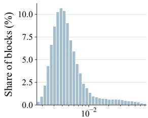  
(a) Attention mass

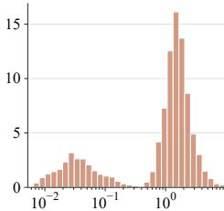  
(b) Output deviation

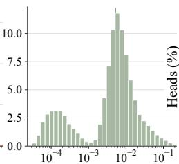  
(c) Important factor

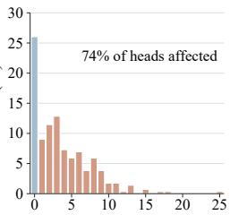  
(d) Replaced blocks (%)  
Figure 3: (a) Distribution of exact block attention mass $m _ { i b } .$ . (b) Distribution of output deviation $\lVert \bar { v } _ { i b } - o _ { i } \rVert _ { 2 } .$ . (c) Distribution of exact importance $I _ { i b } = m _ { i b } \lVert \bar { v } _ { i b } - o _ { i } \rVert _ { 2 }$ . (d) Percentage of blocks replaced per head after output-relative reranking, 74% of heads are affected.

Module ablation. Table 4 separately ablates covariance correction and the output reference on Qwen3-8B. Removing either component worsens perplexity, confirming that covariance improves block-output estimation, while the output reference enables output-relative deviation. Table 5 presents the module ablation on RULER at 128K context for Llama-3.1-8B, where we gradually add each component of POEM to a baseline that selects blocks by mass alone. Incorporating the output deviation into the block score yields a broad improvement, lifting the average from 69.94 to 72.14 at almost the same budget (19.50% vs. 19.56%). Further adding threshold calibration gives this score a slight increase (72.38) while reducing the density from 19.56% to 18.53%, con firming that calibration can leverage differences in head sensitivity.

Table 4: PG19 ablation at 32k with 0.1 density on Qwen3-8B.
<table><tr><td>Variant</td><td>Word PPL</td><td> $\Delta$  PPL</td></tr><tr><td>POEM</td><td>43.65</td><td>+0.00</td></tr><tr><td>w/o cov.</td><td>44.01</td><td>+0.36</td></tr><tr><td>w/o output</td><td>43.95</td><td>+0.30</td></tr></table>

Table 5: POEM module ablation on RULER at 128K. Best results are in bold, and second-best results are underlined.
<table><tr><td rowspan="2">Method</td><td colspan="8">Retrieval</td><td rowspan="2">MHT</td><td rowspan="2"> $\operatorname { A g g } .$ </td><td colspan="2"></td><td colspan="2">QA Overall QA2</td><td rowspan="2">Budget</td></tr><tr><td>S1</td><td>S2</td><td>S3</td><td>MK1</td><td>MK2</td><td>MK3</td><td>MV</td><td>MQ VT</td><td>CWE</td><td>FWE</td><td>QA1</td><td> $\operatorname { A v g } .$ </td></tr><tr><td>Baseline</td><td>100.00</td><td>99.00</td><td>100.00</td><td>92.00</td><td>62.00</td><td>43.00</td><td>93.75</td><td>97.75</td><td>68.20 0.10</td><td></td><td>73.00</td><td>44.42 36.00</td><td>69.94</td><td></td><td>19.50%</td></tr><tr><td>+ output deviation</td><td>100.00</td><td>99.00</td><td>100.00</td><td>93.00</td><td>69.00</td><td>48.00</td><td>95.75</td><td>98.25</td><td>71.00</td><td>0.10</td><td>73.67</td><td>52.08</td><td>38.00</td><td>72.14</td><td>19.56%</td></tr><tr><td>+ threshold calibration</td><td>100.00</td><td>98.00</td><td>100.00</td><td>94.00</td><td>70.00</td><td>46.00</td><td>95.75</td><td>98.50</td><td>74.80</td><td>0.20</td><td>73.00</td><td>54.75</td><td>36.00</td><td>72.38</td><td>18.53%</td></tr></table>

Ablation studies. We conduct ablation studies on the output-relative coefficient $\beta ,$ total threshold p, stage 1 threshold $p _ { 1 }$ , and different scoring proxies on LongBench, RULER, and PG19 (Rae et al., 2019). Figures 4(b)–(d) use Llama 3.1-8B. Figure 4 (a) shows that performance peaks at $\beta = 0 . 3$ for Qwen 3-14B and Llama 3-8B, and at 0.2 for Qwen 3-8B. Larger values degrade performance, suggesting that moderate deviation weighting improves selection but excessive weighting introduces noise from the attention mass. Figure 4 (b) plots the gain against added latency as $p$ increases on RULER. The gain increases from $p = 0 . 8$ to $p = 0 . 9$ , but drops at $p = 0 . 9 5$ despite the higher latency, showing that $p = 0 . 9$ provides the best trade-off among the evaluated settings. Figure 4 (c) varies the Stage-1 threshold $p _ { 1 }$ under $p = 0 . 9$ . PG19 perplexity decreases as $p _ { 1 }$ grows from 0.90 to 0.94, since a larger candidate pool gives the output-relative proxy more room to improve upon mass-only selection. Beyond 0.94, however, the coarse attention score used in Stage-1 admit increasingly unreliable blocks into the pool, and because the final retention threshold $p$ is held fixed, these blocks displace trustworthy candidates and thus worsen the perplexity. Figure 4 (d) confirms our output-relative proxy’s consistent superiority over mass-only and STEM scoring at matched PG19 densities. Details for all ablations are provided in Appendix C.3.

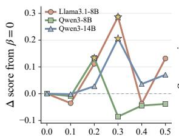  
Coefficient β(a)

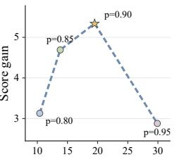  
Added time (ms)(b)

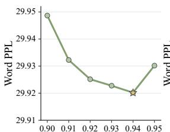  
Stage-1 keep ratio p1(c)

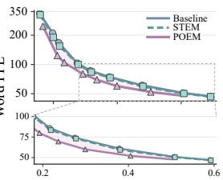  
Block density(d)  
Figure 4: POEM ablations: (a) output-relative weight. (b) score–time trade-off. (c) Stage-1 mass threshold. (d) PG19 perplexity vs density for different scoring proxies.

Total efficiency analysis. Figure 5 compares the total attention run time of five state-of-the-art methods against the FlashAttention-2 baseline, from 16k to 128k, on Qwen3-8B. In these methods, POEM maintains fastest in all the length. At the length of 128k tokens, POEM even accelerates Flashattention-2 by 6.5×, from 928.0 ms to 143.9 ms, saving a massive amount of time.

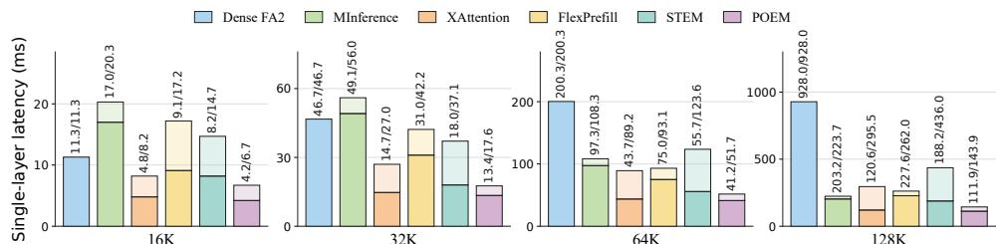  
Figure 5: Attention latency (kernel/total). Dark/light segments show kernel/selector time. POEM is fastest throughout, reaching 6.5× speedup over dense FA2 at 128K.

Latency breakdown of POEM. Furthermore, we analysis the detailed attention execution composition of POEM in Figure 6. The results show that the two-stage selection process of POEM is modest. As length increasing, the selection process consistently accounts for only a small part of the total time of attention execution. The attention kernel time takes the majority, accounting for around 80% of the total times when lengths exceeds 64k. We conduct this study on Qwen3-8B.

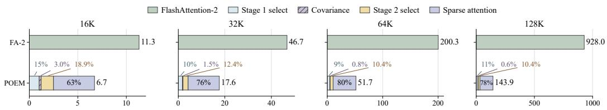  
Figure 6: Latency breakdown of POEM. Selection overhead remains modest across context lengths, while sparse attention dominates the execution time at long contexts.

## 6 CONCLUSION

We showed that the output error of sparse attention grows not only with the attention mass of the removed blocks but also with their output deviation from the dense attention output. POEM therefore scores blocks by both quantities and achieves the best accuracy among sparse attention methods with up to a 6.5× attention speedup over FlashAttention-2 at 128K tokens. Future work could estimate block outputs more accurately before attention and extend the output-relative criterion to KV cache eviction during decoding and to trainable sparse attention.

## AI USE STATEMENT

Generative AI tools were used to assist with drafting and language editing of this manuscript, including improvements to clarity, grammar, and organization. They were not treated as sources of scientific evidence: technical statements, citations, equations, and reported results were checked by the authors against the cited literature, mathematical derivations, implementation, and experimental records. All AI-assisted text was reviewed and revised by the authors. The authors take full responsibility for the final content of the paper, including all text, claims, and artifacts produced with the assistance of generative AI.

## ETHICS STATEMENT

This work studies the efficiency of long-context language-model inference using publicly available pretrained models and established benchmark datasets; it does not involve human participants, newly collected personal data, or interaction with deployed users. Because POEM approximates dense attention, it can change model outputs in ways that are not fully captured by aggregate benchmark scores, potentially increasing factual errors or amplifying biases already present in the underlying models and data. We therefore do not recommend deploying the method in safety-critical or highstakes settings without application-specific evaluation and safeguards. Although sparse attention may reduce the memory and computation required for inference, the experiments themselves consume GPU resources. Users of the method remain responsible for complying with the licenses and usage conditions of the underlying models and datasets.

## REPRODUCIBILITY STATEMENT

Section 4 specifies the two-stage POEM algorithm, its output-relative objective, selection metric, and hyperparameters. The models, datasets, baselines, hardware, attention implementation, evaluation framework, and shared evaluation settings are documented in Section 5 and Appendix C.4. Appendix A provides the detailed derivation of the sparse-attention output error and the pooled approximation used by POEM. The experiments use publicly available model checkpoints and benchmarks, and all methods are evaluated using the same examples and decoding settings. To support independent reproduction, the implementation, evaluation commands, configuration files, software versions, and random seeds will be included in the anonymized supplementary material.

## REFERENCES

Joshua Ainslie, James Lee-Thorp, Michiel De Jong, Yury Zemlyanskiy, Federico Lebron, and Sumit´ Sanghai. Gqa: Training generalized multi-query transformer models from multi-head checkpoints. In Proceedings of the 2023 conference on empirical methods in natural language processing, pp. 4895–4901, 2023.

Yongqi An, Chang Lu, Kuan Zhu, Tao Yu, Chaoyang Zhao, Hong Wu, Ming Tang, and Jinqiao Wang. Rest-kv: Robust kv cache eviction with layer-wise output reconstruction and spatialtemporal smoothing. arXiv preprint arXiv:2605.08840, 2026.

Yushi Bai, Xin Lv, Jiajie Zhang, Hongchang Lyu, Jiankai Tang, Zhidian Huang, Zhengxiao Du, Xiao Liu, Aohan Zeng, Lei Hou, et al. Longbench: A bilingual, multitask benchmark for long context understanding. In Proceedings of the 62nd annual meeting of the association for computational linguistics (volume 1: Long papers), pp. 3119–3137, 2024.

Yushi Bai, Shangqing Tu, Jiajie Zhang, Hao Peng, Xiaozhi Wang, Xin Lv, Shulin Cao, Jiazheng Xu, Lei Hou, Yuxiao Dong, et al. Longbench v2: Towards deeper understanding and reasoning on realistic long-context multitasks. In Proceedings of the 63rd Annual Meeting of the Association for Computational Linguistics (Volume 1: Long Papers), pp. 3639–3664, 2025.

Tom Brown, Benjamin Mann, Nick Ryder, Melanie Subbiah, Jared D Kaplan, Prafulla Dhariwal, Arvind Neelakantan, Pranav Shyam, Girish Sastry, Amanda Askell, et al. Language models are few-shot learners. Advances in neural information processing systems, 33:1877–1901, 2020.

Zefan Cai, Wen Xiao, Hanshi Sun, cheng Luo, Yikai Zhang, Ke Wan, Yucheng Li, Yeyang Zhou, Li-Wen Chang, Jiuxiang Gu, Zhen Dong, Animashree Anandkumar, Abedelkadir Asi, and Junjie Hu. R-kv: Redundancy-aware kv cache compression for reasoning models. In D. Belgrave, C. Zhang, H. Lin, R. Pascanu, P. Koniusz, M. Ghassemi, and N. Chen (eds.), Advances in Neural Information Processing Systems, volume 38, Main Conference, pp. 60980–61005. Curran Associates, Inc., 2025. doi: 10.52202/085713-2038.

Rewon Child, Scott Gray, Alec Radford, and Ilya Sutskever. Generating long sequences with sparse transformers. arXiv preprint arXiv:1904.10509, 2019.

Tri Dao. Flashattention-2: Faster attention with better parallelism and work partitioning. In International Conference on Learning Representations, volume 2024, pp. 35549–35562, 2024.

Yao Fu. Challenges in deploying long-context transformers: A theoretical peak performance analysis. arXiv preprint arXiv:2405.08944, 2024.

Leo Gao, Jonathan Tow, Baber Abbasi, Stella Biderman, Sid Black, Anthony DiPofi, Charles Foster, Laurence Golding, Jeffrey Hsu, Alain Le Noac’h, Haonan Li, Kyle McDonell, Niklas Muennighoff, Chris Ociepa, Jason Phang, Laria Reynolds, Hailey Schoelkopf, Aviya Skowron, Lintang Sutawika, Eric Tang, Anish Thite, Ben Wang, Kevin Wang, and Andy Zou. The language model evaluation harness, 07 2024a.

Yizhao Gao, Zhichen Zeng, Dayou Du, Shijie Cao, Peiyuan Zhou, Jiaxing Qi, Junjie Lai, Hayden Kwok-Hay So, Ting Cao, Fan Yang, et al. Seerattention: Learning intrinsic sparse attention in your llms. arXiv preprint arXiv:2410.13276, 2024b.

Yizhao Gao, Shuming Guo, Shijie Cao, Yuqing Xia, Yu Cheng, Lei Wang, Lingxiao Ma, Yutao Sun, Tianzhu Ye, Li Dong, et al. Seerattention-r: Sparse attention adaptation for long reasoning. arXiv preprint arXiv:2506.08889, 2025.

Raghavv Goel, Junyoung Park, Mukul Gagrani, Dalton Jones, Matthew Morse, Harper Langston, Mingu Lee, and Chris Lott. Caote: Kv cache selection for llms via attention output error-based token eviction. arXiv preprint arXiv:2504.14051, 2025.

Aaron Grattafiori, Abhimanyu Dubey, Abhinav Jauhri, Abhinav Pandey, Abhishek Kadian, Ahmad Al-Dahle, Aiesha Letman, Akhil Mathur, Alan Schelten, Alex Vaughan, et al. The llama 3 herd of models. arXiv preprint arXiv:2407.21783, 2024.

Ali Hatamizadeh, Yejin Choi, and Jan Kautz. Gated deltanet-2: Decoupling erase and write in linear attention. arXiv preprint arXiv:2605.22791, 2026.

Cheng-Ping Hsieh, Simeng Sun, Samuel Kriman, Shantanu Acharya, Dima Rekesh, Fei Jia, Yang Zhang, and Boris Ginsburg. Ruler: What’s the real context size of your long-context language models? arXiv preprint arXiv:2404.06654, 2024.

Xiang Hu, Xinyu Wei, Hao Gu, Minshen Zhang, Tian Liang, Huayang Li, Lei Zhu, Yan Wang, Sirui Han, Yushi Bai, et al. Hierarchical sparse attention done right: Toward infinite context modeling. arXiv preprint arXiv:2607.02980, 2026.

Xiaodong Ji, Hailin Zhang, Fangcheng Fu, and Bin Cui. Sale: Low-bit estimation for efficient sparse attention in long-context llm prefilling. arXiv preprint arXiv:2505.24179, 2025.

Huiqiang Jiang, Yucheng Li, Chengruidong Zhang, Qianhui Wu, Xufang Luo, Surin Ahn, Zhenhua Han, Amir H Abdi, Dongsheng Li, Chin-Yew Lin, et al. Minference 1.0: Accelerating pre-filling for long-context llms via dynamic sparse attention. Advances in Neural Information Processing Systems, 37:52481–52515, 2024.

Xunhao Lai, Jianqiao Lu, Yao Luo, Yiyuan Ma, and Xun Zhou. Flexprefill: A context-aware sparse attention mechanism for efficient long-sequence inference. arXiv preprint arXiv:2502.20766, 2025.

Hoang Anh Duy Le, Sahil Joshi, Zeyu Yang, Zhaozhuo Xu, and Anshumali Shrivastava. Scout before you attend: Sketch-and-walk sparse attention for efficient llm inference. arXiv preprint arXiv:2602.07397, 2026.

Zhiwei Li, Lei Zhu, Hao Gu, Xiang Hu, Yan Wang, Haitao Mi, Sirui Han, Leo Liang, and Zhijiang Guo. Sas: Simple attention sparsification via end-to-end optimization of context ranking. arXiv preprint arXiv:2609.13141, 2026.

Aixin Liu, Aoxue Mei, Bangcai Lin, Bing Xue, Bingxuan Wang, Bingzheng Xu, Bochao Wu, Bowei Zhang, Chaofan Lin, Chen Dong, et al. Deepseek-v3. 2: Pushing the frontier of open large language models. arXiv preprint arXiv:2512.02556, 2025a.

Siran Liu, Zane Cao, and Yongchao He. A unified sparse attention via multi-granularity compression. arXiv preprint arXiv:2512.14082, 2025b.

Enzhe Lu, Zhejun Jiang, Jingyuan Liu, Yulun Du, Tao Jiang, Chao Hong, Shaowei Liu, Weiran He, Enming Yuan, Yuzhi Wang, et al. Moba: Mixture of block attention for long-context llms. Advances in Neural Information Processing Systems, 38:17790–17815, 2026.

Lin Niu, Xin Luo, Linchuan Xie, Yifu Sun, Guanghua Yu, Jianchen Zhu, and S. Kevin Zhou. Stem: Rethinking causal information flow in sparse attention. arXiv preprint arXiv:2603.06274, 2026.

Alexander Novikov, Ngan Vˆ u, Marvin Eisenberger, Emilien Dupont, Po-Sen Huang, Adam Zsolt˜ Wagner, Sergey Shirobokov, Borislav Kozlovskii, Francisco JR Ruiz, Abbas Mehrabian, et al. Alphaevolve: A coding agent for scientific and algorithmic discovery. arXiv preprint arXiv:2506.13131, 2025.

Bowen Peng, Jeffrey Quesnelle, Honglu Fan, and Enrico Shippole. Yarn: Efficient context window extension of large language models, 2026.

Jack W Rae, Anna Potapenko, Siddhant M Jayakumar, Chloe Hillier, and Timothy P Lillicrap. Compressive transformers for long-range sequence modelling. arXiv preprint arXiv:1911.05507, 2019.

Isaac Rehg. Kv-compress: Paged kv-cache compression with variable compression rates per attention head. arXiv preprint arXiv:2410.00161, 2024.

Aurko Roy, Mohammad Saffar, Ashish Vaswani, and David Grangier. Efficient content-based sparse attention with routing transformers. Transactions of the Association for Computational Linguistics, 9:53–68, 2021. doi: 10.1162/tacl a 00353.

Yutao Sun, Zhenyu Li, Yike Zhang, Tengyu Pan, Bowen Dong, Yuyi Guo, and Jianyong Wang. Efficient attention mechanisms for large language models: A survey. arXiv preprint arXiv:2507.19595, 2025.

Hugo Touvron, Thibaut Lavril, Gautier Izacard, Xavier Martinet, Marie-Anne Lachaux, Timothee´ Lacroix, Baptiste Roziere, Naman Goyal, Eric Hambro, Faisal Azhar, Aurelien Rodriguez, Ar- \` mand Joulin, Edouard Grave, and Guillaume Lample. LLaMA: Open and efficient foundation language models. arXiv preprint arXiv:2302.13971, 2023.

Ashish Vaswani, Noam Shazeer, Niki Parmar, Jakob Uszkoreit, Llion Jones, Aidan N. Gomez, Lukasz Kaiser, and Illia Polosukhin. Attention is all you need, 2023.

Guanzhi Wang, Yuqi Xie, Yunfan Jiang, Ajay Mandlekar, Chaowei Xiao, Yuke Zhu, Linxi Fan, and Anima Anandkumar. Voyager: An open-ended embodied agent with large language models. arXiv preprint arXiv:2305.16291, 2023.

Xinghao Wang, Pengyu Wang, Xiaoran Liu, Fangxu Liu, Jason Chu, Kai Song, and Xipeng Qiu. Prism: Spectral-aware block-sparse attention, 2026a.

Xinghao Wang, Pengyu Wang, Dong Zhang, Chenkun Tan, Shaojun Zhou, Zhaoxiang Liu, Shiguo Lian, Fangxu Liu, Kai Song, and Xipeng Qiu. Sparser block-sparse attention via token permutation, 2026b.

Yixuan Wang, Huang He, Siqi Bao, Hua Wu, Haifeng Wang, Qingfu Zhu, and Wanxiang Che. Proxyattn: Guided sparse attention via representative heads, 2026c.

Ruyi Xu, Guangxuan Xiao, Haofeng Huang, Junxian Guo, and Song Han. Xattention: Block sparse attention with antidiagonal scoring. arXiv preprint arXiv:2503.16428, 2025.

Yutaro Yamada, Robert Tjarko Lange, Cong Lu, Shengran Hu, Chris Lu, Jakob Foerster, Jeff Clune, and David Ha. The ai scientist-v2: Workshop-level automated scientific discovery via agentic tree search. arXiv preprint arXiv:2504.08066, 2025.

An Yang, Anfeng Li, Baosong Yang, Beichen Zhang, Binyuan Hui, Bo Zheng, Bowen Yu, Chang Gao, Chengen Huang, Chenxu Lv, et al. Qwen3 technical report. arXiv preprint arXiv:2505.09388, 2025.

Jingyang Yuan, Huazuo Gao, Damai Dai, Junyu Luo, Liang Zhao, Zhengyan Zhang, Zhenda Xie, Yuxing Wei, Lean Wang, Zhiping Xiao, et al. Native sparse attention: Hardware-aligned and natively trainable sparse attention. In Proceedings ofthe 63rd Annual Meeting ofthe Association for Computational Linguistics (Volume 1: Long Papers), pp. 23078–23097, 2025.

Jenny Zhang, Shengran Hu, Cong Lu, Robert Lange, and Jeff Clune. Darwin godel machine: open-¨ ended evolution of self-improving agents. In International Conference on Learning Representations, volume 2026, pp. 104223–104294, 2026.

Jintao Zhang, Chendong Xiang, Haofeng Huang, Jia Wei, Haocheng Xi, Jun Zhu, and Jianfei Chen. Spargeattention: Accurate and training-free sparse attention accelerating any model inference. arXiv preprint arXiv:2502.18137, 2025.

Weilin Zhao, Zihan Zhou, Chaojun Xiao, Yuxuan Li, Yanghao Li, Yudi Zhang, Weilun Zhao, Zhen Li, Yuxiang Huang, Ao Sun, et al. Infllm-v2: Dense-sparse switchable attention for seamless short-to-long adaptation. In International Conference on Learning Representations, volume 2026, pp. 69374–69390, 2026.

## A THEORETICAL ANALYSIS AND PROOFS

This section separates the theoretical steps in POEM’s motivation: a local upper bound relating predictive divergence to layer-output error, an exact identity for sparse-attention output error, and the first-order approximation that makes block scoring tractable. Algorithmic conventions, experimental protocols, and efficiency accounting are deferred to later sections so that each derivation states only the claim, assumptions, proof, and scope that it needs. Throughout the appendices, bold uppercase letters denote matrices, bold lowercase letters denote vectors, and plain lowercase letters denote scalars. Calligraphic letters denote sets or structured collections, and operator names retain their conventional notation. An index identifying a block, head, or token does not remove boldface when the indexed object is still a matrix or vector; scalar coordinates are written in plain type.

## A.1 DERIVATION OF THE PREDICTION-TO-LAYER-OUTPUT BOUND

The objective in Eq. 7 is defined on the final prediction distribution, whereas sparse block selection directly changes an intermediate attention output. This derivation connects these two quantities. We first propagate a layer-output perturbation to the final logits and then expand the predictive KL divergence around the dense logits. The resulting upper bound relates final prediction error to layeroutput reconstruction error, providing the first step of the hierarchical decomposition in Section 4.2.

Proposition (prediction-to-layer-output bound). For a fixed query block i, suppose only layer ℓ is perturbed and the downstream map from its projected attention output to the logits is locally twice differentiable. Then, in a neighborhood of the dense computation path, the predictive KL divergence satisfies Eq. A.12; in particular, its leading term is at most quadratic in the Frobenius norm of the layer-output perturbation.

Assumptions. We apply sparse attention only at layer ℓ and keep all other layers dense. The downstream logit map is twice continuously differentiable, with bounded first and second derivative near the dense output, and the perturbation is small enough for the Taylor expansions below. For query block i, define the attention-output perturbation and its vectorization as

$$
\begin{array} { r } { \Delta \mathbf { O } _ { \ell , i } = \widetilde { \mathbf { O } } _ { \ell , i } - \mathbf { O } _ { \ell , i } , \qquad \varepsilon _ { \ell , i } = \mathrm { v e c } ( \Delta \mathbf { O } _ { \ell , i } ) , } \end{array}
$$

so that

$$
\lVert \pmb { \varepsilon } _ { \ell , i } \rVert _ { 2 } = \lVert \Delta \mathbf { O } _ { \ell , i } \rVert _ { F } .
$$

For compactness, write $\mathbf { x } _ { \ell , i } = \mathrm { v e c } ( \mathbf { O } _ { \ell , i } )$ and let $f _ { \ell \to z }$ denote the downstream network from this vectorized attention output to the final logits. Thus,

$$
\begin{array} { r } { \mathbf { z } _ { i } ^ { d } = f _ { \ell \to z } ( \mathbf { x } _ { \ell , i } ) , \qquad \mathbf { z } _ { i } ^ { s } = f _ { \ell \to z } ( \mathbf { x } _ { \ell , i } + \varepsilon _ { \ell , i } ) , \qquad \Delta \mathbf { z } _ { i } = \mathbf { z } _ { i } ^ { s } - \mathbf { z } _ { i } ^ { d } . } \end{array}
$$

Proof. From output perturbations to logits. Writing $z _ { i c }$ for coordinate c of $\mathbf { z } _ { i } .$ , Taylor’s theorem gives

$$
\begin{array} { r } { \begin{array} { r l } { \Delta z _ { i c } = \nabla f _ { \ell \to z , c } ( \mathbf { x } _ { \ell , i } ) ^ { \top } \boldsymbol { \varepsilon } _ { \ell , i } + \frac { 1 } { 2 } \boldsymbol { \varepsilon } _ { \ell , i } ^ { \top } \mathbf { H } _ { \ell \to z , c } ( \mathbf { x } _ { \ell , i } + \boldsymbol { \theta } _ { c } \boldsymbol { \varepsilon } _ { \ell , i } ) \boldsymbol { \varepsilon } _ { \ell , i } , } & { \quad \boldsymbol { \theta } _ { c } \in ( 0 , 1 ) , } \end{array} } \end{array}\tag{A.1}
$$

where $\mathbf { H } _ { \ell \to z , c }$ is the Hessian of the cth logit with respect to the vectorized attention output. If these Hessians are bounded in a neighborhood of the dense path, stacking Eq. A.1 over all logits gives

$$
\begin{array} { r } { \Delta \mathbf { z } _ { i } = \mathbf { J } _ { \ell  z , i } \varepsilon _ { \ell , i } + \mathbf { r } _ { \ell , i } , \qquad \| \mathbf { r } _ { \ell , i } \| _ { 2 } = \mathcal { O } \big ( \| \varepsilon _ { \ell , i } \| _ { 2 } ^ { 2 } \big ) , } \end{array}\tag{A.2}
$$

where $\mathbf { J } _ { \ell \to z , i }$ is the Jacobian of $f _ { \ell \to z }$ evaluated on the dense computation path. For notational convenience, the Jacobian is taken with respect to the vectorized attention output.

The local KL expansion. Let $\mathbf { z } _ { i } ^ { d }$ be the dense logits and define

$$
\mathbf { p } _ { i } ^ { d } = \mathrm { s o f t m a x } ( \mathbf { z } _ { i } ^ { d } ) , \qquad \mathbf { p } _ { i } ^ { s } = \mathrm { s o f t m a x } ( \mathbf { z } _ { i } ^ { d } + \Delta \mathbf { z } _ { i } ) , \qquad \Delta l _ { i } ^ { \mathrm { p r e d } } = d _ { \mathrm { K L } } ( \mathbf { p } _ { i } ^ { d } \parallel \mathbf { p } _ { i } ^ { s } ) .
$$

To calculate this KL divergence explicitly, define the log-partition function

$$
a ( \mathbf { z } ) = \log \left( \sum _ { c } \exp ( z _ { c } ) \right) .\tag{A.3}
$$

Because log[softmax $[ { \bf z } ) ] _ { c } = z _ { c } - a ( { \bf z } )$ , we have

$$
\begin{array} { r l r } {  { \Delta l _ { i } ^ { \mathrm { p r e d } } = \sum _ { c } p _ { i c } ^ { d } [ \log p _ { i c } ^ { d } - \log p _ { i c } ^ { s } ] } } \\ & { } & { = \sum _ { c } p _ { i c } ^ { d } [ - \Delta z _ { i c } + a ( \mathbf { z } _ { i } ^ { d } + \Delta \mathbf { z } _ { i } ) - a ( \mathbf { z } _ { i } ^ { d } ) ] } \\ & { } & { = a ( \mathbf { z } _ { i } ^ { d } + \Delta \mathbf { z } _ { i } ) - a ( \mathbf { z } _ { i } ^ { d } ) - ( \mathbf { p } _ { i } ^ { d } ) ^ { \top } \Delta \mathbf { z } _ { i } , } \end{array}\tag{A.4}
$$

where the last equality uses $\begin{array} { r } { \sum _ { c } p _ { i c } ^ { d } = 1 } \end{array}$ . Differentiating the same log-partition expression once and then once more keeps the calculation in one chain:

$$
\begin{array} { r l r l } & { \displaystyle \frac { \partial a ( \mathbf { z } ) } { \partial z _ { c } } = \frac { \exp ( z _ { c } ) } { \sum _ { j } \exp ( z _ { j } ) } = p _ { c } , } & & { \displaystyle \frac { \partial ^ { 2 } a ( \mathbf { z } ) } { \partial z _ { c } \partial z _ { d } } = p _ { c } \big ( \mathbb { I } [ c = d ] - p _ { d } \big ) , } \\ & { \nabla a ( \mathbf { z } _ { i } ^ { d } ) = \mathbf { p } _ { i } ^ { d } , } & & { \nabla ^ { 2 } a ( \mathbf { z } _ { i } ^ { d } ) = \mathrm { D i a g } ( \mathbf { p } _ { i } ^ { d } ) - \mathbf { p } _ { i } ^ { d } ( \mathbf { p } _ { i } ^ { d } ) ^ { \top } = \mathbf { F } _ { i } . } \end{array}\tag{A.5}
$$

Expanding the log-partition function in Eq. A.4 therefore gives

$$
a ( \mathbf { z } _ { i } ^ { d } + \Delta \mathbf { z } _ { i } ) = a ( \mathbf { z } _ { i } ^ { d } ) + ( \mathbf { p } _ { i } ^ { d } ) ^ { \top } \Delta \mathbf { z } _ { i } + \frac { 1 } { 2 } \Delta \mathbf { z } _ { i } ^ { \top } \mathbf { F } _ { i } \Delta \mathbf { z } _ { i } + { \cal O } \big ( \| \Delta \mathbf { z } _ { i } \| _ { 2 } ^ { 3 } \big ) .\tag{A.6}
$$

The constant terms cancel in Eq. A.4, and its linear term cancels the explicit term $- ( \mathbf { p } _ { i } ^ { d } ) ^ { \top } \Delta \mathbf { z } _ { i }$ Hence,

$$
\Delta l _ { i } ^ { \mathrm { p r e d } } = \frac { 1 } { 2 } \Delta \mathbf { z } _ { i } ^ { \top } \mathbf { F } _ { i } \Delta \mathbf { z } _ { i } + \mathcal { O } \big ( \| \Delta \mathbf { z } _ { i } \| _ { 2 } ^ { 3 } \big ) ,\tag{A.7}
$$

This calculation also shows directly why the first-order term vanishes and why the quadratic term is governed by the softmax Fisher matrix $\mathbf { F } _ { i }$

Bounding the quadratic term. Substituting Eq. A.2 into Eq. A.7, the quadratic term can be expanded as

$$
\begin{array} { r l } & { \frac { 1 } { 2 } \Delta \mathbf { z } _ { i } ^ { \top } \mathbf { F } _ { i } \Delta \mathbf { z } _ { i } = \displaystyle \frac { 1 } { 2 } ( \mathbf { J } _ { \ell  z , i } \varepsilon _ { \ell , i } + \mathbf { r } _ { \ell , i } ) ^ { \top } \mathbf { F } _ { i } ( \mathbf { J } _ { \ell  z , i } \varepsilon _ { \ell , i } + \mathbf { r } _ { \ell , i } ) } \\ &  \phantom { \frac { 1 } { 2 } \Delta \mathbf { z } _ { i } ^ { \top } \mathbf { F } _ { i } \Delta \mathbf { z } _ { i } = \displaystyle \frac { 1 } { 2 } \varepsilon _ { \ell , i } ^ { \top } \mathbf { J } _ { \ell  z , i } ^ { \top } \mathbf { F } _ { i } \mathbf { J } _ { \ell  z , i } \varepsilon _ { \ell , i } + \varepsilon _ { \ell , i } ^ { \top } \mathbf { J } _ { \ell  z , i } ^ { \top } \mathbf { F } _ { i } \mathbf { r } _ { \ell , i } + \displaystyle \frac { 1 } { 2 } \mathbf { r } _ { \ell , i } ^ { \top } \mathbf { F } _ { i } \mathbf { r } _ { \ell , i } . } \end{array}\tag{A.8}
$$

Locally, $\mathbf { J } _ { \ell \to z , i }$ and $\mathbf { F } _ { i }$ are bounded, while $\lVert \mathbf { r } _ { \ell , i } \rVert _ { 2 } = \mathcal { O } ( \lVert \varepsilon _ { \ell , i } \rVert _ { 2 } ^ { 2 } )$ . The second and third terms in Eq. A.8 are therefore respectively $\mathcal { O } ( \| \varepsilon _ { \ell , i } \| _ { 2 } ^ { 3 } )$ and $\mathcal { O } ( \| \varepsilon _ { \ell , i } \| _ { 2 } ^ { 4 } )$ . Moreover, $\lVert \Delta \mathbf { z } _ { i } \rVert _ { 2 } = \mathcal { O } ( \lVert \varepsilon _ { \ell , i } \rVert _ { 2 } )$ , so the remainder in Eq. A.7 is also $\mathcal { O } ( \| \varepsilon _ { \ell , i } \| _ { 2 } ^ { 3 } )$ . Collecting these terms yields

$$
\Delta l _ { i } ^ { \mathrm { p r e d } } = \frac { 1 } { 2 } \varepsilon _ { \ell , i } ^ { \top } \mathbf { J } _ { \ell  z , i } ^ { \top } \mathbf { F } _ { i } \mathbf { J } _ { \ell  z , i } \varepsilon _ { \ell , i } + \mathcal { O } \big ( \Vert \varepsilon _ { \ell , i } \Vert _ { 2 } ^ { 3 } \big ) .\tag{A.9}
$$

This expression connects the layer-output perturbation to the final predictive divergence through the downstream Jacobian and the softmax Fisher matrix. Assume locally that

$$
\| \mathbf { J } _ { \ell \to z , i } \| _ { 2 } \leq l _ { \ell , i } , \qquad \| \mathbf { F } _ { i } \| _ { 2 } \leq \kappa _ { i } .
$$

Since $\mathbf { F } _ { i }$ is positive semidefinite, the leading quadratic term satisfies

$$
\begin{array} { r l } & { \varepsilon _ { \ell , i } ^ { \top } { \bf J } _ { \ell \to z , i } ^ { \top } { \bf F } _ { i } { \bf J } _ { \ell \to z , i } \varepsilon _ { \ell , i } = ( { \bf J } _ { \ell \to z , i } \varepsilon _ { \ell , i } ) ^ { \top } { \bf F } _ { i } ( { \bf J } _ { \ell \to z , i } \varepsilon _ { \ell , i } ) } \\ & { \qquad \leq \| { \bf F } _ { i } \| _ { 2 } \| { \bf J } _ { \ell \to z , i } \varepsilon _ { \ell , i } \| _ { 2 } ^ { 2 } } \\ & { \qquad \leq \| { \bf F } _ { i } \| _ { 2 } \| { \bf J } _ { \ell \to z , i } \| _ { 2 } ^ { 2 } \| \varepsilon _ { \ell , i } \| _ { 2 } ^ { 2 } } \\ & { \qquad \leq \kappa _ { i } l _ { \ell , i } ^ { 2 } \| \varepsilon _ { \ell , i } \| _ { 2 } ^ { 2 } . } \end{array}\tag{A.10}
$$

Thus,

$$
\Delta l _ { i } ^ { \mathrm { p r e d } } \leq \frac { 1 } { 2 } \kappa _ { i } l _ { \ell , i } ^ { 2 } \Vert \pmb { \varepsilon } _ { \ell , i } \Vert _ { 2 } ^ { 2 } + \mathcal { O } \big ( \Vert \pmb { \varepsilon } _ { \ell , i } \Vert _ { 2 } ^ { 3 } \big ) .\tag{A.11}
$$

Defining $\begin{array} { r } { c _ { \ell , i } = \frac { 1 } { 2 } \kappa _ { i } l _ { \ell , i } ^ { 2 } } \end{array}$ and using $\lVert \pmb { \varepsilon } _ { \ell , i } \rVert _ { 2 } = \lVert \widetilde { \mathbf { O } } _ { \ell , i } - \mathbf { O } _ { \ell , i } \rVert _ { F }$ , we obtain

$$
\begin{array} { r } { \Delta l _ { i } ^ { \mathrm { p r e d } } \leq c _ { \ell , i } \left\| \widetilde { \mathbf { O } } _ { \ell , i } - \mathbf { O } _ { \ell , i } \right\| _ { F } ^ { 2 } + \mathcal { O } \left( \left\| \widetilde { \mathbf { O } } _ { \ell , i } - \mathbf { O } _ { \ell , i } \right\| _ { F } ^ { 3 } \right) . } \end{array}\tag{A.12}
$$

From the layer bound to head errors. Let H be the number of heads and $\Delta \mathbf { O } _ { \ell , i , h }$ the matrix of head-h output perturbations over query block i. The projected perturbation satisfies $\Delta \mathbf { O } _ { \ell , i } =$ $\begin{array} { r } { \sum _ { h = 1 } ^ { H } \Delta \mathbf { O } _ { \ell , i , h } \mathbf { W } _ { O } ^ { ( h ) } } \end{array}$ . Submultiplicativity and the triangle inequality first give

$$
\| \Delta \mathbf { O } _ { \ell , i } \| _ { F } \leq \sum _ { h } \| \mathbf { W } _ { O } ^ { ( h ) } \| _ { 2 } \| \Delta \mathbf { O } _ { \ell , i , h } \| _ { F } .
$$

Applying Cauchy–Schwarz to this sum then gives

$$
\| \boldsymbol { \Delta } \mathbf { O } _ { \ell , i } \| _ { F } ^ { 2 } \leq H \sum _ { h } \| \mathbf { W } _ { O } ^ { ( h ) } \| _ { 2 } ^ { 2 } \| \boldsymbol { \Delta } \mathbf { O } _ { \ell , i , h } \| _ { F } ^ { 2 } .\tag{A.13}
$$

Substituting this inequality into the leading term of Eq. A.12 yields the weighted head-error bound in Section 4.2. Together, the two bounds link the final predictive divergence to the reconstruction errors of individual attention heads and show where head-dependent weights enter the decomposition.

## A.2 EXACT SPARSE-ATTENTION OUTPUT ERROR

We now work within one attention head and retain the original token-level causal mask inside each block. The main text writes a single query row with scalar mass $m _ { i b }$ , conditional block output $\bar { \mathbf { v } } _ { i b } ,$ and dense output $\mathbf { o } _ { i }$ . Here a query block contains several such rows: $\mathbf { m } _ { i b }$ stacks their masses, $\mathbf { D } _ { i b } = \mathrm { D i a g } ( \mathbf { m } _ { i b } )$ applies them rowwise, $\mathbf { W } _ { i b }$ stacks the corresponding conditional block outputs, and $\mathbf { O } _ { i } ^ { \mathrm { d e n s e } }$ stacks the dense outputs. Thus each row of Eq. A.18 reduces to the scalar-query identity used in the main text; the matrix notation introduces no different objective. For query block $i ,$ let $\mathbf { A } _ { i b }$ denote the dense attention-score submatrix associated with key block b. Define

$$
\mathbf { m } _ { i b } = \mathbf { A } _ { i b } \mathbf { 1 } , \qquad \mathbf { D } _ { i b } = \operatorname { D i a g } ( \mathbf { m } _ { i b } ) , \qquad \mathbf { W } _ { i b } = \mathbf { D } _ { i b } ^ { - 1 } \mathbf { A } _ { i b } \mathbf { V } _ { b } .\tag{A.14}
$$

Here, $\mathbf { m } _ { i b }$ collects the scalar block masses of all query rows in query block i. For a zero-mass row, we define the corresponding row of $\mathbf { W } _ { i b }$ as zero rather than inverting a zero diagonal entry. Such a row contributes nothing to $\mathbf { D } _ { i b } \mathbf { W } _ { i b }$ . Since each dense attention row sums to one, its output decomposes as

$$
\mathbf { O } _ { i } ^ { \mathrm { d e n s e } } = \sum _ { b \leq i } \mathbf { A } _ { i b } \mathbf { V } _ { b } = \sum _ { b \leq i } \mathbf { D } _ { i b } \mathbf { W } _ { i b } .\tag{A.15}
$$

Let $\mathcal { T } _ { i }$ and $\mathcal { R } _ { i }$ be the retained and removed block sets, respectively, and define

$$
\mathbf { D } _ { i \mathcal { R } } = \sum _ { b \in \mathcal { R } _ { i } } \mathbf { D } _ { i b } .\tag{A.16}
$$

Recomputing softmax over the retained tokens divides each query row by its retained probability mass. Therefore,

$$
\mathbf { O } _ { i } ^ { \mathrm { s p a r s e } } ( \mathcal { T } _ { i } ) = \left( \mathbf { I } - \mathbf { D } _ { i \mathcal { R } } \right) ^ { - 1 } \sum _ { b \in \mathcal { T } _ { i } } \mathbf { D } _ { i b } \mathbf { W } _ { i b } .\tag{A.17}
$$

Substituting Eq. A.15 gives the exact output error

$$
\begin{array} { r l } & { \mathbf E _ { i } ( { \mathcal T } _ { i } ) = \mathbf O _ { i } ^ { \mathrm { d e n s e } } - \mathbf O _ { i } ^ { \mathrm { s p a r s e } } ( { \mathcal T } _ { i } ) } \\ & { \qquad = \left( \mathbf I - \mathbf D _ { i { \mathcal R } } \right) ^ { - 1 } \displaystyle \sum _ { b \in { \mathcal R } _ { i } } \mathbf D _ { i b } \left( \mathbf W _ { i b } - \mathbf O _ { i } ^ { \mathrm { d e n s e } } \right) . } \end{array}\tag{A.18}
$$

The single-token form of $\mathrm { E q . \ A . 1 8 }$ has also been used to score cached tokens in KV-cache eviction (Goel et al., 2025; An et al., 2026). For multiple removed blocks, submultiplicativity and the triangle inequality give

$$
\Vert \mathbf { E } _ { i } ( \mathcal { T } _ { i } ) \Vert _ { F } \leq \left. \left( \mathbf { I } - \mathbf { D } _ { i \mathcal { R } } \right) ^ { - 1 } \right. _ { 2 } \sum _ { b \in \mathcal { R } _ { i } } \left. \mathbf { D } _ { i b } \left( \mathbf { W } _ { i b } - \mathbf { O } _ { i } ^ { \mathrm { d e n s e } } \right) \right. _ { F } .\tag{A.19}
$$

Eq. A.19 shows that each removed block affects the output error through both its attention mass and output deviation. We therefore rank blocks by the mass-weighted output deviation $m _ { i b } \Vert \bar { \mathbf { v } } _ { i b } - \mathbf { o } _ { i } \Vert _ { 2 }$ retaining blocks with larger estimated effects on the attention output.

## A.3 APPROXIMATION FOR BLOCK OUTPUT

POEM approximates each block output by applying a first-order Taylor expansion at the pooled query. The corresponding diagnostic and complexity analysis appear in Sections D and E.

The derivation below follows the row-vector convention of the main text. Accordingly, its QK logit is $\mathbf { q } \mathbf { k } ^ { \intercal }$ and its covariance correction is $\mathbf { q C }$

A first-order block-output approximation. For a fully visible key block $B _ { b }$ of size $n _ { b } .$ , define

$$
\bar { \mathbf { k } } _ { b } = \frac { 1 } { n _ { b } } \sum _ { t \in \mathcal { B } _ { b } } \mathbf { k } _ { t } , \qquad \bar { \mathbf { v } } _ { b } = \frac { 1 } { n _ { b } } \sum _ { t \in \mathcal { B } _ { b } } \mathbf { v } _ { t } , \qquad \mathbf { C } _ { b } = \frac { 1 } { n _ { b } } \sum _ { t \in \mathcal { B } _ { b } } ( \mathbf { k } _ { t } - \bar { \mathbf { k } } _ { b } ) ^ { \top } ( \mathbf { v } _ { t } - \bar { \mathbf { v } } _ { b } ) .\tag{A.20}
$$

For the pooled query $\bar { \mathbf { q } } _ { i }$ , let $a _ { t } = \bar { \mathbf { q } } _ { i } ( \mathbf { k } _ { t } - \bar { \mathbf { k } } _ { b } ) ^ { \top } / \sqrt { d _ { h } }$ . Subtracting the common block-mean logit does not change the softmax, and the centered logits satisfy $\textstyle \sum _ { t } a _ { t } { \bar { = } } 0$ . Introduce

$$
\alpha _ { t } ( u ) = \frac { \exp ( u a _ { t } ) } { \sum _ { r \in \mathcal { B } _ { b } } \exp ( u a _ { r } ) } , \qquad \mathbf { g } ( u ) = \sum _ { t \in \mathcal { B } _ { b } } \alpha _ { t } ( u ) \mathbf { v } _ { t } .\tag{A.21}
$$

The parameter u interpolates between uniform weights at $u = 0$ and the within-block softmax at $u = 1 . \mathrm { A t } u = 0 , \alpha _ { t } ( 0 ) = 1 / n _ { b }$ and $\mathbf { g } ( 0 ) = \bar { \mathbf { v } } _ { b }$ . Moreover,

$$
\alpha _ { t } ^ { \prime } ( u ) = \alpha _ { t } ( u ) \left( a _ { t } - \sum _ { r \in \mathcal { B } _ { b } } \alpha _ { r } ( u ) a _ { r } \right) ,\tag{A.22}
$$

$$
\alpha _ { t } ^ { \prime } ( 0 ) = \frac { 1 } { n _ { b } } \left( a _ { t } - \frac { 1 } { n _ { b } } \sum _ { r } a _ { r } \right) = \frac { a _ { t } } { n _ { b } } .\tag{A.23}
$$

Therefore,

$$
\begin{array} { l } { { \displaystyle { \bf g } ^ { \prime } ( 0 ) = \frac { 1 } { n _ { b } } \sum _ { t } a _ { t } { \bf v } _ { t } } } \\ { { \displaystyle ~ = \frac { { \bar { \bf q } } _ { i } } { \sqrt { d _ { h } } } \left[ \frac { 1 } { n _ { b } } \sum _ { t } ( { \bf k } _ { t } - { \bar { \bf k } } _ { b } ) ^ { \top } ( { \bf v } _ { t } - { \bar { \bf v } } _ { b } ) \right] = \frac { { \bar { \bf q } } _ { i } } { \sqrt { d _ { h } } } { \bf C } _ { b } } . }  \end{array}\tag{A.24}
$$

(A.25)

The first-order Taylor expansion $\mathbf { g } ( 1 ) \approx \mathbf { g } ( 0 ) + \mathbf { g } ^ { \prime } ( 0 )$ gives

$$
\begin{array} { r } { { \bf g } ( 1 ) \approx \bar { \bf v } _ { b } + \frac { \bar { \bf q } _ { i } } { \sqrt { d _ { h } } } { \bf C } _ { b } = : \widehat { \bf v } _ { i b } . } \end{array}\tag{A.26}
$$

The omitted terms are second order in the centered logits $a _ { t }$ . When their within-block spread is moderate, these terms are typically small and are therefore omitted; Section D.1 evaluates the resulting approximation directly.

All configured local blocks, including the diagonal query–key block, are mandatory and are retained without using this approximation for selection. The pooled-query estimate is applied only to the remaining optional key blocks, which precede the local window and are fully visible to every token in query block i. For these optional blocks, all tokens in query block i use the mean query $\bar { \mathbf { q } } _ { i }$ during scoring instead of their individual queries. After selection, the final sparse-attention kernel still applies the exact token-level causal mask. The diagnostic in Section D.1 measures the effects of query pooling and the first-order truncation.

## B ALGORITHM AND IMPLEMENTATION DETAILS

This section connects the selection formula to the exact operations used by Algorithm 1.

## B.1 FROM BLOCK ESTIMATES TO THE SELECTION SCORE

A coarse global-output reference. The pooled QK term in Eq. 6 is $z _ { i b } ^ { \mathrm { p o o l } } = \bar { \bf q } _ { i } \bar { \bf k } _ { b } ^ { \top } / \sqrt { d _ { h } } .$ . Following the main text, the implementation approximates this term with the antidiagonal scorer; denote its output by $\widehat { z } _ { i b } ^ { \mathrm { A D } } \approx z _ { i b } ^ { \mathrm { p o o l } }$ . All optional blocks evaluated by the scorer are fully visible, fixed-size key blocks; boundary and local blocks are mandatory and do not participate in the optional-block ranking. Consequently, the block cardinality is constant over the scored blocks and no block-dependent cardinality term is needed. Normalizing the antidiagonal estimates over visible blocks gives the pooled weights $a _ { i b }$ used by Stage 1 and by the coarse output reference:

$$
a _ { i b } = \frac { \exp ( \widehat { z } _ { i b } ^ { \mathrm { A D } } ) } { \sum _ { c \leq i } \exp ( \widehat { z } _ { i c } ^ { \mathrm { A D } } ) } , \qquad \widehat { \mathbf { o } } _ { i } = \sum _ { b \leq i } a _ { i b } \bar { \mathbf { v } } _ { b } , \qquad r _ { i b } ^ { \mathrm { v a l u e } } = \| \widehat { \mathbf { v } } _ { i b } - \widehat { \mathbf { o } } _ { i } \| _ { 2 } .\tag{B.1}
$$

Here $\widehat { \mathbf { o } } _ { i }$ aggregates all visible pooled values and contains no query-conditioned covariance correction; only the Stage 2 candidate block outputs include that correction.

Taking the logarithm of the separable importance proxy for positive masses gives log $m _ { i b } ~ +$ log $\lVert \bar { \mathbf { v } } _ { i b } - \mathbf { o } _ { i } \rVert _ { 2 }$ . Substituting the pooled QK term for the first component and the approximated output deviation for the second, and introducing $\beta$ yields the score in the main text. Using the antidiagonal approximation to the pooled QK term, the implementation evaluates

$$
s _ { i b } = \widehat { z } _ { i b } ^ { \mathrm { A D } } + \beta \log r _ { i b } ^ { \mathrm { v a l u e } } ,\tag{B.2}
$$

which is the operational form of Eq. 6 after replacing its pooled QK term by the antidiagonal estimate and substituting $r _ { i b } ^ { \mathrm { v a l u e } }$ from Eq. B.1. Thus the implementation uses antidiagonal scoring to estimate the first term displayed in the main text; it does not replace that term by the logarithm of a separate Stage 1 mass estimator.

Ranking, mass accumulation, and mandatory blocks. Stage 1 selects the shortest prefix of blocks in descending $a _ { i b }$ order whose cumulative estimated mass reaches $p _ { 1 }$ of the total visible mass, then takes the union with the mandatory sink/local set $\mathcal { M } _ { i }$ . Stage 2 initializes $\mathbf { \mathcal { S } } _ { i } ~ = ~ \mathbf { \mathcal { M } } _ { i }$ credits the masses of mandatory blocks toward the target, and evaluates and sorts by $s _ { i b }$ only the remaining optional candidates $\dot { \mathcal { C } } _ { i } \setminus \mathcal { M } _ { i }$ . It appends them until

$$
\sum _ { b \in S _ { i } } a _ { i b } \geq p _ { 2 , g ( h ) } \sum _ { b \in C _ { i } } a _ { i b } .\tag{B.3}
$$

The combined score thus determines only the insertion order; the quantity accumulated against the threshold is the original pooled weight $a _ { i b }$ , not a renormalized softmax of the combined score. Mandatory blocks are never duplicated; if their mass alone meets the target, no optional block is added. Block discreteness may still cause overshoot. Note that this criterion covers pooled attention mass and does not guarantee coverage under exact dense attention. The final sparse attention is recomputed from the original token-resolution Q/K/V tensors.

## C EXPERIMENTAL SETUP

This section collects the model, dataset, and controlled-diagnostic protocols; later diagnostic sections refer back to these populations rather than mixing their setup with the theoretical derivations.

## C.1 RECONSTRUCTION-ERROR EVALUATION SETUP

Table 2 compares block-scoring proxies on LongBench prompts, each containing exactly 8,192 tokens, using Qwen3-8B. All methods use the same antidiagonal QK scorer and the pooled weights obtained by normalizing its scores. The comparison varies only the selection score: pooled attention mass alone, a STEM-style value-magnitude score with $\beta = 0 . 2$ , and POEM’s output-relative score with $\beta = 0 . 2$ . This controlled comparison is distinct from running each method’s complete native implementation.

Fixed selection budget. Blocks contain 128 tokens. Each query/head retains at most 16 visible blocks, corresponding to 2,048 tokens; if fewer than 16 blocks are visible, all are retained. This is a fixed-count diagnostic, not the top-p protocol used for the main task results.

Layer and logit metrics. For the layer-5, layer-15, and layer-35 columns, only the specified decoder layer is sparsified and all other layers remain dense. We measure hidden-state MSE immediately after that layer over all 8, 192 × 4, 096 elements, then average the per-text MSE over the 30 paired texts. Layer indices are one-based. The “Final logits” column instead sparsifies all 36 decoder layers and measures raw-logit MSE after the final normalization and language-model head over all prompt positions and vocabulary entries. It is neither a KL divergence nor an isolated attention-head error.

## C.2 EXACT-SCORE RERANKING DIAGNOSTIC

Figure 3 uses Llama-3.1-8B-Instruct on RULER examples. For every evaluated block, we compute the exact dense attention mass $m _ { i b } ,$ , conditional block output $\bar { \mathbf { v } } _ { i b } ,$ dense head output $\mathbf { o } _ { i } ,$ and exact importance ${ I _ { i b } = m _ { i b } \| \bar { \bf v } _ { i b } - \bf o _ { \it i } \| _ { 2 } }$ . Panel (d) compares mass-only selection with exact outputrelative reranking at the same retention setting and reports the fraction of evaluated heads for which the selected block set changes. This diagnostic is separate from the benchmark scores in Table 3.

## C.3 ABLATION EXPERIMENTAL SETUP

The ablations vary one factor at a time while keeping the remaining model and selector settings fixed as described in the main text and the reproducibility configuration below.

Output-deviation weight. Figure $4 ( \mathrm { a } )$ sweeps $\beta \in \{ 0 , 0 . 1 , 0 . 2 , 0 . 3 , 0 . 4 , 0 . 5 \}$ for Llama-3.1-8B, Qwen3-8B, and Qwen3-14B, and reports the score change relative to $\beta = 0$ for each model.

Overall threshold and latency. Figure 4(b) uses Llama-3.1-8B on RULER and sweeps the overall retention threshold over five levels, $p \in \{ 0 . 7 5 , 0 . 8 0 , 0 . 8 5 , 0 . 9 0 , 0 . 9 5 \}$ . At each level, we record the RULER score and selection latency under the same evaluation setting. The plot reports the increment associated with raising p to the labeled level, rather than the absolute result at that level. Specifically, the point labeled $p = 0 . 8 0$ reports the score difference between $p = 0 . 8 0$ and $p = 0 . 7 5$ , together with the corresponding latency difference; the points labeled 0.85, 0.90, and 0.95 are defined analogously relative to their immediately preceding levels. The five evaluated thresholds therefore produce four plotted transitions. The $p = 0 . 7 5$ result serves as the reference for the first transition and is not shown as a separate point.

Stage 1 threshold. Figure 4(c) uses Llama-3.1-8B on PG19, fixes the overall target at $p = 0 . 9 0 $ and sweeps $p _ { 1 } \in \{ 0 . 9 0 , 0 . 9 1 , 0 . 9 2 , 0 . 9 3 , 0 . 9 4 , 0 . 9 5 \}$ . All other settings are fixed, and each point reports word perplexity under the corresponding candidate-pool threshold.

Scoring proxy and density. Figure 4(d) uses Llama-3.1-8B on PG19 and compares mass-only, STEM, and POEM scoring at matched block densities. Each point reports word perplexity, with the inputs and density fixed across the three selection scores.

Component ablation. Table 4 evaluates Qwen3-8B on 20 books from the PG19 test split, using 32K-token inputs and a fixed attention density of approximately 0.1. The same books and density are used for POEM, the variant without covariance correction, and the variant without the outputrelative reference. Word perplexity is computed over this fixed 20-book evaluation population.

## C.4 MODELS, DATASETS, AND EVALUATION SCOPE

Backbones and context lengths. We evaluate Llama-3.1-8B (Grattafiori et al., 2024) and Qwen3- 8B/14B (Yang et al., 2025). Model parameters remain frozen. The long-context Qwen runs use YaRN (Peng et al., 2026) to extend the 32K context window to 128K tokens; this setting should not be inferred for every 8K diagnostic.

Datasets and reporting. LongBench (Bai et al., 2024) contains 21 tasks in six categories; we use each prescribed metric and report the unweighted macro average of category scores. RULER (Hsieh et al., 2024) is reported at 4K, 8K, 16K, 32K, 64K, and 128K and is averaged uniformly over lengths. PG19 (Rae et al., 2019) supplies long-form text for perplexity ablations and selected block diagnostics. Task evaluation uses lm-evaluation-harness (Gao et al., 2024a); component diagnostics use the explicit samples, precision, thresholds, and aggregation rules stated with each diagnostic and are not pooled into the task benchmarks.

## C.5 REPRODUCIBILITY CONFIGURATION

All models are inference-only and retain their released weights. Experiments use PyTorch on an NVIDIA A100, 128-token query/key blocks, antidiagonal scoring with $B _ { 1 } = 1 6$ in Stage 1 and $B _ { 2 } = 8$ in Stage 2, and FlashAttention-2 for the final token-resolution attention. Llama-3.1-8B uses four sink and four local blocks; Qwen3-8B/14B use one of each. Stage 1 uses $p _ { 1 } = 0 . 9 4$ The output-deviation coefficient is 0.3 for Llama-3.1-8B and Qwen3-14B and 0.2 for Qwen3-8B. Before calibration, $p _ { 2 } = 0 . 9 0 / 0 . 9 4 ;$ calibrated groups use $0 . 8 1 / 0 . 9 4$ . The logarithm floor is $1 0 ^ { - 6 }$

The diagnostic subsections additionally state model trajectory, activation precision, prompt length, sample count, layer indexing, candidate definition, and aggregation unit. A reproduction artifact should preserve the ordered example identifiers and tokenized lengths for every diagnostic and for the two calibration manifests in Section F; this prevents nominally identical datasets from silently producing different subsets after tokenization or filtering.

## D APPROXIMATION AND PRESELECTION DIAGNOSTICS

We first test whether the two output estimates are faithful to their distinct targets, and then test the operational question for preselection: whether the mass-only candidate pool excludes blocks that an all-visible output-relative selector would retain. The block-output and global-output plots use different units and populations and are therefore complementary diagnostics, not a head-to-head comparison.

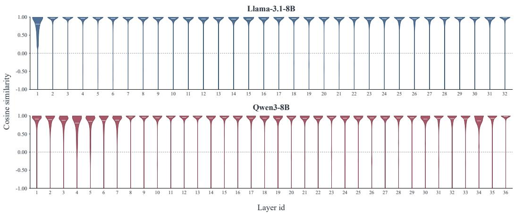  
Figure 7: Cosine similarity between the first-order estimate $\widehat { \mathbf { v } } _ { i b }$ and the exact token-level causal block output ${ \bf v } _ { i b } ^ { \mathrm { e x a c t } }$ . White bars mark weighted medians.

## D.1 BLOCK-OUTPUT APPROXIMATION

Block-output diagnostic: reference and evaluation population. We use 30 shared LongBench text identities for Llama-3.1-8B and Qwen3-8B, tokenize them separately for each model, and retain 8,192 tokens without a chat template. Activations follow the dense BF16 model trajectory. All layers, 32 query heads, and 64 query blocks are evaluated. Blocks contain 128 tokens. Within each layer, every text/head/query-block row has equal total weight, divided equally among its evaluated key blocks. Layers are indexed from one in the figure.

For query block $\mathcal { Q } _ { i }$ and key block $B _ { b }$ , the reference is

$$
\mathbf { v } _ { i b } ^ { \mathrm { e x a c t } } = \frac { 1 } { | \mathcal { Q } _ { i } | } \sum _ { t \in \mathcal { Q } _ { i } } \frac { \sum _ { u \in \mathcal { B } _ { b } , u \leq t } \exp ( \mathbf { q } _ { t } \mathbf { k } _ { u } ^ { \top } / \sqrt { d _ { h } } ) \mathbf { v } _ { u } } { \sum _ { u \in \mathcal { B } _ { b } , u \leq t } \exp ( \mathbf { q } _ { t } \mathbf { k } _ { u } ^ { \top } / \sqrt { d _ { h } } ) } .\tag{D.1}
$$

We compare the reference with $\widehat { \mathbf { v } } _ { i b } = \bar { \mathbf { v } } _ { b } + \bar { \mathbf { q } } _ { i } \mathbf { C } _ { b } / \sqrt { d _ { h } }$ using cosine similarity:

$$
c _ { i b } = \frac { \widehat { \mathbf { v } } _ { i b } ( \mathbf { v } _ { i b } ^ { \mathrm { e x a c t } } ) ^ { \top } } { \| \widehat { \mathbf { v } } _ { i b } \| _ { 2 } \| \mathbf { v } _ { i b } ^ { \mathrm { e x a c t } } \| _ { 2 } }\tag{D.2}
$$

for each text, layer, head, and query–key block pair. Equal row weighting prevents query blocks with more evaluated key blocks from dominating the distribution.

Block-output cosine similarity. Figure 7 shows high cosine similarity for most evaluated blocks. The weighted median exceeds 0.9 in 31 of 32 Llama layers and 29 of 36 Qwen layers. The median is lower in Llama’s first layer (0.805), several early Qwen layers, and Qwen layer 34. Thin lower tails also indicate poorly aligned pairs in otherwise well-aligned layers. These results support the firstorder estimate as a useful block-level signal while identifying layer-dependent limitations. Cosine similarity measures direction, not vector-magnitude error; it does not by itself bound the error in the block-output norm or guarantee that approximate scores preserve the exact block ranking.

## D.2 ACCURACY OF THE GLOBAL OUTPUT ESTIMATE

The global reference $\widehat { \mathbf { o } } _ { i }$ anchors the output deviation used for block selection. To examine how much information this inexpensive estimate retains about the final attention output, we compare it with the dense attention output before the multi-head output projection.

Reference and aggregation. Figure 8 evaluates the raw pooled reference $\widehat { \mathbf { o } } _ { i }$ on 30 LongBench texts of 8,192 tokens and 128-token blocks. The output is estimated using the Stage 1 procedure with $p _ { 1 } = 0 . 9 4$ . Let X contain all text–block pairs. For each layer ℓ and query head $\bar { h } ,$ , we compute

one cosine similarity by summing the dot products and squared norms over all pairs in X before taking their ratio:

$$
c _ { \ell h } ^ { \mathrm { g l o b a l } } = \frac { \sum _ { x \in \mathcal { X } } \widehat { \mathbf { o } } _ { \ell h x } ^ { \top } \mathbf { o } _ { \ell h x } ^ { \mathrm { d e n s e } } } { \sqrt { \sum _ { x \in \mathcal { X } } \| \widehat { \mathbf { o } } _ { \ell h x } \| _ { 2 } ^ { 2 } } \sqrt { \sum _ { x \in \mathcal { X } } \| \mathbf { o } _ { \ell h x } ^ { \mathrm { d e n s e } } \| _ { 2 } ^ { 2 } } } .\tag{D.3}
$$

Thus, each layer contributes 32 head-level cosine values to the violin plot.

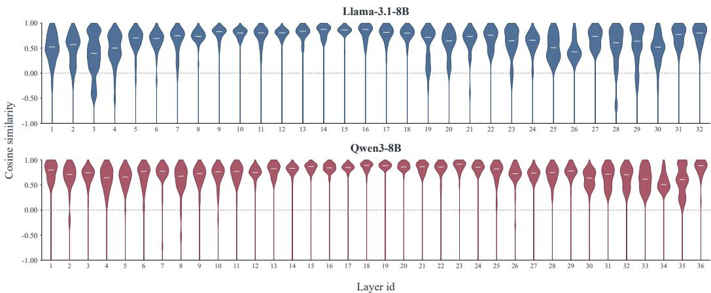  
Figure 8: Head-level cosine similarity between the Stage 1 global-output estimate and the dense attention output across layers.

Results and interpretation. Every layer has a positive median pooled cosine. The layer medians range from 0.399 to 0.873 for Llama and from 0.510 to 0.914 for Qwen, with stronger alignment across many middle layers. Several layers have a broad spread across heads, and some heads have negative pooled cosine. These results show that the low-cost estimate captures a meaningful portion of the dense output information and can serve as a coarse prior for block selection. However, the variation across layers and heads also shows that this prior is only approximate and provides limited output information in the less-aligned cases.

## D.3 STAGE 1 CANDIDATE-POOL COVERAGE

Stage 1 selects candidates using attention mass alone, whereas Stage 2 combines routing relevance with value-dependent output deviation. We first answer the operational question—whether preselection excludes blocks that the combined score would retain—and then use the component distributions to explain the observed coverage.

Diagnostic setup. All four figures in this section use Llama-3.1-8B at layers 5, 15, 25, and 31 (zero-based), evaluated on two fixed PG19 texts at nested input lengths of 16K, 32K, 48K, and 64K. The activations follow the same dense BF16 trajectory. Each layer/length combination contains 512 query rows: two texts, 32 heads, and eight sampled query-block rows per text and head. We retain the diagnostic’s native antidiagonal QK scores, their normalized pooled weights, covariancecorrected value deviations, and frozen output-reference calibration. The distribution plots apply no additional per-row, per-head, or per-layer normalization to these recorded deviations. Keeping the sampled inputs and layer indices aligned makes it possible to compare the mass profiles, deviation distributions, and selection coverage within this diagnostic.

Core coverage result. Figure 9 uses an all-visible Stage 2 reference: output-relative selection is applied to all causally visible blocks with a raw mass target of 0.90 and $\beta = 0 . 6$ . The reference is fixed while $p _ { 1 }$ changes. With $S _ { i , h } ^ { \mathrm { f u l l } }$ denoting the reference selection and $\mathcal { C } _ { i , h } ( p _ { 1 } )$ the mass-only pool,

$$
r _ { \mathrm { m i s s } } ( p _ { 1 } ) = \frac { \sum _ { i , h } \vert S _ { i , h } ^ { \mathrm { f u l l } } \setminus \mathcal { C } _ { i , h } ( p _ { 1 } ) \vert } { \sum _ { i , h } \vert S _ { i , h } ^ { \mathrm { f u l l } } \vert } .\tag{D.4}
$$

The missed fraction is 0.973–2.383% a $p _ { 1 } = 0 . 9 0 , 0 . 0 2 9 - 0 . 2 2 4 \%$ at $p _ { 1 } = 0 . 9 2$ , and at most 0.035% at $p _ { 1 } = 0 . 9 4$ . Thus the deployed conservative pool covers at least 99.96% of the reference-selected blocks in every measured layer/length combination.

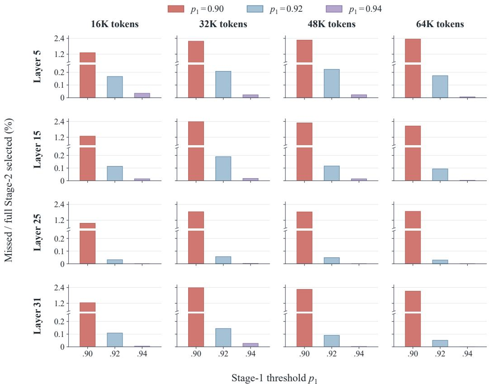  
Figure 9: Layerwise coverage of value-aware selections by mass-only preselection for $p _ { 1 } ~ \in$ {0.90, 0.92, 0.94}. The missed fraction is the pooled count of all-visible reference-selected blocks outside the Stage 1 pool divided by the pooled reference-selected count. At $p _ { 1 } = 0 . 9 4$ , the missed fraction is at most 0.035% across all 16 measured layer/length combinations.

Attention mass versus value deviation. Figures 10 and 11 compare two groups defined by cumulative attention mass: the shell between 0.85 and 0.90, and the tail beyond 0.94. The plots cover layers 5, 15, 25, and 31 and input lengths from 16K to 64K (zero-based layer indices).

Attention-mass separation. Figure 10 shows a clear and persistent gap between the two groups. Across every sampled layer and context length, the 0.85–0.90 shell retains markedly larger raw Stage 1 block mass over almost the entire within-group rank range. By contrast, the tail beyond 0.94 drops rapidly and approaches zero for a large fraction of its blocks. The same ordering appears from 16K through 64K and from the early layer 5 to the late layer 31, although the precise curve shape changes with depth. This separation means that a tail block begins with a substantial QK-score disadvantage before the value-aware term is applied. Consequently, only tail blocks with unusually large output deviation can plausibly overtake candidates already included in the conservative mass pool.

Output-deviation overlap. Figure 11 presents a different pattern. The ranked output-deviation curves of the shell and tail largely overlap in layers 5 and 25, while the tail is only moderately higher through much of layer 15. The strongest difference occurs in layer 31, where the upper portion of the tail has larger deviations than the corresponding shell profile. Even there, the gap contracts toward the lower-ranked portion of the distributions, and the two groups remain on a comparable scale over most ranks. Thus, low attention mass does not imply uniformly negligible value deviation, but neither does the tail exhibit a broad value advantage that would generally compensate for the mass gap in Figure 10.

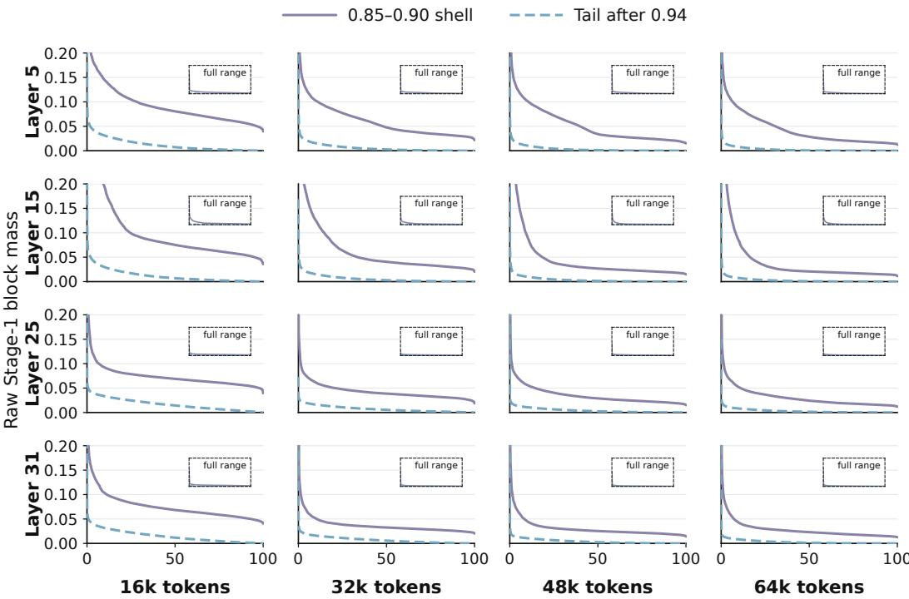  
Rank within each group (%) · largest to smallest  
Figure 10: Attention-mass profiles for the 0.85–0.90 cumulative-mass shell and the tail beyond 0.94, sorted independently within each group. The tail has substantially lower raw Stage 1 block mass over most ranks across all sampled layers and context lengths.

Joint interpretation. Together, the two figures motivate the asymmetric two-stage design. Stage 1 uses attention mass to remove a region whose scores are consistently weak, whereas Stage 2 preserves the value term for finer discrimination inside a conservative candidate pool. The figures are distributional rather than paired blockwise comparisons: ranks are computed independently within each group and component, so points at the same horizontal position need not represent the same block. The profiles therefore explain the empirical coverage trend without asserting that mass alone determines the final selection.

For positive deviations, a discarded block b can outrank a candidate c under Eq. 6 only if

$$
\beta \log { \frac { r _ { i b } ^ { \mathrm { v a l u e } } } { r _ { i c } ^ { \mathrm { v a l u e } } } } > \widehat { z } _ { i c } ^ { \mathrm { A D } } - \widehat { z } _ { i b } ^ { \mathrm { A D } } .\tag{D.5}
$$

Here $\widehat { z } _ { i b } ^ { \mathrm { A D } }$ is the antidiagonal estimate of the pooled QK component in the combined log score. For $\beta > 0 .$ , a large routing-score gap requires a correspondingly large value-deviation ratio. The observed profiles support using the value term to refine a conservative candidate pool rather than scoring every low-mass block. This explains why the conservative pool has high measured coverage without claiming that attention mass alone is sufficient for the final ranking.

Layerwise distribution of value deviation. Figure 12 separates the all-visible deviation distribution by layer and input length. Each panel pools the visible block observations for its 512 query rows, with equal weight per block observation. The 16 panels contain 2,295,552 observations in total. The vertical axis reports the percentage of observations in each 0.05-wide $\log _ { 1 0 }$ bin. Common axes retain the original norm scale and all observed values, so both location and spread can be compared across panels. The distribution includes retained and discarded blocks; it is not conditioned on either stage’s final selection.

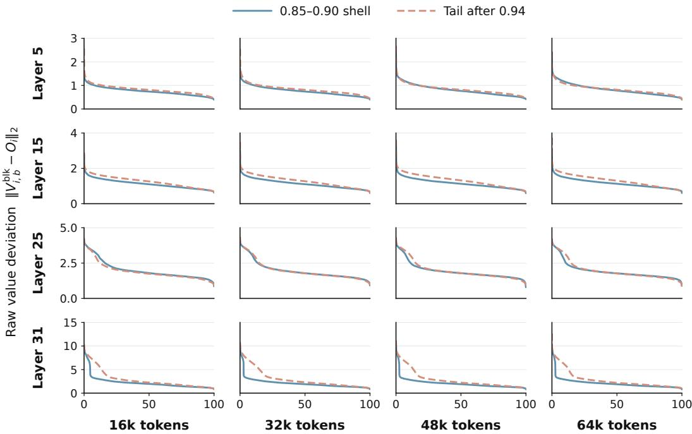  
Rank within each group (%) · largest to smallest  
Figure 11: Output-deviation profiles for the 0.85–0.90 cumulative-mass shell and the tail beyond 0.94, sorted independently within each group. The profiles largely overlap except for the upperranked tail in later layers, most notably layer 31.

The typical deviation increases across the four sampled depths. Across the four lengths, the median is 0.787–0.817 in layer 5, 1.202–1.267 in layer 15, 1.765–1.779 in layer 25, and 2.076–2.085 in layer 31. Within each layer, the largest median is less than 6% above the smallest across these lengths. The late layer also has a broader right tail: its 95th percentile is 6.864–7.180, compared with at most 3.501 in the other three layers. Nevertheless, deviations above 10 account for only 0.037–0.050% of layer-31 observations and do not occur in the other plotted layers.

These layerwise views explain why a pooled histogram can obscure meaningful depth-dependent differences. They also clarify the role of the value term: most blocks have moderate deviations, while a small tail can receive substantially higher scores. Whether such a block should survive depends jointly on its deviation and attention mass, as expressed by Eq. D.5. A marginal deviation histogram alone cannot establish that preselection preserves the desired blocks; the following coverage test evaluates that question using the joint score.

The threshold effect is consistent across the four depths, including layer 31 with its broader deviation tail. The length dependence is not strictly monotone: for example, at $p _ { 1 } = 0 . 9 0$ , layer 15 reaches 2.378% at 32K and decreases to 2.053% at 64K. Hence the observed coverage is better summarized by its range across layers and lengths than by assuming that longer inputs necessarily cause more omissions.

Together, the profiles and coverage measurements support using a conservative mass-only pool before applying the more expensive output-relative score. The profiles identify the large mass gap that a tail block must overcome, while the coverage test directly counts the exceptions under the combined score. The diagnostic uses $\beta = 0 . 6$ , rather than the model-specific coefficients of the main benchmark. Its two-text coverage result does not guarantee zero omissions on other inputs, nor does a small missed-block fraction alone bound output error: missed blocks can differ in their individual contributions.

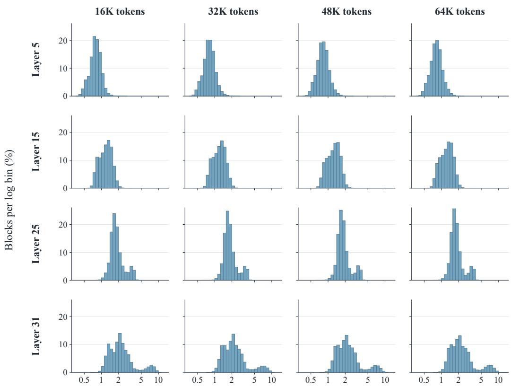  
Raw value deviation (L2 norm; logarithmic scale)

Figure 12: Layerwise distributions of raw value-deviation norms over all visible blocks. Rows show Llama-3.1-8B layers 5, 15, 25, and 31 (zero-based); columns show four input lengths. Each panel pools two PG19 texts, 32 heads, and eight query rows per text and head, with equal weight per visible block observation. The horizontal axis is logarithmic, and bins have width 0.05 in $\log _ { 1 0 }$ deviation. All panels share the same axes, without additional per-head or per-row normalization. Layer 31 has a broader right tail, while each layer’s central distribution varies modestly across lengths.

## E RUNTIME AND MEMORY ANALYSIS

## E.1 BLOCK-OUTPUT ESTIMATOR FLOPS

The relevant baseline is the exact token-level block output in Eq. D.1. Let

$$
n _ { i b } = \sum _ { t \in \mathcal { Q } _ { i } } | \{ u \in B _ { b } : u \leq t \} |\tag{E.1}
$$

be the number of visible query–key pairs. Counting a multiply–add as two FLOPs, exact QK products and value accumulation cost

$$
f _ { \mathrm { e x a c t } } ( i , b ) = 4 n _ { i b } d _ { h } ,\tag{E.2}
$$

where $n _ { i b } = b _ { q } b _ { k }$ for a fully visible block. A cached covariance descriptor requires one matrix– vector product and one vector addition,

$$
f _ { \mathrm { T a y l o r } } = 2 d _ { h } ^ { 2 } + d _ { h } .\tag{E.3}
$$

For a fully visible block, the fraction of per-candidate arithmetic retained by the estimator is therefore

$$
\frac { f _ { \mathrm { T a y l o r } } } { f _ { \mathrm { e x a c t } } } = \frac { 2 d _ { h } + 1 } { 4 b _ { q } b _ { k } } , \qquad \mathrm { s a v i n g } = 1 - \frac { 2 d _ { h } + 1 } { 4 b _ { q } b _ { k } } .\tag{E.4}
$$

When $b _ { q } = b _ { k } = d _ { h } = d ,$ exact block computation is $\mathcal { O } ( d ^ { 3 } )$ whereas the estimate is $\mathcal { O } ( d ^ { 2 } )$ per candidate. At d = 128, Eq. E.4 gives a 99.61% reduction in per-candidate arithmetic.

The covariance costs $2 b _ { k } d _ { h } ^ { 2 } + \mathcal { O } ( b _ { k } d _ { h } + d _ { h } ^ { 2 } )$ to construct, but it is computed once per KV-head/keyblock descriptor and reused across the corresponding query heads and query blocks. Query pooling likewise costs $2 b _ { q } d _ { h }$ once per query block. If P candidate pairs reuse $\dot { U }$ unique descriptors across Q query blocks, the estimator requires

$$
P ( 2 d _ { h } ^ { 2 } + d _ { h } ) + U \left[ 2 b _ { k } d _ { h } ^ { 2 } + \mathcal { O } ( b _ { k } d _ { h } + d _ { h } ^ { 2 } ) \right] + 2 Q b _ { q } d _ { h }\tag{E.5}
$$

FLOPs, compared with $4 d _ { h } \textstyle \sum _ { ( i , b ) } n _ { i b }$ for exact token-level block outputs. The descriptor and pooling terms are therefore amortized as their reuse increases. For a causal diagonal block, Eq. E.2 uses the actual smaller $n _ { i b }$ , so its saving is lower than the full-block expression. These counts exclude memory traffic, kernel launches, Stage 1, and the final sparse attention. End-to-end measurements appear in Figures 5 and 6.

## E.2 MEMORY OVERHEAD OF Q/K COPIES AND COVARIANCE

We first calculate the storage required by the auxiliary tensors used for low-precision scoring and block-output approximation. These tensors consist of low-precision Q/K copies and a blockwise key–value covariance cache. In practice, our implementation stores the Q/K copies in INT8 and the covariance cache in BF16. We then measure the actual instantaneous memory overhead of the INT8 Q/K copies and covariance cache.

Storage calculation. For batch size one, sequence length n divisible by block size $b = 1 2 8$ , head dimension $d _ { h } , h _ { q }$ query heads, and $h _ { k v }$ KV heads, let $\bar { b _ { \mathrm { t o t } } } = \lceil n / b \rceil$ . An INT8 entry occupies one byte, and a BF16 covariance entry occupies two bytes. The buffer sizes are

$$
m _ { \mathrm { c o p i e s } } = n d _ { h } ( h _ { q } + h _ { k v } ) \mathrm { b y t e s } , \qquad m _ { \mathrm { c o v } } = 2 h _ { k v } b _ { \mathrm { t o t } } d _ { h } ^ { 2 } \mathrm { b y t e s } .\tag{E.6}
$$

The covariance cache is shared by query heads using the same KV head. At 128K with $d _ { h } = 1 2 8$ $h _ { q } = 3 2$ , and $h _ { k v } = 8 .$ , the Q and K copies require 512 and 128 MiB, respectively, and the covariance cache requires 256 MiB.

Verification with real model activations. We replay saved dense-trajectory Q/K/V activations from Qwen3-8B (YaRN ×4, layer index 18) for four fixed inputs: two PG19 texts and two InfiniteBench inputs (code debugging and key–value retrieval). The actual INT8 quantization and BF16 covariance routines are executed on an NVIDIA A100 80GB at 16K, 32K, 64K, and 128K, with batch size one. After warm-up, we measure the actual instantaneous memory increase produced by the INT8 Q/K copies and covariance cache during complete POEM execution.

Table 6: Predicted and measured auxiliary tensor storage (MiB). The actual INT8 copies and BF16 covariance cache match their shape-based predictions on all four inputs at each length. Q/K measurements also include the small FP32 quantization-scale tensors.
<table><tr><td rowspan="2">Length</td><td colspan="2">Q/K copies</td><td colspan="2">Covariance</td></tr><tr><td>Predicted payload</td><td>Measured with scales</td><td>Predicted</td><td>Measured</td></tr><tr><td>16K</td><td>80</td><td>80.020</td><td>32</td><td>32</td></tr><tr><td>32K</td><td>160</td><td>160.039</td><td>64</td><td>64</td></tr><tr><td>64K</td><td>320</td><td>320.078</td><td>128</td><td>128</td></tr><tr><td>128K</td><td>640</td><td>640.156</td><td>256</td><td>256</td></tr></table>

Table 6 confirms that these buffers occupy the predicted storage in the implementation. The measured Q/K difference is exactly the FP32 scale storage, $4 ( h _ { q } + h _ { k v } ) b _ { \mathrm { t o t } }$ bytes; at 128K it is 0.15625 MiB. All 48 component checks (Q copy, K copy, and covariance across 16 input/length combinations) match the tensor payload plus its returned metadata exactly. Instrumented and uninstrumented complete POEM calls produce bitwise-identical attention outputs on all 16 cases.

Both terms grow linearly with n for fixed block size and head geometry. Their payload sizes sum to 896 MiB at 128K, but this sum is not a claim about the complete model’s peak GPU memory.

The INT8 copies are temporary Stage 1 tensors, while covariance is constructed for Stage 2; their lifetimes need not overlap. This accounting is limited to the two buffer families and excludes the original Q/K/V activations and other attention workspaces.

End-to-end peak GPU memory. We additionally record the peak allocated GPU memory during full-model prefilling. Table 7 shows that the runtime memory peaks of POEM and dense attention are nearly identical. Even at 128K tokens, POEM increases the peak by only 2.005 MiB.

Table 7: End-to-end peak allocated GPU memory during full-model prefilling. The increase is computed from the unrounded measurements.
<table><tr><td>Length</td><td>Dense (GiB)</td><td>POEM (GiB)</td><td>Increase (MiB)</td></tr><tr><td>16K</td><td>19.147</td><td>19.147</td><td>0.033</td></tr><tr><td>32K</td><td>23.030</td><td>23.031</td><td>0.127</td></tr><tr><td>64K</td><td>30.796</td><td>30.797</td><td>0.503</td></tr><tr><td>128K</td><td>46.329</td><td>46.331</td><td>2.005</td></tr></table>

The model-level peak is determined by the allocation of MLP activations. When this peak is reached, the temporary low-precision Q/K copies and the covariance cache used by POEM have already been released. These buffers therefore do not overlap with the dominant MLP allocation, explaining why their standalone storage does not translate into a comparable increase in the end-to-end peak memory.

## F OFFLINE THRESHOLD CALIBRATION

Algorithm 2 expands the error-ranked batch-bisection procedure in Section 4.3. A group is a layerspecific set of query heads sharing KV projections. Its members share one threshold. To keep calibration notation consistent with the main configuration, let $\theta _ { g } \ = \ p _ { 1 } p _ { 2 , g }$ denote the group’s overall estimated mass target; the candidate-relative threshold used by Algorithm 1 is $p _ { 2 , g } = \theta _ { g } / p _ { 1 }$ Groups are ordered by increasing error in a single-group perturbation diagnostic, with all other groups kept at the reference setting. This ordering prioritizes groups expected to tolerate a smaller budget.

Data partition. Calibration uses two fixed, disjoint manifests: $\mathcal { D } _ { \mathrm { r a n k } }$ for the dense-logit cache and single-group KL probes, and $\mathcal { D } _ { \mathrm { s e a r c h } }$ for accepting or rejecting threshold changes. The benchmark test instances reported in Section 5 belong to neither manifest and are evaluated only after thresholds are frozen. The example identifiers, tokenized lengths, sampled prediction positions, and random seed must be stored with the released configuration so that the split can be reconstructed exactly.

Definition of the group error. We first run dense attention on $\mathcal { D } _ { \mathrm { r a n k } }$ and cache its final vocabulary logits. Set every group’s overall target to 0.9 and evaluate the resulting sparse model against this dense reference. Writing $\pmb { \theta } ^ { \mathrm { r e f } } = ( 0 . 9 , \dots , 0 . 9 )$ , define

$$
d ( \pmb \theta ) = \frac { 1 } { | \mathcal { T } | } \sum _ { ( \boldsymbol x , t ) \in \mathcal { X } } d _ { \mathrm { K L } } \big ( \mathrm { s o f t m a x } ( \mathbf z _ { \boldsymbol x , t } ^ { d } ) \left. \mathrm { s o f t m a x } ( \mathbf z _ { \boldsymbol x , t } ^ { s } ( \pmb \theta ) ) \right) , \qquad d _ { \mathrm { r e f } } = d ( \pmb \theta ^ { \mathrm { r e f } } ) ,\tag{F.1}
$$

where I is the fixed set of example–position pairs drawn only from $\mathcal { D } _ { \mathrm { r a n k } }$ . The softmax is over the vocabulary, with the dense distribution as the first argument of KL, consistent with Eq. 7. For each group g, independently reduce only its threshold by a factor of 0.9 and recompute the full model’s final logits:

$$
\theta _ { h } ^ { ( g ) } = \{ 0 . 8 1 , \quad h = g , \qquad e _ { g } : = d ( \theta ^ { ( g ) } ) , \qquad \Delta e _ { g } : = e _ { g } - d _ { \mathrm { r e f } } . \qquad\tag{F.2}
$$

All examples, prediction positions, and other settings stay fixed. Each probe starts from $\pmb { \theta } ^ { \mathrm { r e f } }$ , so reductions do not accumulate across groups while building this ranking. We order groups by increasing $e _ { g } ;$ subtracting the common baseline $d _ { \mathrm { r e f } }$ gives the identical ordering by $\Delta e _ { g }$ . Lower values indicate that the single-group reduction better preserves the dense prediction distribution. This KL error determines the trial order; the task score below determines whether a trial reduction is accepted.

Search rule. Initialize every group at $\tau _ { 0 } ~ = ~ 0 . 9$ and evaluate its score on $\mathcal { D } _ { \mathrm { s e a r c h } }$ . Each trial changes only the current batch to $\rho \tau _ { 0 }$ , with $\rho = 0 . 9$ , leaving previously accepted changes in place. Accept a trial if its search-set score does not decrease. If the score decreases, restore the accepted configuration and split the batch into two contiguous halves in the error ordering. The lower-error half is tested first. A rejected singleton retains $\tau _ { 0 }$ . The procedure makes a single reduction decision per group; it does not repeatedly multiply already accepted thresholds by $\rho .$ The search terminates when the stack is empty or when the predefined maximum number of calibration steps $T _ { \mathrm { m a x } }$ is reached. If the step limit is reached first, groups in the remaining unvisited batches retain their current thresholds.

Algorithm 2 Error-Ranked Threshold Calibration   
Input: Groups $\mathcal { G } ;$ errors $e _ { g }$ from Eq. F.2; initial threshold $\tau _ { 0 } ;$ reduction factor $\rho = 0 . 9 ;$ fixed-search-set   
score $s ( \pmb \theta )$ ; maximum calibration steps $T _ { \mathrm { m a x } }$   
Output: Frozen group thresholds $\pmb \theta .$   
1: $\mathcal { G }  \mathrm { S o r t A s c e n d i n g } ( \mathcal { G } , e _ { g } )$   
2: $\pmb \theta \gets ( \tau _ { 0 } , \dots , \tau _ { 0 } ) ; s _ { \mathrm { b e s t } } \gets s ( \pmb \theta ) ; \mathcal { Q } \gets [ \mathcal { G } ]$ ▷ LIFO stack   
3: t ← 0   
4: while $\mathcal { Q } \neq \emptyset$ and $t < T _ { \operatorname* { m a x } }$ do   
5: $B  \operatorname { P o p } ( \mathcal { Q } ) ; \pmb { \theta } ^ { \prime }  \pmb { \theta }$   
6: $t \gets t + 1$   
7: Set $\theta _ { g } ^ { \prime }  \rho \tau _ { 0 }$ for every $g \in B$   
8: $s ^ { \prime }  s ( \pmb \theta ^ { \prime } )$   
9: if $s ^ { \prime } \geq \dot { s } _ { \mathrm { b e s t } }$ then   
10: $\pmb \theta  \pmb \theta ^ { \prime } ; s _ { \mathrm { b e s t } }  s ^ { \prime }$   
11: else if $| | B | > 1$ then   
12: $( \vec { B _ { \mathrm { l o } } } , \dot { B } _ { \mathrm { h i } } ) \gets \mathrm { B i s e c t } ( \vec { B } )$   
13: $\dot { \mathrm { P u s h } } ( \mathcal { Q } , B _ { \mathrm { h i } } ) ; \mathrm { P u s h } \dot { ( \mathcal { Q } , B _ { \mathrm { l o } } ) }$   
14: end if   
15: end while   
16: return θ

Final configuration and calibration cost. All reported runs use $p _ { 1 } = 0 . 9 4 , \tau _ { 0 } = 0 . 9 0$ , and $\rho = 0 . 9 0$ . Consequently, an unreduced group uses $p _ { 2 , g } = 0 . 9 0 / 0 . 9 4 \approx 0 . 9 5 7 4 5 .$ , while an accepted reduced group uses $p _ { 2 , g } = 0 . 8 1 / 0 . 9 4 \approx 0 . 8 6 1 7 0$ . The frozen artifact therefore needs only one bit per group in addition to the shared constants: unreduced or reduced. Its practical effect is assessed by the module ablation in Table 5.