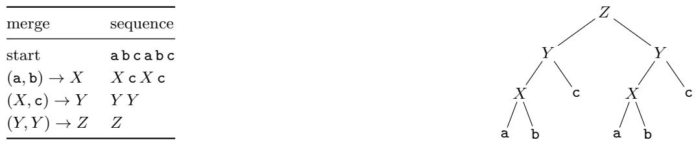
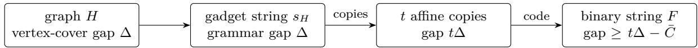
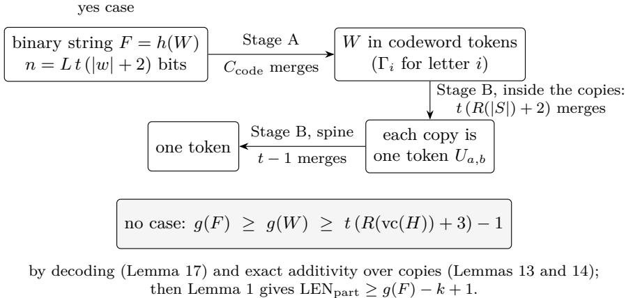
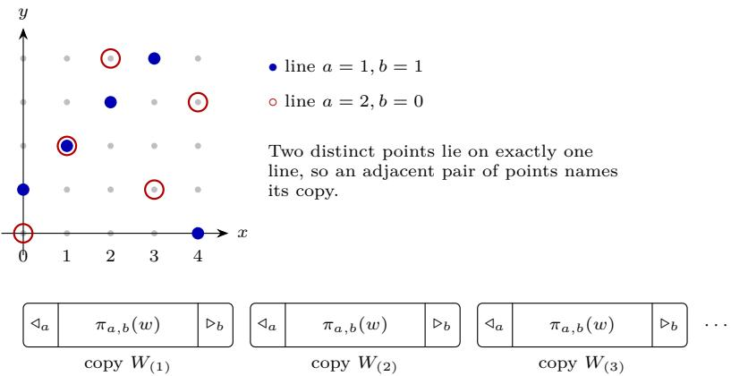
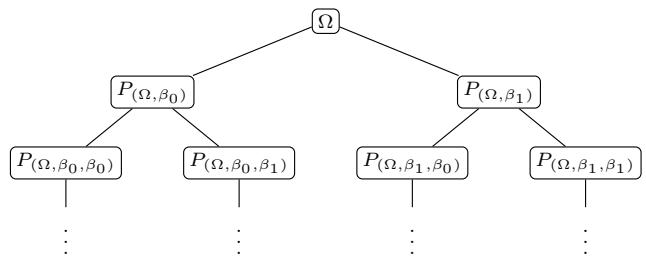
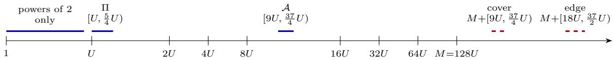
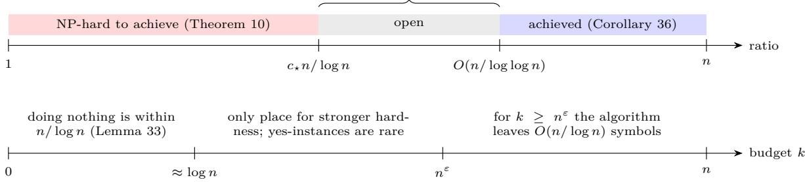

# Pair-Merge Tokenisation Is Hard to Approximate on Binary Strings and Strongly NP-Hard on Unary Datasets

Kundan Baliga University of Illinois Urbana-Champaign kbaliga2@illinois.edu

Aiden Xie Georgia Institute of Technology axie82@gatech.edu

Aditya Byju Georgia Institute of Technology abyju6@gatech.edu

## Abstract

Tokenisers such as Byte-Pair Encoding (BPE) shorten text by repeatedly merging an adjacent pair of symbols into a new one; fewer tokens mean less computation. We ask whether an eficient algorithm can choose k merges that leave a string of length n almost as short as possible; doing nothing is already within a factor n. We prove that, unless P = NP, no polynomial-time algorithm comes within a factor c n/ log n, for some constant c > 0, already for one binary string and for BPE-style merges that replace every occurrence. The key idea is that k merges form a grammar with k rules: a vertex-cover gap becomes a grammar-size gap, which we amplify with relabelled copies, encode in binary and realise with explicit merges. For merges that may skip occurrences, a simple algorithm achieves O(n/ log log n), and no Karp reduction can prove hardness beyond order n/ log n unless coNP ⊆ NP/poly. Over a one-letter alphabet, both tokenisation problems left open by Kastreva et al. are strongly NP-complete on datasets with repeated strings.

## 1 Introduction

Most language models read text through a tokeniser built by Byte-Pair Encoding (BPE) [18, 40]. BPE starts from characters or bytes and repeats one step: pick an adjacent pair of symbols, give it a new name, and replace the pair by the new symbol. Fewer tokens mean less compute, so a natural question is: given a string and a budget of k merges, which merges make the string shortest, and can an eficient algorithm get close? The compressed length counts the symbols that remain. We compare an algorithm’s compressed length with the optimum; for a string of length n, doing nothing is within a factor n, because the optimum is at least one symbol.

We study two kinds of merge. A full merge replaces every occurrence of its pair, as BPE does. A partial merge replaces a chosen set of occurrences. From here on we use only these two terms. Kozma and Voderholzer asked whether any polynomial-time algorithm approximates the compressed length well [28, Section 6]; over alphabets that grow with the input, Theorem 9 answers this up to a constant factor. Kastreva, Whittington, Komm and Pimentel asked whether the binary versions of their tokenisation problems lie in APX, that is, admit some constant-factor approximation, and left two decision problems over a oneletter alphabet open [25, Section 6]. This paper addresses these questions for bounded alphabets, except for direct tokenisation (Section 8). For the question of Kozma and Voderholzer it narrows the answer to between n/ log n and n/ log log n for partial merges; for full merges the upper end is n/(log log n)log3 2.

Main results. Here n is the length of the input string (or the total length of a dataset).

1. Binary strings: hard to approximate (Theorem 10 and Corollary 23). Unless $\mathrm {  ~ P ~ } = \mathrm {  ~ N P ~ } .$ , no polynomial-time algorithm approximates the compressed length after k full or partial merges within $c _ { \star } n / \log n .$ , for a constant $c _ { \star } > 0$ , already for one binary string. So binary bottom-up tokenisation is not in APX. (For partial merges this follows from bounds of Nowicki [38]; for full merges, as in BPE, it is new.)

2. One-letter datasets: strongly NP-complete (Theorems 25 and 30). Over the alphabet {a}, standard bottom-up tokenisation and tokenisation by merges followed by optimal segmentation are NP-complete even when all string lengths are written in unary, on datasets with repeated strings. This settles both open unary problems of Kastreva et al.

3. How far hardness proofs can go (Part II). For partial merges a simple algorithm achieves O(n/ log log n), and no Karp reduction (the usual form of an NP-hardness proof) proves hardness for a ratio $\omega ( n / \log n )$ unless $\mathrm { c o N P \subseteq N P / p o l y }$ , a collapse that complexity theorists consider unlikely. So, for partial merges, result 1 is optimal up to the constant among Karp reductions.

Also in the paper: the $\Theta ( n )$ bound over alphabets that grow with the input, with its full proof (Theorem 9); an $n ^ { 1 - \varepsilon }$ version of result 1 without the PCP theorem (Theorem 10(i)); for full merges, analogues of result 3 with log n and log log n raised to the power $\log _ { 3 } 2 \approx 0 . 6 3$ (Theorems 35 and 37 and Corollary 36); and a closed formula for one unary string under full merges (Lemma 29).

Terms from complexity theory. A problem is in APX if some polynomial-time algorithm approximates it within a constant factor. A problem with numbers in its input is strongly NP-hard if it stays NP-hard when all numbers are written in unary; for one-letter strings this rules out hardness that comes only from exponentially long strings. $\mathrm { c o N P \subseteq N P / p o l y }$ would mean that unsatisfiable formulas have short certificates given advice that depends only on the input length; it would collapse the polynomial hierarchy.

Binary strings are strings over every larger alphabet, so the hardness holds for any alphabet with at least two letters, including bytes. The hard instances are worst cases with a large budget, $k = \Theta ( n / \log n )$ : in the yes case it compresses the whole string to one token. Section 8 explains why this does not say that BPE behaves badly on natural text.

Key idea: merges are small grammars. A sequence of k merges is a grammar with k rules $X  Y Z ,$ much like a BPE merge table. So if every grammar for a string needs $k + \Delta$ rules, then k merges leave at least $\Delta + 1$ symbols; and if a grammar with k rules exists and the merges can follow it, they leave one symbol (Figure 1). Because the yes case leaves exactly one symbol, the approximation ratio is simply the number of symbols left in the no case, so an additive gap in grammar size becomes a multiplicative gap in compressed length. We start from a string over a large alphabet whose smallest grammar size encodes the vertex-cover number of a graph. Section 3 carries out this whole argument on a graph with one edge, small enough to check by hand. Writing that string over a fixed alphabet naively destroys the gap, so we follow Nowicki [38] (Figure 2): take many copies of the string, relabel each copy by a diferent afine map so that no two copies share an adjacent pair, and write every symbol in a binary code. The encoding is paid once, while the vertex-cover gap is multiplied by the number of copies. With t copies of a gadget string of length Θ(|V|) and a gap $\Delta = \Theta ( | V | )$ , the binary string has $n = \Theta ( t | V | \log n )$ bits, the codeword length being Θ(log n), and $\Omega ( t | V | ) = \Omega ( n / \log n )$ symbols remain in the no case. Partial merges can follow any grammar; full merges cannot, because they also replace unwanted occurrences. Our new step is an explicit schedule of full merges for the binary string (Section 4.4).

Key idea of the unary part. With one letter, a string is just a number and a token is a number too. We write every number in the construction as a set of bits. A vertex is “chosen” by merging its binary code with a middle bit, and one last merge of the two middle bits brings every other edge string to 3 tokens. So an edge string reaches the minimum of 2 tokens only if both endpoints were chosen: an AND gadget (Figure 10), which encodes balanced biclique. Many copies of auxiliary strings force every optimal solution to build the codes first, at a known cost. The merges-then-segmentation result uses a diferent, number-theoretic construction from vertex cover (Section 5).

<table><tr><td>merge</td><td>sequence</td></tr><tr><td>start</td><td>abcabc</td></tr><tr><td> $( \mathsf { a } , \mathsf { b } ) \to X$ </td><td> $X \subset X \subset$ </td></tr><tr><td> $( X , { \mathsf { c } } ) \to Y$ </td><td>YY</td></tr><tr><td>(Y,Y) → Z</td><td>Z</td></tr></table>

Figure 1: The two bridges on $s = \mathsf { a b c a b c }$ . Left: three merges reduce s to one symbol. Right: read as rules $X \to \mathsf { a b } , Y \to X \mathsf { c } , Z \to Y Y$ , the same merges form a grammar, whose parse tree is shown (Lemma 1). Conversely, processing the rules of any grammar children first gives partial merges (Lemma 2). A rule at most doubles the length of what it derives, so $g ( s ) = 3 .$ , and by Lemma 1 two merges leave at least $3 - 2 + 1 = 2$ symbols.  
  
Figure 2: The plan of the binary hardness proof. Merges are grammar rules, so the vertex-cover gap becomes an additive gap in grammar size; the copies multiply it by t. The binary code costs ${ \bar { C } } = O ( p | V | \log | V | )$ rules for cubic H and field size p, while the gap grows like $t = p ^ { 2 }$ , so for large p the code cost is negligible. In the yes case an explicit schedule of full merges reduces F to one token; in the no case many tokens remain.

What is new. For partial merges the binary hardness follows from Nowicki’s bounds on binary grammar size, which he states only for exact hardness. Our contribution in the binary part is the full-merge schedule and hence the answer to Kastreva et al.’s APX question for bottom-up tokenisation (the direct half stays open). The Karp barrier and the full-merge algorithm of Part II are new; the partial-merge algorithm is elementary. The unary part is new: the structure of full merges on one-letter strings, the AND gadget and the scafold constructions. Section 7 compares with prior work in detail.

Roadmap. Section 2 gives definitions and the two bridges between merges and grammars. Part I contains the hardness results: the hand-checkable warm-up over a large alphabet (Section 3), the binary hardness (Section 4) and the unary results (Section 5). Part II (Section 6) gives the algorithms and the barrier. Part III covers related work and connections (Section 7) and scope, practice and open problems (Section 8). Case checks, routine lemmas and all computer checks are in the appendices.

## 2 Definitions and two bridges between merges and grammars

## 2.1 Merges

A string s of length $n = | s |$ is a sequence of symbols. A merge of a pair $( a , b )$ of symbols introduces a fresh symbol X and replaces occurrences of the adjacent pair ab in the current sequence by X. We follow Kozma and Voderholzer [28], and call the symbols of the current sequence tokens.

• A full merge replaces all occurrences, scanning left to right, without overlaps. For example, the full merge of $( \mathsf { a } , \mathsf { a } )$ turns aaa into Xa. This is what BPE does. The resulting problem is OMS (optimal merge sequence), the problem of Zouhar et al. [44] in the notation of [28].

• A partial merge replaces any set of pairwise non-overlapping occurrences, possibly none. The resulting problem is OPE (optimal pair encoding).

A merge whose pair does not occur changes nothing; we call it an identity merge. So “exactly k merges” and “at most k merges” give the same optimum; in the string-identified model of Kastreva et al. below, a

merge of two strings that never occur adjacently plays the same role. The budget k is part of the input. Let $\mathrm { L E N } _ { \mathrm { f u l l } } ( s , k )$ and $\mathrm { L E N } _ { \mathrm { p a r t } } ( s , k )$ be the minimum length of the sequence left after k full, respectively partial, merges. A full merge is a special partial merge, so

$$
1 \leq \mathrm { L E N } _ { \mathrm { p a r t } } ( s , k ) \leq \mathrm { L E N } _ { \mathrm { f u l l } } ( s , k ) \leq n .\tag{1}
$$

The utility of a merge sequence is n minus the final length, the number of symbols saved.

An algorithm approximates the compressed length within a factor $\rho \geq 1$ if on every input $( s , k )$ it outputs k merges whose final length is at most ρ times the optimum. By (1), doing nothing is an n-approximation.

Datasets and tokenisers. Kastreva et al. [25] work with a dataset D (a multiset of strings) and the objective $\sum _ { u \in \mathcal { D } } \left| \mathrm { t o k } ( u ) \right|$ , the total number of tokens; for a dataset, n denotes the total length $\textstyle \sum _ { u \in { \mathcal { D } } } | u |$ Their budget, written K there, is our k. Their bottom-up tokeniser applies k merges to every string, each replacing all occurrences left to right, as in full merges; their tokens are identified by the strings they spell rather than by fresh names (Section 4.5). Their OPE tokeniser, which we call $O P E \ – s e g .$ , takes the tokens produced by k merges and segments every string optimally with that vocabulary. Their direct tokeniser chooses any vocabulary of k extra tokens and segments optimally. Table 1 maps these names.

<table><tr><td>name here</td><td>Kastreva et al.</td><td>merges act on</td><td>output</td><td>practical analogue</td></tr><tr><td>full merges (OMS)</td><td>bottom-up</td><td>all occurrences, in order</td><td>token string</td><td>BPE</td></tr><tr><td>partial merges (OPE)</td><td></td><td>chosen occurrences</td><td>token string</td><td>choose where merges apply</td></tr><tr><td>OPE-seg</td><td> $^ { 6 6 } \mathrm { O P E } ^ { 3 }$ </td><td>(define a vocabulary)</td><td>optimal segmentation</td><td>BPE vocab., best segmentation</td></tr><tr><td>direct (not covered)</td><td>direct</td><td>(any k tokens)</td><td>optimal segmentation</td><td>Unigram/WordPiece-like</td></tr></table>

Table 1: Problem names. OPE is Kozma and Voderholzer’s partial-merge problem; OPE-seg is the tokeniser of Kastreva et al. that segments optimally with the vocabulary of k merges.

## 2.2 Straight-line programs

A binary straight-line program (SLP) is an acyclic set of rules $X \ \to \ Y Z .$ where Y and Z are letters or nonterminals. Each nonterminal X derives a string val(X). For $| s | \ge 2$ , the grammar size $g ( s )$ is the minimum number of rules of an SLP that has a nonterminal deriving s. For a single letter, $g = 0$ . For a finite set Words of words of length at least 2, g(Words) is the minimum number of rules of an SLP in which every word of Words is derived by some nonterminal. Without loss of generality distinct nonterminals have distinct values (identifying two nonterminals with equal values never adds rules), so we may name a nonterminal by its value. The parse tree of an SLP for s unfolds the rules from the nonterminal deriving s; each node covers an interval of s, its yield.

Over a fixed alphabet every string of length n has $g = O ( n / \log n ) \ [ 2 7 ]$ . We use this only to explain why our binary ratio has a log n in it.

## 2.3 Two bridges

The first bridge says that merges are grammars. It turns a lower bound on grammar size into a lower bound on compressed length.

Lemma 1 (merges give grammars). Ifk partial merges turn s into a sequence oflength ℓ, then $g ( s ) \leq k + \ell - 1$ Consequently, for every k,

$$
\mathrm { L E N } _ { \mathrm { f u l l } } ( s , k ) \ \geq \ \mathrm { L E N } _ { \mathrm { p a r t } } ( s , k ) \ \geq \ g ( s ) - k + 1 .
$$

Proof. Each merge of $( a , b )$ into X gives a rule $X  a b .$ Every symbol of the final sequence $u _ { 1 } \cdot \cdot \cdot u _ { \ell }$ derives the part of s that it covers, so $\mathrm { v a l } ( u _ { 1 } ) \cdot \cdot \cdot \mathrm { v a l } ( u _ { \ell } ) = s$ . Add ℓ − 1 rules that join $u _ { 1 } , \ldots , u _ { \ell }$ from left to right (none if $\ell = 1 )$ . Merges with no occurrence only add unused rules. A merge of a pair $( a , a )$ is no diferent. The second statement follows with (1). □

<table><tr><td>symbol</td><td>meaning</td></tr><tr><td> $n , k$ </td><td>length of the input string (or total length of a dataset); merge budget</td></tr><tr><td> $\mathcal { D } , \rho$ </td><td>dataset (multiset of strings); approximation ratio</td></tr><tr><td> $\mathrm { L E N } _ { \mathrm { f u l l } } , \mathrm { L E N } _ { \mathrm { p a r t } }$ </td><td>minimum length after k full  $/$  partial merges</td></tr><tr><td> $g ( s ) , g ( \mathrm { W o r d s } )$ </td><td>smallest number of binary rules deriving  $s ~ /$  all words of Words</td></tr><tr><td> $\operatorname { v a l } ( X )$ </td><td>string derived by a nonterminal or token  $X$ </td></tr><tr><td> $H = ( V , E ) , \operatorname { v c } ( H ) , \kappa$ </td><td>graph; its vertex-cover number; threshold of the source instance</td></tr><tr><td>S</td><td>a (minimal) vertex cover; |S| its size</td></tr><tr><td> $\varepsilon _ { \mathrm { 0 } } , c _ { \mathrm { 0 } } , c _ { \star }$   $\lambda$ </td><td>gap constant of Fact  $_ { 3 ; }$  constants of Theorems 9 and  $^ { 1 0 , }$  proportional to</td></tr><tr><td></td><td>number of strings in a dataset (Remark 24)</td></tr><tr><td> $\# , x _ { v } , \ S _ { j }$   $( \mathrm { A L T } )$ </td><td>gadget letters: hash, vertex letter of  $v \in V ,$  separator number  $j$ </td></tr><tr><td> $A _ { v } , B _ { v } , C _ { v } , E _ { u v }$ </td><td>adjacent letters differ, and the first letter differs from the last</td></tr><tr><td></td><td>tokens with values  $\# x _ { v } , x _ { v } \# , \# x _ { v } \# , \# x _ { u } \# x _ { v } \#$ </td></tr><tr><td> $s _ { H } , N , R ( c )$ </td><td>the gadget string of  $H ;$  its number of words,  $N = 2 | V | + | E | ; R ( c ) = 6 | V | + 3 | E | - 1 + c$ </td></tr><tr><td>sched(S)</td><td>the full-merge schedule for  $s _ { H }$  built from a minimal cover S (Lemma 8) </td></tr><tr><td> $w , q$ </td><td>source word for the binary construction  $( w = s _ { H } ) ;$  its number of distinct letters</td></tr><tr><td> $p , t$ </td><td>prime field size; number of copies,  $t \le p ^ { 2 }$ </td></tr><tr><td> $\pi _ { a , b } , \triangleleft _ { a } , \triangleright _ { b }$ </td><td>affine relabelling  $x \mapsto ( x , a x + b )$  ; left and right guard letters</td></tr><tr><td> $W , W _ { a , b } , q _ { W }$ </td><td>amplified string  $W = W _ { ( 1 ) } \cdot \cdot \cdot W _ { ( t ) } ;$  one copy (block); number of distinct letters of W</td></tr><tr><td> $T = T _ { 1 } \cdots T _ { r }$ </td><td>a factorisation of a string into r factors (Section 4.3)</td></tr><tr><td> $\eta , \bar { \eta } ( i )$ </td><td>bit code  $\eta ( 0 ) = 1 0 , \eta ( 1 ) = 1 1 ;$  the 2d-bit identifier of letter i</td></tr><tr><td> $d , L , \chi _ { i } , h , F$ </td><td>bits per identifier; codeword length  $4 d + 3 ;$  codeword of letter  $i ;$  the coding morphism;</td></tr><tr><td>anchor</td><td> $F = h ( W )$  bit at offset  $2 d + 2$  of a codeword (first bit of the second identifier copy)</td></tr><tr><td> $\Omega , \beta _ { 0 } , \beta _ { 1 } , \Gamma _ { i }$ </td><td>tokens for 00, 10, 11, and for the whole codeword  $\chi _ { i }$  (the token Ω is unrelated to the</td></tr><tr><td> $P _ { \varphi } , \tau _ { i } , \theta$ </td><td>asymptotic Ω(·)) Stage-A token for a codeword prefix  $\varphi ;$  token form of  $\chi _ { i }$  after three merges; last token</td></tr><tr><td> $\Psi _ { a , b } , U _ { a , b } , U _ { \leq j }$ </td><td>of a prefix  $\varphi = \varphi ^ { \prime } \theta$  Stage-B tokens: one copy; one copy with its guards; the first  $j$  copies</td></tr><tr><td> $C _ { \mathrm { c o d e } , \bar { C } }$ </td><td>number of merges in Stage 2  $\operatorname { A } ;$  the upper bound  $3 + ( 2 d + 1 ) q _ { W }$  used in the reduction</td></tr><tr><td> $\Delta$ </td><td>additive vertex-cover gap  $\mathrm { v c } ( H ) - \kappa$ </td></tr></table>

Table 2: Notation for Sections 2 to 4.

The bound also holds when merges are identified by the strings they produce, as in Kastreva et al.: each merge still contributes at most one rule.

The second bridge is the converse for partial merges. It is the reason partial merges are easy to handle and full merges are not.

Lemma 2 (partial merges realise any grammar). For every string s with $| s | \geq 2 , \operatorname { L E N } _ { \mathrm { p a r t } } ( s , g ( s ) ) = 1$

Proof. Take a smallest SLP for s with pairwise distinct values, and its parse tree. No node labelled X is a proper descendant of another node labelled X, since the SLP is acyclic; so distinct nodes labelled X have disjoint yields. Process the rules children first. We keep the invariant that the current sequence is the sequence of maximal already-processed nodes of the tree. When the rule $X  Y Z$ is processed, every node labelled X has two children that are adjacent maximal processed nodes, labelled Y and Z. We partially merge exactly those occurrences of the pair $Y Z ;$ they do not overlap, by the disjointness above, and there is at least one. After $g ( s )$ merges only the root is left. □

Together, the two lemmas say that, for $| s | \geq 2 , \operatorname { L E N } _ { \mathrm { p a r t } } ( s , k ) = 1$ if and only if $g ( s ) \leq k$ . So, for partial merges, an additive gap in grammar size becomes a multiplicative gap in compressed length: if $g ( s ) \leq k$ in the yes case and $g ( s ) \geq k + \Delta$ in the no case, then the optimum is 1 versus at least $\Delta + 1$ . All our hardness results follow this template. For full merges, Lemma 2 is not available, and we must build the merges by hand.

## 2.4 Vertex cover

For a graph $H = ( V , E )$ , a vertex cover is a set $S \subseteq V$ that contains an endpoint of every edge. It is minimal if no proper subset is a vertex cover. A minimum vertex cover is minimal. Write $\operatorname { v c } ( H )$ for the minimum size. Deciding $\mathrm { v c } ( H ) \leq \kappa$ is NP-complete [24], also for cubic graphs (this follows from Fact 3; see also [21]). We also use the following gap version. In words: it is NP-hard to tell graphs with a cover of size κ from graphs in which every cover is a constant factor larger.

Fact 3 (APX-hardness of cubic vertex cover [1, 8, 13]). There are a constant $\varepsilon _ { 0 } > 0$ and a polynomialtime reduction from SAT to pairs $( H , \kappa )$ , with H a simple cubic graph, such that satisfiable instances give $\mathrm { v c } ( H ) \leq \kappa$ and unsatisfiable instances give $\mathrm { v c } ( H ) \geq ( 1 + \varepsilon _ { 0 } ) \kappa$

These results come from gap-preserving reductions from the PCP theorem [2]; we do not quote a numerical value of $\varepsilon _ { \mathrm { 0 } }$ , and constants derived from it below are not explicit either. In a cubic graph $| E | = 3 | V | / 2$ and every vertex covers 3 edges, so $\mathrm { v c } ( H ) \geq | V | / 2$ . So when $\kappa < | V | / 2$ the instance is a no-instance, and our reductions map it to a fixed no-instance; below we assume $\kappa \geq | V | / 2$

## 2.5 Notation

Table 2 lists the symbols of Sections 2 to 4; within these sections each has one meaning. Sections 5 and 6 are self-contained and declare their own local symbols at their start, some of which reuse letters from the table with a diferent, section-local meaning.

## Part I. Hardness

## 3 Warm-up: the whole argument over a large alphabet

This section proves the simplest version of our result: over an alphabet that grows with the input, unless $\mathrm { P } = \mathrm { N P }$ , the compressed length cannot be approximated within $c _ { 0 } n$ for a constant $c _ { 0 } > 0$ . It uses only the two bridges of Section 2 and, for the final constant, Fact 3. Every step can be checked by hand on the smallest graph, a single edge, which we work through as we go (Example 4 and Figures 3 and 4). The argument first appeared in an earlier version of our preprint on byte-pair encoding [6]; this paper is now its home. We give it in full because the binary construction uses its gadget, its grammar lemma and its merge schedule as black boxes.

## 3.1 The gadget

Let $H = ( V , E )$ be a graph without isolated vertices, with $V = \{ 1 , \dots , | V | \}$ and each edge written $( u , v )$ with $u < v$ . The alphabet has a letter $\# .$ , a letter $x _ { v }$ for every vertex $v ,$ and separators $\$ 1,4,4$ . The words are

$$
\# x _ { v } , \qquad x _ { v } \# \qquad ( v \in V ) , \qquad \# x _ { u } \# x _ { v } \# \qquad ( ( u , v ) \in E ) .
$$

There are $N = 2 | V | + | E |$ words. The gadget string $s _ { H }$ lists the words in a fixed order, each followed by its own separator: $s _ { H } = w _ { 1 } \$ 123,456$ . Its length is $6 | V | + 6 | E |$ and it has $q = 1 + \vert V \vert + N$ distinct letters. Two properties matter later. In $s _ { H }$ , adjacent symbols are always diferent, and the first symbol difers from the last, which is the separator $\$ 1$ . We call this property (ALT).

Example 4 (the single edge $K _ { 2 } )$ . For $V = \{ 1 , 2 \}$ and $E = \{ ( 1 , 2 ) \}$ we have $N = 5$ words and

$$
s _ { K _ { 2 } } = \# x _ { 1 } \ S \ S \ S _ { 1 } \# x _ { 2 } \ S \ S _ { 2 } \ x _ { 1 } \# \ S _ { 3 } \ x _ { 2 } \# \ S \ S _ { 4 } \ \# x _ { 1 } \# x _ { 2 } \# \ S _ { 5 } ,
$$

a string of length 18 over 8 letters. See Figure 4.

## 3.2 Grammar size encodes the vertex-cover number

Intuition. Unique separators cannot be shared, so a grammar for $s _ { H }$ must build each word separately and then join the 2N pieces. The words $\# x _ { v }$ and $x _ { v } \#$ cost one rule each. An edge word $\# x _ { u } \# x _ { v } \#$ costs one more rule, provided some nonterminal of length three or four is already there to build it from. The cheapest such helpers are $\# x _ { v } \#$ for the vertices of a vertex cover: one helper per cover vertex serves all edges at that vertex.

Lemma 5 (separator lemma). Let $w _ { 1 } , \ldots , w _ { N }$ be words of length at least 2 over an alphabet Σ, let $\$ 1,456,78$ be distinct letters not in $\Sigma _ { i }$ , and let $\mathrm { W o r d s } = \{ w _ { 1 } , \ldots , w _ { N } \}$ . Then $g ( w _ { 1 } \ S _ { 1 } \cdot \cdot \cdot w _ { N } \ S _ { N } ) = 2 N - 1 + g ( \mathrm { W o r d s } )$

Proof. (≤) Build every wj with g(Words) rules, then join the 2N symbols $w _ { 1 } , \mathfrak { F } _ { 1 } , \dotsc , w _ { N } , \mathfrak { F } _ { N }$ with $2 N - 1$ rules.

(≥) Fix a smallest SLP for $s = w _ { 1 } \mathfrak { F } _ { 1 } \cdot \cdot \cdot w _ { N } \mathfrak { F } _ { N }$ and its parse tree. Call a node cross if its yield contains a separator. (i) A cross nonterminal labels exactly one node: two nodes with the same label are either nested, which acyclicity forbids, or have disjoint yields, which would both contain the same separator, which occurs only once. (ii) Ancestors of cross nodes are cross, so the cross nodes form a subtree containing the root. Every child of a cross node is cross or a piece: a separator leaf or a non-cross node. A non-cross yield is contiguous and contains no separator, so it lies inside one word. The pieces partition s into the N separators and, for each $j ,$ a factorisation of $w _ { j }$ into $f _ { j } \geq 1$ pieces. The cross subtree is a full binary tree with $N + \textstyle \sum _ { j } f _ { j }$ leaves, so it has $\begin{array} { r } { N + \sum _ { i } f _ { j } - 1 } \end{array}$ internal nodes, which by (i) are distinct rules. The non-cross rules form an SLP over $\Sigma$ in which each $w _ { j }$ factorises into $f _ { j }$ symbols; adding $f _ { j } - 1$ rules per word makes every word a nonterminal. So the number of non-cross rules is at least $\begin{array} { r } { g ( \mathrm { W o r \bar { d s } } ) - \sum _ { i } ( f _ { j } - 1 ) } \end{array}$ . In total $\begin{array} { r } { g ( s ) \geq N + \sum _ { j } f _ { j } - 1 + g ( \mathrm { W o r d s } ) - \sum _ { j } ( f _ { j } - 1 ) = 2 N - 1 + g ( \mathrm { W o r d s } ) } \end{array}$ □

Lemma 6 (gadget lemma). For the words Words of $s _ { H } , g ( \mathrm { W o r d s } ) = 2 | V | + | E | + \mathrm { v c } ( H )$

Proof. (≤) Let S be a vertex cover. Use the rules $A _ { v }  \# x _ { v }$ and $B _ { v }  x _ { v } \#$ for all $v \colon C _ { v } \to A _ { v } \#$ for $v \in S ,$ so val $( C _ { v } ) = \# x _ { v } \# \mathrm { : }$ ; and for each edge $E _ { u v }  C _ { u } B _ { v }$ if $u \in S$ , otherwise $E _ { u v }  A _ { u } C _ { v }$ (then $v \in S )$ . That is $2 | V | + | S | + | E |$ rules.

(≥) Any feasible SLP has nonterminals with the $2 | V | + | E |$ distinct values $\# x _ { v } , x _ { v } \#$ and $\# x _ { u } \# x _ { v } \#$ of lengths 2 and 5. The rule for $\# x _ { u } \# x _ { v } \#$ splits it at one of four points. Each split needs a nonterminal with value ${ x _ { u } } \# x _ { v } \# , \# x _ { v } \# , \# x _ { u } \# \mathrm { o r } \# x _ { u } \# x _ { v }$ , of length 3 or 4, so not one of the forced values. Call it the witness of the edge. Map witness values to vertices: $\# x _ { v } \# \mapsto v , x _ { u } \# x _ { v } \# \mapsto u$ and $\# x _ { u } \# x _ { v } \mapsto u$ . Every edge’s witness maps to an endpoint of that edge. So the images of all witnesses form a vertex cover, and there are at least $\mathrm { v c } ( H )$ distinct witnesses. □

Corollary 7. $g ( s _ { H } ) = R ( \mathrm { v c } ( H ) )$ , where $R ( c ) : = 6 | V | + 3 | E | - 1 + c$

Proof. Lemmas 5 and 6: $2 N - 1 + 2 | V | + | E | + \mathrm { v c } ( H ) = 6 | V | + 3 | E | - 1 + \mathrm { v c } ( H )$

For $K _ { 2 }$ this gives $g ( s _ { K _ { 2 } } ) = R ( 1 ) = 1 2 + 3 - 1 + 1 = 1 5 .$

<table><tr><td>last rule splits  $\# x _ { u } \# x _ { v } \#$  as</td><td>witness (length 3 or 4) vertex it names</td><td></td></tr><tr><td> $\# \mid x _ { u } \# x _ { v } \#$ </td><td> $x _ { u } \# x _ { v } \#$ </td><td>u</td></tr><tr><td> $\# x _ { u } ~ \mid ~ \# x _ { v } \#$ </td><td> $\# x _ { v } \#$ </td><td>v</td></tr><tr><td> $\# x _ { u } \# \mid x _ { v } \#$ </td><td> $\# x _ { u } \#$ </td><td>u</td></tr><tr><td> $\# x _ { u } \# x _ { v } \ \mid \ \#$ </td><td> $\# x _ { u } \# x _ { v }$ </td><td>u</td></tr></table>

Figure 3: The witness argument of Lemma 6. Whatever rule builds an edge word, one of its two parts has length 3 or 4 and is not one of the forced words. This witness names an endpoint of the edge, so the witnesses name a vertex cover. For $K _ { 2 }$ (one edge, $u = 1 , v = 2 )$ one witness is needed, and the cover {1} provides it as $\# x _ { 1 } \#$

## 3.3 Full merges sufice in the yes case

Intuition. Lemma 2 turns the grammar of Lemma 6 into partial merges. For full merges we must check that each merge does not also hit occurrences we do not want. The danger is the pair $( \# , x _ { v } )$ , which occurs both in the vertex word $\# \boldsymbol { x } _ { \boldsymbol { \imath } }$ and inside edge words. The schedule below merges cover vertices first, so that inside an edge word the cover endpoint grabs its neighbouring $\#$ before anything else can.

Lemma 8 (full-merge schedule). Let H have no isolated vertices and let S be a minimal vertex cover. The following sequence sched(S) of exactly $R ( | S | )$ full merges turns $s _ { H }$ into a single symbol. Every merge has at least one occurrence.

1. $( \# , x _ { v } )  A _ { v } ~ f o r ~ v \in S ;$

2. $( A _ { v } , \# ) \to C _ { v } \ f o r \ v \in S ;$

3. $( x _ { v } , \# ) \to B _ { v } \ f o r \ a l l \ v \in V ;$

4. $( \# , x _ { v } ) \to A _ { v } { \mathrm { ~ } } f o r \ v \not \in S ;$

5. for each edge $( u , v ) \colon ( A _ { u } , C _ { v } ) \to E _ { u v } \ i f v \in S ,$ otherwise $( C _ { u } , B _ { v } )  E _ { u v } ;$

6. the spine: 2N − 1 times, merge the first two symbols of the current sequence.

Proof. Separators occur once, so only pairs inside a word can repeat. Trace an edge word $\# x _ { u } \# x _ { v } \# \colon$

$u , v \in S \colon$ step 1 gives $A _ { u } A _ { v } \#$ ; step 2 gives $A _ { u } C _ { v }$ (there is no pair $A _ { u } \# )$ ; steps 3 and 4 do nothing; step 5 merges $\left( A _ { u } , C _ { v } \right)$

$u \in S , v \notin S \colon$ step 1 gives $A _ { u } \# x _ { v } \# \colon$ ; step $2 \ \mathrm { g i }$ ives $C _ { u } x _ { v }$ #; step 3 gives $C _ { u } B _ { v } ;$ step 5.

• u $\notin S , v \in S \mathrm { : }$ step 1 gives $\# x _ { u } A _ { v } \#$ ; step 2 gives $\# x _ { u } C _ { v }$ ; step 3 does nothing, because $x _ { u }$ is followed by $C _ { v } ;$ step 4 gives $A _ { u } C _ { v } ;$ step 5.

The word $\# x _ { v }$ becomes $A _ { v }$ at step 1 or step 4 and is untouched otherwise, since it is followed by a separator. The word $x _ { v } \#$ is untouched by steps 1 and 2, since its $\#$ is followed by a separator, and becomes $B _ { v }$ at step 3. Each pair in step 5 occurs exactly once, because it determines its edge. After step 5 every word $w _ { j }$ has become a single token, which we call $E _ { j } ^ { \prime }$ (one of $A _ { v } , B _ { v } , E _ { u v } )$ , so the sequence is $E _ { 1 } ^ { \prime } \ S _ { 1 } \cdot \cdot \cdot E _ { N } ^ { \prime } \ S _ { N }$ with 2N distinct symbols, so every spine merge has exactly one occurrence.

Every merge in steps 1–5 has an occurrence. For steps 1, 3 and 4 this is the vertex words. For step 2 and $v \in S { : }$ by minimality v has a neighbour $u \not \in S ,$ and the trace above shows the pair $A _ { v } \#$ in that edge word. For step 5 it is the trace. The count is $| S | + | S | + | V | + ( | V | - | S | ) + | E | + 2 N - 1 = R ( | S | )$ □

Minimality of S is used only to guarantee that no merge of sched(S) is an identity merge. For a nonminimal cover the same sequence still reduces $s _ { H }$ to one symbol, with some identity merges; this is harmless for the bounds.

<table><tr><td>after</td><td>sequence (cover S = {1})</td></tr><tr><td>start</td><td># x1 $1  $\# { x } _ { 2 } \ \ S _ { 2 }$  x1 # $3 x2 # $4 # x1 # x2 # $5</td></tr><tr><td> $1 \colon ( \# , x _ { 1 } )  A _ { 1 }$ </td><td> $\begin{array} { r l } { \mathbf { A _ { 1 } } \ \$ 1 } & { { } \# x _ { 2 } \ \ S _ { 2 } \quad x _ { 1 } \# \ \ S _ { 3 } } \end{array}$  x2 # $4 A1 # x2 # $5</td></tr><tr><td>2:  $( A _ { 1 } , \# ) \to C _ { 1 }$ </td><td> $\begin{array} { r l r } { A _ { 1 } \ S _ { 1 } } & { { } \# x _ { 2 } \ S _ { 2 } } & { x _ { 1 } \# \ S _ { 3 } } \end{array}$  x2 # $4 C1 x2 # $5</td></tr><tr><td>3:  $( x _ { 1 } , \# ) \to B _ { 1 } , ( x _ { 2 } , \# ) \to B _ { 2 }$ </td><td> $A _ { 1 } \ \ S _ { 1 }$  # x2 $2  $\begin{array} { r l } { \mathbf { B _ { 1 } } \ \ S _ { 3 } } & { { } \mathbf { B _ { 2 } } \ \ S _ { 4 } \quad C _ { 1 } \mathbf { B _ { 2 } } \ \ S _ { 5 } } \end{array}$ </td></tr><tr><td>4:  $( \# , x _ { 2 } ) \to A _ { 2 }$ </td><td> $\begin{array} { l l l l l } { A _ { 1 } \ \ S _ { 1 } } & { \ A _ { 2 } \ \ S _ { 2 } } & { B _ { 1 } \ \ S _ { 3 } } & { B _ { 2 } \ \ S _ { 4 } } & { C _ { 1 } \ B _ { 2 } \ \ S _ { 5 } } \end{array}$ </td></tr><tr><td>5:  $( C _ { 1 } , B _ { 2 } )  E _ { 1 2 }$ </td><td> $A _ { 1 } \ S _ { 1 } \quad A _ { 2 } \ S _ { 2 } \quad B _ { 1 } \ S _ { 3 } \quad B _ { 2 } \ S _ { 4 } \quad { \bf E _ { 1 2 } } \ S _ { 5 }$ </td></tr><tr><td> $\mathrm { 6 \colon  s p i n e , 9 m e r g e s }$ </td><td>one symbol</td></tr></table>

Figure 4: The schedule sched({1}) of Lemma 8 on $s _ { K _ { 2 } }$ . Bold symbols were created by the step on that row. Note step 1: the full merge of $( \# , x _ { 1 } )$ also fires inside the edge word, as intended. Steps 1–5 use $1 + 1 + 2 + 1 + 1 = 6$ merges and the spine uses 9, so $1 5 = R ( 1 ) = g ( s _ { K _ { 2 } } )$ merges reduce the string to one symbol. With 14 merges, Lemma 1 and Corollary 7 force at least $1 5 - 1 4 + 1 = 2$ symbols.

## 3.4 The unbounded-alphabet theorem

Theorem 9 (earlier in [6]). There is a constant $c _ { 0 } > 0$ (proportional to $\varepsilon _ { 0 } \big )$ such that, unless $\mathrm { P } = \mathrm { N P }$ , no polynomial-time algorithm approximates $\mathrm { L E N } _ { \mathrm { p a r t } } ( s , k )$ or $\mathrm { L E N } _ { \mathrm { f u l l } } ( s , k )$ within a factor c n. Deciding whether $\mathrm { L E N } _ { \mathrm { f u l l } } ( s , k ) = 1$ , and deciding whether $\mathrm { L E N } _ { \mathrm { p a r t } } ( s , k ) = 1$ , are NP-complete.

Proof. Start from Fact 3 and map $( H , \kappa )$ with $\kappa \geq | V | / 2 \mathrm { ~ t o ~ } \big ( s _ { H } , k \big )$ with $k = R ( \kappa )$ (inputs with $\kappa < | V | / 2$ go to a fixed no-instance).

• Yes $( \mathrm { v c } ( H ) \leq \kappa )$ : a minimum cover is minimal and a cubic graph has no isolated vertices, so Lemma 8 reaches length 1 with $R ( \operatorname { v c } ( H ) ) ~ \leq ~ R ( \kappa )$ merges; pad with merges of absent pairs. So $\mathrm { L E N } _ { \mathrm { f u l l } } =$ $\mathrm { L E N } _ { \mathrm { p a r t } } = 1$

$\mathrm { N o ~ } ( \mathrm { v c } ( H ) \geq ( 1 + \varepsilon _ { 0 } ) \kappa )$ : by Corollary 7, $g ( s _ { H } ) \geq R ( \kappa ) + \varepsilon _ { 0 } \kappa ,$ so by Lemma $1 \ \mathrm { L E N _ { f u l l } } \ge \mathrm { L E N _ { p a r t } } \ge$ $\varepsilon _ { 0 } \kappa + 1$

Here $n = 1 5 | V |$ and $\kappa \geq | V | / 2 ,$ so $\varepsilon _ { 0 } \kappa + 1 > \varepsilon _ { 0 } n / 3 0$ . An algorithm with ratio below c0n, $c _ { 0 } = \varepsilon _ { 0 } / 3 0$ , would separate the two cases. For NP-membership of the decision problems: a merge with an occurrence shortens the sequence, so at most n − 1 merges matter and they form a certificate. Hardness is the same map applied to the decision version of vertex cover on cubic graphs, which is NP-complete (Section 2). □

What can be checked by hand. On $K _ { 2 }$ every claim of this section is a finite check: $s _ { K _ { 2 } }$ has length 18; Lemmas 5 and 6 give $g ( s _ { K _ { 2 } } ) = 9 + 5 + 1 = 1 5$ (concretely: the 10 pieces, five words and five separators, need 9 joining rules, and the five words need 6 rules, one of them for the witness, which has length 3 or 4 and names vertex 1 or 2, Figure 3); Figure 4 shows that 15 full merges reach one symbol, each with an occurrence; and Lemma 1 shows that 14 merges leave at least 2 symbols. The same steps, with the cover number in place of 1, prove Theorem 9.

The hard instances have optimum 1 and a budget $k = R ( \kappa )$ that is a constant fraction of n. The alphabet has |V| vertex letters and N separators, so it grows with n. Over a fixed alphabet this route needs a new idea. If the unique separators are replaced by short strings over a fixed alphabet, every separator design we tried lets the trailing # of each edge word be glued into a shared separator rule at constant total cost. That turns each edge word into $A _ { u } A _ { v } .$ which needs no witness, and the vertex-cover gap disappears. We know no proof that every design fails. The next section gets around this by amplifying the gap before encoding.

## 4 The binary alphabet

Theorem 10 (main theorem). Unless $\mathrm { P } = \mathrm { N P }$ , the following hold for strings over $\{ 0 , 1 \}$ , where n is the string length.

(i) For every ${ \mathrm {  ~ \theta ~ } } , { \mathrm {  ~ \theta ~ } } > { \mathrm {  ~ 0 ~ } } .$ , no polynomial-time algorithm approximates $\mathrm { L E N } _ { \mathrm { f u l l } } ( s , k )$ or $\mathrm { L E N } _ { \mathrm { p a r t } } ( s , k )$ within a factor $n ^ { 1 - \varepsilon }$

(ii) There is a constant $c _ { \star } ~ > ~ 0$ such that no polynomial-time algorithm approximates $\mathrm { L E N } _ { \mathrm { f u l l } } ( s , k )$ or $\mathrm { L E N } _ { \mathrm { p a r t } } ( s , k )$ within a factor $c _ { \star } n /$ log n. The constant is proportional to the (non-explicit) ε of Fact 3.

Part (ii) implies part (i) for large n. Part (i) is stated separately only because its proof uses just the NP-hardness of vertex cover, not the PCP theorem. Both parts use the same construction with diferent parameters, and in the yes case $\mathrm { L E N } _ { \mathrm { f u l l } } = \mathrm { L E N } _ { \mathrm { p a r t } } = 1$

## 4.1 Overview

Recall the template from Section 2: we need a binary string F and a budget k such that k full merges reduce $F$ to one symbol in the yes case, while $g ( F ) - k$ is large in the no case. The gadget $s _ { H }$ has an additive gap of $\Delta = \mathrm { v c } ( H ) - \kappa$ rules, but it needs many letters. Writing each letter in binary costs extra rules. The trick, due to Nowicki [38], is to pay that cost once while multiplying the gap. Figure 5 shows the plan.

1. Amplify (Section 4.2). Take t copies of $w = s _ { H }$ , each relabelled by a diferent afine map over a prime field, with guard letters around each copy. No adjacent pair occurs in two copies, so grammar size adds up exactly over the copies: the gap becomes $t \Delta$

2. Encode. Write every letter of the amplified string W as a binary codeword of length $L = O ( \log n )$ The codewords are designed so that any repeated piece of the binary string F can be read back as a piece of W. Hence $g ( F ) \geq g ( W )$ (Section 4.3).

3. Schedule (Section 4.4). In the yes case, Stage A uses about qW · 2d full merges to turn every codeword into a single token, giving back W. Stage B then runs the schedule of Lemma 8 inside each copy and joins everything. The encoding cost of Stage A depends on the alphabet size $q _ { W }$ of $W$ , not on the number t of copies, and with $t = p ^ { 2 }$ it is of lower order than t∆.

Figure 5: Plan of the proof of Theorem 10. Top: the yes case, with S a minimal vertex cover. Bottom: the no case. Stage B uses $t R ( | S | ) + 2 t$ merges inside the copies $( R ( | S | )$ for the gadget and 2 for the guards) and the spine $t - 1$ , in total $t ( R ( | S | ) + 3 ) - 1$ . The budget is $k = \bar { C } + t ( R ( \kappa ) + 3 ) - 1$ , so the diference between the two cases is at least $t \Delta - \bar { C }$ with $\Delta = \mathrm { v c } ( H ) - \kappa$

## 4.2 The construction

Let w be a word with property (ALT) (adjacent letters difer, and the first letter difers from the last), with q distinct letters. In our application $w = s _ { H }$

Afine copies. Choose a prime $p \geq q$ and an injection of the letters of w into the field $\mathbb { F } _ { p }$ that sends the first letter of w to 0 and the last to 1. (This needs $p \geq 2$ and uses the second half of $( \mathrm { A L } \bar { \mathrm { T } } ) . )$ We identify each letter with its field element. For $a , b \in \mathbb { F } _ { p }$ let

$$
\pi _ { a , b } ( x ) = ( x , a x + b ) ,
$$

a “point” letter on the line $y = a x + b .$ Let $\triangleleft _ { a }$ and $\triangleright _ { b }$ be fresh guard letters, one for each a and one for each b. The copy indexed by $( a , b )$ is

$$
W _ { a , b } = \triangle _ { a } \pi _ { a , b } ( w ) \triangleright _ { b }
$$

(Figure 6). Two distinct points lie on exactly one line, so an adjacent pair of point letters names its copy. The guards make the copy boundaries unique as well: without them, the last letter of one copy and the first letter of the next could form a pair that repeats. List the pairs $( a , b )$ in row-major order (first by a, then by b) and let $W = W _ { ( 1 ) } W _ { ( 2 ) } \cdot \cdot \cdot W _ { ( t ) }$ be the concatenation of the first $t \le p ^ { 2 }$ copies. Let $q _ { W }$ be the number of distinct letters of W; then qW $\leq p ( q + 2 )$ (at most pq points and $2 p$ guards).

  
Figure 6: Afine amplification, with $p = 5$ for illustration. Top: the letters of two copies are points on two diferent lines of $\mathbb { F } _ { 5 } ^ { 2 }$ . Bottom: the copies are concatenated with guards, $W = W _ { ( 1 ) } W _ { ( 2 ) } \cdot \cdot \cdot W _ { ( t ) }$ . Inside a copy every adjacent pair names the copy; between copies the pair $\triangleright _ { b } \triangleleft _ { a ^ { \prime } }$ occurs only once. No adjacent pair is shared by two copies, which makes grammar size exactly additive (Lemmas 13 and 14).

Anchored binary code. Number the $q _ { W }$ letters of W as $0 , \ldots , q _ { W } - 1$ and let $d = \operatorname* { m a x } ( 1 , \lceil \log _ { 2 } q _ { W } \rceil )$ Encode one bit by a pair: $\eta ( 0 ) = 1 0$ and $\eta ( 1 ) = 1 1$ . For a letter i with d-bit binary representation $i _ { 1 } \cdot \cdot \cdot i _ { d }$ let $\bar { \eta } ( i ) = \eta ( i _ { 1 } ) \cdot \cdot \cdot \eta ( i _ { d } )$ , a string of 2d bits. The codeword of i is

$$
\chi _ { i } = 0 0 \bar { \eta } ( i ) \bar { \eta } ( i ) 1 , \qquad \mathrm { o f } \mathrm { l e n g t h } L = 4 d + 3 .
$$

The anchor of a codeword is its bit at ofset $2 d + 2$ (counting from 0), the first bit of the second copy of $\bar { \eta } ( i )$ Let h be the morphism that maps letter i to $\chi _ { i }$ , and let $F = h ( W )$ . Then

$$
n = | F | = L \cdot t \cdot ( | w | + 2 ) .
$$

For example, with $d = 4$ the letter $i = 5$ has bits 0101, so

$$
\bar { \eta } ( 5 ) = 1 0 1 1 1 0 1 1 , \qquad \chi _ { 5 } = 0 0 1 0 1 1 1 0 1 1 0 1 1 0 1 1 1 \quad ( L = 1 9 ) .
$$

Three features matter. The marker 00 occurs only at codeword starts and fixes the phase (the position modulo L). The identifier is written twice, so a window containing two anchors sees a complete identifier at each end; and every potential 0 after the marker is flanked by 1s, which keeps full merges in step with the pairs (Lemma 19).

## 4.3 Lower bound: binary encoding does not shrink the grammar

This subsection states, in our notation, the amplification and decoding lemmas of Nowicki [38, Lemmas 3.2, 3.4, 4.1, 4.3, 5.1, 5.3]. The ideas are Nowicki’s; complete proofs are in Appendix A, so the argument does not rely on the preprint.

Intuition. A grammar saves rules only by reusing pieces that occur at least twice. If every adjacent pair either stays inside one block or occurs only once, then no reusable piece crosses a block boundary, and the grammar must pay for each block separately (Lemma 13). The afine copies have exactly this property (Lemma 14). For the binary code, a reusable piece of $F$ that contains two anchors can be read as a piece of $W$ , because equal binary windows have the same phase (Lemma 16); so a grammar for $F$ can be converted into a grammar for W that is no larger (Lemma 17). Nonterminals that contain fewer than two anchors are not translated at all: they contribute at most one letter of $W$ to the rule above them, so each rule of the binary grammar yields at most one rule over the letters of W.

Definition 11. A factorisation $T = T _ { 1 } \cdots T _ { r }$ is two-separated if every adjacent pair xy of $T$ either (a) has all its occurrences inside one fixed factor $T _ { i }$ , or (b) occurs exactly once and crosses a boundary between factors.

Lemma 12. In a two-separated factorisation, every factor u of $T$ with $| u | \geq 2$ that occurs at least twice has all its occurrences inside one fixed $T _ { i }$

Lemma 13 (direct sum). $I f T = T _ { 1 } \cdot \cdot \cdot T _ { \ i }$ is two-separated, then $\begin{array} { r } { g ( T ) \geq \sum _ { i } g ( T _ { i } ) + r - 1 } \end{array}$ , with $g ( l e t t e r ) = 0$

Equality also holds, by concatenating smallest ${ \mathrm { S L P s } } .$ , but we only need the inequality.

Lemma 14 (afine separation). The factorisation $W = W _ { ( 1 ) } \cdot \cdot \cdot W _ { ( t ) }$ into copies is two-separated.

Lemma 15. $g ( W ) \geq t \left( g ( w ) + 3 \right) - 1$ . (Equality holds, by joining smallest SLPs for the copies and the guards with $2 t + t - 1 ~ r u l e s . )$

Lemma 16 (synchronisation). Let z be a word over the $q _ { W }$ letters (for example $z = W _ { \mathrm { { i } } }$ , so that $h ( z ) = F )$ In $h ( z )$ the pair 00 occurs exactly at codeword starts. Suppose two equal factors of $h ( z )$ occupy intervals I and $I ^ { \prime } ,$ and I contains at least two anchors. Then I and $I ^ { \prime }$ start at the same ofset modulo $L ,$ , and the sequences of letters whose anchors lie in I and in I′ are equal.

Lemma 17 (reverse decoding). For every word z over the $q _ { W }$ letters with $| z | \geq 2 , g ( z ) \leq g ( h ( z ) )$

Proposition 18 (lower bound). $g ( F ) \geq g ( W ) \geq t ( g ( w ) + 3 ) - 1$ . For $w = s _ { H }$ this is $t \left( R ( \operatorname { v c } ( H ) ) + 3 \right) - 1$

Proof. Lemma 17 with $z = W$ , then Lemma 15 and Corollary $7 .$

## 4.4 Upper bound: an explicit schedule of full merges

This is the new part of the proof. In the yes case we must reduce F to a single token using only full merges, and only about $\bar { C } + t ( R ( \kappa ) + 3 )$ of them. Partial merges could follow any grammar (Lemma 2); full merges cannot skip unwanted occurrences, so we must check every merge.

Intuition for Stage A. We first want every codeword to become one token. Merge 00 first: it marks codeword starts and nothing else. Next merge 11, then 10. A full merge scans left to right, so a run of raw 1s is paired up from its left end. Every such run starts at a pair boundary of the code, so the scan pairs exactly the code pairs $\eta ( 1 ) = 1 1$ , and the leftover 1s are the first halves of $\eta ( 0 ) = 1 0$ or the final 1. After these three merges each codeword is a sequence of $2 d + 2$ tokens. Then we glue tokens from the left along a trie of codeword prefixes. The token at the front of a codeword is never confused with any other token, so each trie merge fires exactly at the intended codewords. Figure 7 traces one codeword.

Let $\tau _ { i } = ( \Omega , \beta _ { i _ { 1 } } , \ldots , \beta _ { i _ { d } } , \beta _ { i _ { 1 } } , \ldots , \beta _ { i _ { d } } , 1 )$ . This is the token form of $\chi _ { i }$ after the first three merges below. Define

$$
C _ { \mathrm { c o d e } } : = 3 + \sum _ { j = 2 } ^ { 2 d + 2 } \left| \left\{ \mathrm { p r e f i x e s ~ o f ~ l e n g t h ~ } j \mathrm { ~ o f ~ t h e ~ } \tau _ { i } : 0 \leq i < q _ { W } \right\} \right| \leq 3 + ( 2 d + 1 ) q _ { W } = : \bar { C } .
$$

Lemma 19 (Stage A: codewords by full merges). The following $C _ { \mathrm { c o d e } } \ f u l l$ merges turn F into the sequence W in which each letter i is replaced by a token $\Gamma _ { i : }$ , with $\Gamma _ { i } \neq \Gamma _ { j } f o r i \neq j$

$$
1 . \ ( 0 , 0 )  \Omega ; \quad 2 . \ ( 1 , 1 )  \beta _ { 1 } ; \quad 3 . \ ( 1 , 0 )  \beta _ { 0 } ;
$$

4. $f o r \ j = 2 , \ldots , 2 d + 2 ,$ and for each distinct length-j prefix $\varphi = \varphi ^ { \prime } \theta$ of the $\tau _ { i } \colon ( P _ { \varphi ^ { \prime } } , \theta )  P _ { \varphi }$ , where $P _ { ( \Omega ) } = \Omega . \ F i n a l l y \ \Gamma _ { i } : = P _ { \tau _ { i } }$

after codeword $\chi _ { 5 } \ ( d = 4 )$ , followed by the start of the next codeword   
start $0 0 \ 1 0 \ 1 \ 1 \ 1 \ 1 0 \ 1 \ 1 \ 1 \ 1 \ 1 \ 1 \ 1 \ 1 \ 1 \ 1 \ 1 \ 1 \ 1 \ 1 \ 1 \ 1 \ 1 \ 1 \ 1 \ 1 \ 1 \ 1 \ 1 \ 1 \ 1 \ 1 \ 1 \ 1 \ 1 \ 1 \ 1 \ 1 \ 1 \ 1 \ 1 \ 1 \ 1 \ 1 \ 1 \ 1 \ 1 \ 1 \ 1 \ 1 \ 1 \ 1 \ 1 \ 1 \ 1 \ 1 \ 1 \ 1 \ 1 \ 1 \ 1 \ 1 \ 1 \ 1 \ 1 \ 1 \ 1 \ 1 \ 1 \ 1 \ 1 \ 1 \ 1 \ 1 \ 1 \ 1 \ 1 \ 1 \ 1 \ 1 \ 1 \ 1 \ 1 \ 1 \ 1 \ 1 \ 1 \ 1 \ 1 \ 1 \ 1 \ 1 \ 1 \ 1 \ 1 \ 1 \ 1 \ 1 \ 1 \ 1 \ 1 \ 1 \ 1 \ 1 \ 1 \ 1 \ 1 \ 1 \ 1 \ 1 \ 1 \ 1 \ 1 \ 1 \ 1 \ 1 \ 1 \ 1 \ 1 \ 1 \ 1 \ 1 \ 1 \ 1 \ 1 \ 1 \ 1 \ 1 \ 1 \ 1 \ 1 \ 1 \ 1 \ 1 \ 1 \ 1 \ 1 \ 1 \ 1 \ 1 \ 1 \ 1 \ 1 \ 1 \ 1 \ 1 \ 1 \ 1 \ 1 \ 1 \ 1 \ 1 \ 1 \ 1 \ 1 \ 1 \ 1 \ 1 \ 1 \ 1 \ 1 \ 1 \ 1 \ 1 \ 1 \ 1 \ 1 \ 1 \ 1 \ 1 \ 1 \ 1 \ 1 \ 1 \ 1 \ 1 \ 1 \ 1 \ 1 \ 1 \ 1 \ 1 \ 1 \ 1 \ 1 \ 1 \ 1 \ 1 \ 1 \ 1 \ 1 \ 1 \ 1 \ 1 \ 1 \ 1 \ 1 \ 1 \ 1 \ 1 \ 1 \ 1 \ 1 \ 1 \ 1 \ 1 \ 1 \ 1 \ 1 \ 1 \ 1 \ 1 \ 1 \ 1 \ 1 \ 1 \ 1 \ 1 \ 1 \ 1 \ 1 \ 1 \ 1 \ 1 \ 1 \ 1 \ 1 \ 1 \ 1 \ 1 \ 1 \ 1 \ 1 \ 1 \ 1 \ 1 \ 1 \ 1 \ 1 \ 1 \ 1 \ 1 \ 1 \ 1 \ 1 \ 1 \ 1 \ 1 \ 1 \ 1 \ 1 \ 1 \ 1 \ 1 \ 1 \ 1 \ 1 \ 1 \ 1 \ 1 \ 1 \ 1 \ 1 \ 1 \ 1 \ 1 \ 1 \ 1 \ 1 \ 1 \ 1 \ 1 \ 1 \ 1 \ 1 \ 1 \ 1 \ 1 \ 1 \ 1 \ 1 \ 1 \ 1 \ 1 \ 1 \ 1 \ 1$   
1: (0, 0) → Ω $\Omega \subset \{ 1 0 1 1 1 0 1 1 1 1 1 0 1 1 1 1 1 1 1 0 1 1 1 1 1 1 \} \Omega \cdot \cdot \cdot$   
2: (1, 1) → β1 Ω 1 0 β1 1 0 β1 1 0 β1 1 0 β1 1 | Ω · · ·   
3: (1, 0) → β0 Ω β0 β1 β0 β1 β0 β1 β0 β1 1 | Ω · · · (= τ5, 2d + 2 = 10 tokens)   
4: trie, depths 2..10 $P _ { ( \Omega , \beta _ { 0 } ) } \to \beta _ { 1 } \cdots \to P _ { ( \Omega , \beta _ { 0 } , \beta _ { 1 } ) } \cdot \cdot \cdot \to \cdot \cdot \to \Gamma _ { 5 }$

  
Figure 7: Stage A (Lemma 19) on one codeword. Top: the three bit-level full merges. In step 2 the run of raw 1s after a raw 0 has odd length, and the left-to-right scan pairs exactly the code pairs 11; the leftover 1 belongs to the next 10. Bottom: the trie of codeword prefixes.

$$
P _ { \varphi }
$$

$$
C _ { \mathrm { c o d e } } ^ { - } \leq \dot { 3 } +
$$

Intuition for Stage B. After Stage A we have W written in tokens $\Gamma _ { i } .$ We now run the schedule of Lemma 8 copy by copy. A merge of two original tokens could in principle also fire in another copy; but every pair of point tokens it merges is an adjacent pair of $\pi _ { a , b } ( s _ { H } )$ , and by Lemma 14 such a pair occurs only in its own copy. Tokens created while processing a copy occur only in that copy. So the copies do not interact.

Lemma 20 (Stage B: the copies by full merges). Let $w = s _ { H }$ , and let S be a minimal vertex cover. After Stage A, the following $t \left( R ( | S | ) + 3 \right) - 1$ full merges reduce the sequence to one token.

• For each copy (a, b) in turn: the schedule sched(S) of Lemma 8, with each source letter x relabelled to $\Gamma _ { \pi _ { a , b } ( x ) }$ and fresh tokens for the new symbols. This leaves one token $\Psi _ { a , b }$ between the guards.

• Then, before the next copy, $( \Gamma _ { \triangle _ { a } } , \Psi _ { a , b } )  \Psi _ { a , b } ^ { \prime }$ and $( \Psi _ { a , b } ^ { \prime } , \Gamma _ { \triangleright b } )  U _ { a , b }$ . (The spine of sched(S) joins the symbols of the copy between its guards; it never touches a guard.)

• Finally the spine $\left( U _ { ( 1 ) } , U _ { ( 2 ) } \right) \to U _ { \leq 2 } , \left( U _ { \leq 2 } , U _ { ( 3 ) } \right) \to U _ { \leq 3 }$ , and so on (t − 1 merges).

Both lemmas are proved by tracing every merge; the proofs are in Appendix B.

Proposition 21 (yes case). If H has no isolated vertices and $\operatorname { v c } ( H ) \leq \kappa ,$ then $\mathrm { L E N } _ { \mathrm { f u l l } } \big ( F , ~ \bar { C } + t ( R ( \kappa ) +$ $3 ) - 1 ) = 1$ , and hence also $\mathrm { L E N } _ { \mathrm { p a r t } } = 1$

Proof. A minimum cover is minimal and $R ( \operatorname { v c } ( H ) ) \leq R ( \kappa )$ . Lemmas 19 and 20 use $C _ { \mathrm { c o d e } + } \mathrm { { t } } ( R ( \mathrm { v c } ( H ) ) + 3 ) - 1$ merges, which is at most the budget; pad with merges of absent pairs. A full merge is a partial merge, so $\mathrm { L E N } _ { \mathrm { p a r t } } = 1$ too. □

Example 22 (sizes for $K _ { 2 } )$ . For $H = K _ { 2 }$ we have $q = 8$ and the smallest admissible prime is $p = 1 1$ . Our simulation of the schedule (Appendix E) gives, for $t = 1 \colon { q _ { W } } = 1 0 , d = 4 , L = 1 9 , n = 3 8 0$ bits, $C _ { \mathrm { c o d e } } = 7 3$ and $7 3 + ( 1 5 + 3 ) - 1 = 9 0$ full merges reduce F to one token. For all $t = p ^ { 2 } = 1 2 1$ copies: $q _ { W } = 1 1 0 , d = 7$ $L = 3 1 , n = 7 5 , 0 2 0$ bits, $C _ { \mathrm { c o d e } } = 1 , 1 0 3$ , and 3,280 merges reduce F to one token. The Stage-A cost 1,103 is paid once, while the per-copy cost 18 is paid 121 times.

## 4.5 Proof of the main theorem

The reduction maps (H, κ) to $( F , k )$ with

$$
k = \bar { C } + t ( R ( \kappa ) + 3 ) - 1 , \bar { C } = 3 + ( 2 d + 1 ) q _ { W } .
$$

It is computable in time polynomial in $n ;$ the prime p is found by trial division. Write $\Delta = \mathrm { v c } ( H ) - \kappa$

• Yes $( \Delta \le 0 ) \colon \mathrm { L E N } _ { \mathrm { f u l l } } ( F , k ) = \mathrm { L E N } _ { \mathrm { p a r t } } ( F , k ) = 1$ by Proposition 21.

• No $( \Delta \ge 1 )$ : by Lemma 1 and Proposition 18,

$$
\mathrm { L E N } _ { \mathrm { f u l l } } \ \ge \ \mathrm { L E N } _ { \mathrm { p a r t } } \ \ge \ t \left( R ( \kappa ) + \Delta + 3 \right) - 1 - k + 1 \ = \ t \Delta - \bar { C } + 1 .
$$

It remains to choose $p$ and t so that $t \Delta - \bar { C }$ is a large fraction of n. Appendix B.1 does this. For part (i) it takes $p \approx | V | ^ { \gamma }$ for a large constant γ and $t = p ^ { 2 }$ , so that the gap $\Delta \geq 1$ given by NP-hardness, multiplied by $t ,$ is $\bar { n ^ { 1 - O ( 1 / \gamma ) } }$ . For part (ii) it takes $p = O ( \left| V \right| \log \left| V \right| )$ and $t = p ^ { 2 } ;$ then $\Delta = \Omega ( | V | )$ by Fact $3 , t \geq \bar { C } + 1$ and the gap $t \Delta - \bar { C }$ is at least c⋆n/ log n, the log n being the codeword length.

Datasets and the tokeniser of Kastreva et al.

Corollary 23. Unless $\mathrm { P } = \mathrm { N P }$ , binary bottom-up tokenisation with the total-length objective $[ 2 5 ]$ is not in $A P X ,$ already for one-string datasets: it cannot be approximated within $c _ { \star } n / \log n$

The only diference from full merges is that Kastreva et al. identify tokens by the strings they spell; the proof (Appendix B) checks that every token of our schedule spells a diferent string.

Remark 24 (several strings). Padding F with λ − 1 single-bit strings gives datasets (multisets) of λ strings, of total length n, on which the ratio $c n / ( \lambda \log n )$ cannot be beaten, with $c = c _ { \star } / 2$ for $\lambda \leq n / 2 \colon$ every merge leaves a single bit as one token, so the objective is $\mathrm { L E N } _ { \mathrm { f u l l } } ( F , k ) + \lambda - 1$ , and $n = | F | + \lambda - 1 \le 2 | F |$ . This is only the one-string result in disguise. Every dataset of λ strings has optimum at least $\lambda ,$ so doing nothing is an (n/λ)-approximation, and the remark says nothing about datasets of many short distinct strings, such as the word tables on which BPE is trained (Section 8). The same holds for partial merges.

Other tokenisers. The same reduction also covers OPE-seg (vocabulary extracted from k merges, optimal segmentation) when each merge combines two tokens that already exist, as in the model of Kozma and Voderholzer and under the reading of Remark 43. Both directions are immediate from what we proved. In the yes case, the final token of our schedule spells F, so F is in the extracted vocabulary and costs 1. In the no case, if $F$ is segmented into ℓ vocabulary tokens, then each token of length at least 2 has a rule $X  Y Z$ with $Y , Z$ tokens, and the argument of Lemma 1 gives $g ( F ) \leq k + \ell - 1$ . If instead merges may combine arbitrary strings, one merge of (all but the last letter, the last letter) puts a single string into the vocabulary, and the one-string problem is trivial. The direct tokeniser is not covered (Section 8).

## 4.6 Why the ratio is n/ log n and not n

The loss is the codeword length $L = \Theta ( \log n )$ . This route cannot avoid it: over a fixed alphabet $g =$ $O ( n / \log n )$ [27], so any bound of the form “optimum 1 versus $g - k + 1 ^ { \ast }$ gives at most a ratio $O ( n / \log n )$ Section 6 shows that, for Karp reductions, this is not an artefact of the method. Appendix A.1 explains why the route of part (i), using NP-hardness alone, cannot reach $n / \mathrm { p o l y l o g } ( n )$

## 5 Unary alphabets: strong NP-completeness

Over the alphabet {a} a string $\mathtt { a } ^ { \ell }$ is just its length $\ell \geq 1$ , and a token is a positive integer. Unary inputs model runs of one character, and repeated strings are natural: BPE is trained on a word-frequency table, that is, a multiset. Kastreva et al. listed two open decision problems here [25, Section 6]: for unary OPEseg tokenisation only weak NP-hardness was known, and unary standard bottom-up tokenisation had no hardness result at all. We show that both are strongly NP-complete on datasets with repeated strings (Theorems 25 and 30); Section 8 discusses what these results do not cover. We also give a closed formula for a single unary string under full merges (Lemma 29). This section is self-contained and uses its own local symbols; letters from Table 2 may have a diferent meaning here.

The two tokenisers. A dataset D is a finite multiset of positive integers, each ℓ written out as the string $\mathtt { a } ^ { \ell }$ . Datasets may repeat strings, as in Kastreva et al. A merge $( x , y )$ creates the token $x + y$

• OPE-seg tokenisation [25, Section 5.2]. A merge sequence of length k is $\langle ( x _ { 1 } , y _ { 1 } ) , \dots , ( x _ { k } , y _ { k } ) \rangle$ with $x _ { j } , y _ { j } \in \mathcal { V } _ { j - 1 }$ , where $\mathcal { V } _ { 0 } = \{ { 1 } \}$ and $\mathcal { V } _ { j } = \mathcal { V } _ { j - 1 } \cup \{ x _ { j } + y _ { j } \}$ . Its vocabulary is $\begin{array} { r } { \nu = \nu _ { k } ; } \end{array}$ both parts of a merge must already exist (see Remark 43). Each string is then segmented optimally with $\nu ,$ at cost

$$
\mathrm { c o s t } _ { \mathcal { V } } ( \ell ) = \operatorname* { m i n } \{ r : \ \ell = v _ { 1 } + \cdot \cdot \cdot + v _ { r } , \ v _ { i } \in \mathcal { V } \} ,
$$

which exists because $1 \in \mathcal V$

• Standard bottom-up tokenisation, that is, full merges [25, Equation (2)]. The merges are applied in order to the token string $1 ^ { \ell } ;$ each merge $( x , y )$ scans left to right and replaces every non-overlapping occurrence of the adjacent pair x, y by the single token $x + y$ . Write $\mathrm { t o } \bar { \mathrm { k } } _ { \mathbf { m } } ^ { \uparrow } ( \ell )$ for the resulting token string.

The decision problems ask, given ${ \mathcal { D } } ,$ a budget k and a threshold δ, whether some merge sequence of length k has total cost $\begin{array} { r } { \sum _ { \ell \in \mathcal { D } } \mathrm { c o s t } _ { \mathcal { V } } ( \ell ) \le \delta , } \end{array}$ respectively total length $\begin{array} { r } { \sum _ { \ell \in \mathcal { D } } \vert \mathrm { t o k } _ { \mathbf { m } } ^ { \uparrow } ( \ell ) \vert \le \delta . } \end{array}$ In both problems “exactly $k ^ { \dprime }$ and “at most $\bar { k ^ { \dag } }$ merges are equivalent, by monotonicity: appending a merge (for instance $( 1 , 1 )$ , which is always reachable) only enlarges the vocabulary, which never raises a segmentation cost, and an appended full merge only shortens strings.

A problem with numbers in its input is strongly NP-hard if it stays NP-hard when all numbers are bounded by a polynomial in the input size, equivalently when they are written in unary [19]. Kastreva et al. proved that unary OPE-seg tokenisation is NP-hard by a reduction from addition sequences (addition chains for a set of targets), which are known to be NP-hard only for binary-encoded targets [15]; written out in unary, those targets are exponentially long. So their result is weak NP-hardness.

## 5.1 OPE-seg tokenisation

Theorem 25 (unary OPE-seg). Under the reachable reading (both parts of a merge are existing tokens), unary OPE-seg tokenisation is strongly NP-complete: it is NP-complete even when the dataset, a multiset with repeated strings, is given as explicit unary strings.

Membership in NP. Let the input have total size $\lVert \mathcal { D } \rVert$ , so max $\mathcal { D } \leq \| \mathcal { D } \|$ . Tokens larger than max D are useless and cannot be parts of smaller tokens, so we may assume every token is at most max D, and at most max D merges are not padding. The certificate is this list of merges. Costs are computed by the change-making dynamic program in time $O ( \operatorname* { m a x } \mathcal { D } \cdot | \mathcal { V } | )$

Hardness is a reduction from vertex cover, which is strongly NP-hard because it has no numbers.

## The construction

Intuition. We want an edge string to be cheap only if one of its endpoints was “bought”. Every vertex v gets a number $\alpha _ { v } ,$ and we ask for a “cover string” $\alpha _ { v } + M$ for each vertex and an “edge string” $\alpha _ { u } + \alpha _ { v } + M$ for each edge, where M is a large power of two. Buying the token $\alpha _ { v } + M$ makes the cover string cost 1 and every edge string at v cost 2. Two problems must be solved. First, the numbers $\alpha _ { v }$ and M must themselves be tokens, and making a number a token costs merges. We add a $s c a f f o l d \colon$ many copies of every number needed to build them, so that the optimum is forced to build the scafold, at a known cost. Second, the scafold must not create shortcuts. We make all small scafold numbers powers of two, make all diferences of edge lengths multiples of 3, and choose the vertex numbers from a Sidon set (all pairwise sums distinct, Lemma 39), so that $\theta _ { u } + \theta _ { v }$ determines the edge.

Local notation. In this section $H = ( V , E )$ is a graph with $V = \{ 1 , \dots , | V | \} , | V | \geq 2$ and $| E | \geq 1$ , and κ is the vertex-cover threshold. If $\kappa \geq | V |$ the answer is yes and we output a fixed yes-instance; so assume $0 \leq \kappa < | V |$ . Steps:

1. Let ϖ be the smallest prime with $\varpi > | V |$ ; then $3 \leq \varpi \leq 2 | V |$

2. For $v = 1 , \ldots , | V |$ let $\xi _ { v } = 2 \varpi v + ( v ^ { 2 }$ mod ϖ) [16], and $\theta _ { v } = 3 \xi _ { v }$

3. Let $\beta$ be the least integer with $2 ^ { \beta - 2 } > \operatorname* { m a x } _ { v } \theta _ { v }$ , and put $U = 2 ^ { \beta }$ and $M = 2 ^ { \beta + 7 } = 1 2 8 U$

4. For each vertex v let $\alpha _ { v } = 9 U + \theta _ { v }$ . Let $b _ { 1 } > b _ { 2 } > \cdot \cdot \cdot > b _ { \ i }$ be the positions of the 1-bits of $\theta _ { v } ,$ and let $\phi _ { v , i } = U + 2 ^ { b _ { 1 } } + \cdot \cdot \cdot + 2 ^ { b _ { i } }$ for $i = 1 , \dots , r$ , the prefix sums. So $\phi _ { v , r } = U + \theta _ { v }$

5. The scafold is $S = { \mathcal { P } } \cup \Pi \cup { \mathcal { A } }$ with $\mathcal { P } = \{ 2 ^ { i } : 0 \leq i \leq \beta + 7 \}$ $\Pi = \{ \phi _ { v , i } \}$ (a set) and $\mathcal { A } = \left\{ \alpha _ { v } \right\}$

6. With $\omega = | V | + | E | + 1$ , the dataset is the multiset union $\mathcal { D } = D _ { 1 } + D _ { 2 } + D _ { 3 }$

$D _ { 1 } \colon \omega$ copies of every $z \in \mathcal { S } \setminus \{ 1 \}$ ;

$D _ { 2 } \colon$ one cover string $\alpha _ { v } + M$ for every vertex v;

$D _ { 3 } \colon$ one edge string $\ell _ { e } = \alpha _ { u } + \alpha _ { v } + M$ for every edge $e = \{ u , v \}$

7. Budget $k = | S | - 1 + \kappa$ and threshold $\delta = \omega ( | S | - 1 ) + 2 | V | + 2 | E | - \kappa .$

Size. maxv $\theta _ { v } < 3 ( 2 \varpi | V | + \varpi ) = O ( | V | ^ { 2 } )$ , so $U \leq 8 \operatorname* { m a x } _ { v } \theta _ { v } = O ( | V | ^ { 2 } )$ and every length is less than $2 M = O ( | V | ^ { 2 } )$ Also $| S | \le ( \beta + 8 ) + | V | \beta + | V | = O ( | V | \log | V | )$ . The unary input has total length $O ( ( | V | + | E | ) \cdot | V | \log | V | \cdot | V | ^ { 2 } )$ , which is polynomial, and the construction runs in polynomial time. Figure 8 shows where the numbers lie.

Example 26 $\left( K _ { 2 } \right)$ . For a single edge: $\varpi = 3 , \xi = ( 7 , 1 3 ) , \theta = ( 2 1 , 3 9 ) , \beta = 8 , U = 2 5 6 , M = 3 2 7 6 8 .$ $\alpha = ( 2 3 2 5 , 2 3 4 3 )$ . The prefix sums are 272, 276, 277 for $\theta _ { 1 } = 2 1 = 1 0 1 0 1 _ { 2 }$ and 288, 292, 294, 295 for $\theta _ { 2 } = 3 9 =$ 1001112. So $| S | = 1 6 + 7 + 2 = 2 5$ and $\omega = 4$ . The cover strings are 35093 and 35111, and the edge string is 37436. Then $k = 2 4 + \kappa$ and $\delta = 1 0 2 - \kappa .$ . An exhaustive search over all sets of extra buildable tokens, given the scafold (Appendix E), finds minimum total cost $1 0 3 > 1 0 2$ for $\kappa = 0$ and $1 0 1 = \delta$ for $\kappa = 1$ , the latter with the single extra token $3 5 0 9 3 = \alpha _ { 1 } + M$

  
Figure 8: Where the numbers of the unary OPE-seg reduction lie (schematic, not to scale). Solid bars: the scafold S (powers of two, prefix sums Π, vertex numbers $\boldsymbol { \mathcal { A } } )$ , each element repeated ω times in $D _ { 1 }$ . Dashed bars: the cover strings $\alpha _ { v } + M$ and the edge strings $\ell _ { e } .$ The only scafold element above $M / 2$ is M itself, and S has no element in $[ 1 8 U , { \textstyle \frac { 3 7 } { 2 } } U )$ , so an edge string is never a sum of two scafold elements (Lemma 42).

## Why it works

The arithmetic facts behind the construction (Lemmas 39 to 42) and the correctness proof are in Appendix D. The proof has two directions. A vertex cover C gives a merge sequence that builds the scafold and then the cover tokens $\alpha _ { v } + M$ for $v \in C .$ Conversely, the weight ω forces the whole scafold into the vocabulary. That uses all but κ merges. The remaining κ extra tokens must save $\kappa + | E |$ units on cover and edge strings. A counting argument shows that every extra token is a cover token or an edge token, and that every edge string costs exactly 2 or less. The arithmetic facts then show that the only way to write an edge length as a sum of two tokens is (cover token of an endpoint) + (scafold element).

Which model. Kastreva et al. do not say whether both parts of a merge must already be tokens. Theorem 25 uses the reachable reading, in which they must; this matches Kozma and Voderholzer, and it is the reading under which their own weak NP-hardness proof goes through. Under the literal reading (any pair of strings) unary OPE-seg coincides with unary direct tokenisation, which they already proved strongly NP-complete. So unary OPE-seg tokenisation is strongly NP-complete under either reading. Remark 43 in Appendix D gives the details.

## 5.2 Standard bottom-up tokenisation (full merges)

Full merges are rigid: a merge acts on every occurrence of its pair, and the first useful merge must be (1, 1). One might expect this rigidity to make the unary problem easy. For a single string it does (Lemma 29). For datasets it does not (Theorem 30).

Local notation. or $\operatorname { l } _ { 2 } ( x )$ is the exponent of 2 in x. For integers $x \ge 1 , i \ge 0$ let

$$
\operatorname { p c } _ { i } ( x ) = \lfloor x / 2 ^ { i } \rfloor + \operatorname { p o p c o u n t } ( x \bmod 2 ^ { i } ) ,
$$

the least number of powers of two, each at most $2 ^ { i }$ , that sum to x (popcount counts 1-bits). Note $\mathrm { p c } _ { 0 } ( x ) = x$ and $\mathrm { p c } _ { i + 1 } ( x ) = \mathrm { p c } _ { i } ( \lfloor x / 2 \rfloor ) + ( x$ mod 2).

## Structure of full merges on unary strings

Intuition. Merging (1, 1) pairs up a run of ones; merging (2, 2) pairs up the twos; and so on. Call the merge (2j, 2j) applied when the current head token is $2 ^ { j }$ a doubling. Between doublings, every other merge can only glue together the few leftover tokens at the end of a string. These leftovers have strictly decreasing 2-adic valuations, so they are all distinct and each pair occurs at most once (Figure 9).

<table><tr><td>merge</td><td>kind</td><td>string</td><td>head  $( 2 ^ { j } ) ^ { r }$ </td><td>tail  $u _ { 1 } \cdot \cdot \cdot u _ { c }$ </td></tr><tr><td>start</td><td></td><td> $1 ^ { 1 3 }$ </td><td> $1 ^ { 1 3 }$ </td><td>一</td></tr><tr><td>(1,1)</td><td>doubling</td><td> $2 ^ { 6 } 1$ </td><td> $2 ^ { 6 }$ </td><td>1</td></tr><tr><td>(2,2)</td><td>doubling</td><td> $4 ^ { 3 } 1$ </td><td> $4 ^ { 3 }$ </td><td>1</td></tr><tr><td>(4,4)</td><td>doubling</td><td>841</td><td> $8 ^ { 1 }$ </td><td>41</td></tr><tr><td>(8,4)</td><td>non-doubling</td><td>121</td><td> $8 ^ { 0 }$ </td><td>121</td></tr></table>

Figure 9: Full merges on the unary string $\mathtt { a } ^ { 1 3 }$ , written as a token string (tokens are numbers). Doublings halve the head run; leftovers drop into the tail, whose 2-adic valuations strictly decrease (ord of 4, 1 is $2 , 0 ;$ of 12, 1 it is 2, 0). So tail tokens are distinct, and every non-doubling merge acts at most once per string (Lemma 27). Here 4 merges leave 2 tokens, the minimum given by Lemma 29: $\mathrm { p c } _ { 3 } ( 1 3 ) + 3 - 4 = 3 + 3 - 4 = 2$

Fix a merge sequence. Keep a counter $j ,$ initially 0, and increase it at every merge equal to $( 2 ^ { j } , 2 ^ { j } )$ for the current $j$ (a doubling). All other merges are non-doubling.

The proofs of Lemmas 27 to 29 are in Appendix D.

Lemma 27 (structure). At every time, every string of the dataset has the form $( 2 ^ { j } ) ^ { r } u _ { 1 } u _ { 2 } \cdot \cdot \cdot u _ { c }$ with $r \geq 0$ and $j > \mathrm { o r d } _ { 2 } ( u _ { 1 } ) > \mathrm { o r d } _ { 2 } ( u _ { 2 } ) > \cdots > \mathrm { o r d } _ { 2 } ( u _ { c } ) \geq 0$ . In particular $c \leq j$ , the $u _ { i }$ are pairwise distinct, and none of them is divisible by $2 ^ { j }$

So on each string every non-doubling merge acts at most once, and a doubling acts only on the head.

Lemma 28 (potential). For a string ℓ, let ι be the number of non-doubling merges that have acted on it so far. At every time, for every $j ^ { \prime } \geq j \colon \mathrm { p c } _ { j ^ { \prime } - j } ( r ) + c \ \geq \ \mathrm { p c } _ { j ^ { \prime } } ( \ell ) - \iota$ , where the string is $( 2 ^ { j } ) ^ { r } u _ { 1 } \cdot \cdot \cdot u _ { c }$

Lemma 29 (one unary string). For $\ell \geq 1$ and $k \geq 0 _ { : }$ , let $J = \operatorname* { m i n } ( k , \lfloor \log _ { 2 } \ell \rfloor )$ . The minimum length of $a ^ { \ell }$ after k full merges is

$$
\operatorname* { m a x } ( 1 , \ \mathrm { p c } _ { J } ( \ell ) + J - k ) .
$$

This is elementary and may well be folklore; we found no source. It shows that the single-string problem is in P even when ℓ is written in binary.

## Datasets are hard

Theorem 30 (unary full merges). Unary standard bottom-up tokenisation is strongly NP-complete on datasets (multisets, with repeated strings) of explicitly written unary strings.

Membership in NP. Appending merges never increases the total length, so “exactly $k ^ { \dprime }$ and $^ { 6 6 } \mathrm { a t }$ most $k ^ { \dprime }$ merges have the same yes-instances. Each merge that acts lowers the total by at least 1, so at most $\lVert \mathcal { D } \rVert$ merges act, and the list of acting merges is a certificate checked by simulation in time polynomial in the unary input. (Membership when lengths are given in binary is not claimed; strong NP-completeness does not need it.)

Hardness is a reduction from balanced biclique [20, GT24]: given a bipartite graph $H = ( V _ { 1 } \cup V _ { 2 } , E )$ and an integer $\kappa \geq 1$ , are there $S _ { 1 } \subseteq V _ { 1 }$ and $S _ { 2 } \subseteq V _ { 2 }$ with $| S _ { 1 } | = | S _ { 2 } | = \kappa$ and $S _ { 1 } \times S _ { 2 } \subseteq E ?$ It is $\mathrm { N P } .$ -complete and has no numbers in its input. We may assume $| V _ { 1 } | , | V _ { 2 } | \geq 2$ (add isolated vertices) and $\kappa \leq \operatorname* { m i n } ( | V _ { 1 } | , | V _ { 2 } | )$ (otherwise output a fixed no-instance).

Intuition. Every number in the construction is a sum of distinct powers of two in disjoint bit positions, so after enough doublings every string is just its list of bits, from the top down. A vertex $x \in V _ { 1 }$ gets a binary code placed in a high block of bits; a vertex $y \in V _ { 2 }$ gets a code in a low block; and two single bits $Q _ { 1 } > Q _ { 2 }$ sit in between. An edge string reads, after a forced scafold of merges, $c _ { x } ^ { ( 1 ) } Q _ { 1 } Q _ { 2 } c _ { y } ^ { ( 2 ) }$ . Choosing x means merging $( c _ { x } ^ { ( 1 ) } , Q _ { 1 } )$ ; choosing y means merging $( Q _ { 2 } , c _ { y } ^ { ( 2 ) } )$ . The merge $( Q _ { 1 } , Q _ { 2 } )$ , performed last, glues the middle of every edge string none of whose endpoints was chosen. So an edge string ends with 2 tokens if both endpoints were chosen and with 3 otherwise: an AND gadget (Figure 10). This is the opposite of the OR behaviour of vertex cover, and AND is what balanced biclique needs. The forced scafold makes all codes available as single tokens at a fixed price. The order of merges matters only for the upper bound. For the lower bound we never reason about the order of full merges: every output token lies in the vocabulary $\mathcal { V } ( \mathbf { m } ) = \{ 1 \} \cup \{ x + y : ( x , y ) \in \mathbf { m } \}$ , which has at most $k + 1$ elements, so

$$
| \mathrm { t o k } _ { \bf m } ^ { \uparrow } ( \ell ) | \geq \mathrm { c o s t } _ { \mathcal { V } ( \bf m ) } ( \ell ) .\tag{2}
$$

Layout. Let $d _ { 1 } = \left\lceil \log _ { 2 } \left. V _ { 1 } \right. \right\rceil$ and $d _ { 2 } = \left\lceil \log _ { 2 } | V _ { 2 } | \right\rceil$ (both at least 1). Bits are numbered from 0. The low block holds bits $0 , \ldots , 2 d _ { 2 }$ , with leading bit $2 d _ { 2 } ;$ ; bit $2 d _ { 2 } + 1$ is unused; then come $\mu _ { 2 } = 2 d _ { 2 } + 2$ and $\mu _ { 1 } = 2 d _ { 2 } + 3 ;$ the high block holds bits $h , \ldots , h + 2 d _ { 1 } - 1$ with $h = 2 d _ { 2 } + 4 .$ , followed by its leading bit $h + 2 d _ { 1 }$ . We identify $V _ { 1 }$ with $\{ 0 , \ldots , | V _ { 1 } | - 1 \}$ and $V _ { 2 }$ with $\{ 0 , \ldots , | V _ { 2 } | - 1 \}$ . For $x \in V _ { 1 }$ with $d _ { 1 }$ -bit binary digits $x _ { 1 } \cdots x _ { d _ { 1 } }$ (most significant first), its code is the decreasing bit list code1 $( x ) = ( h + 2 d _ { 1 } , \ h + 2 ( d _ { 1 } -$ $1 ) + x _ { 1 } , \ \dots , \ h + 2 ( d _ { 1 } - i ) + x _ { i } , \ \dots )$ . Likewise $\mathrm { c o d e } _ { 2 } ( y ) = ( 2 d _ { 2 } , 2 ( d _ { 2 } - 1 ) + y _ { 1 } , \ \dots )$ for $y \in V _ { 2 }$ . Codes of one side have equal length, are distinct, and none is a proper prefix of another.

Numbers and dataset. Let $\begin{array} { r } { c _ { x } ^ { ( 1 ) } = \sum _ { b \in \mathrm { c o d e } _ { 1 } ( x ) } 2 ^ { b } } \end{array}$ and $\begin{array} { r } { c _ { y } ^ { ( 2 ) } = \sum _ { b \in \mathrm { c o d e } _ { 2 } ( y ) } 2 ^ { b } , Q _ { 1 } = 2 ^ { \mu _ { 1 } } , Q _ { 2 } = 2 ^ { \mu _ { 2 } } } \end{array}$ $Q _ { 1 2 } = Q _ { 1 } + Q _ { 2 }$ , and $\ell _ { e } = c _ { x } ^ { ( 1 ) } + Q _ { 1 } + Q _ { 2 } + c _ { y } ^ { ( 2 ) }$ for an edge $e = ( x , y )$ . The scafold is $S = \mathcal { P } \cup \mathcal { T } _ { 1 } \cup \mathcal { T } _ { 2 } \cup \{ Q _ { 1 2 } \}$ where $\mathcal { P } = \{ 2 ^ { i } : 0 \leq i \leq h + 2 d _ { 1 } \}$ and $\mathcal { T } _ { i }$ is the set of values of the prefixes, of at least two bits, of the codes of side i (a trie; whole codes included). With $\omega _ { 1 } = 2 | E | + 1$ and $\omega _ { 0 } = 2 \omega _ { 1 } ( | V _ { 1 } | + | V _ { 2 } | ) + 3 | E | + 1 \mathrm { { ; } }$

$D _ { 1 } \colon$ ω0 copies of each $z \in \mathcal { S } \setminus \{ 1 \}$

$D _ { 2 } \colon \omega _ { 1 }$ copies of each vertex string $c _ { x } ^ { ( 1 ) } + Q _ { 1 } ~ ( x \in V _ { 1 } ) \mathrm { ~ a n d ~ } Q _ { 2 } + c _ { y } ^ { ( 2 ) } ~ ( y \in V _ { 2 } ) ;$

$D _ { 3 } \colon$ one edge string ℓe per edge.

Budget $k = | S | - 1 + 2 \kappa$ and threshold $\delta = \omega _ { 0 } ( | S | - 1 ) + \omega _ { 1 } \big ( 2 ( | V _ { 1 } | + | V _ { 2 } | ) - 2 \kappa \big ) + 3 | E | - \kappa ^ { 2 }$

Size. Every length is below $2 ^ { h + 2 d _ { 1 } + 1 } = 2 ^ { 2 d _ { 1 } + 2 d _ { 2 } + 5 } < 5 1 2 | V _ { 1 } | ^ { 2 } | V _ { 2 } | ^ { 2 } ; | S | = O ( ( | V _ { 1 } | + | V _ { 2 } | ) \log ( | V _ { 1 } | + | V _ { 2 } | ) )$ ; multiplicities are $O ( | E | ( | V _ { 1 } | + | V _ { 2 } | ) )$ . So the unary instance has polynomial size and is built in polynomial time.

Bit-set view. All these numbers are sums of distinct powers of two, so we identify each with its set of bits. Scafold elements are single bits, prefixes of high codes (containing the high leading bit), prefixes of low codes (containing $2 d _ { 2 } )$ , or $\{ \mu _ { 1 } , \mu _ { 2 } \}$ . A vertex string is code $( x ) \cup \{ \mu _ { 1 } \}$ or $\{ \mu _ { 2 } \} \cup \mathrm { c o d e } _ { 2 } ( y )$ , and $\ell _ { e } = \mathrm { c o d e } _ { 1 } ( x ) \cup \{ \mu _ { 1 } , \mu _ { 2 } \} \cup \mathrm { c o d e } _ { 2 } ( y )$

Example 31 $\left( K _ { 2 , 2 } \right)$ . Here $d _ { 1 } = d _ { 2 } = 1$ , the low block is bits 0..2, bit 3 is unused, $\mu _ { 2 } = 4 , \mu _ { 1 } = 5 ,$ and the high block is bits 6, 7 with leading bit 8. The codes are (8, 6), (8, 7) on side 1 and (2, 0), (2, 1) on side 2, so $c ^ { ( \breve { 1 } ) } \in \{ 3 2 0 , 3 8 4 \}$ , c(2) ∈ {5, 6}, Q1 = 32, Q2 = 16, Q12 = 48, and the longest edge string is $3 8 4 + 4 8 + 6 = 4 3 8$ The scafold has $| S | = 9 + 2 + 2 + 1 = 1 4$ elements, and $\omega _ { 1 } = 9 , \omega _ { 0 } = 8 5$ . For κ = 1: k = 15 and $\delta = 1 1 7 0 \colon$ for κ = 2: k = 17 and $\delta = 1 1 4 9$

<table><tr><td colspan="9">high block: codes of  $V _ { 1 }$  low block: codes of  $V _ { 2 }$  (leading bit 8) µ1,µ2 (leading bit 2)</td><td colspan="7"></td></tr><tr><td>8</td><td>7</td><td></td><td>6</td><td>5</td><td>4</td><td></td><td>3</td><td>2</td><td>1</td><td>0</td><td></td><td>bit positions for  $K _ { 2 , 2 }$ </td></tr><tr><td></td><td></td><td></td><td></td><td></td><td></td><td>unused</td><td></td><td></td><td></td><td></td><td></td><td></td></tr><tr><td colspan="9">edge string after the scaffold:</td><td> $c _ { x } ^ { ( 1 ) } \quad Q _ { 1 } \quad Q _ { 2 } \quad c _ { y } ^ { ( 2 ) }$ </td><td></td><td></td><td></td></tr><tr><td colspan="9">x and y chosen:  $( c _ { x } ^ { ( 1 ) } + Q _ { 1 } ) ( Q _ { 2 } + c _ { y } ^ { ( 2 ) } )$ </td><td></td><td></td><td></td><td>2 tokens</td></tr><tr><td colspan="9">only x chosen:</td><td> $( c _ { x } ^ { ( 1 ) } + Q _ { 1 } ) ~ Q _ { 2 } ~ c _ { y } ^ { ( 2 ) }$ </td><td></td><td></td><td>3 tokens</td></tr><tr><td colspan="9">only y chosen:</td><td> $c _ { x } ^ { ( 1 ) } \ Q _ { 1 } \ ( Q _ { 2 } + c _ { y } ^ { ( 2 ) } )$ </td><td></td><td></td><td>3 tokens</td></tr><tr><td colspan="9">neither chosen:</td><td> $c _ { x } ^ { ( 1 ) } ( Q _ { 1 } { + } Q _ { 2 } ) c _ { y } ^ { ( 2 ) } ( \mathrm { l a s t \ m e r g e } )$ </td><td></td><td></td><td>3 tokens</td></tr><tr><td colspan="6"></td><td></td><td></td><td></td><td></td><td></td><td></td></tr></table>

Figure 10: The unary full-merge reduction. Top: the bit layout for $K _ { 2 , 2 }$ . Every number is a set of bits; after the doublings each string is its list of bits from the top down, and the trie merges turn each code into one token. Bottom: the AND gadget. Choosing x is the merge $( c _ { x } ^ { ( 1 ) } , Q _ { 1 } )$ , choosing y is $( Q _ { 2 } , c _ { y } ^ { ( 2 ) } )$ , and $( Q _ { 1 } , Q _ { 2 } )$ comes last and brings edge strings with neither endpoint chosen from 4 to 3 tokens, so an edge string ends with 2 tokens only if both endpoints are chosen.

The proof in brief. A balanced biclique $S _ { 1 } \times S _ { 2 }$ gives a merge sequence of length k: doublings, the trie merges that build the scafold, the 2κ choice merges, and finally $( Q _ { 1 } , Q _ { 2 } ) ;$ ; it reaches total length exactly δ (Figure 10). Conversely, the weight $\omega _ { 0 }$ forces the scafold into the vocabulary, the weight $\omega _ { 1 }$ forces exactly 2κ choice tokens, and a residue argument modulo $2 ^ { \mu _ { 2 } }$ shows that an edge string costs 2 only if both endpoints were chosen (Lemma 44); the $\kappa ^ { 2 }$ savings then force a biclique. The full proof is in Appendix D.

Remark 32. (a) Readings and budget. A merge whose pair never occurs has no efect, so the result holds whether or not the parts of a merge must be existing tokens. The (⇐) direction uses only $| \mathcal { V } ( \mathbf { m } ) | \leq k + 1$ , and the (⇒) sequence is reachable and uses exactly k merges, so “exactly $k ^ { \dprime }$ and “at most $k ^ { \dprime }$ are both covered.

(b) A second proof for OPE-seg. The (⇐) direction is an OPE-seg lower bound, and the full-merge output of the $( \Rightarrow )$ sequence is one segmentation into its (reachable) vocabulary. So the same instance also proves Theorem 25, independently of the vertex-cover construction.

(c) Scope. The weights $\omega _ { 0 } , \omega _ { 1 }$ use repeated strings, as Kastreva et al. do; see Section 8 for what is not covered.

Part II. Algorithms and the limits of hardness proofs

## 6 Approximation algorithms and a barrier for Karp reductions

Theorem 10 leaves a gap between $c _ { \star } n / \log n$ and the trivial factor n. Here we narrow it from both sides. For partial merges, a simple algorithm achieves $O ( n / \log \log n )$ , and no Karp reduction can prove more than $\Theta ( n / \log n )$ unless $\mathrm { { z o N P \subseteq N P / p o l y } }$ . So, for partial merges and Karp reductions, Theorem 10 is optimal up to the constant, and the remaining gap is between $n / \log n$ and $n / \log \log n$ . For full merges both bounds are weaker by an exponent $\log _ { 3 } 2 \approx 0 . 6 3$ . Figure 11 summarises the picture. This part does not use the gadgets of Part I. A Karp reduction is a polynomial-time map from SAT to instances, the usual form of an NP-hardness proof; $\mathrm { c o N P \subseteq N P / p o l y }$ would mean that unsatisfiability has polynomial-size certificates given advice, and it would collapse the polynomial hierarchy. This section uses local symbols: σ is the alphabet size, N the length of a SAT instance, m a block length, I a number of phases, $\tau$ the set of symbols present at the start of a phase, and $\theta _ { \mathrm { y e s } } , \theta _ { \mathrm { n o } }$ the thresholds of a gap reduction; logarithms are to base 2, and the budget k is written in binary in the input.

no Karp reduction proves hardness beyond order n/ log n (Theorem 37)  
  
Figure 11: Part II for partial merges on binary strings. Top axis: what is known about the best polynomialtime approximation ratio (schematic). Bottom axis, a separate scale, the budget k: why the barrier holds. Small budgets are easy by Lemma 33, and large budgets by the algorithm. In between, an instance with optimum $o ( \log n )$ is determined by fewer than $n ^ { \varepsilon }$ merge rules and a short final sequence, so such instances are too rare to be the image of a Karp reduction from SAT unless co $\mathbb { V } \subseteq \mathbb { N P / p o l y }$

Lemma 33 (trivial lower bound). Every symbol present after k partial or full merges spells at most $2 ^ { k }$ letters. Hence $\mathrm { L E N } _ { \mathrm { f u l l } } ( s , k ) \geq \mathrm { L E N } _ { \mathrm { p a r t } } ( s , k ) \geq \lceil n / 2 ^ { k } \rceil$

Proof. The symbol created by the i-th merge joins two symbols that existed before it; by induction they spell at most $2 ^ { i - 1 }$ letters each. □

Upper bounds. With partial merges, cut the string into blocks of length m and build every block from the left, one letter at a time, along the trie of block prefixes. This is the all-words idea behind LZ78-style grammars, and we do not claim it as new.

Theorem 34 (partial merges). For a string s over σ letters and an integer m $\geq 1$ with $\textstyle \sum _ { \ell = 2 } ^ { m } \sigma ^ { \ell } \leq k ,$ $\mathrm { L E N } _ { \mathrm { p a r t } } ( s , k ) \le \lceil n / m \rceil$ . For binary strings one can take $m = \lfloor \log ( k + 4 ) \rfloor - 1$ , and for σ letters $m =$ $\lfloor \log _ { \sigma } k \rfloor - 1$ ; the σ-ary choice needs $k \geq \sigma ^ { 2 } .$ , so that $m \geq 1$ (the binary one gives $m \geq 1$ for every $k \geq 0 )$

Full merges cannot respect a block alignment. Instead we work in phases. In each phase, every adjacent pair of old symbols is merged, and then every old symbol is merged with the new symbol to its right. This halves the length, while the number |T| of distinct symbols grows to at most $3 | \mathcal { T } | ^ { 3 }$ per phase.

Theorem 35 (full merges, binary). For a binary string s and an integer $I \geq 0$ with log $k \geq 1 . 8 \cdot 3 ^ { I } + 2$ $\mathrm { L E N } _ { \mathrm { f u l l } } ( s , k ) \leq ( n - 1 ) / 2 ^ { I } + 1$ . Hence, for log $k > 2$ $\mathrm { L E N } _ { \mathrm { f u l l } } ( s , k ) \le 2 n \big ( 1 . 8 / ( \log k - 2 ) \big ) ^ { \log _ { 3 } 2 } + 1$ . Over σ letters the same holds with 1.8 replaced by 1.8 log σ.

The proofs are in Appendix C. A program written separately from the proofs simulates both constructions with exact merge semantics (Appendix E).

Corollary 36 (the algorithm). Fix σ. For $n \ge n _ { 0 } ( \sigma )$ , outputting the better of $^ { 4 } d o$ nothing” and the construction of Theorem $\mathcal { B } \it { 4 }$ is a polynomial-time $O ( n$ log σ/ log log n)-approximation of $\mathrm { L E N _ { p a r t } } ;$ for binary strings the construction of Theorem 35 gives an $O \big ( n / ( \log \log n ) ^ { \log _ { 3 } 2 } \big )$ -approximation of $\mathrm { L E N _ { f u l l } }$ . Moreover, on inputs with $k \geq n ^ { \varepsilon }$ the binary partial-merge construction leaves at most $n / ( \varepsilon \log n - 2 ) + 1$ symbols, the σ-ary one at most n log $\sigma / ( \varepsilon \log n - 2 \log \sigma ) + 1$ , and the binary full-merge one at most 2n $\left( 1 . 8 / ( \varepsilon \log n - \right.$ $2 ) ) ^ { \log _ { 3 } 2 } + 1$

Proof. If $2 ^ { k } \leq n / \log n ,$ doing nothing has ratio at most $n / \lceil n / 2 ^ { k } \rceil \leq 2 ^ { k } \leq n /$ log n by Lemma 33. Otherwise $k >$ log $n -$ log log $n \geq ( \log n ) / 2$ for $n \geq 1 6$ , and Theorem 34 leaves at most $n / ( \log _ { \sigma } k - 2 ) + 1 \leq$ n log σ/(log log $n - 1 - 2 \log { \sigma } ) + 1$ symbols, against an optimum of at least 1; the denominator is positive for $n \geq n _ { 0 } ( \sigma )$ . The full-merge case is the same with Theorem 35. The strong form substitutes $k \geq n ^ { \varepsilon }$ . For polynomial time when k is written in binary, cap k at $n - 1$ (later merges cannot act), output the at most nm merges of the construction explicitly, and describe the remaining identity merges implicitly. □

The barrier. A Karp gap reduction maps satisfiable formulas to instances whose optimum is at most a threshold $\theta _ { \mathrm { y e s } } ( n )$ and unsatisfiable ones to instances whose optimum is at least $\theta _ { \mathrm { n o } } ( n )$ , with ratio $\rho =$ $\theta _ { \mathrm { n o } } / \theta _ { \mathrm { y e s } }$ . We assume, as usual for gap problems, that the thresholds are polynomial-time computable and $1 \leq \theta _ { \mathrm { y e s } } ( n ) < \theta _ { \mathrm { n o } } ( n ) \leq n$

Theorem 37 (no Karp reduction beyond n/ log n). If approximating $\mathrm { L E N _ { p a r t } }$ on binary strings within a ratio $\rho ( n )$ with $\rho ( n )$ log $n / n  \infty$ is NP-hard by a Karp gap reduction, then coNP $\subseteq { \mathrm { N P / p o l y } }$ , and the polynomial hierarchy collapses to its third level $\left[ 4 3 \right]$ . The same holds for $\mathrm { L E N _ { f u l l } }$ on binary strings when $\rho ( n ) ( \log n ) ^ { \log _ { 3 } 2 } / n \to \infty ,$ , and $f o r \mathrm { L E N _ { p a r t } }$ over σ letters when $\rho ( n ) \log n / ( n \log \sigma ) \to \infty$

Proof idea. By Corollary 36, a no-instance (optimum at least $\theta _ { \mathrm { n o } } = \omega ( n / \log n ) )$ must have $k < n ^ { \varepsilon }$ Yes-instances with $k < n ^ { \varepsilon }$ and optimum $\theta _ { \mathrm { y e s } } = o ( \log n )$ are few: such a string is determined by k merge rules and a short final sequence, so there are at most $2 ^ { { \cal O } ( n ^ { \prime } }$ ε log n) of them. Intuitively, so few instances force many formulas, or tuples of formulas, to share an image, so a polynomial list of no-instance images, given as advice, lets an NP machine certify unsatisfiability. Formally, a reduction from SAT to such a sparse set forces co $\mathbb { V } \subseteq \mathbb { N P / p o l y }$ by the density theorem of Buhrman and Hitchcock [9, Lemmas 3.2 and 3.5]. The full proof, including the order in which the running time of the reduction and ε are chosen, is in Appendix C. The theorem covers Karp reductions from any NP-hard problem, but not Turing or randomised reductions, and says nothing about assumptions such as the exponential-time hypothesis (ETH: 3-SAT on v variables cannot be solved in time $2 ^ { o ( v ) } )$ .

Large budgets. Fix $0 < \varepsilon < 1$ . Over all binary inputs with $k \geq n ^ { \varepsilon }$ , the worst-case approximability of $\mathrm { L E N _ { p a r t } }$ is $\Theta _ { \varepsilon } ( n / \log n )$ unless $\mathrm { P } = \mathrm { N P } \colon$ Corollary 36 leaves $O _ { \varepsilon } ( n / \log n )$ symbols on such inputs, and the hard instances of Theorem 10 have $k = \Theta ( n / \log n ) \geq n ^ { \varepsilon }$ . The worst case is attained at $k = \Theta ( n / \log n )$ ; for budgets $n ^ { \varepsilon } \leq k \leq n ^ { 1 - \nu }$ (fixed $\nu > 0 )$ no matching lower bound is known. The only budgets where hardness beyond n/ log n could hold are log n $\lesssim k < n ^ { \varepsilon } ;$ ; this is what the barrier exploits.

A conjecture. We expect the truth to be $\Theta ( n /$ log log n) for partial merges.

Gap-ETH strengthens ETH: for some constant $\varepsilon > 0$ , even distinguishing satisfiable 3-SAT formulas on v variables from those in which every assignment violates an ε fraction of the clauses cannot be done in time $2 ^ { o ( v ) }$

Conjecture 38. Under Gap-ETH [14, 33], for some $c > 0$ no polynomial-time algorithm approximates $\mathrm { L E N } _ { \mathrm { p a r t } } ~ o r ~ \mathrm { L E N } _ { \mathrm { f u l l } }$ on binary strings within c n/ log log n.

The idea is to take a gap vertex-cover instance on $N _ { 0 } = \mathrm { p o l y l o g } ( n )$ vertices, which Gap-ETH makes hard in polynomial time, encode it as a binary word w of length $\Theta ( N _ { 0 } \log N _ { 0 } )$ with a constant number of copies, and use $s = w ^ { M }$ with $M = 2 ^ { j }$ and budget $k = g ( w ) + j$ . In the yes case $g ( w )$ merges build w and $j$ doublings finish. The missing piece is a lemma that, in the no case, every choice of k merges cuts each copy of w into $\Omega ( N _ { 0 } )$ pieces, which would leave $\Omega ( n / \log \log n )$ tokens. Lemma 1 is too weak here, because the grammar size of $w ^ { M }$ is only about $g ( w ) + j ;$ the lemma needs a robust per-copy count of vertex-cover witnesses. We have not proved it.

# Part III. Discussion

## 7 Related work and connections

• Tokenisation complexity. Zouhar et al. [44] started the formal analysis of BPE. Kozma and Voderholzer [28] introduced OPE, restated the problem of Zouhar et al. as OMS, proved APX-hardness of utility over unbounded alphabets (which extends to compressed length), and analysed BPE and EvenOdd. Whittington et al. [42] proved NP-completeness over unbounded alphabets. Kastreva et al. [25] proved NP- and APX-hardness of binary direct and bottom-up tokenisation, strong NP-completeness of unary direct tokenisation, and weak NP-hardness of unary OPE-seg tokenisation.

• Grammar compression. BPE run to exhaustion is Re-Pair [29, 37]. Textual substitution schemes are NP-hard to optimise [41], and the smallest grammar problem is NP-hard and APX-hard [11, 30]. Bannai et al. [7] revisit the approximation ratios of grammar compressors, including Re-Pair, and relate grammar sizes over arbitrary and binary alphabets. Arpe and Reischuk [3] also relate the approximability of grammar compression over arbitrary and binary alphabets. Grammar size is measured either by the total length of the right-hand sides or, as here, by the number of binary rules. Casel et al. [10] prove NP-completeness and APX-hardness for the right-hand-side measure over fixed alphabets of at least 17 letters. Over a binary alphabet, NP-completeness for both the right-hand-side and the binary-rule measure was claimed by Masierak [35] (Nowicki’s appendix disputes the threshold used there) and by Nowicki [38], and for the right-hand-side measure by Chen [12]; none of them gives an approximation lower bound. For a diferent objective, partition-cover (direct) tokenisation, Lim et al. [31] prove NP-hardness and our preprint [4] gives a constant-factor approximation.

• Unbounded alphabets. The Θ(n) bound of Theorem 9 first appeared in the earlier versions (up to version 1.2) of our unreviewed preprint on byte-pair encoding [6]; that preprint now refers to this paper for it. It answers the question of Kozma and Voderholzer up to a constant factor over unbounded alphabets, and the binary result builds on it. Its gadget follows the vertex-cover reduction of Charikar et al. [11]. Nowicki [38, Section 7.2] quotes an exact formula, due to Kawamoto, I, Köppl and Bannai [26], for the smallest SLP of a related vertex-cover gadget. Combined with Fact 3, that formula would imply APX-hardness of grammar size in binary rules over unbounded alphabets, as already noted in [6]; Masierak [34] also states APX-hardness of this measure (as the assembly index), citing the smallestgrammar literature. We rely on Nowicki’s statement of the formula of [26] and do not use it in any proof.

• What we take from Nowicki. Nowicki’s preprint [38] gives exact bounds on binary grammar size (his Theorem 6.1) and says in its Section 8: “The proof does not establish a binary approximation lower bound.” We use his afine copies with guards and the two-separation direct sum (Lemmas 12 to 15; his Lemmas 3.2, 3.4, 4.1, 4.3), and his anchored code with reverse decoding (Lemmas 16 and 17; his Section 5). Our code $\chi _ { i } = 0 0 \bar { \eta } ( i ) \bar { \eta } ( i )$ 1 with η(0) = 10, η(1) = 11 is identical to his, except that we number the q letters actually used instead of his bound $p ( q + 2 )$ and take $d \geq 1 ;$ we take all $t = p ^ { 2 }$ copies instead of his $t = 1 2 p ( q + 2 ) + 1$ , only to fit the larger cost of our Stage A (the ratio does not depend on t once t is well above that cost). His bounds already give an additive gap in binary grammar size, so the partial-merge part of Theorem 10 follows from them and Lemmas 1 and 2; we include it for completeness and make the gap explicit. Nowicki’s upper bound is a grammar, which full merges cannot follow. New here are the full-merge schedule (Lemmas 19 and 20), which uses specific features of the code (the marker, and the 1s around every free 0) to keep left-to-right full merges aligned with the pairs, and the consequences for the merge problems: Theorem 10 for full merges and Corollary 23. Also new are Theorems 25 and 30, the barrier of Theorem 37 and the full-merge bound of Theorem 35; Lemma 29 and the upper bound of Theorem 34 are elementary and may be folklore.

• Unreviewed sources. Nowicki [38], Masierak [35], Chen [12] and our own [4, 5, 6] are preprints, and [28] is cited in its extended arXiv version. We credit them for ideas but rely on none of them: Section 3 proves in full the result that first appeared in [6], and Section 4.3 re-proves what we use from [38].

Connections: good ratios for tokens saved, none for tokens left. Positive results for tokenisation measure the $u t i l i t y ,$ the number of symbols saved. Greedy BPE saves at least a third of the optimum for both partial and full merges [28], and at least 0.391 of it by our preprint [5]; EvenOdd saves half for partial merges [28, Theorem $4 ] ;$ and for partition-cover tokenisation, which is NP-hard [31], GreedTok achieves a constant fraction of the optimal objective [4]. These constant ratios do not contradict Theorem 10. Utility and compressed length add up to n. Our hard instances have budget $k = \Theta ( n / \log n ) \geq n ^ { \varepsilon }$ , so even in the no case the optimum leaves only $o ( n )$ symbols (Corollary 36): the yes and no cases difer by a vanishing fraction of the symbols saved, which no utility ratio sees, but by a factor of order $n /$ log n in the symbols left. So a constant-factor guarantee on the tokens saved does not give a useful guarantee on the tokens left.

Connections to grammar compression. The bridge “merges are grammars” ties tokenisation to the smallest grammar problem in both directions: grammar lower bounds give hardness for compressed length (Lemma 1), and partial merges realise any grammar (Lemma 2). The upper bound of Theorem 34 is the all-words trie behind $\mathrm { L Z 7 8 – s t y }$ le grammars. The log n in Theorem 10 has the same source: over a fixed alphabet every string has a grammar with $O ( n / \log n )$ rules [27], so an “optimum 1 versus $\boldsymbol { g } \mathrm { ~ - ~ } \boldsymbol { k } + \boldsymbol { 1 } ^ { \flat }$ argument cannot give more. The barrier of Theorem 37 is a sparse-set argument in the line of Mahaney’s theorem [32], using the density form of Buhrman and Hitchcock [9], whose combinatorial core goes back to Fortnow and Santhanam [17]. Similar limits on Karp reductions are known for another compressionlike problem, the minimum circuit size problem [36, 22]. Finally, the same string F shows that the binary grammar size $^ { g , }$ counted in binary rules, is APX-hard to compute, with ratio $1 + \Theta ( \varepsilon _ { 0 } )$ , since $g ( F )$ lies between $g ( W )$ and $g ( W ) + \bar { C }$ by Propositions 18 and 21 and Lemma 1 (using equality in Lemma 15). For the right-hand-side measure, APX-hardness over alphabets of at least 17 letters is due to Casel et al. [10]; for the binary-rule measure over unbounded alphabets it follows from the formula of Kawamoto et al. (see above). The binary case also follows from Nowicki’s bounds, which he states only for exact hardness, and approximability transfers between alphabets are studied in [3, 7]; we claim no novelty for this remark.

## 8 Scope, limitations and open problems

Does the hard regime match practice? $\mathrm { N o } ,$ and the result should not be read as saying that BPE is bad on natural text. In our hard instances either k merges shrink the whole string to a single token, or every choice of k merges leaves many tokens. The budget is about $t R ( \kappa )$ while $n = L t \left( \left. s _ { H } \right. + 2 \right)$ , and $R ( \kappa )$ is a constant fraction of $| s _ { H } | ;$ so $k = \Theta ( n /$ log n). Real tokenisers use $k \ll n$ and never reach one token. What the result does say is that, unless $\mathrm { P } = \mathrm { N P }$ , no polynomial-time training algorithm, BPE or otherwise, can come with a worst-case guarantee on the final token count that holds on all inputs and is much better than doing nothing. Over all inputs with $k \geq n ^ { \varepsilon }$ (fixed $0 < \varepsilon < 1 )$ ) the worst-case ratio for partial merges is $\Theta ( n / \log n )$ , attained by inputs with $k = \Theta ( n / \log n )$ (Section 6). It says nothing about budgets $k \leq n ^ { 1 - \nu }$ (fixed $\nu > 0 )$ , such as those of real tokenisers; that regime is open. Our objective is also the token count of the training string itself, not of held-out text. Worst-case guarantees are better stated for the tokens saved, where greedy BPE saves at least a third of the optimum [28]; the connections paragraph of Section 7 explains why such guarantees and our hardness coexist. The constant $c _ { \star }$ is tiny and not explicit, so the result is asymptotic.

## What is not covered.

• Other tokenisers and corpora. Pre-tokenised corpora (word-frequency tables with many short distinct strings, merges never crossing word boundaries) are not covered: Remark 24 only pads one hard string, and its bound degrades by the number of strings, down to the trivial factor $n / \lambda .$ . Direct tokenisation (choose any k tokens, then segment optimally), the closest model of Unigram- or WordPiece-style vocabulary selection, is not covered: for one string, a vocabulary containing that string gives length 1.

• Unary results. Theorems 25 and 30 need datasets with repeated strings, and Theorem 25 assumes that merges combine existing tokens (Remark 43). Neither gives approximation hardness: the objective is dominated by the forced scafold. For a single unary string under OPE-seg we do not know the complexity; with threshold 1 it asks for a shortest addition chain.

• The barrier. Theorem 37 rules out Karp reductions only, not Turing or randomised reductions or hardness under other assumptions, and for full merges it stops at $n / ( \log n ) ^ { \log _ { 3 } 2 }$ , not $n / \log n$

## 8.1 Open problems

The practical regime. Is compressed length still hard to approximate when $k \leq n ^ { 1 - \nu }$ , or when the optimum is at least $n ^ { \nu } ?$ Is there an algorithm with ratio $o ( n )$ that exploits a small budget?

Closing the gap. For partial merges over a binary alphabet the best factor lies between $c _ { \star } n /$ log n (hardness, optimal for Karp reductions by Theorem 37) and $O ( n / \log \log n )$ (Corollary 36). Grammar compressors with approximation ratio $O ( \log ( n / g ) )$ [11, 39, 23] do not obviously help here, because in the window log n $\lesssim k < n ^ { \varepsilon }$ the merge budget leaves no room for a multiplicative loss in grammar size. Closing the gap from the hardness side needs a stronger assumption, such as Gap-ETH (Conjecture 38), or non-Karp reductions. For full merges the algorithm is weaker, $O ( n / ( \log \log n ) ^ { \log _ { 3 } 2 } ) \colon$ an upper bound $\mathrm { L E N } _ { \mathrm { f u l l } } ( s , k ) = { \cal O } ( n / \log k )$ would align the two cases. Whether $n / \mathrm { p o l y l o g } ( n )$ hardness follows from NPhardness without the PCP theorem is also open (Appendix A.1).

Unary tokenisation. Are unary OPE-seg or unary bottom-up tokenisation hard on datasets of distinct strings, or hard to approximate? Greedy BPE is not optimal for unary full-merge tokenisation on datasets: an exhaustive search found lengths (44, 47, 51, 57) with multiplicities (2, 1, 1, 2) and k = 7, where the optimum is 16 tokens and BPE, with every tie-breaking rule, gets 17 (Appendix E).

Direct tokenisation. Kastreva et al. ask whether binary direct tokenisation is in APX [25, Section 4.2]; this half of their question stays open. On datasets the optimum is at least the number of strings, so a superconstant ratio needs a per-string gap that grows.

Utility. The question of Kozma and Voderholzer whether some algorithm saves more than half of the optimum remains open for partial and full merges [28, Section 6].

## Use of AI tools

AI-assisted tools, including Claude (Anthropic), were used throughout the research process to support mathematical reasoning, computational experimentation, proof verification, and manuscript preparation. The authors guided the research direction, directed and evaluated the central arguments, and oversaw the computational and verification workflows. Additional independent AI-assisted checks were employed to assess proof consistency and computational correctness. The authors take full responsibility for the results and conclusions presented.

## References

[1] Paola Alimonti and Viggo Kann. Some APX-completeness results for cubic graphs. Theoretical Computer Science, 237(1–2):123–134, 2000. doi:10.1016/S0304-3975(98)00158-3.

[2] Sanjeev Arora, Carsten Lund, Rajeev Motwani, Madhu Sudan, and Mario Szegedy. Proof verification and the hardness of approximation problems. Journal of the ACM, 45(3):501–555, 1998. doi:10.1145/278298.278306.

[3] Jan Arpe and Rüdiger Reischuk. On the complexity of optimal grammar-based compression. In Data Compres sion Conference (DCC 2006), pages 173–182. IEEE, 2006. doi:10.1109/DCC.2006.59.

[4] Kundan Baliga, Aiden Xie, and Aditya Byju. GreedTok is a 0.30-approximation for tokenization, and boundary merges show it cannot beat 0.34 for large budgets. Preprint, Zenodo (not peer reviewed), 2026. doi:10.5281/ zenodo.24023718.

[5] Kundan Baliga, Aiden Xie, and Aditya Byju. Greedy byte-pair encoding achieves 0.391 of the optimum, past the one-third barrier for packing-based analyses. Preprint, Zenodo (not peer reviewed), 2026. doi:10.5281/ zenodo.24023719.

[6] Kundan Baliga, Aiden Xie, and Aditya Byju. Greedy byte-pair encoding achieves 0.391 of the optimum, past the one-third barrier of pair packing. Preprint, Zenodo (not peer reviewed), versions 1.0–1.2; cited: version 1.2, 2026. doi:10.5281/zenodo.24054238.

[7] Hideo Bannai, Momoko Hirayama, Danny Hucke, Shunsuke Inenaga, Artur Jeż, Markus Lohrey, and Carl Philipp Reh. The smallest grammar problem revisited. IEEE Transactions on Information Theory, 67(1):317–328, 2021. doi:10.1109/TIT.2020.3038147

[8] Piotr Berman and Marek Karpinski. On some tighter inapproximability results (extended abstract). In Automata, Languages and Programming (ICALP 1999), volume 1644 of Lecture Notes in Computer Science, pages 200–209. Springer, 1999. doi:10.1007/3-540-48523-6\_17.

[9] Harry Buhrman and John M. Hitchcock. NP-hard sets are exponentially dense unless coNP ⊆ NP/poly. In Proceedings of the 23rd Annual IEEE Conference on Computational Complexity (CCC 2008), pages 1–7. IEEE, 2008. Full version: ECCC TR08-022. doi:10.1109/CCC.2008.21.

[10] Katrin Casel, Henning Fernau, Serge Gaspers, Benjamin Gras, and Markus L. Schmid. On the complexity of the smallest grammar problem over fixed alphabets. Theory of Computing Systems, 65(2):344–409, 2021. doi:10.1007/s00224-020-10013-w.

[11] Moses Charikar, Eric Lehman, Ding Liu, Rina Panigrahy, Manoj Prabhakaran, Amit Sahai, and Abhi Shelat. The smallest grammar problem. IEEE Transactions on Information Theory, 51(7):2554–2576, 2005. doi: 10.1109/TIT.2005.850116.

[12] Xiangle Chen. Exact algorithms and complexity of the smallest grammar problem. arXiv:2610.32298v2, 2026. URL: https://arxiv.org/abs/2610.32298.

[13] Miroslav Chlebík and Janka Chlebíková. Complexity of approximating bounded variants of optimization prob lems. Theoretical Computer Science, 354(3):320–338, 2006. doi:10.1016/j.tcs.2005.11.029.

[14] Irit Dinur. Mildly exponential reduction from gap 3SAT to polynomial-gap label-cover. Electronic Colloquium on Computational Complexity (ECCC), TR16-128, 2016. URL: https://eccc.weizmann.ac.il/report/2016/ 128/.

[15] Peter Downey, Benton Leong, and Ravi Sethi. Computing sequences with addition chains. SIAM Journal on Computing, 10(3):638–646, 1981. doi:10.1137/0210047.

[16] Paul Erdős and Paul Turán. On a problem of Sidon in additive number theory, and on some related problems Journal of the London Mathematical Society, s1-16(4):212–215, 1941. doi:10.1112/jlms/s1-16.4.212.

[17] Lance Fortnow and Rahul Santhanam. Infeasibility of instance compression and succinct PCPs for NP. Journal of Computer and System Sciences, 77(1):91–106, 2011. doi:10.1016/j.jcss.2010.06.007.

[18] Philip Gage. A new algorithm for data compression. The C Users Journal, 12(2):23–38, 1994.

[19] Michael R. Garey and David S. Johnson. “Strong” NP-completeness results: Motivation, examples, and impli cations. Journal of the ACM, 25(3):499–508, 1978. doi:10.1145/322077.322090.

[20] Michael R. Garey and David S. Johnson. Computers and Intractability: A Guide to the Theory of NP-Completeness. W. H. Freeman, 1979.

[21] Michael R. Garey, David S. Johnson, and Larry J. Stockmeyer. Some simplified NP-complete graph problems. Theoretical Computer Science, 1(3):237–267, 1976. doi:10.1016/0304-3975(76)90059-1.

[22] Shuichi Hirahara and Osamu Watanabe. Limits of minimum circuit size problem as oracle. In 31st Conference on Computational Complexity (CCC 2016), volume 50 of LIPIcs, pages 18:1–18:20, 2016. doi:10.4230/LIPIcs. CCC.2016.18.

[23] Artur Jeż. Approximation of grammar-based compression via recompression. Theoretical Computer Science, 592:115–134, 2015. doi:10.1016/j.tcs.2015.05.027.

[24] Richard M. Karp. Reducibility among combinatorial problems. In Complexity of Computer Computations, pages 85–103. Plenum Press, 1972. doi:10.1007/978-1-4684-2001-2\_9.

[25] Violeta Kastreva, Philip Whittington, Dennis Komm, and Tiago Pimentel. Tokenisation over bounded alphabets is hard. In The Fourteenth International Conference on Learning Representations (ICLR 2026), 2026. arXiv:2511.15709v2. URL: https://arxiv.org/abs/2511.15709.

[26] Akiyoshi Kawamoto, Tomohiro I, Dominik Köppl, and Hideo Bannai. On the hardness of smallest RLSLPs and collage systems. In 2024 Data Compression Conference (DCC), pages 243–252. IEEE, 2024. doi:10.1109/ DCC58796.2024.00032.

[27] John C. Kiefer and En-Hui Yang. Grammar-based codes: A new class of universal lossless source codes. IEEE Transactions on Information Theory, 46(3):737–754, 2000. doi:10.1109/18.841160.

[28] László Kozma and Johannes Voderholzer. Theoretical analysis of byte-pair encoding. arXiv:2411.08671v2, 2026. Version 2 (extended version of the ESA 2026 paper). URL: https://arxiv.org/abs/2411.08671.

[29] N. Jesper Larsson and Alistair Mofat. Of-line dictionary-based compression. Proceedings of the IEEE, 88(11):1722–1732, 2000. doi:10.1109/5.892708.

[30] Eric Lehman. Approximation Algorithms for Grammar-Based Data Compression. PhD thesis, Massachusetts Institute of Technology, 2002. URL: https://dspace.mit.edu/handle/1721.1/87172.

[31] Jia Peng Lim, Shawn Tan, Davin Choo, and Hady W. Lauw. A partition cover approach to tokenization. arXiv:2501.06246, 2025. URL: https://arxiv.org/abs/2501.06246.

[32] Stephen R. Mahaney. Sparse complete sets for NP: Solution of a conjecture of Berman and Hartmanis. Journal of Computer and System Sciences, 25(2):130–143, 1982. doi:10.1016/0022-0000(82)90002-2.

[33] Pasin Manurangsi and Prasad Raghavendra. A birthday repetition theorem and complexity of approximating dense CSPs. arXiv:1607.02986, 2016. URL: https://arxiv.org/abs/1607.02986.

[34] Piotr Masierak. Computational complexity of determining the assembly index. IPI Letters, 4(1):9–12, 2026. arXiv:2604.16302. doi:10.59973/ipil.315.

[35] Piotr Masierak. On the binary-alphabet complexity of the assembly index: NP-completeness of ASI-DEC and consequences for SLP and SGP variants. Preprint, Preprints.org, version 3, 2026. doi:10.20944/ preprints202602.1964.v3.

[36] Cody D. Murray and R. Ryan Williams. On the (non) NP-hardness of computing circuit complexity. Theory of Computing, 13(4), 2017. doi:10.4086/toc.2017.v013a004.

[37] Gonzalo Navarro and Luís M. S. Russo. Re-pair achieves high-order entropy. In Data Compression Conference (DCC 2008), page 537. IEEE, 2008. doi:10.1109/DCC.2008.79.

[38] M. Nowicki. Binary smallest grammar is NP-complete: An afine-amplification and anchored-decoding proof. Preprint, Zenodo record 22144930, v0.9.0 (not peer reviewed), 2026. doi:10.5281/zenodo.22144930.

[39] Wojciech Rytter. Application of Lempel–Ziv factorization to the approximation of grammar-based compression. Theoretical Computer Science, 302(1–3):211–222, 2003. doi:10.1016/S0304-3975(02)00777-6.

[40] Rico Sennrich, Barry Haddow, and Alexandra Birch. Neural machine translation of rare words with subword units. In Proceedings of the 54th Annual Meeting of the Association for Computational Linguistics (Volume 1: Long Papers), pages 1715–1725. Association for Computational Linguistics, 2016. doi:10.18653/v1/P16-1162.

[41] James A. Storer and Thomas G. Szymanski. Data compression via textual substitution. Journal of the ACM, 29(4):928–951, 1982. doi:10.1145/322344.322346.

[42] Philip Whittington, Gregor Bachmann, and Tiago Pimentel. Tokenisation is NP-complete. In Proceedings of the 63rd Annual Meeting of the Association for Computational Linguistics (Volume 1: Long Papers), pages 28133–28153. Association for Computational Linguistics, 2025. doi:10.18653/v1/2025.acl-long.1365.

[43] Chee-Keng Yap. Some consequences of non-uniform conditions on uniform classes. Theoretical Computer Science, 26(3):287–300, 1983. doi:10.1016/0304-3975(83)90020-8.

[44] Vilém Zouhar, Clara Meister, Juan Gastaldi, Li Du, Tim Vieira, Mrinmaya Sachan, and Ryan Cotterell. A forma perspective on byte-pair encoding. In Findings of the Association for Computational Linguistics: ACL 2023, pages 598–614. Association for Computational Linguistics, 2023. doi:10.18653/v1/2023.findings-acl.38.

## A Proofs for the binary lower bound

These are the proofs of Section 4.3. They re-prove, in our notation, lemmas of Nowicki [38].

Proof of Lemma 12. If an occurrence of u crossed a boundary, it would contain the boundary pair xy, which is of type (b) and occurs once. The other occurrence of u would give a second occurrence of xy at a diferent position, a contradiction. So all occurrences of u are inside factors. The first pair of u occurs at least twice, so it is of type (a): all its occurrences lie in one fixed T . Hence so do all occurrences of u. □

Proof of Lemma $^ { 1 3 . }$ Take a smallest SLP for $T$ and its parse tree. Call a nonterminal shared if it labels at least two nodes. Two such nodes are not nested (acyclicity), so they have disjoint yields, and the value, of length at least $^ { 2 , }$ is a repeated factor. By Lemma 12 it lies in one fixed factor, which we call its segment. Descendants of shared nodes are shared, and they have the same segment. Contract every topmost shared node to a leaf. What remains is a full binary tree whose internal nodes carry pairwise distinct, unshared nonterminals. If it has Λ leaves, it has $\Lambda - 1$ internal nodes. Each leaf is a letter or a shared value, so no leaf crosses a boundary, and the leaves split into consecutive groups of sizes $r _ { i } \geq 1$ , one group per factor. Let $m _ { i }$ be the number of shared nonterminals with segment i. Then $T _ { i }$ can be derived with $m _ { i } + r _ { i } - 1$ rules: the $m _ { i }$ shared rules (closed under descendants) plus a left comb over its $r _ { i }$ leaves. Hence

$$
g ( T ) \geq \sum _ { i } m _ { i } + \Lambda - 1 = \sum _ { i } ( m _ { i } + r _ { i } - 1 ) + r - 1 \geq \sum _ { i } g ( T _ { i } ) + r - 1 .
$$

Proof of Lemma 14. A pair of two point letters $( x , a x + b ) ( y , a y + b )$ has $x \neq y$ by (ALT). Two distinct points lie on exactly one line, so the pair determines $( a , b )$ , and all its occurrences are in $W _ { a , b } { \mathrm { : } }$ type (a). The pair $\triangle _ { a } ( 0 , b )$ determines $( a , b )$ , because the first letter of w is 0. The pair $( 1 , a + b ) \triangleright b$ determines b and then $^ { a , }$ because the last letter of w is 1. Both are type (a). The pairs that cross a boundary are $\triangleright _ { b } \triangleleft _ { a ^ { \prime } }$ . In row-major order each ordered pair of guards occurs at most once at a boundary, also in any prefix of the list, and no pair inside a copy consists of two guards. So boundary pairs are type (b). □

Proof of Lemma $\mathit { 1 5 . ~ \pi _ { a , b } }$ is injective on letters (look at the first coordinate), so $g ( \pi _ { a , b } ( w ) ) = g ( w )$ . The factorisation $( \triangle _ { a } , \pi _ { a , b } ( w ) , \triangleright _ { b } )$ of a single copy is two-separated: the guards occur once in the copy, and the pairs of $\pi _ { a , b } ( w )$ stay inside it. By Lemma $1 3 , g ( W _ { a , b } ) \geq g ( w ) + 2$ . By Lemmas 13 and 14 for $W , g ( W ) \geq t ( g ( w ) + 2 ) + t - 1$ □

Proof of Lemma 16. Write $\chi _ { i } = 0 0 1 b _ { 1 }$ 1 b2 $\cdot \cdot \cdot 1 b _ { d } 1 b _ { 1 } \cdot \cdot \cdot \cdot 1 b _ { d } 1$ . Every bit after ofset 1 that can be 0 is some $b _ { j } ,$ which is preceded by 1 and followed by 1 (the first bit of the next pair, or the final 1). Codewords end in 1. So 00 occurs exactly at ofsets 0 mod L

Let I contain two consecutive anchors α and $\alpha + L .$ . The 00 that starts the next codeword occupies positions $\alpha + 2 d + 1$ and $\alpha + 2 d + 2 \quad$ , strictly between the two anchors, so it lies in I. At the same relative position $I ^ { \prime }$ contains 00, which is a codeword start. So the phases agree. The identifier read at the first anchor is the second copy of $\bar { \eta } ( i )$ at positions $[ \alpha , \alpha + 2 d - 1 ] \subset I$ (because $\alpha + L \in I )$ . For the last anchor $\alpha ^ { \prime }$ in $I ,$ the first copy of its identifier sits at $[ \alpha ^ { \prime } - 2 d , \alpha ^ { \prime } - 1 ] \subset I$ (because $\alpha ^ { \prime } - L \in I )$ . Codewords strictly between them lie fully inside I. Equal bits at equal phase therefore give equal identifiers. □

Proof of Lemma 17. Take any binary SLP for $h ( z )$ . Call a nonterminal X macro if one of its occurrences in the parse tree contains at least two anchors. By Lemma 16 every occurrence then does, with the same phase and the same sequence dec(X) of anchored letters. Process the macro rules $X  Y Z$ in topological order, using one fixed occurrence of X. In that occurrence each child contributes either

• a nonterminal $\hat { Y }$ with $\mathrm { v a l } ( { \hat { Y } } ) = \operatorname* { d e c } ( Y )$ , if the child is macro;

• the single anchored letter, if the child contains exactly one anchor (the letter is read of this fixed occurrence of $X ;$ the child’s value alone need not determine it);

• nothing, if the child contains no anchor.

If both children contribute, create one rule ${ \hat { X } }  ( \cdot ) ( \cdot )$ . Otherwise let $\hat { X }$ be an alias of the contributing child, at no cost. (Both cannot be empty, since X has two anchors.) By induction va $\operatorname { \delta } ( { \hat { X } } ) = \operatorname* { d e c } ( X )$ . The root contains all anchors and $| z | \geq 2$ , so it is macro and decodes to z. The new SLP has at most as many rules as there are macro rules. □

## A.1 Why part (i) does not give $n / \mathrm { p o l y l o g } ( n )$

If the source word has an additive gap ∆ and length |w|, then t copies give a gap of at most t∆ while $n = L t \left( \left| w \right| + 2 \right)$ so the ratio is at most $n \Delta / ( L ( | w | + 2 ) )$ ). With only NP-hardness, $\Delta = 1$ , and a ratio within a polylogarithmic factor of n would need $| w | = \mathrm { p o l y l o g } ( n )$ , forcing n to be exponential in |w|. A ratio $n / \mathrm { p o l y l o g } ( n )$ needs $\Delta = \Omega ( | w | )$ , which is what the PCP-based Fact 3 provides. Whether NP-hardness alone sufices by another route is open.

## B Proofs for the binary upper bound and the main theorem

These are the case checks of Sections 4.4 and 4.5.

Proof of Lemma $\begin{array} { r } { 1 9 . \ S t e p \ 1 . } \end{array}$ . By Lemma 16, 00 occurs exactly at codeword starts. Starts are $L \geq 7$ apart and 000 never occurs, so exactly the markers are replaced.

Step 2. After step 1 a codeword reads Ω 1 $b _ { 1 } \ : 1 \ : b _ { 2 } \ : \cdot \cdot \cdot 1 \ : b _ { d } \ : 1 \ : b _ { 1 } \ : \cdot \cdot \cdot 1 \ : b _ { d } \ : 1$ . Every maximal run of raw 1s begins right after Ω or right after a raw 0 (some $b _ { j } = 0 )$ , so at a pair boundary: either at the first bit of a pair $1 b _ { j } .$ , or at the final 1. The run consists of zero or more pairs 11, followed either by the first bit of a pair 10 or by the final 1, and then by Ω or the end of the string. A left-to-right, non-overlapping replacement inside a run that starts on a pair boundary replaces exactly the pairs $\eta ( 1 ) = 1 1$ . A run never crosses Ω.

Step 3. The remaining raw 1s are first bits of pairs $\eta ( 0 ) = 1 0$ (followed by a raw 0) and final 1s (followed by Ω or the end). The remaining raw 0s are second bits of $\eta ( 0 )$ . So exactly the pairs $\eta ( 0 )$ are replaced, and each codeword now reads $\tau _ { i }$

Step 4. Invariant before depth $j \colon$ codeword i reads $P _ { \tau _ { i } \left[ 1 \dots j - 1 \right] } , \tau _ { i } [ j ] , \dots ,$ , and a token $P _ { \varphi }$ occurs only as the first token of codewords with prefix $\varphi .$ This holds at $j = 2 ,$ , because Ω occurs only at codeword starts. A merge $( P _ { \varphi ^ { \prime } } , \theta )$ therefore occurs exactly at the codewords with prefix $\varphi ^ { \prime } \theta$ . These occurrences do not overlap, because $P _ { \varphi ^ { \prime } } \neq \theta ;$ here $\theta \in \{ \beta _ { 0 } , \beta _ { 1 } , 1 \}$ , while $P _ { \varphi ^ { \prime } }$ is Ω or a merged token. The merges at depth j touch disjoint sets of codewords, and all codewords have the same token length $2 d + 2$ . So the invariant holds at $j + 1$ . At $j = 2 d + 2$ each codeword is one token $P _ { \tau _ { i } }$ , and these are distinct because distinct letters have distinct $\tau _ { i } .$

Count. Three merges, plus one per distinct prefix of length at least 2.

Proof of Lemma 20. We claim that while copy $( a , b )$ is processed, every occurrence of a merged pair lies inside block $( a , b )$ . A merged pair either contains a token created by this copy’s merges, which by induction occurs only in block $( a , b )$ , or consists of two raw Stage-A tokens. Two raw tokens adjacent in the current sequence were adjacent in $W _ { i }$ because merges replace contiguous pairs. A pair of point tokens merged by sched(S) is an adjacent pair of $\pi _ { a , b } ( s _ { H } )$ , and by Lemma 14 it occurs in W only in block $( a , b )$ . Also sched(S) never merges a pair containing a guard. So, restricted to block $( a , b )$ , the run is exactly the run of sched(S) on sH under an injective relabelling, and by Lemma 8 it leaves $\Gamma _ { \llangle a } \Psi _ { a , b } \Gamma _ { \triangleright b }$ . The two guard merges then occur once each, because $\Psi _ { a , b }$ and $\Psi _ { a , b } ^ { \prime }$ are specific to this copy. The tokens $U _ { a , b }$ are pairwise distinct, so each spine pair occurs once. The count is $t \cdot R ( | S | ) + 2 t + ( t - 1 ) = t ( R ( | S | ) + 3 ) - 1 . \quad \bigsqcup$

## B.1 Choice of parameters for the main theorem

We continue the proof of Theorem 10 from Section 4.5, with the reduction $( H , \kappa ) \mapsto ( F , k )$ defined there.

Decision rule. Suppose an algorithm has ratio $\rho ( n )$ . For graphs below a constant size, where the asymptotic estimates below may fail, solve vertex cover by brute force; inputs with $\kappa < | V | / 2$ in part (ii) are answered $^ { 6 6 } \mathrm { n o } ^ { 9 }$ (Section 2). Otherwise run the algorithm on $( F , k )$ and answer yes if and only if the length it returns is at most $\rho ( n )$ Yes-instances give at most $\rho ( n ) \cdot 1$ . No-instances give at least the optimum, and we show below that the optimum exceeds $\rho ( n )$ , a strict gap.

Part $( \mathbf { i } ) \colon \ n ^ { 1 - \varepsilon } .$ , from NP-hardness only. Delete isolated vertices (this does not change vc) and assume $| E | \ge 1$ and $| V | \geq 3$ . Then $q = 1 + 3 | V | + | E | \leq 2 | V | ^ { 2 }$ . Fix an integer $\gamma \geq 3$ and let $p$ be the least prime with $p \geq | V | ^ { \gamma }$ ; by Bertrand’s postulate $p \leq 2 | V | ^ { \gamma }$ . Also $p \ge | V | ^ { \gamma } \ge 2 | V | ^ { 2 } \ge q ,$ as the injection into $\mathbb { F } _ { p }$ requires. Take $t = p ^ { 2 }$ . Then $q _ { W } \leq p ( q + 2 )$ ) and $d = O ( \log | V | )$ , so $\bar { C } = O ( p | V | ^ { 2 } \log | V | ) \leq p ^ { 2 } / 2$ for large $| V | ;$ this is where $\gamma \geq 3$ is needed. Hence:

• no-instances have $\mathrm { L E N _ { f u l l } } \ge \mathrm { L E N _ { p a r t } } \ge p ^ { 2 } - p ^ { 2 } / 2 + 1 = p ^ { 2 } / 2 + 1$ , and yes-instances have length 1;

• n = (4d + 3) p2 (|sH| + 2) ≤ p2 |V |2+o(1), so $p ^ { 2 } / 2 \geq n / | V | ^ { 2 + o ( 1 ) }$ ;

$n \geq p ^ { 2 } \geq | V | ^ { 2 \gamma } , \operatorname { s o } | V | ^ { 2 + o ( 1 ) } \leq n ^ { ( 1 + o ( 1 ) ) / \gamma }$ , and the gap is at least $n ^ { 1 - ( 1 + o ( 1 ) ) / \gamma }$

Given $\varepsilon > 0$ , choose $\gamma > \operatorname* { m a x } ( 3 , 1 / \varepsilon )$ . Then for large |V| the no-instance optimum exceeds $n ^ { 1 - \varepsilon }$ , so an $n ^ { 1 - \varepsilon } .$ approximation would decide vertex cover.

Part $( \mathbf { i i } ) \colon c _ { \star } n / \log n .$ , from Fact 3. Now H is cubic, yes means vc $( H ) \leq \kappa ,$ , no means vc( $H ) \geq ( 1 + \varepsilon _ { 0 } ) \kappa ,$ and $\kappa \geq | V | / 2 ;$ so in the no case $\Delta$ is an integer with $\Delta \ge \varepsilon _ { 0 } \kappa \ge \varepsilon _ { 0 } | V | / 2$ . Here $q = 4 . 5 | V | + 1$ and $| s _ { H } | = 1 5 | V |$ . Let p be the least prime with

$$
p ^ { 2 } \ \geq \ 4 + \left( 2 \lceil \log _ { 2 } ( p ( q + 2 ) ) \rceil + 1 \right) p ( q + 2 ) .\tag{3}
$$

The right side is at most $4 + ( 2 \log _ { 2 } { p } + 2 \log _ { 2 } ( q + 2 ) + 3 ) \ : p \left( q + 2 \right)$ . So (3) holds for every $p \geq p _ { 0 }$ , where $p _ { 0 } = c _ { 1 } q \log _ { 2 }$ q for a suitable absolute constant c1 and q large; by Bertrand’s postulate there is a prime in $[ p _ { 0 } , 2 p _ { 0 } ]$ , so $p \leq 2 p _ { 0 } =$ $O ( | V | \log | V | )$ . Also (3) gives $p ^ { 2 } \geq 3 p ( q + 2 )$ , hence $p > q .$ . Take $t = p ^ { 2 }$ . Since $q _ { W } \leq p ( q + 2 )$ and $d \leq \lceil \log _ { 2 } ( p ( q + 2 ) ) \rceil$ , (3) implies $t \geq \bar { C } + 1$

• No-instances have $\mathrm { L E N } _ { \mathrm { f u l l } } \geq \mathrm { L E N } _ { \mathrm { p a r t } } \geq t \Delta - \bar { C } + 1 \geq t ( \Delta - 1 ) + 2 \geq t ( \varepsilon _ { 0 } | V | / 2 - 1 )$ ; yes-instances have length 1.

$n = \left( 4 d + 3 \right) t \left( 1 5 | V | + 2 \right)$ , so the gap is at least $\lambda ( \varepsilon _ { 0 } | V | / 2 - 1 ) / \big ( ( 4 d + 3 ) ( 1 5 | V | + 2 ) \big )$ . Since $n \geq 2 q _ { W }$ , we have $d \leq \log _ { 2 } n$ , and the gap is at least $c _ { \star } n /$ log n for a suitable constant $c _ { \star } > 0$ , proportional to $\varepsilon _ { 0 } ,$ , and large $| V |$ This proves Theorem 10. □

Proof of Corollary 23. Kastreva et al.’s bottom-up tokeniser applies each merge to all occurrences, left to right, as full merges do. The only diference is that their tokens are identified by the strings they spell, not by fresh names. In the yes case this changes nothing, because every token created by our schedule spells a diferent string:

• Stage-A tokens spell distinct codeword prefixes, of length less than L, or whole codewords.

• Per-copy Stage-B tokens spell $h ( z )$ for a factor z of one copy with $| z | \geq 2 .$ , so they have length at least 2L. Tokens of diferent copies spell diferent strings, because z contains an adjacent pair confined to its copy (Lemma 14). Within a copy, the values of $A _ { v } , B _ { v } , C _ { v } , E _ { u v }$ , the gadget spine prefixes, $\Psi _ { a , b } , \Psi _ { a , b } ^ { \prime }$ and $U _ { a , b }$ are pairwise distinct words, and h is injective.

• The spine tokens $U _ { \leq j } \ ( j \geq 2 )$ spell $h ( W _ { ( 1 ) } \cdot \cdot \cdot W _ { ( j ) } )$ . They have pairwise diferent lengths, and each contains the code of a boundary pair $\triangleright _ { b } \triangleleft _ { a ^ { \prime } } .$ , which occurs in no single copy; so they difer from all per-copy tokens.

So no two merges of the schedule produce the same string. In the no case, Lemma 1 holds verbatim for string-identified merges. This gives the claim for the one-string dataset $\{ F \}$ □

## C Proofs for the algorithm and the barrier

Proof of Theorem ${ \mathit { 3 4 } } .$ . Cut s into aligned blocks $b _ { 1 } \cdots b _ { r }$ of length $m ,$ the last one possibly shorter, so $r = \lceil n / m \rceil$ For $\ell = 2 , \ldots , m ,$ , and for each distinct word u of length ℓ that is a prefix of some block, do one partial merge of the pair $( X _ { u [ 1 \ldots \ell - 1 ] } , u [ \ell ] )$ , where $X _ { v }$ is the symbol created for v and $X _ { v } : = v { \mathrm { ~ i f ~ } } | v | = 1$ . The merge acts on exactly the occurrences at the start of a block with prefix u. Invariant before stage ℓ: every block of length at least $\ell - 1$ reads $X _ { b [ 1 . . \ell - 1 ] }$ followed by its remaining letters. So the chosen occurrences exist; they lie in distinct blocks, so they are disjoint and form a legal partial merge, and the invariant holds for $\ell + 1$ . (A short last block sits at the end of the string, so it is never followed by a letter of another block.) After stage m every block is one symbol. The number of merges is the number of distinct block prefixes of length 2 to $m$ , at most $\scriptstyle \sum _ { \ell = 2 } ^ { m } \sigma ^ { \ell }$ . For binary strings this sum is $2 ^ { m + 1 } - 4 ,$ , which gives $m = \lfloor \log ( k + 4 ) \rfloor - 1 ;$ over σ letters it is at most $\sigma ^ { m + \overline { { 1 } } } / ( \sigma - 1 ) \leq k$ for $m = \lfloor \log _ { \sigma } k \rfloor - 1$ □

Proof of Theorem 35. Let u be the current sequence and $\tau$ the set of symbols in it at the start of a phase. Every symbol is fresh when created, as in the model of Kozma and Voderholzer.

• Batch A. For every pair $( a , b ) \in \mathcal { T } \times \mathcal { T }$ that occurs adjacently in u, in any order, do the full merge of $( a , b )$ New symbols are not merged within batch A.

• Batch B. For every pair $( a , P )$ with $a \in \mathcal T$ and $P$ a batch-A symbol that occurs adjacently, do the full merge of $( a , P )$

Claim A: after batch $A ,$ no two adjacent symbols both lie in $\tau$ . Symbols of $\tau$ are never re-created, so two adjacent old symbols $a , b$ at the end of batch A were present and adjacent when $( a , b )$ was merged. If $a \neq b ,$ occurrences of ab do not overlap and the full merge replaces all of them. If $a = b .$ , the left-to-right pass pairs up each run $a ^ { r }$ except possibly its last symbol, so two adjacent copies cannot both survive.

Claim B: after batch $B ,$ at most one symbol of T remains, and only as the last symbol. After batch A every old symbol is followed by a batch-A symbol or is last (Claim A). Pairs of type (old, batch-A) cannot overlap, so the full merge of $( a , P )$ replaces every such occurrence present; and P cannot have been consumed earlier in batch B, since its only old left neighbour is $^ { a , }$ and batch B never pairs $P$ with a symbol on its right.

So every new symbol covers 2 or 3 old symbols, except possibly one old symbol at the end, and the length satisfies $| \mathbf { u } ^ { \prime } | - 1 \leq ( | \mathbf { u } | - 1 ) / 2$ . After I phases the length is at most . After I phases the length is at most $( n - 1 ) / 2 ^ { I } + 1$

Merge count. Phase i uses at most $| \mathcal { T } _ { i } | ^ { 2 }$ merges in batch A and $| \dot { \mathcal { T } } _ { i } | ^ { 3 }$ in batch B, and $| \mathcal { T } _ { i + 1 } | \leq | \mathcal { T } _ { i } | ^ { 2 } { + } | \mathcal { T } _ { i } | ^ { 3 } { + } 1 \leq 3 | \mathcal { T } _ { i } | ^ { 3 }$ With $x _ { i } = \log | \mathcal { T } _ { i } |$ this gives $x _ { i + 1 } \leq 3 x _ { i } + \log 3 .$ , so $x _ { i } + c \leq 3 ^ { i } ( x _ { 0 } + c )$ with $c = ( \log 3 ) / 2 < 0 . 8$ . For binary strings $x _ { 0 } = 1 , \mathrm { s o } x _ { i } \le 1 . 8 \cdot 3 ^ { i }$ and phase i costs at most $2 | T _ { i } | ^ { 3 } \leq 2 ^ { 5 . 4 \cdot 3 ^ { i } + 1 }$ . The cost of phases $0 , \ldots , I - 1$ is dominated by its last term up to a factor 2, so it is at most $2 ^ { 1 . 8 \cdot 3 ^ { I } + 2 } \leq k$ . A partial last phase only shortens the sequence. The closed form follows from $2 ^ { I } \geq { \big ( } ( \log k - 2 ) / 1 . 8 { \big ) } ^ { \log _ { 3 } 2 } / 2$ . Over σ letters $x _ { 0 } = \log \sigma$ , and log $\sigma + 0 . 8 \leq 1 . 8 \log { \sigma }$ for $\sigma \geq 2$ □

Proof of Theorem 37. We give the proof for $\mathrm { L E N _ { p a r t } }$ on binary strings. The other cases use the matching bound of Corollary 36 in step (1); over σ letters the hypothesis together with $\rho \leq n$ forces log $\sigma = o ( \log n )$ , so that bound is $o ( \theta _ { \mathrm { n o } } )$ . Step (3) is unchanged, because $\mathrm { L E N } _ { \mathrm { f u l l } } \le \theta$ implies $\mathrm { L E N } _ { \mathrm { p a r t } } \leq \theta _ { \mathrm { : } }$ except that the merge rules are pairs among at most $k + \sigma$ symbols, and $\sigma \leq n$ keeps the count $2 ^ { \hat { O } ( n ^ { \varepsilon } \log n ) }$ . Instances $( s , k )$ are encoded with k in binary. Since $\theta _ { \mathrm { n o } } \leq n ,$ , we have $\theta _ { \mathrm { y e s } } \leq n / \rho = o ( \log n )$ . Let the reduction $f$ from SAT run in time at most $N ^ { c }$ on inputs of length $N .$ Fix $\varepsilon > 0$ , to be chosen from c only.

(1) No-instances have small k. By Corollary 36, every $( s , k )$ with $k \geq n ^ { \varepsilon }$ has $\mathrm { L E N _ { p a r t } } \leq n / ( \varepsilon \log n - 2 ) + 1 < \theta _ { \mathrm { n o } } ( n )$ for $\iota \geq n _ { 0 } ( \varepsilon )$ , because $\theta _ { \mathrm { n o } } \geq \rho = \omega ( n / \log n )$ . So no no-instance of length n $\geq n _ { 0 }$ has $k \geq n ^ { \varepsilon }$

(2) A modified reduction. Let $S _ { \varepsilon } = \{ ( s , k ) : k < | s | ^ { \varepsilon }$ $\mathrm { L E N } _ { \mathrm { p a r t } } ( s , k ) \le \theta _ { \mathrm { y e s } } ( | s | ) \}$ . If $S _ { \varepsilon }$ is empty, then for $n \geq n _ { 0 }$ a SAT image is a yes-instance exactly when $k \geq | s | ^ { \varepsilon }$ , so SAT is in P and the conclusion is trivial. Otherwise fix a member y of $S _ { \varepsilon }$ and a non-member $y _ { 1 } .$ . Let $f ^ { \prime } ( \varphi )$ be: if $f ( \varphi ) = ( s , k )$ with $| s | < n _ { 0 }$ , decide $\varphi$ by brute force on $f ( \varphi )$ (finitely many strings) and output y0 or y1; else, if $k \geq | s | ^ { \varepsilon }$ , output y0; else output $f ( \varphi )$ . Then $f ^ { \prime }$ is a Karp reduction from SAT to $S _ { \varepsilon } \colon$ a satisfiable $\varphi$ maps to y0 or to a yes-instance with $k < n ^ { \varepsilon }$ , and an unsatisfiable $\varphi$ maps, by (1), to f(φ) itself, whose optimum is at least $\theta _ { \mathrm { n o } } > \theta _ { \mathrm { y e s } }$ . Its running time is $O ( N ^ { c } )$ , independent of ε up to the constant-size table for $| s | < n _ { 0 }$

(3) Density. Partial merges preserve the spelled string, so s is determined by its k merge rules (each a pair among at most $k + 2$ symbols) and the final sequence of at most $\theta _ { \mathrm { y e s } }$ symbols. Hence $| S _ { \varepsilon } \cap \{ | s | = n \} \bar { | } \leq n ^ { \varepsilon } ( \dot { k } + 2 ) ^ { 2 k } ( \bar { k } + 2 ) ^ { \theta _ { \mathrm { y e s } } + \bar { 1 } } \leq$ $2 ^ { C n ^ { \varepsilon } \log n }$ , and the number of members of length at most N is at most $2 ^ { C ^ { \prime } N ^ { \varepsilon } \log N }$

(4) Density theorem. Complementing, $f ^ { \prime }$ is a many-one reduction from coSAT to the complement of $S _ { \varepsilon }$ . By Buhrman and Hitchcock [9, Lemma 3.5], the complement of a set of density d disjunctively reduces to a set $T$ of density at most $N d ( N ) + N$ . The composed disjunctive reduction from coSAT to T runs in time $q ( N ) \leq N ^ { c ^ { \prime } }$ , with $c ^ { \prime }$ depending only on c. We use Lemma 3.2 of [9], which states: if a set A has an AND-function of order s (in the sense of $[ 9 ] ) , \alpha < 1 / s .$ , and A NP-reduces to a family of sets $B = \left( B _ { n } \right)$ with $\| B _ { n } \| \leq 2 ^ { n ^ { \alpha } }$ for all suficiently large $^ { n , }$ then $A \in \mathrm { N P / p o l y }$ . An AND-function for coSAT is an OR-function for $\mathrm { S A T } ;$ let s be its order (order 1 for the standard one). Choose $\varepsilon < 1 / { \left( { 2 s _ { 0 } c ^ { \prime } } \right) }$ . Then the part of T queried on inputs of length N has at most $q \cdot 2 ^ { C ^ { \prime } q ^ { \varepsilon } \log q } + q \leq 2 ^ { N ^ { \alpha } }$ elements for large $N _ { ; }$ , with $\alpha < 1 / s _ { 0 }$ . Lemma 3.2 of [9], applied with $A = \cos \mathrm { A T }$ and $B _ { N }$ this part of $T ,$ then gives $\mathrm { c o S A T } \in \mathrm { N P / p o l y } .$ , that ${ \mathrm { i s } } ,$ co $\mathrm { N P \subseteq N P / p o l y }$ . The order of quantifiers matters: c and $c ^ { \prime }$ are fixed by f before ε is chosen. Lemma 3.2 places no computational requirement on $T$ 口

## D Proofs for the unary results

## D.1 OPE-seg tokenisation

We use the construction and notation of Section $5 .$

Facts about the numbers.

Lemma 39 (Sidon property). For $1 \leq i \leq j \leq | V |$ the sums $\xi _ { i } + \xi _ { j }$ are pairwise distinct; hence so are the sums $\theta _ { i } + \theta _ { j }$

Proof. Let $\Xi = \xi _ { i } + \xi _ { j } = 2 \varpi ( i + j ) + ( i ^ { 2 }$ mod $\varpi ) + ( j ^ { 2 }$ mod ϖ). The last two terms sum to at most $2 \varpi - 2 < 2 \varpi$ , so $i + j = \lfloor \Xi / 2 \varpi \rfloor$ is determined by Ξ, and so is $i ^ { 2 } + j ^ { 2 } \equiv \Xi - 2 \varpi ( i + j )$ (mod ϖ). Then $( i - j ) ^ { 2 } = 2 ( i ^ { 2 } + j ^ { 2 } ) - ( i + j ) ^ { 2 }$ is determined modulo $\varpi _ { : }$ , so $i - j \equiv \pm \Delta _ { 0 }$ (mod ϖ) for a determined $\Delta _ { 0 }$ . With $i + j$ known and ϖ odd, $\{ i , j \}$ is determined modulo $\varpi ,$ and since $1 \leq i , j \leq | V | < \varpi$ it is determined. Multiplying by 3 keeps sums distinct. □

Lemma 40 (ranges). $0 < \theta _ { v } < U / 4$ for all v. Hence $\Pi \subset [ U , { \textstyle { \frac { 5 } { 4 } } } U )$ and $\begin{array} { r } { A \subset [ 9 U , \frac { 3 7 } { 4 } U ) ; S \cap [ 1 , U ) } \end{array}$ consists of powers of two only; S ∩ [ 5 U, 9U) = {2U, 4U, 8U}; S ∩ [9U, $M ] = \mathcal { A } \cup \{ \bar { 1 6 } U$ , 32U, 64U, 128U}; max ${ \boldsymbol { S } } = M$ , and M is the only element of S in $( M / 2 , M ]$ , since $\textstyle { \frac { 3 7 } { 4 } } U < 6 4 U = M / 2$

Proof. $\theta _ { v } < U / 4$ is the choice of β. Every $\phi _ { v , i }$ contains the bit U and some lower bits summing to less than $U / 4 ,$ and $\alpha _ { v } = 9 U + \theta _ { v } ;$ the remaining claims list the powers of two in each range. □

Lemma 41 (scafold chain). S can be built with exactly |S| − 1 merges.

Proof. $2 ^ { i } = 2 ^ { i - 1 } + 2 ^ { i - 1 }$ builds $\mathcal { P } ; \phi _ { v , 1 } = U + 2 ^ { b _ { 1 } }$ and $\phi _ { v , i } = \phi _ { v , i - 1 } + 2 ^ { b _ { i } }$ build $\Pi ;$ and $\alpha _ { v } = 8 U + \phi _ { v , \tau }$ builds ${ \mathcal { A } } ,$ with $8 U \in { \mathcal { P } }$ . Each element of the set $s \backslash \{ 1 \}$ costs one merge (prefix sums of diferent vertices may coincide; they are built once). □

Let $Z _ { \mathrm { c o v } } = \{ \alpha _ { v } + M \}$ and $Z _ { \mathrm { e d g e } } = \{ \ell _ { e } \}$ . Note $\begin{array} { r } { \alpha _ { v } + M \in [ M + 9 U , M + \frac { 3 7 } { 4 } U ) } \end{array}$ and $\ell _ { e } = M + 1 8 U + \theta _ { u } + \theta _ { v } \in$ $\begin{array} { r } { [ M + 1 8 U , M + \frac { 3 7 } { 2 } U ) } \end{array}$

Lemma 42. $( L 1 ) \ Z _ { \mathrm { c o v } } \cap { \cal S } = \emptyset$

(L2) For every edge $e \colon \ell _ { e } \notin S .$ , and $\ell _ { e }$ is not $x + y$ with $x , y \in S$

(L3) For an edge $e = \{ u , v \}$ and a vertex w′ $\textit { \textbf { t e : } } \ell _ { e } - ( \alpha _ { w ^ { \prime } } + M ) \notin S . \mathrm { ~ } ( F o r \ w ^ { \prime } = u$ it equals $\alpha _ { v } \in S . )$

(L4) For distinct edges $e , e ^ { \prime } \colon \ell _ { e } - \ell _ { e ^ { \prime } } \notin S \cup \{ 0 \}$

(L5) $Z _ { \mathrm { c o v } } \cap Z _ { \mathrm { e d g e } } = \emptyset ; v \mapsto \alpha _ { v } + M$ and $e \mapsto \ell _ { e }$ are injective; and a sum of two elements of $Z _ { \mathrm { c o v } } \cup Z _ { \mathrm { e d g e } }$ exceeds every ℓe.

Proof. (L1) Every element of $Z _ { \mathrm { c o v } }$ exceeds M = max S. (L2) $\ell _ { e } \ > \ M .$ . If $\ell _ { e } = x + y$ with $x \ \geq \ y$ in $s ,$ , then $x \ge \ell _ { e } / 2 > M / 2 , \mathrm { s o } \ x = M$ by Lemma 40, and $\begin{array} { r } { y = 1 8 U + \theta _ { u } + \theta _ { v } \in [ 1 8 U , \frac { 3 7 } { 2 } U ) } \end{array}$ ; by Lemma 40, S has no element there. (L3) $\ell _ { e } - \alpha _ { w ^ { \prime } } - M = 9 U + ( \theta _ { u } + \theta _ { v } - \theta _ { w ^ { \prime } } )$ with $\theta _ { u } + \theta _ { v } - \theta _ { w ^ { \prime } } \in ( - U / 4 , \bar { U / 2 } )$ , so the value lies in $( \textstyle { \frac { 3 5 } { 4 } } U , \textstyle { \frac { 1 9 } { 2 } } U ) . \mathrm { ~ B y ~ }$ Lemma 40, S meets this interval only in A. If the value were $\alpha _ { x } = 9 U + \theta _ { x } ,$ then $\theta _ { u } + \theta _ { v } = \theta _ { w ^ { \prime } } + \theta _ { x }$ , so $\{ u , \bar { v } \} \stackrel { - } { = } \{ w ^ { \prime } , x \}$ by Lemma 39, and $w ^ { \prime } \in e ,$ a contradiction. (L4) $\ell _ { e } - \ell _ { e ^ { \prime } } = \theta _ { u } + \theta _ { v } - \theta _ { u ^ { \prime } } - \theta _ { v ^ { \prime } }$ is nonzero by Lemma 39, has absolute value less than $U / 2 ,$ , and is divisible by $3 . \mathrm { ~ A ~ }$ positive element of S below $U / 2$ is a power of two, which is not divisible by 3. (L5) $\begin{array} { r } { \alpha _ { v } + M < M + \frac { 3 7 } { 4 } U < M + 1 8 U \le \ell _ { e } ; } \end{array}$ injectivity follows from Lemma 39 (and distinctness of the $\theta _ { v } )$ ; any sum of two such elements is at least $2 M + 1 8 U > \ell _ { e }$ □

(⇒) Let C be a vertex cover with $| C | \leq \kappa ;$ enlarge it arbitrarily to $| C | = \kappa$ . Build $\mathcal { S } \left( \left| \mathcal { S } \right| - 1 \right.$ merges, Lemma 41), then merge $( \alpha _ { v } , M )$ for $v \in C$ (κ merges, both parts in S). Every $D _ { 1 }$ string is a token (cost 1). A cover string costs $1 { \mathrm { ~ i f ~ } } v \in C$ and at most 2 otherwise. An edge string $\{ u , v \}$ with, say, $u \in C$ costs at most 2, as $( \alpha _ { u } + M ) + \alpha _ { v }$ . The total is at most $\omega ( | S | - 1 ) + ( 2 | V | - \kappa ) + 2 | E | = \delta$

(⇐) Let a merge sequence of length k have vocabulary V and total cost at most δ.

Step $\displaystyle { { \mathit { 1 } } : { \mathit { S } } \subseteq \gamma }$ . Otherwise some $z \in \mathcal { S } \setminus \{ 1 \}$ is not a token, its ω copies cost at least 2 each, and every string costs at least 1, so the total is at least $\omega ( | S | - 1 ) + \omega + | V | + | E | > \delta ,$ , because $\omega = | V | + | E | + 1$

Step 2. Each merge adds at most one token, so $| \nu | \leq k + 1$ , and $\mathcal { Z } : = \mathcal { V } \setminus \mathcal { S }$ has $| \mathcal { Z } | \leq \kappa .$

Step 3 (counting). Every $D _ { 1 }$ string costs exactly 1. A cover string costs at most ${ \mathrm { ~ 2 ~ } } ( \operatorname { a s } \ \alpha _ { v } , M \in { \mathcal { S } } )$ , and costs 1 if and only if $\alpha _ { v } + M \in \mathcal { Z } \left( \mathrm { L 1 } \right)$ . An edge string costs at most 3, and costs 1 if and only if $\ell _ { e } \in \mathcal { Z } \ ( \mathrm { L 2 } )$ . Let $S _ { 0 } = \{ v : \alpha _ { v } + M \in \mathcal { Z } \} , E _ { 1 } = \{ e : \ell _ { e } \in \mathcal { Z } \}$ and $c _ { 2 } = | \{ e : \mathrm { c o s t } \nu ( \ell _ { e } ) \leq 2 \} |$ . Then $c _ { 2 } \geq | E _ { 1 } |$ and the total cost is $\omega ( | S | - 1 ) + ( 2 | V | - | S _ { 0 } | ) + ( 3 | E | - c _ { 2 } - | E _ { 1 } | )$ . So the cost bound gives

$$
| S _ { 0 } | + c _ { 2 } + | E _ { 1 } | \ge \kappa + | E | .\tag{4}
$$

By (L5) the tokens $\alpha _ { v } + M \ ( v \in S _ { 0 } )$ and $\ell _ { e } ~ ( e \in E _ { 1 } )$ are distinct elements of ${ \mathcal { Z } } ,$ so

$$
\begin{array} { r } { | S _ { 0 } | + | E _ { 1 } | \le | \mathcal { Z } | \le \kappa . } \end{array}\tag{5}
$$

From (4) and $( 5 ) , c _ { 2 } \geq | E |$ ; hence $c _ { 2 } = | E |$ |, equality holds in (5), and $\mathcal { Z }$ consists exactly of the cover tokens of $S _ { 0 }$ and the edge tokens of $E _ { 1 }$

Step 4 (every edge is covered $b y \ S _ { 0 } )$ . Fix $\boldsymbol { e } = \{ u , v \}$ . Since costV(ℓe) ≤ 2, either $\ell _ { e } = x + y$ with $x , y \in \nu$ or $\ell _ { e } \in \mathcal { V } ;$ in the second case $\ell _ { e } \in \mathcal { Z }$ was created by a merge of two earlier tokens summing to $\ell _ { e } .$ So in all cases $\ell _ { e } = x + y$ with $x , y \in \nu$ . By (L2) not both are in S; by (L5) and Step 3 not both are in $\mathcal { Z }$ . So, say, $x \in { \mathcal { Z } }$ and $y \in S .$ . If $x = \ell _ { f }$ with $f \in E _ { 1 }$ , then $f \neq e \ ( \operatorname { a s } y > 0 )$ and $y = \ell _ { e } - \ell _ { f } \in S$ contradicts (L4). Hence $x = \alpha _ { w ^ { \prime } } + M$ with $w ^ { \prime } \in S _ { 0 } .$ and $y = \ell _ { e } - ( \alpha _ { w ^ { \prime } } + M ) \in \mathcal { S }$ forces w′ ∈ e by (L3).

So $S _ { 0 }$ is a vertex cover of size at most $| \mathcal { Z } | \le \kappa$ . Since all lengths are $O ( | V | ^ { 2 } )$ and the dataset is written in unary, this is strong NP-hardness. Together with membership this proves Theorem 25. □

## D.2 The two readings of the OPE-seg model

Remark 43 (two readings of the model). Kastreva et al. define the extracted vocabulary as $\{ \mathbf { a } \} \cup \{ s _ { 1 } \circ s _ { 2 } : ( s _ { 1 } , s _ { 2 } ) \in$ m}, with merges drawn from pairs of strings, and their definition does not say whether both parts of a merge must already be tokens.

(a) Literal reading (any pair of strings). Then the vocabulary is {a} plus any k strings of length at least $^ { 2 , }$ so unary OPE-seg coincides with unary direct tokenisation and is strongly NP-complete by their Theorem 5; Theorem 25 is then a trivial corollary. Under this reading their Theorem 6 proof would not go through: for a single target $\ell \geq 3 ,$ one merge would make ℓ a token, but no addition chain of length 1 reaches ℓ.

(b) Reachable reading (both parts already built), used above. Their proof of Theorem 6 mentions non-reachable merges only in a footnote (their Appendix N, footnote 9), which says that subwords produced by non-reachable merges “should be pruned” from the addition chain read of the vocabulary. Pruning is harmless only if such subwords cannot be tokens that the encoding uses, so their proof goes through under this reading, and under it Theorem 25 is new. It also matches Kozma and Voderholzer: their merges act on pairs of symbols, and a merge of symbols that do not occur has no efect. In the unary case, applying the merges as partial merges to each string gives exactly the costs of optimal segmentation with the vocabulary of buildable tokens.

So unary OPE-seg tokenisation is strongly NP-complete under either reading; it is new under the reachable one.

## D.3 Standard bottom-up tokenisation

Proof of Lemma 27. By induction on merges. Initially the string is $1 ^ { \ell } \colon r = \ell .$ no tail, $j = 0$ . The adjacent pairs of $( 2 ^ { j } ) ^ { r } u _ { 1 } \cdot \cdot \cdot u _ { c }$ are $( 2 ^ { j } , 2 ^ { j } )$ (only inside the head run, since no ui equals $2 ^ { j } ) , ( 2 ^ { j } , u _ { 1 } ) ( \mathrm { i f } \ r \geq 1 \quad$ and $c \geq 1 )$ , and $\left( u _ { i } , u _ { i + 1 } \right)$ Consider a merge of a pair of tokens.

• Doubling $( 2 ^ { j } , 2 ^ { j } )$ . It acts exactly on the head run: $( 2 ^ { j } ) ^ { r }$ becomes $( 2 ^ { j + 1 } ) ^ { \lfloor r / 2 \rfloor } ( 2 ^ { j } ) ^ { r { \bmod { 2 } } }$ , and the tail is untouched. The new head is $2 ^ { j + 1 }$ , and the new tail $( 2 ^ { j } ) ^ { r { \bmod { 2 } } } u _ { 1 } \cdot \cdot \cdot u _ { c }$ has strictly decreasing valuations, all below $j + 1 . \ ( \mathrm { I f } \ r \leq 1 $ the merge does not act on this string, and the same description holds.)

• The pair $( 2 ^ { j } , u _ { 1 } )$ . It is non-doubling since $u _ { 1 } \neq 2 ^ { j }$ , and it occurs once, at the head–tail boundary. The result is $( 2 ^ { j } ) ^ { r - 1 } ( 2 ^ { j } + u _ { 1 } ) u _ { 2 } \cdot \cdot \cdot \cdot$ , and ${ \mathrm { o r d } } _ { 2 } ( 2 ^ { j } + u _ { 1 } ) = { \mathrm { o r d } } _ { 2 } ( u _ { 1 } )$

$\textit { A p a i r } ( u _ { i } , u _ { i + 1 } )$ . The u are distinct, so it occurs once. The new token has valuation ord $\left( u _ { i + 1 } \right)$ , so valuations stay strictly decreasing and below $j ;$ it is not divisible by $2 ^ { j }$ , so it is not absorbed into the head.

• Any other merge does not occur in the string.

Proof of Lemma 28. Initially equality holds. A doubling maps $r \mapsto \lfloor r / 2 \rfloor , c \mapsto c + ( r$ mod $2 ) , j \mapsto j + 1$ , and for $j ^ { \prime } \geq j + 1$ the left side is unchanged by the identity for pc. A boundary merge maps $r \mapsto r - 1$ and $\iota \mapsto \iota + 1 ;$ the left side drops by at most 1, because $\mathrm { p c } _ { i } ( r ) - \mathrm { p c } _ { i } ( r - 1 ) \leq 1$ . A tail merge lowers c by exactly 1 and raises ι by 1. A merge that does not act changes nothing. □

Proof of Lemma 29. Lower bound. Let $j \leq k$ be the number of doublings. At most $k - j$ non-doubling merges act on ℓ, so Lemma 28 with $j ^ { \prime } = j$ gives final length at least $\mathrm { p c } _ { j } ( \ell ) - ( k - j )$ . Since $\mathrm { p c } _ { j } ( \ell ) - \mathrm { p c } _ { j + 1 } ( \ell ) = \lfloor \ell / 2 ^ { j + 1 } \rfloor$ , the function $j \mapsto \mathrm { p c } _ { i } ( \ell ) + j$ is non-increasing while $2 ^ { j + 1 } \leq \ell ,$ and $\mathrm { p c } _ { j } ( \ell )$ is constant once $2 ^ { j + 1 } > \ell .$ . Hence $\mathrm { p c } _ { j } ( \ell ) + j - k \geq$ $\mathrm { p c } _ { J } ( \ell ) + J - k$ for every $j \leq k .$ . Also the length is at least 1.

Upper bound. J doublings turn $1 ^ { \ell }$ into its binary expansion: $\lfloor \ell / 2 ^ { J } \rfloor$ copies of $2 ^ { J }$ followed by the powers of two of ℓ mod $2 ^ { J }$ in decreasing order (the doubling step of Lemma 27), of length $\mathrm { p c } _ { J } ( \ell )$ . Each of the remaining $k - J$ merges, chosen as any pair present while the length is at least 2, shortens the string by at least 1. Once the length is 1, pad with merges that act nowhere □

Proof of Theorem 30. We use the construction and notation of Section 5.2.

(⇒) A biclique gives total length δ. Let $S _ { 1 } \times S _ { 2 } \subseteq E$ with $| S _ { 1 } | = | S _ { 2 } | = \kappa$ . Use the following $| S | - 1 + 2 \kappa = k$ merges.

1. The doublings $( 2 ^ { i } , 2 ^ { i } )$ for $i = 0 , \ldots , h + 2 d _ { 1 } - 1$

2. For every node of the side-1 trie, in order of size $2 , 3 , \ldots :$ the merge (value of the prefix of size $i - 1 , 2 ^ { b } )$ , where b is the i-th bit of the code; then the same for the side-2 trie. One merge per element of $\mathcal { T } _ { 1 } \cup \mathcal { T } _ { 2 }$

3. $( c _ { x } ^ { ( 1 ) } , Q _ { 1 } )$ for $x \in S _ { 1 }$ , then $( Q _ { 2 } , c _ { y } ^ { ( 2 ) } )$ for $y \in S _ { 2 }$

4. $\left( Q _ { 1 } , Q _ { 2 } \right)$

After step 1 every string, being less than $2 ^ { h + 2 d _ { 1 } + 1 }$ , is its binary expansion in decreasing order (Lemma 27). In step 2 we keep the invariant that after all trie merges of size at most $i ,$ the high part of every string (its bits in the high block and the high leading bit, which is either a single bit or a prefix of a code) reads as the token of its first min(i, size) bits followed by its remaining bits one by one. A trie merge (value of $\varphi , 2 ^ { b } )$ with $| \varphi | \geq 1$ occurs exactly where a high part starts with $\varphi$ followed by $b \colon$ only the first token of a high part can contain the high leading bit; prefix tokens have at least two bits and so equal no other token; and the element after a complete high part is a bit outside the high block. The same holds for the low block with leading bit $2 d _ { 2 }$ , and the two tries never touch each other’s blocks. After step $^ { 2 , }$ every $D _ { 1 }$ string in $\mathcal { P } \cup \mathcal { T } _ { 1 } \cup \mathcal { T } _ { 2 }$ is a single token; the string $Q _ { 1 2 }$ reads $Q _ { 1 } , Q _ { 2 }$ ; the vertex strings read $c _ { x } ^ { ( 1 ) } , Q _ { 1 }$ and $Q _ { 2 } , c _ { y } ^ { ( 2 ) }$ ; and the edge strings read $c _ { x } ^ { ( 1 ) } , \breve { Q _ { 1 } } , Q _ { 2 } , c _ { y } ^ { ( 2 ) }$

In step $3 , \ ( c _ { x } ^ { ( 1 ) } , Q _ { 1 } )$ turns the vertex string of x into one token and the edge strings at x into $( c _ { x } ^ { ( 1 ) } + Q _ { 1 } ) , \ Q _ { 2 }$ $c _ { y } ^ { ( 2 ) } ;$ ; then $( Q _ { 2 } , c _ { y } ^ { ( 2 ) } )$ acts on the vertex string of y and on every edge string ending in $Q _ { 2 } , c _ { y } ^ { ( 2 ) }$ (step 3 never consumes the $Q _ { 2 }$ of an edge string through a merge whose first part is $c _ { x } ^ { ( 1 ) } )$ . Step 4 acts on the string $Q _ { 1 2 }$ and on the edge strings in which neither $Q _ { 1 }$ nor $Q _ { 2 }$ was consumed. Final lengths: $D _ { 1 }$ strings 1; vertex strings 1 if chosen and 2 otherwise; an edge string $( x , y )$ has 2 tokens if $x \in S _ { 1 }$ and $y \in S _ { 2 } .$ , and 3 otherwise (Figure 10). The total is $\omega _ { 0 } ( | S | - 1 ) + \omega _ { 1 } ( 2 ( | V _ { 1 } | + | V _ { 2 } | ) - 2 \kappa ) + 3 | E | - e ( S _ { 1 } , S _ { 2 } ) = \delta$ , where $e ( S _ { 1 } , S _ { 2 } ) = \kappa ^ { 2 }$ is the number of edges between $S _ { 1 }$ and $S _ { 2 }$

(⇐) Total length at most δ gives a biclique. Let $| { \mathbf { m } } | \leq k$ have total length at most δ, put $\nu = \nu ( \mathbf { m } )$ , and use (2) throughout.

Step 1: $\mathcal { S } \subseteq \mathcal { V }$ . Otherwise some $z \in \mathcal { S } \setminus \{ 1 \}$ is missing, its ω0 copies cost at least 2 each, every other string costs at least 1, and the total is at least $\omega _ { 0 } ( | S | - 1 ) + \omega _ { 0 } + \omega _ { 1 } ( | V _ { 1 } | + | V _ { 2 } | ) + | E | > \delta$ by the choice of ω0.

Step 2. $| \nu | \leq k + 1$ , so at most 2κ elements of V lie outside S. Let $V _ { 1 } ^ { * } = \{ x : c _ { x } ^ { ( 1 ) } + Q _ { 1 } \in \mathcal { V } \}$ and $V _ { 2 } ^ { * } = \{ y : $ $Q _ { 2 } + c _ { y } ^ { ( 2 ) } \in \mathcal { V } \}$ . These tokens are not in S (bit-set view) and are pairwise distinct, so $| V _ { 1 } ^ { * } | + | V _ { 2 } ^ { * } | \le 2 \kappa$

Step 3: counting. The $D _ { 1 }$ strings cost at least ω $( | S | - 1 )$ . A vertex string costs at least 2 unless it is in V, so $D _ { 2 }$ costs at least $\omega _ { 1 } ( 2 ( | V _ { 1 } | + | V _ { 2 } | ) - | V _ { 1 } ^ { * } | - | V _ { 2 } ^ { * } | )$ ). Write the cost of an edge string as $3 - \mathrm { s a v } _ { e }$ with $\operatorname { s a v } _ { e } \leq 2 .$ . The bound δ gives ω1 $( | V _ { 1 } ^ { * } | + | \dot { V } _ { 2 } ^ { * } | ) + \sum _ { e } \operatorname { s a v } _ { e } \geq$ 2κω1 $+ \kappa ^ { 2 }$ . If $| V _ { 1 } ^ { * } | + | V _ { 2 } ^ { * } | \le 2 \kappa - 1$ , the left side is at most $\omega _ { 1 } ( 2 \kappa - 1 ) + 2 | E | < 2 \kappa \omega _ { 1 }$ Hence $\begin{array} { r } { | V _ { 1 } ^ { * } | + | V _ { 2 } ^ { * } | = 2 \kappa , \operatorname { s o } \mathcal { V } = S \cup \{ c _ { x } ^ { ( 1 ) } + Q _ { 1 } : x \in V _ { 1 } ^ { * } \} \cup \{ Q _ { 2 } + c _ { y } ^ { ( 2 ) } : y \in V _ { 2 } ^ { * } \} , \mathrm { a n d } \sum _ { e } \operatorname { s a v } _ { e } \ge \kappa ^ { 2 } } \end{array}$

Lemma 44. For this V and an edge $e = ( x , y ) \colon \mathrm { c o s t } \nu ( \ell _ { e } ) = 2 ~ i f x \in V _ { 1 } ^ { * }$ and $y \in V _ { 2 } ^ { * }$ , and $\mathrm { c o s t } { \nu } ( \ell _ { e } ) \ge 3$ otherwise.

Proof. $\ell _ { e }$ has bits in the high block, at $\mu _ { 1 } .$ , at $\mu _ { 2 }$ and in the low block; no element of V does, so $\ell _ { e } \notin \mathcal { V }$ . Suppose $\ell _ { e } = \tau + \tau ^ { \prime }$ with $\tau , \tau ^ { \prime } \in \mathcal { V }$ , and write $\bar { z } = z$ mod $2 ^ { \mu _ { 2 } }$ . For $z \in \mathcal { V } \colon \bar { z } = z \ \mathrm { i f } \ z < 2 ^ { \mu _ { 2 } }$ (powers $2 ^ { i }$ with $i \leq 2 d _ { 2 } + 1$ , and $\mathcal { T } _ { 2 } ) ; \overline { { Q _ { 2 } + c _ { y ^ { \prime } } ^ { ( 2 ) } } } = c _ { y ^ { \prime } } ^ { ( 2 ) }$ ; and $\bar { z } = 0$ for all other z (larger powers, $\mathcal { T } _ { 1 } , \ : Q _ { 1 2 } ,$ , and $c _ { x ^ { \prime } } ^ { ( 1 ) } + Q _ { 1 } )$ . Every residue is at most $2 ^ { 2 d _ { 2 } + 1 } = 2 ^ { \stackrel { \smile } { \mu _ { 2 } } } / 2$ , so $\bar { \tau } + \bar { \tau } ^ { \prime } \leq 2 ^ { \mu _ { 2 } }$ , with equality only if both equal $2 ^ { 2 d _ { 2 } + 1 }$ , in which case the sum is 0 modulo $2 ^ { \mu _ { 2 } }$ Since $\ell _ { e } \equiv c _ { y } ^ { ( 2 ) }$ and $0 < c _ { y } ^ { ( 2 ) } < 2 ^ { \mu _ { 2 } }$ , we get $\bar { \tau } + \bar { \tau } ^ { \prime } = c _ { y } ^ { ( 2 ) }$ exactly. If $\tau , \tau ^ { \prime } < 2 ^ { \mu _ { 2 } }$ then $\tau + \tau ^ { \prime } < 2 ^ { \mu _ { 2 } + 1 } \leq 2 ^ { h + 2 d _ { 1 } } \leq \ell _ { e } ;$ so say $\tau \geq 2 ^ { \mu _ { 2 } }$

• If $\bar { \tau } = 0$ , then $\bar { \tau } ^ { \prime } = c _ { y } ^ { ( 2 ) }$ , so $\tau ^ { \prime } = c _ { y } ^ { ( 2 ) } \ ( \mathrm { i f } \ \tau ^ { \prime } < 2 ^ { \mu _ { 2 } } )$ or $\tau ^ { \prime } = Q _ { 2 } + c _ { y } ^ { ( 2 ) }$ (the only element at least $2 ^ { \mu _ { 2 } }$ with that residue). $\mathrm { I f } \ \tau ^ { \prime } = \stackrel { \cdot } { c _ { y } ^ { ( 2 ) } }$ then τ has bit set code $. ( x ) \cup \{ \mu _ { 1 } , \mu _ { 2 } \}$ , which is not in V. $\mathrm { I f } \ \tau ^ { \prime } = Q _ { 2 } + c _ { y } ^ { ( 2 ) }$ then $\tau = c _ { x } ^ { ( 1 ) } + Q _ { 1 }$ ; and $\tau \in \mathcal V$ if $x \in V _ { 1 } ^ { * } , \tau ^ { \prime } \in \mathcal { V }$ if $y \in V _ { 2 } ^ { * }$

• $ { \mathrm { I f } } \tau = Q _ { 2 } + c _ { y ^ { \prime } } ^ { ( 2 ) }$ with $y ^ { \prime } \in V _ { 2 } ^ { * }$ , then $\bar { \tau } ^ { \prime } = c _ { y } ^ { ( 2 ) } - c _ { y ^ { \prime } } ^ { ( 2 ) }$ . If $\tau ^ { \prime } < 2 ^ { \mu _ { 2 } }$ , then $\tau + \tau ^ { \prime } = Q _ { 2 } + c _ { y } ^ { ( 2 ) } < \ell _ { e } . \mathrm { ~ I f ~ } \tau ^ { \prime } \geq 2 ^ { \mu _ { 2 } }$ , then $\bar { \tau } ^ { \prime } \in \{ 0 \} \cup \{ c _ { { u ^ { \prime \prime } } } ^ { ( 2 ) } \}$ ; the second option is excluded because $c _ { y ^ { \prime } } ^ { ( 2 ) } + c _ { y ^ { \prime \prime } } ^ { ( 2 ) } \geq 2 ^ { 2 d _ { 2 } + 1 } > c _ { y } ^ { ( 2 ) }$ (every low code contains bit 2d2). So $\bar { \tau } ^ { \prime } = 0 , y ^ { \prime } = y ,$ and $\tau ^ { \prime } = c _ { x } ^ { ( 1 ) } + Q _ { 1 }$ , which is in V only if $x \in V _ { 1 } ^ { * }$ □

By Lemma $4 4 , \mathrm { s a v } _ { e } \leq [ x \in V _ { 1 } ^ { * } ] [ y \in V _ { 2 } ^ { * } ]$ , so the number of edges between $V _ { 1 } ^ { * }$ and $V _ { 2 } ^ { * }$ is at least $\sum _ { e } \mathrm { s a v } _ { e } \geq \kappa ^ { 2 }$ while $| V _ { 1 } ^ { * } | + | V _ { 2 } ^ { * } | = 2$ κ. Since that number is at most $| V _ { 1 } ^ { * } | | V _ { 2 } ^ { * } | \leq \kappa ^ { 2 }$ , equality holds throughout: $| V _ { 1 } ^ { \overline { { * } } } | = | V _ { 2 } ^ { * } | = \kappa$ and $V _ { 1 } ^ { * } \times V _ { 2 } ^ { * } \subseteq E$ . This proves Theorem 30. □

## E Reproducibility

The scripts and result files for all checks below are in the supplementary archive deposited with this preprint on Zenodo (doi:10.5281/zenodo.24023730); paths refer to that archive, whose README also lists the full per-run tables. All proofs are complete without computation; the checks guard against errors in the proofs and constructions. Every number not following from a displayed formula comes from a file named here. Checks use exact integer or rational arithmetic unless marked otherwise.

Unbounded-alphabet gadget (Section 3). gadget/verify.py → gadget/verify\_results.json checks Lemma 6 with an exact smallest-SLP solver on 50 graphs (11 named and 39 random, at most 8 vertices), and replays Lemma 8 (final length 1 after exactly R(|S|) full merges) on those graphs and on 22 cubic graphs with up to 30 vertices. binary/cor4\_check.py → binary/cor4\_check.json checks Corollary 7 exactly on whole gadget strings with a parse-tree integer program; the pass condition $g ( s _ { H } ) = R ( \mathrm { v c } ( H ) )$ was fixed in advance and holds on 9 graphs: K2 (|sH| = 18, g = 15), P3 (30, 24), K3 (36, 28), K1,3 (42, 33), P4 (42, 34), C4 (48, 37), the paw (48, 37), the diamond (54, 40) and $K _ { 4 } ~ ( 6 0 , 4 4 )$ ; larger graphs did not finish. A script checks Lemma 2 on 40 random binary and ternary strings of length at most 9 (gadget/check\_partial.py → gadget/check\_partial\_results.json).

Binary construction (Section 4). binary/oms\_schedule.py → binary/oms\_schedule.json builds $F$ bit by bit, simulates full merges on it, and checks six conditions fixed before the runs: final length 1; no identity merge; the Stage-A image is the codeword-token image of W; exactly $C _ { \mathrm { c o d e } } + t ( R ( | S | ) + 3 ) - 1$ merges; $C _ { \mathrm { c o d e } } \leq$ $3 + ( 2 d + 1 ) q _ { W } ;$ all created tokens spell distinct strings. All 37 runs pass (14 graphs with up to 14 vertices, up to $t = p ^ { 2 } = 1 6 9 \mathrm { c o p i e s } .$ , up to 224,770 bits). A second implementation sharing no code, independent\_check/oms\_sim.py → independent\_check/oms\_sim.json, randomises letter numbering, inner coordinates, word order and trie-merge order, and also checks that trie merges fire only at codeword starts and Stage-B merges stay in their blocks; all 160 configurations pass (primes 11 to $^ { 4 7 , }$ up to 289 copies, up to 428,298 bits), and one control run with a non minimal cover produces an identity merge, as expected. A mutation test (independent\_check/mutation\_test.py → independent\_check/mutation\_test.json) shows the checks are not vacuous: identical copies without the afine relabelling, or the code $\eta ( 0 ) = 0 0$ , make it fail. binary/lb\_checks.py → binary/lb\_checks.json checks twoseparation (Lemma 14) for $K _ { 2 } \ ( t = 1 2 1 )$ , P3 (169), C4 (289), the Petersen graph (300) and others, and synchronisation (Lemma 16) exhaustively for all windows of length 2 to 3L on $K _ { 2 }$ with t = 7, $K _ { 3 }$ with $t = 4$ and $K _ { 4 }$ with $t = 3$ (152,610, 165,894 and 203,532 windows). g(F) itself and Lemmas 13 and 17 as general statements are not checked.

Algorithm and barrier (Section 6). gap/sim\_gap.py → gap/sim\_gap.json is a simulator written separately from the proofs. It applies the construction of Theorem 34 with real partial merges, asserting that every replaced position is an occurrence and that replaced positions do not overlap: 1,088 runs over $\sigma \in \{ 2 , 3 , 4 \}$ , nine families of strings and lengths up to 30,001, all with exactly $\lceil n / m \rceil$ symbols left and at most $\scriptstyle \sum _ { \ell = 2 } ^ { m } \sigma ^ { \ell }$ merges. It runs the phase of Theorem 35 with full merges and checks Claims A and B, the halving of the length, the growth of the symbol set and the cumulative merge budget in every phase: 378 runs (six order runs per string: five named orders, the random one twice), all binary strings of length at most 16 under two orders (262,140 runs), and 180 runs with truncated budgets, without violation. An exact brute force over 1,142 binary strings confirms Lemma 33. The proofs do not rely on these runs, and Theorem 37 has no computational component.

Unary OPE-seg (Theorem 25). unary\_ope/reduction\_check.py → unary\_ope/reduction\_check.json checks (L1)–(L5) and the Sidon property on six graphs and, for $\kappa \in \lbrace \mathrm { v c } - 1 , \mathrm { v c } \rbrace$ , minimises the cost of $D _ { 2 } + D _ { 3 }$ over all sets of extra buildable tokens, given the scafold. An independent program written from the proof text, independent\_check/unary\_ope\_check.py → independent\_check/unary\_ope\_check\_log.jsonl, repeats this on twelve graphs with a full change-making re-check of each optimum. In every case the minimum is at most δ exactly when vc $\leq \kappa ,$ with equality at κ = vc (for vc = 3 only the no side was searched).

Unary full merges (Lemma 29 and Theorem 30). unary\_full/single\_string.py → unary\_full/ single\_string\_600\_12.json compares Lemma 29 with brute force for $\ell \ \leq \ 6 0 0$ , k ≤ 12 (7,800 cases, no mismatch). unary\_full/single\_invariants.py → unary\_full/single\_invariants\_400\_13.json enumerates all reachable single-string states for $\ell \leq 4 0 0 , k \leq 1 3$ (738,666 states) and checks Lemmas 27 and 28. unary\_full/biclique\_ reduction.py → unary\_full/biclique\_reduction.json builds the reduction for seven bipartite graphs and every κ (19 cases): it simulates the (⇒) sequence for every $( S _ { 1 } , S _ { 2 } )$ and confirms the total $\delta + \kappa ^ { 2 } - e ( S _ { 1 } , S _ { 2 } )$ , checks Lemma 44 for every $V _ { 1 } ^ { * } , V _ { 2 } ^ { * }$ , and confirms that the best intended sequence reaches δ exactly when a balanced biclique exists; for κ = 1 on $K _ { 2 , 2 } , P _ { 4 } , 2 K _ { 2 }$ a search over all sets of at most two extra integers finds exactly the intended optimum. A second implementation, independent\_check/unary\_full\_check.py, re-checks Lemma 29 for $\ell \leq 2 5 6 , k \leq 1 3 \ ( 3 , 5 8 4$ cases, independent\_check/unary\_full/thmB3.json) and Lemma 44, and runs heuristic searches (greedy, beam, simulated annealing, one- and two-step edits of the intended sequences) on five no-instances, none of which reaches δ (independent\_check/unary\_full/s\_\*.json, which also holds two yes-instance controls; evidence only). The ex ample in Section 8.1 comes from unary\_full/bpe\_vs\_opt.py (exact search unary\_full/unary\_oms\_exact.py) → unary\_full/bpe\_vs\_opt.json.