# Program-Aided Patchable Skill Evolution

Jiahao Wang1\*, Yuqi Xiong1\*, Qing Yang1, Zhipeng Xu2,

Zhenghao Liu1†, Zulong Chen2, Yubin Bao1

1School of Computer Science and Engineering, Northeastern University, Shenyang, China 2Alibaba Group, Hangzhou, China

## Abstract

Agent skills have emerged as an effective means of enabling LLM agents to solve complex, interactive tasks by encoding reusable knowledge without modifying model parame ters. Recent approaches further improve skill adaptation by distilling reusable experience from agent execution trajectories and evolving skills based on downstream task feedback. However, existing methods primarily represent skills as natural language documents, intertwining procedural logic with descriptive knowledge and making skills difficult to maintain and evolve. To address this limitation, we propose PASE (Program-Aided Patchable Skill Evolution), a program-aided framework that iteratively evolves skills by associating them with executable programs. Unlike prior ap proaches that encode trajectory-derived experience primarily in natural language, PASE separates reusable procedural logic into editable programs, enabling targeted updates to executable components while reducing the need to repeatedly revise natural language skills. Extensive experiments across diverse models and benchmarks demonstrate that PASE consistently outperforms all baselines, by achieving over 2.8% improvements. Further analyses show that PASE exhibits greater evolutionary stability and generalisation capability, highlighting the critical role of programmatic knowledge in skill evolution. We will release all data and code via GitHub.

## 1 Introduction

Leveraging the emergent capabilities of large language models (LLMs), LLM agents have demonstrated strong performance on complex and interactive real-world tasks (Jackson et al., 2025; Merrill et al., 2026; Jimenez et al., 2024; Eliseeva et al., 2025). By actively interacting with their environments and incorporating environmental feedback, agents can adapt their subsequent reasoning and actions to evolving task conditions (Yao et al., 2023; Huang et al., 2026; Liu et al., 2026a). However, despite their general-purpose capabilities, LLM agents often struggle with domain-specific tasks that require specialized knowledge and operational expertise (Zhang et al., 2025; Ni et al., 2026; Ouyang et al., 2026b; Peng et al., 2026; Liu et al., 2026d). Effectively addressing such tasks requires reusable domain knowledge, procedural workflows, and operational guidelines that can be applied across task instances.

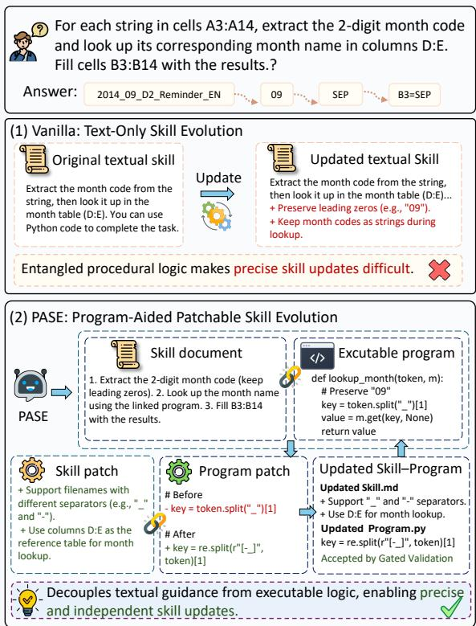  
Figure 1: Comparison between vanilla text-only skillbased agents and the PASE framework.

Agent skills (Anthropic, 2026; Zhou et al., 2026a; Li et al., 2026; Liu et al., 2026b) offer a natural way to equip agents with domain-specific knowledge. Typically represented as natural language documents and provided as context during inference, skills encode reusable knowledge that enables agents to adapt to diverse tasks and environments without fine-tuning (Yang et al., 2026b; Ni et al., 2026). However, conventional skills are often manually authored or generated directly from task descriptions, leaving them largely static after deployment. Without a systematic mechanism for learning from the environment feedbacks, such skills struggle to address recurring failures, accumulate skillable experience from both successful and failed attempts, and adapt to evolving task requirements (Zhou et al., 2026b; Xia et al., 2026; Ouyang et al., 2026b; Ni et al., 2026).

To address this limitation, recent work has explored evolving skills from agent execution trajectories (Alzubi et al., 2026; Xiong et al., 2026b; Zhang et al., 2026; Wang et al., 2026a; Shen et al., 2026; Xiong et al., 2026a). These approaches distill reusable experience from execution traces and incorporate the resulting insights into skills through iterative patching. Despite their effectiveness in accumulating experience, they primarily encode the extracted knowledge in natural language, intertwining procedural logic with descriptive knowledge within a single textual artifact. This entanglement makes it difficult to isolate and revise individual behavioral components without inadvertently affecting other parts of a skill, limiting the precision and maintainability of skill patches (Shen et al., 2026; Huang et al., 2026; Gao et al., 2023). Consequently, a key challenge is how to enable precise and localized skill updates while retaining the flexibility of natural-language representations.

In this paper, we propose PASE (Program-Aided Patchable Skill Evolution), a program-aided framework for iteratively constructing and evolving agent skills. Rather than encoding all procedural details in natural language, PASE decouples reusable procedural logic from natural-language skill descriptions by extracting recurring executable workflows into standalone programs. This design enables agents to leverage executable procedural knowledge through program execution while preserving the flexibility and readability of natural-language skills. Furthermore, PASE introduces a patchbased co-evolution mechanism that iteratively updates both skills and their associated programs, exploiting the modularity and maintainability of executable programs to facilitate targeted revisions. By enabling the coordinated evolution of these complementary representations, PASE supports more precise, maintainable, and effective skill updates.

Our experiments demonstrate the effectiveness and generalizability of PASE, which consistently outperforms all baselines across benchmarks and different backbone LLMs. By decoupling procedural logic into executable programs, PASE achieves higher performance and greater stability across evolution rounds than text-only skill evolution, highlighting the importance of programmatic representations for maintaining and evolving procedural knowledge. Further analysis suggests that isolating complex procedural logic in executable programs, rather than encoding it entirely in natural language, facilitates LLMs’ understanding and utilization of procedural knowledge during skill evolution.

## 2 Related Work

Agent skills are portable artifacts that encapsulate reusable knowledge and procedural workflows, enabling LLM agents to accomplish diverse realworld tasks over extended interactions (Zhou et al., 2026b; Anthropic, 2026; Jiang et al., 2026; Li et al., 2026; Ma et al., 2024). Skills can be inspected, executed, and updated independently of the underlying model, allowing frozen LLMs to adapt to diverse tasks and environments without modifying model parameters (Ni et al., 2026; Yang et al., 2026b; Wang et al., 2026b). However, conventional skills are often manually authored or generated directly from task-specific descriptions, leaving them largely static after deployment. Without a systematic mechanism for learning from execution experience, such skills struggle to address recurring failures and adapt to evolving task requirements (Shinn et al., 2023; Wang et al., 2024a; Liu et al., 2026c; Ouyang et al., 2026b).

To construct and maintain high-quality skills, recent studies have developed specialized frameworks that analyze agent execution trajectories and iteratively evolve skills based on observed outcomes (Ni et al., 2026; Alzubi et al., 2026; Agrawal et al., 2026; Lu et al., 2026; Ouyang et al., 2026a). These methods distill reusable experience from execution traces and translate the extracted insights into skill patches for incremental skill construction and refinement (Alzubi et al., 2026; Tang et al., 2026; Ni et al., 2026). Another line of work treats skills as optimizable external components and applies training-inspired mechanisms, such as learning-rate control and held-out validation, to improve their quality iteratively (Yang et al., 2026b;

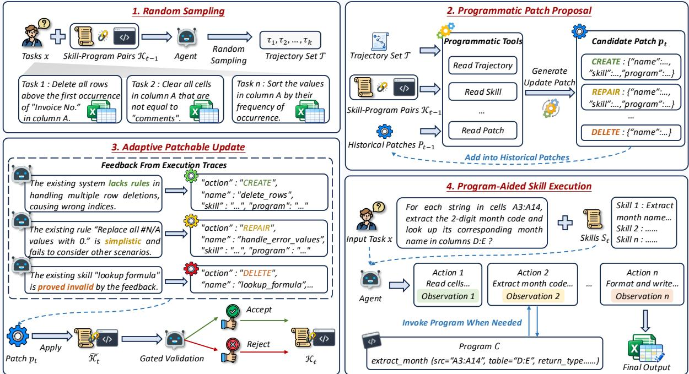  
Figure 2: Overview of our PASE framework.

Wang et al., 2026a). Despite these advances, existing approaches primarily encode reusable knowledge in natural language, intertwining procedural logic with descriptive knowledge within a single textual representation. This entanglement complicates localized modifications and limits the precision and maintainability of skill updates.

Executable programs offer a promissing way to represent procedural knowledge, facilitating LLMs’ understanding of complex logic (Wang et al., 2024b; Yang et al., 2026a). Existing approaches have explored constructing programmatic skills by abstracting procedural logic into reusable callable functions (Wang et al., 2024a, 2025; Shao et al., 2026). However, representing skills primarily as programs may limit the capture of valuable knowledge that cannot be readily formalized as executable logic, including high-level strategies and descriptive insights derived from successful experiences. In contrast, PASE does not replace natural-language skills with programs. Instead, it decouples reusable executable workflows from natural-language skill descriptions, preserving diverse forms of procedural knowledge while facilitating more precise and flexible skill evolution.

## 3 Methodology

In this section, we introduce PASE (Program-Aided Patchable Skill Evolution), a program-aided iterative framework for constructing and updating agent skills. We first provide the preliminaries of program-aided patchable skill evolution, and then represent the adaptive skill update via programmatic patch proposal mechanism (Sec. 3.2).

## 3.1 Preliminaries of Program-Aided Patchable Skill Evolution

Given an input x and a set of agent skills ${ \boldsymbol { S } } =$ $\{ s _ { 1 } , s _ { 2 } , . . . , s _ { m } \}$ , where agent skills encode reusable domain knowledge and task-specific workflows, enabling LLM-based agents to solve specialized tasks by generating reasoning trajectories. To establish the foundation for our method, we first introduce skill-augmented agents and then formalize program-aided skill evolution.

Skill-Augmented Agents. Formally, the agent generates a trajectory τ for the input x conditioned on the provided skills:

$$
\tau = \mathcal { M } _ { \mathrm { i n f e r } } ( x , S ) .\tag{1}
$$

To adapt skills to evolving task requirements, existing methods (Alzubi et al., 2026; Yang et al., 2026b) iteratively refine skills based on agent execution trajectories. Specifically, at evolution step $t ,$ the framework updates the current skill $S _ { t }$ from its previous version $S _ { t - 1 }$ using a batch of training examples $\boldsymbol { B } = \{ ( x _ { i } , y _ { i } ) \} _ { i = 1 } ^ { k }$ and their corresponding execution trajectories:

$$
\begin{array} { r } { \boldsymbol { S } _ { t } = \mathrm { E v o l v e } \left( \boldsymbol { S } _ { t - 1 } , \{ ( x _ { i } , y _ { i } , \tau _ { i } ) \} _ { i = 1 } ^ { k } \right) , } \end{array}\tag{2}
$$

where $x _ { i }$ and $y _ { i }$ denote the input and ground-truth answer of the i-th example, respectively, and $\tau _ { i }$ is the corresponding reasoning trajectory generated by the LLM (Eq. 1). However, directly extracting reusable knowledge from these trajectories and encoding it in natural language can entangle procedural logic with descriptive knowledge. Such entanglement makes it difficult to isolate and modify specific behavioral components, limiting the patchability of evolved skills.

Program-Aided Skill Evolving. To address this limitation, PASE decouples reusable procedural logic from natural-language skills by extracting common executable workflows into standalone programs. Rather than encoding all procedural details in natural language, a skill primarily specifies the task-solving strategy and invokes the corresponding program when needed. Specifically, PASE identifies core procedural workflows and their supporting operational knowledge from execution trajectories, transforms the workflows into executable programs, and links the resulting programs to the corresponding skills:

$$
s _ { i } \xrightarrow { \mathrm { l i n k } } c _ { i } , \quad c _ { i } \in \{ \mathrm { c o d e } , \emptyset \} ,\tag{3}
$$

where $c _ { i } \in \mathcal { C }$ denotes an executable program. We define ${ \cal K } = \{ ( s _ { i } , c _ { i } ) \} _ { i = 1 } ^ { m }$ as the collection of skillprogram pairs, where each skill is associated with its linked program. This representation separates the high-level task-solving strategy from the underlying procedural implementation, allowing individual programs to be independently modified without rewriting the entire skills.

Given an input x, the agent then generates its reasoning trajectory through iterative reasoning, action execution, and observation:

$$
\left( r _ { t } , a _ { t } , o _ { t } \right) = \mathcal { M } _ { \mathrm { i n f e r } } ( x , K , \tau _ { 1 : t - 1 } ) ,\tag{4}
$$

where $\tau _ { t } = ( r _ { t } , a _ { t } , o _ { t } )$ denotes the t-th interaction step, and $r _ { t } , \ a _ { t }$ , and $o _ { t }$ represent the reasoning, action, and observation, respectively. When the action $a _ { t }$ invokes a linked program $c _ { j } \in { \mathcal { C } }$ , the program is executed in the specified environment to obtain an observation (Wang et al., 2024b):

$$
o _ { t } = \operatorname { E x e c } ( c _ { j } , \operatorname { e n v } ) ,\tag{5}
$$

where env denotes the execution environment. The resulting observation is incorporated into the subsequent reasoning process, enabling the agent to leverage executable procedural knowledge while preserving the flexibility of natural-language skill descriptions. During evolution, skills and programs are jointly updated through a unified framework:

$$
\mathcal { K } _ { t } = \mathrm { E v o l v e } \left( \mathcal { K } _ { t - 1 } , \{ ( x _ { i } , y _ { i } , \tau _ { i } ) \} _ { i = 1 } ^ { k } \right) .\tag{6}
$$

However, updating these two forms of knowledge requires a reliable and adaptive mechanism to determine which skills or programs to modify and what specific content within them to update.

## 3.2 Program-Aided Evolution via Patchable Skill Updating

To balance efficiency and effectiveness, at each evolution iteration t, we randomly sample k tasks with their execution trajectories (Eq. 6). We include both successful and failed tasks, where successful trajectories provide reusable behavioral patterns, while failed trajectories reveal failure root causes and limitations.

We employ a React-based proposer $\mathcal { M } _ { p r o p }$ to conduct self-reflection across multiple trajectories, distill common experience, and propose a skill update patch $p _ { t } \colon$

$$
p _ { t } = \mathcal { M } _ { \mathrm { p r o p } } \left( \mathcal { K } _ { t - 1 } , \mathcal { P } _ { t - 1 } , \{ ( x _ { i } , y _ { i } , \tau _ { i } ) \} _ { i = 1 } ^ { k } \right) ,\tag{7}
$$

where $\mathcal { P } _ { t - 1 } = \{ p _ { 1 } , p _ { 2 } , . . . , p _ { t - 1 } \}$ represents historical proposed patches before evolution round t. The resulting patch is then applied to update the current skills and programs:

$$
\widetilde { \cal K } _ { t } = \mathrm { A p p l y } ( p _ { t } , { \cal K } _ { t - 1 } ) ,\tag{8}
$$

where $\widetilde { \kappa } _ { t }$ denote the updated skills and programs. They are then evaluated on a held-out validation set, and the acceptance decision is governed by:

$$
\begin{array} { r } { \mathcal { K } _ { t } = \left\{ \begin{array} { l l } { \widetilde { \mathcal { K } } _ { t } , } & { \mathcal { R } ( \widetilde { \mathcal { K } } _ { t } ) > \mathcal { R } \big ( \mathcal { K } _ { t - 1 } \big ) , } \\ { \mathcal { K } _ { t - 1 } , } & { \mathrm { o t h e r w i s e } , } \end{array} \right. } \end{array}\tag{9}
$$

where $\mathcal { R } ( \cdot )$ denotes the validation performance measured on a held-out validation set, which is disjoint from the training set and used exclusively to evaluate skill updates. The update is accepted if it improves validation performance; otherwise, the update at evolution round t is rejected. This mechanism ensures that only empirically beneficial updates are incorporated into the evolving skills, thereby mitigating overfitting to the training set.

Patchable Skill Updating. We represent each patch as an update operation:

$$
p = ( \mathrm { o p t } , s _ { \mathrm { t a r g e t } } , \mathcal { E } _ { s } , \mathcal { E } _ { c } ) ,\tag{10}
$$

where opt ∈ {create, repair , delete} specifies the operation type, and $s _ { \mathrm { t a r g e t } }$ identifies the target skill. $\mathcal { E } _ { s }$ and $\mathcal { E } _ { c }$ denote the update contents for the skill document and its associated executable program, respectively. The proposer adaptively selects which components to update—the skill document, its associated program, or both—based on the decision of LLM. By decoupling the executable logic from the skill description, our approach enables localized updates to either component without rewriting the entire skill, facilitating more efficient maintenance and evolution of agent skills.

Specifically, these three operations opt have distinct semantics. The create operation introduces a new skill, optionally with an associated program, where $\mathcal { E } _ { s }$ and $\mathcal { E } _ { c }$ contain the complete content of the new skill document and program, respectively. The delete operation removes the target skill and its associated program, if any, entirely, with both $\mathcal { E } _ { s }$ and $\mathcal { E } _ { c }$ set to ∅. The repair operation applies fine-grained modifications to an existing skill document and/or its associated program, with $\mathcal { E } _ { s }$ and $\mathcal { E } _ { c }$ specifying sets of line-level edits for the respective components. Each edit identifies a target line and uses the + and − operators to insert new content or delete existing content, respectively. An empty edit set ∅ indicates that the corresponding component remains unchanged. When a patch contains multiple edits, they are applied sequentially to the current skill and program states according to Eq. 8.

Adaptive Context Reading for Patch Proposal. The proposer $\mathcal { M } _ { p r o p }$ reads multiple agent execution trajectories, current skills and programs, and historical proposed patches. These files are not pre-loaded into the context but reside in the environment. The proposer retrieves information on demand through predefined programmatic tools, preventing the introduction of irrelevant noise and beyond the model’s context window.

We provide PASE with four tools as follows:

• read trajectory (traj id, steps): Inputs a single trajectory ID and a list of step indices of this trajectory. Returns the raw actions and observations of the specified steps from the trajectory.

• read skill (skill name): Inputs a target skill name. Returns the full content of the corresponding skill document and its linked program.

• read patch (patch id): Inputs a historical patch ID. Returns the full content of the corresponding proposed patch, enabling the proposer to learn from past failures and avoid redundant proposals.

• finish () : Submits the final update patch with a

reason for the proposal.

The initial user message provides: the task input and the total number of trajectory steps; the name of skills; and the ids, operations and target name of updated skills of all historical patches.

The proposer first reads multiple trajectories to distill common experience, then retrieve relevant historical proposed patches to refine its experience, and inspect relevant skills to translate the refined experience into updates to the current skills. After retrieve enough information, the proposer finally propose a patch $p _ { t }$ with finish().

## 4 Experimental Methodology

This section describes the datasets, evaluation metric, and baselines, followed by implementation details of our experiments.

Datasets. Our experiments is first evaluated across two spreadsheet benchmarks: Spreadsheetbench (Ma et al., 2024) and Domain-Spreadsheet (Chi et al., 2026), where agents manipulate xlsx files through executable Python code. Additionally, following prior work (Ni et al., 2026), we also report results on two TableQA benchmarks: WikiTableQuestions (Pasupat and Liang, 2015) and HiTab (Cheng et al., 2022). We convert their input tables into spreadsheet format and solve the tasks through spreadsheet manipulation. More details are provided in Appendix A.2.

Baselines. We compare PASE with several representative baseline methods. The No Skill baseline directly prompts the inference agent to solve tasks using its internal knowledge. The Human Skill adopts Anthropic’s official XLSX skill, an expert-curated resource providing best practices and procedural guidance for spreadsheet manipulation. The LLM Skill is generated by an LLM based on task descriptions and its internal knowledge, without leveraging execution trajectories. Then we compare our method against two representative skill-evolution baselines. Trace2Skill (Ni et al., 2026) distills trajectory-local lessons from agent executions and hierarchically consolidates them into transferable skills. EvoSkill (Alzubi et al., 2026) iteratively extracts and refines reusable skills from execution experience. For a fair comparison, all methods employ the same backbone LLM and infer prompt template in our experiments.

Evaluation Metric. Following the prior work (Ni et al., 2026), we report Soft, Hard, and Verified accuracy for SpreadsheetBench, denotation accuracy for WikiTableQuestions, and execution accuracy for HiTab. For Domain-Spreadsheet, we evaluate PASE across five domains, including advanced finance (FIN), human resources (HR), real estate (RE), sales (SAL), and supply chain (SC). We follow the official evaluation protocol (Chi et al., 2026) and report Pass@1. These metrics measure whether the generated spreadsheets or answers satisfy the corresponding ground-truth criteria.

<table><tr><td rowspan="2">Methods</td><td colspan="3">In Domain</td><td colspan="8">Out of Domain</td><td rowspan="2">Avg.↑</td></tr><tr><td></td><td>SpreadsheetBench</td><td></td><td></td><td></td><td>Domain-Spreadsheet</td><td></td><td></td><td></td><td>TableQA</td><td></td></tr><tr><td>Vrf↑</td><td>Soft↑</td><td></td><td>Hard↑</td><td>FIN↑</td><td>HR↑</td><td>RE↑ Qwen3.6-27B</td><td>SAL↑</td><td>SC↑</td><td>Overall↑</td><td>WikiTQ↑</td><td>HiTab↑</td><td></td></tr><tr><td colspan="13"></td></tr><tr><td>No Skill</td><td>43.81</td><td>19.57</td><td>20.76</td><td>26.17</td><td>18.02</td><td>23.97</td><td>10.34</td><td>24.13</td><td>21.07</td><td>51.35</td><td>42.63</td><td>32.04</td></tr><tr><td>Human Skill</td><td>64.76</td><td>42.67</td><td>25.58</td><td>53.09</td><td>41.80</td><td>43.45</td><td>38.70</td><td>42.36</td><td>44.02</td><td>70.23</td><td>46.90</td><td>48.97</td></tr><tr><td>LLM Skill</td><td>43.69</td><td>31.75</td><td>17.69</td><td>28.64</td><td>30.09</td><td>33.33</td><td>27.20</td><td>37.75</td><td>31.91</td><td>83.45</td><td>67.60</td><td>46.16</td></tr><tr><td>Trace2Skill</td><td>65.60</td><td>46.59</td><td>29.09</td><td>51.11</td><td>47.39</td><td>45.32</td><td>40.61</td><td>49.17</td><td>47.46</td><td>83.45</td><td>69.64</td><td>57.03</td></tr><tr><td>EvoSkill</td><td>68.10</td><td>49.15</td><td>31.29</td><td>48.40</td><td>48.11</td><td>45.32 51.69</td><td>35.25</td><td>51.01</td><td>46.92 50.76</td><td>84.60</td><td>72.18</td><td>58.27</td></tr><tr><td>PASE 82.98</td><td colspan="3">53.07 37.57</td><td colspan="3">54.32 50.45</td><td colspan="3">39.85 53.22</td><td colspan="2">85.39 74.10</td><td>62.79</td></tr><tr><td></td><td></td><td></td><td></td><td></td><td></td><td>Qwen3.7-Plus</td><td></td><td></td><td></td><td></td><td></td><td></td></tr><tr><td>No Skill</td><td>51.07</td><td>35.65</td><td>22.66</td><td>19.75</td><td>24.68 43.60</td><td>26.59</td><td>22.22</td><td>25.23</td><td>23.78</td><td>84.52</td><td>65.92</td><td>45.15</td></tr><tr><td>Human Skill</td><td>67.02</td><td>45.83</td><td>29.53</td><td>54.81</td><td></td><td>43.82</td><td>36.40</td><td>39.23</td><td>43.77</td><td>85.00</td><td>62.95</td><td>55.07</td></tr><tr><td>LLM Skill</td><td>63.45</td><td>42.23</td><td>27.05</td><td>33.09</td><td>38.92</td><td>38.95</td><td>26.44</td><td>39.59</td><td>36.34</td><td>84.64</td><td>68.03</td><td>52.31</td></tr><tr><td>Trace2Skill</td><td>69.88</td><td>47.05</td><td>30.56</td><td>52.10</td><td>50.09</td><td>47.94</td><td>43.30</td><td>53.22</td><td>50.17</td><td>84.80</td><td>72.24</td><td>59.28</td></tr><tr><td>EvoSkill PASE</td><td>78.93 86.67</td><td>52.83</td><td>36.70</td><td>55.31</td><td>52.07</td><td>53.56</td><td>42.15</td><td>54.51</td><td>52.29</td><td>86.54</td><td>74.29</td><td>62.95</td></tr><tr><td></td><td></td><td>54.56</td><td>39.91</td><td>63.46</td><td>56.58</td><td>58.80</td><td>43.68</td><td>58.93</td><td>57.21</td><td>86.14</td><td>76.21</td><td>66.26</td></tr><tr><td colspan="3"></td><td></td><td></td><td>Gemma4-31B</td><td></td><td></td><td></td><td></td><td></td><td></td><td></td></tr><tr><td>No Skill</td><td>49.05</td><td>34.67</td><td>21.20</td><td>34.81</td><td>42.34</td><td>39.33</td><td>32.95</td><td>39.96</td><td>38.60</td><td>83.06</td><td>63.01</td><td>48.87</td></tr><tr><td>Human Skill</td><td>65.00</td><td>41.40</td><td>28.51</td><td>49.88</td><td>36.22</td><td>31.84</td><td>32.57</td><td>36.65</td><td>38.01</td><td>80.29</td><td>59.73</td><td>51.00</td></tr><tr><td>LLM Skill</td><td>44.05</td><td>30.85</td><td>20.61</td><td>26.17</td><td>34.77</td><td>35.21</td><td>29.12</td><td>29.28</td><td>30.92</td><td>84.36</td><td>61.59</td><td>45.24</td></tr><tr><td>Trace2Skill</td><td>59.05 70.83</td><td>38.69</td><td>27.63</td><td>44.20</td><td>43.96</td><td>40.82</td><td>35.63</td><td>45.12</td><td>42.84</td><td>83.53</td><td>65.86</td><td>53.11</td></tr><tr><td>EvoSkill</td><td></td><td>44.81</td><td>29.09</td><td>46.91</td><td>46.31</td><td>43.82</td><td>37.16</td><td>47.70</td><td>45.30</td><td>82.19</td><td>68.96</td><td>56.37</td></tr><tr><td>PASE</td><td>73.21</td><td>48.59</td><td>35.67</td><td>49.63</td><td>49.19</td><td>46.82</td><td>37.16</td><td>49.72</td><td>47.56</td><td>81.43</td><td>73.30</td><td>59.14</td></tr></table>

Table 1: Overall performance.

Implementation Details. We experiment with both open-weight and closed models to evaluate our method and baselines. For open-weight models, we select two models from different model families, Qwen3.6-27B (Qwen Team, 2026a) and Gemma-4- 31B-it (Team et al., 2026). For closed models, we use Qwen3.7-Plus (Qwen Team, 2026b). For skill self-evolution, we use SpreadsheetBench-Verified and split its 400 samples into 80 training examples, 40 held-out validation examples, and the remaining 280 examples for final performance evaluation and reporting. All other datasets are used exclusively for evaluation to assess the out-of-domain generalization of the evolved skills.

## 5 Evaluation Results

In this section, we first evaluate the overall performance of PASE and conduct ablation studies to assess the contribution of each component. We then analyze how the cross-model transferability of PASE evolves across different skill creators and skill users. Finally, we present a case study in Appendix A.6.

## 5.1 Overall Performance

Table 1 summarizes the performance of PASE across different models and benchmarks. Overall, PASE consistently outperforms the baselines across different backbone LLMs, demonstrating its effectiveness in enhancing LLM’s capability.

Compared with the No Skill baseline, incorporating external knowledge through agent skills consistently improves performance across different tasks. Specifically, Human Skill yields moderate improvements across benchmarks, demonstrating the value of expert-crafted knowledge. In contrast, LLM Skill performs comparably to the No Skill baseline and even underperforms it on Gemma-4-31B, highlighting the limitations of LLM-generated skills. Existing skill evolution methods further improve the performance of LLMgenerated skills by distilling reusable experience from agent execution trajectories, even surpassing Human Skill. Building on these advances, PASE achieves further improvements over existing skill evolution methods on both in-domain and out-ofdomain benchmarks, demonstrating the benefits of decoupling skill descriptions from their associated executable programs. Specifically, PASE achieves a performance improvement of over 14% on the in-domain SpreadsheetBench-Verified benchmark, demonstrating its effectiveness in acquiring and refining domain-specific skills. More importantly, PASE generalizes well to out-of-domain tasks, achieving the best performance across all evaluated out-of-domain benchmarks, with improvements of over 3.4% on Domain-Spreadsheet and 2.8% on TableQA. These consistent gains suggest that PASE captures reusable knowledge that extends beyond the training tasks, rather than merely overfitting.

<table><tr><td rowspan="2">Methods</td><td>In Domain</td><td colspan="2">Out of Domain</td><td rowspan="2">Avg.↑</td></tr><tr><td>SpreadsheetBench</td><td>Domain-Spreadsheet</td><td>TableQA</td></tr><tr><td>Vanilla LLM</td><td>43.81</td><td>21.07</td><td>42.63</td><td>35.84</td></tr><tr><td>w/ Text Skill</td><td>78.93</td><td>49.68</td><td>71.31</td><td>66.64</td></tr><tr><td>w/ Programmatic Skill</td><td>80.71</td><td>50.17</td><td>72.61</td><td>67.83</td></tr><tr><td>PASE</td><td>82.98</td><td>50.76</td><td>74.10</td><td>69.28</td></tr><tr><td>w/o Program Evolution</td><td>77.26</td><td>46.73</td><td>69.64</td><td>64.54</td></tr><tr><td>w/o Adaptive Reading</td><td>78.10</td><td>47.46</td><td>70.51</td><td>65.36</td></tr><tr><td>w/o Skill Updating</td><td>77.74</td><td>47.56</td><td>69.76</td><td>65.02</td></tr></table>

Table 2: Ablation study of PASE.

## 5.2 Ablation Study

To investigate the contribution of each component in PASE, we conduct an ablation study using Qwen3.6-27B.

As shown in Table 2, we first investigate the effectiveness of different skill representations. Specifically, Vanilla LLM solves tasks without external skill guidance; w/ Text Skill represents each skill entirely as a natural-language document; and w/ Programmatic Skill represents each skill exclusively as an executable program. The results show that both textual and programmatic skills substantially outperform Vanilla LLM, demonstrating the importance of external knowledge in guiding LLMbased agents. Moreover, the w/ Programmatic Skill model achieves higher performance, suggesting that executable programs can provide more precise and actionable procedural guidance. Furthermore, PASE achieves the best overall performance, highlighting the complementary roles of naturallanguage skills and executable programs.

We further investigate the contributions of three key components through ablation studies: (1) PASE w/o Program Evolution, which evolves only textual skills; (2) PASE w/o Adaptive Reading, which directly feeds all execution trajectories, skills, and historical proposals into the model context; and (3) PASE w/o Skill Updating, which disables the evolution of both textual skills and their associated programs. As shown by the results, removing any of these components leads to performance degradation. In particular, the substantial drop caused by removing program evolution highlights the importance of continuously refining executable procedural knowledge beyond textual skill descriptions alone. The performance drop without adaptive reading highlights the importance of retrieving relevant information from execution trajectories on demand when evolving skills and programs, rather than indiscriminately incorporating all available context. Meanwhile, disabling skill updating confirms the importance of iteratively refining both skill documents and their associated programs. Overall, these results validate the complementary roles of procedural knowledge evolution, adaptive information access, and joint skill updating in PASE.

## 5.3 Skill Evolution Characteristics in PASE

As shown in Figure 3, we analyze the characteristics of skill evolution in PASE from three perspectives: performance progression, patch operations, and the compactness of evolved skill documents.

In Figure 3a, we first investigate the role of programs in skill evolution by tracking evaluation accuracy across evolution steps. Specifically, w/ program denotes the full PASE setting, whereas w/o program removes skill-associated programs while keeping all other settings unchanged. The results show that PASE progressively improves its evaluation performance through iterative updates with gated validation, reaching its peak at the sixth evolution step. Moreover, it exhibits smaller performance fluctuations and lower variance across evolution steps, indicating more stable skill evolution. In contrast, the w/o program variant peaks at the second step, while subsequent updates introduce greater performance fluctuations without sustained improvements.

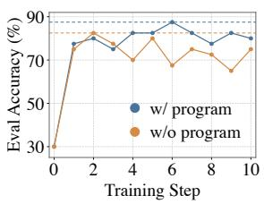  
(a) Evaluation accuracy across evolution steps.

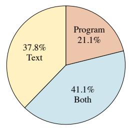  
(b) The category distribution of patchable update.

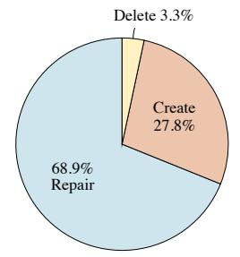  
(c) The operation distribution of patch.

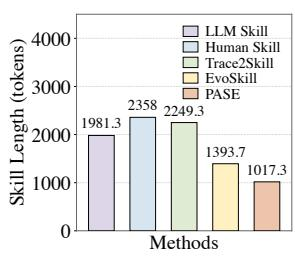  
(d) The lengths of textual skill across different methods.  
Figure 3: Skill evolution characteristics of PASE. Figure 3a analyzes the statistics of skill updates, while Figures 3b and 3c characterize the evolution and operation of the update mechanism. Figure 3d compares textual skill lengths, illustrating how executable programs help reduce the textual burden of skill evolution.

Furthermore, Figures 3b and 3c illustrate the distributions of updated components and patch operations during skill evolution, respectively. Notably, programs are involved in 62.2% of all updates, including 21.1% that update programs alone and 41.1% that update both programs and skill documents. This high proportion highlights the central role of executable programs in skill evolution. Meanwhile, the patch proposer tends to refine existing skills rather than delete them outright, adaptively selecting whether to update skill documents, their associated programs, or both. These findings demonstrate the flexibility of our patchbased mechanism in supporting fine-grained skill refinement through independently manageable programs. Finally, we further compare the lengths of the final skill documents generated by different methods in Figure 3d. The results show that PASE produces shorter and more concise skill documents by encapsulating core procedural logic in standalone executable programs, thereby reducing redundant textual content.

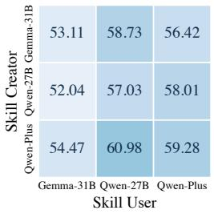  
(a) Trace2Skill.

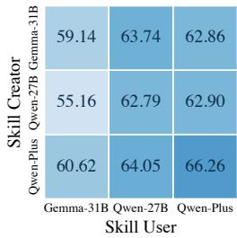  
(b) PASE.  
Figure 4: Generalization of skills learned by different skill evolution methods.

## 5.4 Generalization of Evolved Skills in PASE

To comprehensively evaluate the generalization of skills evolved by PASE, we investigate their transferability across different skill creators and skill users, as shown in Figure 4.

As shown in Figure 4, PASE consistently outperforms Trace2Skill across all nine skill creator-user combinations, with improvements of at least 3.07%. These consistent gains indicate that the effectiveness of PASE does not depend on specific creatoruser combinations. By decoupling executable programs from textual skill descriptions, PASE facilitates the transfer of procedural knowledge across models and enables diverse LLMs with varying capabilities to benefit from evolved skills.

Then, we further evaluate the transferability of skills across models with different capacities and architectures. Within the Qwen family, transferring skills from Qwen3.6-27B to Qwen3.7-Plus yields a 4.89% improvement over Trace2Skill. The advantage also extends across model architectures: transferring skills from Gemma-4-31B to Qwen3.6-27B achieves a gain of 5.01% over Trace2Skill. These results demonstrate that skills evolved by PASE remain effective across different model families without additional adaptation. By separating descriptive knowledge from executable procedural logic, PASE reduces reliance on model-specific natural language instructions and facilitates the reuse of executable programs across heterogeneous LLMs.

## 6 Conclusion

This paper proposes PASE (Program-Aided Agent Skill Evolution), a novel skill evolution framework that leverages executable programs to decouple core procedural logic from supporting knowledge in natural-language skills. Through patch-based proposals, PASE adaptively evolves both skills and their associated programs, enabling more precise skill construction and refinement. Extensive experiments demonstrate that PASE consistently outperforms existing skill evolution methods and produces skills with strong generalization and transferability, improving performance on long-horizon interactive tasks.

## Limitations

Although our approach demonstrates convincing performance in guiding LLMs to evlove skills effectively, it has some limitations. First, following prior work, we directly inject active skills into the agent’s prompt to isolate skill quality from potential confounding effects of skill retrieval. Consequently, our evaluation does not account for skill retrieval, which becomes increasingly important as the skill repository grows. Second, our programs rely on explicit invocation by the inference agent. However, a ReAct-based agent equipped with a Bash tool may bypass predefined programs and implement the underlying logic independently, establishing a reliable mechanism to ensure program execution remains a persistent challenge. Finally, our validation gating accepts only proposals that improve the validation score, potentially excluding neutral updates that maintain immediate performance but could facilitate future improvements. We adopt this criterion following prior evolution framework (Alzubi et al., 2026) to ensure a fair comparison.

## References

Lakshya A Agrawal, Shangyin Tan, Dilara Soylu, Noah Ziems, Rishi Khare, Krista Opsahl-Ong, Arnav Singhvi, Herumb Shandilya, Michael J Ryan, Meng Jiang, et al. 2026. GEPA: Reflective prompt evolution can outperform reinforcement learning. In International Conference on Learning Representations, volume 2026, pages 8479–8565.

Salaheddin Alzubi, Noah Provenzano, Jaydon Bingham, Weiyuan Chen, and Tu Vu. 2026. Evoskill: Automated skill discovery for multi-agent systems. Preprint, arXiv:2603.02766.

Anthropic. 2026. What are skills? Claude Help Center. Accessed: 2026-03-22.

Zhoujun Cheng, Haoyu Dong, Zhiruo Wang, Ran Jia, Jiaqi Guo, Yan Gao, Shi Han, Jian-Guang Lou, and Dongmei Zhang. 2022. HiTab: A hierarchical table dataset for question answering and natural language generation. In Proceedings ofthe 60th Annual Meeting ofthe Associationfor Computational Linguistics (Volume 1: Long Papers), pages 1094–1110, Dublin, Ireland. Association for Computational Linguistics.

Banghao Chi, Yining Xie, Mingyuan Wu, Jingcheng Yang, Jize Jiang, Zhaoheng Li, Shengyi Qian, Minjia Zhang, Klara Nahrstedt, Rui Hou, et al. 2026. Spreadsheet-rl: Advancing large language model agents on realistic spreadsheet tasks via reinforcement learning. Preprint, arXiv:2605.22642.

Aleksandra Eliseeva, Alexander Kovrigin, Ilia Kholkin, Egor Bogomolov, and Yaroslav Zharov. 2025. Envbench: A benchmark for automated environment setup. Preprint, arXiv:2503.14443.

Luyu Gao, Aman Madaan, Shuyan Zhou, Uri Alon, Pengfei Liu, Yiming Yang, Jamie Callan, and Graham Neubig. 2023. PAL: program-aided language models. In International Conference on Machine Learning, ICML 2023, 23-29 July 2023, Honolulu, Hawaii, USA, volume 202 of Proceedings ofMachine Learning Research, pages 10764–10799. PMLR.

Chengsong Huang, Zifeng Wang, Rujun Han, Jun Yan, Yanfei Chen, Zoey CuiZhu, Ke Jiang, Peng Xia, Han Yu, Yufan Zhuang, et al. 2026. Envharness: Awakening static worlds for agent learning. Preprint, arXiv:2608.19880.

Declan Jackson, William Keating, George Cameron, and Micah Hill-Smith. 2025. Aa-omniscience: Evaluating cross-domain knowledge reliability in large language models. Preprint, arXiv:2511.13029.

Yanna Jiang, Delong Li, Haiyu Deng, Baihe Ma, Xu Wang, Qin Wang, and Guangsheng Yu. 2026. Sok: Agentic skills–beyond tool use in llm agents. Preprint, arXiv:2602.20867.

Carlos E. Jimenez, John Yang, Alexander Wettig, Shunyu Yao, Kexin Pei, Ofir Press, and Karthik R. Narasimhan. 2024. Swe-bench: Can language models resolve real-world github issues? In The Twelfth International Conference on Learning Representations, ICLR 2024, Vienna, Austria, May 7-11, 2024. OpenReview.net.

Xiangyi Li, Yimin Liu, Wenbo Chen, Bingran You, Zonglin Di, Yifeng He, Shenghan Zheng, Kyoung Whan Choe, Jiankai Sun, Shuyi Wang, et al. 2026. Skillsbench: Benchmarking how well agent skills work across diverse tasks. Preprint, arXiv:2602.12670.

Shuliang Liu, Zhipeng Xu, Zhenghao Liu, Yukun Yan, Minghe Yu, Yu Gu, Chong Chen, Huiyuan Xie, and Ge Yu. 2026a. Mitigating judgment preference bias in large language models through group-based polling. In Findings of the Association for Computational Linguistics: ACL 2026, pages 1448–1464, San Diego, California, United States. Association for Computational Linguistics.

Yujian Liu, Jiabao Ji, Li An, Tommi Jaakkola, Yang Zhang, and Shiyu Chang. 2026b. How well do agentic skills work in the wild: Benchmarking llm skill usage in realistic settings. Preprint, arXiv:2604.04323.

Yuxuan Liu et al. 2026c. Skillrevise: Improving llmauthored agent skills via trace-conditioned skill revision. Preprint, arXiv:2606.01139.

Zhenghao Liu, Pengcheng Huang, Zhipeng Xu, Xinze Li, Shuliang Liu, Chunyi Peng, Haidong Xin, Yukun Yan, Shuo Wang, Xu Han, Zhiyuan Liu, Maosong Sun, Yu Gu, and Ge Yu. 2026d. Knowledge intensive agents. AI Open, 7:18–44.

Zhengxi Lu, Zhiyuan Yao, Jinyang Wu, Chengcheng Han, Qi Gu, Xunliang Cai, Weiming Lu, Jun Xiao, Yueting Zhuang, and Yongliang Shen. 2026. Skill0: In-context agentic reinforcement learning for skill internalization. Preprint, arXiv:2604.02268.

Zeyao Ma, Bohan Zhang, Jing Zhang, Jifan Yu, Xiaokang Zhang, Xiaohan Zhang, Sijia Luo, Xi Wang, and Jie Tang. 2024. Spreadsheetbench: Towards challenging real world spreadsheet manipulation. In Advances in Neural Information Processing Systems 37: Annual Conference on Neural Information Processing Systems 2024, NeurIPS 2024, Vancouver, BC, Canada, December 10 - 15, 2024.

Mike Merrill, Alexander Shaw, Nicholas Carlini, Boxuan Li, Harsh Raj, Ivan Bercovich, Lin Shi, Jeong Shin, Thomas Walshe, E Kelly Buchanan, et al. 2026. Terminal-Bench: Benchmarking agents on hard, realistic tasks in command line interfaces. In International Conference on Learning Representations, volume 2026, pages 40903–40986.

Jingwei Ni, Yihao Liu, Xinpeng Liu, Yutao Sun, Mengyu Zhou, Pengyu Cheng, Dexin Wang, Erchao Zhao, Xiaoxi Jiang, and Guanjun Jiang. 2026. Trace2skill: Distill trajectory-local lessons into transferable agent skills. Preprint, arXiv:2603.25158.

Siru Ouyang, Jun Yan, Yanfei Chen, Rujun Han, Zifeng Wang, Bhavana Dalvi Mishra, Rui Meng, Chun-Liang Li, Yizhu Jiao, Kaiwen Zha, et al. 2026a. Skillos: Learning skill curation for self-evolving agents. Preprint, arXiv:2605.06614.

Siru Ouyang, Jun Yan, I Hsu, Yanfei Chen, Ke Jiang, Zifeng Wang, Rujun Han, Long Le, Samira Daruki, Xiangru Tang, et al. 2026b. ReasoningBank: Scaling agent self-evolving with reasoning memory. In International Conference on Learning Representations, volume 2026, pages 94327–94354.

Panupong Pasupat and Percy Liang. 2015. Compositional semantic parsing on semi-structured tables. In Proceedings of the 53rd Annual Meeting of the Associationfor Computational Linguistics and the 7th International Joint Conference on Natural Language Processing (Volume 1: Long Papers), pages 1470– 1480, Beijing, China. Association for Computational Linguistics.

Chunyi Peng, Zhipeng Xu, Zhenghao Liu, Yishan Li, Yukun Yan, Shuo Wang, Yu Gu, Minghe Yu, Ge Yu, and Maosong Sun. 2026. Mixture-of-retrieval experts for reasoning-guided multimodal knowledge exploitation. In Proceedings ofthe 49th International

ACM SIGIR Conference on Research and Development in Information Retrieval, pages 1440–1450. ACM.

Qwen Team. 2026a. Qwen3.6-27B: Flagship-level coding in a 27B dense model.

Qwen Team. 2026b. Qwen3.7-Plus: Multimodal agent intelligence.

Jie-Jing Shao, Haiyan Yin, Yueming Lyu, Xingrui Yu, Lan-Zhe Guo, Ivor Tsang, James Kwok, and Yu-Feng Li. 2026. Lifting traces to logic: Programmatic skill induction with neuro-symbolic learning for longhorizon agentic tasks. Preprint, arXiv:2605.01293.

Yifei Shen, Bo Li, and Xinjie Zhang. 2026. Skillopt-lite: Better and faster agent self-evolution via one line of vibe. Preprint, arXiv:2607.03451.

Noah Shinn, Federico Cassano, Ashwin Gopinath, Karthik Narasimhan, and Shunyu Yao. 2023. Reflexion: language agents with verbal reinforcement learning. In Advances in Neural Information Processing Systems 36: Annual Conference on Neural Information Processing Systems 2023, NeurIPS 2023, New Orleans, LA, USA, December 10 - 16, 2023.

Liyan Tang, Cyrus Rashtchian, Chun-Sung Ferng, Andrew Tomkins, Da-Cheng Juan, and Tu Vu. 2026. Wikiskill: Compiling agent experience into persistent knowledge for skill evolution. Preprint, arXiv:2608.27454.

Gemma Team, Sherif El Abd, Vaibhav Aggarwal, Robin Algayres, Alek Andreev, Olivier Bachem, Ian Ballantyne, Cormac Brick, Victor Carbune, Michelle Cas-˘ bon, et al. 2026. Gemma 4 technical report. Preprint, arXiv:2607.02770.

Guanzhi Wang, Yuqi Xie, Yunfan Jiang, Ajay Mandlekar, Chaowei Xiao, Yuke Zhu, Linxi Fan, and Anima Anandkumar. 2024a. Voyager: An open-ended embodied agent with large language models. Trans. Mach. Learn. Res., 2024.

Hanyu Wang, Yifan Lan, Bochuan Cao, Lu Lin, and Jinghui Chen. 2026a. Skillgrad: Optimizing agent skills like gradient descent. Preprint, arXiv:2605.27760.

Leye Wang, Zixing Wang, and Anjie Xu. 2026b. Skilltester: Benchmarking utility and security of agent skills. Preprint, arXiv:2603.28815.

Xingyao Wang, Yangyi Chen, Lifan Yuan, Yizhe Zhang, Yunzhu Li, Hao Peng, and Heng Ji. 2024b. Executable code actions elicit better LLM agents. In Forty-first International Conference on Machine Learning, ICML 2024, Vienna, Austria, July 21-27, 2024. OpenReview.net.

Zora Zhiruo Wang, Apurva Gandhi, Graham Neubig, and Daniel Fried. 2025. Inducing programmatic skills for agentic tasks. Preprint, arXiv:2504.06821.

Peng Xia, Jianwen Chen, Hanyang Wang, Jiaqi Liu, Kaide Zeng, Yu Wang, Siwei Han, Yiyang Zhou, Xujiang Zhao, Haifeng Chen, et al. 2026. Skillrl: Evolving agents via recursive skill-augmented reinforcement learning. Preprint, arXiv:2602.08234.

Yuqi Xiong, Chunyi Peng, Zhipeng Xu, Zhenghao Liu, Zulong Chen, Yukun Yan, Shuo Wang, Yu Gu, and Ge Yu. 2026a. Lang2Act: Fine-grained visual reasoning through self-emergent linguistic toolchains. In Findings ofthe Associationfor Computational Linguistics: ACL 2026, pages 8375–8399, San Diego, California, United States. Association for Computational Linguistics.

Yuqi Xiong, Chunyi Peng, Zhipeng Xu, Qing Yang, Zhenghao Liu, Zulong Chen, Yu Gu, and Ge Yu. 2026b. Skill-decoupled on-policy expert distillation for unified vision-language models. Preprint, arXiv:2610.22217.

Qing Yang, Yuqi Xiong, Pengcheng Huang, Zhipeng Xu, Zhenghao Liu, Zulong Chen, Yu Gu, and Ge Yu. 2026a. Procedural exposure bias in skill-augmented language model agents. Preprint, arXiv:2610.26062.

Yifan Yang, Ziyang Gong, Weiquan Huang, Qihao Yang, Ziwei Zhou, Zisu Huang, Yan Li, Xuemei Gao, Qi Dai, Bei Liu, et al. 2026b. Skillopt: Executive strategy for self-evolving agent skills. Preprint, arXiv:2605.23904.

Shunyu Yao, Jeffrey Zhao, Dian Yu, Nan Du, Izhak Shafran, Karthik R. Narasimhan, and Yuan Cao. 2023. React: Synergizing reasoning and acting in language models. In The Eleventh International Conference on Learning Representations, ICLR 2023, Kigali, Rwanda, May 1-5, 2023. OpenReview.net.

Hanrong Zhang, Shicheng Fan, Henry Peng Zou, Yankai Chen, Zhenting Wang, Jiayu Zhou, Chengze Li, Wei-Chieh Huang, Yifei Yao, Kening Zheng, et al. 2026. Coevoskills: Self-evolving agent skills via co-evolutionary verification. Preprint, arXiv:2604.01687.

Zeyu Zhang, Quanyu Dai, Xiaohe Bo, Chen Ma, Rui Li, Xu Chen, Jieming Zhu, Zhenhua Dong, and Ji-Rong Wen. 2025. A survey on the memory mechanism of large language model-based agents. ACM Transactions on Information Systems, 43(6):1–47.

Huichi Zhou, Siyuan Guo, Anjie Liu, Zhongwei Yu, Ziqin Gong, Bowen Zhao, Zhixun Chen, Menglong Zhang, Yihang Chen, Jinsong Li, et al. 2026a. Memento-skills: Let agents design agents. Preprint, arXiv:2603.18743.

Yingli Zhou, Wang Shu, Yaodong Su, Wenchuan Du, Yixiang Fang, and Xuemin Lin. 2026b. A comprehensive survey on agent skills: Taxonomy, techniques, and applications. Preprint, arXiv:2605.07358.

## A Appendix

## A.1 License

All datasets used in this work are publicly available under licenses that permit academic research and noncommercial use, including Spreadsheet-Bench, Domain-Spreadsheet, and WikiTableQuestions (CC BY-SA 4.0), and HiTab (Computational Use of Data Agreement v1.0).

## A.2 Additional Dataset Details

We evaluate PASE on one in-domain benchmark, SpreadsheetBench (Ma et al., 2024), and three outof-domain benchmarks: Domain-Spreadsheet (Chi et al., 2026), WikiTableQuestions (Pasupat and Liang, 2015), and HiTab (Cheng et al., 2022). Detailed dataset statistics are presented in Table 3. Following prior work (Ni et al., 2026), we adapt the two TableQA benchmarks into spreadsheet manipulation tasks. Specifically, we convert the original JSON-formatted tables into XLSX spreadsheets and instruct the agent to write its predicted answer into fixed cell A1.

SpreadsheetBench. SpreadsheetBench (Ma et al., 2024) is a real-world spreadsheet manipulation benchmark comprising 912 tasks collected from online Excel forums. It covers diverse operations, including data extraction, formula calculation, cell modification, and formatting. We evaluate on both the full benchmark (912 tasks) and SpreadsheetBench-Verified, an expert-verified subset containing 400 tasks.

Domain-Spreadsheet. Domain-Spreadsheet (Chi et al., 2026) evaluates spreadsheet manipulation capabilities across professional domains, including finance, human resources, real estate, sales, and supply chain management. These tasks involve domain-specific knowledge and complex analytical workflows. We select five subsets, including advanced finance (FIN), human resources (HR), real estate (RE), sales (SAL), and supply chain (SC), comprising 677 tasks in total.

WikiTableQuestions. WikiTQ (Pasupat and Liang, 2015) is a table question-answering benchmark consisting of natural-language questions grounded in semi-structured Wikipedia tables. It emphasizes compositional reasoning over diverse topics, requiring operations such as filtering, comparison, and aggregation. We sample 1,000 examples from the official test set for evaluation.

HiTab. HiTab (Cheng et al., 2022) is a hierarchical table question-answering benchmark constructed from statistical reports and Wikipedia tables. Unlike conventional flat-table benchmarks, HiTab requires reasoning over multi-level row and column hierarchies, as well as complex numerical relationships. We sample 1,000 examples from its test set for evaluation.

<table><tr><td>Dataset</td><td># Examples</td></tr><tr><td>SpreadsheetBench</td><td>912</td></tr><tr><td>Verified Full</td><td>400 912</td></tr><tr><td>Domain-Spreadsheet</td><td></td></tr><tr><td>FIN</td><td>677 135</td></tr><tr><td>HR</td><td>185</td></tr><tr><td>RE</td><td>89</td></tr><tr><td>SAL</td><td>87</td></tr><tr><td>SC</td><td>181</td></tr><tr><td></td><td></td></tr><tr><td>WikiTableQuestions HiTab</td><td>1,000 1,000</td></tr></table>

Table 3: Statistics of the evaluation datasets.

## A.3 Additional Experimental Details

For all the baselines, we utilize the same generation settings. We utilize the vllm framework to deploy open-weight LLMs and Qwen api for close-weight LLMs. During inference, we set the temperature to 0.6, the maximum context length to 131,072 tokens, and the maximum number of ReAct iterations to 30, without explicitly configuring a thinking mode. During evolution, we increase the maximum number of ReAct iterations to 50 and evolve each skill for 10 steps with a batch size of 8.

Following prior work (Yang et al., 2026b), we repeat the entire evolution process across three independent runs for each method to account for variability, and report the average test performance across the three resulting evolved skill sets. We split SpreadsheetBench-Verified using a fixed random seed of 42.

LLM Skill. LLM skill is directly generated by a single LLM call according to task descriptions. The generation prompt is ”You are an expert in spreadsheet manipulation. Write a skill guide (Markdown) for an AI agent that solves Excel/xlsx tasks using Python (openpyxl and pandas). Be specific and practical.”

Human Skill. Following Trace2Skill (Ni et al., 2026), we adopt Anthropic’s official XLSX skill as a human-written baseline, which provides expertcrafted guidelines for spreadsheet manipulation, including formula handling, data processing, and formatting. The skill is directly evaluated without further evolution.

<table><tr><td rowspan="3">Skill Creator</td><td colspan="3">In Domain</td><td colspan="8">Out of Domain</td><td rowspan="3">Avg.↑</td></tr><tr><td colspan="3">SpreadsheetBench</td><td colspan="6">Domain-Spreadsheet</td><td colspan="2">TableQA</td></tr><tr><td>Vrf↑</td><td>Soft↑</td><td>Hard↑</td><td>FIN↑</td><td>HR↑</td><td>RE↑</td><td>SAL↑</td><td>SC↑</td><td>Overall↑</td><td>WikiTQ↑</td><td>HiTab↑</td></tr><tr><td colspan="10">Skill User: Qwen3.6-27B</td></tr><tr><td>No Skill</td><td>43.81</td><td>19.57</td><td>20.76</td><td>26.17</td><td>18.02</td><td>23.97</td><td>10.34</td><td>24.13</td><td>21.07</td><td>51.35</td><td>42.63</td><td>32.04</td></tr><tr><td>Qwen3.6-27B</td><td>82.98</td><td>53.07</td><td>37.57</td><td>54.32</td><td>50.45</td><td>51.69</td><td>39.85</td><td>53.22</td><td>50.76</td><td>85.39</td><td>74.10</td><td>62.79</td></tr><tr><td>Gemma4-31B</td><td>76.90</td><td>51.66</td><td>35.75</td><td>62.47</td><td>52.79</td><td>49.81</td><td>41.38</td><td>60.41</td><td>54.90</td><td>85.31</td><td>77.76</td><td>63.74</td></tr><tr><td>Qwen3.7-Plus</td><td>82.74</td><td>54.29</td><td>37.50</td><td>60.49</td><td>55.86</td><td>55.06</td><td>39.46</td><td>57.27</td><td>54.95</td><td>85.47</td><td>72.55</td><td>64.05</td></tr><tr><td colspan="10">Skill User: Qwen3.7-Plus</td><td rowspan="2"></td></tr><tr><td>No Skill</td><td>51.07</td><td>35.65</td><td>22.66</td><td>19.75</td><td>24.68</td><td>26.59</td><td>22.22</td><td>25.23</td><td>23.78</td><td>84.52</td><td>65.92</td></tr><tr><td>Qwen3.6-27B</td><td>81.90</td><td>53.83</td><td>37.94</td><td>54.81</td><td>49.91</td><td>51.31</td><td>39.08</td><td>52.67</td><td>50.42</td><td>85.43</td><td>75.34</td><td>45.15 62.90</td></tr><tr><td>Gemma4-31B</td><td>78.57</td><td>52.31</td><td>36.40</td><td>55.80</td><td>52.79</td><td>49.44</td><td>38.31</td><td>51.75</td><td>50.81</td><td>83.57</td><td>80.42</td><td>62.86</td></tr><tr><td>Qwen3.7-Plus</td><td>86.67</td><td>54.56</td><td>39.91</td><td>63.46</td><td>56.58</td><td>58.80</td><td>43.68</td><td>58.93</td><td>57.21</td><td>86.14</td><td>76.21</td><td>66.26</td></tr><tr><td colspan="10"></td><td colspan="3"></td></tr><tr><td>No Skill</td><td>49.05</td><td>34.67</td><td>21.20</td><td>34.81</td><td></td><td>Skill User: Gemma4-31B 39.33</td><td>32.95</td><td>39.96</td><td>38.60</td><td>83.06</td><td>63.01</td><td></td></tr><tr><td>Qwen3.6-27B</td><td>64.40</td><td>42.23</td><td>29.39</td><td>53.09</td><td>42.34 45.59</td><td>44.19</td><td>33.33</td><td>44.01</td><td>44.90</td><td>83.41</td><td>67.04</td><td>48.87 55.16</td></tr><tr><td>Gemma4-31B</td><td>73.21</td><td>48.59</td><td>35.67</td><td>49.63</td><td>49.19</td><td>46.82</td><td>37.16</td><td>49.72</td><td>47.56</td><td>81.43</td><td>73.30</td><td>59.14</td></tr><tr><td>Qwen3.7-Plus</td><td>77.38</td><td>49.22</td><td></td><td>58.02</td><td>51.71</td><td>47.19</td><td>36.02</td><td>50.46</td><td>50.02</td><td>84.60</td><td>71.44</td><td>60.62</td></tr><tr><td></td><td></td><td></td><td>34.87</td><td></td><td></td><td></td><td></td><td></td><td></td><td></td><td></td><td></td></tr></table>

Table 4: Cross-model skill transfer results.

Trace2Skill. Trace2Skill (Ni et al., 2026) employs a three-stage pipeline comprising trajectory generation, parallel patch proposal, and hierarchical consolidation. First, it collects successful and failed execution trajectories by evaluating the agent with the current skill on evolution tasks. Next, parallel success and error analysts extract reusable strategies from successful trajectories and diagnose the root causes of failures, respectively, to propose skill patches. Finally, a hierarchical merge operator consolidates these patches by eliminating redundancies and resolving conflicts, and applies the resulting updates to construct a skill document.

EvoSkill. EvoSkill (Alzubi et al., 2026) frames skill evolution as an iterative search over a bounded frontier of candidate skills. At each iteration, it selects a parent skill from the frontier in a round-robin manner and evaluates it on sampled training tasks. The proposer analyzes failed execution trajectories and a cumulative history of previous proposals to generate candidate skill modifications. These modifications are applied to SKILL.md files, and the resulting candidates are evaluated on a held-out validation set. Candidates are retained in the frontier only if they outperform its weakest member.

## A.4 Analysis of Cross-model Transferability

Table 4 reports all results of PASE across three different model users and creators. We observe two clear trends. First, stronger skill users generally make better use of evolving skills. Averaged across our three skill creators, Qwen3.7- Plus achieves the highest overall performance than Qwen3.6-27B and Gemma4-31B, suggesting that a stronger inference model can more effectively interpret and execute the procedural knowledge encoded in the evolving skills. Notably, the skills generated by Gemma4-31B are executed more effectively by the other two models, even outperforming their respective self-evolved skills. Second, skills evolved by stronger creator models exhibit better transferability. For all three skill users, skills produced by Qwen3.7-Plus achieve the highest average performance. when transferred to Gemma4- 31B and Qwen3.6-27B, the skills from Qwen3.7- Plus achieve average scores of 64.09 and 60.58 performance. Overall, these results indicate that the effectiveness of cross-model skill transfer depends on both the capability of the model that produces the skill and that of the model that uses it, while the evolved skills remain broadly reusable across heterogeneous backbone models.

## A.5 Prompt Templates Used in PASE

As shown in Figure 5, we present the prompt templates used to solve spreadsheet tasks. The prompt instructs the inference agent to iteratively interactive with input spreadsheet, use bash tool to execute python code to read or modify the spreadsheet, and generate the output spreadsheet. We employ consistent prompt templates across all methods to ensure fair comparison and reproducibility.

As shown in Figure 6, we present the prompt templates used to propose an update patch. The prompt instructs the proposer to use predefined programmatic tools to read relevant information, including trajectory steps, the current skills with programs, and historical proposed patches on demond, and then propose the patch.

## A.6 Case Study

In Table 5, we present a qualitative case study to illustrate how PASE enables more precise skill evolution by separating descriptive knowledge from executable procedural logic. The task requires extracting two-digit month codes from spreadsheet strings, retrieving their corresponding month names from a reference table, and writing the results into designated cells. The text-only baseline, Trace2Skill, captures the general task-solving procedure but introduces potentially misleading rules during skill evolution. Specifically, it suggests allowing prefix matching when exact matches are unavailable and inferring month names directly from numeric codes when lookup fails. Although these rules appear reasonable, they may lead to incorrect matches or outputs inconsistent with the reference table, such as generating “September” instead of the expected “SEP”. Furthermore, mixing these execution details with descriptive guidance makes it difficult to isolate and repair the underlying logic.

In contrast, PASE separates the two forms of knowledge into a natural-language skill document and an associated executable program. The skill document preserves high-level task guidance and explicitly emphasizes the reference table as the authoritative source, while the program implements precise string extraction and exact lookup operations. Through programmatic patches, PASE can directly refine the execution logic without modifying unrelated descriptive knowledge. Meanwhile, textual patches can independently improve tasklevel guidance without disrupting the program implementation. This case demonstrates that decoupling descriptive knowledge from procedural logic facilitates more targeted and reliable skill updates, reducing the risk of introducing ambiguous or conflicting execution rules during skill evolution.

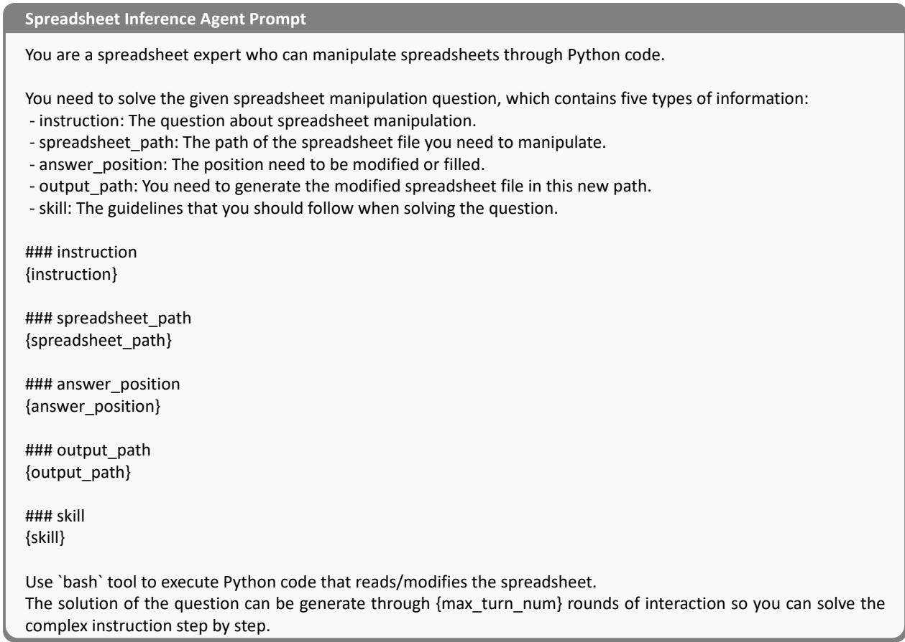  
Figure 5: Spreadsheet Inference Agent Prompt.

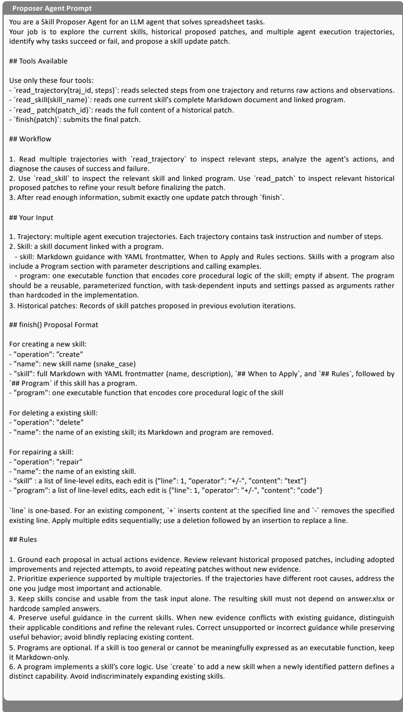  
Figure 6: Proposer Agent Prompt.

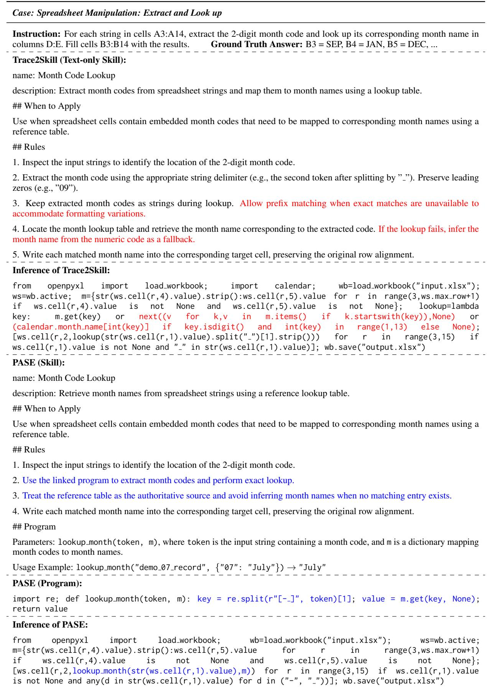  
Table 5: Illustrative case study comparing text-only skill evolution with PASE on spreadsheet manipulation. Potentially incorrect knowledge and operations are highlighted in red, while correctly refined textual knowledge and program logic are highlighted in blue.