# REAL Loss: Optimizing Real Expected Acceptance Length for Speculative Decoding

Yu Tian The University of Hong Kong yutian23m@connect.hku.hk

## Abstract

Speculative decoding accelerates LLM inference by having a draft model propose multiple tokens for the target model to verify in one pass. The speedup is governed by the expected acceptance length (EAL), yet standard training objectives such as cross-entropy, KL divergence, and total variation focus only on distribution matching or single-step overlap. Recent studies instead propose blocklevel training objectives, aiming to optimize EAL directly. However, these objectives remain surrogates rather than exact formulations of EAL. For example, some average later acceptance over target-distributed continuations rather than the verification branches selected by accepted tokens, introducing a covariance gap that can reverse the gradient direction. We analyze this gap and derive REAL, a real EAL training loss that uses path weights for unbiased estimation and Rao–Blackwellization for variance reduction. In a controlled loss-level comparison with a Qwen3.6-35B-A3B target and a Domino drafter, REAL outperforms WTV, VSD, DBLast, and the static LK baseline on probabilistic serving acceptance length across 9 task subsets and 5 evaluation seeds. These gains require only a change to the training loss, with no modification to the drafter architecture or inference procedure, demonstrating the practicality of real EAL training. A reference implementation of the REAL loss is available at https://github.com/King-ty/ speculators/tree/real-loss.

## 1 Introduction

Speculative decoding accelerates large language model inference by letting a small draft model propose multiple tokens that the target model verifies in one forward pass (Leviathan et al., 2023; Chen et al., 2023). At a fixed draft and verification configuration, its speedup is governed by the expected number of accepted draft tokens per round, known as the expected acceptance length (EAL). However, the dominant training objectives, such as cross-entropy and KL divergence, optimize token-level distribution matching rather than EAL (Zhou et al., 2024), causing a gap between the training objective and the inference metric.

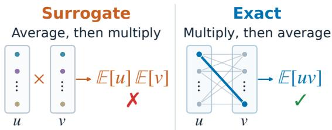  
Figure 1: Two-step illustration of branch dependence. The surrogate averages before multiplying, while the exact objective multiplies before averaging.

Acceptance-oriented objectives narrow this gap at different levels. Single-step total variation losses optimize the one-step acceptance rate (Goel et al., 2024; Samarin et al., 2026), while recent work extends this idea to block-level objectives that aim to optimize EAL directly (Zou et al., 2026; Karimi et al., 2026; Li et al., 2026b; Liu et al., 2026; Xia et al., 2026). For example, the end-to-end TV loss (Li et al., 2026b) and the windowed total variation (WTV) objective of Xia et al. (2026) multiply per-step average acceptance rates over the proposal window. However, this product form is a biased surrogate because an accepted token both extends the accepted prefix and determines the prefix used to verify the next draft token. Multiplying marginal acceptance rates discards information about which tokens survive verification, so later acceptance is averaged over target-sampled paths rather than weighted by the propose-and-accept mass of the surviving branches, as shown in Figure 1. This mismatch appears as $\mathrm { C o v } ( b _ { k } , a _ { k + 1 } )$ , where $b _ { k }$ is the path weight under target sampling and $a _ { k + 1 }$ is the nextstep acceptance rate. The covariance can have either sign and can reverse the gradient direction, causing the surrogate to point away from the true objective, as shown in Section 3.1. In practice, we find this covariance positive throughout training, consistent with the observed gap between the branch estimate and the surrogate (Section 4.3).

To address this gap, we derive an unbiased path estimator of the exact EAL for chain speculative decoding with stochastic rejection sampling. On trajectories sampled from the target, each sampled token is reweighted by a path weight $b _ { i }$ = min $( 1 , q ( y _ { i } ) / p ( y _ { i } ) )$ to recover the true proposeand-accept branch distribution. We then obtain the branch estimator by marginalizing the final token in each term via Rao–Blackwellization, reducing per-term variance while preserving the expected gradient (Rao, 1945; Blackwell, 1947). The branch estimator is differentiable with respect to the draft parameters, allowing direct backpropagation during training. Finally, we derive our final training loss, REAL, by adding an auxiliary CE term to stabilize training from scratch.

We extensively evaluate REAL using a Qwen3.6-35B-A3B MoE target (Qwen Team, 2026), a Domino drafter (Huang et al., 2026), target-sampled data shared across methods, and a three-epoch training budget. REAL reaches 4.792 probabilistic acceptance length, outperforming all compared baselines (4.657–4.749) across 9 task subsets and 5 evaluation seeds, demonstrating the effectiveness of real EAL estimation. The variant without Rao–Blackwellization achieves comparable acceptance length at serving temperature $T = 1$ , while REAL reduces aggregate gradient variance by 52–58% and generalizes better across serving temperatures. Pure CE and REAL w/o CE also underperform REAL, showing that the real EAL term and the auxiliary CE term each contribute to the final result. These gains require only a change to the training loss, with no modification to the drafter architecture or inference procedure, and improve average acceptance length across tasks and seeds, underscoring the practical significance of our method.

Our contributions are:

• We identify a structural bias in existing blocklevel surrogates and derive a covariance diagnostic that links the discarded branch dependence to potential gradient reversal.

• We derive REAL, a real EAL training loss based on an unbiased and differentiable branch estimator, using path weights to correct bias and Rao–Blackwellization to reduce variance, with changes limited to the training loss.

• We show that REAL improves probabilistic serving acceptance length over all baselines across 9 task subsets and 5 seeds, demonstrating the effectiveness of real EAL estimation.

## 2 Preliminaries

## 2.1 Speculative Decoding Framework

We consider standard chain speculative decoding (Leviathan et al., 2023; Chen et al., 2023; Xia et al., 2023) with stochastic rejection sampling, where chain refers to the causal dependence between consecutive draft positions, allowing implementations with a parallel backbone and a causal head. A frozen target model $p$ and a trainable draft model $q _ { \theta }$ share a vocabulary V. Each decoding round starts from a fixed prefix h. The draft proposes up to $\gamma$ tokens, which the target evaluates in parallel but accepts sequentially, stopping at the first rejection. At step i, with prefix $h _ { i } = \left( h , y _ { < i } \right)$ , the draft proposes $y _ { i } \sim q _ { \theta , i } ( \cdot \mid h _ { i } )$ , and the proposal is accepted with probability

$$
\alpha _ { i } ( y _ { i } \mid h _ { i } ) = \operatorname* { m i n } \left( 1 , { \frac { p _ { i } ( y _ { i } \mid h _ { i } ) } { q _ { \theta , i } ( y _ { i } \mid h _ { i } ) } } \right) .\tag{1}
$$

Verification stops at the first rejection, after which the target emits a correction token and the round ends. Let $L \in \{ 0 , \ldots , \gamma \}$ be the number of accepted draft tokens in a round, excluding the correction token. The expected acceptance length is

$$
J _ { \gamma } ( h , \theta ) = \mathbb { E } [ L ] = \sum _ { k = 1 } ^ { \gamma } P ( L \geq k ) ,\tag{2}
$$

where the second equality is the tail-sum identity. Acceptance length is a proxy for speculative decoding speedup because longer accepted prefixes reduce target verification rounds per generated token at a fixed verification configuration.

We write $p _ { i } ( v )$ and $q _ { i } ( v )$ for $p _ { i } ( v ~ \mid ~ h _ { i } )$ and $q _ { i } ( v \mid h _ { i } )$ , suppressing the prefix $h _ { i }$ for brevity, where v ranges over $\nu$ and $y _ { i }$ denotes the token sampled at position $i .$ The propose-and-accept mass of token v at step i is

$$
m _ { i } ( v ) = q _ { i } ( v ) \alpha _ { i } ( v ) = \operatorname* { m i n } \{ p _ { i } ( v ) , q _ { i } ( v ) \} ,\tag{3}
$$

and summing over the vocabulary gives the singlestep acceptance rate

$$
\begin{array} { l l l } { \displaystyle a _ { i } = \sum _ { v \in \mathcal { V } } m _ { i } ( v ) = \sum _ { v \in \mathcal { V } } \operatorname* { m i n } \{ p _ { i } ( v ) , q _ { i } ( v ) \} } \\ { \displaystyle \ } & { \mathrm { = 1 - T V } ( p _ { i } , q _ { i } ) , } \end{array}\tag{4}
$$

where TV is the total variation distance.

A subtle but important point is the distribution of the accepted token. Conditioned on acceptance, the token follows

$$
r _ { \theta } ( v \mid h _ { i } , \mathrm { a c c e p t } ) = \frac { m _ { i } ( v \mid h _ { i } ) } { a _ { i } ( h _ { i } ) } ,\tag{5}
$$

which normalizes the propose-and-accept mass and equals neither $p _ { i }$ nor $q _ { i }$ . An objective that averages over target trajectories without correcting for this selection can therefore weight future branches incorrectly.

## 2.2 The Windowed Total Variation Objective

The closest related work includes the end-to-end TV objective (Li et al., 2026b) and the windowed total variation (WTV) objective of Xia et al. (2026), which share a product-of-marginals form.

$$
\widetilde { J } _ { \mathrm { W T V } } = \mathbb { E } _ { y \sim p } \left[ \sum _ { k = 1 } ^ { \gamma } \prod _ { i = 1 } ^ { k } a _ { i } ( h _ { i } ) \right] .\tag{6}
$$

This objective multiplies per-step acceptance rates over the proposal window, approximating the survival probability without preserving the acceptedtoken distribution in Equation (5). Section 3.1 derives its exact two-step gap and shows that it can reverse the gradient direction.

## 3 Method

## 3.1 The Covariance Bias of WTV

We use a two-step example to illustrate what the WTV surrogate discards. An accepted token determines the prefix on which the next proposal is verified. For a fixed prefix h and a two-step window $( \gamma = 2 )$ , Equation (2) gives the exact objective

$$
\begin{array} { l } { { \displaystyle J _ { 2 } = a _ { 1 } + \sum _ { v } m _ { 1 } ( v ) a _ { 2 } ( h v ) } } \\ { { \displaystyle \ = a _ { 1 } + a _ { 1 } \mathbb { E } _ { v \sim r _ { 1 } } [ a _ { 2 } ] . } } \end{array}\tag{7}
$$

Here $r _ { 1 } ( v ) = m _ { 1 } ( v ) / a _ { 1 }$ is the accepted-branch distribution defined in Equation (5). The second term weights each continuation’s acceptance rate by its propose-and-accept mass $m _ { 1 } ( v )$ in Equation (3). For comparison, the WTV objective in Equation (6) for $\gamma = 2$ reads

$$
\begin{array} { r l } & { \widetilde { J } _ { \mathrm { W T V } , 2 } = \mathbb { E } _ { v \sim p _ { 1 } } [ a _ { 1 } + a _ { 1 } a _ { 2 } ( h v ) ] } \\ & { \qquad = a _ { 1 } + a _ { 1 } \mathbb { E } _ { p _ { 1 } } [ a _ { 2 } ] . } \end{array}\tag{8}
$$

Here $a _ { 1 }$ is a constant because it is computed on the fixed prefix h and does not depend on the sampled token $y _ { 1 }$ . WTV weights the second-step acceptance rate by $a _ { 1 } p _ { 1 } ( v )$ instead of $m _ { 1 } ( v )$ . The two objectives can therefore favor different continuations even when their first-step acceptance rates are equal.

We define the path weight of token v at step i as

$$
b _ { i } ( v ) = \operatorname* { m i n } \left( 1 , { \frac { q _ { i } ( v \mid h _ { i } ) } { p _ { i } ( v \mid h _ { i } ) } } \right) ,\tag{9}
$$

which satisfies the key identity $p _ { i } ( v \mid h _ { i } ) b _ { i } ( v ) =$ $m _ { i } ( v \mid h _ { i } )$ . Taking the expectation of $b _ { 1 }$ under $p _ { 1 }$ gives

$$
\mathbb { E } _ { p _ { 1 } } [ b _ { 1 } ] = \sum _ { v } p _ { 1 } ( v ) b _ { 1 } ( v ) = \sum _ { v } m _ { 1 } ( v ) = a _ { 1 } .\tag{10}
$$

We can then rewrite Equation (7) as

$$
J _ { 2 } = a _ { 1 } + \mathbb { E } _ { p _ { 1 } } [ b _ { 1 } a _ { 2 } ] .\tag{11}
$$

Comparing Equations (11) and (8),

$$
\begin{array} { r l } & { J _ { 2 } - \widetilde { J } _ { \mathrm { W T V } , 2 } = \mathbb { E } _ { p _ { 1 } } [ b _ { 1 } a _ { 2 } ] - \mathbb { E } _ { p _ { 1 } } [ b _ { 1 } ] \mathbb { E } _ { p _ { 1 } } [ a _ { 2 } ] } \\ & { \qquad = \mathrm { C o v } _ { p _ { 1 } } ( b _ { 1 } , a _ { 2 } ) . } \end{array}\tag{12}
$$

The surrogate replaces the paired average of the path weight $b _ { 1 }$ and continuation acceptance rate by the product of their marginal averages. The covariance can have either sign, so WTV is neither an upper nor a lower bound in general. This bias is not specific to $\gamma = 2$ , as the same branchweighting mismatch appears in every prefix product for longer windows, and adjacent covariances diagnose the resulting local branch dependence.

The difference can also reverse the gradient direction. Consider a two-step example on the vocabulary {A, B}. The first step has $p _ { 1 } = ( 0 . 4 , 0 . 6 )$ and $q _ { 1 } ~ = ~ ( 0 . 8 , 0 . 2 )$ , so $a _ { 1 } ~ = ~ \operatorname* { m i n } ( 0 . 4 , 0 . 8 ) ~ +$ min $( 0 . 6 , 0 . 2 ) \ : = \ : 0 . 6$ . The second step has $p _ { 2 } ( \cdot \mid$ $h A ) = ( 0 . 9 , 0 . 1 )$ and $p _ { 2 } ( \cdot \mid h B ) = ( 0 . 1 , 0 . 9 )$ , and the draft shares $q _ { 2 } = ( \theta , 1 - \theta )$ on both branches with $0 . 1 < \theta < 0 . 9$ . Then $a _ { 2 } ( h A ) = 0 . 1 + \theta$ and $a _ { 2 } ( h B ) = 1 . 1 - \theta$ , and direct enumeration of the four paths gives

$$
J _ { 2 } = 0 . 8 6 + 0 . 2 0 \theta , \quad \widetilde { J } _ { \mathrm { W T V , 2 } } = 1 . 0 2 - 0 . 1 2 \theta .\tag{13}
$$

Accepted trajectories enter branch A with mass 0.4 and branch B with mass 0.2, so the true objective rewards increasing θ, which improves the branch with more accepted mass in this example. The WTV surrogate redistributes the surviving mass by the target proportions 0.24 and 0.36 and rewards decreasing θ (Figure 2). At $\theta = 0 . 5$ the two objectives have equal value (0.96) but opposite gradients (0.20 vs −0.12). The full enumeration and a second example where the surrogate reverses the ranking of two drafts are in Appendix A.

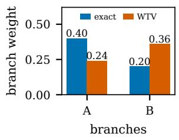

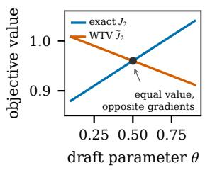  
(a) branch weights in step 2  
(b) opposite gradients  
Figure 2: The two-step counterexample. (a) The exact objective weights each branch by its propose-andaccept mass, while the WTV surrogate redistributes that mass by target proportions. (b) As a function of the shared draft parameter θ, the two objectives have opposite gradients, coinciding in value at $\theta = 0 . 5$

Equation (12) becomes a tool for detecting branch dependence: the covariance measures how much the path weight and continuation acceptance rate co-vary, and a nonzero value indicates that the WTV surrogate misrepresents the branch structure. Section 4.3 examines this branch dependence and the gap between the exact and surrogate objectives during training.

## 3.2 Unbiased Estimation via Path Weights

For a general window $\gamma ,$ the exact survival probability is

$$
P ( L \geq k \mid h ) = \sum _ { y _ { 1 : k } \in \mathcal { V } ^ { k } } \prod _ { i = 1 } ^ { k } m _ { i } ( y _ { i } \mid h _ { i } ) .\tag{14}
$$

Together with the tail-sum identity in Equation (2), this defines $J _ { \gamma }$ . Each factor $m _ { i } ( y _ { i } \mid h _ { i } )$ is conditional on the preceding accepted tokens, so this expression preserves the branch structure without an independence assumption.

Direct evaluation of Equation (14) is intractable because it sums over $| \mathcal { V } | ^ { k }$ paths. Our estimators instead reuse continuations sampled from the frozen target, $y _ { 1 : \gamma } \sim p$ . The derivation assumes that the trajectories are sampled from the target distribution p, while a draft-sampled variant would replace p with q and adjust the path weights accordingly. On such a trajectory, computing the path weight $\begin{array} { r c l } { b _ { i } } & { = } & { b _ { i } ( y _ { i } ) } \end{array}$ in Equation (9) requires only the sampled token’s log-probabilities, which is much cheaper than directly evaluating Equation (14).

Algorithm 1 Computing the branch estimator.   
Require: Frozen target p, draft $q _ { \theta }$ , window size γ   
1: Sample trajectory $y _ { 1 : \gamma } \sim p$   
2: for $k = 1$ to $\gamma$ do   
3: $b _ { k }  \operatorname* { m i n } _ { \mathbf { \mu } , \mathbf { \Lambda } } ( 1 , q _ { \theta } ( y _ { k } \mid h _ { k } ) / p ( y _ { k } \mid h _ { k } ) )$   
4: $\textstyle W _ { k } \gets \prod _ { i = 1 } ^ { k } b _ { i }$   
5: $\begin{array} { r } { a _ { k }  \sum _ { v } \operatorname* { m i n } ( p ( v \mid h _ { k } ) , q _ { \theta } ( v \mid h _ { k } ) ) } \end{array}$   
6: end for   
7: $\begin{array} { r } { \widehat { J } _ { \mathrm { B R A N C H } }  \sum _ { k = 1 } ^ { \gamma } W _ { k - 1 } a _ { k } } \end{array}$   
b8: return $\widehat { J } _ { \mathrm { B R A N C H } }$

Let $W _ { 0 } ~ = ~ 1$ and $\begin{array} { r } { W _ { k } \ = \ \prod _ { i = 1 } ^ { k } b _ { i } . } \end{array}$ Using $p _ { i } ( y _ { i } \mid h _ { i } ) b _ { i } = m _ { i } ( y _ { i } \mid h _ { i } )$ at every position gives $\mathbb { E } _ { y \sim p } [ W _ { k } ] = P ( L \ge k )$ . This yields an unbiased estimator:

$$
\widehat { J } _ { \mathrm { P A T H } } = \sum _ { k = 1 } ^ { \gamma } W _ { k } , \quad \mathbb { E } _ { \boldsymbol { y } \sim \boldsymbol { p } } [ \widehat { J } _ { \mathrm { P A T H } } ] = J _ { \gamma } .\tag{15}
$$

We call this the path estimator. However, its reliance on sampled tokens throughout the trajectory can introduce substantial variance.

## 3.3 Variance Reduction via Conditional Marginalization

We observe that within each prefix term, the last factor has no later factors, so it can be marginalized exactly using the current vocabulary distributions. Based on this observation, we further use Rao–Blackwellization (Rao, 1945; Blackwell, 1947) to marginalize the last step of each term and reduce the variance of the path estimator.

Since $\mathbb { E } [ b _ { k } \ | \ h _ { k } ] = a _ { k } ( h _ { k } )$ , we can replace $b _ { k }$ with its conditional expectation ak:

$$
\widehat { J } _ { \mathtt { B R A N C H } } = \sum _ { k = 1 } ^ { \gamma } W _ { k - 1 } a _ { k } , \quad \mathbb { E } _ { y \sim p } [ \widehat { J } _ { \mathtt { B R A N C H } } ] = J _ { \gamma } .\tag{16}
$$

We call this the branch estimator. For example, with $\gamma \ = \ 3 ,$ , the path estimator reads $b _ { 1 } +$ $b _ { 1 } b _ { 2 } + b _ { 1 } b _ { 2 } b _ { 3 }$ while the branch estimator reads $a _ { 1 } + b _ { 1 } a _ { 2 } + b _ { 1 } b _ { 2 } a _ { 3 }$ , with only the last factor of each term replaced by its conditional mean. Algorithm 1 details the branch estimator computation.

Variance guarantee. The conditional marginalization in the branch estimator is an instance of Rao–Blackwellization. For each prefix contribution k, the marginalized gradient is the conditional expectation of its trajectory-based counterpart given $h _ { k }$ , and therefore has no greater covariance. Summing the mean-squared errors of the prefix-gradient estimators gives the ordering $\begin{array} { r l r } { V _ { \mathrm { B R A N C H } } } & { { } \le } & { V _ { \mathrm { P A T H } } } \end{array}$ , where V denotes the sum of gradient mean-squared errors across prefix contributions. The reduction in this summed mean-squared error equals the gradient variance removed by marginalizing the final token of each prefix term. Thus, the branch estimator preserves the exact expected gradient while eliminating this source of sampling noise from each prefix contribution. A detailed proof is given in Appendix B, and the sampling variance reduction is measured at the main scale in Section 4.4.

## 3.4 Gradient of EAL Estimators

Both the path estimator and the branch estimator are differentiable with respect to the draft parameters $\theta$ wherever $a _ { k }$ is differentiable. Because the distribution $p$ does not depend on $\theta ,$ both estimators give $\nabla _ { \theta } J _ { \gamma } = \mathbb { E } _ { y \sim p } [ \nabla _ { \theta } \widehat { J } ]$ . For the path estimator, the gradient is

$$
\nabla _ { \boldsymbol { \theta } } \widehat { J } _ { \mathrm { P A T H } } = \sum _ { k } \nabla _ { \boldsymbol { \theta } } W _ { k } .\tag{17}
$$

For the branch estimator, the gradient has two parts:

$$
\nabla _ { \boldsymbol { \theta } } \widehat { J } _ { \mathrm { B R A N C H } } = \sum _ { k } W _ { k - 1 } \nabla _ { \boldsymbol { \theta } } a _ { k } + \sum _ { k } a _ { k } \nabla _ { \boldsymbol { \theta } } W _ { k - 1 } .\tag{18}
$$

Comparing the two gradients, the branch estimator also replaces the sampled $b _ { k }$ with its conditional expectation $a _ { k }$ in both terms, so the gradient variance of each prefix contribution is no larger than the path estimator’s, as proved in Appendix B.

## 3.5 The REAL Training Loss

We define REAL, our final training loss based on the branch estimator:

$$
\mathcal { L } _ { \mathrm { R E A L } } = \lambda \left( 1 - \frac { \widehat { J } _ { \mathrm { B R A N C H } } } { \gamma } \right) + \left( 1 - \lambda \right) \ell _ { \mathrm { C E } } .\tag{19}
$$

The fixed window size γ normalizes the EAL term, and the CE term stabilizes gradients early in training (ablated in Section 4.4). Implementing REAL requires changing only the training loss, leaving the drafter architecture, training pipeline, and inference procedure unchanged, with no additional overhead. Further implementation details are provided in Appendix D.

## 4 Experiments

## 4.1 Experimental Setup

Target and Draft Models. We use the Speculators framework (Red Hat, 2025) for training, with the frozen Qwen3.6-35B-A3B target model (Qwen Team, 2026) and the Domino drafter (Huang et al., 2026) in mostly the same setting as the original Domino paper, changing only the loss and the draft block size to 8 (1 anchor and $\gamma = 7 )$ We select this target because its mixture-of-experts (MoE) architecture and hybrid Gated Delta Network (GDN) structure reflect architectural choices in modern LLMs, with the aim of making our findings more transferable to current mainstream model architectures. We select Domino as the drafter because it slightly outperformed other baselines in our preliminary comparisons.

Data and training. We use the Open-PerfectBlend prompts (Labonne, 2024; Xu et al., 2024) for training, with continuations regenerated by the target model at temperature 1.0. We use Muon (Jordan et al., 2024) for hidden-layer weight matrices with learning rate $2 \times 1 0 ^ { - 4 }$ and AdamW (Loshchilov and Hutter, 2019) for the remaining trainable parameters with learning rate $1 \times 1 0 ^ { - 4 }$ . All drafters are trained from scratch for 3 epochs (140K steps) with fixed $\lambda = 0 . 9$

Evaluation protocol. We evaluate on 9 task subsets with temperature 1.0: HumanEval (Chen et al., 2021), GSM8K (Cobbe et al., 2021), Natural Questions (Kwiatkowski et al., 2019), RAG (Karpukhin et al., 2020), CNN/DailyMail (Nallapati et al., 2016), BFCL (Patil et al., 2025), WMT (German–English) (Bojar et al., 2014), MATH-500 (Lightman et al., 2024) and MBPP (Austin et al., 2021). The serving acceptance length measured by the vLLM engine (Kwon et al., 2023) is $\mathrm { A L } \ = \ 1 + N _ { \mathrm { a c c e p t e d } } / N _ { \mathrm { r o u n d s } } \ ( \mathrm { t h e \ + 1 }$ is the bonus token). Each checkpoint is evaluated under two serving protocols: probabilistic serving, which samples proposals and applies the p/q rejection rule (our modeled setting), and greedy serving, which proposes the draft argmax while the target still samples, with results averaged over 5 sampling seeds and 3 repetitions per seed (see Appendix F for the full protocol).

Compared methods. We compare EAL-class objectives and the static LK baseline. All methods use the same auxiliary CE component, and all baselines are reimplemented at the loss level:

• static LK, a static variant of LK (Samarin et al., 2026), with the same CE/TV components as the DSpark loss (Cheng et al., 2026).

• WTV (Xia et al., 2026), a surrogate that multiplies per-step acceptance rates over the proposal window.

• VSD (Zou et al., 2026), a variational lower bound on the acceptance rate over draft paths.

• DBLast (Karimi et al., 2026), an acceptanceoriented loss over log importance ratios and log suffix acceptance length.

• REAL, our real EAL training loss.

• REAL w/o RB, a variant of REAL without Rao–Blackwellization.

Appendix D.1 gives the full shared configuration and the loss recipe for each method.

## 4.2 Main Results

Table 1 presents our main results, with overall and per-subset probabilistic acceptance length across 9 task subsets. REAL and its variant without RB top the table under probabilistic serving, reaching 4.792 and 4.791, respectively, ahead of all other compared methods (4.657–4.749). Under greedy serving, static LK attains the highest AL at 4.544 (Table 11), and among the EAL-class objectives, REAL performs best (4.537), while REAL w/o RB trails at 4.515. The per-subset results under probabilistic serving (Table 1) show that on every subset, the best acceptance length is attained by either REAL or REAL w/o RB. REAL and REAL w/o RB also rank in the top two for endto-end serving throughput, with full results provided in Appendix G. This consistent leading performance across diverse tasks demonstrates the effectiveness of our real acceptance length objective.

Position-wise Acceptance. As an auxiliary position-wise diagnostic, we analyze the 9-subset evaluation under probabilistic serving at $T = 1 . 0$ (Table 2 and Figure 3). At $k \ = \ 1$ , static LK, VSD, REAL, and REAL w/o RB are nearly identical, with static LK slightly ahead. REAL leads at $k = 2 – 4$ , while REAL w/o RB leads at $k = 5 -$ 7. At k = 7, REAL w/o RB and REAL reach $S _ { 7 } ~ = ~ 0 . 3 1 6$ and 0.315, respectively, compared with 0.306 for static LK and 0.304 for WTV. Figure 3 shows the clear advantage of REAL and

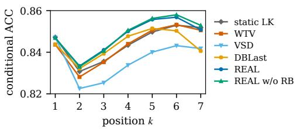  
Figure 3: Conditional acceptance $c _ { k }$ at the three-epoch checkpoint, defined as the probability of accepting the kth draft token given the first k −1 tokens are accepted.

REAL w/o RB in conditional acceptance, indicating stronger continuation of accepted prefixes. The slight first-position edge of static LK is consistent with its single-step objective, while the stronger retention of REAL and REAL w/o RB at later positions aligns with their exact EAL objective over the proposal window. This pattern indicates that the exact objective’s advantage comes primarily from longer accepted prefixes rather than only the first position.

## 4.3 Training Diagnostics

Acceptance Length. Figure 4 compares the argmax-based training EAL proxy (Figure 4a), defined as $\textstyle \sum _ { k } \prod _ { i \leq k }$ acc where acc is the argmax accuracy at position i, with serving acceptance length (AL) at the end of each epoch (Figure 4b). The training EAL proxy favors WTV throughout training, which is expected because this metric shares the product-of-marginals form of the WTV objective, while REAL leads WTV on probabilistic serving AL. This opposite ordering between the training EAL proxy and serving AL shows that the WTV-form metric is not reliable for judging drafttraining objectives. REAL w/o RB reads slightly below REAL on the training EAL proxy and at epoch 1 in serving AL, but the two nearly coincide from epoch 2 onward, suggesting that Rao– Blackwellization helps mainly early in training. We also track the branch EAL estimate $\widehat { J } _ { \mathrm { B R A N C H } }$ band the WTV surrogate during training, finding that WTV consistently reads below the branch estimate for all three methods (Figure 5). This shows that our exact objective recovers acceptance length that the surrogate misses, consistent with the positive covariances observed throughout training (Figure 6).

Covariance Analysis. Motivated by equation (12), we log adjacent-pair covariances on training batches to examine whether path weights and continuation acceptance are associated during training. Figure 6 shows the total covariance summed over all 6 adjacent pairs for WTV, REAL, and REAL w/o RB during training, each with an early spike, a decline, and a nonzero plateau. All methods maintain positive covariances throughout training, with REAL and REAL w/o RB nearly identical and both consistently above WTV. This is consistent with the gap in Figure 5, which confirms that the WTV surrogate systematically underestimates the exact objective. Detailed per-pair analysis is provided in Appendix C.

<table><tr><td>Method</td><td>Avg HumanEval</td><td>GSM8K</td><td>NQ</td><td>RAG</td><td>CNN/DM BFCL</td><td></td><td></td><td>WMT MATH-500 MBPP</td></tr><tr><td>static LK</td><td>4.740</td><td>5.227</td><td>5.899</td><td>3.6434.449</td><td>4.171</td><td>3.968</td><td>4.542</td><td>5.752 5.011</td></tr><tr><td>WTV</td><td>4.715</td><td>5.208</td><td>5.891</td><td>3.6104.426</td><td>4.144</td><td>3.923 4.522</td><td>5.744</td><td>4.967</td></tr><tr><td>VSD</td><td>4.657</td><td>5.122</td><td>5.963</td><td>3.5144.356</td><td>4.017</td><td>3.956 4.383</td><td>5.716</td><td>4.887</td></tr><tr><td>DBLast</td><td>4.749</td><td>5.222</td><td>5.998</td><td>3.6154.437</td><td>4.155</td><td>4.022 4.511</td><td>5.789</td><td>4.992</td></tr><tr><td>REAL w/o RB</td><td>4.791</td><td>5.264</td><td>6.030</td><td>3.6494.498</td><td>4.196</td><td>4.023</td><td>4.574 5.846</td><td>5.041</td></tr><tr><td>REAL</td><td>4.792</td><td>5.270</td><td>6.021</td><td>3.6454.499</td><td>4.218</td><td>4.007</td><td>4.590 5.831</td><td>5.047</td></tr></table>

Table 1: Probabilistic acceptance length after 3 training epochs, averaged over 5 seeds. Avg is the equal-weight mean over 9 task subsets. Bold values indicate the top two results in the Avg column and the best result in each subset column.

<table><tr><td colspan="4">k static LK WTV VSD DBLast REAL REAL w/o RB</td></tr><tr><td>1</td><td>0.847 0.8440.847</td><td>0.844</td><td>0.847 0.847</td></tr><tr><td>2</td><td>0.704 0.699 0.697</td><td>0.702 0.706</td><td>0.705</td></tr><tr><td>3</td><td>0.588 0.5840.575</td><td>0.589 0.594</td><td>0.593</td></tr><tr><td>4</td><td>0.496 0.4930.480</td><td>0.500 0.505</td><td>0.504</td></tr><tr><td>5</td><td>0.421 0.4190.403</td><td>0.425 0.432</td><td>0.432</td></tr><tr><td>6</td><td>0.360 0.3570.340</td><td>0.362 0.370</td><td>0.371</td></tr><tr><td>7 0.306</td><td>0.304 0.286</td><td>0.304 0.315</td><td>0.316</td></tr></table>

Table 2: Acceptance retention $S _ { k }$ at the three-epoch checkpoint, defined as the probability of accepting at least k draft tokens in a speculative round. Bold values mark the highest unrounded retention at each position.

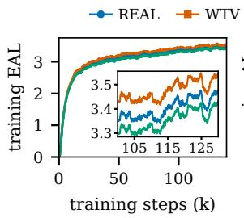  
(a) training EAL proxy

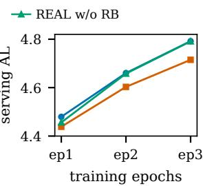  
(b) serving AL  
Figure 4: Training EAL proxy and serving AL during training for WTV, REAL, and REAL w/o RB. REAL leads on probabilistic serving AL, while WTV leads on the training EAL proxy.

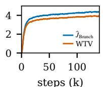  
(a) REAL

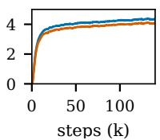  
(b) WTV

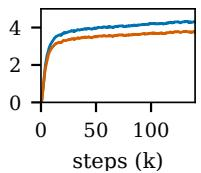  
(c) REAL w/o RB

Figure 5: The branch EAL estimate $\widehat { J } _ { \mathrm { B R A N C H } }$ and the bWTV surrogate during training for WTV, REAL, and REAL w/o RB. The WTV surrogate stays below the branch estimate in all three cases.  
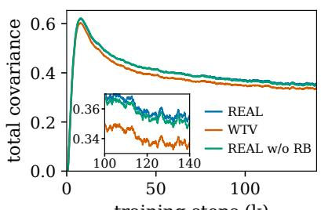  
training steps (k)  
Figure 6: Total covariance summed over all 6 adjacent pairs during training for WTV, REAL, and REAL w/o RB. REAL and REAL w/o RB track each other closely and stay above WTV throughout training.

## 4.4 Ablations

We ablate four aspects: Rao–Blackwellization, the auxiliary CE term, serving temperature, and the training budget.

Rao–Blackwellization. REAL w/o RB ablates Rao–Blackwellization, keeping the sampled $b _ { k }$ in place of the marginalized $a _ { k }$ . As shown in Table 3, the per-term gradient variance is lower at every position in every checkpoint, with reductions of 76– 84% at k = 2 and 52–58% for the aggregate gradient. Rao–Blackwellization preserves the expected gradient while guaranteeing no greater covariance than the path estimator for each prefix-gradient contribution (Section 3.3). As shown in Tables 1 and 11, REAL w/o RB reaches 4.791 probabilistic AL, comparable to REAL (4.792), while its greedy AL (4.515) trails REAL (4.537). Despite their similar final probabilistic AL at $T \ = \ 1$ REAL performs better early in training (Figure 4) and generalizes better across serving temperatures (Table 5). The pilot study further illustrates the optimization difficulties of sampled-path estimation (Appendix K).

<table><tr><td>epoch k=1 k=2 k=3 k=4 k=5 k=6 k=7 agg</td></tr><tr><td>checkpoints of REAL</td></tr><tr><td>ep1 0 0.17 0.44 0.45 0.61 0.56 0.73 0.47 ep2 0 0.17 0.38 0.49 0.59 0.65 0.66 0.48 ep3 0 0.20 0.40 0.48 0.47 0.55 0.67 0.43</td></tr><tr><td>checkpoints of REAL w/o RB</td></tr><tr><td>ep1 0 0.24 0.44 0.45 0.42 0.58 0.68 0.47 ep2 0 0.16 0.35 0.45 0.61 0.48 0.64 0.42 ep3 0 0.19 0.36 0.46 0.54 0.63 0.62 0.44</td></tr></table>

Table 3: $\mathrm { V a r } _ { \mathrm { B R A N C H } } / \mathrm { V a r } _ { \mathrm { P A T H } }$ for per-term gradient variance at each position and for aggregate gradient variance. Lower values indicate greater variance reduction. The zero at k=1 is structural: given the fixed prefix, $a _ { 1 }$ is deterministic while $b _ { 1 }$ is sampled.
<table><tr><td></td><td>greedy</td><td>probabilistic</td></tr><tr><td>REAL w/o CE&amp;RB</td><td>4.369</td><td>4.588</td></tr><tr><td>REAL w/o CE</td><td>4.397</td><td>4.624</td></tr><tr><td>pure CE</td><td>4.508</td><td>4.668</td></tr><tr><td>REAL w/o RB</td><td>4.515</td><td>4.791</td></tr><tr><td>REAL</td><td>4.537</td><td>4.792</td></tr></table>

Table 4: Ablation of the auxiliary CE term at the threeepoch budget. Removing CE from REAL or REAL w/o RB, or using pure CE without the EAL term, degrades serving AL under both protocols.

Auxiliary CE term. To isolate whether the serving gains come from the EAL term or merely from the auxiliary CE term, we train pure CE without the EAL term, as well as REAL w/o CE and REAL w/o CE&RB. Both variants without CE train to completion but stay below their CEaugmented counterparts in greedy and probabilistic serving AL (Table 4), as well as in the training EAL proxy trajectory (Figure 7), showing that the auxiliary CE term stabilizes training and improves serving performance with and without RB. Although pure CE outperforms REAL on the training EAL proxy (Figure 7), its greedy and probabilistic serving AL are again below both REAL and REAL w/o RB (Table 4), demonstrating the effectiveness of the EAL loss term. Thus, both the EAL term and the auxiliary CE term contribute to the final performance.

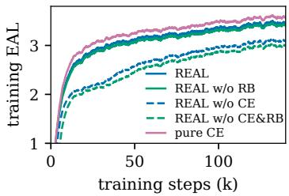  
Figure 7: Training EAL proxy trajectories of REAL and REAL w/o RB with and without the auxiliary CE term, and of pure CE.

<table><tr><td>method</td><td> $T = 1 . 0$ </td><td> $T = 0 . 7$ </td><td> $T = 0 . 5$ </td></tr><tr><td>static LK</td><td>4.740</td><td>4.925</td><td>5.002</td></tr><tr><td>WTV</td><td>4.715</td><td>4.867</td><td>4.981</td></tr><tr><td>VSD</td><td>4.657</td><td>4.842</td><td>4.928</td></tr><tr><td>DBLast</td><td>4.749</td><td>4.912</td><td>4.975</td></tr><tr><td>REAL w/o RB</td><td>4.791</td><td>4.919</td><td>4.964</td></tr><tr><td>REAL</td><td>4.792</td><td>4.935</td><td>4.993</td></tr></table>

Table 5: Probabilistic acceptance length across serving temperatures at the three-epoch budget, averaged over the 5 seeds and 9 subsets. Bold values mark the best method per temperature.

Serving temperature. We evaluate the compared methods at $T \in \{ 1 . 0 , 0 . 7 , 0 . 5 \}$ for both the draft and target models to examine how serving temperature affects the advantage of our method (Table 5). As the temperature decreases, all methods achieve higher acceptance length, while REAL’s advantage over the baselines narrows and static LK surpasses it at $T \ = \ 0 . 5$ . Meanwhile, REAL w/o RB is more sensitive to temperature change, falling further behind REAL as the temperature decreases. This trend matches our expectation that the main advantage of REAL lies in stochastic serving, because it is derived for stochastic rejection sampling and its benefit diminishes as the serving temperature decreases and decoding approaches the fully deterministic regime, where static LK is strongest.

Training budget. To check whether our EAL objective affects convergence speed and sustained gains, we measure probabilistic serving AL at the end of each epoch and continue training for one additional epoch, as shown in Figure 8. The full results under both protocols are provided in Appendix I. REAL attains the highest probabilistic AL at every epoch, and its lead over WTV grows from 0.041 at epoch 1 to 0.077 at epoch 3 (4.479 vs. 4.438 and 4.792 vs. 4.715, respectively). Both REAL and REAL w/o RB maintain their lead through the additional epoch and improve on both protocols, reaching 4.816 and 4.814 probabilistic AL, respectively (Appendix I), so the gains of the exact objective accumulate throughout training rather than saturate early.

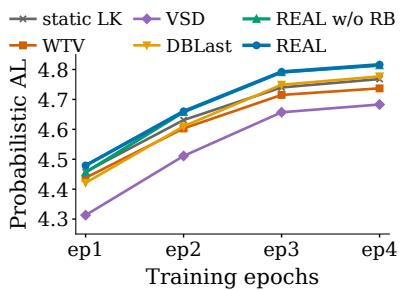  
Figure 8: Probabilistic acceptance length at the end of each epoch, including a continuation to epoch 4, averaged over 9 subsets and 5 seeds. REAL attains the highest AL at every epoch.

## 5 Related Work

## 5.1 Draft Architectures

Draft designs include independent heads (Cai et al., 2024), sequentially dependent heads (Ankner et al., 2024), feature-level autoregression (Li et al., 2024b,a, 2025), and low-overhead variants (Du et al., 2024). Block-parallel drafters generate a block of tokens per round, evolving from early blockwise decoding (Stern et al., 2018) and multi-token prediction heads (Gloeckle et al., 2024) to DFlash (Chen et al., 2026), Domino (Huang et al., 2026), DSpark (Cheng et al., 2026), and P-EAGLE (Hui et al., 2026), with diffusionbased variants enabling bidirectional generation (Li et al., 2026a; Sandler et al., 2026; Whalen et al., 2026; Liu et al., 2026).

## 5.2 Training Objectives of Draft Models

Draft models are commonly trained with crossentropy or forward KL distillation on teacherforced contexts (Zhou et al., 2024), with on-policy variants using draft rollouts (Lei et al., 2026; Liu et al., 2024a). These distribution-matching objectives optimize token-level similarity rather than acceptance length.

Single-step total variation objectives instead maximize the one-step acceptance rate in Equation (4) (Goel et al., 2024; Samarin et al., 2026). Multi-step variants, including end-to-end TV (Li et al., 2026b), DFly’s TV stage (Liu et al., 2026), and WTV (Xia et al., 2026), multiply per-step acceptance rates without preserving the acceptedtoken distribution in Equation (5).

Other acceptance-oriented methods reweight positions in cross-entropy (Wu et al., 2026; Gu et al., 2026), use acceptance-oriented or variational surrogates (Karimi et al., 2026; Zou et al., 2026), or adopt target-aligned training and diffusion-based rewards (An et al., 2026; Sandler et al., 2026; Whalen et al., 2026).

Concurrent work includes EDR, which minimizes exact expected decoding rounds using additional dynamic programming during training (Zhao and Cai, 2026), BV loss, which targets acceptance under block verification (Kim et al., 2026), and FReDraft, which uses draft-generated rollouts with acceptance marginalization and an over-sampled-token penalty (Anonymous, 2026). REAL optimizes EAL under standard token verification by changing only the loss in the existing training pipeline, without being tied to a specific rollout or verification method or incurring additional training overhead.

## 5.3 Other Speculative Decoding Optimization Methods

Other work optimizes serving through draft-target separation (Shi et al., 2025; Park et al., 2025; Zhang et al., 2026; Kumar et al., 2026), verification and speculation control (Sun et al., 2025; Huang et al., 2025; Liu et al., 2024b), or treestructured proposals (Miao et al., 2024; Chen et al., 2024; Li et al., 2024a; Cai et al., 2024; Wang et al., 2025; Hu et al., 2026), which are orthogonal to our focus on the training objective.

## 6 Conclusion

We have presented REAL, a real EAL training loss based on an unbiased and differentiable branch estimator for stochastic rejection sampling, using path weights to restore the propose-andaccept branch structure and Rao–Blackwellization to reduce per-term variance. Our covariance analysis explains why products of marginal acceptance rates can reverse the optimization direction. With only a change to training loss and no additional overhead, REAL achieves the best probabilistic acceptance length among the main compared objectives across 9 task subsets and 5 seeds at T = 1, demonstrating its effectiveness.

## Limitations

The evaluation is limited to one target model, one drafter architecture, and one sampled data recipe to enable controlled comparisons; broader evaluation across these settings is left for future work. The VSD and DBLast comparisons use loss-level adaptations rather than full system reproductions, isolating the effect of the loss itself. Our objective primarily targets probabilistic serving, and REAL is near-optimal under greedy serving.

## Acknowledgments

The author thanks Jiale Fu for insightful discussions, help with checking the mathematical derivations, and valuable suggestions on the organization and presentation of this work.

## References

Zihao An, Taichi Liu, Ziqiong Liu, Dong Li, Ruofeng Liu, and Emad Barsoum. 2026. PARD-2: Targetaligned parallel draft model for dual-mode speculative decoding. Preprint, arXiv:2605.08632.

Zachary Ankner, Rishab Parthasarathy, Aniruddha Nrusimha, Christopher Rinard, Jonathan Ragan-Kelley, and William Brandon. 2024. Hydra: Sequentially-dependent draft heads for Medusa decoding. In First Conference on Language Modeling.

Anonymous. 2026. Directly maximizing on-policy expected accepted length for speculative decoding. Under review at ICLR 2027.

Jacob Austin, Augustus Odena, Maxwell Nye, Maarten Bosma, Henryk Michalewski, David Dohan, Ellen Jiang, Carrie Cai, Michael Terry, Quoc Le, and Charles Sutton. 2021. Program synthesis with large language models. Preprint, arXiv:2108.07732.

David Blackwell. 1947. Conditional expectation and unbiased sequential estimation. The Annals ofMathematical Statistics, 18(1):105–110.

Ondˇrej Bojar, Christian Buck, Christian Federmann, Barry Haddow, Philipp Koehn, Johannes Leveling, Christof Monz, Pavel Pecina, Matt Post, Herve Saint-Amand, Radu Soricut, Lucia Specia, and Aleš Tamchyna. 2014. Findings of the 2014 workshop on statistical machine translation. In Proceedings ofthe Ninth Workshop on Statistical Machine Translation, pages 12–58, Baltimore, Maryland, USA. Association for Computational Linguistics.

Tianle Cai, Yuhong Li, Zhengyang Geng, Hongwu Peng, Jason D. Lee, Deming Chen, and Tri Dao. 2024. Medusa: Simple LLM inference acceleration framework with multiple decoding heads. In Proceedings of the 41st International Conference

on Machine Learning, volume 235 of Proceedings of Machine Learning Research, pages 5209–5235. PMLR.

Charlie Chen, Sebastian Borgeaud, Geoffrey Irving, Jean-Baptiste Lespiau, Laurent Sifre, and John Jumper. 2023. Accelerating large language model decoding with speculative sampling. Preprint, arXiv:2302.01318.

Jian Chen, Yesheng Liang, and Zhijian Liu. 2026. DFlash: Block diffusion for flash speculative decoding. In Proceedings of the 43rd International Conference on Machine Learning, volume 306 of Proceedings of Machine Learning Research, pages 15343–15355. PMLR.

Mark Chen, Jerry Tworek, Heewoo Jun, Qiming Yuan, Henrique Ponde de Oliveira Pinto, Jared Kaplan, Harri Edwards, Yuri Burda, Nicholas Joseph, Greg Brockman, Alex Ray, Raul Puri, Gretchen Krueger, Michael Petrov, Heidy Khlaaf, Girish Sastry, Pamela Mishkin, Brooke Chan, Scott Gray, and 39 others. 2021. Evaluating large language models trained on code. Preprint, arXiv:2107.03374.

Zhuoming Chen, Avner May, Ruslan Svirschevski, Yuhsun Huang, Max Ryabinin, Zhihao Jia, and Beidi Chen. 2024. Sequoia: Scalable and robust speculative decoding. In Advances in Neural Information Processing Systems, volume 37.

Xin Cheng, Xingkai Yu, Chenze Shao, Jiashi Li, Yunfan Xiong, Yi Qian, Jiaqi Zhu, Shirong Ma, Xiaokang Zhang, Jiasheng Ye, Qinyu Chen, Chengqi Deng, Jiping Yu, Damai Dai, Zhengyan Zhang, Yixuan Wei, Yixuan Tan, Wenkai Yang, Runxin Xu, and 14 others. 2026. DSpark: Confidence-scheduled speculative decoding with semi-autoregressive generation. Preprint, arXiv:2607.05147.

Karl Cobbe, Vineet Kosaraju, Mohammad Bavarian, Mark Chen, Heewoo Jun, Lukasz Kaiser, Matthias Plappert, Jerry Tworek, Jacob Hilton, Reiichiro Nakano, Christopher Hesse, and John Schulman. 2021. Training verifiers to solve math word problems. Preprint, arXiv:2110.14168.

Cunxiao Du, Jing Jiang, Yuanchen Xu, Jiawei Wu, Sicheng Yu, Yongqi Li, Shenggui Li, Kai Xu, Liqiang Nie, Zhaopeng Tu, and Yang You. 2024. GliDe with a CaPE: A low-hassle method to accelerate speculative decoding. In Proceedings of the 41st International Conference on Machine Learning, volume 235 of Proceedings of Machine Learning Research, pages 11704–11720. PMLR.

Fabian Gloeckle, Badr Youbi Idrissi, Baptiste Rozière, David Lopez-Paz, and Gabriel Synnaeve. 2024. Better & faster large language models via multi-token prediction. In Proceedings of the 41st International Conference on Machine Learning, volume 235 of Proceedings of Machine Learning Research, pages 15706–15734. PMLR.

Raghavv Goel, Mukul Gagrani, Wonseok Jeon, Junyoung Park, Mingu Lee, and Christopher Lott. 2024. Direct alignment of draft model for speculative decoding with chat-fine-tuned LLMs. Preprint, arXiv:2403.00858.

Geonmo Gu, Byeongho Heo, HeeJae Jun, Yoohoon Kang, Sangmin Lee, Sangdoo Yun, and Dongyoon Han. 2026. Verification-aware training for speculative decoding. In Advances in Neural Information Processing Systems. To appear.

Shijing Hu, Jingyang Li, Zhihui Lu, and Pan Zhou. 2026. Bridging draft policy misalignment: Group tree optimization for speculative decoding. In The Fourteenth International Conference on Learning Representations.

Jianuo Huang, Yaojie Zhang, Qituan Zhang, Hao Lin, Hanlin Xu, and Linfeng Zhang. 2026. Domino: Decoupling causal modeling from autoregressive drafting in speculative decoding. In Proceedings of the 2026 Conference on Empirical Methods in Natural Language Processing, pages 23346–23356, Budapest, Hungary. Association for Computational Linguistics.

Kaixuan Huang, Xudong Guo, and Mengdi Wang. 2025. SpecDec++: Boosting speculative decoding via adaptive candidate lengths. In Second Conference on Language Modeling.

Mude Hui, Xin Huang, Jaime Campos Salas, Yue Sun, Nathan Pemberton, Xiang Song, Ashish Khetan, and George Karypis. 2026. P-EAGLE: Paralleldrafting EAGLE with scalable training. Preprint, arXiv:2602.01469.

Keller Jordan, Yuchen Jin, Vlado Boza, Jiacheng You, Franz Cesista, Laker Newhouse, and Jeremy Bernstein. 2024. Muon: An optimizer for hidden layers in neural networks.

Amirmohammad Karimi, Chao Gao, and Negar Hassanpour. 2026. DBLAST: Dependent block drafting for stochastic speculative decoding. Preprint, arXiv:2608.05448.

Vladimir Karpukhin, Barlas Oguz, Sewon Min, Patrick Lewis, Ledell Wu, Sergey Edunov, Danqi Chen, and Wen-tau Yih. 2020. Dense passage retrieval for open-domain question answering. In Proceedings of the 2020 Conference on Empirical Methods in Natural Language Processing (EMNLP), pages 6769– 6781, Online. Association for Computational Linguistics.

Suyoung Kim, Jahyun Koo, Hyeonjin Kim, Inhyeok Bang, Seunghyun Lee, Hyunjae Oh, Baeseong Park, and Dongsoo Lee. 2026. BV loss: Block verification-aware loss for block diffusion speculative decoding. Preprint, arXiv:2609.34832.

Tanishq Kumar, Tri Dao, and Avner May. 2026. Speculative speculative decoding. In The Fourteenth International Conference on Learning Representations.

Tom Kwiatkowski, Jennimaria Palomaki, Olivia Redfield, Michael Collins, Ankur Parikh, Chris Alberti, Danielle Epstein, Illia Polosukhin, Jacob Devlin, Kenton Lee, Kristina Toutanova, Llion Jones, Matthew Kelcey, Ming-Wei Chang, Andrew M. Dai, Jakob Uszkoreit, Quoc Le, and Slav Petrov. 2019. Natural Questions: A benchmark for question answering research. Transactions of the Association for Computational Linguistics, 7:452–466.

Woosuk Kwon, Zhuohan Li, Siyuan Zhuang, Ying Sheng, Lianmin Zheng, Cody Hao Yu, Joseph E. Gonzalez, Hao Zhang, and Ion Stoica. 2023. Efficient memory management for large language model serving with PagedAttention. In Proceedings of the ACM SIGOPS 29th Symposium on Operating Systems Principles, pages 611–626. ACM.

Maxime Labonne. 2024. Open-PerfectBlend. Hugging Face dataset.

Haodi Lei, Yafu Li, Haoran Zhang, Shunkai Zhang, Qianjia Cheng, Xiaoye Qu, Ganqu Cui, Bowen Zhou, Ning Ding, Yun Luo, and Yu Cheng. 2026. Draft-OPD: On-policy distillation for speculative draft models. In Proceedings of the 2026 Conference on Empirical Methods in Natural Language Processing, pages 26128–26141, Budapest, Hungary. Association for Computational Linguistics.

Yaniv Leviathan, Matan Kalman, and Yossi Matias. 2023. Fast inference from transformers via speculative decoding. In Proceedings of the 40th International Conference on Machine Learning, volume 202 of Proceedings of Machine Learning Research, pages 19274–19286. PMLR.

Guanghao Li, Zhihui Fu, Min Fang, Qibin Zhao, Ming Tang, Chun Yuan, and Jun Wang. 2026a. DiffuSpec: Unlocking diffusion language models for speculative decoding. In Findings of the Association for Computational Linguistics: ACL 2026, pages 20896–20910, San Diego, California, United States. Association for Computational Linguistics.

Yucheng Li, Huiqiang Jiang, Yang Xu, Jianxin Yang, Yi Zhang, Yizhong Cao, Yuhao Shen, Fan Zhou, Rui Men, Jianwei Zhang, An Yang, Bowen Yu, Bo Zheng, Fei Huang, Junyang Lin, Dayiheng Liu, and Jingren Zhou. 2026b. Breaking entropy bounds: Accelerating RL training via MTP with rejection sampling. Preprint, arXiv:2606.12370.

Yuhui Li, Fangyun Wei, Chao Zhang, and Hongyang Zhang. 2024a. EAGLE-2: Faster inference of language models with dynamic draft trees. In Proceedings of the 2024 Conference on Empirical Methods in Natural Language Processing, pages 7421– 7432, Miami, Florida, USA. Association for Computational Linguistics.

Yuhui Li, Fangyun Wei, Chao Zhang, and Hongyang Zhang. 2024b. EAGLE: Speculative sampling requires rethinking feature uncertainty. In Proceedings of the 41st International Conference on Machine Learning, volume 235 of Proceedings of

Machine Learning Research, pages 28935–28948. PMLR.

Yuhui Li, Fangyun Wei, Chao Zhang, and Hongyang Zhang. 2025. EAGLE-3: Scaling up inference acceleration of large language models via training-time test. In Advances in Neural Information Processing Systems, volume 38.

Hunter Lightman, Vineet Kosaraju, Yura Burda, Harri Edwards, Bowen Baker, Teddy Lee, Jan Leike, John Schulman, Ilya Sutskever, and Karl Cobbe. 2024. Let’s verify step by step. In The Twelfth International Conference on Learning Representations.

Hong Liu, Rui Cen, Junhan Shi, Guangshuo Qin, Jiebin Zhang, Tianyu Liu, Runzhi Fan, Guoliang Zhao, Ruobing Xie, Kai Zhang, Song Liu, Guanghua Yu, and Jianchen Zhu. 2026. AngelSpec: Towards realworld high performance inference with speculative decoding. Preprint, arXiv:2607.25852.

Xiaoxuan Liu, Lanxiang Hu, Peter Bailis, Alvin Cheung, Zhijie Deng, Ion Stoica, and Hao Zhang. 2024a. Online speculative decoding. In Proceedings of the 41st International Conference on Machine Learning, volume 235 of Proceedings of Machine Learning Research, pages 31131–31146. PMLR.

Xiaoxuan Liu, Jongseok Park, Langxiang Hu, Woosuk Kwon, Zhuohan Li, Chen Zhang, Kuntai Du, Xiangxi Mo, Kaichao You, Alvin Cheung, Zhijie Deng, Ion Stoica, and Hao Zhang. 2024b. TurboSpec: Closed-loop speculation control system for optimizing LLM serving goodput. Preprint, arXiv:2406.14066.

Ilya Loshchilov and Frank Hutter. 2019. Decoupled weight decay regularization. In International Conference on Learning Representations.

Xupeng Miao, Gabriele Oliaro, Zhihao Zhang, Xinhao Cheng, Zeyu Wang, Zhengxin Zhang, Rae Ying Yee Wong, Alan Zhu, Lijie Yang, Xiaoxiang Shi, Chunan Shi, Zhuoming Chen, Daiyaan Arfeen, Reyna Abhyankar, and Zhihao Jia. 2024. SpecInfer: Accelerating large language model serving with treebased speculative inference and verification. In Proceedings of the 29th ACM International Conference on Architectural Support for Programming Languages and Operating Systems, Volume 3. Association for Computing Machinery.

Ramesh Nallapati, Bowen Zhou, Cicero dos Santos, Çaglar Gülçehre, and Bing Xiang. 2016.˘ Abstractive text summarization using sequence-to-sequence RNNs and beyond. In Proceedings of the 20th SIGNLL Conference on Computational Natural Language Learning, pages 280–290, Berlin, Germany. Association for Computational Linguistics.

Jinwoo Park, Seunggeun Cho, and Dongsu Han. 2025. SpecEdge: Scalable edge-assisted serving framework for interactive LLMs. In Advances in Neural Information Processing Systems, volume 38.

Shishir G Patil, Huanzhi Mao, Fanjia Yan, Charlie Cheng-Jie Ji, Vishnu Suresh, Ion Stoica, and Joseph E. Gonzalez. 2025. The Berkeley function calling leaderboard (BFCL): From tool use to agentic evaluation of large language models. In Proceedings of the 42nd International Conference on Machine Learning, volume 267 of Proceedings of Machine Learning Research, pages 48371–48392. PMLR.

Qwen Team. 2026. Qwen3.6-35B-A3B: Agentic coding power, now open to all.

C. Radhakrishna Rao. 1945. Information and accuracy attainable in the estimation of statistical parameters. Bulletin ofthe Calcutta Mathematical Society, 37(3):81–91.

Red Hat. 2025. Speculators: A unified library for speculative decoding algorithms in LLM serving. https: //github.com/vllm-project/speculators.

Alexander Samarin, Sergei Krutikov, Anton Shevtsov, Sergei Skvortsov, Filipp Fisin, and Alexander Golubev. 2026. LK losses: Direct acceptance rate optimization for speculative decoding. In Proceedings of the 43rd International Conference on Machine Learning, volume 306 of Proceedings of Machine Learning Research, pages 107441–107454. PMLR.

Jameson Sandler, Jacob K. Christopher, Thomas Hartvigsen, and Ferdinando Fioretto. 2026. SpecDiff-2: Scaling diffusion drafter alignment for faster speculative decoding. In Proceedings of Machine Learning and Systems, volume 8.

Tianyao Shi, Yanran Wu, Sihang Liu, and Yi Ding. 2025. Disaggregated speculative decoding for carbon-efficient LLM serving. IEEE Computer Architecture Letters, 24(2):369–372.

Mitchell Stern, Noam Shazeer, and Jakob Uszkoreit. 2018. Blockwise parallel decoding for deep autoregressive models. In Advances in Neural Information Processing Systems, volume 31, pages 10086– 10095.

Ziteng Sun, Uri Mendlovic, Yaniv Leviathan, Asaf Aharoni, Jae Hun Ro, Ahmad Beirami, and Ananda Theertha Suresh. 2025. Block verification accelerates speculative decoding. In The Thirteenth International Conference on Learning Representations.

Jikai Wang, Yi Su, Juntao Li, Qingrong Xia, Zi Ye, Xinyu Duan, Zhefeng Wang, and Min Zhang. 2025. OPT-Tree: Speculative decoding with adaptive draft tree structure. Transactions of the Association for Computational Linguistics, 13:188–199.

Lexington Whalen, Yuki Ito, and Ryo Sakamoto. 2026. Teaching diffusion to speculate left-to-right. Preprint, arXiv:2606.11552.

Tianyu Wu, Yu Yao, Zhenting Qi, Han Zheng, Chengxi Zhang, Zhuohan Wang, Haoran Ma, Zichun Liao, Himabindu Lakkaraju, Ju Li, and Yilun Du. 2026. D-PACE: Dynamic position-aware cross-entropy for parallel speculative drafting. In Advances in Neural Information Processing Systems. To appear.

Heming Xia, Tao Ge, Peiyi Wang, Si-Qing Chen, Furu Wei, and Zhifang Sui. 2023. Speculative decoding: Exploiting speculative execution for accelerating Seq2seq generation. In Findings of the Association for Computational Linguistics: EMNLP 2023, pages 3909–3925, Singapore. Association for Computational Linguistics.

Tianhua Xia, Mugilan Ganesan, Yifei Feng, Haiyu Wang, Maximilian Egger, and Sai Qian Zhang. 2026. Acceptance-aware draft model training for speculative decoding. Preprint, arXiv:2609.24150.

Tengyu Xu, Eryk Helenowski, Karthik Abinav Sankararaman, Di Jin, Kaiyan Peng, Eric Han, Shaoliang Nie, Chen Zhu, Hejia Zhang, Wenxuan Zhou, Zhouhao Zeng, Yun He, Karishma Mandyam, Arya Talabzadeh, Madian Khabsa, Gabriel Cohen, Yuandong Tian, Hao Ma, Sinong Wang, and Han Fang. 2024. The Perfect Blend: Redefining RLHF with mixture of judges. Preprint, arXiv:2409.20370.

An Yang, Anfeng Li, Baosong Yang, Beichen Zhang, Binyuan Hui, Bo Zheng, Bowen Yu, Chang Gao, Chengen Huang, Chenxu Lv, Chujie Zheng, Dayiheng Liu, Fan Zhou, Fei Huang, Feng Hu, Hao Ge, Haoran Wei, Huan Lin, Jialong Tang, and 41 others. 2025. Qwen3 technical report. Preprint, arXiv:2505.09388.

Ziyi Zhang, Ziheng Jiang, Chengquan Jiang, Menghan Yu, Size Zheng, Haibin Lin, Xin Liu, and Henry Hoffmann. 2026. SwiftSpec: Disaggregated speculative decoding and fused kernels for low-latency LLM inference. In Proceedings of the 31st ACM International Conference on Architectural Support for Programming Languages and Operating Systems, Volume 2. Association for Computing Machinery.

Yunxiao Zhao and Changxiao Cai. 2026. Training parallel speculative draft models by directly minimizing expected decoding rounds. Preprint, arXiv:2610.10411.

Yongchao Zhou, Kaifeng Lyu, Ankit Singh Rawat, Aditya Krishna Menon, Afshin Rostamizadeh, Sanjiv Kumar, Jean-François Kagy, and Rishabh Agarwal. 2024. DistillSpec: Improving speculative decoding via knowledge distillation. In The Twelfth International Conference on Learning Representations.

Xiandong Zou, Jianshu Li, Jing Huang, and Pan Zhou. 2026. Variational speculative decoding: Rethinking draft training from token likelihood to sequence acceptance. In Proceedings of the 43rd International Conference on Machine Learning, volume 306 of Proceedings of Machine Learning Research, pages 168768–168789. PMLR.

## A Counterexample Details

This appendix gives the full two-step enumeration behind the counterexample of Section 3.1 and a second example in which the surrogate reverses the ranking of two drafts.

## A.1 Full Enumeration of the Two-Step Counterexample

The setup of Section 3.1: vocabulary $\{ A , B \}$ $p _ { 1 } = ( 0 . 4 , 0 . 6 ) , q _ { 1 } = ( 0 . 8 , 0 . 2 ) , p _ { 2 } ( \cdot \mid h A ) =$ $( 0 . 9 , 0 . 1 ) , p _ { 2 } ( \cdot , \enspace | \enspace h B ) \ = \ ( 0 . 1 , 0 . 9 )$ , and $q _ { 2 } =$ $( \theta , 1 - \theta )$ on both branches with $0 . 1 < \theta < 0 . 9$ The per-token quantities of step 1 are:

<table><tr><td>token</td><td> $p _ { 1 }$ </td><td>q1</td><td> $m _ { 1 } = \operatorname* { m i n } ( p _ { 1 } , q _ { 1 } )$ </td></tr><tr><td>A</td><td>0.4</td><td>0.8</td><td>0.4</td></tr><tr><td>B</td><td>0.6</td><td>0.2</td><td>0.2</td></tr></table>

so $\begin{array} { r l r } { a _ { 1 } } & { { } = } & { 0 . 6 , } \end{array}$ , and the path weights are $b _ { 1 } ( A ) \ = \ \operatorname* { m i n } ( 1 , 0 . 8 / 0 . 4 ) \ = \ 1$ and $b _ { 1 } ( B ) \ =$ min $( 1 , 0 . 2 / 0 . 6 ) = 1 / 3 .$ The second-step acceptance rates are $\begin{array} { l c l } { { a _ { 2 } ( h A ) } } & { { = } } & { { \operatorname* { m i n } ( 0 . 9 , \theta ) ~ + } } \end{array}$ min $( 0 . 1 , 1 ~ - ~ \theta ) ~ = ~ \theta ~ + ~ 0 . 1 ~ \mathrm { a n d } ~ a _ { 2 } ( h B ) ~ =$ min $( 0 . 1 , \theta ) + \operatorname* { m i n } ( 0 . 9 , 1 - \theta ) = 1 . 1 - \theta .$ Enumerating all four two-token paths:

<table><tr><td>path</td><td>target probability</td><td>propose-accept mass</td></tr><tr><td> $A A$ </td><td> $0 . 4 \times 0 . 9 = 0 . 3 6$ </td><td>0.4θ</td></tr><tr><td> $A B$ </td><td> $0 . 4 \times 0 . 1 = 0 . 0 4$ </td><td>0.04</td></tr><tr><td>BA</td><td> $0 . 6 \times 0 . 1 = 0 . 0 6$ </td><td> $0 . 2 \times 0 . 1 = 0 . 0 2$ </td></tr><tr><td>BB</td><td> $0 . 6 \times 0 . 9 = 0 . 5 4$ </td><td> $0 . 2 ( 1 - \theta )$ </td></tr></table>

Hence $P ( L ~ \ge ~ 2 ) ~ = ~ 0 . 2 6 + 0 . 2 0 \theta$ and $J _ { 2 } \ =$ $0 . 8 6 + 0 . 2 0 \theta$ . The surrogate averages the second step over target proportions: $\tilde { J } _ { \mathrm { W T V , 2 } } ~ = ~ 0 . 6 ~ +$ $0 . 2 4 a _ { 2 } ( h A ) + 0 . 3 6 a _ { 2 } ( h B ) = 1 . 0 2 - 0 . 1 2 \theta .$ . The branch estimator on target samples reads ${ \widehat { J } } ( A ) =$ $0 . 6 + 1 \times ( 0 . 1 + \theta )$ and $\begin{array} { r } { \widehat { J } ( B ) = 0 . 6 + \frac { 1 } { 3 } ( 1 . 1 - \theta ) } \end{array}$ whose target average $0 . 4 { \widehat { J } } ( A ) + 0 . 6 { \widehat { J } } ( B )$ equals $J _ { 2 }$ exactly.

Gradient variance in the same example. At $\theta = 0 . 5$ , the per-path gradients give $\mathbb { E } [ g _ { \mathrm { B R A N C H } } ] =$ +0.20 with variance $3 2 / 7 5 \approx 0 . 4 2 7 , \mathbb { E } [ g _ { \mathrm { W T V } } ] =$ −0.12 with variance 0.3456, and $\begin{array} { r l } { \mathbb { E } [ g _ { \mathrm { P A T H } } ] } & { { } = } \end{array}$ +0.20 with variance $3 2 3 / 6 7 5 \approx 0 . 4 7 9$ . The surrogate has the lowest gradient variance but a biased mean: with M independent trajectories its gradient MSE is $6 4 / 6 2 5 + 2 1 6 / ( 6 2 5 M )$ , which does not vanish as M grows, while the exact estimators’ MSE vanishes as $1 / M .$ . Lower variance does not compensate for a wrong mean.

## A.2 The Surrogate Can Reverse Model Rankings

Take a first step with target $p _ { 1 } = ( 0 . 5 , 0 . 5 )$ and two candidate drafts $q _ { 1 } ^ { ( 1 ) } = ( 0 . 7 0 , 0 . 3 0 )$ and $q _ { 1 } ^ { ( 2 ) } = ( 0 . 3 5 , 0 . 6 5 )$ . The second step has $p _ { 2 } ( \cdot \ |$ $h A ) \ = \ ( 0 . 5 , 0 . 5 )$ with $q _ { 2 } ( { \cdot } \ | \ h A ) \ = \ ( 0 . 6 , 0 . 4 )$ and $p _ { 2 } ( \cdot \mid h B ) = ( 0 . 0 5 , 0 . 9 5 )$ with $q _ { 2 } ( \cdot \mid h B ) =$ $( 0 . 9 5 , 0 . 0 5 )$ , so $a _ { 2 } ( h A ) = 0 . 9$ and $a _ { 2 } ( h B ) = 0 . 1$ Draft 1 has the lower single-step acceptance rate $( a _ { 1 } ^ { ( 1 ) } = 0 . 8 < a _ { 1 } ^ { ( 2 ) } = 0 . 8 5 )$ but the higher true objective:

<table><tr><td></td><td>Draft 1 Draft 2</td></tr><tr><td>a1 0.80</td><td>0.85</td></tr><tr><td> $J _ { \mathrm { W T V , 2 } }$  1.200</td><td>1.275</td></tr><tr><td>J2 (exact) 1.280</td><td>1.215</td></tr></table>

The surrogate ranks Draft 2 above Draft 1; the exact objective ranks them oppositely. The bias is not a shared constant offset: it changes which model is better.

## B Proof of the Variance Guarantee

We provide a detailed proof of the variance guarantee stated in Section 3.3.

Setup. For a fixed prefix h, define the k-th prefix contribution of the path estimator and the branch estimator as

$$
T _ { k } ^ { \mathrm { P A T H } } = W _ { k - 1 } b _ { k } , \quad T _ { k } ^ { \mathrm { B R A N C H } } = W _ { k - 1 } a _ { k } ,\tag{20}
$$

where $\begin{array} { r c l } { { W _ { k - 1 } } } & { { = } } & { { \prod _ { i = 1 } ^ { k - 1 } b _ { i } } } \end{array}$ and $\begin{array} { r }  { \begin{array} { c c c } { a _ { k } } & { = } & { \mathbb { E } [ b _ { k } } \end{array} } \end{array}$ $h _ { k } ]$ . Both estimators are unbiased: $\mathbb { E } [ T _ { k } ^ { \mathrm { P A T H } } ] =$ $\mathbb { E } [ \overset { \cdot } { T } _ { k } ^ { \mathrm { B R A N C H } } ] = S _ { k }$ , where $S _ { k } = P ( L \geq k )$ is the survival probability.

Gradient variance reduction for both terms. The gradient of the path estimator is

$$
g _ { k } ^ { \mathtt { P A T H } } = b _ { k } \nabla _ { \theta } W _ { k - 1 } + W _ { k - 1 } \nabla _ { \theta } b _ { k } ,\tag{21}
$$

and the gradient of the branch estimator is

$$
g _ { k } ^ { \mathtt { B R A N C H } } = a _ { k } \nabla _ { \theta } W _ { k - 1 } + W _ { k - 1 } \nabla _ { \theta } a _ { k } .\tag{22}
$$

For either estimator $s \in \{ \mathrm { P A T H }$ , BRANCH}, define its per-term gradient variance as

$$
\begin{array} { r } { \mathrm { V a r } _ { k } ^ { s } = \mathbb { E } \Big [ \| g _ { k } ^ { s } - \mathbb { E } [ g _ { k } ^ { s } ] \| ^ { 2 } \Big ] . } \end{array}\tag{23}
$$

Define the gradient residual

$$
r _ { k } = g _ { k } ^ { \mathrm { P A T H } } - g _ { k } ^ { \mathrm { B R A N C H } } .\tag{24}
$$

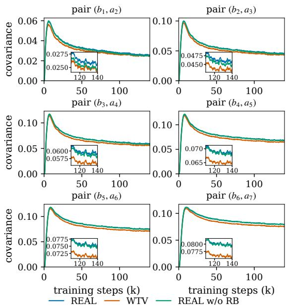  
Figure 9: Per-pair covariance trajectories during training for WTV, REAL, and REAL w/o RB. Each panel shows one adjacent pair $( b _ { k } , a _ { k + 1 } ) , k = 1 , \ldots , 6 .$

The branch gradient is the conditional mean $g _ { k } ^ { \mathrm { B R A N C H } } = \bar { \mathbb { E } } \bar { [ } g _ { k } ^ { \mathrm { P A T H } } \ | \ h _ { k } ]$ , so $\mathbb { E } [ r _ { k } \ | \ h _ { k } ] = 0$ . Let $\ddot { \mu _ { k } } = \mathbb { E } [ g _ { k } ^ { \mathrm { B R A N C H } } ] = \mathbb { E } [ g _ { k } ^ { \mathrm { P A T H } } ]$ denote their common mean. We write the gradient error as

$$
g _ { k } ^ { \mathrm { P A T H } } - \mu _ { k } = ( g _ { k } ^ { \mathrm { B R A N C H } } - \mu _ { k } ) + r _ { k } .\tag{25}
$$

Taking the expectation of the squared norm gives

$$
\begin{array} { r } { \mathrm { V a r } _ { k } ^ { \mathsf { P A T H } } = \mathrm { V a r } _ { k } ^ { \mathsf { B R A N C H } } + \mathbb { E } \left[ \| r _ { k } \| ^ { 2 } \right] . } \end{array}\tag{26}
$$

Since $g _ { k } ^ { \mathrm { B R A N C H } } \mathrm { ~ - ~ } \mu _ { k }$ is fixed given $h _ { k }$ , the cross term vanishes after taking expectation:

$$
\begin{array} { r l } & { \mathbb { E } \big [ \big \langle g _ { k } ^ { \mathrm { B R A N C H } } - \mu _ { k } , r _ { k } \big \rangle \big ] } \\ & { \quad = \mathbb { E } \big [ \big \langle g _ { k } ^ { \mathrm { B R A N C H } } - \mu _ { k } , \mathbb { E } [ r _ { k } \mid h _ { k } ] \big \rangle \big ] = 0 . } \end{array}\tag{27}
$$

Therefore, $\mathrm { V a r } _ { k } ^ { \mathrm { B R A N C H } } \leq \mathrm { V a r } _ { k } ^ { \mathrm { P A T H } }$ for every prefix term k.

## C Per-Pair Covariance Trajectories

This appendix shows the per-pair covariance trajectories behind the summed diagnostic of Figure 6, one panel per adjacent pair (Figure 9). Each position follows the same overall trend as the summed diagnostic, with generally larger covariances at later positions.

## D Implementation Details

This appendix collects the implementation details: the shared setup and loss recipes, ratio direction, normalization and masks, the logging diagnostics, and the verifier consistency check.

## D.1 Shared Setup and Loss Recipes

The main-study methods share the training data, drafter architecture, optimizer, and training budget (Table 6), and differ in the training loss (Table 7). The shared base-anchored curriculum evaluates each method’s loss recipe on both the prebias logits $z _ { \mathrm { b a s e } }$ and the final GRU-refined logits zfinal:

$$
\begin{array} { r } { \mathcal { L } _ { t } = ( 1 - c _ { t } ) \mathcal { L } _ { \mathrm { r e c i p e } } ( z _ { \mathrm { f i n a l } } ) } \\ { + c _ { t } \mathcal { L } _ { \mathrm { r e c i p e } } ( z _ { \mathrm { b a s e } } ) , \quad } \end{array}\tag{28}
$$

where $c _ { t } = \lambda _ { \mathrm { b a s e } }$ decreases linearly from 1 to 0 over the main training budget. This coefficient is separate from the fixed mixture coefficient λ within the REAL recipe. The variants without CE remove the auxiliary CE component from the recipe on both branches, while keeping the same curriculum.

<table><tr><td>component</td><td>setting</td></tr><tr><td>target model drafter</td><td>frozen Qwen3.6-35B-A3B (MoE) Domino block-parallel drafter, 5 layers on target layers 2/20/37 GRU hidden dim 1024, embedding dim</td></tr><tr><td>block</td><td>256 8 tokens per round (1 anchor +  $. \gamma = 7$ </td></tr><tr><td>training data</td><td>proposals), 4096 anchors Open-PerfectBlend continuations re- generated by the target at  $T = 1 . 0$ </td></tr><tr><td>optimizer</td><td>Muon for hidden-layer weight matri- ces,  $\mathrm { L R 2 \times 1 0 ^ { - 4 } }$  AdamW for remaining trainable param-</td></tr><tr><td>training budget batch</td><td>eters, LR  $1 \times 1 0 ^ { - 4 }$  3 epochs (≈140K steps) 16384 tokens per rank per step</td></tr><tr><td>curriculum</td><td>same loss recipe on base and final log-</td></tr><tr><td>evaluation</td><td>its,  $\lambda _ { \mathrm { b a s e } } : 1 \overset { \cdot } {  } 0$  over training 9 subsets, 80 requests each, max 2048 output tokens</td></tr><tr><td>sampling proposals</td><td> $T \doteq 1 . 0 .$  top-p 0.95, top-k 20 greedy (argmax) and probabilistic  $( p / q$  rejection)</td></tr></table>

Table 6: Shared training and evaluation setup for the main study.

Ratio direction. The training-time path weight is $b _ { i } = \operatorname* { m i n } ( 1 , q ( y _ { i } ) / p ( y _ { i } ) )$ on target-sampled tokens; the inference-time acceptance probability is min $( 1 , p ( v ) / q ( v ) )$ on draft-proposed tokens. The two ratios point in opposite directions and must not be interchanged. Target log-probabilities are detached; draft log-probabilities are not.

Normalization and masks. The loss $1 - { \widehat { J } } / \gamma$ always divides by the fixed $\gamma ,$ bnever by the random effective length. EOS counts as an acceptable token, positions after EOS are masked, and masks are prefix-contiguous so that the full-vocabulary sum in $a _ { k }$ remains exact. The prefix weight W and the overlap a both backpropagate (Equation (18)).

<table><tr><td>method</td><td>loss configuration</td></tr><tr><td>static LK</td><td> $\{ \mathrm { T V } : 0 . 9 , \mathrm { C E } : 0 . 1 \}$  , the static LK objective used in the DSpark recipe</td></tr><tr><td>WTV VSD</td><td> $\{ W T V : 0 . 9 , \mathrm { C E } : 0 . 1 \}$   $\begin{array} { r l r } { \mathrm { \Delta \widetilde { f } V S D } } & { { } : } & { 0 . 9 , \mathrm { C E } \quad \mathrm { \Delta \widetilde { \Omega } : } \quad 0 . 1 \} } \end{array}$  weighted-likelihood M-step</td></tr><tr><td>DBLast</td><td>with detached path-acceptance weights, self-normalized across valid blocks and divided by γ  $\{ D B L a s t : 0 . 9 , \mathrm { C E } : \dot { 0 . 1 } \dot  \}$  , ac-</td></tr><tr><td>REAL w/o RB</td><td>ceptance threshold  $\tau = 0 . 1$   $\{ \widehat { J } _ { \mathrm { P A T H } } : 0 . 9 , \mathrm { C E } : 0 . 1 \}$ </td></tr><tr><td>REAL</td><td> $\{ \widehat { J } _ { \mathtt { B R A N C H } } : 0 . 9 , \mathrm { C E : 0 . 1 } \}$   $\lbrace \widehat { J } _ { \mathrm { P a T H } } : 1 . 0 \rbrace$ </td></tr><tr><td>REAL w/o CE&amp;RB REAL w/o CE</td><td> $\{ \widehat { J } _ { \mathrm { B R A N C H } } : 1 . 0 \}$ </td></tr><tr><td>pure CE</td><td> $\{ \mathrm { C E } : 1 . 0 \}$ </td></tr></table>

Table 7: Loss configurations of the final experiments. Each J entry denotes the corresponding loss $1 - \widehat { J } / \gamma$

Diagnostics. For each block, we log the branch EAL estimate $\widehat { J } _ { \mathrm { B R A N C H } }$ as eal\_j\_b, the WTV bsurrogate value eal\_j\_wtv on the same trajectories, per-position means eal\_a\_pos\_\* and eal\_b\_pos\_\*, and per-pair eal\_ba\_next\_pos\_\* for the covariance of Equation (12). All diagnostic tensors are logged as sum/total pairs.

Verifier consistency. We evaluate two proposal strategies: argmax proposals (greedy) and sampled proposals with $p / q$ rejection (probabilistic). Under probabilistic serving, a draft token y ∼ q is accepted with probability min $( 1 , p ( y ) / q ( y ) )$ (Leviathan et al., 2023). On rejection, the correction token is sampled from the normalized positive part of $p - q .$ . Under greedy serving, the draft proposes its argmax token, but the target continues to sample from p.

## E Recorded Training Cost

Table 8 summarizes the logged step times of the five EAL-class training objectives over three 10,000-step windows, one within each epoch, without outlier filtering. The recorded step times are similar across these methods. The timer covers batch fetch through optimizer completion, including synchronization and the shared objective diagnostics. These measurements describe the recorded runs and do not isolate the incremental cost of the loss, since software builds and resource contention were not controlled for a timing comparison.

<table><tr><td>method</td><td>global steps</td><td>median</td><td>IQR</td></tr><tr><td>WTV</td><td>1,000–10,999 50,000–59,999 100,000–109,999</td><td>847.4 850.2 849.7</td><td>[843.0, 855.4] [845.2, 859.7] [844.7, 859.1]</td></tr><tr><td>VSD</td><td>1,000–10,999 50,000–59,999 100,000–109,999</td><td>834.7 840.8 845.9</td><td>[830.0, 845.1] [834.5, 854.2] [838.5, 862.6]</td></tr><tr><td>DBLast</td><td>1,000-10,999 50,000–59,999 100,000–109,999</td><td>838.3 839.5 839.4</td><td>[833.8, 847.5] [834.9, 849.0] [834.7, 849.7]</td></tr><tr><td>REAL w/o RB</td><td>1,000-10,999 50,000–59,999 100,000–109,999</td><td>835.5 836.2 838.6</td><td>[831.4, 844.2] [832.0, 845.7] [834.0, 849.6]</td></tr><tr><td>REAL</td><td>1,000-10,999 50,000–59,999 100,000–109,999</td><td>844.5 846.7 845.0</td><td>[839.6, 854.2] [841.2, 858.5] [840.2, 855.2]</td></tr></table>

Table 8: Recorded training step time in milliseconds over three 10,000-step windows. The bracketed interquartile range (IQR) [Q , Q ] spans the middle 50% of step times.

<table><tr><td>method</td><td>0 777</td><td>13</td><td>1234</td><td>999983</td><td>3mean</td></tr><tr><td>static LK</td><td>4.7394.7354.739</td><td></td><td>4.746</td><td>4.743</td><td>4.740</td></tr><tr><td>WTV</td><td>4.7144.7264.7064.715</td><td></td><td></td><td>4.714</td><td>4.715</td></tr><tr><td>VSD</td><td>4.652 4.6694.6494.659</td><td></td><td></td><td>4.657</td><td>4.657</td></tr><tr><td>DBLast</td><td>4.7574.7484.7454.744</td><td></td><td></td><td>4.751</td><td>4.749</td></tr><tr><td></td><td>REAL w/o RB 4.7874.787 4.786 4.799</td><td></td><td></td><td>4.796</td><td>4.791</td></tr><tr><td>REAL</td><td>4.8044.7884.7874.797</td><td></td><td></td><td>4.783</td><td>4.792</td></tr></table>

Table 9: Per-seed and seed-averaged probabilistic AL after three training epochs. All methods are combined with the auxiliary CE term. Bold marks the best value in each column.

## F Evaluation Seeds and Repetitions

All checkpoints are evaluated with 5 sampling seeds {0, 777, 13, 1234, 999983}, with 3 repetitions per seed under probabilistic serving (15 evaluations per checkpoint) and 3 repetitions with the default seed under greedy serving. Each repetition runs 80 requests per subset with at most 2048 output tokens, using the checkpoint’s generation configuration (T = 1.0, top-k 20, top-p 0.95). Reported values are equal-weight means over the subsets and seeds.

Table 9 shows the per-seed results. The spread across seeds is at most 0.021 AL for every method, and REAL and REAL w/o RB stay ahead of all other methods on every seed, so the main ranking is not driven by any particular seed.

<table><tr><td>method</td><td>Throughput (tokens/s)</td></tr><tr><td>static LK</td><td>4622.1</td></tr><tr><td>WTV</td><td>4553.0</td></tr><tr><td>VSD</td><td>4535.8</td></tr><tr><td>DBLast</td><td>4648.6</td></tr><tr><td>REAL w/o RB</td><td>4664.8</td></tr><tr><td>REAL</td><td>4662.0</td></tr></table>

Table 10: End-to-end vLLM serving throughput at the three-epoch budget, averaged over 5 seeds and 9 subsets. Bold values indicate the top two results.

## G End-to-End Serving Throughput

Table 10 reports aggregate output throughput with a batch size of 80 for the same checkpoints and protocol (probabilistic serving, 5 seeds, 9 subsets, 3 repetitions each), with REAL w/o RB and REAL taking the top two spots and supporting acceptance length as a speedup proxy.

## H Per-Subset Greedy Results

This appendix reports the per-subset acceptance lengths under greedy serving (Table 11); the probabilistic counterpart is Table 1 in the main text.

## I Epoch-wise Acceptance Length

Table 12 reports the complete epoch-wise results under both greedy and probabilistic serving, complementing the probabilistic-only results in Figure 8 in the main text.

## J Comparison with D-PACE

D-PACE applies dynamic position weighting to the cross-entropy loss rather than optimizing an acceptance-length objective (Wu et al., 2026), which is orthogonal to and can be combined with REAL, and is therefore compared separately from the EAL-class objectives of the main text. We use α = 0.5 for its position weighting. Table 13 compares D-PACE with REAL w/o RB and REAL. Under both serving protocols, D-PACE is lower than REAL (4.760 vs. 4.792 probabilistic and 4.535 vs. 4.537 greedy).

Combination with D-PACE. D-PACE performs well in Table 13 without using the EAL objective, raising the question of whether its position weighting also improves the auxiliary CE term of our REAL loss. Table 14 compares the five variants: switching from standard CE to D-PACE-weighted CE improves probabilistic AL for both REAL w/o RB and REAL, from 4.791 to 4.797 and from 4.792 to 4.796, respectively, and REAL w/o RB-D-PACE attains the best probabilistic AL in the table. The advantage grows further with a fourth training epoch, with REAL w/o RB-D-PACE attaining the highest probabilistic AL (4.838), followed by REAL-D-PACE (4.823), while D-PACE reaches 4.784. This shows that applying D-PACE weighting to the auxiliary CE term can further improve serving acceptance length.

<table><tr><td>Method</td><td>Avg</td><td>HumanEval</td><td>GSM8K</td><td>NQ</td><td>RAG</td><td>CNN/DM BFCL</td><td></td><td></td><td>WMT MATH-500 MBPP</td><td></td></tr><tr><td>static LK</td><td>4.544</td><td>5.000</td><td>5.555</td><td>3.533</td><td>4.349</td><td>4.123</td><td>3.665</td><td>4.460</td><td>5.425</td><td>4.783</td></tr><tr><td>WTV</td><td>4.530</td><td>5.021</td><td>5.617</td><td></td><td>3.5184.300</td><td>4.092</td><td>3.612</td><td>4.440</td><td>5.411</td><td>4.757</td></tr><tr><td>VSD</td><td>4.497</td><td>4.988</td><td>5.587</td><td>3.462</td><td>4.283</td><td>3.988</td><td>3.636</td><td>4.373</td><td>5.421</td><td>4.736</td></tr><tr><td>DBLast</td><td>4.513</td><td>5.000</td><td>5.600</td><td></td><td>3.4714.266</td><td>4.039</td><td>3.618</td><td>4.428</td><td>5.469</td><td>4.731</td></tr><tr><td>REAL w/o RB</td><td>4.515</td><td>5.002</td><td>5.582</td><td></td><td>3.4824.292</td><td>4.062</td><td>3.611</td><td>4.396</td><td>5.453</td><td>4.751</td></tr><tr><td>REAL</td><td>4.537</td><td>5.039</td><td>5.638</td><td></td><td>3.5044.284</td><td>4.066</td><td>3.651</td><td>4.420</td><td>5.465</td><td>4.766</td></tr></table>

Table 11: Greedy acceptance length after 3 training epochs, averaged over 3 repetitions with the default seed. Avg is the equal-weight mean over 9 task subsets. Bold values indicate the top two results in the Avg column and the best result in each subset column.
<table><tr><td></td><td colspan="2">epoch 1</td><td colspan="2">epoch 2</td><td colspan="2">epoch 3</td><td colspan="2">epoch 4</td></tr><tr><td>method</td><td>greedy</td><td>prob.</td><td>greedy</td><td>prob.</td><td>greedy</td><td>prob.</td><td>greedy</td><td>prob.</td></tr><tr><td>static LK</td><td>4.319</td><td>4.458</td><td>4.473</td><td>4.631</td><td>4.544</td><td>4.740</td><td>4.570</td><td>4.768</td></tr><tr><td>WTV</td><td>4.302</td><td>4.438</td><td>4.428</td><td>4.603</td><td>4.530</td><td>4.715</td><td>4.548</td><td>4.737</td></tr><tr><td>VSD</td><td>4.239</td><td>4.313</td><td>4.378</td><td>4.511</td><td>4.497</td><td>4.657</td><td>4.511</td><td>4.683</td></tr><tr><td>DBLast</td><td>4.270</td><td>4.421</td><td>4.403</td><td>4.610</td><td>4.513</td><td>4.749</td><td>4.545</td><td>4.777</td></tr><tr><td>REAL w/o RB</td><td>4.260</td><td>4.456</td><td>4.413</td><td>4.658</td><td>4.515</td><td>4.791</td><td>4.533</td><td>4.814</td></tr><tr><td>REAL</td><td>4.289</td><td>4.479</td><td>4.425</td><td>4.660</td><td>4.537</td><td>4.792</td><td>4.556</td><td>4.816</td></tr></table>

Table 12: Acceptance length under greedy and probabilistic serving at the end of each epoch, including a continuation to epoch 4. Means over 9 subsets, using 5 seeds for probabilistic serving and the default seed for greedy serving.

<table><tr><td></td><td>greedy</td><td>probabilistic</td></tr><tr><td>D-PACE</td><td>4.535</td><td>4.760</td></tr><tr><td>REAL w/o RB</td><td>4.515</td><td>4.791</td></tr><tr><td>REAL</td><td>4.537</td><td>4.792</td></tr></table>

Table 13: Acceptance length after the full 3-epoch budget with D-PACE included. Means are equal-weight averages over 9 subsets, using 5 seeds for probabilistic serving and the default seed for greedy serving. Bold values mark the best result for each protocol.

## K Pilot Experiments

This appendix reports the small-scale predecessor of the main study (Qwen3-8B target, Qwen3-0.6B draft, GSM8K prompts for training and 64 heldout prompts for evaluation), whose results in Table 15 shaped the design of the main-study objectives and the auxiliary loss.

<table><tr><td></td><td colspan="2">greedy</td><td colspan="2">probabilistic</td></tr><tr><td>method</td><td>epoch 3 epoch 4 epoch 3 epoch 4</td><td></td><td></td><td></td></tr><tr><td>D-PACE</td><td>4.535</td><td>4.555</td><td>4.760</td><td>4.784</td></tr><tr><td>REAL w/o RB-CE</td><td>4.515</td><td>4.533</td><td>4.791</td><td>4.814</td></tr><tr><td>REAL w/o RB-D-PACE</td><td>4.516</td><td>4.528</td><td>4.797</td><td>4.838</td></tr><tr><td>REAL-CE</td><td>4.537</td><td>4.556</td><td>4.792</td><td>4.816</td></tr><tr><td>REAL-D-PACE</td><td>4.538</td><td>4.554</td><td>4.796</td><td>4.823</td></tr></table>

Table 14: Combination of REAL and REAL w/o RB with D-PACE position weighting at the three- and fourepoch budgets. The suffixes -CE and -D-PACE denote standard CE and D-PACE-weighted CE, respectively. Bold values mark the best result in each column.

## K.1 Setup

We use Qwen3-8B as the frozen target and fully fine-tune Qwen3-0.6B as the draft (Yang et al., 2025) on GSM8K prompts, with window $\gamma = 7$ and temperature 1 using the full softmax. Training windows contain 1024 tokens, and evaluation uses 64 held-out prompts. We use pure objectives based on $\widehat { J } _ { \mathrm { B R A N C H } } $ and $\widehat { J } _ { \mathrm { P A T H } }$ without auxiliary CE, b bcorresponding to REAL w/o CE and REAL w/o CE&RB, respectively. We compare seven objectives: CE, single-step TV, $\mathrm { L K } ^ { \lambda } ~ ( \eta ~ = ~ 3 )$ , WTV, $\widehat { J } _ { \mathrm { B R A N C H } } , ~ \widehat { J } _ { \mathrm { P A T H } }$ , and WTV trained on greedy deb bcodes (the original WTV data recipe). The pilot WTV objectives also omit auxiliary CE. Two ablations add an auxiliary KL term to the losses based on $\widehat { J } _ { \mathrm { B R A N C H } }$ and ${ \widehat { J } } _ { \mathrm { P A T H } } ,$ and a third detaches the prefix weight W in $\widehat { J } _ { \mathrm { B R A N C H } }$ . For variants with an bauxiliary KL term, the total loss is $1 - \widehat { J } / \gamma + L _ { \mathrm { K L } }$ with the auxiliary coefficient set to 1.

<table><tr><td>Objective</td><td>Acceptance length (T=1)</td></tr><tr><td>Base draft</td><td>2.5833</td></tr><tr><td>CE (KL)</td><td>3.1354</td></tr><tr><td> $\mathrm { T V } \left( \gamma = 1 \right)$ </td><td>2.3750</td></tr><tr><td> $\mathrm { L K } ^ { \lambda }$ </td><td>3.6406</td></tr><tr><td> $\mathrm { W T V }$ </td><td>3.9375</td></tr><tr><td> $\underset {  } { \widehat { J } } _ { \mathrm { B R A N C H } }$ </td><td>3.5312</td></tr><tr><td> $\dot { J _ { \mathrm { P A T H } } }$ </td><td>0.5052</td></tr><tr><td>WTV on greedy data</td><td>2.5000</td></tr><tr><td>Ablations</td><td></td></tr><tr><td> $\widehat { J } _ { \mathrm { B R A N C H } }$  with KL</td><td>3.6302</td></tr><tr><td> $\widehat { J } _ { \mathrm { P A T H } } \mathrm { \ w i t h \ K L }$ </td><td>3.1458</td></tr><tr><td>JBRANCH, detach W</td><td>1.5573</td></tr></table>

Table 15: Pilot study: verifier acceptance length at T=1 on 64 held-out GSM8K prompts.

## K.2 Results

The following findings shaped the main study.

1. The exact objective does not significantly outperform the surrogate in this setting. In this small-scale experiment, per-pair correlations are small, evaluation variance is large, and training is limited, so the comparison between training with $\widehat { J } _ { \mathrm { B R A N C H } }$ and WTV rebmains inconclusive. This provides a complementary setting in which exact estimation does not yield a clear serving advantage.

2. The path objective without CE is fragile. It collapsed in all four training runs through a positive feedback loop in which $b  0$ concentrates the loss on surviving positions, and the path estimator has higher gradient variance than both WTV and the branch estimator. Training with $\widehat { J } _ { \mathrm { B R A N C H } }$ outperforms training with $\widehat { J } _ { \mathrm { P A T H } }$ bby 3.03 AL on average, a large band statistically significant advantage.

3. Detaching W fails. The detached variant scores 1.56, supporting the role of the prefixweight gradient in Equation (18) in stabilizing training.

4. The auxiliary loss stabilizes training. Across four independent training runs, training with $\widehat { J } _ { \mathrm { B R A N C H } }$ without KL succeeds only once, breaching 3.53 serving AL in Table 15. Using $\widehat { J } _ { \mathrm { B R A N C H } }$ with KL stabilizes training and breaches 3.63 serving AL, but does not significantly outperform training with either $\widehat { J } _ { \mathrm { B R A N C H } }$ without KL or WTV. This motivates the auxiliary CE term of the main study.

5. The data recipe matters. WTV scores 2.50 when trained on greedy decodes and 3.94 when trained on sampled continuations, supporting the requirement that real acceptance objectives train on target-sampled trajectories.

## L Serving-Variance Analysis and Regularization Attempts

Although REAL improves mean acceptance length, we still observe substantial round-toround variability during inference, with acceptance lengths rising and falling across consecutive rounds. We explore two extensions of REAL to reduce this variability and improve acceptance at early positions.

Variance penalty. Within-request fluctuations account for about 89% of total serving variance in our evaluation (Table 16), motivating REAL-V, which maximizes a mean–variance objective:

$$
J _ { \mathrm { V } } = \mu - \lambda _ { \mathrm { v a r } } ( M _ { \mathrm { 2 } } - \mu ^ { 2 } ) .\tag{29}
$$

Here $\begin{array} { r } { M _ { 2 } = \sum _ { k } ( 2 k - 1 ) S _ { k } } \end{array}$ is the second moment of the accepted draft-token count, $\mu$ is its mean, and $S _ { k } = P ( L \geq k )$ , so $M _ { 2 } - \mu ^ { 2 }$ measures variance across decoding rounds.

Prefix objective. Separately, REAL and REAL w/o RB have weaker retention at the first position than static LK, while very small acceptance probabilities at later positions may provide insufficient training signal. We therefore test REAL-K, which maximizes acceptance length capped at a fixed budget $K \leq \gamma$

$$
J _ { K } = \mathbb { E } [ \operatorname* { m i n } ( L , K ) ] = \sum _ { k = 1 } ^ { K } S _ { k } .\tag{30}
$$

Setting $K = \gamma$ recovers the full-window objective $J _ { \gamma }$ in Equation (2).

Design. For each variant, the corresponding training estimate replaces $\widehat { J } _ { \mathrm { B R A N C H } }$ in Equabtion (19), retaining the fixed denominator γ and the auxiliary CE term. Starting from the REAL checkpoint after two epochs, we continue training with these two variants using hot continuation, resuming the optimizer, scheduler, and training state from the checkpoint and setting $K \ = \ 5$ and $\lambda _ { \mathrm { v a r } } ~ = ~ 0 . 0 5$ The training-time mean $\mu$ is the average of the per-block branch EAL estimates $\begin{array} { r } { \widehat { J } _ { \mathrm { B R A N C H } } \ = \ \sum _ { k = 1 } ^ { \gamma } W _ { k - 1 } a _ { k } } \end{array}$ over bvalid blocks, where the variance penalty is computed within each training sequence and averaged equally across sequences. We also include a mean-preservation guard $( \lambda \rho / \gamma ) [ \mu _ { \mathrm { m i n } } - \mu ] _ { - }$ + in the total loss, where $\mu _ { \mathrm { m i n } } ~ = ~ \mu _ { 0 } - \delta$ , µ0 is the mean of $\widehat { J } _ { \mathrm { B R A N C H } }$ at the end of the REAL run, $\delta \ = \ 0 . 0 5$ , and $\rho ~ = ~ 0 . 9$ , activated only when $\mu \ : < \ : \mu _ { \mathrm { { m i n } } }$ This regularization strength is approximately $6 . 5 \lambda _ { \mathrm { v a r , r e f } }$ , where $\lambda _ { \mathrm { v a r , r e f } } = \delta / V _ { 0 }$ ≈ 0.0077 and $V _ { 0 }$ is the measured within-request variance.

<table><tr><td colspan="4">Metric WTV REAL REAL-V REAL-K</td></tr><tr><td>Validation  $\widehat { J } _ { \mathrm { B R A N C H } }$ </td><td>4.3570 4.3795</td><td>4.3790</td><td>4.3669</td></tr><tr><td>Within var. (greedy)</td><td>6.499 6.554</td><td>6.548</td><td>6.526</td></tr><tr><td>Within var. (prob.)</td><td>6.252 6.340</td><td>6.343</td><td>6.312</td></tr><tr><td>Between var. (greedy)</td><td>0.804 0.825</td><td>0.830</td><td>0.818</td></tr><tr><td>Between var. (prob.)</td><td>0.878 0.890</td><td>0.890</td><td>0.839</td></tr><tr><td></td><td>50 26</td><td>31</td><td>23</td></tr><tr><td>Max streak (greedy) Max streak (prob.)</td><td>33 20</td><td>31</td><td>17</td></tr></table>

Table 16: Outcomes after one additional training epoch with hot continuation, with WTV and REAL as standard three-epoch references. All methods include a CE term.

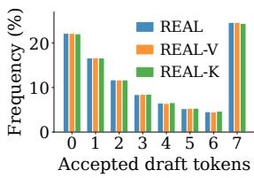  
(a) Greedy serving

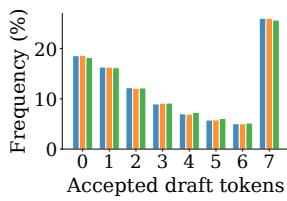  
(b) Probabilistic serving  
Figure 10: Distributions of accepted draft-token counts per decoding round for REAL, REAL-V, and REAL-K. All three methods show similar distributions under both serving protocols.

Outcome. The validation means of $\widehat { J } _ { \mathrm { B R A N C H } }$ for bREAL-V and REAL-K remain close to that for REAL (Table 16).

REAL-V shows no consistent reduction in within-request variance under either greedy or probabilistic serving at $\lambda _ { \mathrm { v a r } } ~ = ~ 0 . 0 5$ (Table 16). The per-round histograms are nearly identical across the three objectives, decreasing monotonically from 0 to 6 accepted draft tokens but rising sharply at 7, indicating a substantial fullacceptance tail (Figure 10).

REAL-K reduces the max streak, defined as the longest run of consecutive rounds with at most one accepted draft token and maximized over requests, to 23 rounds under greedy serving and 17 rounds under probabilistic serving, compared with 26 and 20 for REAL (Table 16). WTV also exhibits much longer low-acceptance streaks than REAL, reaching 50 versus 26 rounds under greedy serving and 33 versus 20 under probabilistic serving (Table 16). As an auxiliary diagnostic, REAL-K increases probabilistic $J _ { K }$ by 0.01 to 0.02 over REAL, indicating the intended earlyposition shift (Table 17). However, this small auxiliary gain does not carry over to the official serving evaluation, where REAL-K has lower AL than REAL.

<table><tr><td> $K$ </td><td>REAL</td><td>REAL-K</td></tr><tr><td>1</td><td>0.81</td><td>0.82</td></tr><tr><td>2</td><td>1.46</td><td>1.47</td></tr><tr><td>3</td><td>1.99</td><td>2.01</td></tr><tr><td>4</td><td>2.43</td><td>2.45</td></tr><tr><td>5</td><td>2.80</td><td>2.82</td></tr><tr><td>6</td><td>3.11</td><td>3.13</td></tr><tr><td>7</td><td>3.37</td><td>3.39</td></tr></table>

Table 17: Probabilistic $J _ { K }$ after hot continuation, evaluated at each cutoff $K = 1 , \ldots , 7$ . REAL-K is trained with $K = 5$ . All methods include a CE term.

We leave further exploration of variance-aware objectives and regularization strategies to future work.