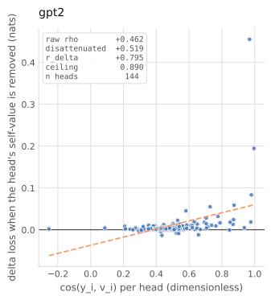
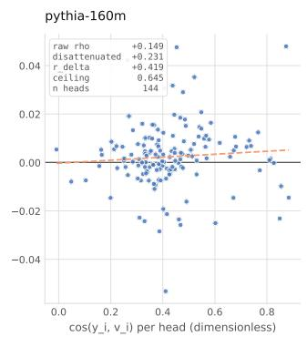
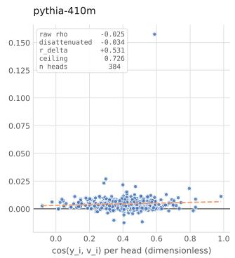
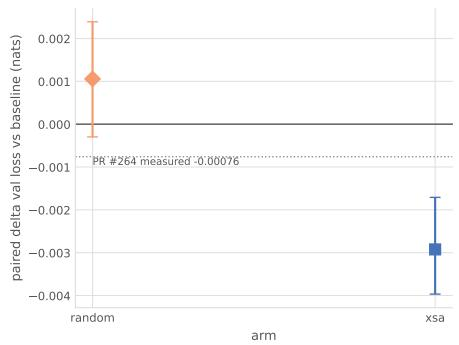
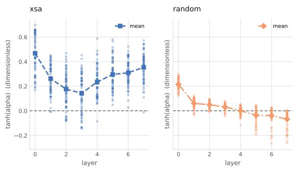
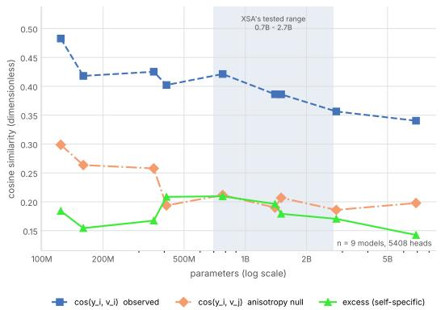
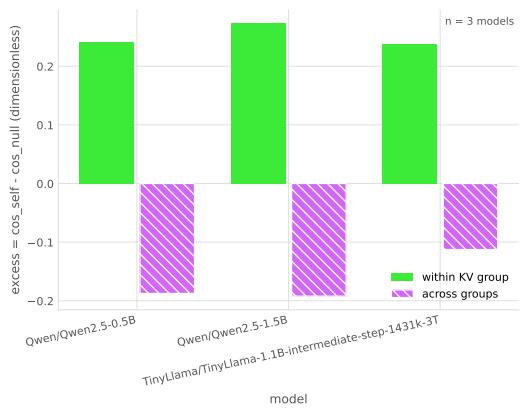
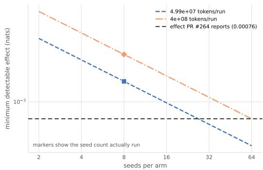
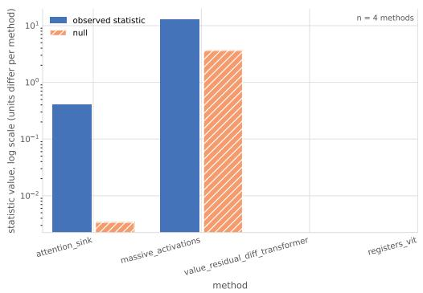

# SANITY CHECKS FOR ATTENTION SURGERY: NULL MODELS AND MATCHED INTERVENTIONS FOR REPRESENTATION-MOTIVATED DESIGN

Basavaraj R M Independent AI & ML Systems Researcher basavarajrm972@gmail.com

Aryan Bharat Kumar Independent ML Researcher ar22073yan@gmail.com

## ABSTRACT

Transformer architectural modifications frequently measure a statistic on internal representations, observe that it is large, remove it architecturally, and report an improvement. Interpreting that sequence requires evaluating whether the statistic exceeds its noise floor, whether it survives a geometric null, and whether the training gain requires the specific direction removed. We formulate these requirements as three reusable checks and apply them to self-attention removal, which deletes the component of an attention head’s output aligned with its own value vector. Across nine multi-head pretrained models (5,408 heads, 124M to 6.9B parameters), an earlier-position causal null accounts for 48% to 63% of the headvalue cosine alignment, with no monotone scale trend. Under grouped-query attention, this alignment is specific to each head’s own key–value group and reverses across groups (+0.24 to +0.27 within-group, −0.11 to −0.19 across-group). Split-half reliability demonstrates that the per-head intervention effect is resolvable in GPT-2 $( r _ { \Delta } ~ = ~ 0 . 8 0 )$ but attenuated in Pythia-160M (0.42) and Pythia-410M (0.53), whereas structural self-cosine reliability is near-perfect in all three $( r _ { \mathrm { s t a t } } > 0 . 9 9 )$ ; which statistic predicts its own intervention is model-dependent. In a pre-registered 3-arm by 8-seed paired factorial at $4 . 0 \times 1 0 ^ { 8 }$ tokens per run (399 900 672 tokens), a fixed arbitrary rank-one direction does not differ from baseline (+0.0011 nats, $p = 0 . 1 9 7 )$ , while self-directed removal lowers validation loss (−0.0029 nats, Holm-corrected $p = 0 . 0 0 2 3 )$ and outperforms the fixed arbitrary control directly (−0.0040 nats, $p = 0 . 0 0 1 8 )$ . At 50.9M scale the training benefit requires the own-value direction rather than a fixed arbitrary one, but a large cosine alignment alone does not establish redundancy in frozen models.

## 1 INTRODUCTION

Multi-head self-attention (Vaswani et al., 2017) forms each head’s output as a weighted sum of value vectors. In a causal model, position i can attend to its own value vector as well as to earlier positions. Exclusive self attention (XSA) removes the output component aligned with that value (Zhai, 2026).

Research objective. We examine whether this component is redundant and whether its cosine alignment identifies heads whose removal changes language-modelling loss. This is a question about a direction within a head, distinct from the whole-head pruning studied by Michel et al. (2019); Voita et al. (2019).

Two measurements are needed to interpret such an intervention. First, high cosine alignment need not be specific to a token’s own value: contextual representations can be anisotropic (Ethayarajh, 2019). A comparison with other values tests how much alignment survives that background geometry. Second, an edit’s loss effect must be measured reliably before it can be related to a structural statistic. A small observed correlation can reflect either a weak association or noisy measurements. Training with an arbitrary-direction edit provides a further control for whether an apparent benefit requires the own-value direction.

Check 0: is the effect resolvable? Before interpreting correlations between representation statistics and intervention outcomes, we estimate the split-half reliability $r _ { \Delta }$ of the behavioural effect and $r _ { \mathrm { s t a t } }$ of the structural statistic. Their geometric mean $\sqrt { r _ { \Delta } r _ { \mathrm { s t a t } } }$ provides an attenuation diagnostic. We classify an effect as reliable at $r _ { \Delta } \ge 0 . 6 .$ , attenuated at $0 . 3 \leq r _ { \Delta } < 0 . 6$ , and unresolvable below 0.3; this classification relies on $r _ { \Delta }$ directly rather than the geometric mean.

Check 1: does alignment exceed background geometry? We compare cos $\left( \mathbf { y } _ { i } , \mathbf { v } _ { i } \right)$ against the cosine computed with a null partner drawn uniformly from earlier positions in the same sequence. The difference measures excess alignment beyond shared causal representation geometry.

Check 2: does the training benefit depend on direction? We train self-directed and arbitrarydirection arms with identical gate parameterisations and evaluate each against baseline and against each other across paired random seeds. The protocol pre-registers the arbitrary-direction comparison as primary.

Contributions. We provide the three checks and a reconstruction gate for verifying the captured head layout (Sections 3 and 3.5). The experiments comprise an eight-seed training factorial, geometry measurements across twelve pretrained models, and reliability and correlation estimates for three models (Sections 5.3 and 5.2–5.5).

## 2 RELATED WORK

Head importance and pruning. Michel et al. (2019) and Voita et al. (2019) show that many attention heads can be pruned with limited degradation on their evaluated tasks. Their results concern the importance of whole heads. We instead intervene along one direction within each head and use an arbitrary-direction arm to test the specificity of that choice.

Circuit-level accounts. Elhage et al. (2021) decompose attention into QK and OV circuits and treat the diagonal of the attention pattern as one contribution to the output. Projecting the full head output onto its own value direction can also remove aligned contributions from earlier tokens. It therefore differs from deleting only the diagonal term.

Representation geometry. Ethayarajh (2019) finds anisotropy in contextual representations from ELMo, BERT, and GPT-2. This motivates a geometric control; it does not establish the geometry of every head examined here. Check 1 measures that background using values from earlier positions in the same sequence.

Isotropy is not universal. Timkey & van Schijndel (2021) show that a small number of highvariance coordinates dominate cosine similarity in contextual spaces, so a raw cosine can be large without reflecting shared structure. Machina & Mercer (2024) further report that the large Pythia models have approximately isotropic embedding spaces, which bounds how much a generic anisotropy argument can explain. Our null is computed within the same run, at one stated sequence length, on the same documents as the observed statistic, so it measures the earlier-position background of each model directly rather than assuming a uniform anisotropy across the ladder. Across the multi-head ladder, the earlier-position null accounts for 48.1% to 63.1% of cos $\left( \mathbf { y } _ { i } , \mathbf { v } _ { i } \right)$ . Even at 6.9B parameters, 58.1% of the alignment (0.198 of 0.340) remains attributable to the null, showing that background geometry persists at billion-parameter scales rather than vanishing with model capacity.

Grouped-query attention. Ainslie et al. (2023) share key and value projections across groups of query heads. We compare own-group and neighbouring-group values to assess the statistic’s dependence on that sharing in Section 5.5.

## 3 METHOD

## 3.1 THE INTERVENTION

Let head h at layer ℓ produce output $\mathbf { y } _ { i } \in \mathbb { R } ^ { d _ { h } }$ at position $i ,$ and let $\mathbf { v } _ { i }$ be the value vector that same head writes at i. Write $\hat { \mathbf { v } } _ { i } = \mathbf { v } _ { i } / \lVert \mathbf { v } _ { i } \rVert$ . The self-directed removal, which we call XSA, replaces the head output with

$$
\mathbf { z } _ { i } = \mathbf { y } _ { i } - \operatorname { t a n h } ( \alpha ) \left. \mathbf { y } _ { i } , { \hat { \mathbf { v } } } _ { i } \right. { \hat { \mathbf { v } } } _ { i } ,\tag{1}
$$

where α is a gate for each layer and head. The edit acts before the output projection. For frozen models, we set the multiplier to one and intervene on one head at a time, excluding the first token. In the trained factorial, gates start at zero and are learned jointly with the model; all positions are included. A zero gate disables the edit, and a negative gate adds an aligned component. The implementation stabilises normalisation by using $\mathbf { v } _ { i } / ( \bar { \lVert \mathbf { v } _ { i } \rVert + \epsilon } )$ , with $\epsilon = 1 \bar { 0 } ^ { - 8 }$ for frozen measurements and $1 0 ^ { - 6 }$ for training. Equation 1 states the idealised unit-direction form.

The RANDOM control uses the same gated edit with a fixed arbitrary direction for each layer and head. Directions are sampled by normalising isotropic Gaussian vectors, seeded by layer index, and held fixed across positions, training steps, and run seeds. Both arms use the same normalisation and gate parameterisation, but their projection magnitudes need not match. The harness also implements MEANVAL and DIAGMASK (Appendix $\mathbf { A } ) ;$ neither appears in the reported three-arm factorial.

## 3.2 CHECK 0: RESOLVABILITY

Split the evaluation corpus into halves A and B and measure each head’s effect $\Delta$ and structural statistic on both halves. Spearman correlations across heads give the split-half reliabilities $r _ { \Delta }$ and $r _ { \mathrm { s t a t } }$ . The archived analysis applies no Spearman–Brown correction and reports:

$$
\rho _ { \mathrm { m a x } } = \sqrt { r _ { \Delta } r _ { \mathrm { s t a t } } } , \qquad \rho _ { \mathrm { d i s a t t } } = \rho _ { \mathrm { r a w } } / \rho _ { \mathrm { m a x } } .\tag{2}
$$

We classify the effect as reliable at $r _ { \Delta } \ge 0 . 6 ,$ , attenuated at $0 . 3 \le r _ { \Delta } < 0 . 6$ , and unresolvable below 0.3. An unresolvable effect does not support interpreting a small correlation as absence of an association. Each structural statistic uses its own reliability estimate.

For $\rho _ { \mathrm { r a w } } .$ , the statistic and effect are each averaged across the two halves before computing their Spearman correlation across heads. Because the denominator in Equation 2 uses half-sample reliabilities, the adjusted value is a diagnostic, not a calibrated estimate of the latent correlation between the pooled measurements. We retain the archived notation $\rho _ { \mathrm { m a x } }$ , but do not interpret it as a strict bound on those pooled correlations.

## 3.3 CHECK 1: THE ANISOTROPY NULL

For each head and position, $\cos ( \mathbf { y } _ { i } , \mathbf { v } _ { i } )$ is compared against $\cos ( \mathbf { y } _ { i } , \mathbf { v } _ { j } )$ with $j$ drawn uniformly from $\{ 1 , \ldots , i - 1 \}$ using one-based indexing. The first token is excluded because it has no earlier partner and its head output equals its own value. The statistic, excess, is the mean paired difference between the cosines. It controls for alignment with earlier values, not all sources of anisotropy. The model-ladder figure reports point estimates; the harness supports layer-cluster bootstrap intervals for head-level data.

Two further diagnostics use different nulls. For attention sinks, we compare attention mass on the first token with the average mass on the next three tokens, using queries from the ninth token onward. For massive activations, we compare the mean maximum absolute hidden coordinate, scaled by the hidden tensor’s standard deviation, with the Gaussian reference ${ \sqrt { 2 \log d } }$ for width d. This reference is a scale approximation, not an exact finite-width expected maximum.

## 3.4 CHECK 2: MATCHED INTERVENTION

Check 2 is run as a paired factorial over seeds. For each seed, all arms train from an identical initialisation on an identical token stream, so the paired difference controls for variation shared within a seed. Define $\Delta$ as the arm’s validation loss minus baseline loss, so negative values indicate improvement. The protocol-specified primary endpoint is RANDOM versus baseline. The XSA comparison is secondary, with Holm correction (Holm, 1979) restricted to secondary endpoints. XSA is the only secondary in the completed factorial, so its adjusted and unadjusted p-values coincide. We report two-sided paired t-tests and percentile bootstrap intervals over seed differences. Separate baseline comparisons do not constitute a direct test of XSA against RANDOM.

The analysis approximates the minimum detectable effect at 80% power and $\alpha = 0 . 0 5$ by

$$
\mathbf { M D E } \ = \ 2 . 9 \sigma _ { \mathrm { p a i r e d } } / { \sqrt { n } } ,\tag{3}
$$

using the observed $\sigma _ { \mathrm { p a i r e d } }$ . We call this the realised MDE to distinguish it from the planning forecast. It describes sensitivity under the approximation, not achieved power or a hard threshold for detection.

## 3.5 THE RECONSTRUCTION GATE

A head-layout error can preserve tensor shape while changing the intervention. We rebuild ${ \textbf { y } } =$ A expand\_kv(V) from the captured attention matrix and values, then compare it with the input to the output projection. The gate rejects a relative Frobenius error above $1 0 ^ { \div 2 }$ or a non-finite value. In each reliability run, it checks the first, middle, and last layers on one document before measuring head effects.

The implementation notes record an initial Pythia-160M error of $2 . 0 \times 1 0 ^ { - 4 }$ and errors of 1.39 to 1.50 after reversing heads, rolling the head axis, or omitting a transpose. These observations motivated the threshold. In the archived reliability runs, the maximum error across the checked layers is approximately $1 . 6 \times 1 0 ^ { - 3 }$ for each model, below the same threshold. A passed gate supports the tensor reconstruction at those checked layers; it does not validate the intervention’s semantic interpretation.

## 4 EXPERIMENTAL SETUP

Frozen-model measurements. Check 1 covers twelve pretrained models, including nine multihead models from 124M to 6.9B parameters and three grouped-query models. These include the GPT-2 family (Radford et al., 2019) and the Pythia suite (Biderman et al., 2023). Model revisions are recorded by hash. The geometry measurements use WikiText-103 test documents and each run’s recorded block length. Check 0 is restricted to GPT-2, Pythia-160M, and Pythia-410M, using 64 documents per half at a fixed length of 128 tokens. Shorter documents are dropped rather than padded. This length constraint applies to the reliability runs, not to the full model ladder.

Trained factorial. Check 2 uses a decoder-only model with eight layers, eight heads per layer, and hidden width 512, approximately 50.9M parameters. The data pipeline uses FineWeb-Edu’s sample-10BT stream with a fixed disjoint validation holdout. We trained from scratch on eight seeds (7, 42, 99, 512, 1337, 2024, 8191, 31337) under three arms (BASELINE, XSA, RANDOM), giving 24 cells. Each cell sees 399 900 672 tokens, rounded down from the budget to a whole number of batches. Runs share initialisation, token order, learning-rate schedule, and validation batches within each seed. All three arms for a seed complete before the next seed starts.

Budget. The completed factorial cost \$15.58 against a \$20 ceiling. The ledger records 16.98 GPU-hours spent in training cells; billing covers pod uptime, including time outside those cells. An earlier $5 \times 1 0 ^ { 7 }$ -token pilot is retained separately and is not pooled with the primary runs.

## 5 RESULTS

## 5.1 RESOLVABILITY

Under the Check 0 thresholds, the behavioural effect is reliable in GPT-2 $( r _ { \Delta } = 0 . 7 9 5 )$ and attenuated in Pythia-160M (0.419) and Pythia-410M (0.531; Table 1). All three models avoid the unresolvable category $( r _ { \Delta } < 0 . 3 )$ . Structural self-cosine reliability is near-perfect across all three models (0.991 to 0.997). The attenuation is therefore driven by measurement noise in the single-head intervention effect rather than the underlying representation statistic. For Pythia-160M, dividing the raw self-cosine correlation of 0.149 by the attenuation diagnostic 0.645 yields 0.231; this diagnostic adjustment does not substitute for an adequately resolved behavioural measurement.

<table><tr><td>Model</td><td> $r _ { \Delta }$ </td><td> $r _ { \mathrm { s t a t } }$ </td><td> $\rho _ { \mathrm { m a x } }$ </td><td>Verdict</td></tr><tr><td>GPT-2</td><td>0.795</td><td>0.997</td><td>0.890</td><td>reliable</td></tr><tr><td>Pythia-160M</td><td>0.419</td><td>0.994</td><td>0.645</td><td>attenuated</td></tr><tr><td>Pythia-410M</td><td>0.531</td><td>0.991</td><td>0.726</td><td>attenuated</td></tr></table>

Table 1: Check 0 split-half reliability, $n = 1 4 4$ heads for GPT-2 and Pythia-160M and $n = 3 8 4$ for Pythia-410M, at a fixed sequence length of 128 tokens with 64 documents per half. The verdict uses $r _ { \Delta } ; r _ { \mathrm { s t a t } }$ here refers to self-cosine. $\rho _ { \mathrm { m a x } }$ is the attenuation factor in Equation 2.
<table><tr><td>Model</td><td>Statistic</td><td>ρraw</td><td>ρmax</td><td>ρdisatt</td></tr><tr><td rowspan="2">GPT-2</td><td>self-cosine</td><td>+0.462</td><td>0.890</td><td>+0.519</td></tr><tr><td>excess</td><td>+0.279</td><td>0.891</td><td>+0.313</td></tr><tr><td rowspan="2">Pythia-160M</td><td>self-cosine</td><td>+0.149</td><td>0.645</td><td>+0.231</td></tr><tr><td>excess</td><td>+0.189</td><td>0.646</td><td>+0.292</td></tr><tr><td rowspan="2">Pythia-410M</td><td>self-cosine</td><td>-0.025</td><td>0.726</td><td>-0.034</td></tr><tr><td>excess</td><td>+0.249</td><td>0.727</td><td>+0.342</td></tr></table>

Table 2: Spearman correlation between the structural statistic and the measured behavioural effect, raw and adjusted using Equation 2. The raw correlation uses averages over both halves; the adjustment uses each statistic’s own half-sample reliability.

## 5.2 STRUCTURAL STATISTIC VERSUS BEHAVIOURAL EFFECT

The relation between self-cosine and the measured effect varies by model (Figure 1, Table 2). GPT-2 has a raw correlation of +0.462 and an adjusted value of +0.519; Pythia-410M has an adjusted value of −0.034, close to zero. For excess, the adjusted correlations are +0.313, +0.292, and +0.342 across the three models. These are descriptive rank associations, not estimates of explained loss variance or out-of-sample predictive accuracy.

An earlier Pythia-160M run reported a raw excess correlation of +0.487, compared with +0.189 in the current run. Several protocol changes accompanied the rerun (Appendix C), so their individual contributions to this difference are not isolated.

## 5.3 THE PAIRED FACTORIAL

All 24 training cells completed, giving eight paired seeds for each contrast in Table 3 and Figure 2.
<table><tr><td></td><td>RANDOM (primary)</td><td>XSA (secondary)</td></tr><tr><td>Mean ∆ (nats)</td><td>+0.001056</td><td>-0.002924</td></tr><tr><td>CI low</td><td>-0.000298</td><td>-0.003967</td></tr><tr><td>CI high</td><td>+0.002390</td><td>-0.001709</td></tr><tr><td>t</td><td>+1.43</td><td>-4.67</td></tr><tr><td>p</td><td>0.197</td><td>0.0023</td></tr><tr><td>Holm p</td><td>n/a</td><td>0.0023</td></tr><tr><td>Cohen&#x27;s dz</td><td>+0.504</td><td>-1.649</td></tr><tr><td> $\sigma _ { \mathrm { p a i r e d } }$ </td><td>0.002095</td><td>0.001773</td></tr><tr><td>Realised MDE</td><td>0.00215</td><td>0.00182</td></tr></table>

Table 3: Check 2, eight complete paired seeds, 399 900 672 tokens per run. Both contrasts are against BASELINE. Positive $\Delta$ means higher loss. Intervals are 95% percentile bootstrap intervals over paired seed differences. The realised MDE uses the observed $\sigma _ { \mathrm { p a i r e d } }$ . Holm correction does not apply to the primary endpoint.

  
Figure 1: Self-cosine against the loss effect of frozen-head intervention. Points use the half-A statistic and the effect averaged over both halves; panel annotations report the pooled-statistic correlations in Table 2. Dashed least-squares lines are visual guides, not tests of significance. Vertical scales differ across panels.

  
Figure 2: Paired difference in validation loss against baseline, with 95% intervals, over eight paired seeds. The RANDOM interval crosses zero and the XSA interval lies below zero. The horizontal reference line marks an external reference value. The −0.00076 value comes from the H200 comparison in PR #264, which uses different training step counts between arms; it is not a matched replication target for this experiment.

For the primary endpoint, the RANDOM arm’s loss difference is +0.001056 nats $( p = 0 . 1 9 7 )$ . Its 95% interval, [−0.000298, +0.002390], spans both directions, indicating no detectable change from baseline.

The secondary endpoint, XSA versus baseline, is −0.002924 nats with interval [−0.003967, −0.001709], t = −4.67, and Holm-corrected $p \ = \ 0 . 0 0 2 3$ XSA therefore lowers loss in this training setting. The realised MDE from Equation 3 is 0.00182 nats for the XSA contrast and 0.00215 for the control contrast. The observed XSA effect is about 1.6× its approximate MDE, whereas the control effect is smaller than its MDE. Figure 6 shows sensitivity estimates for the control at both token budgets.

The benefit concerns a model trained with learned removal. It does not show that the same component can be removed from an already trained model without cost. Beyond the separate contrasts against baseline, a direct paired comparison between XSA and RANDOM across the eight seeds confirms that self-directed removal outperforms the fixed arbitrary control directly (mean paired difference −0.003980 nats, t = −4.86, p = 0.0018).

Final gates differ between arms (Figure 3). XSA’s layer means range from 0.14 to 0.47, indicating partial removal on average. The control’s later-layer means are negative, indicating addition along its direction. These endpoint measurements do not explain the loss difference.

  
Figure 3: Final learned gates tanh(α) for all heads and seeds, with markers at the layer mean. XSA has positive means at every layer. The RANDOM mean approaches zero by layer four and becomes negative in later layers. A negative gate adds the projected component. These are endpoint measurements, not gate trajectories during training.

  
Figure 4: Check 1 across the nine multi-head models in the ladder, every model pinned by revision hash. Observed $\cos ( \mathbf { y } _ { i } , \mathbf { v } _ { i } )$ , the anisotropy null $\cos ( \mathbf { y } _ { i } , \mathbf { v } _ { j } )$ , and their difference. The observed curve generally declines with scale; the excess has no monotone trend.

## 5.4 CHECK 1 ACROSS THE MODEL LADDER

Across nine multi-head models and 5408 heads, self-cosine generally declines with model size (Figure 4). It is 0.483 for GPT-2 at 124M parameters and 0.340 for Pythia-6.9B. The earlier-position null also declines overall. Excess remains between 0.14 and 0.21 without a monotone trend. These observations do not establish scale invariance, but show that the raw cosine’s trend is partly shared by its null. The grouped-query models are examined separately below.

Both additional GPT-2 diagnostics exceed their respective nulls (Figure 7). Attention mass on the first token is 0.403, compared with 0.003 on the matched early positions. The massive-activation statistic is 12.87 against a Gaussian reference of 3.65, leaving approximately 71.7% after subtraction. Neither pattern is explained away by its chosen null. The two unexecuted diagnostics are shown as blank categories.

## 5.5 GROUPED-QUERY ATTENTION

For each grouped-query model, we compare the head output’s cosine with its own group’s value and with a neighbouring group’s value at the same position. Both excess values subtract the owngroup earlier-position null. For Qwen2.5-0.5B (14 query heads over 2 key–value heads), own-group excess is +0.2415 and neighbouring-group excess is −0.1876. Qwen2.5-1.5B and TinyLlama-1.1B show the same signs (Figure 5). The alignment thus depends on which group’s value is used. A negative across-group excess means alignment below the own-group null, not necessarily a negative raw cosine. The harness leaves this contrast undefined for multi-head models, which lack groups sharing a value projection.

  
Figure 5: Within-group against across-group excess for the three grouped-query models. Both subtract the own-group earlier-position null. Own-group excess is positive and neighbouring-group excess negative in all three models. The harness does not report this grouping contrast for multihead models.

## 6 LIMITATIONS

Training and scale. Check 2 evaluates learned intervention in a 50.9M parameter model trained for $4 . 0 \overset { \overline { { \times } } } { \times } 1 0 ^ { 8 }$ tokens per run. It does not determine effect signs or magnitudes at larger scales, such as the 0.7B–2.7B regimes evaluated in prior work. Furthermore, the frozen and trained settings differ in gate constraints and first-token handling, so their outcomes reflect related but non-identical interventions.

Statistic families. Both evaluated structural statistics rely on cosine similarities. Alternative formulations based on attention probabilities or projection norms may exhibit different empirical associations with head interventions.

Reliability coverage and correlation scope. Intervention reliability was evaluated on three models in the main study, and extended to Pythia-1.4B $( r _ { \Delta } = 0 . 6 7 )$ and Pythia-2.8B (0.63; Appendix D), where the effect is reliable under a half-budget protocol (32 documents per half). The remaining seven ladder models lack intervention measurements. Disattenuation applies half-sample reliabilities to pooled correlations, meaning adjusted values serve as diagnostic bounds alongside raw values rather than corrected ground truth. Rank correlations describe within-sample monotonicity rather than out-of-sample prediction.

Control scope. While RANDOM and XSA share a rank-one parametric form, their projected norms and converged gate strengths diverge. The trained comparison does not isolate projection direction from magnitude. The control direction is also fixed across positions, whereas XSA removes a different, input-dependent direction at every token, so the contrast confounds own-value specificity with per-token versus static projection. A per-token control, such as projecting out an earlier token’s value as in the Check 1 null, would separate the two. Additionally, reconstruction gates verify captured tensor layouts and indexing, but do not prove that a value-aligned direction carries solely self-position information.

Reference mismatch. The GPT-2 geometry measurement did not reproduce the project’s reference triple within its stated tolerance of 0.01. At block 512 the measured self-cosine, null, and excess were 0.4828, 0.2987, and 0.1840, against reference values 0.5406, 0.3798, and 0.1608.

A length sweep accounts for most of that gap. The reference triple is quoted without a sequence length, and the null is strongly length-dependent while the observed self-cosine is close to flat.

Across 64 to 1024 tokens the null moves by 0.096, nine times the tolerance, and at 64 tokens it sits 0.005 from the reference value, inside it. The excess moves by 0.080 and comes within 0.011 at 256 tokens. The self-cosine moves by only 0.016 and never comes within 0.051, so length does not account for that component; its residual gap is consistent with a difference in corpus, truncation, or head-level aggregation, and we have not identified which.

The consequence for Check 1 is narrow. The null is measured inside the same runs, at one stated length, on the same documents as the observed statistic, so the comparison the check makes is internally matched whatever the absolute level. The excess is positive at every length tested. What the sweep does show is that a self-specific fraction quoted without a length is not comparable across studies: the same GPT-2 gives 0.235 at 64 tokens and 0.412 at 1024. We therefore report the length everywhere and do not claim reproduction of the reference triple.

## 7 CONCLUSION

Learned self-directed removal lowers validation loss by 0.0029 nats in our eight-seed factorial (p = 0.0023) and outperforms a fixed arbitrary rank-one control directly by 0.0040 nats $( p = 0 . 0 0 1 8 )$ The arbitrary-direction control does not differ from baseline (+0.0011 nats, $p = 0 . 1 9 7 )$ . At 50.9M scale the training benefit therefore requires the own-value direction rather than a fixed arbitrary one; a per-token control remains to be tested.

However, a within-sequence null shows that background representation geometry accounts for 48% to 63% of raw self-value alignment across nine models through 6.9B parameters, and grouped-query attention reverses the alignment across key–value groups. Furthermore, the intervention effect is reliably resolvable in GPT-2 but attenuated in Pythia-160M and Pythia-410M, becoming reliable in Pythia-1.4B and 2.8B under a half-budget protocol. Large internal alignments alone do not demonstrate representational redundancy. Modifying representations based on internal statistics requires establishing measurement resolvability, empirical null comparisons, and matched directional controls.

## AI USE STATEMENT

AI assistants were used during the development of this work. The authors defined the research question, experimental design, methodological choices, and interpretation of results. AI assistants were also used to review the analysis for errors. The authors take responsibility for every claim, citation, and number in this paper. Use by category:

• Synthetic data. None. All text comes from public corpora; no generated data enters any result.

• Hypotheses. Author-defined. The research question, the three checks, and the preregistered primary endpoint were specified by the authors before any assistant was involved in the experimental programme.

• Theory, proofs, and conceptual frameworks. None. The paper contains no theorem or proof, and the conceptual framing of the three checks is author-originated.

• Methodology and experiment design. Author-defined. Assistants enumerated candidate controls and failure modes and drafted the power and token-budget arithmetic, which the authors reviewed before adoption.

• Code, data analysis, and figures. Written by the authors. AI assistants were used for debugging. Every table cell and manifest claim is recomputed from the stored result files by a checker rather than transcribed, and every figure is generated from those files; no figure content was drawn or edited by hand.

• Interpreting results. Author-owned. Assistants were used adversarially against the draft, and a second model from a different vendor reviewed the analysis; both surfaced errors the authors then corrected, including a reversed sign convention in an earlier draft.

• Writing and editing. Written by the authors. AI assistants were used for grammar and language checking.

• Translation. None. The work was written in English throughout.

• Literature search, references, and structure. Assistants were used for literature search and summarisation, reference formatting, and suggestions on section structure and title wording. The authors verified every cited work against its original source.

## ETHICS STATEMENT

This work analyses the internal structure of publicly released pretrained language models and trains small models from scratch on public text. It introduces no new data collection, no human subjects, and no deployed system. The small-model training result does not establish that attention components can be pruned safely in deployed models. Any such use requires evaluation in the intended model and setting.

## REPRODUCIBILITY STATEMENT

All code, configuration records, raw per-head logs, result files, and validation scripts are available at https://github.com/Basavarajearlybird/ SANITY-CHECKS-FOR-ATTENTION-SURGERY\_Original under the MIT license, and archived on Zenodo at https://doi.org/10.5281/zenodo.24096410. The repository contains per-run factorial records, paired-test summaries, per-head geometry and intervention measurements, and revision hashes for all twelve pretrained models. The pilot runs are stored apart from the primary factorial and are labelled as such.

Every figure is generated from these stored results. The tables are written by hand, so a checker recomputes each of their 48 cells from the archived result files and compares against the printed value at the precision shown. Cells that the manuscript derives are recomputed rather than read back: $\rho _ { \mathrm { m a x } }$ from its two reliabilities, $\rho _ { \mathrm { d i s a t t } }$ from the raw correlation and that factor, and the realised MDE from the observed paired standard deviation and seed count. Tables 1–3 currently agree with their sources on all 48 cells. The checker also reports any table row it does not know how to verify, so an unchecked row cannot pass silently.

Separately, a manifest recomputes 33 numerical claims from the committed artifacts and fails on any that does not reproduce within a stated tolerance. All 33 reproduce from the archived files.

## REFERENCES

Joshua Ainslie, James Lee-Thorp, Michiel de Jong, Yury Zemlyanskiy, Federico Lebrón, and Sumit Sanghai. GQA: Training generalized multi-query transformer models from multi-head checkpoints. arXiv preprint arXiv:2305.13245, 2023.

Stella Biderman, Hailey Schoelkopf, Quentin Anthony, et al. Pythia: A suite for analyzing large language models across training and scaling. arXiv preprint arXiv:2304.01373, 2023.

Nelson Elhage, Neel Nanda, Catherine Olsson, et al. A mathematical framework for transformer circuits. Transformer Circuits Thread, 2021.

Kawin Ethayarajh. How contextual are contextualized word representations? comparing the geometry of BERT, ELMo, and GPT-2 embeddings. arXiv preprint arXiv:1909.00512, 2019.

Sture Holm. A simple sequentially rejective multiple test procedure. Scandinavian Journal of Statistics, 6(2):65–70, 1979.

Anemily Machina and Robert Mercer. Anisotropy is not inherent to transformers. In Proceedings of the 2024 Conference of the North American Chapter of the Association for Computational Linguistics: Human Language Technologies (Volume 1: Long Papers), 2024. doi: 10.18653/v1/ 2024.naacl-long.274.

Paul Michel, Omer Levy, and Graham Neubig. Are sixteen heads really better than one? In Advances in Neural Information Processing Systems, 2019.

Alec Radford, Jeffrey Wu, Rewon Child, David Luan, Dario Amodei, and Ilya Sutskever. Language models are unsupervised multitask learners. OpenAI Technical Report, 2019.

William Timkey and Marten van Schijndel. All bark and no bite: Rogue dimensions in transformer language models obscure representational quality. In Proceedings of the 2021 Conference on Empirical Methods in Natural Language Processing, pp. 4527–4546, 2021.

Ashish Vaswani, Noam Shazeer, Niki Parmar, Jakob Uszkoreit, Llion Jones, Aidan N Gomez, Lukasz Kaiser, and Illia Polosukhin. Attention is all you need. In Advances in Neural Information Processing Systems, 2017.

Elena Voita, David Talbot, Fedor Moiseev, Rico Sennrich, and Ivan Titov. Analyzing multi-head self-attention: Specialized heads do the heavy lifting, the rest can be pruned. In Proceedings of the 57th Annual Meeting of the Association for Computational Linguistics, 2019.

Shuangfei Zhai. Exclusive self attention. arXiv preprint arXiv:2603.09078, 2026. URL https: //arxiv.org/abs/2603.09078.

  
Figure 6: Approximate MDE for the RANDOM-versus-baseline contrast, using the observed paired standard deviation at each token budget. Markers show the eight seeds actually run; the remaining points extrapolate at fixed variance. Both eight-seed estimates exceed the external reference magnitude of 0.00076 nats from the PR #264 comparison described in Figure 2.

  
Figure 7: Observed statistics and their respective nulls for two GPT-2 diagnostics: attention mass for attention sinks and standard-deviation units for massive activations. Both exceed their nulls. The logarithmic axis accommodates different magnitudes; values across diagnostics have different units. The two blank categories were not run: one requires training matched models, and the other requires a vision-model harness.

## A ARM DEFINITIONS

BASELINE leaves the head output unchanged. XSA uses Equation 1, with a learned gate in the factorial and a unit multiplier in the frozen-head measurements. RANDOM substitutes a fixed arbitrary direction per layer and head and learns the same type of gate.

The two additional harness arms were not evaluated in the primary factorial. MEANVAL uses a detached exponential moving average of the head’s batch-mean value, updated only during training. DIAGMASK operates on logits. Its default gated form subtracts 30 tanh(α) from diagonal logits before softmax; the optional hard-mask form sets them to −∞. Both leave the first token unmasked because it has no alternative key. These implementations should not be read as completed experimental arms.

## B BUDGET LEDGER

The ledger records completed seed blocks and separates training-cell time from billed pod uptime. Adding cell hours to uptime would count training twice. An earlier forecast of \$18.16 made that error; the corrected projection at the same stage was \$13.41. The final billed total was \$15.58.

## C CHANGES TO THE MEASUREMENT PROTOCOL

The reliability runs now use a fixed length of 128 tokens. Earlier runs allowed the common length to depend on the selected documents: 142 tokens at 24 documents per half and 137 at 64. This changes the null partner set as well as the measurement budget. The analysis also now pools both halves of the statistic and effect and uses statistic-specific reliability for disattenuation. The earlier Pythia-160M raw excess correlation of +0.487 and the current value of +0.189 belong to different runs; their difference does not isolate the contribution of any single correction. Earlier outputs are retained for comparison.

Three departures from the pre-specified plan affect Check 2. The plan recorded after the pilot called for 12 seeds per arm; the reported factorial uses 8. The planned scale check at a larger training configuration was not run, so no training result beyond 50.9M parameters is reported. The MEANVAL and DIAGMASK arms were dropped before the factorial, leaving XSA as the only secondary endpoint. The primary endpoint, the token budget band, and the analysis were not changed.

## D EXTENDED RELIABILITY AT SCALE

To determine whether the attenuation observed in Pythia-160M $( r _ { \Delta } = 0 . 4 1 9 )$ and Pythia-410M (0.531) is an artifact of smaller parameter counts or persists at scale, we extended Check 0 split-half reliability and Check 0–A2 correlations to EleutherAI/pythia-1.4b (24 layers, 16 query heads, $n = 3 8 4 )$ and EleutherAI/pythia-2.8b (32 layers, 32 query heads, $n = 1 0 2 4 )$ . Both models were evaluated with the Check 0 protocol at half the document budget (32 rather than 64 documents per half, fixed sequence length of 128 tokens, evaluated in bfloat16 on an NVIDIA RTX 6000 Ada Generation GPU).

Both larger models pass the $r _ { \Delta } \geq 0 . 6 0$ threshold and are classified as RELIABLE (Table 4). Across the Pythia models tested, $r _ { \Delta }$ is 0.419, 0.531, 0.666, and 0.632; the two larger models are more reliable despite the smaller budget, but the sequence is not monotone and the budgets differ, so we do not claim a scale trend.
<table><tr><td>Model</td><td>Statistic</td><td> $r _ { \Delta }$ </td><td> $r _ { \mathrm { s t a t } }$ </td><td> $\rho _ { \mathrm { m a x } }$ </td><td>ρraw</td><td>ρdisatt</td><td>Verdict</td></tr><tr><td>Pythia-1.4B</td><td>self-cosine excess</td><td>0.666</td><td>0.982 0.988</td><td>0.809 0.811</td><td>+0.187 +0.249</td><td>+0.232 +0.307</td><td>reliable</td></tr><tr><td>Pythia-2.8B</td><td>self-cosine excess</td><td>0.632</td><td>0.967 0.982</td><td>0.782 0.788</td><td>+0.003 -0.124</td><td>+0.003 -0.158</td><td>reliable</td></tr></table>

Table 4: Check 0 split-half reliability and Check 0–A2 rank correlations for extended Pythia models (32 documents per half, 128 tokens). A@V reconstruction Frobenius error was $1 . 6 \dot { 6 } \times 1 0 ^ { - 3 }$ on Pythia-1.4B and $1 . 6 6 \times 1 0 ^ { - 3 }$ on Pythia-2.8B. As in Table 2, disattenuation uses each statistic’s own split-half reliability.

The association between representation statistics and intervention outcomes varies across models. In Pythia-1.4B, the null-corrected excess cosine $( \rho _ { \mathrm { d i s a t t } } = + 0 . 3 0 7 )$ outperforms raw self-cosine (+0.232) in predicting intervention effect, mirroring Pythia-410M. In Pythia-2.8B, raw self-cosine completely decouples from intervention effect $( \rho _ { \mathrm { r a w } } = + 0 . 0 0 3 , \rho _ { \mathrm { d i s a t t } } = + 0 . 0 0 3 )$ , despite high measurement reliability $( r _ { \Delta } = 0 . 6 3 2 )$ , and the excess correlation is negative $( \rho _ { \mathrm { d i s a t t } } = - 0 . 1 5 8 )$ , so the advantage of excess over self-cosine seen in Pythia-410M and 1.4B does not hold here. This indicates that high representation-level cosine alignment does not reliably index intervention sensitivity.