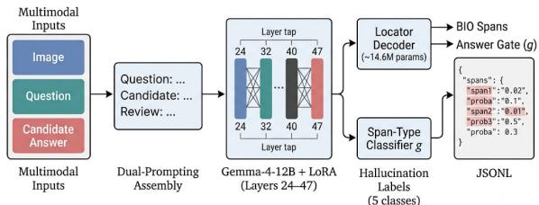
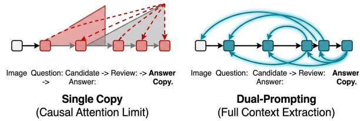
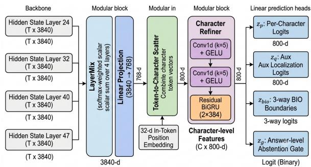

# Sckwoky at SHROOM-Visions: Character-Level Hallucination-Span Detection in Image-Conditioned VLMs via Dual-Prompted LoRA Decoders

Mikhail Kulakov, Ruslan Solikhov, Ivan Bondarenko

Novosibirsk State University

m.kulakov@g.nsu.ru, r.solikhov@g.nsu.ru, i.bondarenko@g.nsu.ru

## Abstract

We present our system for the SHROOMvisions 2026 shared task on character-level hal lucination span detection in image-conditioned vision-language model (VLM) responses, evaluated across English, French, Italian, and Chinese. The detector is built on a frozen Gemma-4-12B-it backbone with trainable LoRA adapters (∼10.7M parameters). Because the backbone is a causal decoder, hidden states read from a single copy of an answer cannot attend to subsequent tokens; we therefore re peat the candidate answer within one prompt and extract features from its second occurrence, giving every position approximate bidirectional context in a single non-autoregressive pass. A character-level locator combines intermediate hidden states to predict hallucination probabilities, BIO boundaries, and a response-level ab stention score, while separate language-specific classifiers assign one of five hallucination types to each predicted span. On the closed test set, our system reaches a macro-averaged character IoU of 0.4404, more than doubling the official baseline (0.1854), and ranks 5th–6th on IoU across the four languages. On the English tun ing split, controlled ablations attribute a gain to the repeated answer that is comparable to that of LoRA adaptation (its held-out gain is smaller and concentrated on hallucinated answers), and they show that the detector relies on the image– answer pairing: shuffling images across examples drives IoU down to the level of the predictnothing floor or below it in every language. In deployments where the same Gemma-4-12B-it model also generates answers, its base weights can be reused, making the approach practical for local question-answering systems that cannot run a separate verifier.

## 1 Introduction

Hallucinations in Vision-Language Models (VLMs) remain a central reliability challenge for multimodal systems (Liu et al., 2024). The

SHROOM shared-task series introduced modelaware and model-agnostic hallucination detection (Mickus et al., 2024) and was later extended to multilingual character-level span detection in Mu-SHROOM (Vázquez et al., 2025).

This paper describes our system for the SHROOM-visions 2026 shared task (Vázquez et al., 2026), built around the multilingual SHEEP benchmark (Mickus et al., 2026). The task requires identifying hallucinated character spans in VLMgenerated answers. Figure 1 gives an overview of our pipeline.

  
Figure 1: High-level overview of our hallucination detection pipeline, showing the information flow from multimodal input to final labeled spans.

Our response-repetition scheme adapts echostyle contextualization, previously explored for sentence embeddings and sequence labeling, to multimodal character-level hallucination localization (Springer et al., 2025; Kukic et al. ´ , 2026). Because our backbone, Gemma-4-12B-it, is a causal decoder, hidden states extracted from a single copy of an answer cannot attend to subsequent tokens. To bypass this, our prompt includes the candidate answer twice. The first copy serves as context, while features are extracted from the tokens of the second (“review”) copy. This allows every position to attend to the image, the question, and the entire first copy (Figure 2), approximating bidirectional context without modifying the causal attention mask.

After response generation, localization requires one non-autoregressive LoRA-enabled backbone pass over the repeated-response prompt. Span typing is performed in a second pass through the same base checkpoint with the LoRA adapters disabled. The implementation, evaluation scripts, and the ablation dumps behind Section 6.1 are publicly available.1

  
Figure 2: Conceptual visualization of our dualprompting strategy. By duplicating the answer, tokens in the “Review Copy” can attend to the complete preceding copy of the candidate answer under the standard causal mask.

## 2 Task Setup

Each datapoint in SHROOM-visions 2026 consists of an image, a textual prompt (e.g. a visual question), a model-generated answer, and a characterlevel annotation: for every character of the answer, the gold standard records whether it belongs to a hallucinated span and, if so, which of five hallucination types the span belongs to. Systems must therefore output, per character, a hallucination probability together with a per-span type label. Evaluation is performed separately on four languages: English, French, Italian, and Chinese. To illustrate, an answer such as “There are five apples and a banana” to an image showing exactly three apples may yield the spans “five” (Miscounting) and $^ { 6 6 } a$ banana” (Invention).

## 3 Data and Splits

Our system relies exclusively on the official SHROOM-visions 2026 training data (Mickus et al., 2026), without external or synthetic augmentation.

To ensure rigorous evaluation, we implemented a deterministic split rule based on the MD5 hash of the image name: int $( { \bmod { 5 } } ( \dots 1 3 \colon \dots ) +$ image\_name)[:8], 16) $/ 2 \land 3 2 < 0 . 1$ . This ensures all answers about a single image land on the same side of the split. For English, the development side was further divided into tune-202 (for decision making) and held-out-157 (evaluated exactly once). To control cross-language leakage during multilingual training, we applied a hard filter to drop any item sharing an image with a protocol evaluation item, resulting in 12,874 training items.

## 4 System Architecture

## 4.1 Backbone and LoRA

We use google/gemma-4-12b-it (Gemma Team, 2026) as our frozen backbone in bfloat16 precision. Images are resized to a maximum side of 768 pixels. We apply Low-Rank Adaptation (LoRA) (Hu et al., 2022) with rank 16, α = 32, and dropout 0.05 to the q, k, v, and o attention projections of layers 24 through 47. This range encompasses all four layers used for feature tapping, introducing approximately 10.7M trainable parameters.

## 4.2 Locator Decoder

  
Figure 3: Detailed architecture of the Locator Decoder. The system mixes hidden states from four backbone layers, converts tokens to characters with position embeddings, and refines them via Conv1d and BiGRU stages before outputting four specialized logits.

Features $\mathbf { H } \in \mathbb { R } ^ { T \times 4 \times 3 8 4 0 }$ are extracted from layers $l \in \{ 2 4 , 3 2 , 4 0 , 4 7 \}$ (Figure 3). A Layer-Mix mechanism computes a softmax-normalized weighted sum of these layers, followed by a linear projection to 768 dimensions. We use a token-tocharacter scatter operation: each character receives its covering token’s vector concatenated with a 32- dimensional embedding of the character’s position within the token.

The character refiner consists of two Conv1d layers with GELU activations (Hendrycks and Gimpel, 2016), followed by a bidirectional GRU (Cho et al., 2014; Schuster and Paliwal, 1997) added residually. Four heads operate on these refined states: $z _ { p }$ (per-character logit), $z _ { q }$ (auxiliary localization), $z _ { \mathrm { b i o } }$ (O/B/I tags (Ramshaw and Marcus, 1995)), and $z _ { g }$ (answer-level gate).

## 4.3 Span-Type Classifier

A standalone classifier assigns one of five hallucination types to the predicted spans: Invention (entities or content absent from the image), Mischaracterization (incorrect description of visible content), OCR Problem (misreading of text in the image), Miscounting (wrong quantity of visible items), and Other. It is trained per track on gold spans. The input features include the layer-averaged frozen hidden state of the span’s tokens and three scalar length/position features. The classifier architecture is a simple multi-layer perceptron: LayerNorm (Ba et al., 2016), followed by a linear layer, GELU activation (Hendrycks and Gimpel, 2016), dropout, and an output linear layer.

## 5 Training and Optimization

The locator decoder is optimized using a composite loss function $\mathcal { L }$ that includes a Tversky loss (Salehi et al., 2017):

$$
\begin{array} { r l } & { \mathcal { L } = \mathrm { B C E } ( z _ { p } , y _ { \mathrm { s o f t } } ) + \mathrm { T v e r s k y } ( \sigma ( z _ { q } ) , m ) } \\ & { \quad \quad + 0 . 5 \cdot \mathrm { R a n k i n g } ( z _ { p } ) } \\ & { \quad \quad + 0 . 5 \cdot \mathrm { C E } ( z _ { b i o } , \mathrm { t a g s } ) } \\ & { \quad \quad + 0 . 2 \cdot \mathrm { B C E } ( z _ { g } , y _ { \mathrm { a n s w e r } } ) } \\ & { \quad \quad + 0 . 3 \cdot \mathrm { M S E } ( \sigma ( z _ { g } ) , \mathrm { T o p } 5 \mathrm { M e a n } ( \sigma ( z _ { p } ) ) ) } \end{array}\tag{1}
$$

The Tversky loss $( \alpha ~ = ~ 0 . 7 , \beta ~ = ~ 0 . 3 )$ heavily penalizes false negatives to optimize recall. The remaining terms are: $y _ { \mathrm { { s o f t } } }$ , the soft percharacter hallucination label derived from multiannotator agreement; $m ,$ the binary gold hallucination mask consumed by the Tversky term; yanswer, the response-level hallucination label driving the gate; Ranking $\left( z _ { p } \right)$ , a margin loss that pushes hallucinated characters above non-hallucinated ones; and Top5Mean $( \sigma ( z _ { p } ) )$ ), the mean of the five largest per-character probabilities, used both as an abstention signal and as a self-consistency target that ties the gate to the strongest local evidence. We use AdamW (Loshchilov and Hutter, 2019) with constant learning rates of $3 \times 1 0 ^ { - 4 }$ for the decoder and $1 \times 1 0 ^ { - 4 }$ for LoRA.

During post-processing, candidate spans are extracted via BIO argmax. Abstention is applied if $g < g _ { \mathrm { t h r } }$ or $\mathrm { T o p 5 M e a n } ( p ) < \tau$ . Spans are trimmed, filtered for minimum length $( < 3$ characters), and merged if separated by $\leq 2$ characters. Finally, the external classifier relabels the spans.

## 6 Results

The task ranks systems separately per language on three character-level metrics (Vázquez et al., 2026): IoU, the intersection-over-union between the predicted and gold sets of hallucinated characters (span identification); Cor, the correlation between the predicted per-character hallucination probability and the empirical multi-annotator gold probability (confidence calibration); and Cor+Lbl, the label-conditioned variant of Cor in which a character contributes only when its predicted hallucination type matches the gold type.

Table 1 compares our final system with the official SHROOM-visions baseline across the four language tracks (Vázquez et al., 2026; SHROOMvisions Organizers, 2026). Our system outperformed the baseline on all three metrics in every language, ranking 5th on IoU in English, French, and Italian and 6th in Chinese.

Averaged across the four tracks, our system improved Cor+Lbl from 0.1854 to 0.3361, corresponding to an absolute gain of 0.1507. (The baseline reports identical Cor+Lbl, Cor, and IoU in each track, a property of the provided reference baseline rather than an artefact of our evaluation.) The average Cor score increased from 0.1854 to 0.4669 (+0.2815), while average span IoU increased from 0.1854 to 0.4404 (+0.2550). These results show that the improvements extend to both confidence calibration and character-level span localization, rather than being limited to hallucination-type classification.

Among the individual tracks, the largest Cor improvement was observed for Italian (+0.3291), while French showed the largest IoU improvement (+0.2789). Although the Chinese baseline was notably stronger than the other language baselines, our system still improved its Cor+Lbl, Cor, and IoU scores by 0.1205, 0.2328, and 0.2111, respectively.

Classifier relabeling provided an additional improvement over our constant-label variant, a reference that assigns the single most frequent hallucination type to every predicted span. Replacing this fixed label with the learned span-type classifier (Sec. 4.3) increased the macro-average Cor+Lbl score from 0.2476 to 0.3361 (+0.0885), whereas the macro-average Cor score changed only from 0.4631 to 0.4669 (+0.0038). This confirms that the classifier primarily improved hallucination-type assignment, as intended.

## 6.1 Ablations

All ablations use the official scorer on imagedisjoint development data under the protocol of the final system: one seed (13), the best epoch and thresholds selected on the tuning split (tune-202 for English), and, unless stated otherwise, the submission post-processing. English rows are also reported on held-out-157, which was never used for any decision.

Components and the repeated answer. Table 2 isolates the main design choices. LoRA adaptation was the largest single contributor (+0.039 IoU), direct visual-token cross-attention did not help, and joint multilingual training improved Chinese by +0.032, which mattered because the Chinese training split contains the fewest hallucinated answers. The single-copy control tests the paper’s central claim directly: the same detector (LoRA, LayerMix, Conv1d + BiGRU refiner, identical loss, schedule and seed) is trained on a prompt that contains the answer once, so every feature is strictly causal. Under the trainer decode of Table 2 (before post-processing) it loses 0.029 IoU on tune-202 (0.415 vs. 0.386) and 0.009 on held-out-157 (0.385 vs. 0.376), and 0.032 / 0.010 Cor; with the submission post-processing the IoU gaps are 0.035 and 0.006. The loss is concentrated where the mechanism should matter: on hallucinated answers, span IoU drops from 0.326 to 0.283 (tune-202) and from 0.294 to 0.235 (held-out-157). The character-level BiGRU therefore does not substitute for answerlevel context inside the backbone. With one seed, the held-out difference in overall IoU is within the run-to-run variation we measured for the frozen baseline; the localisation gain on hallucinated answers is consistent across both splits.

Does the detector use the image? Table 3 evaluates the submitted checkpoint of every track with the correct image, with images shuffled across examples (a seeded derangement over the split’s unique images, so no answer keeps its own image), and with no image, at the submitted thresholds. A mismatched image is not ignored but actively misleading: the detector flags almost every answer (only 2–14% of clean answers stay empty; 40% for Italian), and IoU falls by 0.12–0.27, to within 0.01 of the predict-nothing floor or below it in every track. Removing the image costs 0.05–0.13 IoU and 0.05–0.12 Cor: the model then abstains more and localises worse on hallucinated answers. Retuning the thresholds for the degraded conditions recovers only part of the loss (English tune-202: 0.325 without the image vs. 0.422 with it). All paired image-cluster bootstrap CIs of these differences exclude zero (Appendix B). The predictions are thus driven by the image–answer pairing; the no-image scores above the floor show that answerinternal cues carry some signal, but not the bulk of it.

<table><tr><td>Track</td><td>System</td><td>Cor+Lbl</td><td>Cor</td><td>IoU</td></tr><tr><td rowspan="2">EN</td><td>Baseline</td><td>0.1549</td><td>0.1549</td><td>0.1549</td></tr><tr><td>Our system</td><td>0.3129</td><td>0.4491</td><td>0.4189</td></tr><tr><td rowspan="2">FR</td><td>Baseline</td><td>0.1679</td><td>0.1679</td><td>0.1679</td></tr><tr><td>Our system</td><td>0.3181</td><td>0.4378</td><td>0.4468</td></tr><tr><td rowspan="2">IT</td><td>Baseline</td><td>0.1635</td><td>0.1635</td><td>0.1635</td></tr><tr><td>Our system</td><td>0.3373</td><td>0.4926</td><td>0.4293</td></tr><tr><td rowspan="2">ZH</td><td>Baseline</td><td>0.2554</td><td>0.2554</td><td>0.2554</td></tr><tr><td>Our system</td><td>0.3759</td><td>0.4882</td><td>0.4665</td></tr><tr><td rowspan="2"> $\operatorname { A v g } .$ </td><td>Baseline</td><td>0.1854</td><td>0.1854</td><td>0.1854</td></tr><tr><td>Our system</td><td>0.3361</td><td>0.4669</td><td>0.4404</td></tr></table>

Table 1: Official test-set comparison between our final system and the SHROOM-visions baseline. Avg. denotes the unweighted macro-average over the four language tracks.

Post-processing and threshold sensitivity. The minimum span length (3) and merge gap (2) were swept on the English tuning split and shared across tracks. Re-running the sweep on the ablation dumps (Table 4) shows that on English, French and Italian the choice barely matters: IoU varies by at most 0.008 over min\_len $\in \ \{ 1 , 2 , 3 \}$ , and by at most 0.002 over merge\_gap $\in \{ 0 , \ldots , 3 \}$ Chinese is the exception the reviewers anticipated: one CJK character can carry a complete error, and the 3-character rule costs 0.015 IoU (0.500 vs. 0.515 at min\_len = 1) and 0.020 Cor on the Chinese development split. Table 1 keeps the submitted setting because the evaluation phase is closed; a script-dependent minimum length is the obvious fix. Finally, to quantify what the per-track thresholds tuned on the French, Italian and Chinese development splits bought, we scored those tracks with the English operating point fixed before looking at them $( \tau = 0 , g _ { \mathrm { t h r } } = 0 . 5$ , same postprocessing): IoU changes by −0.032 for French (95% CI [−0.058, −0.008]), −0.002 for Italian and −0.014 for Chinese (both CIs include zero), so all three tracks remain far above their floors without any track-specific tuning.

<table><tr><td>Configuration change (dev set)</td><td>∆ IoU</td></tr><tr><td>Add LoRA adapters (vs. frozen backbone) Add visual-token cross-attention Joint multilingual training (ZH dev)</td><td>+0.039 ≈0 +0.032</td></tr><tr><td>Single answer copy (vs. echo), tune-202 held-out-157</td><td>-0.029 -0.009</td></tr><tr><td>hallucinated answers only, tune-202 hallucinated answers only, held-out-157</td><td>-0.043 -0.059</td></tr></table>

Table 2: Development-set ablations (English unless stated; trainer decode at the tuning-split thresholds, before post-processing). Changes in IoU are relative to the ablated configuration of each row; the multilingual row is measured on Chinese. The single-copy rows use the same detector, loss, schedule and seed with the answer present once in the prompt.
<table><tr><td>Split</td><td>Floor</td><td>Correct</td><td>Shuffled</td><td>No image</td></tr><tr><td>EN tune</td><td></td><td></td><td>0.2130.422/0.4530.183/0.1300.297/0.332</td><td></td></tr><tr><td></td><td></td><td>EN held-out0.2100.381/0.4230.211/0.1690.271/0.311</td><td></td><td></td></tr><tr><td>FR dev</td><td></td><td>0.2970.450/0.4370.224/0.1430.347/0.339</td><td></td><td></td></tr><tr><td>IT dev</td><td></td><td></td><td></td><td>0.2890.416/0.4500.299/0.3180.366/0.403</td></tr><tr><td>ZH dev</td><td></td><td></td><td></td><td>0.3550.500/0.5230.225/0.2230.398/0.414</td></tr></table>

Table 3: Image dependence of the submitted checkpoints (IoU / Cor, official scorer, full pipeline at the submitted thresholds). EN rows are tune-202 and heldout-157; Floor is the predict-nothing IoU of the split. Shuffled: every answer is paired with another image; No image: the prompt contains no image.

## 7 Conclusion

We presented an effective, non-generative character-level hallucination detection pipeline. By utilizing a dual-prompting strategy to secure bidirectional context and decoupling boundary detection from span classification, our system achieved robust performance across all four languages in the SHROOM-visions 2026 shared task. On the English tuning split, the repeated answer contributes a gain comparable to that of LoRA adaptation, with a smaller held-out gain that is concentrated on hallucinated answers; the detector’s predictions depend on the image–answer pairing rather than on textual regularities alone.

## Limitations

Our approach and experimental setup have several limitations:

• Single Seed: Experiments, including the ablations of Section 6.1, use a single random seed (13). Run-to-run variation was estimated only for the frozen baseline (±0.0060 IoU), so differences of that size—such as the heldout-157 gap between the echo and single-copy prompts—should not be over-interpreted.

• Data Leakage in Decision Making: The tune-202 split was reused for multiple threshold sweeps and post-processing decisions. While mitigated in English via the held-out-157 split, the French, Italian, and Chinese tracks lacked untouched held-out data. Section 6.1 bounds the effect: with the English operating point fixed in advance, those tracks lose between 0.002 and 0.032 IoU.

• Classifier Distribution Shift: The span-type classifier was trained on gold spans but deployed on predicted (imperfect) spans. Validation splits for this classifier were span-random rather than image-disjoint.

• Language-Specific Tuning: The minimumspan-length rule (3 characters) was tuned on English and applied uniformly. For Chinese, where a single character can encompass a severe factual hallucination, this costs 0.015 development IoU (Table 4); the submitted Chinese results therefore understate what a scriptaware rule would achieve.

• Image Dependence: The image-shuffle and no-image controls are evaluation-time interventions on models trained with the correct image. A detector trained without images could exploit textual regularities more effectively than our no-image numbers suggest; we did not train such a model.

## References

Jimmy Lei Ba, Jamie Ryan Kiros, and Geoffrey E. Hinton. 2016. Layer normalization. arXiv preprint arXiv:1607.06450.

Kyunghyun Cho, Bart van Merriënboer, Caglar Gulcehre, Dzmitry Bahdanau, Fethi Bougares, Holger Schwenk, and Yoshua Bengio. 2014. Learning phrase representations using RNN encoder–decoder for statistical machine translation. In Proceedings of the 2014 Conference on Empirical Methods in Natural Language Processing (EMNLP), pages 1724– 1734, Doha, Qatar. Association for Computational Linguistics.

Gemma Team. 2026. Gemma 4 Technical Report. arXiv preprint arXiv:2607.02770.

Dan Hendrycks and Kevin Gimpel. 2016. Gaussian error linear units (GELUs). arXiv preprint arXiv:1606.08415.

Edward J. Hu, Yelong Shen, Phillip Wallis, Zeyuan Allen-Zhu, Yuanzhi Li, Shean Wang, Lu Wang, and Weizhu Chen. 2022. LoRA: Low-rank adaptation of large language models. In International Conference on Learning Representations.

Matija Luka Kukic, Marko ´ Culjak, David Duki ˇ c, Martin´ Tutek, and Jan Šnajder. 2026. Sequence repetition enhances token embeddings and improves sequence labeling with decoder-only language models. arXiv preprint arXiv:2601.17585.

Hanchao Liu, Wenyuan Xue, Yifei Chen, Dapeng Chen, Xiutian Zhao, Ke Wang, Liping Hou, Rongjun Li, and Wei Peng. 2024. A survey on hallucination in large vision-language models. arXiv preprint arXiv:2402.00253.

Ilya Loshchilov and Frank Hutter. 2019. Decoupled weight decay regularization. In International Conference on Learning Representations.

Timothee Mickus, Claudio Savelli, Eduardo Calò, Emilio Raimond, Stella Frank, Hengyu Luo, Flavio Giobergia, Vincent Segonne, Chuyuan Li, Aman Sinha, Lorenzo Vaiani, Jörg Tiedemann, and Raúl Vázquez. 2026. Can humans dream of electric sheep? human-written samples for fine-grained vision-andlanguage hallucination benchmarking. Preprint, arXiv:2608.01021.

Timothee Mickus, Elaine Zosa, Raúl Vázquez, Teemu Vahtola, Jörg Tiedemann, Vincent Segonne, Alessandro Raganato, and Marianna Apidianaki. 2024. SemEval-2024 task 6: SHROOM, a shared-task on hallucinations and related observable overgeneration mistakes. In Proceedings of the 18th International Workshop on Semantic Evaluation (SemEval-2024), pages 1979–1993, Mexico City, Mexico. Association for Computational Linguistics.

Lance Ramshaw and Mitch Marcus. 1995. Text chunking using transformation-based learning. In Proceedings of the Third Workshop on Very Large Corpora, pages 82–94. Association for Computational Linguistics.

Seyed Sadegh Mohseni Salehi, Deniz Erdogmus, and Ali Gholipour. 2017. Tversky loss function for image segmentation using 3d fully convolutional deep networks. In Machine Learning in Medical Imaging, volume 10541 of Lecture Notes in Computer Science, pages 379–387. Springer.

Mike Schuster and Kuldip K. Paliwal. 1997. Bidirectional recurrent neural networks. IEEE Transactions on Signal Processing, 45(11):2673–2681.

SHROOM-visions Organizers. 2026. SHROOMvisions 2026: A shared task on hallucination detection in large vision-language models. Accessed 11 August 2026.

Jacob Mitchell Springer, Suhas Kotha, Daniel Fried, Graham Neubig, and Aditi Raghunathan. 2025. Repetition improves language model embeddings. In International Conference on Learning Representations.

Raúl Vázquez, Timothee Mickus, Elaine Zosa, Teemu Vahtola, Jörg Tiedemann, Aman Sinha, Vincent Segonne, Fernando Sanchez-Vega, Alessandro Raganato, Jindˇrich Libovický, Jussi Karlgren, Shaoxiong Ji, Jindˇrich Helcl, Liane Guillou, Ona De Gibert, Jaione Bengoetxea, Joseph Attieh, and Marianna Apidianaki. 2025. SemEval-2025 task 3: Mu-SHROOM, the multilingual shared-task on hallucinations and related observable overgeneration mistakes. In Proceedings ofthe 19th International Workshop on Semantic Evaluation (SemEval-2025), pages 2472–2497, Vienna, Austria. Association for Computational Linguistics.

Raúl Vázquez, Aman Sinha, Chuyuan Li, Artem Shelmanov, Artem Vazhentsev, Claudio Savelli, Eduardo Calò, Emilio Raimond, Stella Frank, Hengyu Luo, Flavio Giobergia, Vincent Segonne, Lorenzo Vaiani, Jörg Tiedemann, and Timothee Mickus. 2026. Overview of SHROOM-visions 2026: A shared task on hallucination detection in large vision-language models. Preprint, arXiv:2608.25662.

## A Reproducibility Details

Beyond the hyperparameters given in Sections 3 and 4 (LoRA rank $1 6 , \alpha = 3 2 \quad \quad$ , dropout 0.05 on the $ { \boldsymbol { q } } ,  { \boldsymbol { k } } ,  { \boldsymbol { v } } ,  { \boldsymbol { o } }$ projections of layers 24–47; AdamW with constant learning rates of $3 \times 1 0 ^ { - 4 }$ for the decoder and $1 \times 1 0 ^ { - 4 }$ for LoRA; bfloat16 precision; images resized so that the longest side does not exceed 768 pixels; seed 13), the per-run batch size, epoch count, and hardware configuration are recorded in the configuration files of our public repository (Sec. 1). The locator decoder and the LoRA adapters are optimized jointly, while the span-type classifier is trained independently per track on gold spans.

## B Ablation Details

Protocol. The single-copy control was trained with the final English recipe (cold start, seed 13, 5 epochs, LoRA on layers 24–47, decoderonly warm-up epoch) and the prompt “Question: {q}\nCandidate answer: $\backslash \neg \{ \mathsf { a } \} ^ { \prime \prime }$ , so that the answer’s tokenisation and token-to-character alignment are identical to the review copy of the echo prompt; its best epoch (4) and thresholds $( \tau = 0 . 4$ $g _ { \mathrm { t h r } } = 0 . 4 )$ were selected on tune-202 exactly as for the echo model $( \tau = 0 , g _ { \mathrm { t h r } } = 0 . 5 )$ . The image controls re-run the submitted checkpoints once per condition with one model load; the shuffled condition uses a seeded derangement over the unique images of the split. All post-processing and threshold sweeps are computed offline from the dumped per-character probabilities, gate scores and BIO tags. Uncertainty is a 95% percentile CI from 2,000 bootstrap resamples of image clusters (all answers about an image are resampled together) of the paired per-item difference.

<table><tr><td>Split</td><td>1</td><td>2</td><td>3</td><td>4</td><td>5</td></tr><tr><td>EN tune-202</td><td>0.416</td><td>0.421</td><td>0.422</td><td>0.405</td><td>0.397</td></tr><tr><td>EN held-out-157</td><td>0.386</td><td>0.388</td><td>0.381</td><td>0.373</td><td>0.364</td></tr><tr><td>FR dev</td><td>0.448</td><td>0.449</td><td>0.450</td><td>0.451</td><td>0.440</td></tr><tr><td>IT dev</td><td>0.418</td><td>0.419</td><td>0.416</td><td>0.415</td><td>0.404</td></tr><tr><td>ZH dev</td><td>0.515</td><td>0.513</td><td>0.500</td><td>0.477</td><td>0.458</td></tr></table>

Table 4: Sensitivity of IoU to the minimum span length (columns; the submitted value is 3) at the submitted merge gap of 2. Varying the merge gap over {0, . . . , 3} changes IoU by at most 0.002 in every track.

Image controls. Paired differences in IoU relative to the correct image (Table 3): shuffled −0.239 [−0.311, −0.177] (EN tune-202), −0.171 [−0.242, −0.111] (EN held-out-157), −0.225 [−0.273, −0.176] (FR), −0.116 [−0.163, −0.072] (IT), −0.275 [−0.336, −0.214] (ZH); no image −0.125 [−0.185, −0.068], −0.110 [−0.161, −0.064], −0.103 [−0.143, −0.060], −0.049 [−0.082, −0.019] and −0.102 [−0.145, −0.059], respectively. With images shuffled, the share of clean answers left empty drops from 0.75–0.89 to 0.02–0.14 (0.40 for Italian); without an image it stays at 0.52–0.86 while the span IoU on hallucinated answers falls (e.g. ZH 0.286 → 0.145).