# Thermodynamics of words

Klaus M. Frahm∗,1, Dima L. Shepelyansky∗∗,∗,1

Univ Toulouse, CNRS, Laboratoire de Physique Théorique, Toulouse, France dima@irsamc.ups-tlse.fr

We introduce the word thermalization hypothesis according to which in a literary work there are effective interactions between words that drive them to thermalization where their word frequency distribution is the same as for the phenomenon of Rayleigh-Jeans (RJ) thermalization and condensation. In this concept, the different words play a role ofclassical oscillators (particles) and their word frequencies, or related tokens, are analogous to certain filling factors over energy state levels. The thermalization process is characterized by the conservation of total system energy, or total number of words/tokens, and total probability norm, or total number of different words. We apply this approach to analyze 16 literary works, including Bible, complete works of Shakespeare, and data from American National Corpus. We show that for these cases the effective system energy is very low and thus there is the RJ condensation phenomenon with a big fraction of total probability concentrated at the lowest energy states corresponding to a big fraction of rare words appearing only once or twice in the whole text. Such a RJ condensation is observed for light propagation in multimode optical fibers and other physical systems. We relate the thermalization of words to the recently proposed wealth thermalization for households in world countries. The economy concepts of Lorenz and Pareto curves, and also Zipf curves, are applied to the word frequency distributions of the selected 16 cases and it is shown that the thermalization theory gives a strikingly good description of real data.

## 1. Introduction

The statistical properties of the distribution of word frequencies in literary works are actively studied by the scientific community and are reported in various review articles and books (see e.g. (Baayen 2001; Popescu 2009; Piantadosi 2014) and Refs. therein). A significant part of research is devoted to the analysis of properties and origins of the Zipf frequency law in natural language (Zipf 1936, 1949). According to this law the word frequencies decay algebraically with an exponent 1 $\alpha \approx 1$ at high rank values of words ordered by frequency. Detailed investigations of the Zipf law are described e.g. in (Newman 2005; Brysbaert and New 2009; Moreno-Sánchez, Font-Clos, and Corral 2016; Linders and Louwerse 2022) but still its deep origins remain under debate (Piantadosi 2014).

To understand the properties of the whole word frequency distribution in literary works, we introduce the WOrd Thermalization Hypothesis (WOTH) according to which the semantic laws, meanings and literary work concepts create links and interactions between words that drive the word frequency distribution to thermalization of words. These links and interactions between words describe the classical objects and thus the physical laws of classical mechanics (Landau and Lifshitz 1976; Zakharov, L’vov, and Falkovich 1992) conduct the whole system to a stationary thermal word frequency distribution. According to the laws of statistical physics this distribution is given by the Rayleigh-Jeans (RJ) thermalization and condensation phenomenon well studied in various physical systems. In physics the RJ distribution describes usually classical particles or objects where the thermalization appears due to nonlinear interactions between particles or due to a system contact with an external thermal bath (see e.g. (Frahm and Shepelyansky 2023; Ermann, Chepelianskii, and Shepelyansky 2026)). In this context, it is also assumed that the system evolution conserves two quantities (integrals of motion) being the system energy and the probability norm (or number of particles).

In physical systems, RJ thermalization and condensation were found in numerical simulations and experiments with light propagation in multimode optical fibers (Connaughton et al. 2005; Krupa et al. 2016; Baudin et al. 2020; Ermann, Chepelianskii, and Shepelyansky 2026). The surprising feature of the RJ thermal distribution is that at low total system energy a large probability fraction (or number of particles) is concentrated at low energy states and only a very small fraction is located at high energy states. In fact the RJ condensation belongs to a more generic phenomenon of statistical mechanics known as the constraint-driven condensation (Evans et al. 2010; Szavits-Nossan, Evans, and Majumdar 2014; Filiasi et al. 2014) that describes such diverse physical systems as jamming in traffic, coalescence in granular media, gelation in networks (Szavits-Nossan, Evans, and Majumdar 2014) and financial data analysis (Filiasi et al. 2014).

Recently it was shown that RJ thermalization and condensation appear not only for the above physical systems but also for the wealth inequality in the world, world countries, stock exchange markets and the distribution of world Gross Domestic Product (GDP) over countries (Frahm and Shepelyansky 2026c; Frahm, Ermann, and Shepelyansky 2026). It was also shown that the nonlinear interactions between system agents in social stratification models on social networks also drive the system to RJ thermalization and condensation (Frahm and Shepelyansky 2026c,a).

The striking feature for the wealth distribution in world countries is the strong inequality of wealth of households as demonstrated e.g. in (Piketty 2014; Chancel et al. 2022; Roach et al. 2003). Thus, according to (Chancel et al. 2022) for the whole world 50% of the population owns only 2% of total wealth, while the top 10% owns 75% of total wealth, of which 38% is held by the top 1% alone. The emergence of the phase of very poor households and the oligarchic phase of very rich ones is naturally explained in the framework of the RJ thermalization approach. In this context, the wealth of a household is analogous to an energy level of a physical system.

In this work, we expand the analogy between system energy levels and wealth of households to the word frequency in literary works. All N different words of a given literary work are ordered by their frequency rank K increasing from rarest words to most frequent ones as it is the case of wealth of households (Piketty 2014; Chancel et al. 2022; Roach et al. 2003). In the modern Large Language Models (LLM) for Artificial Intelligence (AI) English words are related to tokens with on average of 4/3 tokens for a word (OpenAI 2026). The tokens have their price usually expressed in US dollars (USD). This price is typically determined by the word frequency in a literary work which is related to the amount of work and energy for this word in the whole text. Indeed, the word frequency is proportional to the effort of a text writer when writing the text of a book. Thus the word frequency determines a number of tokens in a text being analogous to a state level energy in physical system or wealth of a household. This analogy represents the main element of the WOTH approach.

To verify the validity of the WOTH concept, we follow the approach used in (Frahm and Shepelyansky 2026c; Frahm, Ermann, and Shepelyansky 2026) for the wealth inequality in the world which relies on the concept of the Lorenz curve (Lorenz 1905), well known in the context of economy. This curve (Lorenz 1905; Roach et al. 2003) represents the dependence of cumulated normalized wealth $0 \leq w \leq 1$ on the cumulated normalized fraction of population or households $0 \leq h \leq 1$ . The perfect equipartition of wealth corresponds to the diagonal $w = h$ and the doubled area between diagonal and the Lorenz curve w(h) provides the Gini coefficient $0 \leq G \leq 1$ (Gini 1914; Roach et al. 2003).

The values of Gini coefficients G for world countries in 2021 are presented in (Wikipedia and contributors 2026b) being in the range $0 . 5 9 < G < 0 . 9 0$ while for the whole world it is $G = 0 . 8 4 3$ (see (Frahm, Ermann, and Shepelyansky 2026) using data of (Chancel et al. 2022)). High G values being close to unity correspond to a high inequality in a country with a large fraction of poor population and a tiny oligarchic population fraction that owns a large fraction of the total wealth (Piketty 2014; Chancel et al. 2022). The details of the distribution of high revenues are typically better described by the Pareto curve (Pareto 1897; Yakovenko and Rosser 2009) (see below for more details on its definition and relation to the Lorenz curve). According to the above analogy rare words correspond to poor households and frequent words to rich households. Using this analogy, we construct the Lorenz and Pareto curves for the word frequency for 10 literary works in English, including Bible and complete works of Shakespeare, and 5 works in French, German, Italian, Russian and Spanish. We also analyze a quite large data set obtained from American National Corpus (ANC). For all these 16 cases, we show that the WOTH concept based on the RJ thermalization and condensation gives a strikingly good description of the Lorenz, Pareto and Zipf distributions (we show that the Zipf distribution is directly related to the Pareto curve).

The paper is constructed as follows: the data sets of literary works (books from certain authors), used in this work, are described in Section 2, basic properties of the RJ thermalization and condensation concept are recalled in Section 3, construction rules of Lorenz, Pareto and Zipf curves of the word frequency distributions and two related specific RJ theoretical models are explained in Section 4, the results are presented in Section 5 and their global discussion is given in Section 6. The Appendix provides additional figures and a further subsection that discusses the limits of the Zipf law and related power law to describe the word frequency distribution.

## 2. Data sets

In our study, we consider 16 data sets which are 15 literary works of different authors and also the ANC data set openly available at (Open American National Corpus 2026) (with abbreviation ANC in Table 1) for which we study the word frequency distributions. The texts of each literary work in English (10 cases) and 5 other languages (1 case per language) are obtained from open sources on Internet (including such web

sites as www.gutenberg.org; bdebooks.com; archive.org; royallib.com; bdebooks.com;   
oceanofpdf.com; standardebooks.org).

More specifically, the 10 considered works in English are:

An Early Modern English translation of the Christian Bible commissioned in 1604 by King James VI and I and published in 1611 (Wikipedia and contributors 2026a) and taken from the open source available at Project Gutenberg, with abbreviation Bible;

The Complete Works of William Shakespeare by William Shakespeare taken from the open source available at Project Gutenberg with abbreviation Shakespeare;

r I, Robot by Isaac Asimov with abbreviation Asimov;

The Complete Novels of Jane Austen with abbreviation Austen;

r David Copperfield by Charles Dickens with abbreviation Dickens;

Moby Dick by Herman Melville with abbreviation Melville;

r 1984 by George Orwell with abbreviation Orwell;

r The Lord of the Rings, 1-3 by J. R. R. Tolkien with abbreviation Tolkien;

r The Adventures of Tom Sawyer by Mark Twain with abbreviation Twain;

r Mrs. Dalloway by Virginia Woolf with abbreviation Woolf.

The 5 works in the other languages are:

Don Quixote by Miguel de Cervantes in Spanish with abbreviation Cervantes;

La Divina Comedia by Dante Alighieri in Italian with abbreviation Dante;

Faust Part I by Johann Wolfgang von Goethe in German with abbreviation Goethe;

r Les Miserables by Victor Hugo in French with abbreviation Hugo;

r Peace and War by Lev Tolstoy in Russian with abbreviation Tolstoy.

The total number of words $N _ { w }$ and the total number of different words N are given in Table 1 for each literary work (see below for a more detailed discussion of the other entries of this table). For each work the text, in format epub or txt, is analyzed with the help of Open AI Chart GPT giving the word frequency distribution with frequency of a given word $f _ { m }$ and word index m ordered by frequency (increasing $f _ { m }$ with increasing $m = 0 , 1 , \ldots )$ . Following the analogy with the wealth inequality analysis (Frahm and Shepelyansky 2026c; Frahm, Ermann, and Shepelyansky 2026), we attribute to each word with index m a cumulated normalized household fraction $h ( m ) = m / N$ and a wealth value $w _ { m } = f _ { m } - 1$ which represents the (reduced) frequency (we attribute a vanishing wealth $w _ { m } = 0$ to the words with minimal frequency value $f _ { m } = 1 )$ . The data Lorenz, Pareto and Zipf curves are constructed from these values as described below in Section 4. The raw data files for the word frequencies of all these 15 cases, extracted from the different books (or sets of books) given above, are available at the web site related to this work (Frahm and Shepelyansky 2026b). The ANC data set is available at (Open American National Corpus 2026).

## 3. RJ thermodynamics and condensation

Rayleigh-Jeans (RJ) thermalization appears in certain nonlinear oscillator systems with given oscillator energies or frequencies $E _ { m }$ (with $E _ { 0 } < E _ { 1 } < . . . < E _ { N - 1 } )$ . For example, in Refs. (Frahm and Shepelyansky 2026c, 2023; Ermann, Chepelianskii, and Shepelyansky 2026; Frahm, Ermann, and Shepelyansky 2026), a nonlinear oscillator system with complex amplitudes $C _ { m } ( t )$ of the form $\begin{array} { r } { i \frac { \partial C _ { m } ( t ) } { \partial t } = E _ { m } C _ { m } ( t ) + \beta F _ { m } ( \{ C _ { l } ( t ) \} ) } \end{array}$ was considered where $\bar { F } _ { m } ( \{ C _ { l } ( t ) \} )$ is some complicated nonlinear function of all the amplitudes $C _ { l } ( t )$ obtained from some special potential (see, e.g., (Frahm and Shepelyansky 2026c) for details) and β is a parameter for the strength of the nonlinear perturbation. The particular form of $F _ { m } ( \{ \bar { C } _ { l } ( t ) \} )$ used in the above references ensured that in this nonlinear oscillator system there are two exact integrals of motion (i.e. conserved quantities with time t) which are system energy $\begin{array} { r } { \mathcal { H } = \sum _ { m } E _ { m } | C _ { m } ( t ) | ^ { 2 } + \beta V ( \{ C _ { l } ( t ) \} ) } \end{array}$ and probability norm $\begin{array} { r } { \eta = \sum _ { m } | C _ { m } ( { \dot { t } } ) | ^ { 2 } } \end{array}$ . Here $\bar { V ( } \{ C _ { l } ( t ) \} )$ is the potential associated with the nonlinear term $F _ { m } ( \{ C _ { l } ( t ) \} )$ . Typically, once the system is thermalized (at long times) the contribution of the potential is small, $V \sim \beta / \dot { N } .$ , and we have $\begin{array} { r } { \mathcal { H } \approx \sum _ { m } E _ { m } | C _ { m } ( t ) | ^ { 2 } } \end{array}$

In the context of statistical physics, this type of system corresponds to a special type of microcanonical ensemble with fixed energy $\mathcal { H } = E$ and the additional norm constraint that $\eta$ is conserved (typically the value $\eta = 1$ is chosen). According to standard techniques of statistical physics (Landau and Lifshitz 1976), such a system can be replaced (for $N \gg 1 )$ by a grand canonical ensemble. In this approach, the amplitudes $\dot { C _ { m } } ( t )$ have (in equilibrium) a Gaussian distribution with the RJ average

$$
\rho _ { m } = \langle | C _ { m } ( t ) | ^ { 2 } \rangle = \frac { T } { E _ { m } - \mu }\tag{1}
$$

where the temperature $T$ and the chemical potential $\mu$ are determined to satisfy both constraints in average:

$$
E = \langle \mathcal { H } \rangle = \sum _ { m } E _ { m } \rho _ { m } , 1 = \langle \eta \rangle = \sum _ { m } \rho _ { m } .\tag{2}
$$

Here $\rho _ { m }$ represents the average probability norm of the state m with energy $E _ { m }$ These equations allow a unique physical solution of $\mu$ (and T) where $\rho _ { m } > 0$ for all modes and which can be computed by standard numerical techniques. Depending on $\begin{array} { r } { E < E _ { c } = \sum _ { m } E _ { m } / N } \end{array}$ (or $E > E _ { c } )$ , we have $\mu < E _ { 0 }$ and $T > 0 \ ( \mu > E _ { N - 1 }$ and $T < 0$ respectively; see (Frahm and Shepelyansky 2026c) for details). In this work, we only discuss the physical case of positive temperature $T > 0$ and, actually, in nearly all cases related to real word distribution data, we are in the low temperature regime, corresponding to $E _ { 0 } < E \ll E _ { \iota }$ with possible RJ condensation where a big part of probability is concentrated on the lowest modes m. In the next section, the construction of the associated Lorenz (and other related) curves for such an RJ system is defined.

The striking feature of the RJ distribution (1) at low energies $E \ll E _ { c }$ is a condensation of a high fraction of total probability $\eta$ in the states in a vicinity of the energy ground state. This phenomenon is for example found at the numerical simulations and experiments with multimode optical fibers as discussed in (Connaughton et al. 2005; Krupa et al. 2016; Baudin et al. 2020; Ermann, Chepelianskii, and Shepelyansky 2026).

## 4. Construction of Lorenz, Pareto and Zipf curves

The concept of Lorenz curves (Lorenz 1905; Wikipedia and contributors 2026c) is widely used in economy science where it shows for a given population the cumulated fraction w of total wealth as a function of the cumulated fraction of households $h$ (the households or the associated population are assumed to be ordered with increasing wealth). The line $w = h$ corresponds to the case of perfect equipartition. It is useful to define the Gini coefficient $G \in [ 0 , 1 ]$ , being the doubled area between the equipartition line and the Lorenz curve. Thus the Gini coefficient characterizes the global inequality of the wealth distribution, i.e. large of values of G close to unity correspond to a strong inequality.

In this work, we construct two types of Lorenz curves, first for real word frequency distribution data and second for suitable RJ models with certain energy spectra (see below). For the real data of a certain literary work (or book), we consider $\bar { N }$ different words used in this book (or set of books, data sets) with word frequency values $f _ { m }$ being the number of times each word is used in this book. We assume these frequency values being ordered with increasing values, $f _ { 0 } \leq f _ { 1 } \leq \ldots \leq f _ { N - 1 }$ , and we attribute to each word a wealth or token value $w _ { m } = f _ { m } - 1$ (reduced frequency) such that for words with minimal frequency $f _ { m } = 1$ we have a vanishing wealth $w _ { m } = 0$ (very “poor” words).

Then the associated (real data) Lorenz curve $( h ( m ) , w ( m ) )$ for $N + 1$ data points $m = 0 , 1 , \hdots , N$ is simply constructed as $h ( m ) = m / N$ and $\begin{array} { r } { w ( m ) = \sum _ { k = 0 } ^ { m - 1 } w _ { m } / ( N \langle w _ { m } \rangle ) } \end{array}$ where $\begin{array} { r } { \langle w _ { m } \rangle = \sum _ { k = 0 } ^ { N - 1 } w _ { k } / N } \end{array}$ is the average wealth or (reduced) word frequency with $w _ { m } = f _ { m } - 1$ . Here $h ( m )$ represents the cumulative fraction of households (different words) at index m and $w ( m )$ is the cumulative normalized reduced frequency (wealth) fraction such that $h ( 0 ) = w ( 0 ) = 0$ and $h ( N ) = w ( N ) = 1$ . In this construction, we assume that each word has the same uniform household fraction $1 / N$

For the RJ theory, we consider an ordered model spectrum $E _ { k }$ of N levels with $0 = E _ { 0 } < E _ { 1 } < . . . < E _ { N - 1 }$ for large values of $N \ ( \mathrm { e . g . } \ N ^ { ' } = 1 0 ^ { 4 }$ , see also below). Here, each level corresponds to a given agent k with associated wealth $E _ { k }$ . We attribute to each agent a thermalized RJ probability according to (1) for a given energy value $E \in ] E _ { 0 } , \bar { E _ { N - 1 } } [$ which fixes the parameters T and $\mu$ as described in the last section. Then, we define the RJ Lorenz curve as $N + 1$ points $( h ( m ) , w ( m ) )$ (for $m = 0 , 1 , \ldots , N )$ with $\begin{array} { r } { \boldsymbol { h } ( \boldsymbol { m } ) = \sum _ { k = 0 } ^ { m - 1 } \boldsymbol { \rho } _ { k } } \end{array}$ and $\begin{array} { r } { w ( m ) = \sum _ { k = 0 } ^ { m - 1 } E _ { k } \rho _ { k } / E _ { \perp } } \end{array}$ , again satisfying $h ( 0 ) = w ( 0 ) = 1$ and $h ( N ) = w ( N ) = 1$ (in principle the number of agents can be larger than the number of different words). This curve is invariant with respect to a simple energy rescaling $E _ { m }  \lambda E _ { m } , E  \lambda E$ (and similarly for $\mu$ and T). Therefore, the relevant parameter is the rescaled energy $\varepsilon = E / B$ where $B = E _ { N - 1 }$ is the energy bandwidth of the spectrum. In this theoretical RJ approach, it is assumed that each word is represented by a certain number of thermalized agents distributed over the energy levels $E _ { k }$ being in the energy band [0, B].

Concerning the specific choice of the RJ energy spectrum we consider two models. The first one is very simple with a constant density of energy states $\nu ( k ) = d k / d E _ { k } =$ const so that $0 \leq E _ { k } = k / N < 1$ for $k = 0 , 1 , 2 , \ldots , ( N - 1 )$ . We call this model, the RJ standard (RJS) model that was analyzed in detail in (Ermann, Chepelianskii, and Shepelyansky 2026; Frahm and Shepelyansky 2026c). For sufficiently small values of $\varepsilon \ll 1$ , we have RJ condensation in this model where a significant fraction of probability is concentrated on a small number of modes at minimal k values. This description provides Lorenz curves that usually qualitatively agree with Lorenz curves from real data.

However, to obtain a more exact agreement, we introduce the RJ extended (RJE) model with $E _ { k } = ( e ^ { a k / N } - 1 ) / ( e ^ { a } - 1 )$ and a being an additional parameter besides ε. The limit $a \to 0$ reproduces the RJS model with $\bar { \boldsymbol { E } } _ { k } = k / N$ and for $a > 0$ the density of states $\nu ( E _ { m } )$ is decreasing at high energies as $\nu ( E _ { k } ) = d k / d E _ { k } = N ( e ^ { a } - 1 ) / [ a ( 1 +$ $( e ^ { a } - 1 ) E _ { k } ]$ . The global energy scale here is chosen such that $B = E _ { N - 1 } \approx 1$ (such that $E \approx \varepsilon )$ . For the wealth inequality, the decay of ν at high energies is rather natural since there are fewer rich people at high wealth/energy values (or smaller number of words with very high frequency $f _ { m } = w _ { m } + 1 )$ ). Such a situation is also plausible for the word distribution in a data set where very high frequency words are rarer.

In this work, we consider only results for the RJE model, since the real word distribution data requires typically quite high values of $a \approx 5 – 1 0$ and the RJS model (at $a = 0 )$ only gives a very rough qualitative agreement with real data.

To compute the Lorenz curve from the RJ theory (1), it is possible to use the above procedure for large but finite values of N, e.g. $\dot { N } = 1 0 0 0 0$ . However, here, we use the continuous limit $N \to \infty$ for which it is possible to replace the discrete sums for cumulated household and wealth fractions by continuous integrals and to work out closed analytic expressions (Frahm, Ermann, and Shepelyansky 2026) for different key quantities. For example the analytical RJE Lorenz curve (at $N \to \infty )$ is given by

$$
w ^ { \mathrm { ( R J E ) } } ( h ) = \left( 1 - \frac { \mu } { \varepsilon } \right) s ( h ) + \frac { \mu h } { \varepsilon } \quad , \quad D ( a ) = e ^ { a } - 1 \quad ,\tag{3}
$$

$$
s ( h ) = - \frac { 1 } { a } \ln \left\{ 1 + \frac { \mu D ( a ) } { 1 + \mu D ( a ) } \left[ \exp \left( \frac { a ( 1 + \mu D ( a ) ) h } { D ( a ) ( \varepsilon - \mu ) } \right) - 1 \right] \right\}\tag{4}
$$

where $\mu$ is determined by the implicit equation:

$$
1 = \frac { \varepsilon - \mu } { a ( D ^ { - 1 } ( a ) + \mu ) } \ln \left( \frac { e ^ { - a } ( 1 - \mu ) } { - \mu } \right) .\tag{5}
$$

Note that the quantity $s ( h )$ in (4) corresponds to the continuous index $s = m / N$ in the limit $N \to \infty$ which has a non-trivial dependence on the household fraction h.

These analytic RJE expressions agree very well with the finite N RJE curves provided N is sufficiently large (identical on graphical precision for $N \geq 1 0 ^ { 4 } )$ . We remind, that in the RJE approach with (very) large values of $N ,$ , multiple agents (many values of the spectral index k) correspond to a given individual data point for real word reduced frequency values $w _ { m } = f _ { m } - 1$ (one fixed value of m).

To compare the RJE model with real data Lorenz curves, the parameter ε is fixed by the condition that the RJE and real data Lorenz curves have the same Gini coefficient G and the parameter a is determined by minimizing the geometrical curve distance between both curves (under the constraint of respecting the first condition). This procedure was already used in (Frahm and Shepelyansky 2026c; Frahm, Ermann, and Shepelyansky 2026).

Another useful characteristics, often used in economy studies (see, e.g., (Pareto 1897; Yakovenko and Rosser 2009)), is the cumulative distribution function (CDF) $C ( w _ { m } )$ , which represents the fraction of households (words) having a wealth $w _ { m ^ { \prime } }$ with $w _ { m ^ { \prime } } \geq w _ { m }$ . It can be directly obtained by drawing $C ( w _ { m } ) = 1 - h ( m )$ versus $w _ { m }$ (for both cases of real data and RJ models). Usually, this distribution is described by the Pareto distribution representing an algebraic decay law for $w _ { m } \geq w _ { c }$ with some critical $w _ { c }$ (and $C ( w _ { m } ) = 1$ for $w _ { m } < w _ { c } )$ . In our work, we simply use the notation Pareto distribution (or curve) for the CDF $C ( w _ { m } )$ as such, also for more general cases even if there is no simple power law.

In contrast to the Lorenz curve, the Pareto curve is not scale independent and in order to compare real data with possible RJE Pareto curves, it is necessary to fix the global wealth scale either by the maximal or the average value of $w _ { m }$ . In this work, we show $C ( w _ { m } )$ as a function of $w _ { m } / \langle \omega _ { m } \rangle$ where for the RJE model, we simply have $\langle w _ { m } \rangle = \varepsilon$ (since $B = 1$ and $E _ { m } = w _ { m } )$ . For real data the average value $\left. w _ { m } \right.$ is more reliable since the maximal value of $w _ { m }$ for a given data set may be subject to strong statistical fluctuations (note that max $\left( w _ { m } \right) = 1$ for the RJE model since $B = 1 )$

The analytical expression for the RJE Pareto curve at $N \to \infty$ is given by (Frahm, Ermann, and Shepelyansky 2026):

$$
C _ { \mathrm { R J E } } ( w _ { m } ) = 1 - \frac { \varepsilon - \mu } { a ( D ^ { - 1 } ( a ) + \mu ) } \ln \left( \frac { 1 - \mu ^ { - 1 } w _ { m } } { 1 + D ( a ) w _ { m } } \right) .\tag{6}
$$

For $w _ { m } \gg \operatorname* { m a x } ( - \mu , D ^ { - 1 } ( a ) )$ , one can apply an expansion in $1 / w _ { m }$ which gives the quite simple expression (Frahm, Ermann, and Shepelyansky 2026):

$$
C _ { \mathrm { R J E } } ( w _ { m } ) \approx \frac { \varepsilon - \mu } { a } \left( \frac { 1 } { w _ { m } } - 1 \right) = A _ { \mathrm { R J E } } \left( \frac { w _ { m } } { \langle w _ { m } \rangle } \right) ^ { - 1 } - A _ { \mathrm { R J E } } \langle w _ { m } \rangle \quad ,\tag{7}
$$

$$
\mathrm { w i t h \quad } A _ { \mathrm { R J E } } = { \frac { \varepsilon - \mu } { \varepsilon a } } \approx { \frac { 1 } { a } }\tag{8}
$$

since $\varepsilon = \langle w _ { m } \rangle$ (for the RJE model) and typically $| \mu | = - \mu \ll \varepsilon$ (for all cases in this work; see also below). The expression $( 7 )$ is valid in the full interval $w _ { m } \in [ w _ { \mathrm { m i n } } , 1 ]$ where $w _ { \mathrm { m i n } }$ is some value with $w _ { \mathrm { m i n } } ^ { - } \gg \mathrm { m a x } ( - \mu , D ^ { - 1 } ( a ) ) \approx e ^ { - a }$ (since also $- \mu \ll e ^ { - a }$ in all cases here).

In the context of Linguistics, one typically considers the dependence of the word frequencies $f _ { m }$ on the rank K with $K = 1 ( K = N )$ for the word with maximal (minimal) value of $f _ { m }$ . For example in (Piantadosi 2014), power law fits of the type $f _ { m } \sim K ^ { - \alpha }$ with some fit parameter $\alpha$ (for the negative exponent) are performed. In order to provide a presentation closer to this convention, we define the quantity $Z = w _ { m } / \langle w _ { m } \rangle$ (analogous to $f _ { m }$ apart from rescaling) which we consider as a function of the rescaled rank $\bar { K } / N$ We note that the rank index K is a cumulative index and hence it is related with the cumulative distribution $C ( w _ { m } )$ . The dependence of $Z$ on $K / N$ is actually just the inverse Pareto function and the corresponding plots in double logarithmic representation are very similar to the Pareto curves but with the roles of $x \mathrm { - }$ and y-axis exchanged since we can identify $C ( w _ { m } ) = K / N$ (the number of words having $w _ { m ^ { \prime } } \geq w _ { m }$ is just the rank K). We call the curves for the dependence of $Z$ on K/N Zipf curves in analogy to the Zipf law that is a decaying power law with exponent $\alpha = 1$ , even if these curves are not exact power laws.

For the RJE model, we can in principle extract from (6) a rather complicated analytic expression for the exact RJE Zipf curve $Z _ { \mathrm { R J E } } ( K / N )$ which is just the inverse function of (6). However, for practical purposes the approximation (7) is sufficient and in Zipf curve representation it becomes

$$
Z _ { \mathrm { R J E } } ( K / N ) \approx \frac { A _ { \mathrm { R J E } } } { A _ { \mathrm { R J E } } \langle w _ { m } \rangle + ( K / N ) } .\tag{9}
$$

Word frequency (wealth) inequality indicators for the ANC data base and 15 book writers. The columns correspond to name, Gini coefficient G, the total number of words $N _ { w } ,$ number of different words N, frequency share (wealth) held by the bottom 50%, the top 10%, and the top 1% of words (households) for each writer/data base. Values of 0% for the bottom 50% of words indicate that more than 50% of words have a vanishing frequency/wealth value $w _ { m } = 0$ (corresponding to $f _ { m } = 1$ since $w _ { m } = f _ { m } - 1 )$ . For comparison also the values of G and the three wealth shares quantities for the Lorenz curves of the World wealth of 2021 and the company market capitalization of the London Stock Exchange (LSE) of 2020 are given in the last two rows (values obtained from (Frahm, Ermann, and Shepelyansky 2026)).
<table><tr><td>Name</td><td>G</td><td> $N _ { w }$ </td><td>N</td><td>Bottom 50%</td><td>Top 10%</td><td>Top 1%</td></tr><tr><td>ANC</td><td>0.967</td><td>18300430</td><td>293867</td><td>0.06%</td><td>95.6%</td><td>75.9%</td></tr><tr><td>Asimov</td><td>0.910</td><td>70704</td><td>7323</td><td>0.12%</td><td>85.9%</td><td>52.6%</td></tr><tr><td>Austen</td><td>0.937</td><td>722747</td><td>14923</td><td>0.35%</td><td>90.6%</td><td>64.1%</td></tr><tr><td>Bible</td><td>0.944</td><td>789668</td><td>12765</td><td>0.37%</td><td>92.0%</td><td>67.6%</td></tr><tr><td>Cervantes</td><td>0.944</td><td>377633</td><td>22705</td><td>0.07%</td><td>91.5%</td><td>68.4%</td></tr><tr><td>Dante</td><td>0.931</td><td>97209</td><td>13603</td><td>0%</td><td>88.9%</td><td>59.7%</td></tr><tr><td>Dickens</td><td>0.934</td><td>356285</td><td>14159</td><td>0.50%</td><td>90.3%</td><td>65.0%</td></tr><tr><td>Goethe</td><td>0.926</td><td>77007</td><td>13734</td><td>0%</td><td>87.6%</td><td>58.7%</td></tr><tr><td>Hugo</td><td>0.940</td><td>67100</td><td>12865</td><td>0%</td><td>90.3%</td><td>63.4%</td></tr><tr><td>Melville</td><td>0.921</td><td>215304</td><td>17406</td><td>0.50%</td><td>87.6%</td><td>62.7%</td></tr><tr><td>Orwell</td><td>0.915</td><td>103731</td><td>8964</td><td>0.43%</td><td>86.7%</td><td>58.2%</td></tr><tr><td>Shakespeare</td><td>0.941</td><td>909658</td><td>26866</td><td>0.33%</td><td>91.1%</td><td>67.7%</td></tr><tr><td>Tolkien</td><td>0.930</td><td>518645</td><td>13928</td><td>0.50%</td><td>89.8%</td><td>61.1%</td></tr><tr><td>Tolstoy</td><td>0.929</td><td>451496</td><td>50869</td><td>0%</td><td>88.6%</td><td>62.6%</td></tr><tr><td>Twain</td><td>0.915</td><td>71221</td><td>7305</td><td>0.17%</td><td>86.8%</td><td>55.4%</td></tr><tr><td>Woolf</td><td>0.918</td><td>63958</td><td>7055</td><td>0%</td><td>87.4%</td><td>56.4%</td></tr><tr><td>World 2021</td><td>0.843</td><td>一</td><td>一</td><td>2%</td><td>75%</td><td>38%</td></tr><tr><td>LSE 2020</td><td>0.909</td><td>一</td><td>一</td><td>0.7%</td><td>87.4%</td><td>44.7%</td></tr></table>

This expression is valid for $Z \gg e ^ { - a } / \varepsilon$ implying $K / N \ll \varepsilon e ^ { a } / a .$

In the next section, we present figures which compare real data and (precise) RJE Lorenz, Pareto and Zipf curves for our 16 data sets. Later, we also discuss these results and the RJE approximations (7) and (9) in the context of a possible power or Zipf law (for a certain interval of parameters).

## 5. Results

In Table 1, we provide for the 16 data sets (ANC and the literary works described in Section 2) the Gini coefficient G, the total number of words $N _ { w }$ in the data set $( N _ { w } =$ $\begin{array} { r } { \sum _ { m } f _ { m } = N + \sum _ { m } w _ { m } ) } \end{array}$ , the number N of different words and certain wealth/word inequality indicators which can be obtained from the Lorenz curve. These are the word frequency (wealth) share of bottom 50% of words (households) and similarly the wealth share of top 10% (top 1%) of words (households). Note, that in certain cases the bottom 50% share is simply 0% since here the household fraction $h _ { \mathrm { m i n } }$ of (different) words with vanishing wealth $w _ { m } = f _ { m } - 1 = 0$ (minimal frequency $f _ { m } = 1 )$ is larger than 0.5. For the other cases, this bottom 50% share is between 0.06% and 0.5%. The top 10% (1%) have typically 85-95% (52-75%). The average Gini coefficient of these data sets is $G = 0 . 9 3 1 \pm 0 . 0 1 3 9$ . For comparison, the last two rows of Table 1 also provide G and the three wealth inequality indicators for two other cases which are the wealth distribution of the world population for 2021 using data of (Chancel et al. 2022) and the distribution of company market capitalization of the London Stock Exchange (LSE) of 2020 using data already analyzed in (Frahm, Ermann, and Shepelyansky 2026).

The wealth inequality indicators for the 16 word distributions are even more extreme than those for the world inequality in 2021 which is already characterized by a rather high Gini coefficient $G = 0 . 8 4 3$ (Chancel et al. 2022; Frahm and Shepelyansky 2026c) and where 50% of the world population owns only 2% of total wealth while 10% (1%) of the population owns 75% (38%) of total wealth. However, the word distribution data is quite similar to the LSE 2020 data with $G = 0 . 9 0 9$ and where 50% of bottom companies have only $0 . 7 \%$ and 10% (1%) of top companies have 87.4% (44.7%) of the total market capitalization.

In Fig. 1 we present the Lorenz, Pareto and Zipf curves for all 16 data sets. The Lorenz curve presentation emphasizes the cumulated word/wealth more in intermediate range of $h = m / N$ below unity while the Pareto and Zipf curves (both shown in double logarithmic scale) focus more on the very poor or very rich phases (minimal or maximal values of $w / \omega _ { m } \rangle$ or K/N).

All 16 cases have a big phase with RJ condensation: for 50% of words the fraction of the whole word frequency or wealth w is below 0.5% being by a factor 4 or even more (see Table 1) smaller than for the world wealth inequality with $w = 2 \%$ . The household fraction $h _ { \mathrm { m i n } }$ with $w ( h ) = 0$ (for words with $w _ { m } = 0 )$ is in the interval $0 . 3 1 7 \leq h _ { m i n } \leq$ 0.658 for the different data set. The Lorenz curves visible in normal scale in the top left panel are mostly very close between the data sets except for the ANC Lorenz curve which is a bit below the other curves due to the largest Gini coefficient $G = 0 . 9 6 7$ for this case. The logarithmic scale of $w ( h )$ in the bottom left panel strongly enhances small values of the Lorenz curves, corresponding to the RJ condensate phase where the number of words is small and hence the (relative) fluctuations of Lorenz curves (only visible in logarithmic scale) between the 16 data sets are significant. However, starting from $h > 0 . 6 5$ , when $w > 0 . 0 1$ , also the relative variations are reduced with rather close Lorenz curves (except for ANC) confirming the observation of the top left panel demonstrating the presence of a global stationary steady-state distribution of cumulated word frequency (or wealth). The visible deviation from this stationary state for the ANC case can be attributed to the fact that the ANC data is a composition of many literary works written by many different writers and containing a huge number of different words $N \approx 3 \times 1 0 ^ { 5 }$ in comparison to $N \approx 1 0 ^ { 4 }$ for most other cases (the values of $N \approx 2 \times 1 0 ^ { 4 }$ for Cervantes, Shakespeare and $N \approx 5 \times 1 0 ^ { 4 }$ for Tolstoy are slightly larger but still clearly below the ANC value). Indeed, the data of Table 1 shows that the Gini coefficients of the books of given writers are in the narrow range $0 . 9 1 5 \leq G \leq 0 . 9 4 4$ while for the ANC data set the value $G = 0 . 9 6 7$ is visibly higher. This can be a result of mixing of works/books of very different authors while each author is characterized by his/her own style of writing.

The global stationary steady-state distribution, with close curves between the different data sets, is also visible in both right panels of Fig. 1 for the Pareto and Zipf curves, again with slightly stronger deviations for the ANC curves (which also extend to a larger interval for smaller values of $C ( w _ { m } ) = K / N )$ . However, to observe this universality, it is important that all curves are shown in the appropriate units, i.e. $C ( w _ { m } )$ is shown versus the rescaled wealth $w _ { m } / \langle w _ { m } \rangle$ or Z versus the rescaled rank index

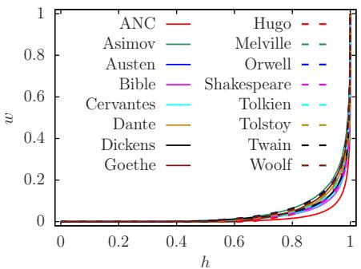

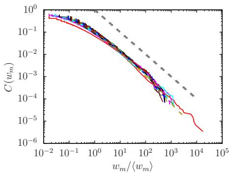

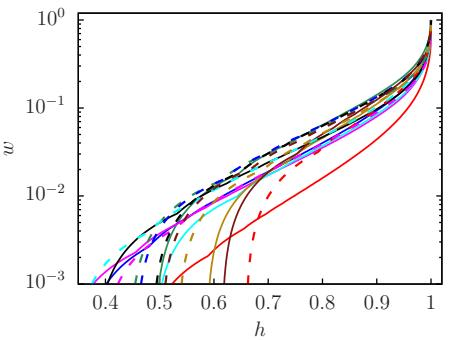

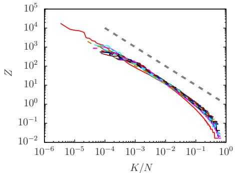  
Figure 1  
Top left: Lorenz curves for the 16 data sets of Table 1. The x-axis corresponds to the cumulated fraction of households/words (h) and the y-axis to the cumulated fraction of wealth/word frequency (w). The other panels show certain curves for the same data sets with same curve colors and types (dashed or not dashed). The Gini coefficients for all cases are given in Table 1. Top right: Pareto curves $C ( w _ { m } )$ for the same data where $C ( w _ { m } )$ represents the fraction of words $m ^ { \prime }$ with a word frequency $w _ { m ^ { \prime } } \geq w _ { m }$ (analogous to wealth and with $w _ { m } = f _ { m } - 1 )$ . The x-axis corresponds to values $w _ { m } / \langle \boldsymbol { w } _ { m } \rangle$ where $\left. w _ { m } \right. = N _ { w } / N - 1$ (see Table 1 for the values of $N _ { w }$ and N) is the average reduced name frequency. Both axis are in logarithmic scale and the thick dashed gray line shows the power law $C \bar { ( \boldsymbol { w } _ { m } ) } = ( \boldsymbol { w } _ { m } / \langle \boldsymbol { w } _ { m } \rangle ) ^ { - 1 }$ . Bottom left: Lorenz curves for the same data but in logarithmic scale for the cumulated wealth/frequency fraction w and a slightly zoomed range for the household variable $h \in [ 0 . 3 5 , 1 ]$ . Note that data points with $h < h _ { \operatorname* { m i n } } ,$ and therefore exactly $w ( h ) = 0 ,$ , are not visible due to the logarithmic scale in this panel (here $h _ { \mathrm { m i n } }$ is the household fraction of words with vanishing wealth $w _ { m } = f _ { m } - 1 = 0 , \mathrm { i . e }$ . minimal frequency $f _ { m } = 1 )$ . Bottom right: Zipf variable $Z = w _ { m } / \langle \ ' { w } _ { m } \rangle$ versus rescaled rank $K / N$ in a double logarithmic scale and where the rank $K = \dot { 1 } \dot { ( K = N ) }$ corresponds to the word m with maximal (minimal) value of $w _ { m }$ . In right panels the thick dashed gray line corresponds to the power law $\dot { Z } = ( K / \dot { N } ) ^ { - 1 }$ . Note that $K / N$ coincides with $C ( w _ { m } )$ and this panel is essentially identical to the top right panel but with the roles of x- and y-axis exchanged.

K/N. Here the average wealth $\left. w _ { m } \right. = N _ { w } / N - 1$ takes for the 16 data sets values in the interval [4.22, 61.3]. We attribute this ubiquity of word frequency distribution to the universal feature of RJ thermalization and condensation based of statistical laws of physics.

In the right panels of Fig. 1, the gray dashed (thicker) line gives for illustration the $Z _ { \mathrm { i p f } }$ law $Z = N / K$ (with a certain fixed coefficient). The real data Pareto and Zipf curves are approximately parallel to this line for some limited interval, indicating $Z _ { \mathrm { d a t a } } ^ { - } \approx A ( N / K )$ with A typically being slightly larger than 0.1 according to the figure. Therefore, globally these curves show roughly the usual Zipf and Pareto algebraic dependence that captures the global probability decay of data even if there is a certain curvature with certain deviations from the Zipf law which will be discussed later in more detail.

Below, we discuss more specifically the properties of Lorenz, Pareto and Zipf distributions for 3 literary works from Table 1 and in particular, we compare them with the theory results of the RJE thermalization model. The comparison for the other 13 cases is presented in Appendix Figs. A.1 – A.13.

As explained in the previous Section, we determine the optimal RJE parameters $a ,$ ε for the 16 data sets. The obtained values of the parameter a are rather high, typically $a = 5 – 1 1$ , the values of ε are quite small with $\varepsilon \sim 1 0 ^ { - 5 } – 1 0 ^ { - 3 }$ (specific values are given in the Figures below and in the Appendix). The related values of $- \mu$ are even smaller (typically $- \mu / \varepsilon \sim 1 0 ^ { - 3 } )$ indicating that all cases correspond to a strong RJ condensation. We note that it is possible to show from (5) that $0 < - \mu \ll \varepsilon$ if $\varepsilon \ll 1$ (see (Frahm, Ermann, and Shepelyansky 2026)). The two maximal values $a = 1 0 . 7$ and $a = 9 . 0 5$ are obtained for ANC or the Bible respectively.

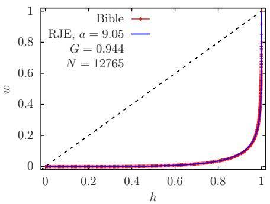

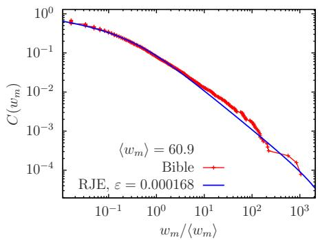

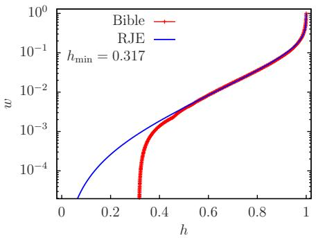

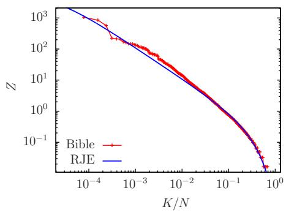  
Figure 2  
All panels are in the same style as the corresponding panels in Fig. 1 but only for two curves in each panel being the data curve for the King James Bible (red data points) and the corresponding optimal RJE curve shown in blue. Furthermore, in the top left panel for the Lorenz curves also the (dashed black) line of perfect equipartition $w = h$ is shown. The two top panels also give the values of $G , N ,$ the real data average $\left. w _ { m } \right.$ and the two optimal RJE parameters a and ε. The Lorenz curves in the bottom left panel are shown in logarithmic scale for the cumulated frequency/wealth fraction w and in full (normal) scale for the word/household variable $h \in [ 0 , 1 ]$ . Due to the logarithmic scale the (red) data points for $h < h _ { \operatorname* { m i n } }$ with $w ( h ) = 0$ are not visible and the range of w is chosen such that all other data points with $w ( h ) > 0$ are visible (the value of $h _ { \mathrm { m i n } }$ is given in the panel).

Fig. 2 compares real data Lorenz, Pareto and Zipf curves for the case of the (King James) Bible (red data points) with the corresponding theoretical RJE curves (blue lines)

given by (3) for the RJE Lorenz curve or (6) for the RJE Pareto curve (the theoretical RJE Zipf curve is just the inverse function of (6)). The parameter values of $G , \langle w _ { m } \rangle$ (for data), $a , \varepsilon$ and $h _ { \mathrm { m i n } }$ are given in the panels of this figure. The two Lorenz curves in normal representation (top left panel) for data and the RJE model agree nearly perfectly on graphical precision. In logarithmic scale (bottom left panel), there are some deviations for very small values $w \overset { \vartriangle } { < } 1 0 ^ { - 3 }$ which are more of a technical nature due to the low frequency statistics of rare words.

We note that in the RJE model the global wealth/energy scale is arbitrarily fixed at max $( w _ { m } ) = \operatorname* { m a x } ( E _ { m } ) = B = 1$ and gives $\langle w _ { m } \rangle = \varepsilon$ which is well below unity (see last section). Therefore, the real data and RJE Pareto curves have to be compared for the proper rescaled quantity $w _ { m } / \langle \omega _ { m } \rangle$ , i.e. the wealth is measured in both cases (data and RJE model) in units of its average. Using this rescaling convention, there is also a strikingly good agreement between the data and the corresponding RJE Pareto and Zipf curves (right panels) on the whole scale of 4 orders of magnitude for these distributions. We stress that the Pareto and Zipf curves have a well visible curvature and cannot be described by a simple algebraic decay with a certain exponent $\alpha \approx 1 f o r$ the full interval. However, this curvature is well captured and described by the RJE theory.

Figure 3 As Fig. 2 for Shakespeare.  
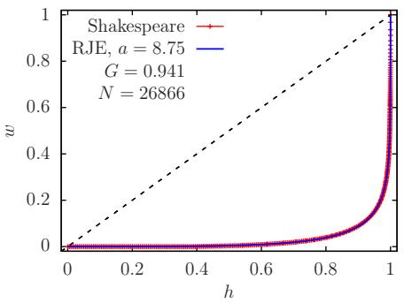

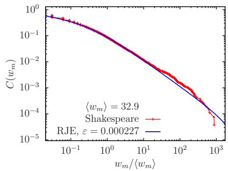

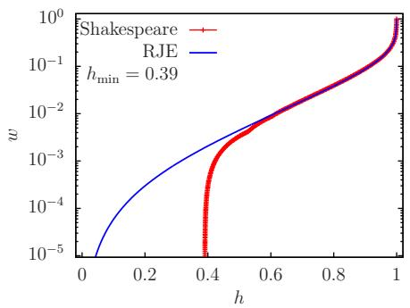

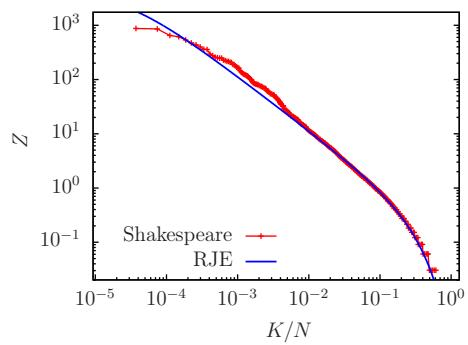

Fig. 3 is similar to Fig. 2 but for the complete works of William Shakespeare. Here, as for the case of the Bible, we also find a very good agreement of the RJE theory with the real data. For the Lorenz curves there are only technical deviations (of relative values) for the range of very small cumulated wealth values $w < 1 0 ^ { - 3 }$ , only visible in logarithmic scale, while in normal scale both curves are essentially identical. Also the Pareto and Zipf curves agree well between data and the RJE model in a range of 4 orders of magnitude. Here the obtained value of $a = 8 . 7 5$ is slightly smaller than for the case of Bible with $a = 9 . 0 5$

Fig. 4 compares the data of the book Les Miserables by Vitor Hugo with the RJE theory. Again, we find a very good agreement between the data and the theory. In this case, the statistics of words $N _ { w }$ is by a factor 10 smaller compared to the cases of Bible and Shakespeare (see Table 1). Due to this, the small wealth deviations for the Lorenz curve are visible for $w < 0 . 0 1$ in logarithmic scale. Here the value of $h _ { \operatorname* { m i n } } = 0 . 6 5 8$ is very large, which affects the bottom left panel. However, in normal scale the data and RJE Lorenz curves are very close and the Pareto and Zipf curves agree on a scale of 3 orders of magnitude. Again, the theory captures well the curved feature of these distributions. Since the optimal value of $a = 6 . 5 5$ is lower than in the other two cases, the curved regions of the Pareto and Zipf curves are relatively larger (see later discussion in the Appendix).

In all cases of Figs. 2-4 (and also similar Appendix Figs. A.1-A.13), we can observe for the Pareto (Zipf) curve in the range of small $w _ { m } / \langle w _ { m } \rangle$ (large $K / N )$ the effect, of some degenerate $w _ { m }$ values being $w _ { m } = 1 , 2 , 3 , . . .$ . visible as small vertical (horizontal) steps. Of course, such degeneracies mechanically reduce a bit the agreement between data and smooth RJE curves. But this is only a minor effect and clearly due to the low frequency statistics of rare words.

We remind, that in the RJE model there are (only) two fit parameters a and $\varepsilon$ which are obtained by minimizing the geometrical curve distance between data and RJE Lorenz curves under the constraint of identical values of the Gini coefficient G. Once this fit procedure has been applied, also the Pareto (and Zipf) curves agree very well provided that there are shown in the appropriate scale (units of $\langle w _ { m } \rangle \rangle$ ). Such an agreement is not obvious since the Pareto curve emphasizes in double logarithmic scale different regions for the wealth as the Lorenz curve. Furthermore, there are no other additional fit parameters for the Pareto curve, in particular the wealth units for the average wealth are given either directly by the data or the theory. We mention that the power law fits of (Piantadosi 2014), either use two parameters (pure power law fits) or three parameters (shifted power law fits).

In Fig. 5, we provide a global color view of Lorenz curves obtained within the RJE theory for all 16 literary works of Table 1. The theory gives almost exact values of cumulated wealth w for $w > 0 . 0 1$ for all 16 cases as it is shown in Figs. 2-4 and Appendix Figs. A.1-A.13. The color scale in Fig. 5 is nonlinear to enhance smaller wealth values (i.e. the numbers of the colorbar in the interval [0, 1] correspond to $w ^ { 1 / 2 }$ which increases the greens parts in the figure) but the range $w < 0 . 0 1$ , with possible (relative) technical deviations between data and RJE Lorenz curves, is still clearly in the range of blue color with $w ^ { 1 / 2 } < 0 . 1$ for minimal values. Therefore, this region does not affect Fig. 5. Apart from this, there are certain variations from one case to another correlated with the variations of the Gini coefficient (see Table 1). For example for Asimov, Melville and Orwell, we have quite large green zones with (slightly) smaller values of $G \approx 0 . 9 1 – 0 . 9 2$ for them. On the other side, we have small green zones for ANC, Bible and Cervantes with (slightly) larger values of $G = 0 . 9 6 7$ or $G = 0 . 9 4 4$

Fig. 6 gives a similar color plot view for the RJE Pareto curves for all 16 cases but here both x-axis for $w _ { m } / \langle w _ { m } \rangle$ and colorbar for $C _ { \mathrm { R J E } } ( w _ { m } )$ are in logarithmic scale similarly as top right panels of Figs. 2-4 and Appendix Figs. A.1-A.13 (which also show a very good agreement between real data and the RJE Pareto curves). We note that the maximum value of red color for $C ( w _ { m } )$ is 0.77 and not unity, since this is simply the maximum value of $C _ { \mathrm { R J E } } ( w _ { m } )$ for all 16 cases and the shown range $w _ { m } / \langle w _ { m } \rangle \geq 0 . 0 1$ The theoretical limit of $C _ { \mathrm { R J E } } ( w _ { m } ) \approx 1$ is only obtained for $w _ { m } / \langle w _ { m } \rangle \ll 0 . 0 1 ,$ a range which is not visible in the figure (same effect for top right panels of other figures in the style of Fig. 2). Globally, both Figs. 5 and 6 illustrate quite clearly the universality of the RJE Pareto Lorenz and Pareto curves (which are all close to the corresponding real data curves).

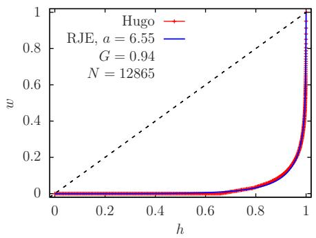

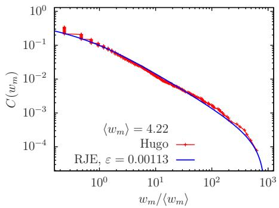

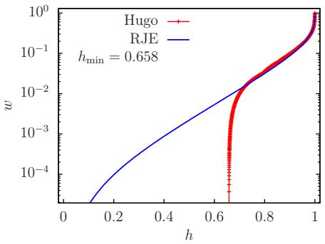  
Figure 4 As Fig. 2 for Hugo.

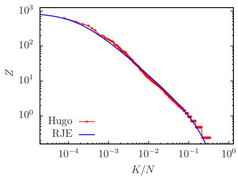

In this Section we presented results for the cases of Bible, Shakespeare and Hugo (see Figs. 2-4). The other 13 cases are shown in Appendix Figs. A.1-A.13 which are in the same style way as Fig. 2. In particular, the ANC case is presented in Fig. A.1; here the statistics of all words $N _ { w }$ is very high and the RJE theory describes well the Pareto and Zipf distributions on a scale of 5 orders of magnitude. The cases of Asimov, Austen, Cervantes, Dante, Dickens, Goethe, Melville, Orwell, Tolkien, Tolstoy, Twain and Woolf are presented in Appendix Figs. A.2-A.13 respectively. The data of all these cases agree well with the RJE theory.

We also point out that at high values of the parameter a and low values of ε the analytic RJE expression for the Pareto curve gives an approximate algebraic decay of probability with the exponent α = 1 in a certain restricted range (Frahm, Ermann, and Shepelyansky 2026) (see also the approximate RJE expression (7)). Due to the direct relation between Pareto and Zipf curves this is also valid for the Zipf distribution. We discuss this feature in more detail in the Appendix with illustrations in Fig. A.14 and Table A.1.

## 6. Discussion

In this work, we presented the concept of RJ thermalization and condensation of words in literary works (or books) of different writers and different languages. In this WOTH approach the different N words of a book are analogous to independent classical particles and also analogous to households in the wealth inequality problem. The interactions between these words (or particles) appear due to semantic rules, meanings and writer concepts, generating links and nonlinear couplings between them. The precise form of these interactions is not specifically known but this is not important when applying well known concepts of statistical physics (Landau and Lifshitz 1976; Zakharov, L’vov, and Falkovich 1992). For example, as for a gas of classical particles in three dimensions almost any weak or moderate interaction between particles drives a system into the thermal state with the average kinetic energy per particle 3kT/2 where k and T are the Boltzmann constant and gas temperature.

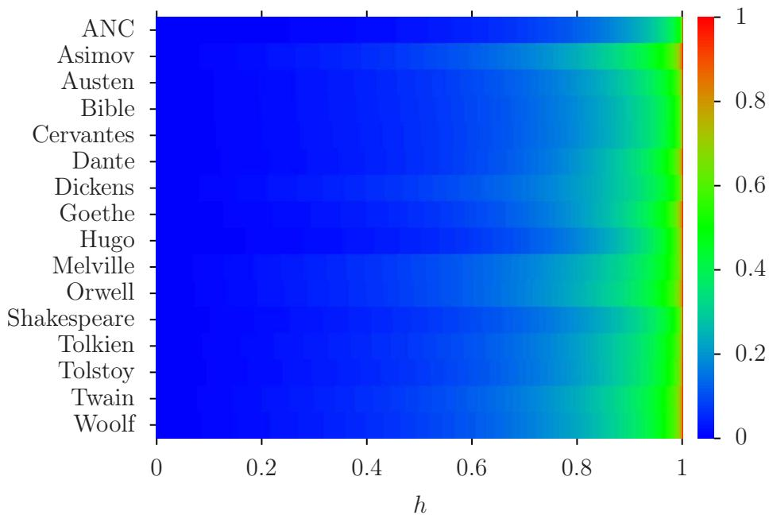  
Figure 5  
Density color plot of Lorenz curves for the 16 cases of Table 1 obtained from the RJE model with optimal RJE parameters for ε and a. The x-axis corresponds to the cumulated fraction of households/words (h) and the y-axis to data sets/writers (in alphabetical order). The color value corresponds to the cumulated fraction of wealth or rescaled word frequency (w). In order to enhance small values of w a nonlinear scale is chosen where the values of the color bar correspond to $w ^ { 1 / 2 }$ . The RJE Lorenz curves here correspond to the optimal RJE fits shown as blues lines in the top left panels of Figs. 2-4 and Appendix Figs. A.1-A.13 (see also these figures for the values of ε and a).

In the framework of the WOTH thermodynamic theory, all words in a book are distributed over certain states levels characterized by the word frequencies (and corresponding tokens). These levels are analogous to the energy levels in a physical system of classical particles, or to word frequencies or token levels for a book. This is also similar to the wealth state levels of households analyzed in (Frahm and Shepelyansky 2026c; Frahm, Ermann, and Shepelyansky 2026). We propose the RJE model of this energy (token) spectrum with a density of states decreasing at high word frequencies (or at high energies or high wealth revenues) characterized by a certain system parameter a. The thermal steady-state distribution of frequencies or tokens over these state levels is described by the classical RJ thermalization law (1) characterized by the rescaled total system energy ε.

Figure 6  
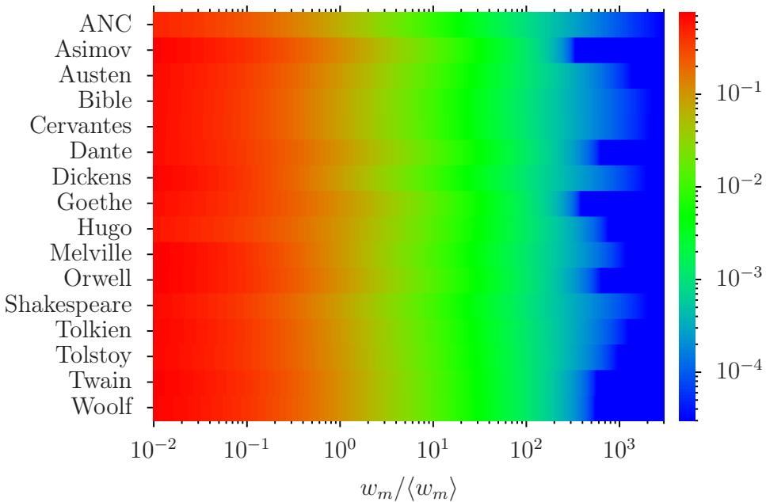  
Density color plot of Pareto curves for the 16 cases of Table 1 obtained from the RJE model with optimal RJE parameters for ε and a. The x-axis corresponds to the rescaled wealth $w _ { m } / \langle \omega _ { m } \rangle$ (in logarithmic scale) and the y-axis to data sets/writers (in alphabetical order). The color value (in logarithmic scale) corresponds to the RJE value of the Pareto function $C _ { \mathrm { R J E } } ( w _ { m } )$ given by Eq. (6). Values of $C _ { \mathrm { R J E } } ( w _ { m } )$ below the minimal color value $3 \times 1 0 ^ { - 5 }$ , in particular if $\bar { C } _ { \mathrm { R J E } } ( w _ { m } ) \bar { = } 0$ for $w _ { m } > w _ { \mathrm { m a x , } }$ , are also shown by blue color for the minimal value. Perfect red color corresponds to max $( C _ { \mathrm { R J E } } ( w _ { m } ) ) \stackrel { - } { \approx } 0 . 7 7$ where the maximum is taken over all data sets and over all $w _ { m }$ values inside the used interval for $w _ { m } / \langle w _ { m } \rangle \in [ 1 0 ^ { - 2 } , 3 \times 1 0 ^ { 3 } ]$ . (Note for the RJE model, we have $w _ { \mathrm { m a x } } = 1 , \left. w _ { m } \right. = \varepsilon$ and $w _ { \mathrm { m a x } } / \langle w _ { m } \rangle = 1 / \varepsilon$ . Furthermore, the theoretical limit $C _ { \mathrm { R J E } } ( w _ { m } )$ 1 is only reached for $w _ { m } \ll 0 . 0 1$ not accessible in this figure.) The RJE Pareto curves here correspond to the blues lines in the top right panels of Figs. 2-4 and A.1-A.13 (see also these figures for the values of ε and a).

Using these RJ thermalization theory parameters ε and $^ { a , }$ obtained by a specific fit procedure for the Lorenz curve, we compare the results of the RJE distribution of word frequencies of 16 literary works described in Section 2 and Table 1. We find that the RJE model gives a strikingly good description of all 16 cases of real data for their Lorenz, Pareto and Zipf curves, and this essentially for the full range of the wealth or rank interval. The obtained values of the rescaled effective system energy ε are typically very low indicating that there is RJ condensation of a significant fraction of total probability (fraction of all different words N) at the lowest energy (token) level. This is related to the typically huge fraction of different words at lowest frequency $f _ { m } = 1$ with typical values of $4 \mathrm { { \dot { 5 } } \% \pm \mathrm { { \dot { 1 } } 5 \% } }$ for the considered data sets. Also the 50% bottom fraction of all different words contains only less than 0.5% of the total number of book words $N _ { w }$ (see Table 1).

The phenomenon of RJ condensation has also been studied previously in the physics of light propagation in multimode optical fibers (Connaughton et al. 2005;

Krupa et al. 2016; Baudin et al. 2020) and for the wealth inequality in the world (Frahm and Shepelyansky 2026c; Frahm, Ermann, and Shepelyansky 2026) (and also in constraint driven condensation in other physical systems (Evans et al. 2010; Szavits-Nossan, Evans, and Majumdar 2014; Filiasi et al. 2014)).

The WOTH theory gives a very good description of the word frequencies in the 16 considered cases but one can object that there are two fit parameters in these RJE distributions. However, the main competing proposal to describe work frequency distributions based on a (shifted) power law (see e.g. (Piantadosi 2014)) also uses two or even three fit parameters and even then it does not provide a good description at both boundaries of the interval of the frequency distribution (for the data used in our work). This concerns in particular the range of small wealth/word frequency or large rank index where the real data curves show a strong curvature for Pareto and Zipf curves (when shown in double logarithmic scale) which is very well captured by the optimal RJE curves. Concerning the Lorenz curves the agreement of data with a shifted power law proposal is even much worse. Thus in that case the Lorenz curve construction as such is actually very delicate and only possible for the shifted power law proposal similar to (7) (impossible for the simple power law). On the other hand the RJE Lorenz curves agree nearly perfectly with the data (when shown in normal scale; modest deviations for very small cumulated wealth values are only visible in logarithmic scale inside strongly condensated phase).

Apart from this, there are also important conceptual features that in our opinion provide a strong support to the WOTH concept:

F1) the distribution of word frequencies is a stable steady-state being very similar for all 16 cases considered (see Figs. 1 and 6), there is also a rather narrow interval for Gini coefficient in Table 1), this is in agreement with the thermodynamic stability of the RJ thermal distribution;

F2) a huge condensation of rare words at lowest word frequencies is in qualitative and quantitative agreement with the RJ condensation phenomenon;

F3) The RJ type distributions determined by thermalization and condensation appear in very different systems like wealth inequality of households in the world, stock market capitalization of companies, GDP distribution over world countries (Frahm and Shepelyansky 2026c; Frahm, Ermann, and Shepelyansky 2026) and word frequencies in books; the RJ condensation also describes the Lorenz curves in various other systems (see (Frahm and Shepelyansky 2026b)); this highlights the universal features of the RJ thermal concept.

We note that recently thermodynamic concepts start to be discussed in relations to LLM (see e.g. (Sadrtdinov et al. 2026) and Refs. therein) and we hope that the thermodynamics of words established here will find useful applications there.

## Appendix A:

In this appendix, we present additional figures in the same style of Fig. 2 for the other data sets not shown in the main part and also a discussion about the limits of a potential power law for the Zipf curves of real data.

## 1.1 Additional figures

Here, we present Figs. A.1-A.13 which are in the same style as Fig. 2 for the cases of ANC, Asimov, Austen, Cervantes, Dante, Dickens, Goethe, Melville, Orwell, Tolkien,

Tolstoy, Twain, and Woolf. These figures are mostly discussed in the main part of the text. Here, we point out that globally all real data curves (red data points) agree very well with the corresponding RJE theory curves (blue lines) for optimal parameters a and ε given in Figures for each data set.

For the case of Tolstoy in Fig. A.11, there are some modest deviations at the tail of the Pareto curve at $C ( w _ { m } ) < 1 0 ^ { - 4 }$ (initial part of the Zipf curve) between data and the RJE theory. We note in analogy with the WTH concept for the wealth inequality (Frahm and Shepelyansky 2026c; Frahm, Ermann, and Shepelyansky 2026) that this tail corresponds to the case of very rich households (a lot of tokens for these words). Such households or words of very high frequency are rare that leads to larger statistical fluctuation of such words at the Pareto tail.

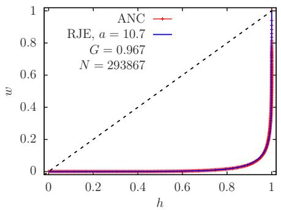

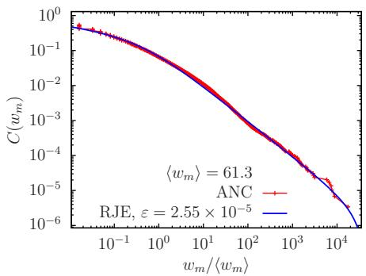

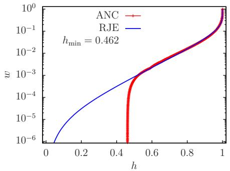  
Figure A.1 As Fig. 2 for ANC.

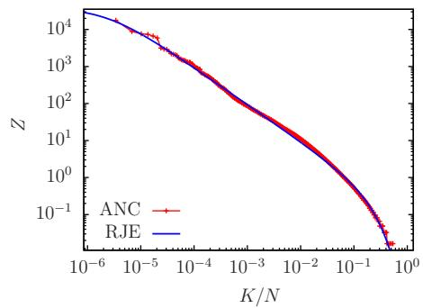

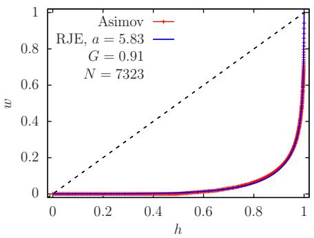

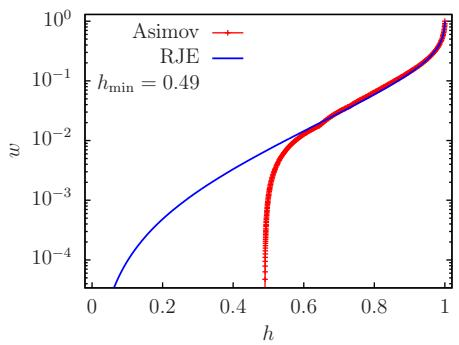

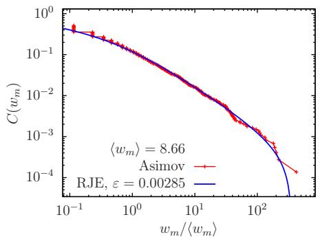

Figure A.2  
As Fig. 2 for Asimov.  
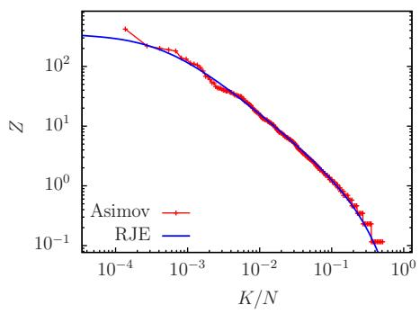

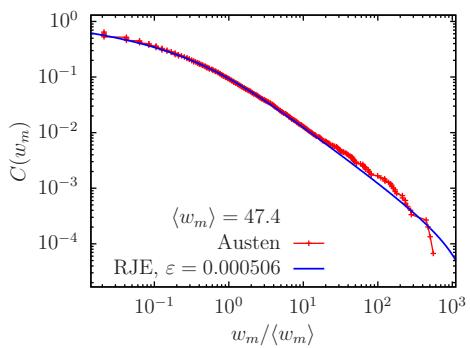

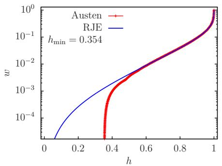  
Figure A.3  
As Fig. 2 for Austen.

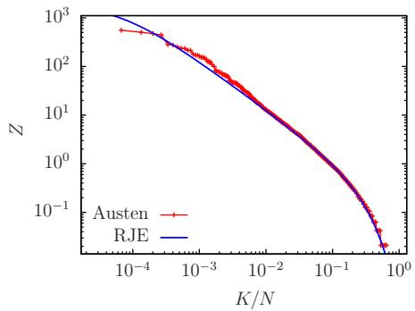

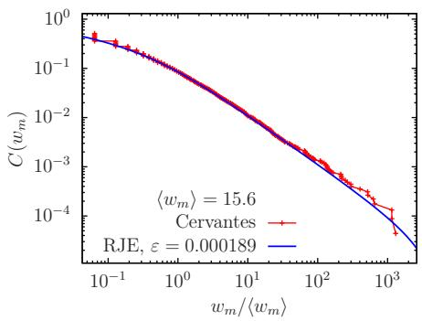

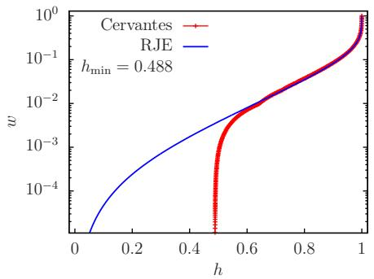  
Figure A.4

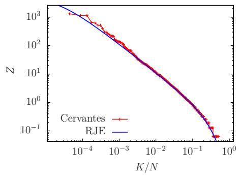

As Fig. 2 for Cervantes.  
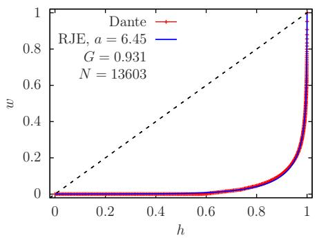

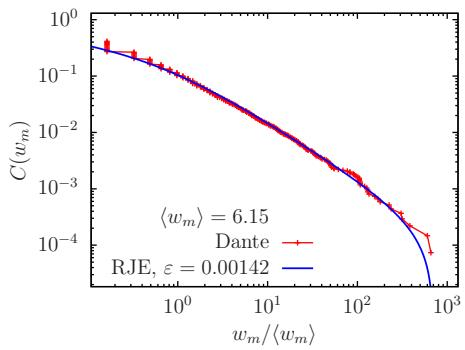

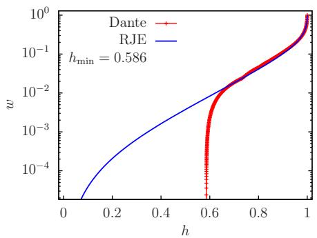  
Figure A.5  
As Fig. 2 for Dante.

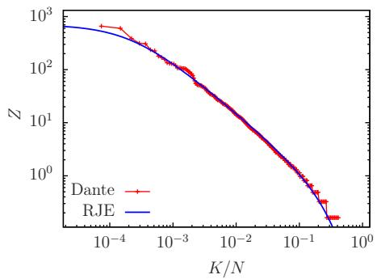

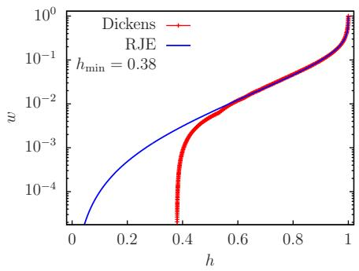  
Figure A.6

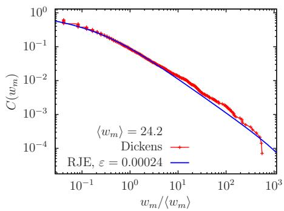

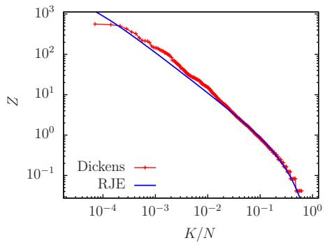

As Fig. 2 for Dickens.  
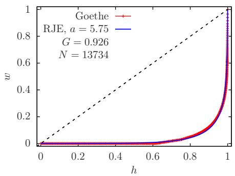

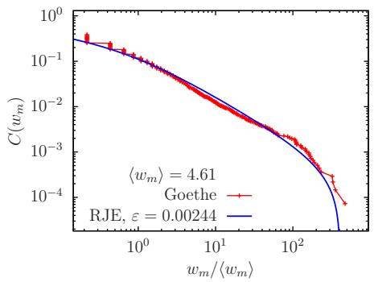

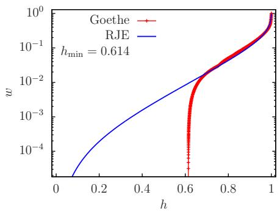  
Figure A.7  
As Fig. 2 for Goethe.

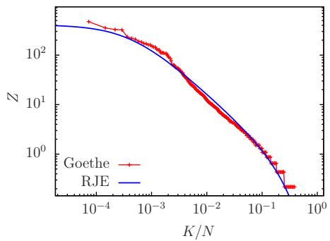

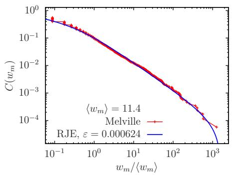

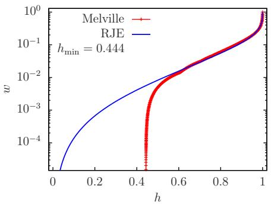  
Figure A.8

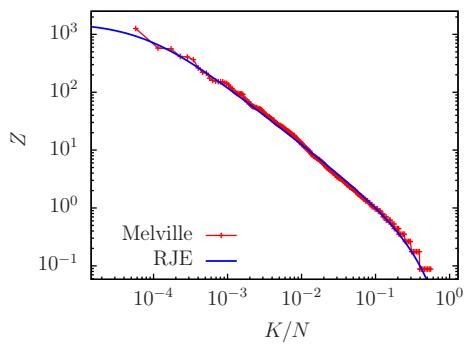

As Fig. 2 for Melville.  

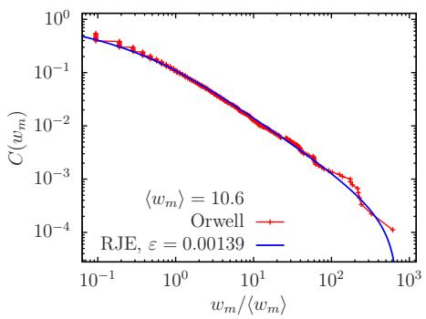

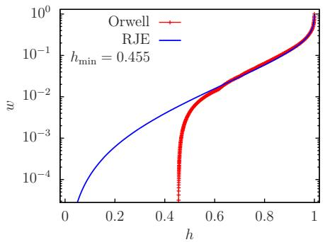  
Figure A.9  
As Fig. 2 for Orwell.

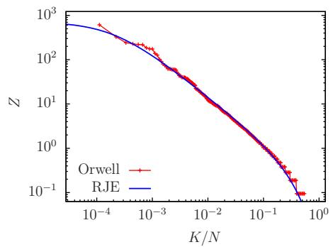

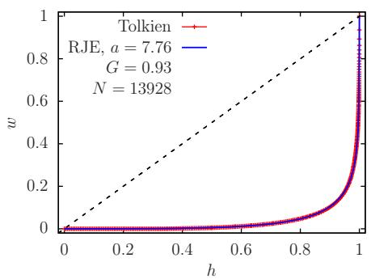

  
Figure A.10  
As Fig. 2 for Tolkien.

  
Figure A.11  
As Fig. 2 for Tolstoy.

  
Figure A.12

As Fig. 2 for Twain.  

  
Figure A.13  
As Fig. 2 for Woolf.

## 1.2 Discussion of the limits of the Zipf law

The analytical RJE approximation (7) for the Pareto function, valid for $w _ { m } \gg e ^ { - a }$ (assuming $| \dot { \mu } | \ll e ^ { - a }$ which is well verified for all cases here), resembles partly a power law behavior except for the constant offset that ensures that $C _ { \mathrm { R J E } } ( 1 ) = 0$ . If we assume in addition that also $w _ { m } \ll 1$ , we can neglect this offset which indeed gives the Zipf law, i.e. a decaying power law with exponent $^ 2 \alpha = 1$

$$
C _ { \mathrm { R J E } } ( w _ { m } ) \approx \left( \frac { \varepsilon - \mu } { a } \right) w _ { m } ^ { - 1 } = A _ { \mathrm { R J E } } \left( \frac { w _ { m } } { \langle w _ { m } \rangle } \right) ^ { - 1 } \quad \mathrm { i f } \quad e ^ { - a } \ll w _ { m } \ll 1 .\tag{A.1}
$$

To have a significant interval of validity for this expression, we need rather larger values of a (small values of $D ^ { - 1 } ( a ) \approx e ^ { - a } )$ . If this condition is verified the analytical Pareto curve of the RJE model is close to a decaying power law with exponent $\alpha = 1$ for this interval.

Concerning, the Zipf expression (9), we can add the additional condition $K / N \gg$ $A _ { \mathrm { R J E } } \langle w _ { m } \rangle \approx \varepsilon / a ,$ , such that we can neglect the constant term in the denominator which also gives the Zipf law

$$
Z \approx A _ { \mathrm { R J E } } \left( \frac { K } { N } \right) ^ { - 1 } \quad \mathrm { i f } \quad \frac { \varepsilon } { a } \ll \frac { K } { N } \ll \frac { \varepsilon e ^ { a } } { a } .\tag{A.2}
$$

This expression corresponds to the approximation (A.1) for the Pareto function which are both valid for some intermediate interval in either K or $w _ { m }$

To test more explicitly the validity of these two expressions for real data, or more generally their power law properties, we perform for each data set a power law fit $\bar { C _ { \mathrm { d a t a } } ( w ) } = \bar { A _ { \mathrm { Z i p f } } } ( w _ { m } / \langle w _ { m } \rangle ) ^ { - \bar { 1 } / \alpha }$ for the fit interval $Z = w _ { m } / \langle w _ { m } \rangle \in [ 2 \bar { e ^ { - a } } / \varepsilon , 0 . 1 / \varepsilon ]$ where a and ε are the optimal RJE parameters for the used data set and $\left. w _ { m } \right.$ is real data average of $w _ { m } = f _ { m } - 1$ (see previous figures for specific values for each data set). Here, we choose the notation $^ { - } - 1 / \alpha ^ { \prime \prime }$ for the fit exponent to be coherent with the notations of (Piantadosi 2014) where $Z \sim w _ { m } \sim f _ { m } \sim \bar { K } ^ { - \alpha } \sim C ( w ) ^ { - \alpha }$ . We expect, that the analytical RJE power law approximations (A.1) and (A.2) are roughly valid for the proposed fit interval above. Therefore, it is reasonable to use the same interval (in the rescaled variable $Z = w _ { m } / \langle w _ { m } \rangle )$ to perform a power law fit for the real data. (To be more precise the power law fit is actually done as the linear fit $y ( x ) = b + p x$ with $y = \ln ( C _ { \mathrm { d a t a } } ( w ) ) , x = \ln ( w _ { m } / \langle w _ { m } \rangle ) , b = \ln ( A _ { \mathrm { Z i p f } } )$ and $p = - 1 / \alpha . )$

In Table A.1, we provide for each data set the RJE power law coefficient $A _ { \mathrm { R J E } }$ defined in Eq. (8), the two fit parameters $A _ { \mathrm { Z i p f } } , \alpha$ and also the numerical values of the borders of the fit interval (in units of $\left. w _ { m } \right.$ , i.e. for $Z = w _ { m } / \langle w _ { m } \rangle )$ . The obtained values of α are typically in the interval [1, 1.17] with most values $\alpha \approx 1$ .1 and minimal value $\alpha = 0 . 9 9 9$ for Goethe. The coefficients $A _ { \mathrm { R J E } } \approx 1 / a$ and $A _ { \mathrm { Z i p f } }$ are quite close with roughly comparable values.

In Fig. A.14, we provide a graphical illustration of this power law fit for the Zipf curves of the data for the four examples of Bible, Shakespeare, ANC and Austen. As in the previous figures, the real word data corresponds to the red data points and the exact RJE curve (for optimal values a and ε for the given data set) to the blue line. The analytical RJE power law approximation (A.2 with exponent $^ { \prime \prime } { - 1 ^ { \prime \prime } }$ is shown as the black line and the above power law fit corresponds to the green line. In the figure panels, also the values of $\bar { Z _ { \mathrm { m i n } } } = 2 e ^ { - a } / \varepsilon$ and $Z _ { \mathrm { m a x } } = 0 . 1 / \varepsilon$ for the used fit interval (in the Zipf variable Z) are marked as thin dotted black lines.

Table of power law fit parameters for the ANC data base and 15 books of writers. The columns correspond to name, the RJE power law coefficient $A _ { \mathrm { R J E } } = ( \varepsilon - \mu ) / ( \varepsilon a ) \approx 1 / a ,$ the Zipf fit parameters $A _ { \mathrm { Z i p f } } ,$ α and the min/max values of $Z = w _ { m } / \langle w _ { m } \rangle$ for the used fit interval. These parameters correspond either to the RJE power law behavior $\dot { C } _ { \mathrm { R J E } } ( w ) \approx A _ { \mathrm { R J E } } ( w _ { m } / \langle w _ { m } \rangle ) ^ { - 1 }$ or the Zipf power law fit $K / N = C _ { \mathrm { d a t a } } ( w _ { m } ) = A _ { \mathrm { Z i p f } } ( w _ { m } / \langle w _ { m } \rangle ) ^ { - 1 / \alpha } = A _ { \mathrm { Z i p f } } Z ^ { - 1 / \alpha }$ . The fit interval borders have been chosen as $Z _ { \mathrm { m i n } } = \mathrm { 2 } e ^ { - \dot { a } } / \varepsilon$ and $Z _ { \mathrm { m a x } } = 0 . 1 / \varepsilon$ and we expect the RJE power law behavior to be approximately valid for $Z _ { \operatorname* { m i n } } < Z < Z _ { \operatorname* { m a x } }$ . The statistical fit errors of $A _ { \mathrm { Z i p f } }$ and α are well below 0.5% for all cases.
<table><tr><td>Name</td><td> $A _ { \mathrm { R J E } }$ </td><td> $A _ { \mathrm { Z i p f } }$ </td><td>α</td><td> $Z _ { \mathrm { m i n } }$ </td><td> $Z _ { \mathrm { m a x } }$ </td></tr><tr><td>ANC</td><td>0.0933</td><td>0.0847</td><td>1.07</td><td>1.73</td><td> $3 . 9 3 \times 1 0 ^ { 3 }$ </td></tr><tr><td>Asimov</td><td>0.172</td><td>0.129</td><td>1.09</td><td>2.06</td><td>35.1</td></tr><tr><td>Austen</td><td>0.129</td><td>0.101</td><td>1.12</td><td>1.69</td><td>198</td></tr><tr><td>Bible</td><td>0.111</td><td>0.0896</td><td>1.16</td><td>1.4</td><td>594</td></tr><tr><td>Cervantes</td><td>0.113</td><td>0.0917</td><td>1.09</td><td>1.45</td><td>530</td></tr><tr><td>Dante</td><td>0.155</td><td>0.113</td><td>1.08</td><td>2.23</td><td>70.6</td></tr><tr><td>Dickens</td><td>0.113</td><td>0.0894</td><td>1.17</td><td>1.2</td><td>417</td></tr><tr><td>Goethe</td><td>0.174</td><td>0.128</td><td>0.999</td><td>2.6</td><td>40.9</td></tr><tr><td>Hugo</td><td>0.153</td><td>0.103</td><td>1.1</td><td>2.54</td><td>88.5</td></tr><tr><td>Melville</td><td>0.128</td><td>0.0963</td><td>1.1</td><td>1.27</td><td>160</td></tr><tr><td>Orwell</td><td>0.147</td><td>0.115</td><td>1.06</td><td>1.57</td><td>71.9</td></tr><tr><td>Shakespeare</td><td>0.115</td><td>0.0877</td><td>1.14</td><td>1.4</td><td>441</td></tr><tr><td>Tolkien</td><td>0.129</td><td>0.107</td><td>1.11</td><td>1.49</td><td>175</td></tr><tr><td>Tolstoy</td><td>0.138</td><td>0.11</td><td>1.02</td><td>1.7</td><td>121</td></tr><tr><td>Twain</td><td>0.151</td><td>0.113</td><td>1.13</td><td>1.68</td><td>63.6</td></tr><tr><td>Woolf</td><td>0.154</td><td>0.123</td><td>1.07</td><td>1.82</td><td>61.7</td></tr></table>

First, we observe that the blue line (exact RJE expression obtained as the inverse function of (6)) and black line (analytic RJE power law approximation (A.2)) are quite close for the values in the fit interval which is expected. There are slight deviations between them at the interval boundaries which is due to the fact that the chosen interval is slightly on the “larger” side and that the conditions of validity of (A.2) are not perfectly verified at its boundaries. The green line for the power law fit is rather close to the black line but there are some visible deviations and the slope of the green line corresponds to values of $^ { \prime \prime } - \alpha ^ { \prime \prime }$ where α is slightly larger than unity. The green fit line agrees typically very well with most of the (red) data points inside the fit interval except for a small number of data points at the top of the interval where the density of data points is also reduced and which have a smaller influence on the fit result. As already observed in the previous figures, the blue RJE curve agrees globally quite well with the data nearly for all data points, also outside the fit interval and in particular in the range of large $K / N > 0 . 1$ where both data and precise RJE theory are very different from the power law behavior. Concerning the range of smallest values of $K \le 5 \mathrm { - } 1 0$ (top frequent words with largest values of $w _ { m } )$ , the data points are not very far from the black line for the cases of Bible and $\mathrm { A N C }$ while for Shakespeare and and Austen they deviate a bit more from both blue and black RJE curves (and even more from the green fit line). This region is statistically not very reliable and concerns only a few data points. However, also here the blue RJE curve still provides the best agreement in comparison to the other two power law lines.

  
Figure A.14  
Graphical illustration of the power law fits according to Table A.1 for the cases of Bible, Shakespeare, ANC and Austen. Shown are the Zipf curves of Z versus the rescaled rank $K / N$ for the word data (red data points) and the precise optimal RJE curve (blue line). The two straight lines correspond to the analytical RJE power law approximation $Z = \dot { A _ { \mathrm { R J E } } } ( K / N ) ^ { - 1 }$ (black line) and the power law expression $\dot { Z } = \dot { ( K / ( N A _ { \mathrm { Z i p f } } ) ) } ^ { - \alpha }$ (green line) obtained from the fit $K / N = A _ { \mathrm { Z i p f } } Z ^ { - 1 / \alpha }$ . The thin horizontal black dotted lines indicate the values of $Z _ { \mathrm { m i n } }$ and $Z _ { \mathrm { m a x } }$ for the used fit interval given in Table A.1.

We mention, that the more refined approximation (9) (not shown in the figure), which is valid for $K / N \ll \varepsilon e ^ { a } / a .$ , agrees quite precisely with the exact blue RJE curve for smaller values of $K / N < 1 0 ^ { - 2 }$ and with the black line for larger values of $K / N > 1 0 ^ { - 2 }$

We have also tested the case of a reduced fit interval, i.e. $Z _ { \mathrm { m i n } } = 4 e ^ { a } / \varepsilon$ and $Z _ { \mathrm { m a x } } =$ $0 . 0 5 / \varepsilon$ (factor 2 modification of both interval borders to the inside). In this case, the obtained fit values of $A _ { \mathrm { Z i p f } }$ and α are still quite similar. However, the values of α are generally a bit closer to unity, e.g. for the four cases of Fig. A.14, we have $\alpha =$ 1.12, 1.15, 0.993, 1.1 instead of the values $\alpha = 1 . 1 6 , 1 . 1 4 , 1 . 0 7 , 1 . 1 2$ in Fig. A.14 for the initial fit interval. For the reduced interval, the black and green lines are typically a bit closer.

In summary, we see that the RJE Zipf curves exhibit for the cases of rather large values of a and small values of ε the Zipf power law in some intermediate interval, $\varepsilon / a \ll K / N \ll \varepsilon e ^ { a } / a _ { \ r { \ r } }$ , which can be quite large. However, for the regions outside this interval there are significant deviations from this power law, and as we can see in

Fig. A.14 and also in the previous figures, the RJE theory curves fit remarkably well the real word distribution data for most cases and the full range with only two free parameters being ε and a. We note, that typical power law type fits of (Piantadosi 2014) are done with at least two parameters being the exponent and the numerical coefficient. In certain cases, a third parameter $\beta$ for a shifted power law, $f _ { m } \sim Z \sim ( \beta + K ) ^ { - \alpha }$ , is added which is similar to the offset term in either (7) or (9) but there this term is simply fixed by the theory and does not add a third fit parameter. We note that even with this extension, there are still significant deviations with the data (used here in this work) for larger values of $K / N > 0 . { \bar { 1 } }$

The above discussion focuses on the Zipf curves but the situation is very similar for Pareto curves where the roles of x- and y-axis are exchanged. However, it is quite complicated to construct potential Lorenz curves from simple power law Pareto functions due to their singular behavior for small and large values of $w _ { m }$ and the necessary integral to compute the cumulated wealth variable. For the more refined shifted power law approximation (7) for the Pareto function, it is still possible to reconstruct the Lorenz curve, using a simple procedure given in (Frahm, Ermann, and Shepelyansky 2026), which gives the formula $w ( h ) \tilde { \approx } \ln \left( 1 - h / ( 1 + C _ { 2 } ) \right) / \ln \left( C _ { 2 } / ( 1 + C _ { 2 } ) \right)$ with $C _ { 2 } = ( \varepsilon - \mu ) / a$ . However, this expression does not agree well with neither the real data nor the precise RJE Lorenz curve (3) except for the very rich phase at $h \approx 1$ . On the other hand, the precise RJE Lorenz curve typically fits the data Lorenz curve extremely well as can be seen in the above figures. The reason for this is that the Lorenz curve emphasizes the poor phase (large values of K) where the deviations between power law and data are strongest while the RJE theory agrees quite well with the data in this region.

## Acknowledgments

The authors acknowledge support from NANOX $N ^ { \circ }$ ANR-17-EURE-0009 in the framework of the Programme Investissements d’Avenir (project MTDINA).

## References

Baayen, R. 2001. Wordfrequency distributions, volume 1. Kluwer Academic Publishers.

Baudin, K., A. Fusaro, K. Krupa, J. Garnier, S. Rica, G. Millot, and A. Picozzi. 2020. Classical Rayleigh-Jeans condensation of light waves: observation and thermodynamic characterization. Phys. Rev. Lett., 125:244101.

Brysbaert, Marc and Boris New. 2009. Moving beyond Kuˇcera and Francis: A critical evaluation of current word frequency norms and the introduction of a new and improved word frequency measure for American English. Behavior Research Methods, 41(4):977–990.

Chancel, L., T. Piketty, E. Saez, and G. et al Zucman. 2022. World Inequality Report. World Inequality Lab. Retrieved 2026-09-12. https://wir2022.wid.world.

Connaughton, C., C. Josserand, A. Picozzi, Y. Pomeau, and S. Rica. 2005.

Condensation of classical nonlinear waves. Phys. Rev. Lett., 95:263901.

Ermann, L., A. D. Chepelianskii, and D. L. Shepelyansky. 2026. Dynamical thermalization, Rayleigh-Jeans condensate, vortexes and wave collapse in quantum chaos fibers and fluid of light. J. Phys. A: Math. Theor., 59:055702.

Evans, M. R., S. N. Majumdar, I. Pagonabarraga, and E. Trizac. 2010. Condensation transition in polydisperse hard rods. J. Chem. Phys., 132:014102.

Filiasi, M., G. Livan, M. Marsili, M. Peressi, E. Vesselli, and E. Zarinelli. 2014. On the concentration of large deviations for fat tailed distributions, with application to financial data. J. Stat. Mech., 2014:P09030.

Frahm, K. M., L. Ermann, and D. L. Shepelyansky. 2026. Thermodynamic description of wealth inequality in the world. Complexities, 2:20.

Frahm, K. M. and D. L. Shepelyansky. 2023. Nonlinear perturbation of Random Matrix Theory. Phys. Rev. Lett., 131:077201.

Frahm, K. M. and D. L. Shepelyansky. 2026a. Dynamical thermalization and turbulence in social stratification models. CHAOS, 36:073117.

Frahm, K. M. and D. L. Shepelyansky. 2026b. Thermodynamics ofwords. Retrieved

2026-11-10, https: //www.quantware.ups-tlse.fr/ QWLIB/thermo4words/index.html.

Frahm, K. M. and D. L. Shepelyansky. 2026c. Wealth thermalization hypothesis and social networks. J. Stat. Phys., 193:64. arXiv:2506.17720 [cond-mat.stat-mech].

Gini, C. 1914. Sulla misura della concentrazione e della variabilit‘a dei caratteri. Atti del Reale Istituto Veneto di Scienze, Lettere ed Arti, 73:1203–1248. English translation in Metron - Int. J. Statistics, 2005, 63, 3–38, Retrieved 2026-09-23. https: //www.dss.uniroma1.it/RePec/ mtn/articoli/2005-1-1.pdf.

Krupa, K., A. Tonello, A. Barthelemy, B. M. Shalaby, A. Bendahmane, G. Millot, and S. Wabnitz. 2016. Observation of geometric parametric instability induced by the periodic spatial self-imaging of multimode waves. Phys. Rev. Lett., 116:183901.

Landau, L. D. and E. M. Lifshitz. 1976. Statistical mechanics. Wiley, New York.

Linders, Guido M. and Max M. Louwerse. 2022. Zipf’s law revisited: Spoken dialog, linguistic units, parameters, and the principle of least effort. Psychonomic Bulletin & Review, 30(1):77–101.

Lorenz, M. O. 1905. Methods of measuring the concentration of wealth. Quarterly Publications of the American Statistical Association, 9:209–219. (New Series, No. 70); doi:10.1080/15225437.1905.10503443. Retrieved 2026-09-23.

Moreno-Sánchez, Isabel, Francesc Font-Clos, and Álvaro Corral. 2016. Large-Scale Analysis of Zipf’s Law in English Texts. PLOS ONE, 11(1):e0147073.

Newman, M. E. J. 2005. Power laws, Pareto distributions and Zipf’s law. Contemporary Physics, 46:323.

Open American National Corpus, (OANC). 2026. Open data for language research and education. ANC. Retrieved: 2026-10-17 https://anc.org/.

OpenAI. 2026. Understanding and counting tokens. ChatGPT. Understanding and counting tokens.

Pareto, V. 1897. Cours d’Économie Politique Professé a l’Université de Lausanne. Lausanne Univ., 1896.

Piantadosi, Steven T. 2014. Zipf’s word frequency law in natural language: A critical review and future directions. Psychonomic Bulletin & Review, 21(5):1112–1130.

Piketty, T. 2014. Capital in the Twenty-First Century. Belknap Press of. Harvard

University Press, Cambridge, MA.

Popescu, I. I. 2009. Word frequency studies, volume 64. Walter de Gruyter, Berlin.

Roach, B., P. J. Rajkanikar, N. Goodwin, and J. Harris. 2003. Social and Economic Inequality. Economics in Context Initiative, Global Development Policy Center, Boston University, An ECI Teaching Module on Social and Environmental Issues. Retrieved 2026-09-23. https: //www.bu.edu/eci/files/2023/05/ Inequality-Module-2023.pdf.

Sadrtdinov, Ildus, Ekaterina Lobacheva, Ivan Klimov, Mikhail Burtsev, Mikhail I. Katsnelson, and Dmitry Vetrov. 2026. Can Stationary Distributions of Scale-Invariant Neural Networks Be Described by the Thermodynamics of an Ideal Gas? arXiv. arXiv:2511.07308v3 [cs.LG].

Szavits-Nossan, J., M. R. Evans, and S. N. Majumdar. 2014. Constraint driven condensation in large fluctuations of linear statistics. Phys. Rev. Lett., 112:020602.

Wikipedia and contributors. 2026a. King James Version ofBible. Wikipedia. Retrieved 2026-10-12. https://en.wikipedia. org/wiki/King\_James\_Version.

Wikipedia and contributors. 2026b. List of sovereign states by wealth inequality. Wikipedia. Retrieved 2026-10-12. https://en.wikipedia.org/wiki/ List\_of\_sovereign\_states\_by\_ wealth\_inequality.

Wikipedia and contributors. 2026c. Lorenz curve. Wikipedia. Retrieved 2026-09-25. https://en.wikipedia.org/wiki/ Lorenz\_curve.

Yakovenko, V. M. and J. B. Rosser. 2009. Colloquium: Statistical mechanics of money, wealth, and income. Rev. Mod. Phys., 81:1703.

Zakharov, V. E., V. S. L’vov, and G. Falkovich. 1992. Kolmogorov spectra of turbulence. Springer-Verlag, Berlin.

Zipf, G. 1936. The Psychobiology of Language. London: Routledge.

Zipf, G. 1949. Human Behavior and the Principle of Least Effort. New York: Addison-Wesley.