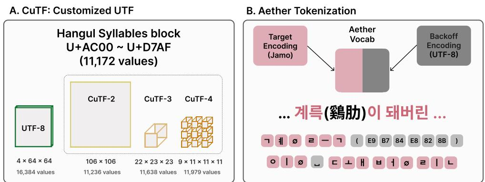
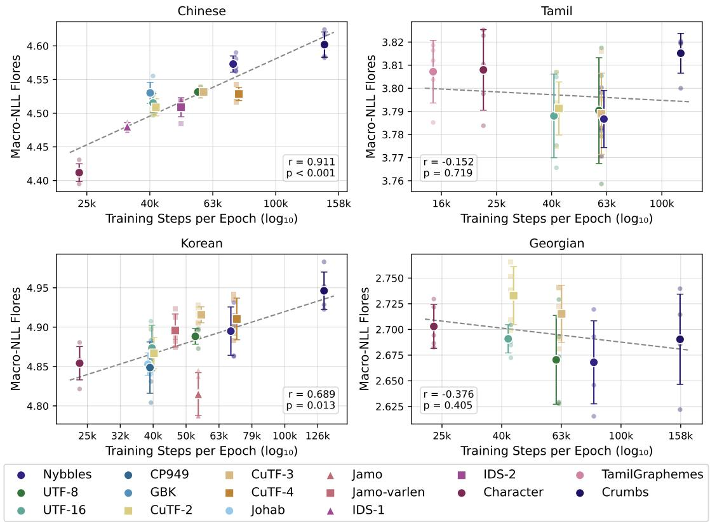
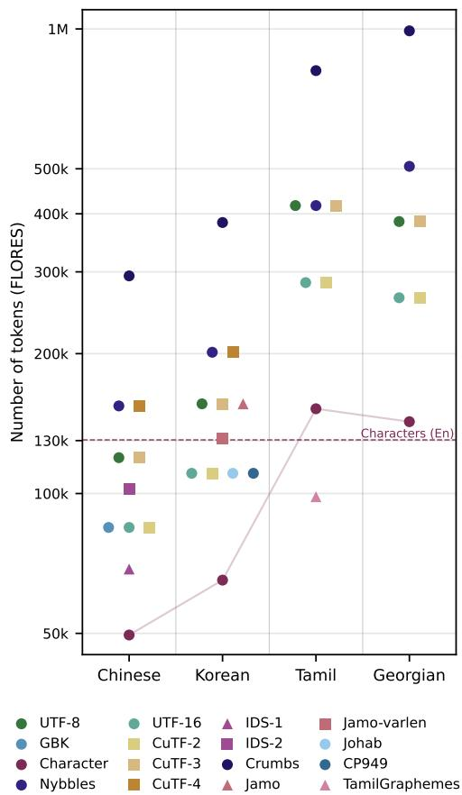
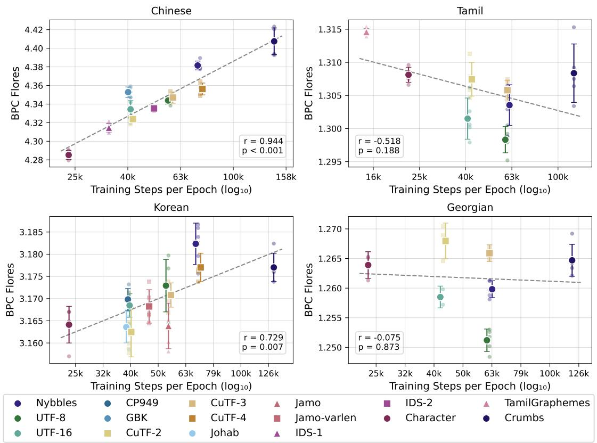

# When does text encoding matter for language modeling?

Eugene Jang1, Catherine Arnett2, Terra Blevins1

1Khoury College of Computer Sciences, Northeastern University 2EleutherAI

{jang.eu, t.blevins}@northeastern.edu catherine@eleuther.ai

## Abstract

UTF-8’s role as the defacto encoding standard in language models introduces cross-lingual inequities due to its variable-length design. However, the efect that this encoding choice has on model performance remains largely unexamined. In this work, we investigate how text encoding impacts the performance of byte-level language models, comparing UTF-8 with a wide range of other encoding strategies, including other Unicode-based approaches, languagespecific encodings, and our own customized encodings. To facilitate our analysis, we propose AETHER: a hybrid encoding scheme that uses script-specific encodings for our target setting while maintaining full Unicode coverage through UTF-8 fallbacks, using this framework to model four orthographically diverse languages. Surprisingly, we find that while languages with information-dense characters (Chinese, Korean) significantly benefit from compressive encodings, languages whose characters carry less information individually (Georgian, Tamil) are largely insensitive to encoding choice. In light of these findings, we argue that text encoding should be a language-specific design decision, rather than a universal default.1

## 1 Introduction

Subword tokenization (i.e. BPE; Gage, 1994; Sennrich et al., 2016) has long been the dominant approach to tokenization (Mielke et al., 2021), but there is growing interest in byte-level tokenization (Tay et al., 2022; Xue et al., 2022; Wang et al., 2024, inter alia) as a way to overcome the shortcomings of subword tokenization (Bostrom and Durrett, 2020; Beinborn and Pinter, 2023; Wang et al., 2025; Chai et al., 2024). While these methods aim to reduce inductive biases carried by subword tokens, the inherent biases of the bytes used as the bases for language models instead are often overlooked. The de facto standard for converting text into bytes in modern computing applications is UTF-8, a variable length encoding scheme capable of expressing all Unicode codepoints using 1 4 bytes; due to its ubiquity, it is also the primary method for converting text into language modeling inputs. However, UTF-8 introduces ineficiencies (Moon et al., 2025; Kim et al., 2026a) and unfairness (Petrov et al., 2023; Arnett et al., 2024), leading some to argue that it is suboptimal for NLP applications (van der Goot, 2026).

<table><tr><td>Unicode Characters</td><td>Chinese</td><td>Korean</td><td>60T Tamil</td><td>S Georgian</td></tr><tr><td>UTF-8</td><td>E6 BB AA</td><td>EA BO 95</td><td>EO AE A9</td><td>E1 83 97</td></tr><tr><td>UTF-16</td><td>4E EA</td><td>AC 15</td><td>OB A9</td><td>10 D7</td></tr><tr><td>Nybbles</td><td>4 E E A</td><td>A C 5</td><td>B A 9</td><td>A D 7</td></tr><tr><td>Jamo</td><td></td><td>上 o</td><td></td><td></td></tr><tr><td>IDS-1</td><td>义</td><td></td><td></td><td></td></tr><tr><td>CuTF-2</td><td>146 89</td><td>106 21</td><td>15 5</td><td>10 5</td></tr><tr><td>CuTF-3</td><td>56 36</td><td>46 23 21</td><td>13 6 5</td><td>12 6 0</td></tr></table>

Figure 1: Examples of alternative text encodings, including Unicode-based encodings (UTF-8, UTF-16, Nybbles), language-specific encodings (Jamo, IDS-1), and our new custom encodings (CuTF-2, CuTF-3).

Recent work, such as MYTE (Limisiewicz et al., 2024) and SCRIPT (Land and Arnett, 2025), propose new encoding strategies designed to address fairness between languages. However, these studies are limited to a single alternative encoding designed to improve the UTF-8 baseline on a specific dimension, leaving many aspects of how encoding choice afects language modeling unexplored. In this work, we present a systematic comparison of encoding methods for byte-level language modeling, based on a wide range (16) of encoding methods spanning Unicode-based encodings, languagespecific encodings, and our own proposed custom encodings (Figure 1). To enable controlled comparisons within a target script, we propose AETHER tokenizers (Alternative Encoding Tokenizers for Hybrid Encoding Representations), which apply script-specific encodings when relevant while applying UTF-8 as a back-of encoding for other text. Using Aether tokenizers, we train “byte”- level models on four orthographically distinct languages (Chinese, Korean, Georgian, Tamil) with 38 unique language-encoding pairs.

Our experiments reveal two distinct patterns. For Chinese and Korean, encoding choice has a clear impact on performance, with more compressive encodings yielding significantly better results. In contrast, all encodings perform similarly for Georgian and Tamil, even when their compression rates difer by up to 7 and 8 , respectively. We hypothesize that these divergent results stem from diferences in the orthographic granularity of the underlying scripts. Specifically, when characters individually encode meaningful information (as in Chinese and Korean), compression appears to heavily impact performance, while characters that carry little information in isolation (like Tamil and Georgian) are largely insensitive to encoding selection. Given these script-specific trends, we argue that text encoding should be treated as a deliberate design choice that accounts for these properties rather than accepted as a universal default.

## 2 Related Work

Character/Byte-Level Modeling The drawbacks of subword tokenizers are often cited as motivations to use atomic units of text as tokens, in the form of characters (Clark et al., 2022; Gao et al., 2020; Lee et al., 2017) or bytes (Xue et al., 2022; Neitemeier et al., 2025; Hwang et al., 2025).2 However, these approaches have seen limited adoption, which Libovický et al. (2022) attribute to their increased computational cost and underperformance to subword counterparts. On the other hand, Edman et al. (2024) identify benefits of byte-level models in low-resource MT scenarios, and argue lower eficiency should be seen as a tradeof. Minixhofer et al. (2026) note that such models are advantageous in domains that benefit from character understanding, such as code and biological sequences. While byte-level models have some promising advantages, the literature typically defaults to the UTF-8 encoding.

Byte Premiums in UTF-8 Past work discuss how tokenization length can vary greatly between languages when conveying the same information (Ahia et al., 2023; Petrov et al., 2023). Arnett et al. (2024) identify how UTF-8 variable byte lengths can systematically distort text dataset sizes. UTF-8 uses variable byte-lengths to encode diferent scripts, with higher Unicode code points requiring more bytes. Basic Latin characters take up early code points represented by single bytes, while other language scripts are encoded with multiple bytes per character. A script’s encoding eficiency therefore depends on its position within Unicode, as earlier code points are encoded as two bytes (e.g. Cyrillic, U+0400–U+04FF) while later code points require three bytes (e.g. Tamil, U+0B80– U+0BFF) or more. Furthermore, two-byte UTF-8 sequences can represent only up to 1,920 code points, which is insuficient for large script blocks, such as CJK Unified Ideographs (20,992 characters) or Hangul Syllables (11,172 characters). In this work, we experiment with Chinese, Korean, Tamil, and Georgian, all of whose scripts fall within the three-byte encoding range.

Alternatives to UTF-8 Previous works explore diferent encoding methods, either by creating new indexing strategies or modifying UTF-8. Limisiewicz et al. (2024) propose MYTE encoding, which converts redundant bytes in the UTF-8 bytespace to encode morphological units. Land and Arnett (2025) propose SCRIPT encoding, where all Unicode characters are encoded in two-part representations of block-indexing pairs. Few works specifically target the large character inventories in the CJK Unified Ideographs and Hangul Syllables blocks. Kim et al. (2026a) suggest representing these code points with UTF-16 encoding, which results in two bytes per character. Similarly, Moon et al. (2025) compress such code points to two 9-bit units by deduplicating redundancies and redistributing the indexing bits of their UTF-8 byte representations. Other works leverage properties specific to a target script, such as decomposability or glyph information (Stratos, 2017; Moon and Okazaki, 2020; Si et al., 2023). We build on these approaches to systematically evaluate many encoding schemes on language model performance.

## 3 Alternative Encodings

In this section, we describe the encoding methods tested in our experiments (Table 1).

We consider an encoding to be any mapping of natural language text into an atomic basis for modeling (potentially ranging from bit-based representations to multi-character units). Critically, we do not restrict ourselves to byte- or bit-aligned units; an encoding may use any indexing unit and vocabulary size we define. We group the considered encodings as follows: Unicode-based encodings (§3.1); language-specific encodings designed to represent a single script (§3.2); and CuTF, our customized indexing scheme that eficiently encodes a script at a fixed length (§3.3). Examples of encodings are illustrated in Figure 1.

## 3.1 Unicode-based Encodings

Unicode is a character encoding standard that unifies previously separate character sets by assigning each character a unique code point. The code points are converted into code units through UTF (Unicode Transformation Format) encodings: UTF-8 uses 8-bit bytes as code units while UTF-16 uses 16-bit byte-pairs as code units.

UTF-8 Encoding While UTF-8 has 256 total byte values in its inventory, only a subset of these values are used to encode multi-byte characters. Each UTF-8 multi-byte character encoding is composed of two types of bytes: the starting byte and the continuation bytes. Starting bytes use part of their beginning bits to indicate the number of continuation bytes that follow while the remaining bits are used for indexing. For instance, in the byte 0xEC (11101100) the 4-bit prefix (1110) signals that it begins a three-byte sequence, while the remaining 4 bits (1100) carry indexing information. Continuation bytes have a fixed 2-bit prefix (10), and use the remaining 6 bits to carry indexing information. Consequently, only 16 of the 24 bits in a three-byte UTF-8 encoding of a code point contain indexing information.

Each character in scripts in the 3-byte code point range can be expressed in the form of triple $( s , c _ { 1 } , c _ { 2 } ) \in S _ { \ell } \times C \times C$ , where $S _ { \ell }$ is the set of possible starting bytes for script $\ell ( | S _ { Z h } | = 6 , | S _ { K o } |$ = $4 , | S _ { T a } | = 1 , | S _ { K a } | = 1 \rangle$ and C is the continuation bytes $( | C | = 6 4 )$ . Continuation bytes $C$ are shared for all multi-byte characters across scripts.

UTF-16 Variants The larger code unit of 16-bits allows for more compact indexing compared to its 8-bit counterpart for certain code points. Code points that would require three UTF-8 bytes can be instead represented as a single 16-bit unit (recall that code points in this range only use 16 bits for indexing). The 16-bit unit can then be interpreted as a two-byte sequence (Kim et al., 2026a). For our experiments, UTF-16 encodings will refer to the big-endian bytes obtained by splitting UTF-16 encodings in half. We argue that splitting the 16 indexing bits to finer-grained units can be iteratively extended upon. We propose two such encodings: Nybbles splits a 16-bit sequence into four nybbles (4-bit units) and Crumbs splits the 16-bit sequence into eight crumbs (2-bit units)3. Finer-grained units reduce the base vocabulary size (from 256 symbols for bytes to 16 for nybbles and 4 for crumbs) at the cost of longer sequences (from 2 to 4 to 8 units per code unit).

## 3.2 Language-specific Encodings

We examine four languages that use diferent writing systems: Chinese (logography), Korean (syllabary)4, Tamil (abugida), and Georgian (alphabet). For each language, we source various representational methods, including legacy encodings and orthography-aware representations.

## 3.2.1 Legacy Encodings

Prior to the wide adoption of Unicode, text encodings were designed to compactly represent the characters used in a target language, but they did not cover all other scripts. When languages have large character inventories, such as Chinese and Korean, language-specific encodings like GBK for Chinese ideographs and CP949 and Johab for Korean Hangul use two bytes to represent characters. When character inventories are suficiently small, language-specific encodings can assign a single byte to each character, as GEOSTD8 and TSCII do for the Georgian and Tamil scripts, respectively. We note that byte-level models using such single-byte encodings are equivalent to training on character-level granularity. Therefore, rather than testing these encodings directly, we evaluate the general strategy of Character-level encoding, applying it to all four languages regardless of character inventory size.

<table><tr><td rowspan="2">Encoding</td><td rowspan="2">Length</td><td colspan="2">Korean (KO)</td><td colspan="2">Chinese (ZH)</td><td colspan="2">Tamil (TA)</td><td colspan="2">Georgian (KA)</td></tr><tr><td>Vocab</td><td>Steps/Ep.</td><td>Vocab</td><td>Steps/Ep.</td><td>Vocab</td><td>Steps/Ep.</td><td>Vocab</td><td>Steps/Ep.</td></tr><tr><td colspan="9">Unicode-based methods</td></tr><tr><td>Character</td><td>1</td><td>11,172</td><td>23,804</td><td>20,902</td><td>23,756</td><td>128</td><td>23,756</td><td>96</td><td>23,585</td></tr><tr><td>UTF-16</td><td>2</td><td>256</td><td>39,202</td><td>256</td><td>40,768</td><td>129</td><td>41,439</td><td>97</td><td>42,749</td></tr><tr><td>UTF-8</td><td>3</td><td>68</td><td>54,600</td><td>70</td><td>57,781</td><td>65</td><td>60,368</td><td>65</td><td>61,913</td></tr><tr><td>Nybbles</td><td>3/4</td><td>16</td><td>69,998</td><td>16</td><td>74,793</td><td>16</td><td>79,296</td><td>16</td><td>81,077</td></tr><tr><td>Crumbs</td><td>6/8</td><td>4</td><td>131,589</td><td>4</td><td>142,842</td><td>4</td><td>117,151</td><td>4</td><td>157,733</td></tr><tr><td colspan="10">Language-specific methods</td></tr><tr><td colspan="10">CP949</td></tr><tr><td>Johab</td><td>2</td><td>178</td><td>39,202 39,202</td><td></td><td></td><td></td><td></td><td></td><td></td></tr><tr><td></td><td>2</td><td>177</td><td></td><td></td><td></td><td></td><td></td><td></td><td></td></tr><tr><td>Jamo-varlen</td><td>2-3</td><td>67</td><td>46,472 54,600</td><td></td><td></td><td></td><td></td><td></td><td></td></tr><tr><td>Jamo</td><td>3</td><td>68</td><td></td><td>190</td><td></td><td></td><td></td><td></td><td></td></tr><tr><td>GBK IDS-1</td><td>2</td><td></td><td></td><td>3007</td><td>40,768</td><td></td><td></td><td></td><td></td></tr><tr><td>IDS-2</td><td>1-10</td><td></td><td></td><td>1138</td><td>33,766 50,030</td><td></td><td></td><td></td><td></td></tr><tr><td>TamilGraphemes</td><td>1-17 &lt;1</td><td></td><td></td><td></td><td></td><td>314</td><td>14,789</td><td></td><td></td></tr><tr><td colspan="10">Custom UTFs</td></tr><tr><td colspan="10">CuTF-2</td></tr><tr><td></td><td>2</td><td>212</td><td>39,202</td><td>290</td><td>40,768</td><td>23</td><td>41,439</td><td>20</td><td>42,749</td></tr><tr><td>CuTF-3</td><td>3</td><td>68</td><td>54,600</td><td>83</td><td>57,781</td><td>16</td><td>60,368</td><td>14</td><td>61,913</td></tr><tr><td>CuTF-4</td><td>4</td><td>42</td><td>70,004</td><td>49</td><td>74,793</td><td></td><td></td><td></td><td></td></tr></table>

Table 1: Encoding methods tested in our experiments for Korean (KO), Chinese (ZH), Tamil (TA), and Georgian (KA). Vocab size refers to the unique values in encoding inventory used to represent the target script.

## 3.2.2 Orthography-aware Representations

Drawing on prior work, we explore representation methods that exploit the orthographic structure of three scripts. To our knowledge, there are no scriptspecific encodings for Georgian.

Chinese The Chinese Hanzi script (mainly CJK Ideographs in Unicode) contain rich features, such as phonetic information and glyph information (Wang et al., 2020; Si et al., 2023; Xiang and Liu, 2025). However, methods based on these features are often not suitable to encode characters, as they require explicit symbols for character boundaries or disambiguation. We experiment with character representations utilizing Ideographic Description Sequence (IDS) decomposition, which represents a character by its subcharacters and their arrangement (Han et al., 2021). For instance, the character 悬 is decomposed to (⿱, 县, 心). IDS sequences are self-delimiting and rarely require disambiguation, making them a viable method for character representation. The IDS subcharacters are often also decomposable, allowing for recursive decomposition. In the previous decomposition, subcharacter 心 has no further decompositions, but 县 can be further decomposed to (⿱, 且, and 厶). Allowing one decomposition step (IDS-1) reduces the vocabulary size from 20,902 to 3,006 and allowing two steps of decomposition (IDS-2) reduces it further to 1,138. Characters with identical decompositions are rare (20 in IDS-1 and 24 in IDS-2), and are addressed by a single additional disambiguation symbol. This representation benefits from subcharacter information transferring across multiple characters, but may sufer from long and irregular encoding lengths. We use the cjkvi-ids database5 for IDS decompositions.

Korean The Korean Hangul script (Hangul Syllables) have a compositional structure, where each character can be canonically decomposed into three sub-character alphabet units called jamo (Stratos, 2017; Moon and Okazaki, 2020; Cognetta et al., 2023). For instance, the character 강 (gang) can be losslessly decomposed into jamos that carry phonetic information: ㄱ (g), ㅏ (a), ㅇ (- ng). Jamo decomposition of Hangul syllables can be expressed as $\left( c _ { h } , c _ { v } , c _ { t } \right)$ with $c _ { h } \in J _ { h } , c _ { v } \in J _ { v } $ and $c _ { t } \in J _ { t }$ where $| J _ { h } | = 1 9 , | J _ { v } | = 2 1 , | J _ { t } | =$ 28. We test two variants of jamo-based encoding schemes. The first, Jamo (fixed-length), always decomposes characters into three jamos (e.g. 하 $ ( \bar { \sigma } , \ \vdash , \emptyset ) )$ , while the second Jamo-varlen encodes into two jamos whenever possible (e.g. 하 $ ( \bar { \sigma } , \mathrm {  ~ \ l ~ } ) ) ^ { 6 }$ . The former may benefit from the regularity of a fixed length encoding, while the latter may benefit from stronger compression.

  
Figure 2: A. CuTF is a custom encoding scheme that maps target characters to a minimal vocabulary at a given compression rate. For example, 강 would be encoded as [EA, B0, 95] out of [4, 64, 64] possible inventory elements in UTF-8, versus [46, 23, 21] out of position specific inventories of [22 , 23 , 23 ] in CuTF-3. B. AetherTokenizers use a hybrid representation that applies a specialized encoding to the target script and UTF-8 to all other text.

Tamil For abugida writing systems such as Tamil, a single user-perceived character (grapheme) may be encoded as multiple Unicode characters (Velayuthan and Sarveswaran, 2024; Nisfer et al., 2026). For instance, the word வீடு (veedu, ‘house’) is rendered as two graphemes வீ (vee) and டு (du), but is stored as four Unicode characters ('வ', '◌ீ', 'ட', '◌ு'). Following this prior work, we represent Tamil text at the Graphemes granularity, which better aligns with the units perceived by Tamil readers. We follow the implementation of Nisfer et al. (2026), which defines a total of 314 total graphemes, including 247 standard Tamil letters, 65 Grantha forms, and 2 conjunct graphemes (ஶ்ரீ, க்ஷ).

## 3.3 CuTF: Customized UTFs

Generally, existing encodings are designed with the constraint of using computational units (i.e. bytes) as code units. Using these encodings for language modeling unnecessarily inherits these constraints, leading to ineficient indexing. We propose CuTF (Customized UTF; Figure 2A), a novel indexing scheme that encodes a target Unicode block using the minimum base units needed to index all codepoints in a target Unicode block at fixed lengths, relaxing the assumption that the total vocabulary of the encoding must fit within one byte (256 values).

Each CuTF implementation is parameterized by an encoding length L (denoted CuTF-L), the number of units needed to represent a character in the target Unicode block. Specifically, the character is represented as a fixed-length sequence of L units $[ c _ { 1 } , \dots , c _ { L } ]$ , where the i-th unit is drawn from a position-specific vocabulary Ci. Indexing within this encoding uses the ofset within the target block rather than the Unicode codepoint.7

The minimum vocabulary needed to fully map a block of size V with length L is $\lceil V ^ { 1 / L } \rceil$ per encoding unit. For instance, the 11,172 characters in the Hangul Syllables blocks can be mapped with three encoding units if each unit has 23 unique values. In our experiments, we use $L = 2 , 3 .$ , 4 for larger script inventories (ZH, KO) and L = 2, 3 for smaller scripts (TA, KA).

## 4 Methodology

We investigate the efectiveness of alternative encoding strategies (Section 3) for monolingual language modeling by training comparable language models that vary only in their encoding method for the target script. We train each language’s models on identical monolingual corpora for one epoch, introducing hybrid encoding schemes and character-level macro-averaged metrics to prevent out-of-vocabulary confounds and frequency biases in our evaluations, respectively.

Aether Tokenization Even in monolingual text corpora, characters outside the primary script (e.g. foreign words, symbols, emojis) can naturally occur. However, many language-specific encodings do not provide full coverage of Unicode characters, leading to inconsistent handling of out-ofscript characters across the considered settings. To in order to include the language-specific encodings while not introducing confounds, we propose AETHER tokenizers, which apply a script-specific encoding only to the target script, while using UTF-8 as a back-of encoding for other characters (Fig 2B); this hybrid encoding set up enables fair comparison between encoding methods in their ability to represent a target script, without out-ofvocabulary issues. A preprocessing regex separates target from non-target text to facilitate the selective application of encodings across inputs. The target and fallback encoding spaces are stored in separate inventories, preventing cross-script collisions in model inputs.

Model Training For each encoding scheme, we train GPT2-base-sized decoder-only models with Llama-3 architecture from scratch, increasing sequence length from 512 to 4096 to account for longer sequences from finer-grained tokenization. We use a maximum learning rate of 5e-4 at batch sizes of 64 using BF16 mixed precision training. Additional hyperparameter information can be found in Appendix A.

Importantly, we train each model on one epoch, so that all models of the same language are trained on the same amount of data regardless of input sequence lengths. Ensuring fair comparisons between models with diferent tokenizers is dificult, since runs cannot be both compute-matched (Liu et al., 2025) and data-matched (Park et al., 2020) at the same time. We focus on data-matching over compute-matching in our experiments as it controls for the overall information seen by each model, while compute-matching benefits more compressive encodings artificially by allowing it to train on significantly more data.

Each model is trained on a high-quality, curated pretraining text corpus for the target language. For Chinese, we use FineWeb-Edu-Chinese-v2 from the OpenCSG Corpus (Yu et al., 2025). For Korean, we use the LLM pretraining corpus from the AI Hub8. For Tamil, we use the Tamil subset from the Sangraha dataset (Khan et al., 2024). For Georgian, we use the Georgian subset from the FineWeb2 dataset (Penedo et al., 2025). Each training corpus is capped to approximately 6 billion characters, corresponding to around 15 billion UTF-8 bytes for each language. For comparison, this exceeds the 7–11 billion UTF-8 byte range (varying by language) recommended for our model size by tokenization scaling laws (Limisiewicz et al., 2026).

For each setting, we report mean and standard deviation from 5 random seeds.

Evaluation For evaluation, we use language modeling probabilities of sequences taken from the FLORES dataset (Goyal et al., 2022). Our aim is to evaluate an encoding’s ability to efectively represent all targeted characters in a script. However, common characters are more frequent than uncommon characters by large magnitudes (Choi, 2000; Liu et al., 2017), skewing standard language modeling metrics to a small subset of characters. Therefore, we propose character-level macro averaged negative log-likelihood (Macro NLL) as our primary metric. Individual token NLLs are aggregated to the character-level9 and averaged across character occurrences; then, the log-likelihood values of all unique characters are averaged together with equal weighting regardless of frequency. For experimental results with the standard bits-percharacter loss, refer to Appendix B.

## 5 Results

Figure 3 shows log-linear fits between the compression of an encoding and its language modeling performance. Since all models for a given language are trained on the same data for one epoch, we measure compression as the number of training steps per epoch. We observe two distinct trends between languages.

Chinese and Korean Encoding compression was significantly correlated with language modeling performance, with more compressive encodings performing better. The correlation was strong for Chinese (r = 0.911, p < 0.001) and moderately strong for Korean $( r = 0 . 6 8 9 , p = 0 . 0 1 3 )$ We note that the weaker correlation for Korean was largely driven by the Jamo encoding. Excluding it yields a correlation comparable to Chinese $( r = 0 . 8 8 6 , p < 0 . 0 0 1 )$

Tamil and Georgian Encoding compression was not significantly correlated with language modeling performance for either Tamil (r =

  
Figure 3: Macro negative log-likelihoods (lower is better) of alternative text encodings on all considered languages. A linear regression model shows the relationship between Macro-NLL and log(training steps per epoch). X-values are jittered for visualization.

0.152, p = 0.719) or Georgian (r = 0.376, $\begin{array} { r l r } { p } & { { } = } & { 0 . 4 0 5 ) } \end{array}$ Overlapping error bars suggest that variability between encodings is comparable to variability across random seeds. Even in the most extreme comparisons, encodings performed similarly despite large diferences in compression: Graphemes and Crumbs difered by a factor of 8 for Tamil, as did Character and Crumbs by a factor of 7 for Georgian. Although neither correlations is significant, they trend in the opposite direction from Chinese and Korean.

## 6 Discussion

Encoding Efects are Language-specific. Why does encoding choice impact Chinese and Korean but not (significantly) Tamil and Georgian? We attribute this diference to orthographic granularity, or how densely languages represent linguistic content in writing (Shani et al., 2026). In Chinese, each character typically corresponds to a morpheme, and in Korean, each character encodes a full syllable. In contrast, characters in Tamil and Georgian correspond to individual consonants or vowels, which contain little information in isolation. Consistent with this, Chinese and Korean require less than half as many characters as Tamil and Georgian to express the same content in our evaluation data (Figure 4). We hypothesize that when characters contain substantial information, allowing models to reconstruct this information in fewer steps (fewer tokens) is beneficial for performance. Conversely, when characters carry negligible information on their own, characters and subcharacters perform similarly.

Role of Compression. Tokenizer compression has been said to be correlated with model performance (Gallé, 2019; Goldman et al., 2024), but there is conflicting evidence (Schmidt et al., 2024). It may be the case that longer sequences from finergrained tokenization are advantageous, as this allows models to spend more FLOPs on a given text (Xue et al., 2022; Marathe et al., 2026). Limisiewicz et al. (2026) find increasing compression past an optimal point can harm performance. Our findings suggest that the role of compression can be heavily dependent on the language.

  
Figure 4: Number of tokens produced by diferent encodings on parallel data (FLORES). Dotted red line marks the character counts in English for comparison.

Linguistically Meaningful Encoding Units. For Korean models, the best performing Jamo encoding outperformed the most compressive encoding (Character). Jamo encoding decomposes each syllable into three jamos, a meaningful sub-character unit that can capture linguistic phenomena such as morphophonological alternations (Kim et al., 2026b). In contrast, Jamo-varlen, which uses the same sub-character units but with variable-length sequences, did not show the same benefits and instead performed in line with its compression. Similarly, IDS-1 and IDS-2 also performed in line with their compression, despite using linguistically informative subcharacter units (Han et al., 2021) as variable-length sequences. This suggests that sub-character information is only useful in settings where it is paired with fixed-length encoding patterns.

What’s in a good encoding? Recent work argues that tokenization should be considered as a core design decision appropriately tailored for its context (Alqahtani et al., 2026). Encodings, much like subword tokenizers, have desiderata that should be considered before being deployed in the language modeling pipeline. Even without performance benefits, compression is a desirable quality for eficient model training and inference. However, higher compression often necessitates a larger vocabulary size (as seen in Table 1). Our findings on when and how compression afects performance can help inform these tradeofs when choosing an encoding.

Another factor is encoding fairness between scripts. Our approach of using hybrid encodings of Aether tokenization poses a solution to encoding length disparities in UTF-8 (Land and Arnett, 2025; Arnett et al., 2024). Hybrid encodings provide a method to improve compression or performance at the cost of increased vocabulary size.

Do these results extend to subword tokenizers? We argue that understanding the efect of encoding choice is relevant for all tokenizers. All modern subword tokenization models (byte-level BPE, and even character-level BPE or Unigram with byte fallback) implicitly use UTF-8 encoding as a pretokenizer, which has tangible and underlooked efects on the final tokenization (Velayuthan and Sarveswaran, 2024; Gorman and Pinter, 2025). Our work suggests that the default UTF-8 encoding used by subword tokenizers may disadvantage certain scripts with longer byte lengths, since specialized encodings can provide increased compression and improved language modeling performance. This efect might be the most significant for languages with coarser orthographic granularities like Korean and Chinese.

## 7 Conclusion

In this work, we investigate alternative encoding schemes for their impact on language modeling performance. We conduct a comprehensive analysis of encoding efects on 38 language-encoding settings, considering Unicode-based encodings, language-specific encodings, and our novel encoding scheme, CuTF, that eficiently encodes the target script at a chosen compression rate. To facilitate full coverage of possible characters in language-specific encoding experiments, we also introduce Aether Tokenization, a new hybrid encoding method that can reap the benefits of specialized encodings without sacrificing character coverage. We find that byte-level language models benefit from compressive text encodings for languages with coarse orthographic granularity (such as Chinese and Korean), while languages with finer granularity (such as Tamil and Georgian) are largely insensitive to encoding choice. In light of these results, we argue that practitioners should not default to UTF-8 when building a language model, but instead treat the choice of encoding as a deliberate design decision that considers the targeted languages.

## 8 Limitations

Given the computational costs of comprehensively analyzing multiple encoding schemes across languages and modeling runs, the models considered in this work are relatively small, at approximately 120M parameters. Scaling these experiments in future work will be important for verifying our results, particularly on downstream tasks beyond next-word prediction. Additionally, our evaluation is currently limited to monolingual settings, though we hypothesize that encoding efects may behave diferently in multilingual settings due to cross-script interactions and the availability of alternative encodings for diferent languages.

Finally, like standard byte-level language models using UTF-8, models trained on our custom encodings can generate invalid or malformed sequences (Moon et al., 2026; Firestone et al., 2025), an issue we leave unaddressed in this paper. We anticipate that some encoding schemes may be particuarly prone to this issue, such as IDS tokenization, that would require the model to precisely match long, variable-length sequences for each character when generating new text.

## References

Orevaoghene Ahia, Sachin Kumar, Hila Gonen, Jungo Kasai, David Mortensen, Noah Smith, and Yulia Tsvetkov. 2023. Do all languages cost the same? tokenization in the era of commercial language models. In Proceedings of the 2023 Conference on Empirical Methods in Natural Language Processing, pages 9904–9923, Singapore. Association for Computational Linguistics.

Rami Al-Rfou, Dokook Choe, Noah Constant, Mandy Guo, and Llion Jones. 2019. Character-level language modeling with deeper self-attention. In Proceedings ofthe Thirty-Third AAAI Conference on Artificial Intelligence and Thirty-First Innovative Applications of Artificial Intelligence Conference and Ninth AAAI Symposium on Educational Advances in Artificial Intelligence, AAAI’19/IAAI’19/EAAI’19. AAAI Press.

Sawsan Alqahtani, Mir Tafseer Nayeem, Md Tahmid Rahman Laskar, Tasnim Mohiuddin, and M Sai-

ful Bari. 2026. Stop taking tokenizers for granted: They are core design decisions in large language models. In Proceedings of the 19th Conference of the European Chapter of the Association for Computational Linguistics (Volume 1: Long Papers), pages 8410–8432, Rabat, Morocco. Association for Computational Linguistics.

Catherine Arnett, Tyler A. Chang, and Benjamin Bergen. 2024. A bit of a problem: Measurement disparities in dataset sizes across languages. In Proceedings of the 3rd Annual Meeting of the Special Interest Group on Under-resourced Languages @ LREC-COLING 2024, pages 1–9, Torino, Italia. ELRA and ICCL.

Lisa Beinborn and Yuval Pinter. 2023. Analyzing cognitive plausibility of subword tokenization. In Proceedings of the 2023 Conference on Empirical Methods in Natural Language Processing, pages 4478– 4486, Singapore. Association for Computational Linguistics.

Kaj Bostrom and Greg Durrett. 2020. Byte pair encoding is suboptimal for language model pretraining. Preprint, arXiv:2004.03720.

Yekun Chai, Yewei Fang, Qiwei Peng, and Xuhong Li. 2024. Tokenization falling short: On subword robustness in large language models. In Findings ofthe Associationfor Computational Linguistics: EMNLP 2024, pages 1582–1599, Miami, Florida, USA. Association for Computational Linguistics.

Dokook Choe, Rami Al-Rfou, Mandy Guo, Heeyoung Lee, and Noah Constant. 2019. Bridging the gap for tokenizer-free language models. Preprint, arXiv:1908.10322.

S.-W. Choi. 2000. Some statistical properties and zipf s law in korean text corpus. Journal of Quantitative Linguistics, 7(1):19–30.

Jonathan H. Clark, Dan Garrette, Iulia Turc, and John Wieting. 2022. Canine: Pre-training an eficient tokenization-free encoder for language representation. Transactions of the Association for Computational Linguistics, 10:73–91.

Marco Cognetta, Sangwhan Moon, Lawrence Wolfsonkin, and Naoaki Okazaki. 2023. Parametereficient Korean character-level language modeling. In Proceedings of the 17th Conference of the European Chapter of the Association for Computational Linguistics, pages 2350–2356, Dubrovnik, Croatia. Association for Computational Linguistics.

Lukas Edman, Gabriele Sarti, Antonio Toral, Gertjan van Noord, and Arianna Bisazza. 2024. Are character-level translations worth the wait? comparing ByT5 and mT5 for machine translation. Transactions of the Association for Computational Linguistics, 12:392–410.

Preston Firestone, Shubham Ugare, Gagandeep Singh, and Sasa Misailovic. 2025. UTF-8 plumbing: Bytelevel tokenizers unavoidably enable LLMs to generate ill-formed UTF-8. In Second Conference on Language Modeling.

Philip Gage. 1994. A new algorithm for data compression. C Users J., 12(2):23–38.

Matthias Gallé. 2019. Investigating the efectiveness of BPE: The power of shorter sequences. In Proceedings of the 2019 Conference on Empirical Methods in Natural Language Processing and the 9th International Joint Conference on Natural Language Processing (EMNLP-IJCNLP), pages 1375–1381, Hong Kong, China. Association for Computational Linguistics.

Yingqiang Gao, Nikola I. Nikolov, Yuhuang Hu, and Richard H.R. Hahnloser. 2020. Character-level translation with self-attention. In Proceedings ofthe 58th Annual Meeting of the Association for Computational Linguistics, pages 1591–1604, Online. Association for Computational Linguistics.

Omer Goldman, Avi Caciularu, Matan Eyal, Kris Cao, Idan Szpektor, and Reut Tsarfaty. 2024. Unpacking tokenization: Evaluating text compression and its correlation with model performance. Preprint, arXiv:2403.06265.

Kyle Gorman and Yuval Pinter. 2025. Don’t touch my diacritics. In Proceedings of the 2025 Conference of the Nations of the Americas Chapter of the Association for Computational Linguistics: Human Language Technologies (Volume 2: Short Papers), pages 285–291, Albuquerque, New Mexico. Association for Computational Linguistics.

Naman Goyal, Cynthia Gao, Vishrav Chaudhary, Peng-Jen Chen, Guillaume Wenzek, Da Ju, Sanjana Krishnan, Marc’Aurelio Ranzato, Francisco Guzmán, and Angela Fan. 2022. The Flores-101 evaluation benchmark for low-resource and multilingual machine translation. Transactions ofthe Associationfor Computational Linguistics, 10:522–538.

Lifeng Han, Gareth Jones, Alan Smeaton, and Paolo Bolzoni. 2021. Chinese character decomposition for neural MT with multi-word expressions. In Proceedings of the 23rd Nordic Conference on Computational Linguistics (NoDaLiDa), pages 336–344, Reykjavik, Iceland (Online). Linköping University Electronic Press, Sweden.

Sukjun Hwang, Brandon Wang, and Albert Gu. 2025. Dynamic chunking for end-to-end hierarchical sequence modeling. Preprint, arXiv:2507.07955.

Mohammed Safi Ur Rahman Khan, Priyam Mehta, Ananth Sankar, Umashankar Kumaravelan, Sumanth Doddapaneni, Suriyaprasaad G, Varun Balan G, Sparsh Jain, Anoop Kunchukuttan, Pratyush Kumar, Raj Dabre, and Mitesh M. Khapra. 2024. Indicllmsuite: A blueprint for creating pre-training and finetuning datasets for indian languages. arXiv preprint arXiv: 2403.06350.

Hyunsik Kim, Haeri Kim, Munhak Lee, and Kyungmin Lee. 2026a. Bbpe16: Utf-16-based byte-level byte-pair encoding for improved multilingual speech recognition. Preprint, arXiv:2602.01717.

SungHo Kim, Juhyeong Park, Eda Atalay, and SangKeun Lee. 2026b. SCRIPT: A subcharacter compositional representation injection module for Korean pre-trained language models. In Findings of the Association for Computational Linguistics: ACL 2026, pages 2185–2213, San Diego, California, United States. Association for Computational Linguistics.

Sander Land and Catherine Arnett. 2025. Bpe stays on script: Structured encoding for robust multilingual pretokenization. Preprint, arXiv:2505.24689.

Jason Lee, Kyunghyun Cho, and Thomas Hofmann. 2017. Fully character-level neural machine translation without explicit segmentation. Transactions of the Association for Computational Linguistics, 5:365–378.

Jindřich Libovický, Helmut Schmid, and Alexander Fraser. 2022. Why don’t people use character-level machine translation? In Findings of the Association for Computational Linguistics: ACL 2022, pages 2470–2485, Dublin, Ireland. Association for Computational Linguistics.

Tomasz Limisiewicz, Terra Blevins, Hila Gonen, Orevaoghene Ahia, and Luke Zettlemoyer. 2024. MYTE: Morphology-driven byte encoding for better and fairer multilingual language modeling. In Proceedings of the 62nd Annual Meeting of the Association for Computational Linguistics (Volume 1: Long Papers), pages 15059–15076, Bangkok, Thailand. Association for Computational Linguistics.

Tomasz Limisiewicz, Artidoro Pagnoni, Srini Iyer, Mike Lewis, Sachin Mehta, Alisa Liu, Margaret Li, Gargi Ghosh, and Luke Zettlemoyer. 2026. Compute optimal tokenization. Preprint, arXiv:2605.01188.

Alisa Liu, Jonathan Hayase, Valentin Hofmann, Sewoong Oh, Noah A. Smith, and Yejin Choi. 2025. SuperBPE: Space travel for language models. In Second Conference on Language Modeling.

Chao-Lin Liu, Shuhua Zhang, Yuanli Geng, Huei ling Lai, and Hongsu Wang. 2017. Character distributions of classical chinese literary texts: Zipf’s law, genres, and epochs. Preprint, arXiv:1709.05587.

Kalyani Marathe, Artidoro Pagnoni, Tomasz Limisiewicz, Margaret Li, Mike Lewis, Luke Zettlemoyer, and Srinivasan Iyer. 2026. Breaking the token ceiling: Distilling smaller, stronger byte models. arXiv preprint arXiv:2609.12303.

Sabrina J Mielke, Zaid Alyafeai, Elizabeth Salesky, Colin Rafel, Manan Dey, Matthias Gallé, Arun Raja, Chenglei Si, Wilson Y Lee, Benoît Sagot, et al. 2021. Between words and characters: A brief history of open-vocabulary modeling and tokenization in nlp. arXiv preprint arXiv:2112.10508.

Benjamin Minixhofer, Tyler Murray, Tomasz Limisiewicz, Anna Korhonen, Luke Zettlemoyer, Noah A. Smith, Edoardo M. Ponti, Luca Soldaini, and Valentin Hofmann. 2026. Bolmo: Byteifying the next generation of language models. Preprint, arXiv:2512.15586.

Sangwhan Moon, Tatsuya Hiraoka, and Naoaki Okazaki. 2025. Bit-level bpe: Below the byte boundary. Preprint, arXiv:2506.07541.

Sangwhan Moon, Daisuke Oba, Youmi Ma, Tatsuya Hiraoka, and Naoaki Okazaki. 2026. Beyond perplexity: Utf-8 validity in byte-aware language models. Preprint, arXiv:2606.14122.

Sangwhan Moon and Naoaki Okazaki. 2020. Jamo pair encoding: Subcharacter representation-based extreme Korean vocabulary compression for eficient subword tokenization. In Proceedings of the Twelfth Language Resources and Evaluation Conference, pages 3490–3497, Marseille, France. European Language Resources Association.

Pit Neitemeier, Björn Deiseroth, Constantin Eichenberg, and Lukas Balles. 2025. Hierarchical autoregressive transformers: Combining byte- and wordlevel processing for robust, adaptable language models. In The Thirteenth International Conference on Learning Representations.

Izzath Nisfer, Ashini Kavindya, Ovindu Atukorala, Purushoth Velayuthan, and Menan Velayuthan. 2026. grapheme-kit: Grapheme-level metrics and text processing for multilingual nlp. Preprint, arXiv:2607.22456.

Hye K. Pae. 2011. Is korean a syllabic alphabet or an alphabetic syllabary. Writing Systems Research, 3(2):103–115.

Kyubyong Park, Joohong Lee, Seongbo Jang, and Dawoon Jung. 2020. An empirical study of tokenization strategies for various Korean NLP tasks. In Proceedings of the 1st Conference of the Asia-Pacific Chapter of the Association for Computational Linguistics and the 10th International Joint Conference on Natural Language Processing, pages 133–142, Suzhou, China. Association for Computational Linguistics.

Guilherme Penedo, Hynek Kydlíček, Vinko Sabolčec, Bettina Messmer, Negar Foroutan, Amir Hossein Kargaran, Colin Rafel, Martin Jaggi, Leandro Von Werra, and Thomas Wolf. 2025. Fineweb2: One pipeline to scale them all – adapting pre-training data processing to every language. Preprint, arXiv:2506.20920.

Aleksandar Petrov, Emanuele La Malfa, Philip Torr, and Adel Bibi. 2023. Language model tokenizers introduce unfairness between languages. In Advances in Neural Information Processing Systems, volume 36, pages 36963–36990. Curran Associates, Inc.

Craig W Schmidt, Varshini Reddy, Haoran Zhang, Alec Alameddine, Omri Uzan, Yuval Pinter, and Chris Tanner. 2024. Tokenization is more than compression. In Proceedings of the 2024 Conference on Empirical Methods in Natural Language Processing, pages 678–702, Miami, Florida, USA. Association for Computational Linguistics.

Rico Sennrich, Barry Haddow, and Alexandra Birch. 2016. Neural machine translation of rare words with subword units. In Proceedings of the 54th Annual Meeting of the Association for Computational Linguistics (Volume 1: Long Papers), pages 1715– 1725, Berlin, Germany. Association for Computational Linguistics.

Chen Shani, Yuval Reif, Nathan Roll, Dan Jurafsky, and Ekaterina Shutova. 2026. The roots of performance disparity in multilingual language models: Intrinsic modeling dificulty or design choices? Preprint, arXiv:2601.07220.

Chenglei Si, Zhengyan Zhang, Yingfa Chen, Fanchao Qi, Xiaozhi Wang, Zhiyuan Liu, Yasheng Wang, Qun Liu, and Maosong Sun. 2023. Sub-character tokenization for Chinese pretrained language models. Transactions of the Association for Computational Linguistics, 11:469–487.

Karl Stratos. 2017. A sub-character architecture for Korean language processing. In Proceedings of the 2017 Conference on Empirical Methods in Natural Language Processing, pages 721–726, Copenhagen, Denmark. Association for Computational Linguistics.

Yi Tay, Vinh Q. Tran, Sebastian Ruder, Jai Gupta, Hyung Won Chung, Dara Bahri, Zhen Qin, Simon Baumgartner, Cong Yu, and Donald Metzler. 2022. Charformer: Fast character transformers via gradient-based subword tokenization. In International Conference on Learning Representations.

Insup Taylor. 1980. The Korean writing system: An alphabet? A syllabary? a logography?, pages 67–82. Springer US, Boston, MA.

Rob van der Goot. 2026. From bytes to subwords: Challenges of input representations in NLP. In Findings of the Association for Computational Linguistics: ACL 2026, pages 10911–10919, San Diego, California, United States. Association for Computational Linguistics.

Menan Velayuthan and Kengatharaiyer Sarveswaran. 2024. Egalitarian language representation in language models: It all begins with tokenizers. Preprint, arXiv:2409.11501.

Dixuan Wang, Yanda Li, Junyuan Jiang, Zepeng Ding, Ziqin Luo, Guochao Jiang, Jiaqing Liang, and Deqing Yang. 2025. Tokenization matters! degrading large language models through challenging their tokenization. Preprint, arXiv:2405.17067.

Junxiong Wang, Tushaar Gangavarapu, Jing Nathan Yan, and Alexander M Rush. 2024. Mambabyte: Token-free selective state space model. In First Conference on Language Modeling.

Shirui Wang, Wenan Zhou, and Qiang Zhou. 2020. Radical and stroke-enhanced chinese word embeddings based on neural networks: S. wang et al. Neural Processing Letters, 52(2):1109–1121.

Junyi Xiang and Maofu Liu. 2025. Exploiting phonetics and glyph representation at radical-level for classical Chinese understanding. In Findings of the Associationfor Computational Linguistics: ACL 2025, pages 22850–22871, Vienna, Austria. Association for Computational Linguistics.

Linting Xue, Aditya Barua, Noah Constant, Rami Al Rfou, Sharan Narang, Mihir Kale, Adam Roberts, and Colin Rafel. 2022. ByT5: Towards a token-free future with pre-trained byte-to-byte models. Transactions of the Association for Computational Linguistics, 10:291–306.

Yijiong Yu, Ziyun Dai, Zekun Wang, Wei Wang, Ran Chen, and Ji Pei. 2025. Opencsg chinese corpus: A series of high-quality chinese datasets for llm training. Preprint, arXiv:2501.08197.

## A Training Details

The hyperparameters of our models are found in Table 2. For hyperparameter search, we performed a sweep over 1e-4, 5e-4, 1e-3 learning rate on three encodings (UTF-8, Jamo, and GBK) on Chinese and Korean. Higher learning rate values would produce better training curves, but were frequently prone to training loss spikes. The 5e-4 value was chosen for our experiments, but occasional training loss spikes persisted. Increasing batch size (64 128) improved stability but harmed performance. Eventually, changing $\beta _ { 2 }$ value of the AdamW optimizer from the default 0.999 value to 0.95 improved both stability and performance.

<table><tr><td>Hyperparameter</td><td>Value</td></tr><tr><td>Number of Layers</td><td>12</td></tr><tr><td>Hidden Size</td><td>768</td></tr><tr><td>Inner Hidden Size Attention Heads</td><td>3072</td></tr><tr><td>Attention Dropout</td><td>12 0.0</td></tr><tr><td>Max Sequence Length</td><td>4096</td></tr><tr><td>Peak Learning Rate</td><td>5e-4</td></tr><tr><td>Batch Size</td><td></td></tr><tr><td></td><td>64</td></tr><tr><td>Weight Decay</td><td>0.01</td></tr><tr><td>Learning Rate Decay</td><td>Linear</td></tr><tr><td>LR Warmup</td><td>0.1</td></tr><tr><td>Adam €</td><td>1e-8</td></tr><tr><td>Adam  $\beta _ { 1 }$ </td><td>0.9</td></tr><tr><td>Adam  $\beta _ { 2 }$ </td><td>0.95</td></tr><tr><td>Max Grad Norm</td><td>1</td></tr></table>

Table 2: The hyperparameters used for training our models.

## B BPC Results

Figure 5 contains our results using the BPC (bits-per-character) metric. Overall trends remain the same, but the impact of long-tailed characters are diminished in this metric.

  
Figure 5: Bits-per-character (lower is better) of alternate text encodings for the considered languages. A linear regression model shows the relationship between BPC and log(training steps per epoch). X-values are jittered for visualization.