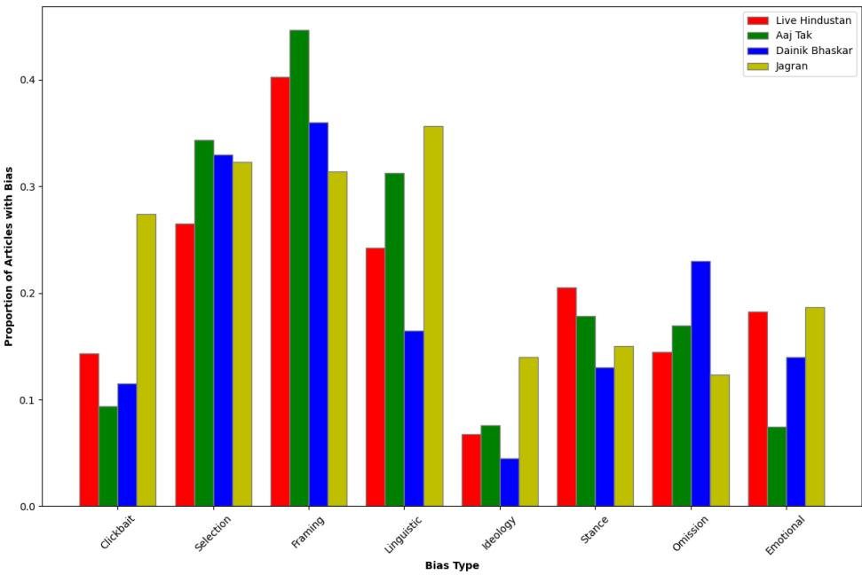
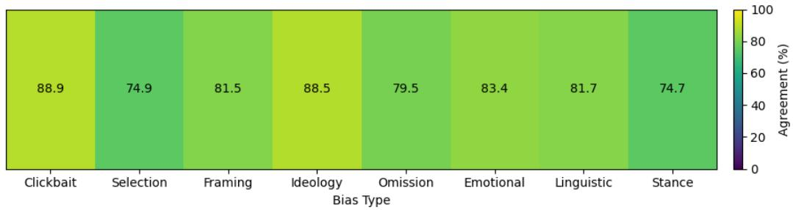
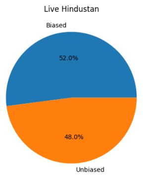
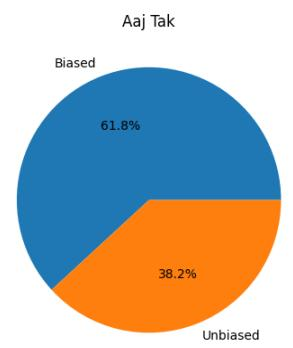
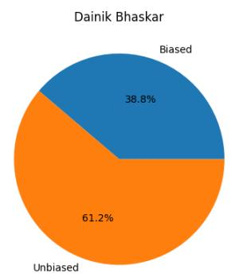
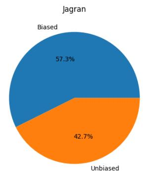

# You Are What You Read: Indian Political News Media Bias Dataset for Hindi Language

Kushal Trivedi1, Mayank Mahor1 Dhruv Sanghvi1, Roshni Chakraborty1

1Atal Bihari Vajpayee - Indian Institute of Information Technology, Gwalior, India kushal.trivedi.2110@gmail.com

## Abstract

Media bias understanding and detection remains an under-researched problem for Indian context, specifically for Indic languages, such as, Hindi, which is widely spoken in India. In this paper, we introduce a comprehensive, multi-annotator, explainable dataset consisting of approximately 448 unique articles from four leading Indian news agencies publishing in Hindi. We focus on Hindi, the most spoken and an oficial language of India. The study of media bias is particularly relevant in the Indian context due to the country’s linguistic diversity and large population, where the same event is often reported by multiple news agencies in diferent languages, thereby introducing scope for bias. The dataset comprises Hindi political news articles annotated by 14 experts and classified into four bias categories - selection bias, framing bias, clickbait bias and omission bias - when an article is identified as biased or unbiased. For each biased article, annotators also provide a textual explanation, enabling future semi-automated approaches to incorporate explainability when language models reason over the dataset. Cohen’s Kappa scores were 0.81 for simple bias/no-bias classification reflecting strong inter-annotator agreement. For the multi-label task, the Cohen’s Kappa values are 0.89, 0.75, 0.81, and 0.79 for clickbait, selection, framing, and omission biases, respectively, resulting in an average Kappa of 0.80, which also reflects strong agreement.The dataset and replication code are publicly available at https://github.com/KushalTrivedi19032005/Indic-Media-Bias-Detection-Dataset.

## Introduction

News, whether in physical or electronic form, remains the primary medium for communicating recent events to the public (Fan et al. 2025). With increasing digitization, users now have continuous access to news from multiple news media agencies, which lead to high competition for user attention(Chakraborty et al. 2019). While audiences rely on news agencies for fair and highquality reporting, there have been numerous instances of deviation from journalistic standards, including deliberate misinformation or omission of context, lack of fact-checking, clickbait headlines, biased framing, and politically aligned reporting (Kuuse et al. 2025; Lüüsi et al. 2024). Media bias refers to the non-objective presentation of news through mechanisms such as selective reporting, omission of relevant facts, or slanted perspectives based on demographic dimensions including political ideology, gender, religion, geography, or ethnicity (Spinde et al. 2023). Alternatively, (Entman 1993) defines media bias as when journalists systematically frame reality in a way that promotes a particular interpretation, evaluation, or solution to an issue. Regardless of its form, media bias can adversely shape public opinion, facilitate misinformation, contribute to echo chambers, and intensify societal polarization (Arifah et al. 2025). Consequently, identifying, detecting, and mitigating media bias is essential to ensure an informed readership (Hamborg, Donnay, and Gipp 2019). However, the extensive information overload makes it increasingly dificult for users to manually distinguish between biased and unbiased news, often leading to skewed news consumption (Rodrigo-Ginés, Carrillo-de Albornoz, and Plaza 2024). Automated bias detection is highly challenging as it requires identification and understanding of the underlying implicit attributes and its various forms, such as framing bias, selection bias, and presentation bias. Each type requires specialized bias detection approaches. This further aggravates for in a country as vast and linguistically diverse as India (Sen et al. 2022).

According to Lokniti CSDS - a network of political scientists conducting survey-based studies on Indian politics and democracy - around 82% of independent journalists surveyed believe that Indian media favors a political party.1. Further, the World Press Freedom Index 2025 ranks India 151st out of 180 countries,2 highlighting significant economic pressure on journalists and a high concentration of media ownership, both of which threaten independent and objective reporting. This concern is particularly relevant in today’s digital era, where a 2022 study by Oxford University Press (OUP) found that 54% of Indian youth turn to social media when seeking factual information.3 Therefore, in order to build automated systems for media bias detection and mitigation for Indian context and specifically, in Indic languages, such as, Hindi, there is a requirement of specific extensive datasets. To quantify media bias in a systematic manner, the availability of comprehensive and reliable datasets is a fundamental prerequisite. While several datasets exist at both international and national levels for bias classification and related tasks in high-resource languages, the Indian context presents unique challenges. The high variance and richness of Indic language diferences along with India’s complex political landscape featuring a multiparty system unlike the largely binary political ideologies in other English speaking countries makes direct application of bias detection approaches inefective. Furthermore, translation-based approaches fail to account for culturally and linguistically specific nuances of Indian society (Puro et al. 2026) or AI-driven machine translation might lose sensitivity(Anik et al. 2025).

Despite being India’s oficial language, Hindi remains a low-resource language in this domain (Sabane, Litake, and Chadha 2023). Existing research on Indian news media bias largely focuses on English-language outlets, primarily analyzing Indian English newspapers (Sen et al. 2022). The high variance in Indian languages makes it dificult to build a system that can work for media bias irrespective of the Indian language. Therefore, given the unavailability of datasets and absence of research works in this low resource domain, such as, media bias detection and mitigation, we focus on one of the primary Indic languages, i.e., Hindi. Although recent studies have explored the use of large language models (LLMs) as alternatives to manual annotation (Horych et al. 2025; Raza, Rahman, and Ghuge 2024), manual annotation continues to outperform automated approaches in tasks requiring nuanced judgment, domain expertise, and ethical consideration (Garg, Chakraborty, and Dandapat 2025). These models might lack robust capabilities for reasoning-intensive tasks, including bias classification and detection, for Indian context (as shown through an example in Table 1). With respect to the specific example as shown in Table 1, we observe the annotator labels are presented as the ground truth, whereas the language models incorrectly predict several bias types, such as clickbait, emotional, and ideological biases. Although identifying labeled data requires manual annotation, it is time and cost intensive. Therefore, it is particularly challenging to build automated models, especially train large language models, for media bias detection in Indian languages. Therefore, in this paper, we introduce the first Hindi media political bias benchmark dataset, covering four distinct types of bias. To the best of our knowledge, this is the first dataset in Indian context that covers an exhaustive types of biases. This dataset aims to support the research community in developing robust and trustworthy automated systems for monitoring and mitigating news media bias in Indian context.

The rest of the paper is organized as follows, related works in Section , dataset collection and annotation detail in Section followed by discussions in Section . We discuss a brief overview of FAIR principles in Section and finally, conclusions in Section .

## Related Works

Bias detection in news media is specifically relevant considering the adverse impact on public opinion shaping and society (Fan et al. 2019; Spinde et al. 2023). Media bias based research works tackle diferent forms, such as, selection bias, information bias, editorial bias, framing bias, demographic bias, etc (Rodrigo-Ginés, Carrillo-de Albornoz, and Plaza 2024). Existing research works on framing based media bias detection could be segregated into feature based understanding, such as, usage of kill verbs, lexical cues, sentiment analysis (Pryzant et al. 2020; Bhatia and Deepak 2018), contextual representation of bias inducing words and sentence level understanding (Raza et al. 2024; Lei and Huang 2024). Recent works on transformer based bias detection integrate pretraining datasets through Distant Supervision Learning (Spinde et al. 2021b), Multitask Learning (Spinde et al. 2022), domain adaptive dataset (Raza, Rahman, and Ghuge 2024). While these approaches have shown high efectiveness for framing bias at article level, they do not discuss the interpretability of the model’s decision which can aid in bias mitigation and understanding (Noh et al. 2025). Additionally, these approaches do not provide detail of the rationales that can enhance the interpretability (Spinde et al. 2025). Furthermore, these models are not directly applicable to Indian languages due to the requirement of understanding and interpretation of framing bias which can not be resolved by translation compiled with the existing research works.

There are several existing research works that focus on bias detection and characterization in text with respect to demographic bias, such as, racial bias(Kambhatla, Stewart, and Mihalcea 2022; Navon, Reingold, and Shen 2025), gender bias (Cheng, Durmus, and Jurafsky 2023), etc. While these approaches mainly focus on bias detection in user generated contents, such as, social media posts, hate speech, etc., these provide significant understanding of the characteristics of bias and possible ways of detection (Cheng, Durmus, and Jurafsky 2023). For example, (Navon, Reingold, and Shen 2025) highlights the role of lexical features, such as, readability measures and Yule’s measure in automated gender bias detection and further, discusses human mediated mechanisms for bias mitigation.

Table 1: Human vs LLM Classification Comparison
<table><tr><td rowspan=1 colspan=1>Original Article (Hindi)</td><td rowspan=1 colspan=1>Translated Article (English)</td><td rowspan=1 colspan=1>Ground Truth</td><td rowspan=1 colspan=1>LLM&#x27;s Prediction</td></tr><tr><td rowspan=3 colspan=1>A aRa ,TRuT;A3i a?RRRR可可RRRRRais CCDBHARTEaFAcaRuER</td><td rowspan=3 colspan=1>Party A ran a negativenarrative, the publicrejected it; what elsedid Person A say on theHaryana results?In Haryana, Party B hasachieved a hat-trick andsecured a mandate to formthe government for thethird consecutive time. Theelection results havetriggered political stiracross the country. Bywinning for the third time,Party B has created ahistoric record. Followingthis, political statementshave intensified in Bihar.While Party C supremoPerson C and Leader of theOpposition Person Dexpressed surprise over theelection results, Party Bcelebrated by beatingdrums and rejoicing.Meanwhile, Party Cpresident and UnionMinister for Panchayati Rajin the Person Egovernment, Person F,strongly advised Party A,saying that the public hasrejected this party, whereasPerson E&#x27;s influence isresonating everywhere.</td><td rowspan=3 colspan=1>Selection BiasFraming BiasStance BiasOmission Bias. 可&quot;(English Translation: Thisalso proves that Team Awon&#x27;t last long.) ⇒Stance bias2. Omission bias ⇒Negative comments arenot mentioned3. Framing bias ⇒Victory is foregroundedbefore political reactions4. Selection bias ⇒Maximum space is givento Person E, a Party Bally</td><td rowspan=3 colspan=1>Framing bias: The articleframes Party B&#x27;s victory asa “historic record&quot; andcontrasts it with Party A&#x27;sfailure.Linguistic bias: Loadedphrases like &quot;RT&quot;，&quot;R3i可可&quot;, and &quot; &quot;are used.(English Translation:Loaded phrases like &quot;Thepublic has rejected it&quot;,There is a lot of noiseeverywhere&quot; and &quot;Amassive verbal attack areused.&quot;)Ideology bias: Thenarrative aligns with apro-Party B perspective.Stance bias: Opposingvoices are frameddefensively, while PartyB-aligned views arereinforced.Emotional bias:References to celebration,rejection, humiliation, andattacks are used to evokepride, triumph, orresentment rather than justinform.Clickbait bias: Thehighlighted line“E G, Video”isdesigned to provokecuriosity and drive clicksrather than add factualvalue.(English Translation: Chaosat Person G’s rice feast,watch video!)Omission bias: Thearticle does not deeplyexplore neutral electoraldata, voter issues, orindependent analysis,limiting alternativeexplanations for the results.</td></tr><tr><td rowspan=1 colspan=1>defensively</td></tr><tr><td rowspan=1 colspan=1>B-aligned</td></tr></table>

However, the high variance in Indian society requires specific handling of demographic bias 4 (Medidoddi et al. 2022). This could be with respect to the variation in population density across regions. For example, Delhi, Mumbai, Kolkata, and Chennai represent some of the most densely populated districts with over 10,000 people per square kilometer, while remote areas in Arunachal Pradesh and Ladakh have densities as low as 20 persons per square kilometer. This geographic diversity means social work approaches, such as the number of news articles for a particular group or a social issue, or bias detection and mitigation through automated approaches, must be preferably tailored to local contexts rather than applying uniform solutions across the country. Similarly, disparities in gender and age also create a requirement for such contextual adaptation.

Subsequently, news media agencies are required to filter out the particular information from all the available information to be reported. This selection might lead to pruning of various news events or select a subset of information given a news event. While this selection is a necessity for news publishing, the reasoning might be based on ideological leaning which can adversely impact the representation of information, demographic groups, political leaning, etc. This is referred to as selection bias or. information coverage bias. Existing research works compares the latent representation of a news event based on the news articles published with respect to it from diferent news media sources to the particular news event representation for a news media source (Zhou et al. 2025; Wang et al. 2025), explore theoretical understanding of journalism, communications, and political science, revealing key insights into usability and functionality, comparison of right leaning based political parties and and explored narrative variation through stance and topical based analysis (Kuila et al. 2024). Subsequently, bias mitigation based approaches, such as, one of the earliest and most common approaches to bias mitigation is supervised fine-tuning using curated, balanced datasets. For example, in (Zhao et al. 2018; Khan et al. 2025), Zhao et al. introduced Counterfactual Data Augmentation (CDA) for coreference resolution, where gender-swapped sentence pairs are used to reduce gender bias in model predictions. Similarly, crafting balanced and inclusive prompts during finetuning has been shown to improve model fairness and diversity in output.

Therefore, irrespective of the type of bias and context, the requirement of labelled datasets with rationale for development of automated trustworthy media bias detection and/or mitigation approaches. Existing media bias datasets include MBIB – Media Bias Identification Benchmark (Wessel et al. 2023) is a large benchmarking dataset created by combining 15 existing datasets. It classifies statements, sentences, and tweets into nine bias categories, such as, linguistic bias, textlevel context bias, reporting-level context bias, cognitive bias, hate speech, racial bias, fake news, gender bias, and social bias. Subsequently, MBIC (Spinde et al. 2021b), i.e., Media Bias Annotation Dataset Including Annotator Characteristics consists of 1,700 statements representing various forms of media bias. Each statement was annotated by ten annotators and includes labels at both the word and sentence levels. To the best of our knowledge, MBIC is the first media bias dataset to provide detailed information about annotator characteristics and individual backgrounds. In addition, (Spinde et al. 2021a) proposed a neural approach to media bias detection using a multi-stage annotation process. Annotators first identified words or phrases that induced bias, then labeled sentences as biased or non-biased, and finally categorized them as factual, opinionated, or mixed. There has been very few works for other than English language, such as, Implicit Media Bias Dataset (Lee et al. 2023) comprised of 24,576 news articles covering non-political events which were annotated for objectivity, fairness, unbiasedness, and political orientation, and was classified as conservative, neutral, or progressive.

Substantial work has been carried out to create annotated datasets for media bias detection. However, most of this efort is concentrated on high-resource languages, with only a limited number of notable works addressing low-resource domain based work, such as, media bias detection and mitigation for Indian context. Additionally, it was highlighted political bias identification and mitigation is extremely challenging compared to other forms of bias, such as, hate speech, racial bias, and gender bias (Spinde et al. 2021b). Compared to international research on news media bias detection, work in the Indian context remains relatively limited. Creating annotated datasets for low-resource domains is both labor-intensive and costly. Existing research on Indian news media bias has largely focused on Indian English news outlets. For example, (Sen et al. 2022) analyzed Indian English newspapers and their coverage of four large-scale news events to study information coverage bias and user reactions. Similarly, (Chauhan et al. 2024) and (Rawat and Vadivu 2022) used sentiment-based analysis to understand bias in Indian English news sources.

Existing datasets for political bias detection in Indian languages are summarized in Table 2. One of the earliest works on political media bias detection in Indian languages is (Gangula, Duggenpudi, and Mamidi 2019). This study created a dataset of 1,329 news articles collected from multiple Telugu newspapers and annotated them for bias toward specific political parties. Each article was annotated by four native Telugu speakers with good language proficiency and political awareness. Articles were labeled as biased toward one of five placeholder parties (A, B, C, D, E) or as None if unbiased. Annotators were instructed to read articles and headlines as they would in a newspaper and then judge whether the content was biased for or against a party. Building on this work, (Agrawal et al. 2022) introduced a dataset of 1,388 Hindi news articles and headlines collected from various Hindi news outlets. The task involved classifying articles into three categories — for, neutral, and against - with respect to the ruling party, represented by a placeholder X. The study evaluated multiple models and found that XLM-RoBERTa (Conneau et al. 2020) performed best, achieving an accuracy of 83.00 %, a macro-F1 score of 76.4%, and a Matthews

Correlation Coeficient of 72.1%. However, a key limitation of these work are and the earlier Telugu study is that the datasets focus exclusively on the governing party based articles. A more robust and neutral approach would involve collecting articles without such filters and covering perspectives related to all political parties. Additionally, none of these works explore the plethora of diferent types of biases possible but rather focus on understanding the diference of title wit respect to news article contents (similar to only a particular type of bias, i.e., click bait)

(Kuila et al. 2024) provides a detailed understanding of bias in Indian news through the lens of diferent events. However, they focus on understanding bias only at sentence level for English news articles, whereas we also intend to understand the implicit contextual bias at the news article level and for Indic languages. Additionally, Maity et al. (Maity et al. 2024) have provided a bias dataset for Wikipedia content in multiple Indian languages. Although the dataset is extensive, it is not directly applicable for news articles. Therefore, in order to bridge these research gaps, we propose a Hindi news article dataset considering 4 diferent bias labels. Additionally, our annotators provide with rationale which would be extremely helpful to build explainable automated media bias detection and mitigation approach.

## Dataset Overview

For our work, we have considered four leading Indian News Media agencies for Hindi Language, i.e., Aaj Tak5, Live Hindustan6, Dainik Bhaskar7 and Jagran8respectively. These four news publishers were selected because they have some of the highest audience reach and viewership among Hindi news media outlets. However, this claim cannot be supported by a single citation, as there is no oficial or centralized metric for ranking all news publishers across diferent media platforms. For Live Hindustan, articles were randomly sampled using a Selenium-based scraping script applied to the website’s XML sitemap. For Aaj Tak, Dainik Bhaskar and Jagran, articles were scraped from the most recent political news. Since the website does not provide an XML sitemap, random sampling of articles from previous months or years was not possible. Therefore, we implemented a JavaScript-based scraping script that extracts all article URLs from the political news category by identifying relevant <a> tags. The script then filters out articles with word counts below a predefined threshold, removes duplicate entries, and stores the cleaned articles in a text file. These articles are subsequently processed and incorporated into the original CSV dataset. For pre-processing, duplicate records were removed to avoid redundancy, and annotation labels were checked for consistency.

An article could have either of these biases and not limited to only one bias type, such as, selection, framing, omissiom and clickbait biases. We provide a brief description of each of these biases with examples in Table 3. After dataset collection, we organize our dataset into following fields, news\_publisher which comprises of the name, article\_date, article\_links which contains the link to the news article, and label information that indicates whether any form of bias is present in the article and separate columns for each of the 4 types of bias along with Explanation that includes the rationale provided by 3 annotators who labeled a particular article. We next discuss the annotation procedure. Further statistical information about the dataset can be found in Table 4 and Table 5.

## Data Annotation

A total of 14 annotators were involved in the creation of this dataset, and each article has been annotated by 3 experts. We initially started creating this dataset with 9 bias categories: clickbait bias, selection bias, framing bias, omission bias, factual bias, linguistic bias, emotional bias, stance bias, and ideology bias. Upon analyzing the distribution of each bias across 200 news articles, we limited our study to the top four—clickbait bias, selection bias, framing bias, and omission bias— as illustrated in Figure 1. These represented the most relevant biases according to frequency of occurence and therefore, seemed essential for future work involving the development of media bias mitigation models. We followed the following conditions for annotation :

1. All annotators were confirmed to be politically neutral, i.e., they had no political incentives or inclinations toward any particular political party, political figure, or political ideology. This was ensured by assessing the responses of candidate annotators to a series of questions asked during in-person interviews conducted by the first authors. Additionally, each annotator was given a sample of 10 news articles to annotate, and a discussion meeting was held to resolve any ambiguity, given that bias annotations can often be subjective in nature. Candidate selection was strictly determined by the outcomes of the first two assessment phases described above.

2. All annotators were provided with detailed training on the diferent types of biases using a comprehensive rulebook, as summarized in Table 6. It was ensured that each annotator complied to these two factors before annotation procedure. Additionally, we provide a detailed documentation of each type of biases considered in the dataset documentation. While there are some examples that are language specific and require understanding of the language specific information, such as Hindi, the remaining biases require understanding of the logical structure and reasoning of the article. We highlight a few examples of biases that are explicitly classified based on the language of the article in Table 3. The annotators comprised information technology students, working professionals, and professors from diferent Indian states who possess native or proficient multilingual capabilities in both Hindi and their respective state languages.

Table 2: Summary of Created Datasets on Political Bias Detection in Indian Languages
<table><tr><td>Paper Size Detecting Political Bias 1329</td><td>Lang. Description Telugu Articles from multiple</td><td>Annotation</td><td>Experiments 5-fold CV; compared ML</td></tr><tr><td>in News Articles Us- ing Headline Attention (Gangula, Duggenpudi, and Mamidi 2019)</td><td>Telugu newspapers, labeled for bias toward one of five parties (BJP, Congress, TRS, TDP, YCP) or None.</td><td>4 native Telugu speak- ers; disagreements re- solved by discussion. Co- hen&#x27;s κ = 0.90.</td><td>(Naive Bayes, SVM) and neuralmodels (CNN, LSTM, GRU). Head- line Attention Network achieved ~89.5% accu- racy.</td></tr><tr><td>Enhancing Bias De- tection Using Prag- matic Presupposition (Kameswari, Sravani, and Mamidi 2020)</td><td>1050 / Telugu 850 biased and 200 un- biased Telugu articles; bias treated as binary (present/absent).</td><td>Sentence-level presup- position scoring (0/1); guidelines cover coref- erence, deixis, verbal suffixes, and rhetorical</td><td>10-fold CV across Naive Bayes, LR, SVM, RF, MLP. MLP with presup- position features: accu- racy ~96.5%, F1 ~95.7.</td></tr><tr><td>Quantifying Mag- nitude of Political Bias (PoBiCo-21) (Kameswari and Mamidi 2021)</td><td>500 / Telugu Articles from Eenadu Andhrajyothy, Sakshi; 180 positive, 220 neg- ative, 100 unbiased.</td><td>questions. 10 fine-grained bias tech- niques (e.g., amplifica- tion, whataboutism) la- beled at direct, indirect, and headline levels. κ = 0.715.</td><td>Bias magnitude quanti- fied via sentiment-based technique ranking; In- dicBERT for scoring. Cor- rectly identified the more biased article in ~72% of</td></tr><tr><td>Towards Detecting Polit- ical Bias in Hindi News Articles (Agrawal et al. 2022)</td><td>1388 / Hindi Political news four outlets: The Wire &amp; The Quint (liberal) and OPIndia &amp; The Frustrated (pro-BJP).</td><td>from 2 native speakers with opposing leanings; la- bels: pro-BJP, anti-BJP, neutral. Indian third annotator; κ 0.65.</td><td>pairs. 10:1 train/validation split; metrics: accuracy, F1-macro, MCC. XLM- Resolved by RoBERTa outperformed 二 traditional ML.</td></tr><tr><td>Nishkarsh: AI-Based Multimodal Political Hindi Bias Detection (Bho- jwani et al. 2025)</td><td>13,000 Large-scale ernment stances across diverse outlets.</td><td>dataset Expert review combin- with headlines and ing manual checks with full articles capturing automated scoring (TF- pro/anti/neutral gov- IDF, embeddings).</td><td>RoBERTa for leaning (87% acc.), DistilBERT for sentiment (92.6% acc.); outputs summa- rized via BART.</td></tr><tr><td>Read Between the Lines: Benchmark for Bangla News (BanglaBias) (Lia et al. 2025)</td><td>200 / Bangla ~46 political (2013–2025) 54 outlets; government-critique, 72 neutral, government-leaning articles.</td><td>events 2 native speakers + adju- from dicator; structured deci- 95 sion flowchart; 3 stances. IAA: 73.5% (κ = 0.574). 33</td><td>Benchmarked across 28 LLMs (zero/few-shot). Larger models: F1 up to 0.83 for critique; neutral stance hardest.</td></tr></table>

Table 3: Examples of Explicit Language-Based Media Bias Categories
<table><tr><td rowspan=1 colspan=1>Bias Labels</td><td rowspan=1 colspan=1>Examples (Hindi)</td><td rowspan=1 colspan=1>Translated (English)</td></tr><tr><td rowspan=1 colspan=1>1. Framing Bias</td><td rowspan=1 colspan=1> Example1:  Example 2: A</td><td rowspan=1 colspan=1>• Example 1: Political parties are coming to-gether to strategize on increasing voter participa-tion in the Bihar Assembly elections.• Example 2: In the Delhi Assembly elections,the central leadership of the A has curbed the in-ternal factionalism within the party.</td></tr><tr><td rowspan=1 colspan=1>2. Clickbait Bias</td><td rowspan=1 colspan=1> Example1: -D RRITRATRETO Example 2:       </td><td rowspan=1 colspan=1>• Example 1: D&#x27;s political masterstroke underthe pretext of Dhanbad-Chandrapura passenger.• Example 2: Political parties were taught thecode of conduct.</td></tr></table>

We ensured that each article was annotated by three annotators, with disagreements resolved through majority voting. However, individual annotators’ explanations for their decisions are retained in the dataset to enable computational models to incorporate human reasoning and to identify and mitigate bias in the articles. All articles were evenly distributed among the annotators and annotated across all four news agencies. The following protocols were enforced: (1) article assignments were randomly sampled, ensuring that no annotator annotated the same article more than once; and (2) each article was independently annotated without any prior knowledge of the annotations assigned by another annotator.

  
Figure 1: Distribution of fine-grained bias categories across news agencies.

Table 4: Dataset Statistics
<table><tr><td rowspan=1 colspan=1></td><td rowspan=1 colspan=1>Biased</td><td rowspan=1 colspan=1>Unbiased</td></tr><tr><td rowspan=1 colspan=1>Articles</td><td rowspan=1 colspan=1>240</td><td rowspan=1 colspan=1>208</td></tr><tr><td rowspan=1 colspan=1>Avg #words in headline</td><td rowspan=1 colspan=1>15.40</td><td rowspan=1 colspan=1>14.81</td></tr><tr><td rowspan=1 colspan=1>Avg #words in article</td><td rowspan=1 colspan=1>682.60</td><td rowspan=1 colspan=1>521.62</td></tr><tr><td rowspan=1 colspan=1>Avg #sentences in article</td><td rowspan=1 colspan=1>19.69</td><td rowspan=1 colspan=1>16.88</td></tr></table>

Inter-Annotator Agreement : In order to ensure that the dataset is balanced with diferent annotator perspectives, we assess annotation reliability using Cohen’s Kappa (Warrens 2015). For the binary biased versus non-biased classification, we obtained a Kappa value of 0.81 (a news article is classified as biased if even one of the four bias categories is marked as present), indicating strong inter-annotator agreement. For the multi-label task, the Cohen’s Kappa values are 0.89, 0.75, 0.81, and 0.79 for clickbait, selection, framing, and omission biases, respectively, resulting in an average Kappa of 0.80, which reflects strong agreement. A per-agency, per-category breakdown of the agreement scores is presented in Figure 2.

## Summary of Insights

We highlight our observations during dataset creation considering the diferent types of biases possible next :

• It should be noted that, despite the availability of a comprehensive rulebook for the classification of bias categories into binary labels, a degree of inherent subjectivity remains unavoidable. This is particularly evident in bias categories such as emotional bias, where diferent annotators may interpret the tone, implications, or neutrality of an article diferently. Similarly, omission bias is inherently dificult to identify, as assessing whether important information has been deliberately excluded often requires broader contextual knowledge of the event beyond what is presented in the article.

• The biases initially studied before narrowing down to four are not mutually exclusive; multiple biases may be present in a single article, and some may act as subsets of others. Furthermore, subtle distinctions exist between labels that might otherwise appear similar. For example, linguistic bias depends exclusively on the language used in the article and may imply emotional bias (see Table 7). However, emotional bias can also arise from the overall tone of reporting even when explicit linguistic markers, such as idioms or ofensive words, are absent (see Table 8). A similar subtle distinction also occurs between selection bias and omission bias (see Table 9 and Table 10).

• It is a common observation that many articles quote statements made by political figures. We report only the bias that arises from the author’s reporting and not from the political figure’s speech, as our focus is on media bias detection and understanding. However, in cases where an article captures only a single figure’s speech or repeatedly emphasizes a single controversial statement, bias may be introduced by the author of the news article, thereby making the article biased.

Table 5: News Publisher Statistics
<table><tr><td rowspan=1 colspan=1>News Publisher</td><td rowspan=1 colspan=1>Number of Articles</td><td rowspan=1 colspan=1>Biased/Unbiased Articles</td><td rowspan=1 colspan=1>Date Range</td></tr><tr><td rowspan=2 colspan=1>1. Live Hindustan</td><td rowspan=2 colspan=1>171</td><td rowspan=1 colspan=1>Biased: 89</td><td rowspan=2 colspan=1>Jan 11 – Nov 14, 2024</td></tr><tr><td rowspan=1 colspan=1>Unbiased: 82</td></tr><tr><td rowspan=2 colspan=1>2. Aaj Tak</td><td rowspan=2 colspan=1>110</td><td rowspan=1 colspan=1>Biased: 68</td><td rowspan=2 colspan=1>Nov 28 – Dec 27, 2025</td></tr><tr><td rowspan=1 colspan=1>Unbiased: 42</td></tr><tr><td rowspan=2 colspan=1>3. Dainik Bhaskar</td><td rowspan=2 colspan=1>68</td><td rowspan=1 colspan=1>Biased: 27</td><td rowspan=2 colspan=1>Dec 21 – Dec 29, 2025</td></tr><tr><td rowspan=1 colspan=1>Unbiased: 41</td></tr><tr><td rowspan=2 colspan=1>4. Jagran</td><td rowspan=2 colspan=1>99</td><td rowspan=1 colspan=1>Biased: 56</td><td rowspan=2 colspan=1>Dec 12 – Dec 27, 2025</td></tr><tr><td rowspan=1 colspan=1>Unbiased: 43</td></tr></table>

  
Figure 2: Inter-annotator agreement (%) across all news agencies and bias types.

## Analysis and Observations

In this Section, we discuss our observations based on the annotated dataset with respect to the leading news media agencies that publish news in Hindi. Our initial observations include a visualization of the proportion of biased news articles for each news media agency, which aids in understanding the exposure of the Hindi news reading population to biased reporting. We observe that a substantial fraction of Hindi political news articles exhibit bias. Specifically, 52%, 62%, 40% and 57% of the articles in our dataset from Live Hindustan, Aaj Tak, Dainik Bhaskar and Jagran are biased, as shown in Table 5. Figure 3 provides a visualization of the bias prevalence across the agencies, where the biased share clearly dominates or is comparable to the unbiased share in both cases. While we acknowledge that these proportions are based on a sampled subset of articles, they nonetheless indicate that a large number of Hindi news articles, irrespective of the media agency, carry some form of bias. This further underscores the need for a large-scale media bias dataset for the Hindi language to enable automated bias detection.

## Case Study : Linguistic and Structural Feature Analysis

Beyond the label-level statistics, we conducted an exploratory analysis to examine whether biased and unbiased articles difer along measurable surface-level, lexical, and syntactic dimensions. Understanding these diferences is important for two reasons: it helps characterize how bias manifests linguistically in Hindi political reporting, and it establishes whether shallow lexical cues alone are suficient for automated detection or whether deeper contextual reasoning is required. For this analysis, we constructed a feature-extraction pipeline that operates entirely on Devanagari-aware tokenization using the Indic NLP Library (Kunchukuttan 2020), thereby avoiding the loss of nuance that arises from translation-based approaches.

The pipeline computes a broad set of article-level features spanning several linguistic dimensions. Lexical and part-of-speech features were derived using IndoWordNet (Bhattacharyya 2010), from which we drew coverage lexicons of 19,417 adjectives, 82,747 nouns, and 2,212 adverbs, supplemented with curated domainspecific political vocabulary and a hand-verified stopword list of 846 entries built on top of the LiHiSTO (Rajwal 2024) resource. We further computed sentiment polarity using curated positive and negative lexicons, superlative and intensifier density, article- and sentence-length statistics, lexical diversity measures such as the type-token ratio and Yule’s characteris tic constant K, and Hindi-specific readability estimates based on the RH1 and RH2 formulations. Finally, we obtained syntactic-complexity features - mean dependency distance, parse-tree depth, subject/object/clause ratios, and a composite complexity score by parsing every sentence with the Stanza Universal Dependencies pipeline for Hindi. In total, this yields 130 features per article, which we release alongside the dataset to support future feature-driven studies.

  
Figure 3: Distribution of biased and unbiased news articles across agencies.

Among these measures, sentence-level lexical diversity, quantified by Yule’s K, proved most informative for distinguishing certain bias types, and we therefore report it in detail. Since Yule’s K is not normally distributed, we assess group diferences using the nonparametric Mann-Whitney U test, which avoids the skewness of standard parametric tests by evaluating rank-based medians instead of means. Table 11 summarizes the median sentence-level Yule’s K for articles exhibiting each fine-grained bias against those that do not. We observe that, for the overall biased versus unbiased partition, there is no statistically significant diference in either the mean (p = 0.9951) or the dispersion (p = 0.5565) of sentence-level lexical richness. A similar pattern holds for framing $( p = 0 . 5 8 3 6 )$ , selection (p = 0.9859), and omission $( p = 0 . 5 2 3 9 )$ biases, none of which are separable from their respective negative classes on the basis of lexical diversity alone.

The notable exception is clickbait bias, for which articles flagged as clickbait exhibit a significantly higher median sentence-level Yule’s K than non-clickbait articles (69.61 versus 62.89, p = 0.0294). This is intuitive: clickbait framing tends to rely on denser and more varied vocabulary - rhetorical hooks, sensational descriptors, and out-of-context teasers which inflates lexical richness relative to routine reporting. The corresponding dispersion of Yule’s K trends in the same direction, though it does not reach significance (p = 0.1844).

Taken together, these findings carry an important implication. With the sole exception of clickbait - whose signal is largely superficial and headline-driven - the fine-grained bias categories that dominate our dataset, namely selection, framing, and omission, are not distinguishable from unbiased articles using surface lexicaldiversity statistics. In other words, an article that omits crucial context or selectively frames an event is written in language that is, statistically, indistinguishable from neutral reporting. This corroborates our central premise that media bias in Hindi political news is predominantly a contextual and inferential phenomenon rather than a lexical one, and it is therefore unlikely to be captured by shallow feature-based classifiers. It also explains, at least in part, why the language models evaluated over-predict lexically driven labels (illustrated in Table 12 and Table 13) while missing biases that require reasoning over what is included, foregrounded, or withheld. These observations reinforce the need for reasoning-oriented and culturally grounded models, and motivate the release of both the bias labels and the accompanying annotator rationales.

## FAIR Principles

The dataset has been developed in accordance with the FAIR principles (Wilkinson et al. 2016) to ensure that it is legally and ethically fair and unbiased. We discuss each of these principles next.

• Findable: The dataset is publicly available at https://github.com/KushalTrivedi19032005/Indic-Media-Bias-Detection-Dataset. Detailed metadata describing the dataset context, structure, and usage instructions is also provided.

• Accessible: The dataset can be accessed through the above link and is publicly available to users.

• Interoperable: The dataset was originally created and annotated in CSV format, which is widely supported by data processing and analysis tools.

• Reusable: The dataset is hosted on a public platform that permits reuse for research purposes, subject to agreement with the stated terms and conditions.

## Conclusions

Media Bias can severely impact public perception of the event, form echo chambers, cause segregation and polarization in society. Therefore, identification of different forms of media bias and further mitigation and handling is severely required. Developing automated approaches for low-resource domains can be challenging due to the non-availability of task and domain-specific data. Additionally, understanding the implicit factors of Indian political context, specifically with the high variance across diferent languages is almost impossible. Therefore, we propose to create Hindi language specific large scale media bias benchmark datasets, that covers multiple facets of bias. In this paper, we presented a carefully curated annotated dataset for media bias detection in Hindi political news articles, addressing a significant gap in resources for low-resource domain for Indian context. The dataset consists of 448 unique articles from four prominent Indian news agencies and is annotated by expert annotators across four finegrained bias categories. By incorporating both bias labels and human-written explanations, the dataset supports not only bias detection but also explainable reasoning, which is crucial for advancing language technologies. Through an analysis of inter-annotator agreement, with Cohen’s Kappa scores of 0.80 across the four bias categories and 0.81 for biased/unbiased annotations, we demonstrate that bias annotation is reliable when supported by clear guidelines. Our future directions include increase our dataset to ensure representation of diferent forms of demographic bias, such as, religion, region, language, gender, etc. This is specifically relevant to Indian context considering the high variance and diversity with respect to every demographic factor. We, additionally, believe that this fine-grained annotation would enable models to perform bias mitigation given a news article.

## Acknowledgment:

We would like to thank Mr. Murtuza Shaikh, Ms. Subhoshri Pal, Mr. Yash Kumar Panse, Mr. Vyom Tiwari, Mr. Rohit Kumawat, Ms. Anisha Khairnar, Mr. Satwik Duppala, Mr. Sai Pranav, Mr. Chakali Surendra, Ms. Mehr Aliah for their contribution in the annotation process.

## References

Agrawal, S.; Gupta, K.; Gautam, D.; and Mamidi, R. 2022. Towards detecting political bias in hindi news articles. In Proceedings of the 60th annual meeting of the association for computational linguistics: student research workshop, 239–244.

Anik, M. A.; Rahman, A.; Wasi, A. T.; and Ahsan, M. M. 2025. Preserving Cultural Identity with Context-Aware Translation Through Multi-Agent AI Systems. In Truong, S.; Putri, R. A.; Nguyen, D.; Wang, A.; Ho, D.; Oh, A.; and Koyejo, S., eds., Proceedings of the 1st Workshop on Language Models for Underserved Communities (LM4UC 2025), 51–60. Albuquerque, New Mexico: Association for Computational Linguistics. ISBN 979-8-89176-242-8.

Arifah, I. D. C.; Maureen, I. Y.; Rofik, A.; Puspila, N. K. W.; Erifiawan, H.; et al. 2025. Social Media Platforms in Managing Polarization, Echo Chambers, and Misinformation Risk in Interreligious Dialogue among

Young Generation. Journal of Social Innovation and Knowledge, 1(aop): 1–33.

Bhatia, S.; and Deepak, P. 2018. Topic-specific sentiment analysis can help identify political ideology. In Proceedings of the 9th workshop on computational approaches to subjectivity, sentiment and social media analysis, 79–84.

Bhattacharyya, P. 2010. IndoWordNet. In Calzolari, N.; Choukri, K.; Maegaard, B.; Mariani, J.; Odijk, J.; Piperidis, S.; Rosner, M.; and Tapias, D., eds., Proceedings of the Seventh International Conference on Language Resources and Evaluation (LREC’10). Valletta, Malta: European Language Resources Association (ELRA).

Bhojwani, P.; Shruti, J.; Teli, S.; Sharma, S.; Hegde, S.; et al. 2025. Nishkarsh: An AI-Based Multimodal Political Bias Detection System for Indian News Media. In 2025 International Conference on Emerging Technologies in Electronics and Green Energy (ICETEG), 1–8. IEEE.

Chakraborty, R.; Bhavsar, M.; Dandapat, S. K.; and Chandra, J. 2019. Tweet summarization of news articles: An objective ordering-based perspective. IEEE Transactions on Computational Social Systems, 6(4): 761–777.

Chauhan, S.; Verma, S.; Pandey, A.; Srivastava, A.; Malik, P.; Garg, N.; and Singh, A. K. 2024. Media Bias Monitor: Quantifying Biases of Indian Print Media. In 2024 15th International Conference on Computing Communication and Networking Technologies (IC-CCNT), 1–7. IEEE.

Cheng, M.; Durmus, E.; and Jurafsky, D. 2023. Marked Personas: Using Natural Language Prompts to Measure Stereotypes in Language Models. In Proceedings of the 61st Annual Meeting of the Association for Computational Linguistics (Volume 1: Long Papers), 1504–1532.

Conneau, A.; Khandelwal, K.; Goyal, N.; Chaudhary, V.; Wenzek, G.; Guzmán, F.; Grave, E.; Ott, M.; Zettlemoyer, L.; and Stoyanov, V. 2020. Unsupervised Cross-lingual Representation Learning at Scale. arXiv:1911.02116.

Entman, R. M. 1993. Framing: Towards clarification of a fractured paradigm. McQuail’s reader in mass communication theory, 390: 397.

Fan, A.; Lei, F.; Corman, S. R.; and Maciejewski, R. 2025. Skeptik: A Hybrid Framework for Combating Potential Misinformation in Journalism. ACM Transactions on Interactive Intelligent Systems.

Fan, L.; White, M.; Sharma, E.; Su, R.; Choubey, P. K.; Huang, R.; and Wang, L. 2019. In Plain Sight: Media Bias Through the Lens of Factual Reporting. In Proceedings of the 2019 Conference on Empirical Methods in Natural Language Processing and the 9th International Joint Conference on Natural Language Processing (EMNLP-IJCNLP), 6343–6349.

Gangula, R. R. R.; Duggenpudi, S. R.; and Mamidi, R. 2019. Detecting political bias in news articles using headline attention. In Proceedings of the 2019 ACL workshop BlackboxNLP: analyzing and interpreting neural networks for NLP, 77–84.

Garg, P. K.; Chakraborty, R.; and Dandapat, S. K. 2025. PORTRAIT: a hybrid aPproach tO cReate extractive ground-TRuth summAry for dIsaster evenT. ACM Transactions on the Web, 19(1): 1–36.

Hamborg, F.; Donnay, K.; and Gipp, B. 2019. Automated identification of media bias in news articles: an interdisciplinary literature review. International Journal on Digital Libraries, 20(4): 391–415.

Horych, T.; Mandl, C.; Ruas, T.; Greiner-Petter, A.; Gipp, B.; Aizawa, A.; and Spinde, T. 2025. The promises and pitfalls of LLM annotations in dataset labeling: A case study on media bias detection. In Findings of the Association for Computational Linguistics: NAACL 2025, 1370–1386.

Kambhatla, G.; Stewart, I.; and Mihalcea, R. 2022. Surfacing racial stereotypes through identity portrayal. In Proceedings of the 2022 ACM conference on fairness, accountability, and transparency, 1604–1615.

Kameswari, L.; and Mamidi, R. 2021. Towards quantifying magnitude of political bias in news articles using a novel annotation schema. In Proceedings of the International Conference on Recent Advances in Natural Language Processing (RANLP 2021), 671–678.

Kameswari, L.; Sravani, D.; and Mamidi, R. 2020. Enhancing bias detection in political news using pragmatic presupposition. In Proceedings of the eighth international workshop on natural language processing for social media, 1–6.

Khan, F. A.; Sivakumar, N.; Wang, Y. O.; Metcalf, K.; Camacho, C.; Theobald, B.-J.; Zappella, L.; and Apostolof, N. 2025. Investigating Intersectional Bias in Large Language Models using Confidence Disparities in Coreference Resolution. arXiv preprint arXiv:2508.07111.

Kuila, A.; Jena, S.; Sarkar, S.; and Chakrabarti, P. P. 2024. “News has Various Shades”: Quantifying and Analyzing Media Bias at Aspect-level Granularity. ACM Journal on Computing and Sustainable Societies, 2(4): 1–51.

Kunchukuttan, A. 2020. The IndicNLP Library. https://github.com/anoopkunchukuttan/indic\_nlp\_ library/blob/master/docs/indicnlp.pdf.

Kuuse, S. F.; Kangur, U.; Chakraborty, R.; and Sharma, R. 2025. Crowdsourced Fact-Checking or Biased Commentary? Analyzing Political Bias in Twitter’s Community Notes. In Companion Proceedings of the ACM on Web Conference 2025, 2661–2669.

Lee, S.; Kim, J.; Kim, D.; Kim, K. J.; and Park, E. 2023. Computational approaches to developing the implicit media bias dataset: Assessing political orientations of nonpolitical news articles. Applied Mathematics and Computation, 458: 128219.

Lei, Y.; and Huang, R. 2024. Sentence-level Media Bias Analysis with Event Relation Graph. In Proceedings of the 2024 Conference of the North American Chapter of the Association for Computational Linguistics: Human Language Technologies (Volume 1: Long Papers), 5225– 5238.

Lia, N. J.; Dipta, S. R.; Zehady, A. K.; Islam, N.; Chakraborty, M.; and Al Wasif, A. 2025. Read Between the Lines: A Benchmark for Uncovering Political Bias in Bangla News Articles. In Proceedings of the Second Workshop on Bangla Language Processing (BLP-2025), 61–79.

Lüüsi, L.; Kangur, U.; Chakraborty, R.; and Sharma, R. 2024. Political Stance Detection in Estonian News Media. In Proceedings of the 9th International Workshop on Computational Linguistics for Uralic Languages, 12–28.

Maity, A.; Sharma, A.; Dhar, R.; Abhishek, T.; Gupta, M.; and Varma, V. 2024. Multilingual bias detection and mitigation for Indian languages. In Proceedings of the 7th Workshop on Indian Language Data: Resources and Evaluation, 24–29.

Medidoddi, V.; Bantupalli, J.; Chakraborty, S.; and Mukherjee, A. 2022. Decoding Demographic un-fairness from Indian Names. In Hopfgartner, F.; Jaidka, K.; Mayr, P.; Jose, J.; and Breitsohl, J., eds., Social Informatics, 472–489. Cham: Springer International Publishing. ISBN 978-3-031-19097-1.

Navon, I. R. L.; Reingold, O.; and Shen, J. H. 2025. Fairness with respect to Stereotype Predictors: Impossibilities and Best Practices. Transactions on Machine Learning Research.

Noh, Y.-G.; Han, M.; Jeon, J.; and Hong, J.-H. 2025. BIASsist: Empowering News Readers via Bias Identification, Explanation, and Neutralization. In Proceedings of the 2025 CHI Conference on Human Factors in Computing Systems, 1–24.

Pryzant, R.; Martinez, R. D.; Dass, N.; Kurohashi, S.; Jurafsky, D.; and Yang, D. 2020. Automatically neutralizing subjective bias in text. In Proceedings of the aaai conference on artificial intelligence, volume 34, 480–489.

Puro, V.; Kezo, R.; Prashanth, N. N. A.; Anandhan, H.; Deikus, M.; and Vveinhardt, J. 2026. Challenges of Multilingual Research: A Discourse in the Context of Nagaland, India. Social Inclusion, 14.

Rajwal, S. 2024. LiHiSTO: a comprehensive list of Hindi stopwords. Multimedia Tools and Applications, 83(17): 50047–50059.

Rawat, S.; and Vadivu, G. 2022. Media bias detection using sentimental analysis and clustering algorithms. In Proceedings of international conference on deep learning, computing and intelligence: ICDCI 2021, 485–494. Springer.

Raza, S.; Bamgbose, O.; Chatrath, V.; Ghuge, S.; Sidyakin, Y.; and Muaad, A. Y. M. 2024. Unlocking bias detection: Leveraging transformer-based models

for content analysis. IEEE Transactions on Computational Social Systems, 11(5): 6422–6434.

Raza, S.; Rahman, M.; and Ghuge, S. 2024. Dataset Annotation and Model Building for Identifying Biases in News Narratives. In Text2Story@ ECIR, 5–15.

Rodrigo-Ginés, F.-J.; Carrillo-de Albornoz, J.; and Plaza, L. 2024. A systematic review on media bias detection: What is media bias, how it is expressed, and how to detect it. Expert Systems with Applications, 237: 121641.

Sabane, M.; Litake, O.; and Chadha, A. 2023. Breaking language barriers: A question answering dataset for hindi and marathi. arXiv preprint arXiv:2308.09862.

Sen, A.; Ghatak, D.; Khanuja, G.; Rekha, K.; Gupta, M.; Dhakate, S.; Sharma, K.; and Seth, A. 2022. Analysis of media bias in policy discourse in india. In Proceedings of the 5th ACM SIGCAS/SIGCHI Conference on Computing and Sustainable Societies, 57–77.

Spinde, T.; Hinterreiter, S.; Haak, F.; Ruas, T.; Giese, H.; Meuschke, N.; and Gipp, B. 2023. The media bias taxonomy: A systematic literature review on the forms and automated detection of media bias. arXiv preprint arXiv:2312.16148.

Spinde, T.; Krieger, J.-D.; Ruas, T.; Mitrović, J.; Götz-Hahn, F.; Aizawa, A.; and Gipp, B. 2022. Exploiting transformer-based multitask learning for the detection of media bias in news articles. In International conference on information, 225–235. Springer.

Spinde, T.; Plank, M.; Krieger, J.-D.; Ruas, T.; Gipp, B.; and Aizawa, A. 2021a. Neural Media Bias Detection Using Distant Supervision With BABE - Bias Annotations By Experts. In Moens, M.-F.; Huang, X.; Specia, L.; and Yih, S. W.-t., eds., Findings of the Association for Computational Linguistics: EMNLP 2021, 1166– 1177. Punta Cana, Dominican Republic: Association for Computational Linguistics.

Spinde, T.; Rudnitckaia, L.; Sinha, K.; Hamborg, F.; Gipp, B.; and Donnay, K. 2021b. MBIC – A Media Bias Annotation Dataset Including Annotator Characteristics. arXiv:2105.11910.

Spinde, T.; Wu, F.; Gaissmaier, W.; Demartini, G.; Echizen, I.; and Giese, H. 2025. Enhancing media literacy: The efectiveness of (Human) annotations and bias visualizations on bias detection. Information Processing & Management, 62(6): 104244.

Wang, J. S.; Haider, S.; Tohidi, A.; Gupta, A.; Zhang, Y.; Callison-Burch, C.; Rothschild, D.; and Watts, D. J. 2025. Media Bias Detector: Designing and Implementing a Tool for Real-Time Selection and Framing Bias Analysis in News Coverage. In Proceedings of the 2025 CHI Conference on Human Factors in Computing Systems, 1–27.

Warrens, M. J. 2015. Five ways to look at Cohen’s kappa. Journal of Psychology & Psychotherapy, 5.

Wessel, M.; Horych, T.; Ruas, T.; Aizawa, A.; Gipp, B.; and Spinde, T. 2023. Introducing MBIB - The First

Media Bias Identification Benchmark Task and Dataset Collection. In Proceedings of the 46th International ACM SIGIR Conference on Research and Development in Information Retrieval, SIGIR ’23, 2765–2774. New York, NY, USA: Association for Computing Machinery. ISBN 9781450394086.

Wilkinson, M. D.; Dumontier, M.; Aalbersberg, I. J.; Appleton, G.; Axton, M.; Baak, A.; Blomberg, N.; Boiten, J.-W.; da Silva Santos, L. B.; Bourne, P. E.; et al. 2016. The FAIR Guiding Principles for scientific data management and stewardship. Scientific data, 3(1): 1–9.

Zhao, J.; Wang, T.; Yatskar, M.; Ordonez, V.; and Chang, K.-W. 2018. Gender Bias in Coreference Resolution: Evaluation and Debiasing Methods. In Proceedings of the 2018 Conference of the North American Chapter of the Association for Computational Linguistics: Human Language Technologies, Volume 2 (Short Papers), 15–20.

Zhou, T.; Neumann, S.; Garimella, K.; and Gionis, A. 2025. Calibrated and Diverse News Coverage. In Proceedings of the 34th ACM International Conference on Information and Knowledge Management, 4509–4518.

Table 6: Annotation Guidelines for Bias Classification
<table><tr><td rowspan=1 colspan=1>Bias Label</td><td rowspan=1 colspan=1>Description</td></tr><tr><td rowspan=1 colspan=1>1. SelectionBias</td><td rowspan=1 colspan=1>Rule: Focus on what is included or, more importantly, excluded from the story or the entire news cycle.• Inclusion/Exclusion of Sources: A story predominantly features sources supporting one side (e.g.,only Party X&#x27; spokespersons) while ignoring or minimizing opposing voices (e.g., opposition leaders).• Topic Filtering: One key political event, scandal, or achievement related to one party is given zerocoverage or is buried deep, while similar news about another party is highly publicized.• Data Cherry-picking: Using only the specific statistics or facts (e.g., economic growth rates, pollnumbers) that favor a particular narrative and omitting inconvenient data.</td></tr><tr><td rowspan=1 colspan=1>2. FramingBias</td><td rowspan=1 colspan=1>Rule: Focus on how the story is packaged, emphasizing certain aspects to influence interpretation.• Choice of Metaphor/Analogy: Using loaded terms or imagery to describe a party or event (e.g.,describing a protest as chaos/anarchy&#x27; (3h) vs. democratic expression&#x27;(aif )).• Order of Information: Placing the preferred narrative&#x27;s conclusion or preferred facts (e.g., “Thegovernment succeeded...&quot;) at the very start of the headline/story.• Focus of Responsibility: Attributing success/positive outcomes to one party&#x27;s ‘vision’(¿) or&#x27;leadership&#x27;(), but blaming negative outcomes on external factors or the past&#x27; (3).</td></tr><tr><td rowspan=1 colspan=1>3. LinguisticBias</td><td rowspan=1 colspan=1>Rule: Focus on the specific words, adjectives, and nouns used to describe people, groups, or actions.• Loaded Adjectives: Describing an action using emotionally charged words (e.g., a leader&#x27;s firmdecision is called bold&#x27;() vs. stubborn&#x27;()).• Labeling: Using different labels for similar groups (e.g., calling one group&#x27;s supporters ‘patriots&#x27;() and an opposing group&#x27;s supporters agitators&#x27;(3t)).• Euphemisms/Dysphemisms: Softening negative actions (e.g., calling a major financial collapse a&#x27;minor adjustment&#x27;( )) or hardening neutral ones.</td></tr><tr><td rowspan=1 colspan=1>4. IdeologyBias</td><td rowspan=1 colspan=1>Rule: Focus on how the news story aligns with or subtly promotes a specific political, economic, orsocial doctrine.• Normalization of Views: Presenting a partisan or extreme ideological position (e.g., hyper-nationalism ( ) or far-left policy ( )) as the only acceptable or mainstream viewpoint.• Policy Critique: Čonsistent, unquestioning support for or dismissal of policies based solely on theparty&#x27;s ideological stance (e.g., always praising privatization (fq) or always condemning it).• Historical Interpretation: Re-interpreting historical events or figures in a way that aligns with thefavored ideological narrative (R ) of a specific political base.</td></tr><tr><td rowspan=1 colspan=1>5. Stance Bias</td><td rowspan=1 colspan=1>Rule: Focus on the reporter, anchor, or publication&#x27;s express or implied approval or disapproval of apolitical actor or event.• Approval/Disapproval in Tone: The overall tone () of the narration is visibly fawning/respectful(/quf) when discussing one side and skeptical/derisive (quf/3uf) when discussing theother.• Interviewer Behavior: An anchor interrupts one interviewee frequently with leading questions butallows the opposing interviewee to speak uninterrupted.• Visual/Audio Cues (in TV News): Using flattering graphics/lighting for one leader and unflat-tering or aggressive visuals for an opponent.</td></tr><tr><td rowspan=1 colspan=1>6. OmissionBias</td><td rowspan=1 colspan=1>Rule: Focus on the intentional leaving out of crucial context or necessary facts that would alter thestory&#x27;s meaning.• Missing Context: Reporting a politician&#x27;s controversial statement without including the precedingquestion or the full sequence of events that provoked the comment.• Withholding Key Facts: Reporting on a crime rate increase in a specific state but omitting thefact that the reporting methodology for crimes changed, skewing the numbers.• Incomplete Follow-up: Failing to follow up on allegations or promises made by one side that turnedout to be false or unfulfilled.</td></tr><tr><td rowspan=1 colspan=1>7. Fact Bias</td><td rowspan=1 colspan=1>Rule: Focus on the use of verifiable information, particularly where a genuine fact is mixed with opinionor presented as fact.• Opinion as Fact: Presenting a claim that requires proof (e.g., “The economy will grow by 10%&quot;) asa certain, established fact (f ) without attribution or supporting evidence.• Misrepresentation: Distorting or twisting an actual quote, number, or event to support the desirednarrative.• Over-simplification: Reducing complex policy issues to overly simplistic, easily digestible slogansthat ignore critical details or caveats.</td></tr><tr><td rowspan=1 colspan=1>8. EmotionalBias</td><td rowspan=1 colspan=1>Rule: Focus on language and presentation designed to elicit a strong emotional response (anger, fear,solidarity) rather than rational thought.• Appeal to Fear/Anger: Using language/imagery to suggest an opposing group or policy is anexistential threat (3  ) to the nation, religion, or society.• Appeal to Pity/Sympathy: Over-dramatizing the plight of one group (often victims of the otherside&#x27;) to elicit uncritical sympathy (y) and support.• Use of Anecdotes: Relying solely on a highly emotive, singular personal story ( ) to represent a complex trend or policy outcome, overriding statistical evidence.</td></tr><tr><td rowspan=1 colspan=1>9. ClickbaitBias</td><td rowspan=1 colspan=1>Rule: Focus on the headline. Assign this label if the headline is designed to attract readers throughsensational, controversial, or misleading statements, or by selectively highlighting a single line or detail–often taken out of context or unrelated to the main focus of the article—without accurately representingthe overall content.</td></tr></table>

Table 7: Example of Linguistic Bias without Emotional Bias. Loaded terms shape political framing, but the tex does not attempt to manipulate the reader’s emotional response against any party.
<table><tr><td>Field</td><td>Content</td></tr><tr><td>Title</td><td>H?A,BC</td></tr><tr><td>Article (ex- cerpt)</td><td>MA ...AC.. </td></tr><tr><td>English Sum- mary</td><td>Former state CM A claimed that current CM B is poised to deliver a major blow to C&#x27;s political alliance X by potentially switching back to alliance Y. A stated that B is ready to rejoin the Z-led alliance due to discomfort over corruption allegations surrounding Deputy CM D, alongside growing pressure from party P to hand over state leadership. B has a historical pattern of shifting alliances and will likely either flip sides or dissolve the assembly rather than step down.</td></tr><tr><td>Linguistic Bias</td><td>Present. Phrases such as &quot; &quot; (will flip/turn around), &quot; (pressure), and &quot;&#x27;(jolt/blow) are loaded political terms introduced by the reporter that cast one alliance in an unfair light, introducing framing bias through word choice.</td></tr><tr><td>Emotional Bias</td><td>Absent. The text does not attempt to evoke strong feelings or manipulate the reader&#x27;s sentiments against any party. The narrative remains descriptive and factual without an affective charge.</td></tr></table>

Table 8: Example of Emotional Bias without Linguistic Bias. Unchallenged reporting of inflammatory accusations may agitate certain reader groups, yet the reporter’s own word choices remain neutral.
<table><tr><td>Field</td><td>Content</td></tr><tr><td>Title</td><td>ZRRR:A</td></tr><tr><td>Article (ex- cerpt)</td><td>A </td></tr><tr><td>English Sum- mary</td><td>An ulema conference of party X was organized in Pachperwa, where national presi- dent A strongly criticized the ruling Z government, labeling it anti-farmer and accus- ing it of practicing vote-bank and appeasement politics. A alleged that the adminis- tration is unjustly imprisoning citizens to create fear and is exploiting marginalized groups including Muslims, Dalits, backward classes, and tribals. He concluded that if party X comes to power, its leaders will fight impartially for the justice of all</td></tr><tr><td>Emotional Bias</td><td>communities. Present. The article carries a mild emotional bias by solely and uncritically report- ing the inflammatory accusations of party X—allegations of unjust imprisonment, persecution of minorities, and exploitation of marginalized communities. Presenting these charged claims without any counter-perspective may provoke strong negative</td></tr><tr><td>Linguistic Bias</td><td>emotions toward the Z government among certain reader groups. Absent. The reporter does not employ loaded or partisan language of their own. All critical statements are straightforwardly attributed to A. No reporter-level framing terms appear; the language remains neutral at the lexical level.</td></tr></table>

Table 9: Example of Selection Bias without Omission Bias. The reporter selectively covers a single-party event, but within that chosen story, no critical context or counter-argument is strategically withheld.
<table><tr><td>Field</td><td>Content</td></tr><tr><td>Title</td><td>A</td></tr><tr><td>Article (ex- cerpt)</td><td>QARRR ... 201420-2</td></tr><tr><td>English Sum- mary</td><td>After the electoral victory in Rae Bareli, leaders A and F of alliance I thanked workers and voters. A credited collective efforts in Amethi and Rae Bareli and called for clean politics. MP F criticized leader M and the ruling administration for division, favoring billionaire G, and neglecting unemployment and inflation, and</td></tr><tr><td>Selection Bias</td><td>pledged to oppose the Agniveer scheme. Present. The reporter chose to cover exclusively a victory rally held by alliance I, presenting only their speeches, internal dynamics, and criticisms of the ruling party. The bias lies at the event-selection level: by picking this one-sided event, the</td></tr><tr><td>Omission Bias</td><td>coverage structurally centers a single alliance&#x27;s narrative. Absent. Within the scope of the chosen event, the reporter does not suppress any critical facts or mandatory context. The story faithfully covers what transpired at the rally; no distortion through selective exclusion of relevant details occurs within the reported event itself.</td></tr></table>

Table 10: Example of Omission Bias without Selection Bias. The reporter covers a legitimate, newsworthy political event but strategically withholds the incumbent’s response and record, skewing the narrative within the story itself.
<table><tr><td>Field</td><td>Content</td></tr><tr><td>Title</td><td></td></tr><tr><td>cerpt)</td><td>Article(x-...A ... ... , , R</td></tr><tr><td>English Sum- mary</td><td>Ahead of the Jharkhand assembly elections, former metropolitan A chief X, nephew of former CM Z, began a public outreach campaign in Jamshedpur East. Residents at a Jojobera meeting criticized sitting MLA Y&#x27;s performance, citing garbage, poorly maintained toilets, overflowing drains, and inadequate basic facilities. No response,</td></tr><tr><td>Omission Bias</td><td>counter-claims, or achievements from Y are presented. Present. The reporter covers the broader political story but, within it, strategically omits the incumbent MLA Y&#x27;s response, perspective, and any positive developmen- tal record. This selective exclusion of critical context within an already covered topic skews the reader&#x27;s perception in favor of the challenger—a hallmark of omis-</td></tr><tr><td>Selection Bias</td><td>sion bias. Absent. The reporter does not engage in gatekeeping-level bias by ignoring the story or choosing only one side&#x27;s event. Political competition ahead of the Jharkhand elections is a legitimate and newsworthy topic; the bias lies not in which story was selected, but in what was left out within that story.</td></tr></table>

Table 11: Sentence-level Yule’s K (median) for articles with versus without each bias type, and the corresponding Mann-Whitney U p-value. ∗ denotes significance at $p < 0 . 0 5$
<table><tr><td rowspan=1 colspan=1>Bias Type</td><td rowspan=1 colspan=1>n1</td><td rowspan=1 colspan=1>Median (Bias)</td><td rowspan=1 colspan=1>Median (No Bias)</td><td rowspan=1 colspan=1>p-value</td></tr><tr><td rowspan=1 colspan=1>Clickbait</td><td rowspan=1 colspan=1>45</td><td rowspan=1 colspan=1>69.61</td><td rowspan=1 colspan=1>62.89</td><td rowspan=1 colspan=1>0.0294*</td></tr><tr><td rowspan=1 colspan=1>Framing</td><td rowspan=1 colspan=1>99</td><td rowspan=1 colspan=1>63.52</td><td rowspan=1 colspan=1>65.59</td><td rowspan=1 colspan=1>0.5836</td></tr><tr><td rowspan=1 colspan=1>Selection</td><td rowspan=1 colspan=1>67</td><td rowspan=1 colspan=1>64.24</td><td rowspan=1 colspan=1>64.77</td><td rowspan=1 colspan=1>0.9859</td></tr><tr><td rowspan=1 colspan=1>Omission</td><td rowspan=1 colspan=1>32</td><td rowspan=1 colspan=1>58.70</td><td rowspan=1 colspan=1>65.72</td><td rowspan=1 colspan=1>0.5239</td></tr></table>

Table 12: An example from the dataset illustrating LLM vs. human annotation diferences across nine bias labels. Part I: News article, prompt, and LLM response.
<table><tr><td>Field</td><td>Content</td></tr><tr><td>News Article</td><td>,CA B.. AB </td></tr><tr><td>Prompt</td><td>[News Article] + Read this article carefully and classify the article into binary labels for each of the following media bias labels: 1. clickbait bias (for the title), 2. selection bias, 3. framing bias, 4. linguistic bias, 5. ideology bias, 6. stance bias, 7. omission bias, 8. fact bias, 9. emotional bias; also provide a brief explanation for why you believe a type of bias is present in the article, with reference/context from the article (if applicable). [Note: The rulebook for classification of each bias was not prompted, to check the</td></tr><tr><td>LLM Re- sponse</td><td>language model&#x27;s intrinsic reasoning on the news article.] Labels: 0, 1, 1, 1, 1, 1, 1, 0, 1 Selection Bias: The article covers exclusively Party A leader Person A&#x27;s press state- ments targeting Party B. There is no corresponding coverage of Party B&#x27;s response, Person C&#x27;s original statement in full context, or any rebuttal from the Party B side. Framing Bias: The article is framed entirely as a Party A counter-offensive (R qR), with Person A positioned as the active critic and Party B figures as pas- sive targets, treating Party A&#x27;s accusations as newsworthy claims without framing them as contested political rhetoric. Linguistic Bias: Multiple loaded terms originating from Person A&#x27;s speech are repro- duced uncritically:(sarcastically jabbed),(axed his own head), and  çř  (leader of tourism), normalizing a mocking register. Ideology Bias: The article implicitly endorses a right-leaning position by uncritically amplifying Party A&#x27;s anti-dynasty argument without ideological labeling or counter- point. Stance Bias: Person A&#x27;s claims that Person B attacks democracy, lives off taxpayer money, and is a mere tourist are reported as substantive statements rather than par- tisan allegations, with no skepticism signaled. Omission Bias: Person C&#x27;s original statement is never quoted directly; Party B&#x27;s response is absent; and no context is given for Person B&#x27;s foreign visits. Emotional Bias: The article reproduces emotionally charged language without jour-</td></tr></table>

Table 13: An example from the dataset illustrating LLM vs. human annotation diferences across nine bias labels. Part II: Gold labels and human justification.
<table><tr><td>Field</td><td>Content</td></tr><tr><td>Gold Labels</td><td>Labels: 1, 0, 1, 0, 0, 0, 0, 0, 0 ClickbaitBias:AABA,B Framing Bias: Picks out the statements by Person A which are provocative, showing Party B leadership has been hierarchical but Party A leadership does not work that</td></tr><tr><td rowspan="5">Justification</td><td>way, with no other arguments shown. The article headline clearly tries to attract readers by showing how the Party A leader targets the Party B leader. However, the LLM confidently predicts “there is no infla- tion and no misleading hook,&quot; raising no doubt about the strong and direct tone of</td></tr><tr><td>the headline. While selection bias could be debatable, it could alternatively be tagged as framing bias; where to mark it is considered subjective for this article. The reason manual annotators marked it as absent could be the lack of a response from Party B to this</td></tr><tr><td>statement. Furthermore, the LLM blunders by marking linguistic bias present; all the phrases it reports were spoken by the Party A leader, not the reporter. For linguistic bias to be present, these words or remarks should have been written by the article&#x27;s editor. Similarly, no specific ideology (leftist, rightist, or centrist) is promoted by the article, so ideological bias should be absent; however, the LLM identifies it anyway, providing</td></tr><tr><td>a contradictory explanation. While the reporter does not take a direct stand, one could mildly argue that the article</td></tr><tr><td>favors Party A due to the lack of an opposition reply. Finally, omission bias is rightly marked as absent, as including Party B&#x27;s reply would not significantly change the reader&#x27;s perception of party support, given that the subject is relatively trivial.</td></tr></table>