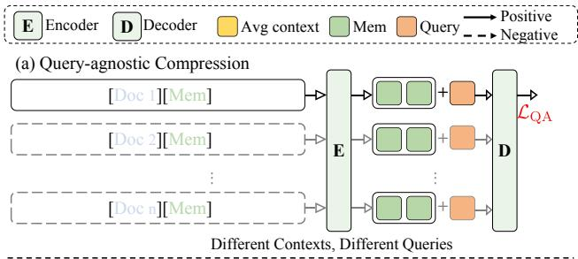
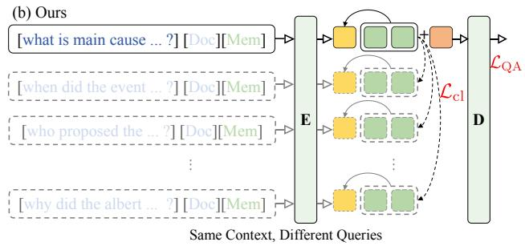
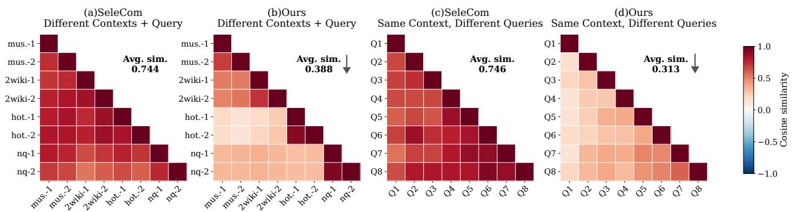
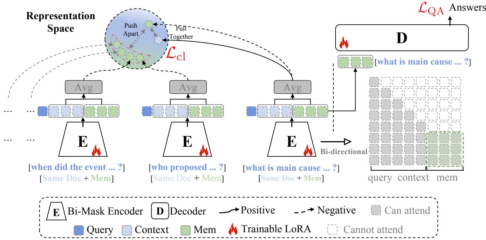
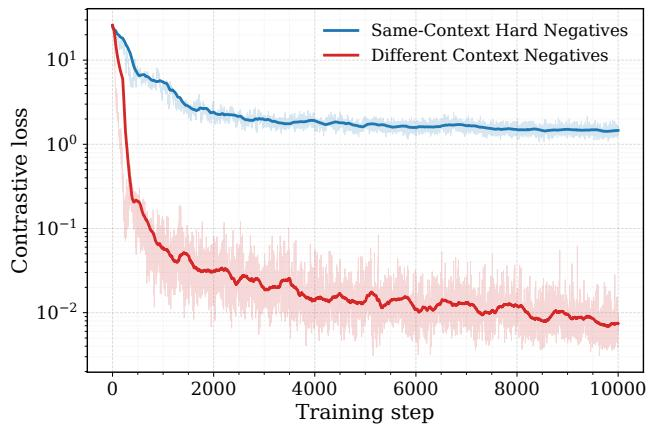
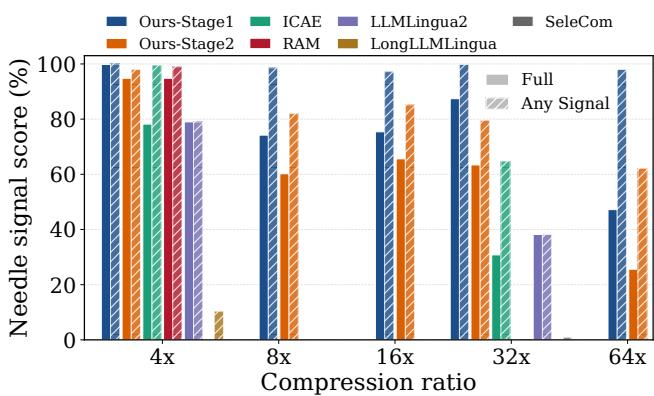

# Beyond Compressing Everything: Contrastive Memory Learning for Selective Context Compression

Sikui Zhang Institute of Automation, Chinese Academy of Sciences, China

Chunfeng Yuan Institute of Automation, Chinese Academy of Sciences, China

Boyu Cai Institute of Automation, Chinese Academy of Sciences, China

Jun Gao Hello Group China

Haowei Liu Alibaba Group China

Guangze Gao Institute of Automation, Chinese Academy of Sciences, China

Bo Li   
Hello Group   
China

Bing Li Institute of Automation, Chinese Academy of Sciences, China

Ziyun Gan Institute of Automation, Chinese Academy of Sciences, China

Nian Liu Institute of Automation, Chinese Academy of Sciences, China

Xiaolei Lv Hello Group China

Weiming Hu Institute of Automation, Chinese Academy of Sciences, China

## Abstract

As large language models (LLMs) advance toward increasingly long inputs, soft context compression ofers a promising method to efficient inference by converting long inputs into compact memory slots. Under limited memory budgets, efective context compres- sion remains challenging because task-relevant evidence varies substantially across queries, ranging from localized evidence to multiple distant spans or information dispersed throughout the full document. Instead of compressing everything indiscriminately, we propose CoMem, a query-guided selective context compression framework that learns memory representations conditioned on both the document and query. CoMem develops Contrastive Compressor Learning to achieve query-sensitive yet context-preserving mem ory representations. To inject a strong prior over query-dependent evidence distributions, we devise a same-context hard negative mining strategy by pairing a single document with multiple queries, requiring the compressor to selectively retain information according to each query’s distinct evidence needs. To address the re- stricted information flow imposed by causal masking, we further enable bidirectional attention among memory slots. Experiments demonstrate that CoMem consistently outperforms existing context compression methods across compression ratios on question answering and RULER-NIAH benchmarks. Our code is available at https://github.com/scar-on/CoMem.

## Keywords

Context Compression, Large Language Models, Question Answer-ing

## 1 Introduction

Large language models (LLMs) have substantially expanded the amount of information that can be provided to a model at inference time. This is particularly important for long-document question answering [17, 35] and retrieval-augmented generation (RAG) [6], where the answer often depends on evidence distributed across a large context. Yet long context does not mean efective information use, natural language is inherently redundant [19, 37]. Taking the entire document as input to an LLM may introduce inference cost, distractors [24], dilute attention over irrelevant content, and substantially increase computation and KV-cache overhead [8, 12]. Soft context compression [21] ofers a promising alternative by com-pressing full context into short continuous memory slots, enabling the decoder to reason over a compact representation rather than the full document.

  
Figure 1: Comparison between the query-agnostic compression and CoMem. (a) The query-agnostic method learns memory slots supervised by the QA loss. (b) Our method further introduces contrastive compressor learning and trains on diferent queries from the same context.

  
Figure 2: Similarity patterns of compressed memory slots. (a) and (b) show memory slots from diferent contexts, (c) and (d) show memory slots from the same context under diferent queries. In both settings, our method achieves lower inter-slot similarity, demonstrating more discriminative query-guided compression.

Existing soft compression methods, such as ICAE [7], 500x [22], PCC [3], and SAC [25], typically compress a document into a fixed memory representation independent of the downstream query. However, the essence of compression is not merely to reduce the number of tokens, but to determine what information should be preserved under a limited memory budget. The same context may contain critical evidence for one question while serving only as background for another. Recent works have begun to concatenate the query with the document for compression [26, 28]. Although the query is incorporated into the compression input, this design does not explicitly encourage memory slots to specialize according to query needs. Consequently, in practice, the learned memory slots remain relatively query-agnostic, leaving most query-sensitive reasoning to the decoder. This limitation is illustrated in Figure 2(a, c), where the SeleCom [26] compressor generates highly similar mem-ory slots not only across diferent contexts but also across diferent queries paired with the same context. These findings highlight the need for stronger mechanisms to explicitly encourage query-guided memory specialization.

In this paper, we argue that efective query-guided context com-pression requires stronger supervision than simple query concatenation. As illustrated in Figure 1, compressed memory representations should remain distinguishable under diferent queries even for the same context. To this end, we present CoMem, a novel architecture for query-guided selective context compression. CoMem develops Contrastive Compressor Learning to preserve contextual information by aligning memory slots with their corresponding context representations, while separating representations from diferent contexts. To further strengthen query-guided compression signals, we devise a same-context hard negative mining strategy that contrasts memory slots from diferent queries over the same context, encouraging query-sensitive yet context-preserving memory repre- sentations. To enable richer information flow and more efective information allocation during compression, we allow memory slots to interact bidirectionally. Concretely, we introduce bidirectional attention among memory slots while preserving causal masking for the original query-context sequence. By combining Contrastive

Compressor Learning with Bidirectional Flow Memory, CoMem enables more efective query-guided compression. We conduct a comprehensive evaluation of CoMem on four question-answering benchmarks and RULER-NIAH. CoMem achieves superior overall performance across both QA and retrieval tasks. Notably, under 4× compression, it even surpasses the original context in LLM-as-a- judge scores on several benchmarks, while remaining competitive even at 64× compression.

Our contributions are summarized as follows:

• We propose CoMem, a query-guided selective context com-pression framework that learns memory slots that are con- sistent with their source context and distinct across difer- ent queries over the same context.

• We develop contrastive compressor learning with samecontext hard negatives to encourage query-sensitive com-pression, together with a bidirectional memory interaction mechanism for more efective information allocation.

• Extensive experiments on four question-answering benchmarks and RULER-NIAH show that CoMem consistently outperforms prior methods and remains efective under high compression ratios.

## 2 Method

## 2.1 Task Formulation

Given a long document context $C ~ = ~ ( c _ { 1 } , \ldots , c _ { n } )$ , a query $Q \ =$ $( q _ { 1 } , \dots , q _ { l } )$ , and a target answer $Y = \left( y _ { 1 } , \dots , y _ { T } \right)$ , our goal is to gen-erate the answer without feeding the full context into the decoder. Instead, we learn a query-conditioned compressor that maps the query-context pair into a compact set of memory representations. We construct the encoder input in Eq. 1 by appending � learnable memory tokens to the query-context sequence:

$$
X _ { \mathrm { e n c } } = [ < \mathsf { E N C } > , Q , C , < \mathsf { M E M } _ { 1 } > , \hdots , < \mathsf { M E M } _ { K } > ] .\tag{1}
$$

The encoder processes $X _ { \mathrm { e n c } }$ and returns a hidden state for each to- ken at every layer. We use the final-layer hidden states correspond- ing to the last � memory tokens as the compressed representation in Eq. 2:

$$
M = f _ { \phi } ( C , Q ) = [ h _ { 1 } ^ { m } , \dots , h _ { K } ^ { m } ] \in \mathbb { R } ^ { K \times d } ,\tag{2}
$$

  
Figure 3: Overview of CoMem. The QA objective ${ \mathcal { L } } _ { \mathrm { Q A } }$ provides an end-task generation signal, while the contrastive learning objective $\mathcal { L } _ { \mathrm { c l } }$ imposes a more explicit representation-level signal, aligning memory slots with their source context while using same-context, diferent-query examples as hard negatives to encourage query-guided memory representations.

where $h _ { k } ^ { m } \in \mathbb { R } ^ { d }$ is the final-layer hidden state of the �-th memory token and $K \ll n .$ Thus, � acts as a compact information bottle neck over the original context. Unlike query-agnostic compression, the memory representation is conditioned on both the document and the query, so the compressor is encouraged to preserve the context information most relevant to answering the given query. The decoder then generates the answer from the query and the compressed memory representation as shown in Eq. 3:

$$
p _ { \theta } ( Y \mid C , Q ) \approx p _ { \theta } ( Y \mid Q , M ) ,\tag{3}
$$

where the conditional distribution is factorized in Eq. 4:

$$
p _ { \theta } ( Y \mid Q , M ) = \prod _ { t = 1 } ^ { T } p _ { \theta } ( y _ { t } \mid y _ { < t } , Q , M ) .\tag{4}
$$

At inference time, the model follows a two-stage procedure: it first compresses the query-context pair into memory slots �, and then conditions the decoder on � and � to generate the final answer.

## 2.2 Contrastive Compressor Learning

The supervised generation objective only indirectly supervises the compressor. As long as the decoder can recover the answer from the memory slots, the encoder is not explicitly encouraged to form faithful or discriminative memory representations. This can lead to overly similar memories across inputs with shared linguistic patterns or answer formats. To address this limitation, we develop Con- trastive Compressor Learning, as shown in Figure 3, with two com-ponents: (1) memory-context alignment for preserving contextual information in compressed memory slots and separating memory representations from diferent contexts; and (2) same-context hard negative mining for injecting a strong prior over query-dependent evidence distributions by contrasting memories from the same context under diferent queries.

2.2.1 Memory-Context Alignment. To instantiate this objective, for the �-th training instance $( C _ { i } , Q _ { i } , Y _ { i } )$ , the encoder produces � final-layer memory hidden states $[ h _ { i , 1 } ^ { m } , \ldots , h _ { i , K } ^ { m } ]$ , consistent with Eq. 2:

$$
M _ { i } = f _ { \phi } ( C _ { i } , \mathcal { Q } _ { i } ) = [ h _ { i , 1 } ^ { m } , \dots , h _ { i , K } ^ { m } ] \in \mathbb { R } ^ { K \times d } .\tag{5}
$$

We then mean pool these memory states into a single compressed representation, as shown in Eq. 6:

$$
\begin{array} { r } { \mathbf { m } _ { i } = \mathrm { M e a n P o o l } ( M _ { i } ) \in \mathbb { R } ^ { d } . } \end{array}\tag{6}
$$

In parallel, we collect the final-layer encoder hidden states $H _ { i } ^ { c } =$ $[ h _ { i , 1 } ^ { c } , \ldots , h _ { i , n } ^ { c } ]$ corresponding to the context tokens and mean pool them in $\operatorname { E q . 7 }$ 7:

$$
\mathbf { c } _ { i } = \mathrm { M e a n P o o l } ( H _ { i } ^ { c } ) \in \mathbb { R } ^ { d } .\tag{7}
$$

As illustrated in Figure 3, in the representation space, the positive pair is formed between the compressed memory representation and the context representation from the same instance, $\left( \mathbf { m } _ { i } , \mathbf { c } _ { i } \right)$ . Pulling this pair together encourages the memory bottleneck to preserve the semantic information of its source context. In contrast, the neg- ative pairs are formed among diferent memory representations in the mini-batch, $\mathrm { i } . \mathrm { e } . , ( \mathbf { m } _ { i } , \mathbf { m } _ { j } )$ for $j \neq i .$ Pushing these memory representations apart prevents the compressor from mapping dif- ferent query-context pairs into indistinguishable memory states.

Formally, the contrastive objective is defined in $\operatorname { E q . }$ 8:

$$
\begin{array} { r l } & { \mathcal { L } _ { \mathrm { c l } } = - \displaystyle \frac { 1 } { N } \sum _ { i = 1 } ^ { N } \log \frac { \exp ( s ( \mathbf { m } _ { i } , \mathbf { c } _ { i } ) / \tau ) } { \sum _ { \mathbf { z } \in \mathcal { Z } _ { i } } \exp ( s ( \mathbf { m } _ { i } , \mathbf { z } ) / \tau ) } , } \\ & { \mathcal { Z } _ { i } = \{ \mathbf { c } _ { i } \} \cup \{ \mathbf { m } _ { j } : j \neq i \} . } \end{array}\tag{8}
$$

Here, $s ( \cdot , \cdot )$ denotes cosine similarity and � is the temperature, and � is the mini-batch size. The set $\textstyle z _ { i }$ contains one positive context representation and all negative memory representations in the mini-batch. Thus, unlike conventional contrastive learning that con- trasts an anchor against mismatched context representations, our objective uses the memory slots m� as the contrastive query. The corresponding context representation $\mathbf { c } _ { i }$ serves as a stop-gradient positive target, and the other compressed memories serve as negatives. Since gradients from $\mathcal { L } _ { \mathrm { c l } }$ do not update $\mathbf { c } _ { i } ,$ the loss directly optimizes memory representations to align with their source contexts while occupying distinguishable regions of the representation space.

2.2.2 Same-Context Hard Negative Mining Strategy. A naive in-batch contrastive objective often uses examples from diferent contexts as negatives. However, diferent contexts are usually already well-separated in representation space, making such negatives relatively easy. As a result, the contrastive objective can converge quickly without forcing the compressor to learn the more important behavior of selective compression. This tendency toward rapid convergence is illustrated in Figure 4.

To address this, we construct each mini-batch using the same context paired with diferent queries. Thus, all negative memories in the batch come from the same document but are conditioned on diferent queries. For an anchor memory m�, its positive is the context representation $\mathbf { c } _ { i } ,$ , while its negatives are the other memory representations $\{ \mathbf { m } _ { j } \} _ { j \neq i }$ from the same context. This design turns query variation into hard negatives. Since all memories come from the same context, the model cannot rely on coarse document-level diferences to separate them. Instead, it must encode the query- specific information needed to distinguish which aspects of the shared context are compressed into each memory.

2.2.3 Overall Training Objective. We train the model jointly with the supervised answer generation objective. Given the memory slots $M _ { i } = f _ { \phi } ( C _ { i } , Q _ { i } )$ , the QA loss is the negative log-likelihood of the target answer, defined in Eq. 9:

$$
\mathcal { L } _ { \mathrm { Q A } } = - \sum _ { t = 1 } ^ { T } \log p _ { \theta } \left( y _ { t } \mid y _ { < t } , Q _ { i } , f _ { \phi } ( C _ { i } , Q _ { i } ) \right) .\tag{9}
$$

The final training objective combines answer supervision with the same-context contrastive objective:

$$
\mathcal { L } = \mathcal { L } _ { \mathrm { Q A } } + \lambda \mathcal { L } _ { \mathrm { c l } } ,\tag{10}
$$

where � controls the strength of the contrastive compressor learning signal.

## 2.3 Bidirectional Flow Memory

Prior work shows that attention masks strongly shape information flow [1, 36]. DeepSeek OCR2 shows that tailored attention masks can help learnable output tokens distill and reorganize source infor- mation, while LLM2Vec [1] shows that bidirectional attention can become beneficial after proper adaptation. More discussion is provided in Section 4. Motivated by these findings, we revisit the causal ordering imposed on memory slots in soft context compression. Under causal masking, memory slots are forced into an unneces- sary left-to-right order. This constraint is natural for autoregressive generation, but not for soft context compression. Since memory slots are latent representations rather than tokens to be generated, they should communicate with each other and cooperate to allocate diferent aspects of the query-relevant context.

Figure 3 (Right) illustrates our attention-mask design. In detail, we introduce a bidirectional flow among memory slots while pre- serving the causal structure of the original query-context sequence. Let $L = \left| Q \right| + \left| C \right|$ denote the length of the query-context prefix and � denote the number of memory slots. The encoder input is arranged as [�, �, �], and its attention mask is defined in Eq. 11:

$$
\mathbf { A } = \left[ \begin{array} { c c } { \mathrm { L o w e r T r i } ( L ) } & { \ \mathbf { 0 } _ { L \times K } } \\ { \mathbf { 1 } _ { K \times L } } & { \ \mathbf { 1 } _ { K \times K } } \end{array} \right] ,\tag{11}
$$

where LowerTri(�) is an $L \times L$ binary lower-triangular matrix that encodes causal attention over the query-context prefix. The lower- right block makes memory slots bidirectional, allowing them to exchange information and form a coordinated set of compression slots. We implement the corresponding bidirectional mask using FlexAttention for eficient custom attention masking.1

## 3 Experiments

## 3.1 Experimental Setup

3.1.1 Training Data and Details. We train CoMem in two stages. In Stage I, we construct a query-rich training set from the CLaRa multi-stage pretraining corpus.2 To support same-context hard negatives, we keep only contexts paired with at least eight distinct queries, yielding approximately 160K training instances. In Stage II, following Rau et al. [31]3, we perform instruction tuning on approximately 453K instances.

In Stage I, both the compressor $f _ { \phi }$ and decoder $\hbar \theta$ are trained with LoRA. We use Mistral- $- 7 \mathrm { B } ^ { 4 }$ and $\mathrm { Q w e n } 3 \substack { - 4 \mathrm { B } ^ { 5 } }$ as the backbone LLMs. Following Ge et al. [7], each document is split into 256-token chunks. For a context chunk of length �, the compressor produces memory states at compression ratios $r \in \{ 4 , 8 , 1 6 , 3 2 , 6 4 , 1 2 8 \}$ , with the number of memory slots determined by the target ratio. We apply the memory-context contrastive loss $\mathcal { L } _ { \mathrm { c l } }$ with weight $\lambda = 0 . 1$ In Stage II, we initialize from the Stage I checkpoint, freeze the compressor $f _ { \phi } { \mathrm { . } }$ , and continue training only the decoder $\scriptstyle { \mathcal { P } } \theta$ . Addi- tional details on data and training configurations are provided in Appendix A.

3.1.2 Evaluation Benchmarks. We evaluate on four long-document question answering benchmarks: Natural Questions [15], HotpotQA [38], MuSiQue [34], and 2WikiMultiHopQA [10]. These datasets cover both single-hop and multi-hop reasoning. We also include RULER-NIAH [11], a synthetic needle-in-a-haystack benchmark in which a 7-digit numerical needle is inserted into five documents. This

Table 1: Overall performance on four question-answering benchmarks and RULER-NIAH. All rows use Mistral-7B except the final two CoMem rows, which use Qwen3-4B. SeleCom-82×∗ denotes the best-performing configuration reported in the original paper, and △ marks query-aware methods. Bold and underlined numbers denote the best and second-best results within each Mistral-7B compression setting.
<table><tr><td rowspan="2">Type</td><td rowspan="2">Model</td><td colspan="2">2Wiki</td><td colspan="2">HotpotQA</td><td colspan="2">MuSiQue</td><td colspan="2">NQ</td><td rowspan="2">NIAH ACC</td></tr><tr><td>ACC</td><td>LLM Judge</td><td>ACC</td><td>LLM Judge</td><td>ACC</td><td>LLM Judge</td><td>ACC</td><td>LLM Judge</td></tr><tr><td colspan="10">RAG (No Compression)</td></tr><tr><td></td><td>Mistral-7B</td><td>0.7654</td><td>0.7088</td><td>0.7751</td><td>0.8249</td><td>0.5333</td><td>0.5085</td><td>0.7905</td><td>0.7671</td><td>0.886</td></tr><tr><td></td><td>Qwen3-4B</td><td>0.7927</td><td>0.6236</td><td>0.8164</td><td>0.8220</td><td>0.3814</td><td>0.2880</td><td>0.8007</td><td>0.7405</td><td>1.0</td></tr><tr><td colspan="10">Mistral-7B: 4× Compression</td></tr><tr><td rowspan="3">Hard compression</td><td>LLMLingua2</td><td>0.3905</td><td>0.3379</td><td>0.3612</td><td>0.4848</td><td>0.1614</td><td>0.2284</td><td>0.5081</td><td>0.6121</td><td>0.790</td></tr><tr><td>LongLLMLingua</td><td>0.4436</td><td>0.2741</td><td>0.4254</td><td>0.4898</td><td>0.1465</td><td>0.1825</td><td>0.6084</td><td>0.6630</td><td>0.128</td></tr><tr><td>Provence</td><td>0.6131</td><td>0.6279</td><td>0.6624</td><td>0.6415</td><td>0.3620</td><td>0.3471</td><td>0.7522</td><td>0.7318</td><td>0.522</td></tr><tr><td rowspan="4">Soft</td><td>ICAE</td><td>0.3941</td><td>0.4282</td><td>0.4043</td><td>0.5352</td><td>0.1820</td><td>0.2561</td><td>0.4686</td><td>0.5722</td><td>0.782</td></tr><tr><td>PISCO</td><td>0.5884</td><td>0.5740</td><td>0.6551</td><td>0.6691</td><td>0.3194</td><td>0.3029</td><td>0.7368</td><td>0.7921</td><td>0.960</td></tr><tr><td>compression RAM</td><td>0.4614</td><td>0.5079</td><td>0.4510</td><td>0.5859</td><td>0.1994</td><td>0.2896</td><td>0.5075</td><td>0.6269</td><td>0.948</td></tr><tr><td>CoMem</td><td>0.6280</td><td>0.6662</td><td>0.6937</td><td>0.7045</td><td>0.3359</td><td>0.3277</td><td>0.7902</td><td>0.8185</td><td>0.972</td></tr><tr><td colspan="10">Mistral-7B: 32× Compression</td></tr><tr><td rowspan="3">Hard compression</td><td>LLMLingua2</td><td>0.3318</td><td>0.2465</td><td>0.2241</td><td>0.2718</td><td>0.0368</td><td>0.0621</td><td>0.1945</td><td>0.2665</td><td>0.382</td></tr><tr><td>LongLLMLingua</td><td>0.4120</td><td>0.2139</td><td>0.3403</td><td>0.3727</td><td>0.0869</td><td>0.1051</td><td>0.5361</td><td>0.5724</td><td>0.000</td></tr><tr><td>Provence</td><td>0.5017</td><td>0.4908</td><td>0.4358</td><td>0.4752</td><td>0.1444</td><td>0.1601</td><td>0.5736</td><td>0.6362</td><td>0.486</td></tr><tr><td rowspan="6">Soft</td><td>ICAE</td><td>0.3403</td><td>0.3721</td><td>0.3161</td><td>0.4410</td><td>0.0761</td><td>0.1353</td><td>0.3856</td><td>0.5079</td><td>0.308</td></tr><tr><td>PISCO</td><td>0.5369</td><td>0.5306</td><td>0.5683</td><td>0.6140</td><td>0.2731</td><td>0.2842</td><td>0.6731</td><td>0.7459</td><td>0.578</td></tr><tr><td>RAM∆</td><td>0.2723</td><td>0.2960</td><td>0.1943</td><td>0.2637</td><td>0.0294</td><td>0.0720</td><td>0.1615</td><td>0.2447</td><td>0.000</td></tr><tr><td>compression SeleCom</td><td>0.2894</td><td>0.3331</td><td>0.3445</td><td>0.4706</td><td>0.0856</td><td>0.1593</td><td>0.6531</td><td>0.7604</td><td>0.000</td></tr><tr><td>SeleCom-82×*Δ</td><td>0.3410 0.5650</td><td>0.3883</td><td>0.4191</td><td>0.5622</td><td>0.1477</td><td>0.2284</td><td>0.7315</td><td>0.8229</td><td>0.000</td></tr><tr><td>CoMem</td><td></td><td>0.5479</td><td>0.6197</td><td>0.6586</td><td>0.2656</td><td>0.2578</td><td>0.7389</td><td>0.7862</td><td>0.612</td></tr><tr><td colspan="10">Qwen3-4B: CoMem Only</td></tr><tr><td>Soft</td><td>CoMem-4×</td><td>0.6102 0.5591</td><td>0.6441</td><td>0.6900</td><td>0.7489</td><td>0.3893</td><td>0.3827</td><td>0.7249</td><td>0.8226</td><td>0.948</td></tr><tr><td>compression</td><td>CoMem-32×</td><td></td><td>0.5187</td><td>0.6349</td><td>0.6582</td><td>0.2971</td><td>0.2958</td><td>0.7013</td><td>0.7880</td><td>0.634</td></tr></table>

benchmark directly tests whether the memory slots � = �� (�, �) retain query-relevant evidence from the original context � under long-context retrieval.

3.1.3 Metrics. We report Cover Exact Match, denoted as accuracy (ACC), and LLM-as-a-judge scores. Unlike standard Exact Match and F1 metrics, Cover-EM measures whether the generated answer contains the gold answer span. In addition, we use DeepSeek-V4- Flash as an LLM-as-a-judge evaluator to better assess the semantic correctness of model predictions. The full prompt template is pro- vided in Appendix B.1, and further analysis on the motivation for using LLM-as-a-judge instead of EM/F1 is presented in Appendix C.

3.1.4 Baselines. We compare CoMem with both hard and soft context compression methods. For hard compression, we evalu- ate LLMLingua-2 [30], LongLLMLingua [14], and the query-aware Provence [2]. For soft compression, we include ICAE [7], PISCO [27], and the query-aware RAM [33] and SeleCom [26]. For all evaluated methods, we use Mistral-7B as the decoder. Additionally, we also report model performance under the settings of the original prompt, corresponding to standard RAG without context compression.

## 3.2 Main Results

3.2.1 Overall Performance. Table 1 summarizes results on four long-document QA benchmarks and RULER-NIAH. Overall, CoMem consistently outperforms prior compression baselines across com-pression ratios. At 4× compression, CoMem achieves the best overall QA performance, substantially improving multi-hop reasoning performance. Notably, under llm judge score, CoMem even sur-passes the uncompressed full-context baseline on several bench- marks. Even under much tighter memory budgets (32× compression), CoMem remains highly competitive, consistently outperforming strong baselines while maintaining robust retrieval performance on RULER-NIAH.

Hard compression methods generally preserve sparse lexical evidence but often hurt QA performance, especially under high compression ratios. In contrast, soft compression methods retain richer semantic information and are more stable on QA bench-marks, but their performance drops noticeably as memory budgets become tighter. In comparison, CoMem maintains strong performance across both retrieval and reasoning tasks, suggesting that query-aware memory construction makes more efective use of limited memory capacity.

Table 2: Accuracy (ACC) of CoMem across diferent compression ratios.
<table><tr><td>Model</td><td>2Wiki HotpotQA MuSiQue</td><td></td><td></td><td>NQ</td></tr><tr><td>Mistral-7B-8 ×</td><td>0.5863</td><td>0.6437</td><td>0.2826</td><td>0.7524</td></tr><tr><td>Mistral-7B-16 ×</td><td>0.5988</td><td>0.6411</td><td>0.2627</td><td>0.7524</td></tr><tr><td>Mistral-7B-64 ×</td><td>0.5724</td><td>0.5925</td><td>0.2466</td><td>0.7223</td></tr><tr><td>Mistral-7B-128 ×0.5756</td><td></td><td>0.5975</td><td>0.2594</td><td>0.7294</td></tr><tr><td>Qwen3-4B-8×</td><td>0.5833</td><td>0.6578</td><td>0.3434</td><td>0.7010</td></tr><tr><td>Qwen3-4B-16×</td><td>0.5540</td><td>0.6366</td><td>0.2974</td><td>0.6997</td></tr><tr><td>Qwen3-4B-64×</td><td>0.5069</td><td>0.5864</td><td>0.2378</td><td>0.6777</td></tr><tr><td>Qwen3-4B-128×</td><td>0.4941</td><td>0.5682</td><td>0.2304</td><td>0.6640</td></tr></table>

Table 3: Ablation study on Stage I and Stage II training components.
<table><tr><td>Contrastive</td><td>Bi-Mask</td><td>2Wiki</td><td>HotpotQA</td><td>MuSiQue</td><td>NQ</td></tr><tr><td>Stage I</td><td></td><td></td><td></td><td></td><td></td></tr><tr><td>X</td><td>√</td><td>0.2785</td><td>0.2440</td><td>0.0709</td><td>0.2560</td></tr><tr><td>X</td><td>X</td><td>0.2852</td><td>0.2447</td><td>0.0861</td><td>0.2665</td></tr><tr><td>√</td><td>×</td><td>0.2627</td><td>0.1492</td><td>0.0203</td><td>0.1160</td></tr><tr><td>√</td><td>√</td><td>0.3761</td><td>0.5211</td><td>0.2280</td><td>0.6197</td></tr><tr><td>Stage ⅡI</td><td></td><td></td><td></td><td></td><td></td></tr><tr><td>Ours</td><td></td><td>0.5591</td><td>0.6349</td><td>0.2971</td><td>0.7013</td></tr><tr><td>w/ encoder</td><td></td><td>0.5782</td><td>0.6211</td><td>0.2950</td><td>0.6697</td></tr><tr><td>w/o Stage I checkpoint</td><td></td><td>0.3932</td><td>0.2187</td><td>0.0360</td><td>0.2319</td></tr></table>

3.2.2 Additional Compression Ratios. We further evaluate CoMem under increasingly aggressive compression ratios to assess its robustness under highly constrained memory budgets. As shown in Table 2, CoMem maintains relatively stable performance as the com- pression ratio increases from 8× to 128× across both Mistral-7B and Qwen3-4B. In particular, for Qwen3-4B, increasing the compression ratio to 128× results in an average performance drop of only 0.0822 compared with 8× compression. These results demonstrate that CoMem exhibits graceful degradation even under extremely high compression ratios, retaining a substantial portion of its performance while reducing the memory footprint by up to 128×.

## 3.3 Ablation Study

3.3.1 Interaction between Contrastive Learning and Bidirectional Memory. Unless otherwise specified, all ablation experiments are conducted under a 32× compression ratio and report ACC. Table 3 shows the efects of the key training components of CoMem. In Stage I, contrastive learning and the bidirectional memory mask are strongly complementary. Without contrastive learning, the choice of memory mask has only a limited efect. Once contrastive learn- ing is applied, however, using a causal mask leads to a substantial performance drop, whereas combining contrastive learning with bidirectional memory achieves the best results across all datasets. This suggests that contrastive supervision requires non-causal interactions among memory slots to efectively allocate limited capacity and preserve query-relevant information. Stage II results further show that the Stage I checkpoint is critical for downstream answer generation, while updating the encoder during Stage II provides no consistent benefit over freezing the compressor.

  
Figure 4: Optimization dynamics for same-context and diferent-context negatives.

Table 4: Ablation study on same-context hard negatives and diferent-context negatives.
<table><tr><td>Negative Type</td><td>2Wiki</td><td>HotpotQA</td><td>MuSiQue</td><td>NQ</td></tr><tr><td>Different-Context</td><td>0.3681</td><td>0.4947</td><td>0.2201</td><td>0.6047</td></tr><tr><td>Same-Context</td><td>0.3761</td><td>0.5211</td><td>0.2280</td><td>0.6197</td></tr></table>

Table 5: ACC with the true downstream query or a generalpurpose query at 32× compression ratios.
<table><tr><td>Method</td><td>2Wiki</td><td>HotpotQA</td><td>MuSiQue</td><td>NQ</td></tr><tr><td>CoMem w/ true query</td><td>0.5591</td><td>0.6349</td><td>0.2971</td><td>0.7013</td></tr><tr><td>CoMem w/ general query</td><td>0.3786</td><td>0.4607</td><td>0.2098</td><td>0.5597</td></tr></table>

3.3.2 Efect ofSame-Context Hard Negatives. We next test whether adding negatives from unrelated contexts improves the contrastive objective. In conventional contrastive learning, more negatives of- ten provide stronger discrimination. In our setting, however, the key challenge is not to separate diferent documents, but to distinguish which evidence should be preserved for diferent queries over the same document. Diferent-context negatives can therefore be sepa- rated using coarse document-level cues and provide a weaker signal for query-specific compression. As shown in Figure 4, the optimization dynamics also indicate that such negatives contribute less useful training signal than same-context hard negatives. Consistent with this observation, Table 4 shows that same-context negatives outperform diferent-context negatives on all four datasets.

## 3.4 Deep Analysis of Selective Compression

3.4.1 General Compression withoutDownstream Queries. Although CoMem conditions compression on a query, its context-preservation objective also encourages the memory to retain information from the source context. At evaluation time, we replace the true query with the generic instruction “Please preserve all potentially useful information from the following context.” As shown in Table 5, CoMem with this general-purpose query still achieves strong performance under 32× compression, consistently outperforming the query-agnostic baselines ICAE and LLMLingua2 across all four datasets. While access to the true query yields the strongest re- sults, the general-query variant retains substantial performance, enabling the resulting memories to be precomputed ofline, stored, and reused for diferent downstream queries.

Table 6: Eficiency comparison of CoMem across diferent compression ratios.
<table><tr><td colspan="5">GFlops</td></tr><tr><td>Compression ratio</td><td>4X</td><td>16×</td><td>32×</td><td>64×</td></tr><tr><td>Full Context</td><td></td><td>10031</td><td></td><td></td></tr><tr><td>Ours</td><td>14074</td><td>10800</td><td>10256</td><td>9985</td></tr><tr><td></td><td>Time/sample (s)</td><td></td><td></td><td></td></tr><tr><td>Compression ratio</td><td>4X</td><td>16×</td><td>32×</td><td>64X</td></tr><tr><td>Full Context</td><td></td><td>0.053</td><td></td><td></td></tr><tr><td>Ours</td><td>0.026</td><td>0.013</td><td>0.012</td><td>0.011</td></tr><tr><td colspan="3">Speedup</td><td></td><td></td></tr><tr><td>CoMem</td><td>2.04×</td><td>4.08×</td><td>4.42×</td><td>4.82×</td></tr></table>

  
Figure 5: Needle-signal retention under diferent compression ratios.

3.4.2 Eficiency Analysis. Building on this ofline compression setting, we next evaluate the inference eficiency ofCoMem on a single H100 GPU using a setup with a 128-token query, five 256-token documents, and forced generation of 32 tokens. We report only the decoder-side answer generation time, excluding retrieval and con text compression overhead, to isolate the eficiency of downstream generation. Table 6 reports both theoretical GFlops and measured latency in seconds per sample under diferent compression ratios. Compared with the full-context baseline, CoMem substantially re- duces inference latency as the compression ratio increases, achieving up to a 4.8× speedup at 64× compression while maintaining comparable computational cost in terms of GFlops.

3.4.3 Needle-Signal Retention. Using Qwen3-4B as the backbone LLM, we evaluate RULER-NIAH to assess whether the compressor preserves retrieval-critical information. We report two metrics: Full, which requires the complete 7-digit needle, and Any Signal, which counts either the full needle or a recognizable digit substring. Thus, Any Signal captures partial retention of query-relevant evidence even when exact recovery fails.

As shown in Figure 5, existing hard compression and soft com-pression methods exhibit near-zero performance under aggressive compression, due to their limited query-aware evidence selection. Query-agnostic soft compression retains more evidence at lower compression ratios but also degrades substantially as the memory budget shrinks.

In contrast, CoMem preserves substantially more query-relevant evidence under extreme compression. Stage I achieves a 0.98 Any Signal score at 64× compression, demonstrating reliable needle localization despite the severe memory reduction. The gap between Full and Any Signal indicates that remaining errors are often due to partial corruption rather than complete loss of the relevant ev- idence. These results highlight the efectiveness of query-aware contrastive compression in retaining retrieval-critical information under extreme compression.

## 4 Related Work

Hard Prompt Compression. One line of work studies compressing the original context by removing unimportant text tokens using a lightweight auxiliary model, while preserving readable prompts for direct use by of-the-shelf LLMs. Representative approaches include LLMLingua [13], LongLLMLingua [14], and LLMLingua-2 [30]. Provence [2] formulates context pruning as sequence labeling and dynamically retains relevant passages. These methods filter the original context, making them prone to removing query-relevant or otherwise critical information during aggressive compression. DAC [39] further incorporates attention scores and dynamic entropy changes to preserve salient tokens. This reliance on full at- tention incurs additional overhead, since modern FlashAttention kernels [4, 32] do not save full attention matrices.

Soft Context Compression. Unlike hard compression methods, soft compression encodes long contexts into continuous latent representations and feeds them to a decoder for generation. Ge et al. [7] compress context into learned memory slots through au toencoding and language modeling objectives, while Li et al. [22] explore extreme compression by using KV caches as compressed representations. Dai et al. [3] pretrain a decoupled compressor with embedding-based memory using reconstruction and completion tasks. More recent works reduce the reliance on explicit recon- struction pretraining [25, 27]. Lin et al. [23] mix compressed chunk embeddings with standard token inputs for eficient RAG decoding, He et al. [9] jointly optimize retrieval and generation over com-pressed memories. Closest to our setting, Louis et al. [28] and Liu et al. [26] condition compression on the input query to reduce irrelevant information. In summary, existing soft compressors largely rely on decoder-side objectives, whereas CoMem explicitly regularizes compressed memories to be both context-preserving and query-guided.

Bidirectional Masking. Prior work suggests that bidirectional masks can improve representations by relaxing the information bottleneck imposed by causal attention, but the gains are not au- tomatic [1, 16, 18, 20, 29]. These studies show that access to right context is useful for token- and sequence-level embeddings when paired with suitable adaptation, while naive mask changes can be less reliable. Similar findings appear in context compression, where full-context attention helps compressed vectors or anchor tokens aggregate global information [5, 25]. This motivates our use of bidirectional communication among memory slots, which are latent representations rather than autoregressively generated tokens.

## 5 Conclusion

In this paper, we introduce CoMem, a query-guided selective context compression framework. Through contrastive compressor learning, same-context hard negatives, and bidirectional memory interaction, CoMem efectively preserves query-relevant evidence under compact memory budgets. Extensive experiments on long- document QA benchmarks and RULER-NIAH demonstrate that CoMem consistently outperforms prior compression methods across compression ratios.

## A Implementation details

The training hyperparameters are summarized in Table 7. Stage I training can be completed within 10 hours on a single H100 GPU. We set the micro-batch size to 8, which matches one same-context group containing eight distinct queries. Table 8 provides an example of such a same-context contrastive group. Stage II training finishes within 5 hours on four H100 GPUs. The training time remains simi lar across diferent compression ratios. Overall, CoMem is eficient to train.

## B Prompt Templates

## B.1 LLM-as-a-Judge Evaluation Prompt

For LLM-as-a-judge evaluation, we use DeepSeek-V4-Flash as the evaluator. Each example is formatted as a single user message, and the judge is asked to return only a binary decision. The prompt template is shown in Prompt B.1.

## Prompt B.1: LLM-as-a-Judge Evaluation Prompt

A prediction is correct if it conveys the same meaning as the reference answer, even if the wording is diferent. Minor diferences in formatting, articles, or extra context are acceptable as long as the core answer is correct.

Question: {question} Reference Answer: {answer} Model Prediction: {prediction}

Is the model’s prediction correct? Reply with only “Yes” or “No”.

## B.2 Training Data Prompt Templates

During training, CoMem uses separate templates for the compression side input and the decoder-side answer generation input. The com-pression input places the query between two <QUERY> markers,

Table 7: Training hyperparameters.
<table><tr><td>Hyperparameter</td><td>Value</td></tr><tr><td>Batch size</td><td>128</td></tr><tr><td>Micro batch size per GPU</td><td>8</td></tr><tr><td>Gradient accumulation steps</td><td>16</td></tr><tr><td>Learning rate</td><td>1 × 10−4</td></tr><tr><td>LR scheduler</td><td>cosine with minimum LR</td></tr><tr><td>Optimizer</td><td>DeepSpeed FusedAdam</td></tr><tr><td>Epochs</td><td>1</td></tr><tr><td>Max tokens for generation</td><td>128</td></tr><tr><td>Document max tokens</td><td>256</td></tr><tr><td>LoRA layers</td><td>All-linear</td></tr><tr><td>LoRA rank</td><td>16</td></tr><tr><td>LoRA dropout</td><td>0.1</td></tr><tr><td>LoRA alpha</td><td>32</td></tr><tr><td>Warmup ratio</td><td>0.03</td></tr><tr><td>Number of questions per context</td><td>8</td></tr></table>

followed by the source document, and appends memory tokens af- ter tokenization. The decoder-side prompt receives the compressed memory slots as the background and generates the target answer.

Prompt B.2: Query-Conditioned Compression Input   
<ENC><BOS><QUERY>   
Query:   
{query} <QUERY>Document:   
{document} <EOS>   
<MEM>. .. <MEM>

## Prompt B.3: Decoder QA Template

User:   
Background:   
{compressed memory slots}

Question: {query}

Assistant: {answer}

## C Why Use LLM-as-a-Judge?

Biases of Automatic Metrics. Prior work commonly reports exact match EM, F1, and ACC as the main evaluation metrics [9, 22, 25]. Given a prediction �ˆ and a reference answer �, let �(·) denote the evaluation normalization, which lowercases text, removes punctua- tion and articles, maps boolean labels to yes/no, and fixes white- space. Let �(·) denote the token multiset after normalization and �(·) denote the corresponding token set. These metrics can be written as:

$$
\begin{array} { r } { \mathrm { E M } ( \hat { y } , y ) = \mathbb { I } \left[ n ( \hat { y } ) = n ( y ) \right] , } \end{array}\tag{12}
$$

$$
\mathrm { F } 1 ( \hat { y } , y ) = \frac { 2 \mathrm { P r e c } ( \hat { y } , y ) \mathrm { R e c } ( \hat { y } , y ) } { \mathrm { P r e c } ( \hat { y } , y ) + \mathrm { R e c } ( \hat { y } , y ) } ,
$$

$$
\operatorname { A C C } ( \hat { y } , y ) = \mathbb { I } \left[ S ( y ) \subseteq S ( \hat { y } ) \right] ,\tag{13}
$$

(14)

where Prec and Rec are computed by multiset token overlap be- tween �(�ˆ) and �(�). These definitions show that the metrics are still largely based on lexical overlap with the reference answer. EM is especially strict, as it requires the model output to exactly match the gold label. In our experiments, we observed that EM is strongly afected by the output length distribution in the training data. When the training answers are short, the model also tends to produce shorter responses, which can artificially improve EM and F1. However, this behavior often reduces answer completeness, weakens the model’s reasoning ability, and may even lower ACC when the model fails to provide enough supporting information.

Failure Cases of Span Matching. ACC can also overestimate performance: a model may mention the correct answer somewhere in a long response while ultimately giving an incorrect, ambiguous, or self-contradictory final answer. As shown in Table 9, such outputs can be counted as correct by lexical ACC because they contain the gold span, even though they reject, contradict, or over-qualify the answer. Therefore, we additionally introduce LLM-as-a-Judge to assess whether the prediction is truly semantically correct with respect to the question and reference answer. This helps filter out cases where the model merely guesses or incidentally includes the gold answer, providing a more reliable estimate of answer correct- ness.

## Ethical Considerations

Our work does not introduce new datasets containing personally identifiable or sensitive information, and we rely primarily on pub licly available benchmarks. Nevertheless, context compression may introduce a risk of information loss, particularly when the com- pressed representation omits details that are important for downstream decision-making. This risk may be more consequential in sensitive or high-stakes applications, where seemingly minor infor-mation loss could afect the reliability of model outputs. Therefore, our method should be used with appropriate safeguards and human oversight in such settings. We also note that context compression does not provide any additional privacy guarantees, and sensitive information present in the original context may still be preserved in the compressed representation.

## References

[1] Parishad BehnamGhader, Vaibhav Adlakha, Marius Mosbach, Dzmitry Bahdanau, Nicolas Chapados, and Siva Reddy. 2024. LLM2Vec: Large Language Models Are Secretly Powerful Text Encoders. In First Conference on Language Modeling. https://openreview.net/forum?id=IW1PR7vEBf

[2] Nadezhda Chirkova, Thibault Formal, Vassilina Nikoulina, and Stéphane Clin-chant. 2025. Provence: Eficient and Robust Context Pruning for Retrieval-Augmented Generation. In International Conference on Learning Representations. https://openreview.net/forum?id=TDy5Ih78b4

[3] Yuhong Dai, Jianxun Lian, Yitian Huang, Wei Zhang, Mingyang Zhou, Mingqi Wu, Xing Xie, and Hao Liao. 2025. Pretraining context compressor for large language models with embedding-based memory. In Proceedings of the 63rd Annual Meeting of the Association for Computational Linguistics (Volume 1: Long Papers). 28715–28732.

[4] Tri Dao. 2024. Flashattention-2: Faster attention with better parallelism and work partitioning. In International Conference on Learning Representations, Vol. 2024. 35549–35562.

[5] Yair Feldman and Yoav Artzi. 2025. Simple Context Compression: Mean-Pooling and Multi-Ratio Training. arXiv preprint arXiv:2510.20797 (2025). https://arxiv. org/abs/2510.20797

[6] Guangze Gao, Zixuan Li, Chunfeng Yuan, Jiawei Li, Wu Jianzhuo, Yuehao Zhang, Xiaolong Jin, Bing Li, and Weiming Hu. 2025. D-RAG: Diferentiable Retrieval-Augmented Generation for Knowledge Graph Question Answering. In Proceedings of the 2025 Conference on Empirical Methods in Natural Language Processing. 35398–35417.

[7] Tao Ge, Hu Jing, Lei Wang, Xun Wang, Si-Qing Chen, and Furu Wei. 2024. In-context Autoencoder for Context Compression in a Large Language Model. In The Twelfth International Conference on Learning Representations. https: //openreview.net/forum?id=uREj4ZuGJE

[8] Chi Han, Qifan Wang, Hao Peng, Wenhan Xiong, Yu Chen, Heng Ji, and Sinong Wang. 2024. Lm-infinite: Zero-shot extreme length generalization for large language models. In Proceedings of the 2024 Conference of the North American Chapter ofthe Association for Computational Linguistics: Human Language Technologies (Volume 1: Long Papers). 3991–4008.

[9] Jie He, Richard He Bai, Sinead Williamson, Jef Z. Pan, Navdeep Jaitly, and Yizhe Zhang. 2025. CLaRa: Bridging Retrieval and Generation with Continuous Latent Reasoning. Version 3, last revised 5 Feb 2026. arXiv:2511.18659 [cs.CL] https://arxiv.org/abs/2511.18659

[10] Xanh Ho, Anh-Khoa Duong Nguyen, Saku Sugawara, and Akiko Aizawa. 2020. Constructing A Multi-hop QA Dataset for Comprehensive Evaluation of Reasoning Steps. In Proceedings ofthe 28th International Conference on Computational Linguistics, Donia Scott, Nuria Bel, and Chengqing Zong (Eds.). International Committee on Computational Linguistics, Barcelona, Spain (Online), 6609–6625. doi:10.18653/v1/2020.colin -main.580

[11] Cheng-Ping Hsieh, Simeng Sun, Samuel Kriman, Shantanu Acharya, Dima Rekesh, Fei Jia, and Boris Ginsburg. 2024. RULER: What’s the Real Context Size of Your Long-Context Language Models?. In First Conference on Language Modeling. htt s://o enreview.net/forum?id=kIoBbc76S

[12] Huiqiang Jiang, Yucheng Li, Chengruidong Zhang, Qianhui Wu, Xufang Luo, Surin Ahn, Zhenhua Han, Amir H. Abdi, Dongsheng Li, Chin-Yew Lin, Yuqing Yang, and Lili Qiu. 2024. MInference 1.0: Accelerating Pre-filling for Long Context LLMs via Dynamic Sparse Attention. In Advances in Neural Information Processing Systems, A. Globerson, L. Mackey, D. Belgrave, A. Fan, U. Paquet, J. Tomczak, and C. Zhang (Eds.), Vol. 37. Curran Associates, Inc., 52481–52515. doi:10.52202/079017-1663

[13] Huiqiang Jiang, Qianhui Wu, Chin-Yew Lin, Yuqing Yang, and Lili Qiu. 2023. LLMLingua: Compressing Prompts for Accelerated Inference of Large Language Models. In Proceedings ofthe 2023 Conference on Empirical Methods in Natural Language Processing. Association for Computational Linguistics, Singapore, 13358–13376. doi:10.18653/v1/2023.emnlp-main.825

[14] Huiqiang Jiang, Qianhui Wu, Xufang Luo, Dongsheng Li, Chin-Yew Lin, Yuqing Yang, and Lili Qiu. 2024. LongLLMLingua: Accelerating and Enhancing LLMs in Long Context Scenarios via Prompt Compression. In Proceedings ofthe 62nd Annual Meeting of the Association for Computational Linguistics (Volume 1: Long Papers). Association for Computational Linguistics, Bangkok, Thailand, 1658– 1677. doi:10.18653/v1/2024.acl-long.91

[15] Tom Kwiatkowski, Jennimaria Palomaki, Olivia Redfield, Michael Collins, Ankur Parikh, Chris Alberti, Danielle Epstein, Illia Polosukhin, Jacob Devlin, Kenton Lee, Kristina Toutanova, Llion Jones, Matthew Kelcey, Ming-Wei Chang, Andrew M. Dai, Jakob Uszkoreit, Quoc Le, and Slav Petrov. 2019. Natural Questions: A Benchmark for Question Answerin Research. Transactions ofthe Association for Computational Linguistics 7 (2019), 452–466. doi:10.1162/tacl\_a\_00276

[16] Chankyu Lee, Rajarshi Roy, Mengyao Xu, Jonathan Raiman, Mohammad Shoeybi, Bryan Catanzaro, and Wei Ping. 2025. NV-Embed: Improved Techniques for Training LLMs as Generalist Embedding Models. In International Conference on Learning Representations. https://arxiv.org/abs/2405.17428

[17] Tianle Li, Ge Zhang, Quy Duc Do, Xiang Yue, and Wenhu Chen. 2024. Long-context llms struggle with long in-context learning. arXiv preprint arXiv:2404.02060 (2024).

[18] Xianming Li and Jing Li. 2024. BeLLM: Backward Dependency Enhanced Large Language Model for Sentence Embeddings. In Proceedings ofthe 2024 Conference ofthe North American Chapter ofthe Association for Computational Linguistics: Human Language Technologies. 792–804. https://aclanthology.org/2024.naacl-long.45

[19] Yucheng Li, Bo Dong, Frank Guerin, and Chenghua Lin. 2023. Compressing context to enhance inference eficiency of large language models. In Proceedings of the 2023 conference on empirical methods in natural language processing. 6342– 6353.

[20] Zongxi Li, Xianming Li, Yuzhang Liu, Haoran Xie, Jing Li, Fu-lee Wang, Qing Li, and Xiaoqin Zhong. 2023. Label Supervised LLaMA Finetuning. arXiv preprint arXiv:2310.01208 (2023). https://arxiv.org/abs/2310.01208

[21] Zongqian Li, Yinhong Liu, Yixuan Su, and Nigel Collier. 2025. Prompt compression for large language models: A survey. In Proceedings ofthe 2025 Conference of the Nations of the Americas Chapter of the Association for Computational Linguistics: Human Language Technologies (Volume 1: Long Papers). 7182–7195.

[22] Zongqian Li, Yixuan Su, and Nigel Collier. 2025. 500xcompressor: Generalized prompt compression for large language models. In Proceedings ofthe 63rd Annual Meeting of the Association for Computational Linguistics (Volume 1: Long Papers).

Table 8: A same-context example from the contrastive data. One context about the history of Azerbaijani press supports eight diferent queries and answers.  
Shared context. This document describes the history of Azerbaijani press. Hasan bey Zardabi founded publishing in Azerbaijan and sought permission to publish the native-language newspaper “Akinchi” under the Tsar’s colonial system. The newspaper drew a wide response in the Caucasus, and Zardabi served as its publisher, editor, corrector, and typesetter. From 1875 to 1877, 56 issues were published. Zardabi distributed the newspaper gratuitously to arouse public interest and used it to promote national enlightenment, improve peasants’ agricultural literacy, and support national unity. During the Russo-Turkish War of 1877–1878, Tsarist censorship prohibited political discussion, and in 1877 a decree ordered the newspaper’s liquidation.
<table><tr><td>ID</td><td>Query</td><td>Answer</td></tr><tr><td>1</td><td>Who is considered the founder of publishing in Azerbaijan? During which period was the newspaper &quot;Akinchi&quot; published?</td><td>Hasan bey Zardabi is considered the founder of publishing in Azerbaijan The newspaper &quot;Akinchi&quot; was published during 1875-1877.</td></tr><tr><td>2 3</td><td>How many issues of the &quot;Akinchi&quot; newspaper were published between 1875 and</td><td>56 issues.</td></tr><tr><td>4</td><td>1877? What role did Hasan bey Zardabi play in the publication of the &quot;Akinchi” newspa-</td><td>Hasan bey Zardabi was the founder, publisher, editor, corrector, and typesetter of the &quot;Akinchi&quot;</td></tr><tr><td>5</td><td>per? What was the main goal of Hasan bey Zardabi in publishing the &quot;Akinchi&quot; news-</td><td>newspaper. His main goal was the propagation of ideas of the nation&#x27;s enlightenment.</td></tr><tr><td>6</td><td>paper? What major event caused the situation of the “Akinchi” newspaper to sharply</td><td>The beginning of the Russo-Turkish War of 1877-1878.</td></tr><tr><td>7</td><td>complicate in 1877? What restriction was imposed by the Tsar&#x27;s censorship on the &quot;Akinchi” newspaper</td><td>Tsar&#x27;s censorship prohibited the newspaper from touching upon political issues.</td></tr><tr><td>8</td><td>during the Russo-Turkish War? What decree was issued in 1877 regarding the &quot;Akinchi&quot; newspaper?</td><td>A decree ordering the liquidation of the newspaper was issued.</td></tr></table>

Table 9: Qualitative examples where lexical ACC marks the Qwen3-4B original output as correct because the gold answer is mentioned, while LLM-as-a-Judge rejects it due to refusal, contradiction, or over-qualification. In contrast, CoMem produces a direct answer that is accepted by both ACC and LLM-as-a-Judge.
<table><tr><td rowspan=1 colspan=2>Question What contest did Drew Barry&#x27;s younger brother win in 1996?Gold Answer the 1996 NBA Slam Dunk Contest</td></tr><tr><td rowspan=2 colspan=2>Qwen3-4B There is no information in the provided documents indicating that Drew Barry&#x27;s younger brother won any contest in 1996.In fact, the documents mention that Brent Barry won the 1996 NBA Slam Dunk Contest, but Brent is not Drew Barry&#x27;syounger brother. However, the documents do not state that Brent won a contest in 1996 as a younger brother of Drew.(mentions the answer but rejects it)CoMem Drew Barry&#x27;s younger brother, Brent, won the NBA Slam Dunk Contest in 1996.</td></tr><tr><td rowspan=1 colspan=1>CoMem</td></tr><tr><td rowspan=1 colspan=1>Question</td><td rowspan=4 colspan=1>Who is the actor who plays the title character in The Bourne Betrayal?Matt DamonThe actor who plays the title character in The Bourne Betrayal is Matt Damon. However, it is important to clarify: TheBourne Betrayal is a novel by Eric Van Lustbader, not a film. Matt Damon does not appear in the novel, as it is a book, not amovie. Therefore, there is no actor who plays the title character in the novel The Bourne Betrayal. (self-contradictory finalanswer)</td></tr><tr><td rowspan=1 colspan=1>Gold Answer</td></tr><tr><td rowspan=1 colspan=1>Qwen3-4B</td></tr><tr><td rowspan=1 colspan=1></td></tr><tr><td rowspan=1 colspan=1>CoMem</td><td rowspan=1 colspan=1>Matt Damon plays the title character in The Bourne Betrayal.</td></tr><tr><td rowspan=1 colspan=1>Question</td><td rowspan=2 colspan=1>Who is the mother-in-law of Fredegund?Aregund</td></tr><tr><td rowspan=1 colspan=1>Gold Answer</td></tr><tr><td rowspan=1 colspan=1>Qwen3-4B</td><td rowspan=3 colspan=1>The provided documents do not mention the mother-in-law of Fredegund. Fredegund was the queen consort of Chilperic I,who was the son of Clotaire I and Queen Aregund. Therefore, Aregund would be the mother-in-law of Fredegund. However,this information is not explicitly stated in the given documents. Strictly from the provided text, there is no informationabout Fredegund&#x27;s mother-in-law. (mentions the answer but refuses)</td></tr><tr><td rowspan=1 colspan=1></td></tr><tr><td rowspan=1 colspan=1></td></tr><tr><td rowspan=1 colspan=1>CoMem</td><td rowspan=1 colspan=1>Chilperic I was the son of Fredegund&#x27;s mother-in-law, Queen Aregund.</td></tr><tr><td rowspan=1 colspan=1>Question</td><td rowspan=2 colspan=1>Who sings Lean on Me in the movie?Big Daddy Kane</td></tr><tr><td rowspan=1 colspan=1>Gold Answer</td></tr><tr><td rowspan=1 colspan=1>Qwen3-4B</td><td rowspan=3 colspan=1>The document does not specify who sings &quot;Lean on Me&quot; in the movie Lean on Me. However, it does mention that the songwas adapted by Big Daddy Kane in a hip-hop form for the film. While this indicates a version of the song was used inthe film, it does not confirm whether Big Daddy Kane&#x27;s version was the one performed in the movie. (over-qualified andnon-committal)</td></tr><tr><td rowspan=1 colspan=1></td></tr><tr><td rowspan=1 colspan=1></td></tr><tr><td rowspan=1 colspan=1>CoMem</td><td rowspan=1 colspan=1>Big Daddy Kane sings &quot;Lean on Me&quot; in its hip-hop form in the movie Lean on Me.</td></tr><tr><td rowspan=5 colspan=2>When did Season 3 of The Expanse start on Netflix?2018Qwen3-4B The information provided in the documents does not specify when Season 3 of The Expanse started on Netflix. However,Season 3 of The Expanse premiered on Syfy in 2018, and Seasons 1 and 2 were streamed on Netflix until September 30, 2018.This implies that Season 3 may have been available on Netflix after September 30, 2018, but there is no explicit start date.(mentions the answer but does not answer)CoMem Season 3 of The Expanse started streaming on Netflix on September 7, 2018.</td></tr><tr><td rowspan=1 colspan=1>Gold Answer</td></tr><tr><td rowspan=1 colspan=1>Qwen3-4B</td></tr><tr><td rowspan=2 colspan=1></td></tr><tr><td rowspan=1 colspan=1>ies that Sea</td></tr></table>

25081–25091.

[23] Xiaoqiang Lin, Aritra Ghosh, Bryan Kian Hsiang Low, Anshumali Shrivastava, and Vijai Mohan. 2025. REFRAG: Rethinking RAG based Decoding. arXiv:2509.01092 [cs.CL] https://arxiv.org/abs/2509.01092

[24] Nelson F Liu, Kevin Lin, John Hewitt, Ashwin Paranjape, Michele Bevilacqua, Fabio Petroni, and Percy Liang. 2024. Lost in the middle: How language models use long contexts. Transactions ofthe association for computational linguistics 12 (2024), 157–173.

[25] Xin Liu, Runsong Zhao, Pengcheng Huang, Xinyu Liu, Junyi Xiao, Chun yang Xiao, Tong Xiao, Shengxiang Gao, Zhengtao Yu, and JingBo Zhu. 2026. Autoencoding-Free Context Compression for LLMs via Contextual Seman tic Anchors. In International Conference on Learning Representations. https: //mlanthology.org/iclr/2026/liu2026iclr-autoencodingfree/

[26] Yunhao Liu, Zian Jia, Xinyu Gao, Kanjun Xu, and Yun Xiong. 2026. Rethinking Soft Compression in Retrieval-Augmented Generation: A Query-Conditioned Selector Perspective. In Proceedings ofthe ACM Web Conference 2026 (WWW’26). 10008. doi:10.1145/3774904.3792700

[27] Maxime Louis, Hervé Déjean, and Stéphane Clinchant. 2025. PISCO: Pretty Simple Compression for Retrieval-Augmented Generation. In Findings ofthe Association for Computational Linguistics: ACL 2025. Association for Computational Linguistics, Vienna, Austria, 15506–15521. doi:10.18653/v1/2025.findings-acl.800

[28] Maxime Louis, Thibault Formal, Hervé Déjean, and Stéphane Clinchant. 2026. OSCAR: Online Soft Compression for RAG. In The Fourteenth International Conference on Learning Representations. https://openreview.net/forum?id= ideKAUWvFE

[29] Niklas Muennighof, Hongjin Su, Liang Wang, Nan Yang, Furu Wei, Tao Yu, Amanpreet Singh, and Douwe Kiela. 2025. Generative Representational Instruc- tion Tuning. In International Conference on Learning Representations. https: //o enreview.net/forum?id=NVZzD7GCtU

[30] Zhuoshi Pan, Qianhui Wu, Huiqiang Jiang, Menglin Xia, Xufang Luo, Jue Zhang, Qingwei Lin, Victor Ruhle, Yuqing Yang, Chin-Yew Lin, H. Vicky Zhao, Lili Qiu, and Dongmei Zhang. 2024. LLMLingua-2: Data Distillation for Eficient and Faithful Task-Agnostic Prompt Compression. In Findings of the Association for Computational Linguistics: ACL 2024. Association for Computational Linguistics, Bangkok, Thailand, 963–981. doi:10.18653/v1/2024.findings-acl.57

[31] David Rau, Shuai Wang, Hervé Déjean, Stéphane Clinchant, and Jaap Kamps. 2025. Context embeddings for eficient answer generation in retrieval-augmented

generation. In Proceedings of the Eighteenth ACM International Conference on Web Search and Data Mining. 493–502.

[32] Jay Shah, Ganesh Bikshandi, Ying Zhang, Vijay Thakkar, Pradeep Ramani, and Tri Dao. 2024. Flashattention-3: Fast and accurate attention with asynchrony and low-precision. Advances in Neural Information Processing Systems 37 (2024), 68658–68685.

[33] Jiwei Tang, Shilei Liu, Zhicheng Zhang, Qingsong Lv, Runsong Zhao, Tingwei Lu, Langming Liu, Haibin Chen, Yujin Yuan, Hai-Tao Zheng, Wenbo Su, and Bo Zheng. 2026. Read As Human: Compressing Context via Parallelizable Close Reading and Skimming. arXiv preprint arXiv:2602.01840 (2026). Version 2, last revised 27 Feb 2026. https://arxiv.org/abs/2602.01840

[34] Harsh Trivedi, Niranjan Balasubramanian, Tushar Khot, and Ashish Sabharwal. 2022. MuSiQue: Multihop Questions via Single-hop Question Composition. Transactions of the Association for Computational Linguistics 10 (2022), 539–554. doi:10.1162/tacl a 00475

[35] Cunxiang Wang, Ruoxi Ning, Boqi Pan, Tonghui Wu, Qipeng Guo, Cheng Deng, Guangsheng Bao, Xiangkun Hu, Zheng Zhang, Qian Wang, et al. 2025. Novelqa: Benchmarking question answering on documents exceeding 200k tokens. In International Conference on Learning Representations, Vol. 2025. 23444–23466.

[36] Haoran Wei, Yaofeng Sun, and Yukun Li. 2026. DeepSeek-OCR 2: Visual Causal Flow. arXiv preprint arXiv:2601.20552 (2026).

[37] Ernst-Jan C Wit and Marie Gillette. 1999. What is linguistic redundancy. University ofChicago (1999).

[38] Zhilin Yang, Peng Qi, Saizheng Zhang, Yoshua Bengio, William Cohen, Ruslan Salakhutdinov, and Christopher D. Manning. 2018. HotpotQA: A Dataset for Diverse, Explainable Multi-hop Question Answering. In Proceedings ofthe 2018 Conference on Empirical Methods in Natural Language Processing, Ellen Rilof, David Chian , Julia Hockenmaier, and Jun’ichi Tsujii (Eds.). Association for Com utational Lin uistics, Brussels, Bel ium, 2369–2380. doi:10.18653/v1/D18- 1259

[39] Yi Zhao, Zuchao Li, Hai Zhao, Baoyuan Qi, and Liu Guoming. 2025. DAC: A Dynamic Attention-aware Approach for Task-Agnostic Prompt Compression. In Proceedings of the 63rd Annual Meeting of the Association for Computational Linguistics (Volume 1: Long Papers). Association for Computational Linguistics, Vienna, Austria, 19395–19407. doi:10.18653/v1/2025.acl-lon .952