# DAVINCI-PROVER: AGENT-NATIVE MID-TRAINING FOR FORMAL THEOREM PROVING

Wenhong Zhu1,2,4 Xuefeng Li1,2,4 Jiashuo Zhang1,2,4 Yu Chen1,2,4 Tiantian Mi1,3,4 Qipeng Guo1,4 Pengfei Liu1,2,4∗

1 Shanghai Innovation Institute 2 Shanghai Jiao Tong University 3 Fudan University

4 Generative Artificial Intelligence Research Lab (GAIR)

§ github.com/GAIR-NLP/daVinci-prover

## ABSTRACT

Advances in large language models (LLMs) are rapidly transforming formal theorem proving. Yet further progress remains constrained by the lack of a transparent and effective data recipe for systematically improving theorem-proving models. In this work, we argue that effective agentic provers require strong mathematical skill priors to ground theorem proving and agentic trajectories to enable long-horizon, interactive proof construction. To this end, we synthesize an agent-native 33.7Btoken mid-training corpus covering decomposition, search, self-verification, and revision, together with verifier-grounded agentic trajectories. We further introduce the daVinci-Prover harness, which enables models to construct proofs and interact with a Lean verifier in an isolated workspace, and use it to collect approximately 36K high-quality agent trajectories for supervised fine-tuning. Our midtraining recipe yields an average improvement of 13.7 points over the matched Qwen3-8B SFT-only baseline across MiniF2F, FATE-M, and ProofNet. When applied to the Qwen3.5 series, our approach also yields strong performance across theorem-proving benchmarks and achieves near-saturating MiniF2F performance with memory compaction. The results highlight agent-native mid-training as an effective foundation for developing stronger interactive theorem-proving agents.

## 1 INTRODUCTION

Formal theorem proving turns mathematical definitions, statements, and proofs into computational objects that can be checked, reused, and extended. Proof assistants such as Lean (De Moura et al., 2015; Moura & Ullrich, 2021) provide a particularly attractive interface for language models: they combine the reasoning trajectories required by mathematics with machine-checkable feedback. Recent large language models (LLMs) have made rapid progress in formal proof generation, demonstrating increasingly strong performance across problems ranging from high-school olympiads to research-level mathematics (Chen et al., 2025; Ren et al., 2025; Lin et al., 2026).

Existing LLM-based theorem provers broadly follow three paradigms. (i) Whole-proof generation produces a complete proof in a single pass, offering a simple and efficient inference procedure (Lin et al., 2025). (ii) Agentic proving places the model in an executable environment, where it can inspect the workspace, query libraries, run Lean, interpret verifier feedback, and iteratively revise its proof (Ma et al., 2026; Wang et al., 2026). (iii) Orchestrated systems coordinate multiple reasoning or proving components within structured workflows (Chung et al., 2026). These paradigms are complementary rather than mutually exclusive. Across all three, success depends heavily on the underlying model’s ability to decompose the problem effectively, explore alternative proof steps, diagnose failures, and integrate feedback over long reasoning horizons.

Despite this progress, existing formal-reasoning corpora are still dominated by whole-proof trajectories, where models primarily observe completed theorem–proof pairs, sometimes augmented with verifier feedback or revised proofs (Lin et al., 2025; Ma et al., 2026). In contrast, many behaviors essential to effective proving are exposed more explicitly in post-training or inference-time procedures, including decomposing goals into useful sub-theorems (Chen et al., 2025), exploring alternative proof steps (Ren et al., 2025; Xin et al., 2025), verifying intermediate reasoning (Shao et al., 2025), and localizing and repairing failures. Rather than leaving these capabilities to be acquired primarily during post-training, we argue that they can be injected into mid-training data as reusable mathematical skill priors, an idea supported by recent findings on self-improving reasoners (Gandhi et al., 2025). Beyond these, agentic provers also require a distinct form of training data that captures executable interactions with Lean, including observing proof states, interpreting verifier feedback, and revising failed attempts. These agentic trajectories during mid-training can reduce the distribution gap between static model training and agentic inference, where the model operates within an executable proving environment (Zeng et al., 2026; Yang et al., 2026).

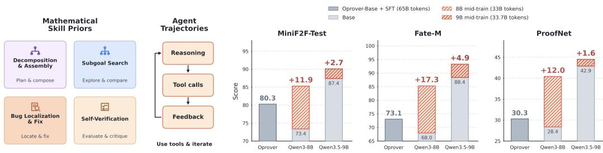  
Figure 1: Mid-training data design and benchmark performance. Left: The mid-training data incorporates mathematical skill priors and iterative agent trajectories. Right: Mid-training leads to consistent performance gains on benchmarks across different model families.

In this work, we introduce davinci-Prover, a family of formal theorem-proving models trained on our curated mid-training corpus and high-quality supervised fine-tuning (SFT) data collected through a lightweight prover harness. As shown in Figure 1, our mid-training corpus covers informal mathematical reasoning, proof decomposition and assembly, verifier-grounded subgoal search, and error diagnosis and revision. We further incorporate agent-native trajectories that expose models to authentic tool calls, execution results, intermediate proof states, and Lean feedback. Together, these data teach the model not only to generate valid proofs, but also to develop the reasoning and interaction patterns required for effective proving in an executable environment. We instantiate this recipe with a 33.7B-token mid-training corpus. For post-training, we build a lightweight prover harness that provides a persistent workspace, typed tools, Lean verification, and trusted comple tion checks. Using a strong teacher model within this harness, we collect and filter approximately 36K domain-diverse agent trajectories for SFT. We evaluate the resulting models on various Lean 4 benchmarks. Our main contributions are as follows:

• We construct a 33.7B-token corpus combining mathematical skill priors with environmentnative agent trajectories to prepare models for interactive theorem proving.

• We develop the daVinci-Prover harness, a lightweight prover harness, and curate approximately 36K high-quality, domain-diverse agent trajectories for supervised fine-tuning.

• Our mid-training improves Qwen3-8B pass@1 by an average of 13.7 points over the matched Base + SFT baseline across MiniF2F, FATE-M, and ProofNet, while consistently improving both Qwen3.5-9B and Qwen3.5-35B-A3B over their corresponding Base + SFT baselines.

## 2 BACKGROUND

Publicly available Lean provers for academic use remain relatively weak (Lin et al., 2025; Ren et al., 2025), while stronger systems are either unreleased (Chen et al., 2025) or prohibitively expensive to run (Varambally et al., 2026; Requena et al., 2026). Existing approaches can be broadly categorized into three directions as follows (Chung et al., 2026):

(1) Whole-proof generation and refinement. These methods generate a complete Lean proof directly from the theorem statement. Representative approaches include DeepSeek-Prover (Ren et al., 2025), Goedel Prover (Lin et al., 2025), and Kimina-Prover (Wang et al., 2025a). More recent systems augment this paradigm with iterative repair. Goedel-Prover-V2 (Lin et al., 2026) introduces verifier-guided self-correction, where a complete proof is revised using feedback from the Lean compiler. OProver (Ma et al., 2026) further combines whole-proof refinement with retrieval and compiler feedback, and trains the prover directly on such multi-round repair trajectories.

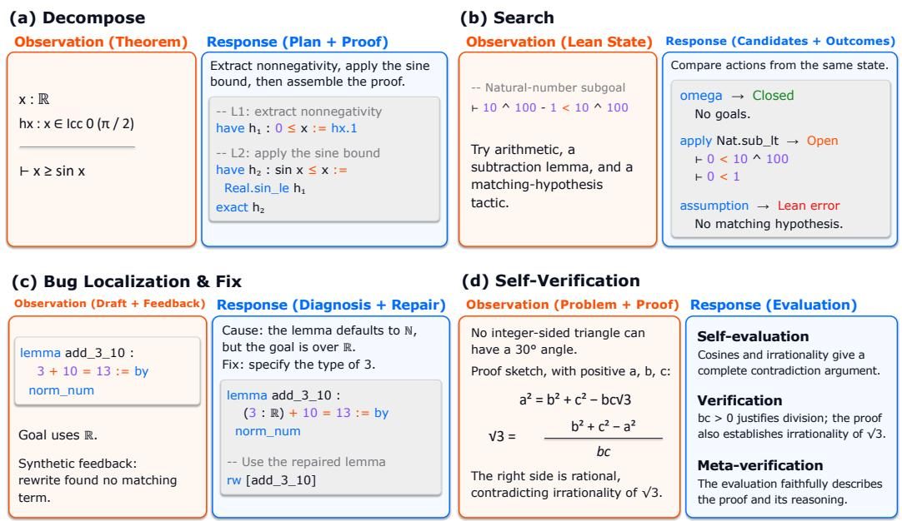  
Figure 2: Overview of our midtrain data generation pipeline.

(2) Agentic provers. Agentic provers are driven by a single LLM agent that interacts with external tools and adapts its proof strategy based on their outputs. AxProverBase (Requena et al., 2026) augments off-the-shelf frontier LLMs with iterative proof refinement, memory, and search capabilities. Numina-Lean Agent (Liu et al., 2026) similarly builds on Claude Code, exposing Lean verification, theorem retrieval, and auxiliary reasoning tools through MCP, thereby enabling a general-purpose coding agent to carry out formal proof development through iterative tool use.

(3) Orchestrated prover systems. In contrast to single-agent approaches, orchestrated systems coordinate multiple reasoning or proving components within a predefined workflow, often separating stages such as decomposition, proof sketching, verification, and refinement. Representative systems include Seed-Prover 1.5 (Chen et al., 2025), Hilbert (Varambally et al., 2026), and LongCat-Flash Prover (Wang et al., 2026), which combine multiple stages or specialized components to guide formal proof construction. Goedel-Architect (Chung et al., 2026) constructs and iteratively refines a dependency-graph blueprint of formal lemmas, optionally seeded by a natural-language proof, and dispatches the resulting subgoals to tool-equipped Lean provers in parallel.

However, sophisticated orchestrated systems rely on capable agentic provers as their core building blocks; in this work, we focus on advancing the capability of the agentic prover itself. More related work can be found in Appendix A.

## 3 MID-TRAINING DATA CONSTRUCTION

This section presents our mid-training data construction framework for developing prover-oriented foundation models. The corpus comprises two complementary components. The first is designed to instill core theorem-proving skill priors, including (1) proof decomposition and assembly, (2) proof search, (3) error diagnosis and revision, and (4) self-verification. The second consists of environment-native agent trajectories that capture authentic interactions with tools, execution out comes, and verifier feedback.

## 3.1 THEOREM-PROVING SKILL PRIORS

Construction of Decomposition and Assembly Trajectories. We construct decomposition and assembly trajectories (Ren et al., 2025; Zhao et al., 2023; Chen et al., 2025) to develop lemma-based proof planning and composition. As shown in Figure 2(a), a teacher LLM receives a Lean theorem and its verified reference proof, and generates a natural-language proof plan, auxiliary lemmas with dependency information, and a complete assembled Lean proof. The teacher is instructed to specify each lemma’s required variables and hypotheses and preserve the original theorem statement. These trajectories are used to identify useful intermediate results, formulate self-contained lemmas, and combine them into a coherent proof.

Construction of Verified Subgoal Search Data. We replay verified Lean proofs to extract intermediate states and executable snapshots, as shown in Figure 2(b). For each state, a proposal model generates diverse tactics, which we combine with the reference tactic, anonymize, shuffle, and execute independently from the same snapshot. We retain successful closures, accepted open states, and Lean errors, while excluding timeouts and infrastructure failures. Each trajectory pair links candidate tactics and their search intents with the corresponding execution outcomes, teaching the model to compare alternatives, interpret formal feedback, and distinguish valid intermediate transitions from completed proofs.

Construction of Revision Trajectories. We construct revision trajectories that explicitly connect error diagnosis to proof repair. Given failed proof attempts, diagnostic feedback, and reference corrections, a teacher LLM synthesizes the diagnosis. Figure 2(c) shows a structured diagnosis with four fields: location identifies the affected lemma or proof step; symptom describes the observed failure; cause explains the underlying issue; and fix proposes a targeted correction. Each diagnosis is followed by an explicit revision plan and a revised lemma or proof. These trajectories train the model to localize errors, explain their causes, and formulate targeted corrections.

Construction of Informal Reasoning and Verification Trajectories. We incorporate informal trajectories from Nemotron-Math-Proofs-v2 using DeepSeekMath-V2-style prompts (Shao et al., 2025). The data covers proof generation with self-evaluation, proof verification, and metaverification. Proof verification identifies gaps and assesses proof quality, while meta-verification reviews either the generator’s self-evaluation or an independent verifier’s critique, checking whether the reported defects and assigned scores are justified. These complementary trajectories aim to de velop rigorous natural-language reasoning, calibrated self-assessment, and evidence-based critique of both proofs and their evaluations.

## 3.2 DAVINCI-PROVER HARNESS

The harness formulates theorem proving as an iterative edit–check–revise loop with Lean4. The input theorem is copied verbatim into scratch/solution.lean, the agent’s main proof file. At each turn, the agent selects from seven tools (see Appendix E) to edit candidates, inspect files, retrieve Lean declarations, and run focused checks. The writable scratch/ directory stores proof candidates and auxiliary files, while sketch/ holds optional lemma de-

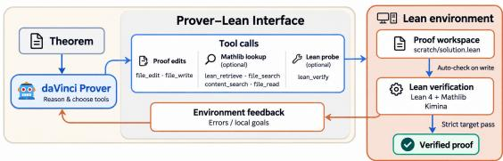  
Figure 3: daVinci-Prover agent harness

composition drafts. The read-only target/ directory provides the Lean/Mathlib project used for verification. Every Lean-file edit automatically triggers verification. Draft checks expose local goals and diagnostics, while placeholder-free candidates undergo strict verification. Tool results are added to the conversation to guide subsequent revisions. The episode terminates successfully only when a candidate passes strict Lean verification and checks confirming that its declaration and elaborated type match the original theorem.

## 3.3 THE FINAL DATASET: DAVINCI-PROVER 33.7B COLLECTION

Data Source. We use a curated corpus drawn from NuminaMath-LEAN (Wang et al., 2025a), AoPS (Art of Problem Solving, 2026), Lean Workbook (Ying et al., 2024), Goedel LM/SFT dataset v2 (Lin et al., 2025), and OProofs (Ma et al., 2026). To mitigate data contamination (Zhu et al., 2024), we remove duplicate problems and exclude examples that overlap with our evaluation benchmarks. These filtering steps remove 0.03427% of the 33.7B-token mid-training corpus, with token counts computed using the Qwen3.5 tokenizer; see Appendix C.

Data Cleaning and Reconstruction. Following Section 3, we use DeepSeek-V4-Flash and DeepSeek-V4-Flash-0731 (Xu et al., 2026) to construct an approximately 29B-token mid-training corpus, whose composition is shown in Table 1. We remove repetitive system prompts, tool schemas, and source-specific boilerplate while retaining the problems, reasoning traces, tool interactions, and outcomes. Each example is then reconstructed into a unified training document and semantically chunked to at most 32K tokens at natural boundaries.

Data Replay. We define a parent example as one complete logical trajectory before 32K semantic chunking. We assign each source a replay budget according to the desired data mixture and select high-quality parent examples using source-specific scores. To preserve diversity, we cover distinct problems before selecting additional trajectories from the same problem. Once a parent example is

Table 1: Categories and statistics of the mid-training corpus.
<table><tr><td>Category</td><td># Samples (M)</td><td># Toks. (B)</td><td>Share (%)</td></tr><tr><td>Pre-Replay Data</td><td>8.131</td><td>28.6</td><td>84.8</td></tr><tr><td>Self-verfication</td><td>0.083</td><td>5.70</td><td>16.9</td></tr><tr><td>Theorem Decomposition</td><td>4.662</td><td>8.43</td><td>25.0</td></tr><tr><td>Proof Revision</td><td>1.027</td><td>3.84</td><td>11.4</td></tr><tr><td>Proof Search</td><td>1.962</td><td>3.45</td><td>10.2</td></tr><tr><td>Environment-Aware Agent Trajectories</td><td>0.397</td><td>7.17</td><td>21.3</td></tr><tr><td>Replay Data</td><td>1.454</td><td>5.11</td><td>15.2</td></tr><tr><td>Total</td><td>9.585</td><td>33.70</td><td>100.0</td></tr></table>

selected, all of its semantic chunks are replayed together and processed using the same reconstruction and packing pipeline as the original corpus. This adds 5.11B replay tokens, resulting in a final corpus of 33.7B tokens.

## 4 SUPERVISED FINE-TUNING

Data Source. Our SFT training corpus consists of trajectories generated through harness rollouts. We sample problems from the Goedel-LM/RL dataset V2 dataset (Lin et al., 2025), which contains approximately 99K unverified problems, and use Goedel-LM/SFT dataset V2 for domain supplementation. We limit our interaction turns to 30 turns with a maximum of 200 tool calls. The trajectories are collected using DeepSeek-V4-Flash-0731.

SFT Data Overview. We ultimately collect approximately 36K high-quality SFT trajectories from successful theorem-proving

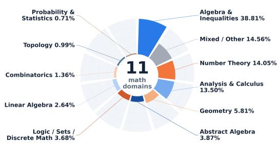  
Figure 4: SFT Data Overview

runs. The resulting dataset spans a broad range of mathematical domains, including algebra, number theory, geometry, analysis, combinatorics, topology, probability and statistics, linear algebra, abstract algebra, and logic and set theory, as shown in Figure 4. Following the filtering strategy of Raoof et al. (2026), we remove low-quality trajectories exhibiting undesirable behaviors, such as excessive repetition or unnecessary tool calls, as well as trajectories containing fewer than 5 turns. We further retain only trajectories that fit within a 144K-token context window.

## 5 EXPERIMENTS

Models. We select Qwen3.5-9B-Base and Qwen3.5-35B-A3B-Base for experiments. We also perform ablation on Qwen3-8B-Base, see Section 6.5.

Table 2: Theorem-proving performance. Best results are in bold, and second-best results are underlined. † marks scores not re-evaluated by us under our protocol.
<table><tr><td>Model</td><td>#Params</td><td>MathOlympiad</td><td>MiniF2F</td><td>ProofNet</td><td>ProverBench</td><td>Putnam</td></tr><tr><td colspan="7">Open-Weights Reasoning Models (pass@32)</td></tr><tr><td>DeepSeek-V3.2</td><td>671B-A37B</td><td>14.7†</td><td>77.9†</td><td>20.4†</td><td>42.8†</td><td>5.8†</td></tr><tr><td>Kimi-K2.5</td><td>1T-A32B</td><td>7.5†</td><td>76.6†</td><td>19.9†</td><td>44.3†</td><td>1.2†</td></tr><tr><td colspan="7">Open-Weights Prover Models (pass@32)</td></tr><tr><td>DeepSeek-Prover-V2-7B</td><td>7B</td><td>7.9†</td><td>73.9†</td><td>18.1†</td><td>45.7†</td><td>1.5†</td></tr><tr><td>DeepSeek-Prover-V2</td><td>671B-A37B</td><td>13.9†</td><td>82.4†</td><td>30.5†</td><td>52.9†</td><td>3.3†</td></tr><tr><td>Goedel-Prover-V2-8B</td><td>8B</td><td>9.9†</td><td>79.4†</td><td>17.3†</td><td>48.6†</td><td>0.7†</td></tr><tr><td>Goedel-Prover-V2-32B</td><td>32B</td><td>16.0†</td><td>85.8†</td><td>22.0†</td><td>51.0†</td><td>5.0†</td></tr><tr><td>LongCat-Flash-Prover</td><td>560B-A27B</td><td>16.9†</td><td>84.4†</td><td>19.9†</td><td>49.9†</td><td>4.9†</td></tr><tr><td>whole-proof w/ TIR</td><td>560B-A27B</td><td>27.5†</td><td>90.2†</td><td>36.1†</td><td>57.9†</td><td>10.4†</td></tr><tr><td>sketch-proof w/ TIR</td><td>560B-A27B</td><td>35.8†</td><td>93.9†</td><td>47.3†</td><td>66.5†</td><td>28.9†</td></tr><tr><td>OProver-8B</td><td>8B</td><td>21.7†</td><td>91.8†</td><td>31.9†</td><td>56.0†</td><td>9.0†</td></tr><tr><td>OProver-32B</td><td>32B</td><td>22.8†</td><td>93.3†</td><td>33.2†</td><td>58.2†</td><td>11.3†</td></tr><tr><td colspan="7">daVinci-Prover Harness (pass@8)</td></tr><tr><td>DeepSeek-V4-Flash-0731</td><td>284B-A13B</td><td>52.2</td><td>95.9</td><td>56.5</td><td>68.9</td><td>39.7</td></tr><tr><td>Qwen3.5-9B-Base + SFT</td><td>9B</td><td>32.3</td><td>92.6</td><td>51.1</td><td>66.2</td><td>22.3</td></tr><tr><td>Qwen3.5-9B-Midtrain + SFT</td><td>9B</td><td>35.3</td><td>93.9</td><td>52.7</td><td>66.5</td><td>24.9</td></tr><tr><td>Qwen3.5-35B-Base + SFT</td><td>35B-A3B</td><td>35.8</td><td>93.0</td><td>52.7</td><td>66.5</td><td>24.3</td></tr><tr><td>Qwen3.5-35B-Midtrain + SFT</td><td>35B-A3B</td><td>36.1</td><td>94.3</td><td>53.8</td><td>67.1</td><td>26.5</td></tr></table>

Benchmarks. We evaluate on five Lean 4 theorem-proving benchmarks spanning diverse levels of mathematical difficulty and scope: MiniF2F (Zheng et al., 2021), which contains 244 high-school olympiad problems; MathOlympiadBench (Lin et al., 2025), consisting of 360 recent competition problems; ProofNet (Azerbayev et al., 2023), featuring 186 undergraduate-level theorems; Prover-Bench (Ren et al., 2025), which includes 325 problems covering both olympiad and undergraduate mathematics; and PutnamBench (Tsoukalas et al., 2024), a collection of 672 Putnam competition problems representing the most challenging benchmark in the suite. We additionally evaluate on FATE-M and FATE-H (Shen et al., 2025), which consist of standard textbook exercises and challenging problems from abstract and commutative algebra.

Evaluation. We evaluate all models using the daVinci-Prover harness with a temperature of 1.0, the context length of 200K, and up to 30 interactions. We report pass@1 averaged over three runs where applicable, and pass@8 otherwise. All experiments use Lean v4.26 and Mathlib at commit 2df2f0150c275ad53cb3c90f7c98ec15a56a1a67. We reject any proof attempt that introduces axioms or local instances, as these could circumvent formal verification, including through native decide.

## 5.1 EFFECTIVENESS OF DAVINCI-PROVER HARNESS

We select DeepSeek-V4-Flash-0731 and Qwen3.6-35B-A3B to evaluate the harness’s effectiveness. As shown in Table 3, we evaluate our lightweight agent harness across different model backbones, with high reasoning effort enabled for DeepSeek-V4-Flash-0731. Despite its simple design, augmenting the harness with a mathlib retrieval tool consistently improves performance across benchmarks of vary-

Table 3: Effectiveness of the daVinci-Prover harness. We report pass@1 averaged over three runs. “w/ ret.” denotes the use of the mathlib retrieval tool.
<table><tr><td>Model</td><td>MiniF2F</td><td>FATE-M</td><td>FATE-H</td><td>Putnam</td></tr><tr><td>Qwen3.6-35B-A3B</td><td>68.0</td><td>48.7</td><td>4.0</td><td>3.0</td></tr><tr><td>Qwen3.6-35B-A3B (w/ ret.)</td><td>73.0</td><td>57.3</td><td>5.0</td><td>3.4</td></tr><tr><td>DeepSeek-V4-Flash</td><td>90.2</td><td>94.7</td><td>19.0</td><td>18.9</td></tr><tr><td>DeepSeek-V4-Flash (w/ ret.)</td><td>91.3</td><td>99.3</td><td>29.0</td><td>22.8</td></tr></table>

ing difficulty. The gains are particularly pronounced on the more challenging Fate-H and Putnam benchmarks. We observe a similar improvement trend with Qwen3.6-35B-A3B, indicating that the benefit of retrieval is not specific to a single model backbone.

## 5.2 AGENTIC PROVER PERFORMANCE

The overall performance results are presented in Table 2. We provide the following analysis:

Agentic prover outperforms existing whole-proof baselines. DeepSeek-V4-Flash-0731, evaluated with the daVinci-Prover harness, achieves the highest reported scores across all five benchmarks. Its interactive pass@8 results exceed the reported pass@32 results of whole-proof generation and refinement methods. The results highlight the potential of agentic proving to enable strong theorem proving with whole proof.

High-quality SFT trajectories effectively elicit theorem-proving capabilities. We further use the proof trajectories generated by the daVinci-Prover harness as SFT data to train Qwen3.5 models. Despite their substantially smaller model sizes, the resulting models achieve strong performance across all benchmarks, indicating that trajectories collected by the harness provide effective supervision for transferring its theorem-proving behavior to smaller models.

Mid-training consistently improves performance over the base models. Across both model scales, the Midtrain + SFT variants consistently outperform their corresponding Base + SFT counterparts. The gains are particularly pronounced on more challenging benchmarks such as Math-Olympiad and Putnam. For Qwen3.5-9B, mid-training improves MathOlympiad from 32.3 to 35.3 and Putnam from 22.3 to 24.9, while maintaining consistent improvements on the other benchmarks. A similar trend is observed for Qwen3.5-35B. These results suggest that mid-training provides a stronger initialization for subsequent theorem-proving SFT, with particularly clear benefits on more difficult mathematical reasoning tasks.

## 6 IN-DEPTH ANALYSES

## 6.1 TRAINING PROCESS

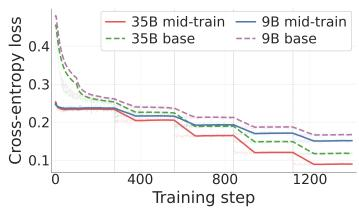  
(a) SFT training loss

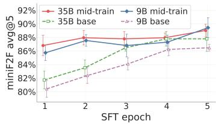  
(b) miniF2F avg@5

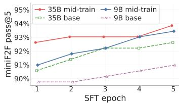  
(c) miniF2F pass@5  
Figure 5: Training dynamics and miniF2F performance of models with and without mid-training.

Setup. We compare base and mid-trained checkpoints over five epochs of SFT. Each checkpoint is evaluated on miniF2F-test problems using five runs and reports avg@5 and pass@5.

Mid-training bridges the gap to agentic learning. Figure 5a shows that mid-trained checkpoints start SFT with lower loss and remain better aligned with the SFT distribution throughout training. As shown in Figure 5b and Figure 5c, after one epoch, mid-training improves avg@5 by 5.33 and 5.08 points for the 9B and 35B models, respectively, and already matches the base model’s epoch-5 pass@5. These gains persist through epoch 5, indicating faster adaptation and a better initialization for downstream SFT.

Scaling with model size. The 35B-A3B MoE model generally outperforms the 9B model, although the gap is relatively small on MiniF2F, possibly due to limited headroom on this benchmark. As shown in Table 2, the 35B-A3B midtrain model consistently outperforms the 9B midtrain model across all benchmarks. Notably, the 9B midtrain model surpasses the 35B-A3B base model on both MiniF2F metrics despite having a higher final SFT loss, suggesting that the downstream gains potentially come from mid-training.

## 6.2 ANALYSIS OF AGENT BEHAVIOR

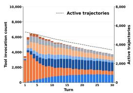  
(a) 9B Base

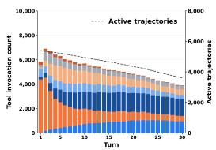  
(b) 9B Midtrain

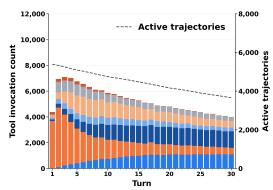  
(c) 35B-A3B Base

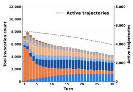  
(d) 35B-A3B Midtrain  
Figure 6: Tool call analysis of PutnamBench. Tool colours: file edit, lean retrieve, lean verify, file write, content search, file read, and file search. The dashed line indicates the number of active trajectories.

Common patterns. As shown in Figure 6, across all four settings, the aggregate tool-use distribution shifts from retrieval towards verification and revision as the interaction progresses. lean retrieve accounts for over half of all tool calls during the first five turns, whereas lean verify and file edit together account for approximately 55–57% during turns 21– 30. This shift remains visible after normalizing by the number of active trajectories, suggesting a common workflow of gathering relevant information followed by checking and revising candidate proofs. The declining bar heights also reflect the shrinking population of active trajectories. For a relatively easier benchmark such as MiniF2F, we provide a separate analysis in Appendix B.1, which reveals distinct behavioral patterns.

Midtraining changes model behaviour. As shown in Figure 6, midtrained models exhibit stronger tool engagement at the beginning of an interaction and increase the share of file write calls, particularly in the early turns, indicating earlier file construction. In Figure 7, explicit auxiliary-check passing improves consistently after midtraining, from 11.8% to 12.7% at 9B and from 12.6% to 13.4% at 35B. Moreover, mid-training increases the number of local steps in the first target-candidate proof on medium- and high-difficulty problems, while having little effect on easy problems. These results suggest that mid-training promotes more decomposition and verification as problem difficulty increases, with the decomposition behavior on harder problems becoming closer to that of DeepSeek-V4-Flash-0731.

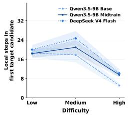  
(a) Decomposition

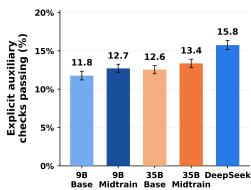  
(b) Self-check  
Figure 7: Behavior comparison.

## 6.3 SCALING WITH DATA VOLUME

Setup. We evaluate mid-training checkpoints of Qwen3.5-9B at 7.5B, 15B, 22.5B, 30B, and 33.7B tokens. We apply the same two-epoch SFT procedure to each checkpoint and the base model. We measure performance by average pass@1 across three runs.

Analysis. Agentic theorem-proving performance exhibits an approximately log-linear trend with mid- training data scale. Much of the improvement is achieved within the first 15B tokens, yielding gains of 3.96 and 11.11 percentage points over the base model on miniF2F and FATE-M, respectively. Further midtraining generally improves performance, although gains shrink at larger data scales. These results suggest that targeted mid-training can effectively develop agentic theorem proving capabilities.

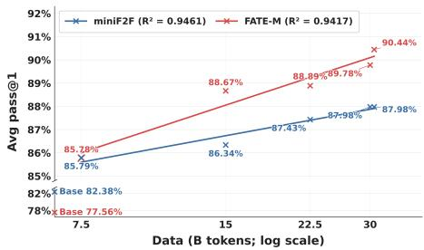  
Figure 8: Scaling law of agent-native midtraining.

Table 4: Data component ablation.
<table><tr><td>Component</td><td>Tokens</td><td>MiniF2F</td><td>Fate-M</td><td>ProofNet</td></tr><tr><td>Qwen3.5-9B Base</td><td>1</td><td>87.4</td><td>88.4</td><td>42.9</td></tr><tr><td> $\bar { \mathcal { D } } _ { s k i l l }$ </td><td>25.3B</td><td>87.8</td><td>89.8</td><td>43.6</td></tr><tr><td> $\mathcal { D } _ { a g e n t }$ </td><td>8.4B</td><td>88.8</td><td>92.2</td><td>43.5</td></tr><tr><td> $\mathcal { D } _ { s k i l l } + \mathcal { D } _ { a g e n t }$ </td><td>33.7B</td><td>90.1</td><td>93.3</td><td>44.5</td></tr></table>

Table 5: Comparison with existing corpora.
<table><tr><td>Data component</td><td>MiniF2F</td><td>Fate-M</td><td>ProofNet</td></tr><tr><td>Qwen3-8B-Base + SFT</td><td>73.4</td><td>68.0</td><td>28.4</td></tr><tr><td>Oprover-8B-Base + SFT</td><td>80.3</td><td>73.1</td><td>30.3</td></tr><tr><td>Qwen3-Base + Midtrain (ours) + SFT</td><td>85.3</td><td>85.3</td><td>40.4</td></tr></table>

## 6.4 ABLATION ON DAVINCI-PROVER

Setup. We explore the contribution of each data component on the Qwen3.5-9B models.

Analysis. As shown in Table 4, the ablation highlights the importance of agent-native supervision beyond generic theorem-proving skill acquisition. Despite using only 8.4B tokens, $\mathcal { D } _ { a g e n t }$ produces larger gains than the 25.3B-token $\mathcal { D } _ { s k i l l }$ on MiniF2F and Fate-M. A likely explanation is distribution alignment: $\mathcal { D } _ { a g e n t }$ exposes the model to the same interaction primitives encountered at inference time, thereby bridging the gap between static next-token training and interactive proving. In contrast, $\mathcal { D } _ { s k i l l }$ primarily strengthens reusable reasoning priors such as decomposition, search, diagnosis, and self-verification. Importantly, these two forms of supervision are complementary rather than substitutable. Combining them consistently outperforms either component alone, indicating that agentic proving benefits from both knowing how to reason about a proof and knowing how to realize that reasoning through environment interaction.

## 6.5 COMPARISON WITH EXISTING CORPORA

Setup. We perform mid-training on Qwen3-8B-Base using 33B tokens, followed by agentic SFT for 5 epochs. We compare the resulting model against Qwen3-8B-Base without mid-training and Oprover-8B-Base (Ma et al., 2026), which is trained with 65B mid-training tokens. For all base models, we use YaRN (Peng et al., 2024) to extend the context length from 32K to 256K.

Analysis. As shown in Table 5, our mid-training substantially improves performance over Qwen3- 8B-Base across all three benchmarks, confirming that the gains cannot be attributed solely to the subsequent agentic SFT. Moreover, our model consistently outperforms Oprover-8B-Base, with particularly large margins on Fate-M and ProofNet, despite using only 33B mid-training tokens compared with Oprover’s 65B. This suggests that the effectiveness of mid-training depends not only on data scale, but critically on its composition: our combination of theorem-proving skill priors and agent-native trajectories provides more targeted supervision for downstream interactive proving and transfers effectively across diverse formal reasoning problems.

## 6.6 MEMORY COMPACT

Setup. To support long-horizon difficult proofs, we use a simple, model-free trajectory compression method. Once the context length reaches 200K tokens, we trigger compression by replacing older interactions with deterministically extracted tool evidence, while preserving the original theorem, current Lean proof, and recent interactions. We allow up to 8 compactions, and other settings remain unchanged.

Analysis. Memory compaction consistently improves performance, with the largest gains on the more challenging FATE-H benchmark. The improvement is especially pronounced for

Table 6: Effect of memory compaction on theorem-proving performance. Performance is evaluated using pass@1, averaged over 3 runs.
<table><tr><td>Model</td><td>MiniF2F</td><td>FATE-M</td><td>FATE-H</td></tr><tr><td colspan="4">w/o memory compact</td></tr><tr><td>Qwen3.5-midtrain-9B</td><td>90.1</td><td>93.3</td><td>16.7</td></tr><tr><td>Qwen3.5-midtrain-35B</td><td>90.1</td><td>93.7</td><td>16.3</td></tr><tr><td colspan="4">w/ memory compact</td></tr><tr><td>Qwen3.5-midtrain-9B</td><td>97.1</td><td>96.7</td><td>28.0</td></tr><tr><td>Qwen3.5-midtrain-35B</td><td>97.1</td><td>97.3</td><td>42.0</td></tr></table>

the 35B model, suggesting that effective context management is important for long-horizon proving and can better expose the capacity of larger models.

## 7 CONCULUSION

We introduced daVinci-Prover, combining agent-native mid-training with verifier-grounded supervised fine-tuning for interactive theorem proving based on a single harness. Experiments demonstrate consistent improvements over SFT-only baselines, while ablations support the complemen tary roles of mathematical skill priors and environment-native trajectories. These findings highlight agent-native mid-training as an effective foundation for developing stronger theorem-proving agents.

## AI USE STATEMENT

In this work, we used generative AI tools for paper polishing and coding assistance. All AI-assisted content was carefully reviewed by the authors. For example, we manually checked AI-polished text, and AI-generated code was independently verified and tested for correctness by two authors. We take full responsibility for the final content of this work, including all text, claims, and artifacts produced with the assistance of generative AI.

## REPRODUCIBILITY STATEMENT

The data we collected, the models we trained, the harness we built, and the corresponding code and training infrastructure will be fully open-sourced for reproducibility after the anonymous review period ends.

## ETHICS STATEMENT

No ethics statement is required here.

## REFERENCES

Art of Problem Solving. Art of problem solving community. https:// artofproblemsolving.com/community, 2026. Accessed August 31, 2026.

Zhangir Azerbayev, Bartosz Piotrowski, Hailey Schoelkopf, Edward W Ayers, Dragomir Radev, and Jeremy Avigad. Proofnet: Autoformalizing and formally proving undergraduate-level mathematics. arXiv preprint arXiv:2302.12433, 2023.

Kaito Baba, Chaoran Liu, Shuhei Kurita, and Akiyoshi Sannai. Prover agent: An agent-based framework for formal mathematical proofs. arXiv preprint arXiv:2506.19923, 2025.

Jiangjie Chen, Wenxiang Chen, Jiacheng Du, Jinyi Hu, Zhicheng Jiang, Allan Jie, Xiaoran Jin, Xing Jin, Chenggang Li, Wenlei Shi, et al. Seed-prover 1.5: Mastering undergraduate-level theorem proving via learning from experience. arXiv preprint arXiv:2512.17260, 2025.

Jui-Hui Chung, Ziyang Cai, Zihao Li, Qishuo Yin, Rohit Agarwal, Simon Park, Rodrigo Porto, Narutatsu Ri, Ziran Yang, Shange Tang, et al. Goedel-architect: Streamlining formal theorem proving with blueprint generation and refinement. arXiv preprint arXiv:2606.06468, 2026.

Leonardo De Moura, Soonho Kong, Jeremy Avigad, Floris Van Doorn, and Jakob von Raumer. The lean theorem prover (system description). In International conference on automated deduction, pp. 378–388. Springer, 2015.

Kanishk Gandhi, Ayush Chakravarthy, Anikait Singh, Nathan Lile, and Noah D Goodman. Cognitive behaviors that enable self-improving reasoners, or, four habits of highly effective stars. arXiv preprint arXiv:2503.01307, 2025.

Yong Lin, Shange Tang, Bohan Lyu, Jiayun Wu, Hongzhou Lin, Kaiyu Yang, Jia Li, Mengzhou Xia, Danqi Chen, Sanjeev Arora, et al. Goedel-prover: A frontier model for open-source automated theorem proving. arXiv preprint arXiv:2502.07640, 2025.

Yong Lin, Shange Tang, Bohan Lyu, Ziran Yang, Jui-Hui Chung, Haoyu Zhao, Lai Jiang, Yihan Geng, Jiawei Ge, Jingruo Sun, et al. Goedel-prover-v2: Scaling formal theorem proving with scaffolded data synthesis and self-correction. In International Conference on Learning Representations, volume 2026, pp. 11793–11818, 2026.

Junqi Liu, Zihao Zhou, Zekai Zhu, Marco Dos Santos, Weikun He, Jiawei Liu, Ran Wang, Yunzhou Xie, Junqiao Zhao, Qiufeng Wang, et al. Numina-lean-agent: An open and general agentic reasoning system for formal mathematics. arXiv preprint arXiv:2601.14027, 2026.

David Ma, Kaijing Ma, Shawn Guo, Yunfeng Shi, Enduo Zhao, Jiajun Shi, Zhaoxiang Zhang, Gavin Cheung, Jiaheng Liu, and Zili Wang. Oprover: A unified framework for agentic formal theorem proving. arXiv preprint arXiv:2605.17283, 2026.

Leonardo de Moura and Sebastian Ullrich. The lean 4 theorem prover and programming language. In International Conference on Automated Deduction, pp. 625–635. Springer, 2021.

Bowen Peng, Jeffrey Quesnelle, Honglu Fan, and Enrico Shippole. Yarn: Efficient context window extension of large language models. In International Conference on Learning Representations, volume 2024, pp. 31932–31951, 2024.

Negin Raoof, Richard Zhuang, Marianna Nezhurina, Etash Guha, Atula Tejaswi, Ryan Marten, Charlie F Ruan, Tyler Griggs, Alexander Glenn Shaw, Hritik Bansal, et al. Openthoughts-agent: Data recipes for agentic models. arXiv preprint arXiv:2606.24855, 2026.

ZZ Ren, Zhihong Shao, Junxiao Song, Huajian Xin, Haocheng Wang, Wanjia Zhao, Liyue Zhang, Zhe Fu, Qihao Zhu, Dejian Yang, et al. Deepseek-prover-v2: Advancing formal mathematical reasoning via reinforcement learning for subgoal decomposition. arXiv preprint arXiv:2504.21801, 2025.

Borja Requena, Austin Letson, Krystian Nowakowski, Izan Beltran-Ferreiro, and Leopoldo Sarra. A minimal agent for automated theorem proving. arXiv preprint arXiv:2602.24273, 2026.

Zhihong Shao, Yuxiang Luo, Chengda Lu, ZZ Ren, Jiewen Hu, Tian Ye, Zhibin Gou, Shirong Ma, and Xiaokang Zhang. Deepseekmath-v2: Towards self-verifiable mathematical reasoning. arXiv preprint arXiv:2511.22570, 2025.

Ziju Shen, Naohao Huang, Fanyi Yang, Yutong Wang, Guoxiong Gao, Tianyi Xu, Jiedong Jiang, Wanyi He, Pu Yang, Mengzhou Sun, et al. Real-prover: Retrieval augmented lean prover for mathematical reasoning. arXiv preprint arXiv:2505.20613, 2025.

George Tsoukalas, Jasper Lee, John Jennings, Jimmy Xin, Michelle Ding, Michael Jennings, Amitayush Thakur, and Swarat Chaudhuri. Putnambench: Evaluating neural theorem-provers on the putnam mathematical competition. Advances in Neural Information Processing Systems, 37: 11545–11569, 2024.

Chengying Tu, Xuemiao Zhang, Rongxiang Weng, Rumei Li, Chen Zhang, Yang Bai, Hongfei Yan, Jingang Wang, and Xunliang Cai. A survey on llm mid-training. arXiv preprint arXiv:2510.23081, 2025.

Sumanth Varambally, Thomas Voice, Yanchao Sun, Zhifeng Chen, Rose Yu, and Ke Ye. Hilbert: Recursively building formal proofs with informal reasoning. In International Conference on Learning Representations, volume 2026, pp. 38998–39031, 2026.

Haiming Wang, Mert Unsal, Xiaohan Lin, Mantas Baksys, Junqi Liu, Marco Dos Santos, Flood Sung, Marina Vinyes, Zhenzhe Ying, Zekai Zhu, et al. Kimina-prover preview: Towards large formal reasoning models with reinforcement learning. arXiv preprint arXiv:2504.11354, 2025a.

Jianing Wang, Jianfei Zhang, Qi Guo, Linsen Guo, Rumei Li, Chao Zhang, Chong Peng, Cunguang Wang, Dengchang Zhao, Jiarong Shi, et al. Longcat-flash-prover: Advancing native formal reasoning via agentic tool-integrated reinforcement learning. arXiv preprint arXiv:2603.21065, 2026.

Zengzhi Wang, Fan Zhou, Xuefeng Li, and Pengfei Liu. Octothinker: Mid-training incentivizes reinforcement learning scaling. arXiv preprint arXiv:2506.20512, 2025b.

Ran Xin, Chenguang Xi, Jie Yang, Feng Chen, Hang Wu, Xia Xiao, Yifan Sun, Shen Zheng, and Ming Ding. Bfs-prover: Scalable best-first tree search for llm-based automatic theorem proving. In Proceedings of the 63rd Annual Meeting of the Association for Computational Linguistics (Volume 1: Long Papers), pp. 32588–32599, 2025.

Anyi Xu, Bangcai Lin, Bing Xue, Bingxuan Wang, Bingzheng Xu, Bochao Wu, Bowei Zhang, Chaofan Lin, Chen Dong, Chenchen Ling, et al. Deepseek-v4: Towards highly efficient milliontoken context intelligence. arXiv preprint arXiv:2606.19348, 2026.

Zonghan Yang, Shengjie Wang, Kelin Fu, Wenyang He, Weimin Xiong, Yibo Liu, Yibo Miao, Bofei Gao, Yejie Wang, Yanhao Li, et al. Kimi-dev: Agentless training as skill prior for swe-agents. In International Conference on Learning Representations, volume 2026, pp. 148369–148436, 2026.

Huaiyuan Ying, Zijian Wu, Yihan Geng, Jiayu Wang, Dahua Lin, and Kai Chen. Lean workbook: A large-scale lean problem set formalized from natural language math problems. Advances in Neural Information Processing Systems, 37:105848–105863, 2024.

Ji Zeng, Dayuan Fu, Tiantian Mi, Yumin Zhuang, Yaxing Huang, Xuefeng Li, Lyumanshan Ye, Muhang Xie, Qishuo Hua, Zhen Huang, et al. davinci-dev: Agent-native mid-training for software engineering. arXiv preprint arXiv:2601.18418, 2026.

Charlie Zhang, Graham Neubig, and Xiang Yue. On the interplay of pre-training, mid-training, and rl on reasoning language models. arXiv preprint arXiv:2512.07783, 2025.

Xueliang Zhao, Wenda Li, and Lingpeng Kong. Decomposing the enigma: Subgoal-based demonstration learning for formal theorem proving. arXiv preprint arXiv:2305.16366, 2023.

Kunhao Zheng, Jesse Michael Han, and Stanislas Polu. Minif2f: a cross-system benchmark for formal olympiad-level mathematics. arXiv preprint arXiv:2109.00110, 2021.

Wenhong Zhu, Hongkun Hao, Zhiwei He, Yun-Ze Song, Jiao Yueyang, Yumeng Zhang, Hanxu Hu, Yiran Wei, Rui Wang, and Hongyuan Lu. Clean–eval: Clean evaluation on contaminated large language models. In Findings of the Association for Computational Linguistics: NAACL 2024, pp. 835–847, 2024.

## LIMITATION

During the mid-training phase, we do not replay any generalization data. However, we believe that incorporating generalization replay is both necessary and important for maintaining and improving the model’s generalization capabilities.

## A RELATED WORK

Mid-training. Recent work views mid-training as a useful bridge between pre-training and posttraining. Instead of moving directly from pre-training to SFT or RL, mid-training uses cleaner and more task-relevant data to better prepare the model, often with learning-rate annealing (Zhang et al., 2025; Tu et al., 2025). For example, OctoThinker (Wang et al., 2025b) shows that reasoning-focused mid-training can improve both RL efficiency and final performance.

Agentic Proving Agentic provers make the interaction loop part of the solution. Prover Agent coordinates informal reasoning, formal proving, auxiliary lemmas, and Lean feedback (Baba et al., 2025). OProver retrieves verified proofs, repairs failures, and feeds successful interactions back into training (Ma et al., 2026); LongCat-Flash-Prover trains auto-formalization, sketching, proving, and tool use through agentic reinforcement learning (Wang et al., 2026). Thus, interaction traces can serve as training data rather than only inference-time scaffolding.

Agent-Native Mid-Training Software-engineering research offers a complementary training perspective: Kimi-Dev treats structured workflow training as transferable skill priors, while DaVinci-Dev combines contextually and environmentally native trajectories during mid-training (Yang et al., 2026; Zeng et al., 2026). We also focus on the stage at which agents acquire capabilities. We orga nize decomposition, search, revision, and environment interaction as complementary mid-training skills, then study whether these priors transfer from whole-proof generation to downstream interactive proving.

## B IN-DEPTH ANALYSIS OF AGENT BEHAVIOR

Figure 10: Tool call analysis. Tool colours: file edit, lean retrieve,  
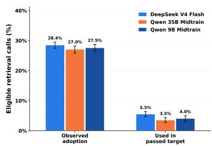  
(a) Retrival calls

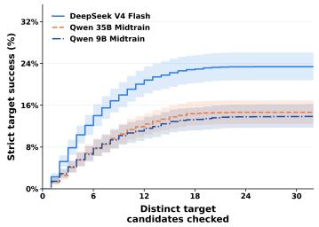  
(b) Strict proof success

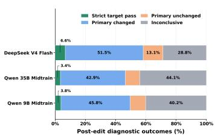  
Figure 9: In-depth analysis of agent trajectories.  
(c) Revision capability

We analyze the agent trajectories on the same 672 Putnam problems, using eight runs for DeepSeek-V4-Flash-0731 and eight runs for Qwen3.5-9B midtrain and Qwen3.5-35B-A3B midtrain models.

Retrieval utilization. DeepSeek-V4-Flash-0731, Qwen3.5-35B-A3B-Midtrain, and Qwen3.5-9B-Midtrain exhibit similar observed retrieval adoption rates of 28.45%, 27.01%, and 27.53%, respectively. The fraction of retrieval calls whose returned declarations appear in strictly verified target proofs is higher for DeepSeek (5.47%) than for Qwen3.5-35B (3.48%) and Qwen3.5-9B (4.01%). Both measures use all successful, nonempty retrieval calls as their denominator.

Proof completion across candidate checks. DeepSeek’s advantage is already visible within the first few candidate checks. By the fifth distinct target candidate checked, cumulative observed success reaches 12.15%, compared with 6.85% and 6.60% for Qwen 35B and 9B. Over the full recorded trajectories, the corresponding rates reach 23.38%, 14.66%, and 13.86%. This pattern shows higher proof completion across the observed candidate generation and revision process. The horizontal axis counts distinct checked target candidates, including drafts, rather than interaction turns.

Outcomes of iterative edits. Among content-changing edits following a failed check of the same target file with a primary diagnostic, 6.60% of DeepSeek’s edits immediately produce a strict target pass, compared with 3.43% and 3.75% for Qwen 35B and 9B. DeepSeek therefore completes the target more frequently immediately after eligible edits in these logs.

## B.1 TOOL CALL ANALYSIS OF MINIF2F

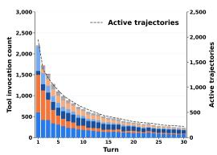  
(a) 9B Base

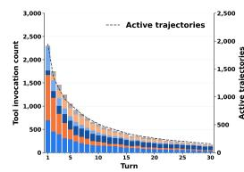  
(b) 9B Midtrain

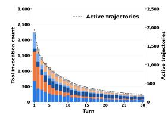  
(c) 35B-A3B Base

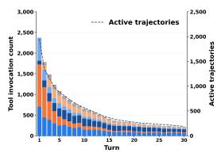  
(d) 35B-A3B Midtrain  
file search. The dashed line indicates the number of active trajectories.

Compared with Putnam, miniF2F shows shorter tool-use trajectories and earlier proof writing and editing. Only about 8–11% of trajectories remain active at turn 30 on miniF2F, compared with 64–73% on Putnam. Putnam also places greater emphasis on early retrieval, followed by sustained editing and verification.

Across the four miniF2F models, the overall tool-use pattern is similar. Midtrained models make fewer total tool calls while recording slightly more successful tasks, with a larger reduction at 9B (8.75%) than at 35B (2.65%). Their late-stage active trajectories also decline more quickly. On Putnam, however, Midtrained models sustain longer interactions and make more calls. This suggests that Midtraining changes interaction duration differently across benchmarks.

## B.2 DECOMPOSITION

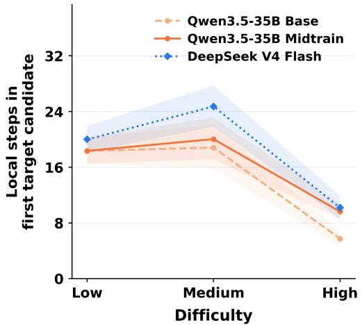  
(a) Qwen3.5-35B-A3B, Local steps in proof

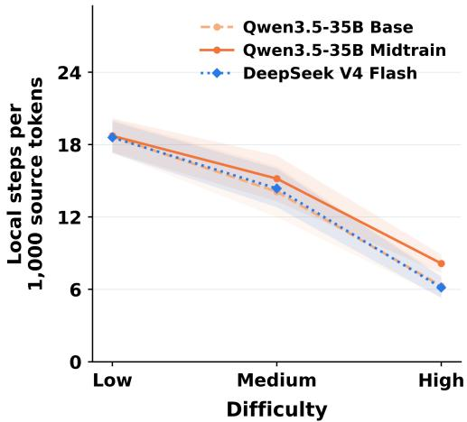  
(b) Qwen3.5-35B-A3B, Local steps in 1k tokens

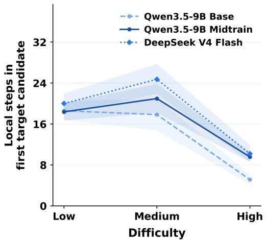  
(c) Qwen3.5-9B, Local steps in proof

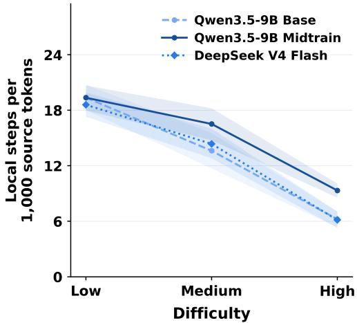  
(d) Qwen3.5-9B, Local steps in 1k tokens  
Figure 11: Proof decomposition analysis.

Effect of midtraining on proof decomposition. Midtrained models produce more explicit intermediate steps in their first checked target proof, particularly on harder problems. In the high-difficulty group, defined as problems unsolved by the DeepSeek reference across eight attempts, the average number of local have/suffices steps increases from 5.13 to 9.57 at 9B and from 5.73 to 9.63 at 35B. The corresponding step densities also increase, from 6.22 to 9.33 and from 6.28 to 8.15 per 1,000 lexical source tokens, respectively. Thus, these differences are not explained solely by longer code. By contrast, Base and Midtrain models show similar step counts in the low difficulty group. This pattern suggests that midtraining is associated with more explicit decomposition when constructing initial proofs for challenging problems.

Comparison with DeepSeek. DeepSeek produces more local steps in absolute terms, especially in the medium-difficulty group, but its step density is lower than that of the Midtrained Qwen models. In the high-difficulty group, its average step count is 10.17, close to the approximately ten steps produced by both Midtrained Qwen models. Therefore, DeepSeek’s higher overall success rate cannot be attributed simply to producing more intermediate steps.

## C DECONTAMINATION

To ensure a fair evaluation, we perform benchmark-level decontamination against all evaluation sets listed in Table 7. For Lean data, we extract the theorem signature by removing nested comments and proof bodies, normalize Unicode characters, tokenize the remaining statement, and anonymize the declaration name. We then perform exact matching against all available benchmark variants. To avoid false positives caused by short or generic statements, a token-level formal match is automatically confirmed only if the anonymized signature contains at least 20 tokens and 80 normalized characters. Exact provenance links and byte-identical raw statements are also treated as confirmed matches.

For informal data, we apply Unicode and math-aware normalization and require an exact match of the complete problem statement with at least 12 content tokens. Matches based only on theorem names or approximate textual similarity are not automatically classified as contamination; instead, they are reserved for manual review. For each confirmed match, we remove the entire logical parent example, including all of its semantic chunks and any replayed copies derived from it.

Before filtering, we identify 29 overlapping problems among the 2,137 evaluation problems (1.36%). When conservatively counting every token in each matched parent trajectory, these examples account for at most 11.55M tokens, corresponding to 0.03427% of the 33.7B-token mid-training corpus.

Table 7: Confirmed benchmark overlaps detected in the mid-training corpus before decontamination. Approximate and review-only matches are excluded.
<table><tr><td>Benchmark</td><td>Overlaps</td><td>Total</td><td>Rate</td></tr><tr><td>miniF2F</td><td>16</td><td>244</td><td>6.56%</td></tr><tr><td>MathOlympiadBench</td><td>9</td><td>360</td><td>2.50%</td></tr><tr><td>ProofNet</td><td>2</td><td>186</td><td>1.08%</td></tr><tr><td>DeepSeek-ProverBench</td><td>1</td><td>325</td><td>0.31%</td></tr><tr><td>Putnam</td><td>1</td><td>672</td><td>0.15%</td></tr><tr><td>FATE-H/M/X</td><td>0</td><td>350</td><td>0.00%</td></tr><tr><td>Total</td><td>29</td><td>2,137</td><td>1.36%</td></tr></table>

For the SFT training data, we also remove any examples that overlap with the evaluation benchmarks.

## D EVALUATION METRIC

In Table 2, to account for inference efficiency and budget, we evaluate each problem using Pass@8:

$$
\mathrm { P a s s @ } 8 ( i ) = \mathbf { 1 } \left[ \sum _ { j = 1 } ^ { 8 } \mathrm { s u c c e s s } _ { i j } > 0 \right] .\tag{1}
$$

## E TOOL SCHEMA

We use the following tools to expose the agent. There are only 7 tools. For the convenience of future RL expansion, we do not use bash and Python commands to expose the agent.

## F DATA SYNTHESIS COSTS

Teacher deployment. We deployed DeepSeek-V4-Flash-0731 on 48 NVIDIA H200 GPUs for approximately 20 days, with the teacher service shared across mid-training and SFT data synthesis. This corresponds to approximately $4 8 \times 2 0 \times 2 4 = 2 3 , 0 4 0$ allocated H200 GPU-hours. This deployment-level budget includes unsuccessful attempts, discarded generations, and idle periods, in addition to generations retained in the final datasets.

Table 8: Internal tools exposed to the davici-Prover agent harness.
<table><tr><td>Tool</td><td>Category</td><td>Description</td></tr><tr><td>file_read</td><td>File</td><td>Read workspace files or line ranges.</td></tr><tr><td>file_write</td><td>Edit</td><td>Write complete workspace files.</td></tr><tr><td>file_edit</td><td>Edit</td><td>Replace text spans or line ranges.</td></tr><tr><td>file_search</td><td>Search</td><td>Find files by glob patterns.</td></tr><tr><td>content_search</td><td>Search</td><td>Search file contents by text or regex.</td></tr><tr><td>lean_retrieve</td><td>Retrieval</td><td>Retrieve relevant Mathlib declarations.</td></tr><tr><td>lean_verify</td><td>Verification</td><td>Check Lean code or scratch files.</td></tr></table>

CPU resources for Lean verification. The CPU service supporting Lean verification used approximately eight worker instances, each provisioned with 20 CPU cores and 80 GB of memory, for roughly the same 20-day period. The estimated aggregate allocation was therefore 160 CPU cores and 640 GB of memory, corresponding to approximately $8 \times 2 0 \times 2 0 \times 2 4 = 7 6 { , } 8 0 0$ allocated CPU core-hours.

Public-cloud rental equivalent. For a public-cloud comparison, Runpod lists H200 Secure Cloud instance and H200 SXM cluster rates of US\$5.29 and US\$6.35 per GPU-hour, respectively, as of November 9, 2026.1 Applying these rates to the teacher deployment yields a GPU rental-equivalent cost of approximately US\$122,000–146,000. This is a reference-price estimate rather than an actual expenditure figure, and excludes the additional CPU service for Lean verification and separate storage charges.

## G HYPERPARAMETERS

## G.1 MID-TRAINING DETAILS

We perform full-parameter mid-training using the autoregressive next-token prediction objective, while retaining the one-layer multi-token prediction (MTP) objective with a loss weight of 0.1. For the MoE model, we retain the pretrained routing configuration and apply a global-batch auxiliary load-balancing loss with a coefficient of $1 0 ^ { - 3 }$ . We use AdamW with a weight decay of 0.1. The learning rate is linearly warmed up for the first 3% of training steps and then cosine-decayed to zero. For offline-packed 32K-token sequences, we enforce sample-level isolation using per-sample cumulative sequence boundaries. These boundaries induce block-diagonal causal attention, reset positional indices and Gated DeltaNet states, and mask next-token targets that cross sample boundaries. More details are in Table 9.

## G.2 SFT TRAINING DETAILS

The SFT training details are provided in Table 10. The Qwen3 model is trained using the same configuration as Qwen3.5-9B.

<table><tr><td>Hyperparameter</td><td>Qwen3.5-9B</td><td>Qwen3.5-35B-A3B</td></tr><tr><td colspan="3">Model</td></tr><tr><td>Initialization</td><td>Qwen3.5-9B-Base</td><td>Qwen3.5-35B-A3B-Base</td></tr><tr><td>Finetuning type</td><td>full parameter</td><td>full parameter</td></tr><tr><td>Training backend</td><td>Megatron-Bridge</td><td>Megatron-Bridge</td></tr><tr><td>Precision</td><td>bf16 mixed</td><td>bf16 mixed</td></tr><tr><td>Attention backend</td><td>auto, cuDNN fused preferred</td><td>auto, cuDNN fused preferred</td></tr><tr><td>Vision modules</td><td>frozen</td><td>frozen</td></tr><tr><td>MTP layers</td><td>1</td><td>1</td></tr><tr><td>MTP loss coefficient</td><td>0.1</td><td>0.1</td></tr><tr><td colspan="3"></td></tr><tr><td>Training objective</td><td>Data causal LM on all valid tokens</td><td>causal LM on all valid tokens</td></tr><tr><td>Valid training tokens</td><td>33,699,997,413</td><td>33,699,997,413</td></tr><tr><td>Physical training tokens</td><td>34,133,245,952</td><td>34,133,245,952</td></tr><tr><td>Fixed packed rows</td><td>1,041,664</td><td>1,041,664</td></tr><tr><td>Sequence length</td><td>32,768</td><td>32,768</td></tr><tr><td>Packing efficiency</td><td>98.73%</td><td>98.73%</td></tr><tr><td>Pre-packed THD sequences</td><td>enabled</td><td>enabled</td></tr><tr><td>Shuffle</td><td>global random cyclic sampler</td><td>global random cyclic sampler</td></tr><tr><td colspan="3"></td></tr><tr><td>Epochs</td><td>Optimization 1 (8,138 steps)</td><td>1 (8,138 steps)</td></tr><tr><td>Micro batch size</td><td>1 packed row</td><td>1 packed row</td></tr><tr><td>Gradient accumulation</td><td>16</td><td>32</td></tr><tr><td>Global batch size</td><td>128 packed rows</td><td>128 packed rows</td></tr><tr><td>Physical token batch</td><td>4,194,304 tokens/step</td><td>4,194,304 tokens/step</td></tr><tr><td>Valid token batch</td><td>~4.14M tokens/step</td><td>~4.14M tokens/step</td></tr><tr><td>Optimizer</td><td>distributed Adam</td><td>distributed Adam</td></tr><tr><td>Peak learning rate</td><td>5 × 10−5</td><td>5 × 10−5</td></tr><tr><td>Minimum learning rate</td><td>0</td><td>0</td></tr><tr><td>LR scheduler</td><td>cosine</td><td>cosine</td></tr><tr><td>Warmup</td><td>244 steps (3%)</td><td>244 steps (3%)</td></tr><tr><td>Weight decay</td><td>0.1</td><td>0.1</td></tr><tr><td>Adam betas</td><td>(0.9,0.95)</td><td>(0.9,0.95)</td></tr><tr><td>Adam epsilon</td><td>1 × 10−8</td><td>1 × 10−8</td></tr><tr><td>Gradient clipping</td><td>1.0</td><td>1.0</td></tr><tr><td>Per-token loss</td><td>enabled</td><td>enabled</td></tr><tr><td colspan="3">Parallelism</td></tr><tr><td>Number of GPUs</td><td>4×8H200</td><td>4 × 8 H200</td></tr><tr><td>TP / PP / CP / DP</td><td>4/1/1/8</td><td>4/2/1/4</td></tr><tr><td>EP/ETP</td><td>1/4</td><td>4/1</td></tr><tr><td>Sequence parallelism</td><td>enabled</td><td>enabled</td></tr><tr><td>Parameter gather overlap</td><td>enabled</td><td>enabled</td></tr><tr><td>Gradient reduce overlap</td><td>enabled</td><td>enabled</td></tr><tr><td colspan="3"></td></tr><tr><td>Number of experts</td><td>MoE N/A</td><td>256</td></tr><tr><td>Experts per token</td><td>N/A</td><td>8</td></tr><tr><td>Token dispatcher</td><td>N/A</td><td>all-to-all</td></tr><tr><td>Grouped GEMM</td><td>N/A</td><td>enabled</td></tr><tr><td>Router precision</td><td>N/A</td><td>fp32</td></tr><tr><td>Load balancing</td><td>N/A</td><td>global auxiliary loss</td></tr><tr><td>Auxiliary loss coefficient</td><td>N/A</td><td>1 × 10−3</td></tr><tr><td colspan="3">Kernels</td></tr><tr><td>Bias-activation fusion</td><td>enabled</td><td>enabled</td></tr><tr><td>Masked-softmax fusion</td><td>enabled</td><td>enabled</td></tr><tr><td>Cross-entropy fusion</td><td>enabled</td><td>enabled</td></tr><tr><td>MoE permutation fusion</td><td>N/A</td><td>enabled</td></tr><tr><td>Training backend Precision</td><td>Slime + Native MCore bf16</td><td>Slime + Native MCore bf16</td></tr><tr><td>Attention implementation</td><td>MCore flash backend</td><td>MCore flash backend</td></tr><tr><td>Vision modules</td><td>frozen</td><td>frozen</td></tr><tr><td>MTP layers</td><td>1</td><td>1</td></tr><tr><td>MTP loss coefficient</td><td>0.1</td><td>0.1</td></tr><tr><td colspan="3">Data</td></tr><tr><td>Training samples</td><td>35,861</td><td>35,861</td></tr><tr><td>Maximum sequence length</td><td>147,456 (144K)</td><td>147,456 (144K)</td></tr><tr><td>Maximum position embeddings</td><td>262,144</td><td>262,144</td></tr><tr><td>Mean sequence length</td><td>36,445 tokens</td><td>36,445 tokens</td></tr><tr><td>P95 sequence length</td><td>84,446 tokens</td><td>84,446 tokens</td></tr><tr><td>Shuffle</td><td>global shuffle</td><td>global shuffle</td></tr><tr><td colspan="3">Optimization</td></tr><tr><td>Epochs</td><td>5</td><td>5</td></tr><tr><td>Per-device batch size</td><td>dynamic</td><td>dynamic</td></tr><tr><td>Maximum tokens per GPU</td><td>131,072</td><td>131,072</td></tr><tr><td>Gradient accumulation</td><td>dynamic to reach GBS</td><td>dynamic to reach GBS</td></tr><tr><td>Global batch size</td><td>128 samples</td><td>128 samples</td></tr><tr><td>Effective token batch</td><td>~4.665M tokens/step</td><td>~4.665 tokens/step</td></tr><tr><td>Optimizer</td><td>distributed Adam</td><td>distributed Adam</td></tr><tr><td>Peak learning rate</td><td> $3 \times 1 0 ^ { - 5 }$ </td><td> $4 \times 1 0 ^ { - 5 }$ </td></tr><tr><td>Minimum learning rate</td><td> $4 \times 1 0 ^ { - 6 }$ </td><td> $4 \times 1 0 ^ { - 6 }$ </td></tr><tr><td>LR scheduler</td><td>cosine</td><td>cosine</td></tr><tr><td>Warmup</td><td>50 steps (~3.6%)</td><td>50 steps (~3.6%)</td></tr><tr><td>Weight decay</td><td>0.01</td><td>0.01</td></tr><tr><td>Adam betas</td><td>(0.9,0.98)</td><td>(0.9,0.98)</td></tr><tr><td>Gradient clipping</td><td>1.0</td><td>1.0</td></tr><tr><td>Attention dropout</td><td>0.0</td><td>0.0</td></tr><tr><td>Hidden dropout</td><td>0.0</td><td>0.0</td></tr><tr><td>Cross-entropy</td><td>linear fused CE</td><td>linear fused CE</td></tr><tr><td colspan="3">Parallelism</td></tr><tr><td>Number of GPUs</td><td>4× 8 H200</td><td> $4 \times 8 \mathrm { H } 2 0 0$ </td></tr><tr><td>TP / PP / CP / DP</td><td> $4 / 1 / 1 / 8$ </td><td> $4 / 1 / 1 / 8$ </td></tr><tr><td>EP/ETP</td><td>1/1</td><td>8/1</td></tr><tr><td>Sequence parallelism</td><td>enabled</td><td>enabled</td></tr><tr><td>MoE dispatcher</td><td></td><td></td></tr><tr><td>MoE routing</td><td>N/A N/A</td><td>flex + DeepEP softmax, top-8 of 256</td></tr><tr><td>MoE load balancing</td><td>N/A</td><td>global auxiliary loss</td></tr><tr><td>MoE auxiliary coefficient</td><td>N/A</td><td> $\mathrm { \bar { 1 } \times 1 0 ^ { - 3 } }$ </td></tr></table>

Table 9: Qwen3.5 mid-training configurations on 32 NVIDIA H200 GPUs.

Table 10: Native MCore full-parameter SFT configurations for Qwen3.5 models.

## H RESOURCE USAGE OF MEMORY COMPACTION

Generation usage. We report generation and verification resource usage across 26,708 recorded turns. Table 11 summarizes the compaction events and cumulative input and output tokens for these records. Input tokens are summed over each call’s actual context, accounting for history replacement after compaction and including retained checkpoints in subsequent calls. Output tokens include reasoning, response text, and tool calls.

Table 11: Recorded resource usage for memory-compaction evaluation. Input and output token counts are in millions.
<table><tr><td>Dataset</td><td>Compaction events</td><td>Input tokens</td><td>Output tokens</td></tr><tr><td>MiniF2F</td><td>104</td><td>414.29</td><td>22.44</td></tr><tr><td>FATE-M</td><td>33</td><td>140.67</td><td>7.89</td></tr><tr><td>FATE-H</td><td>365</td><td>1,646.51</td><td>63.48</td></tr><tr><td>Total</td><td>502</td><td>2,201.47</td><td>93.81</td></tr></table>

Compaction overhead and accounting checks. All 502 compactions use rule-based extraction without additional LLM calls for summarization. Token counts for all 1,004 pre- and postcompaction context snapshots match the historical server-side records. Thus, the input accounting includes the context actually consumed after each history replacement.

Lean verification. Recorded verification-call durations sum to approximately 11.02 hours, with a median of 0.734 seconds per call; 91.4% of calls take at most 10 seconds. These cumulative durations include overlapping concurrent calls and should not be interpreted as end-to-end elapsed time or CPU-hours.

Scope. Memory compaction is an auxiliary analysis; our main contribution is agent-native midtraining and its benefits for downstream agentic proving.