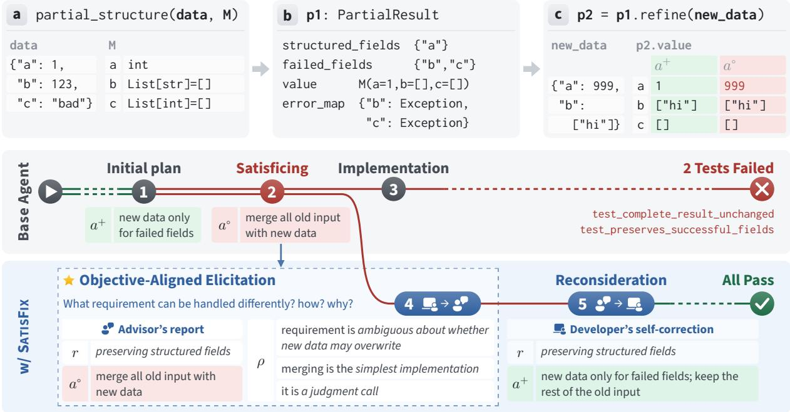
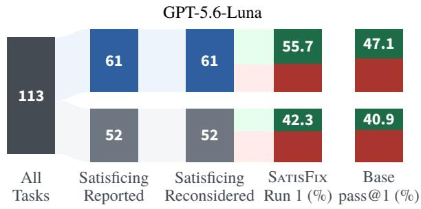
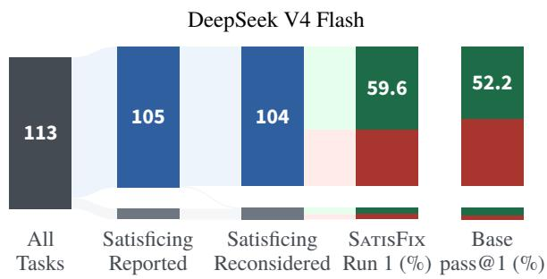

# Eliciting and Mitigating Specification Satisficing in Coding Agents

Ruixin Wang Purdue University ruixinw@purdue.edu

Tianyi Zhang Purdue University tianyi@purdue.edu

## Abstract

Coding agents often fail to meet all requirements in the task description. In some of these failures, the agent considers an implementation choice that meets a requirement, but later decides to commit to another one that does not meet the requirement for a reason it finds ac ceptable. We call this specification satisficing. It is challenging to identify and mitigate specification satisficing because the agent accepts such choices for its own reasons, and existing self-correction methods are biased toward them. We propose SATISFIX, which guides a coding agent to report these choices and their reasons, and then check each choice against the task description. We evaluate SATISFIX on DeepSWE and SWE-bench Pro with five LLMs as back bones and two different agent frameworks, and compare it with three self-correction methods. SATISFIX improves the pass@1 of the base agent by an average of 5.09% on DeepSWE and 7.06% on the hard subset of SWE-bench Pro. On DeepSWE, it outperforms the best baseline by 3.98%. Our ablation study shows that both steps of SATISFIX contribute to the improvement.

## 1 Introduction

Coding agents (Yang et al., 2024; Zhang et al., 2024b; Wang et al., 2025; Ruan et al., 2025) often face complex tasks in large code repositories. Such a task can contain many requirements and take hundreds of lines of code spanning multiple files (Deng et al., 2026; Huang et al., 2026). Recent studies show that coding agents frequently fail to meet all of these requirements (Zeng et al., 2025; Wang et al., 2026; Huang et al., 2026).

We observe that coding agents often consider an implementation choice that meets a requirement, but later decide to commit to another one that does not meet the requirement for a reason they find acceptable. We call this specification satisficing.

Self-correction is commonly used to identify and mitigate an agent’s mistakes (Madaan et al., 2023; Ferraz et al., 2024; Song et al., 2025). Recent studies show that its effectiveness is limited (Huang et al., 2024; Stechly et al., 2025; Kamoi et al., 2024; Olausson et al., 2024). One reason is that an agent is biased toward its own output when asked to identify its mistakes (Xu et al., 2024; Panickssery et al., 2024). In specification satisficing, the agent accepts its choice for its own reasons, so it does not regard the choice as a mistake (Kaddour et al., 2026; cf. Kunda, 1990; Pronin et al., 2002; Ehrlinger et al., 2005).

We propose SATISFIX, the first approach that helps a coding agent surface and mitigate specification satisficing. It takes two steps before the agent writes code (Figure 1). First, SATISFIX asks the agent to report where it concluded that a requirement could be handled differently from what the task states. For each case, it asks for the requirement, the agent’s implementation choice, and the reason for this choice. Unlike existing selfcorrection methods, it does not ask the agent to judge its choices. It puts the agent in the role of an advisor who helps revise the task description, so the agent can report a choice without regarding it as a mistake. Second, SATISFIX asks the agent to double-check each reported choice against the task description. It then asks the agent to decide whether to keep or change each choice, and proceed to complete the task.

We evaluate SATISFIX on DeepSWE (Huang et al., 2026) and SWE-bench Pro v2 (Deng et al., 2026; Scale AI, 2026). We use five LLMs as backbones and two agent frameworks, and compare SATISFIX with three self-correction methods. These methods are Self-Refine (Madaan et al., 2023), DeCRIM (Ferraz et al., 2024), and ProgCo (Song et al., 2025).

SATISFIX improves the pass@1 of the base agent by an average of 5.09% on DeepSWE and

7.06% on the hard subset of SWE-bench Pro. On DeepSWE, it outperforms the best baseline by 3.98%. Our ablation study shows that both steps contribute to the improvement. The pass rate drops by 6.2% to the level of the base agent when SATIS-FIX does not put the agent in the role of an advisor.

## 2 Problem Definition

In specification satisficing, a coding agent considers an implementation choice that meets a requirement. It later commits to another one that does not meet the requirement, for a reason it finds acceptable. We formalize this definition below.

A task description D states a requirement r. An implementation choice for r is how the agent plans to make the code behave where r applies. An implementation choice a meets r under premises $P$ if its behavior satisfies r given P. This definition follows the satisfaction argument of Zave and Jackson (1997). The premises $P$ can be the statements in D. They can also be the agent’s own premises, and these can include conclusions that D does not state.

The agent considers an implementation choice when it raises the choice as an option. It commits to the choice when it decides to take it, in its reasoning or in its code. Let t be the point at which the agent commits to an implementation choice for r. At $t ,$ the agent holds its own premises $B _ { t } \mathbf { : }$ : what it has taken from $D _ { \mathbf { \delta } }$ and the conclusions it has drawn while working on the task. The agent accepts an implementation choice when the choice meets r under $B _ { t }$

Definition 1 (Specification satisficing). The agent exhibits specification satisficing on r when three conditions hold.

(i) The agent considers some $a ^ { + }$ that meets $r$ under $D$

(ii) At t, the agent commits to another considered choice $a ^ { \circ }$ that does not meet r under $D$

(iii) The agent accepts $a ^ { \circ }$

Condition (i) requires only that the agent considers $a ^ { + }$ , not that it accepts $a ^ { + }$ . The term satisficing comes from Simon (1955, 1956), where a decision maker takes an alternative that it finds good enough. Here the agent accepts $a ^ { \circ }$ as good enough. Since $a ^ { \circ }$ does not meet r under $D _ { : }$ , its acceptance rests on premises in $B _ { t }$ that do not follow from $D .$ We call these premises the reason $\rho .$ Table 1 lists four types of reasons.

Example. We illustrate the definition with a DeepSWE task (Huang et al., 2026), shown in Figure 1. The coding agent is mini-swe-agent (Yang et al., 2024) with DeepSeek V4 Flash (DeepSeek-AI, 2026). The task<sup>1</sup> asks for partial structuring in cattrs (cattrs contributors, 2026), a Python library that converts dictionaries into objects of typed classes. When some fields of the input fail to convert, partial structuring still structures the other fields (Figure 1(a)). It returns a PartialResult that records the structured fields and the failed fields (Figure 1(b)). Here r is a requirement on refine, a method of PartialResult (Figure 1(c)). It reads: “PartialResult.refine(data) returns a new PartialResult, fixing failed fields with new data while preserving structured fields.”

The agent first considers $a ^ { + }$ , applying new data only to failed fields (Figure 1 1 ). It meets r under $D$ (condition (i)). With $a ^ { + }$ , a failed field that the new data does not provide loses its original error. The agent wants to keep this error, a preference that the task does not state. It turns to another choice $a ^ { \circ }$ which merges the whole original input with the new data (Figure 1 2 ). The new data can then overwrite a structured field (Figure 1(c)), so $a ^ { \circ }$ does not meet r under D.

When it turns to $a ^ { \circ }$ , the agent writes in its reasoning that $a ^ { \circ }$ is “arguably not ‘preserving’, but likely acceptable”. It continues: “The phrase ‘preserving structuredfields’ I’ll interpret as ‘the existing structured fields remain in the result $\cdots$ . The agent commits to $a ^ { \circ }$ before it writes code (condition (ii)). This interpretation is then a premise in $B _ { t }$ With it, $a ^ { \circ }$ meets r under $B _ { t }$ , so the agent accepts $a ^ { \circ }$ (condition (iii)). The premise does not follow from $D .$ , so it is part of the reason $\rho ,$ an intended reinterpretation (Table 1).

The agent implements $a ^ { \circ }$ (Figure 1 3 ) and fails two of the 69 evaluation tests, so the task counts as failed.

A limitation of existing self-correction methods. By condition (iii), the coding agent accepts $a ^ { \circ }$ , so it does not regard $a ^ { \circ }$ as a mistake. Existing selfcorrection methods ask the agent to review its own work while it still holds $\rho .$ It can accept $a ^ { \circ }$ again (Huang et al., 2024). To find that $a ^ { \circ }$ does not meet r under $D ,$ the agent has to check $a ^ { \circ }$ against D without relying on $\rho .$

Requirement �  
PartialResult.refine returns a new PartialResult, fixing failed fields with new data while preserving structured fields.  
  
Figure 1: Illustration of SATISFIX with an example task. The task: (a) partial structuring of data into class M, where fields b and c fail, (b) the resulting PartialResult, and (c) refine with new data that fixes b and also provides the structured field a. The agent first considers a design $a ^ { + }$ that preserves structured fields and meets r 1 , but later commits to a design $a ^ { \circ }$ that can overwrite them and does not meet $r \textcircled{2}$ . Without SATISFIX, the agent implements this design 3 and fails two of the 69 evaluation tests. With SATISFIX, before the agent writes code, it reports the choice in the role of an advisor $\textcircled{4}$ and reconsiders it $\textcircled{5} ;$ its final code passes all 69 tests. The notation follows Section 2.

<table><tr><td>Type</td><td>Reason  $\rho$ </td></tr><tr><td>Intended</td><td>The requirement can be interpreted another</td></tr><tr><td>reinterpretation Narrowed</td><td>way, so the implementation still meets it. Some scenarios the requirement covers will</td></tr><tr><td>scope</td><td>not arise, so they need not be handled.</td></tr><tr><td>Lowered standard</td><td>A weaker version of the requirement is</td></tr><tr><td>Perceived</td><td>good enough.</td></tr><tr><td>conflict</td><td>The requirement conflicts with another one, so it can be weakened in favor of the other.</td></tr></table>

Table 1: Four types of the reason $\rho$ in Definition 1.

## 3 SATISFIX

SATISFIX has two steps. First, SATISFIX asks the coding agent to report where it concluded that a requirement could be handled differently from what the task states (§3.1). Then SATISFIX asks the agent to check every reported implementation choice against the task description and to complete the task (§3.2). Figure 1 shows both steps on the example task.

The agent decides how to handle each requirement while it explores and plans. Once it writes code for an implementation choice, an early mistake carries over into the later steps (Zhang et al., 2024a; Mehta and Datta, 2026). SATISFIX steps in just before the agent writes code (Figure 1 3 ). By then, the agent has made many of its implementation choices but has not yet built on them.

## 3.1 Objective-Aligned Elicitation

SATISFIX sends the coding agent the elicitation message $p _ { \mathrm { e l i c i t } }$ . The message asks where the agent concluded that a requirement could be handled differently from what the task states. For each such place, it asks for the requirement, the agent’s implementation choice, and the reason for this choice. The agent replies with a report

$$
E = { \mathcal { M } } ( h \| p _ { \mathrm { e l i c i t } } ) ,
$$

where h is the agent’s history so far, M is its LLM backbone, and ∥ denotes concatenation. Each item of E reports one such place.

In a case of specification satisficing, the agent accepts $a ^ { \circ }$ for the reason $\rho ,$ so in its view $a ^ { \circ }$ meets r. It works as a developer, and its objective is to complete the task. For this objective, it does not have anything to report about $a ^ { \circ }$ . The elicitation message says that it comes from the task’s maintainers, who wrote the task description and may revise it. The message puts the agent in the role of an advisor to the maintainers. The advisor’s objective is to show the maintainers where the task description would need to change. Reporting $a ^ { \circ }$ and its reason $\rho$ serves this objective. People report different information depending on the role they take (Anderson and Pichert, 1978). The same holds for LLMs (Shanahan et al., 2023; Marks et al., 2025; Cywinski et al.´ , 2025). We call this step objectivealigned elicitation.

Unlike existing self-correction methods, the message does not ask the agent to judge its choices. The agent can report r and $a ^ { \circ }$ without regarding $a ^ { \circ }$ as a mistake. The reason it gives in this item of E can bring out $\rho .$

In the example of Figure 1, the agent reports its choice for refine (Figure 1 4 ). It reports that the choice “violates a strict reading of ‘preserve structured fields’”. As the reason, it reports that the requirement is “ambiguous about whether new data may overwrite an already-structured field”. This reason brings out the interpretation in Section 2. There, the agent reads the requirement as allowing new data to overwrite a structured field. The agent adds that merging is the “simplest implementation” and that the choice is “a judgment call”. These premises do not follow from D and are part of $\rho .$

## 3.2 Reconsideration

A reported choice can be a case of specification satisficing. In that case, the coding agent has already accepted the choice. The agent uses its own premises to judge whether the choice is a mistake, so it can accept the choice again (Section 2). As in the first step, SATISFIX does not ask the agent to figure out which of the reported choices are mistakes. Instead, it asks the agent to reopen every reported choice and to check it against D before deciding to keep or change it.

The elicitation message in Section 3.1 says that the maintainers may revise D. SATISFIX now tells the agent that they will not. It puts the agent back in the developer’s role, and the agent’s code has to meet the task requirements in D.

SATISFIX then sends two messages. The first message $p _ { \mathrm { r e c o n } } ( D )$ asks the agent to list the alternatives to each reported choice and the plan to check it against D and the repository. In a case of specification satisficing, $a ^ { + }$ can be among the alternatives, since the agent has considered it. The message asks the agent not to settle any choice in its reply

```diff
def refine(self, data):
merged = {**self._data, **data} # a<sup>◦</sup>
+ key_to_field = self._key_to_field() # $a ^ { + }$
+ merged = dict(self._data)
+ for key, value in data.items():
+ fname = key_to_field.get(key)
+ if (fname is None
+ or fname in self.failed_fields):
+ merged[key] = value
return self._converter.partial_structure(
merged, self._cl)
```  
Listing 1: refine in the agent’s code before (red) and after (green) self-correction with SATISFIX.

$$
Q = { \mathcal { M } } ( h \| p _ { \mathrm { e l i c i t } } \| E \| p _ { \mathrm { r e c o n } } ( D ) ) .
$$

The second message asks the agent to carry out the plan in Q, settle each choice, and proceed to complete the task. SATISFIX does not send any further messages. If the agent reports nothing in $E _ { \mathrm { { : } } }$ SATISFIX only puts it back in the developer’s role and asks it to complete the task.

In the example of Figure 1, the agent reads the requirement again (Figure 1 5 ). It writes in its reasoning: “‘while preserving structured fields’ = don’t disturb fields in structured\_fields”. It concludes that new data should be applied only to failed fields. This choice is $a ^ { + }$ . Its corrected code keeps the whole original input and applies new data only to failed fields (Listing 1). The code meets r under D and still keeps the original error of c. It passes all 69 evaluation tests.

## 4 Evaluation

## 4.1 Setup

Benchmarks. We evaluate SATISFIX on Deep-SWE v1.1 (Huang et al., 2026). It has 113 longhorizon software engineering tasks. Several popular evaluation platforms use it (Artificial Analysis, 2026; Epoch AI, 2026; Mercor, 2026). To evaluate the generalizability of SATISFIX, we also use SWE-bench Pro v2 (Deng et al., 2026; Scale AI, 2026). Its 642 tasks are complex enterprise-level problems. This version corrects the task descriptions that contradicted their tests (OpenAI, 2026b; Scale AI, 2026). We report results on the full set and on its official hard subset of 51 tasks.

Models. We use five LLMs as backbones. GPT-5.6-Luna (OpenAI, 2026a) runs with high reasoning effort and DeepSeek V4 Flash (DeepSeek-AI, 2026) with max reasoning effort. The other three are Qwen3.8-27B (Qwen Team, 2026), Gemma 4 26B A4B (Gemma Team, 2026), and Muse Glimmer 30B (Muse Glimmer Team, 2026).

Baselines. We compare SATISFIX with three selfcorrection methods. Self-Refine (Madaan et al., 2023) is the most widely used one that does not need another agent or external feedback. It asks the model to give feedback on its own output and to revise the output with this feedback over several rounds. DeCRIM (Ferraz et al., 2024) decomposes the task description into a list of requirements. It asks the model to check its output against each requirement and to revise the output where a requirement is not met. ProgCo (Song et al., 2025) asks the model to write a verification program for the task and to run this program on its output. The model then revises the output where the verification fails.

Agent frameworks. We run SATISFIX in two agent frameworks, OpenHands (Wang et al., 2025) and mini-swe-agent (Yang et al., 2024). The latter gives the coding agent only a bash tool. The base agent is the same framework without any modification.

## 4.2 Comparison with Baselines

Table 2 compares SATISFIX with the three baselines and the base agent on DeepSWE with GPT-5.6-Luna. SATISFIX reaches a pass@1 of 50.22%, averaged over four runs. It outperforms the base agent by 5.97% and Self-Refine by 3.98%.

The three baselines improve pass@1 over the base agent by at most 1.99%. Self-Refine and ProgCo each reach 46.24%, while DeCRIM stays at the 44.25% of the base agent. This result is consistent with the limitation in Section 2. An agent that has accepted $a ^ { \circ }$ can accept it again when it reviews its own work.

Self-Refine takes 70.2 steps per task (vs. 49.0 for the base agent) and uses about three times as many input tokens (10.14M vs. 3.37M). SATISFIX takes 58.6 steps per task and costs \$0.897, less than half as much as Self-Refine.

<table><tr><td colspan="3"></td><td colspan="3">Tokens per task</td></tr><tr><td>Method</td><td>Pass@1</td><td>Steps</td><td>Input</td><td>Output</td><td>Cost ($)</td></tr><tr><td>Base</td><td> $4 4 . 2 5 _ { \pm 2 . 9 8 }$ </td><td>49.0</td><td>3.37M</td><td>25.8k</td><td>0.644</td></tr><tr><td>Self-Refine</td><td> $4 6 . 2 4 _ { \pm 3 . 9 8 }$ </td><td>70.2</td><td>10.14M</td><td>92.0k</td><td>2.022</td></tr><tr><td>DeCRIM</td><td> $4 4 . 2 5 _ { \pm 2 . 6 1 }$ </td><td>47.9</td><td>3.39M</td><td>25.6k</td><td>0.645</td></tr><tr><td>ProgCo</td><td> $4 6 . 2 4 _ { \pm 1 . 8 2 }$ </td><td>51.1</td><td>4.12M</td><td>35.3k</td><td>0.809</td></tr><tr><td>SATISFIX</td><td> ${ \bf 5 0 . } 2 2 _ { \pm 2 . 6 4 }$ </td><td>58.6</td><td>4.80M</td><td>33.5k</td><td>0.897</td></tr></table>

Table 2: SATISFIX, the baselines, and the base agent (Base) on DeepSWE with GPT-5.6-Luna, four runs each. Pass@1 (%) is the mean over runs ± the standard deviation. Steps, token counts, and cost (\$) are means per task.

## 4.3 Cross-Model and Cross-Benchmark Comparison

Table 3 shows that the gain holds across models and benchmarks. On DeepSWE with DeepSeek V4 Flash, SATISFIX raises pass@1 from 53.32% to 57.08%. It also saves 14.0% of the token cost per task, as the coding agent takes fewer steps (131.6 vs. 152.9). With Qwen3.8-27B, SATISFIX raises pass@1 from 42.26% to 47.79%. Gemma 4 26B A4B and Muse Glimmer 30B hit a capability floor on DeepSWE.

On the hard subset of SWE-bench Pro, SATIS-FIX improves pass@1 with all five models by up to 11.77%. The largest gain is with Gemma 4 26B A4B, from 9.80% to 21.57%. With GPT-5.6- Luna and Qwen3.8-27B, SATISFIX gains 5.88% and 7.84% and reaches 84.31% with both.

On the full set, SATISFIX also improves pass@1 with all five models. GPT-5.6-Luna, DeepSeek V4 Flash, and Qwen3.8-27B saturate the tasks of SWE-bench Pro v2 outside the hard subset. They solve more than 92% of these tasks with either method. For these models, most of the room for improvement is in the hard subset. With Gemma 4 26B A4B and Muse Glimmer 30B, SATISFIX gains 3.27% and 2.65% on the full set.

## 4.4 Cross-Framework Comparison

Table 4 shows that the gain also holds on Open-Hands with GPT-5.6-Luna. The base agent on OpenHands takes more than twice as many steps per task as on mini-swe-agent (118.8 vs. 49.0). Its pass@1 is 46.90%, against 44.25% on mini-sweagent. SATISFIX raises it to 51.33%. This gain of 4.43% is close to the 5.97% on mini-swe-agent.

<table><tr><td></td><td colspan="2">DeepSWE v1.1 Full (113)</td><td colspan="4">SWE-bench Pro v2</td></tr><tr><td></td><td colspan="2"></td><td colspan="2">Hard (51)</td><td colspan="2">Full (642)</td></tr><tr><td>Model</td><td>Base</td><td>SATISFIX</td><td>Base</td><td>SATISFIX</td><td>Base</td><td>SATISFIX</td></tr><tr><td>GPT-5.6-Luna</td><td> $4 4 . 2 5 _ { \pm 2 . 9 8 }$ </td><td> ${ \bf 5 0 . } 2 2 _ { \pm 2 . 6 4 }$ </td><td>78.43</td><td>84.31</td><td>91.12</td><td>92.37</td></tr><tr><td>DeepSeek V4 Flash</td><td> $5 3 . 3 2 _ { \pm 3 . 6 4 }$ </td><td> ${ \pm 7 . 0 8 } _ { \pm 1 . 6 9 }$ </td><td>78.43</td><td>82.35</td><td>92.21</td><td>92.37</td></tr><tr><td>Qwen3.8-27B</td><td> $4 2 . 2 6 _ { \pm 2 . 3 3 }$ </td><td> $\mathbf { 4 7 . 7 9 _ { \pm 2 . 2 8 } }$ </td><td>76.47</td><td>84.31</td><td>91.28</td><td>92.21</td></tr><tr><td>Gemma 4 26B A4B</td><td></td><td></td><td>9.80</td><td>21.57</td><td>52.65</td><td>55.92</td></tr><tr><td>Muse Glimmer 30B</td><td></td><td></td><td>37.25</td><td>43.14</td><td>80.37</td><td>83.02</td></tr></table>

Table 3: Pass@1 (%) of SATISFIX and Base on DeepSWE v1.1 and SWE-bench Pro v2. On DeepSWE, each method runs four times, and pass@1 is the mean over runs ± the standard deviation. A dash (–) marks a model that hits a capability floor on DeepSWE.

<table><tr><td colspan="4"></td><td colspan="2">Tokens per task</td><td rowspan="2">Cost ($)</td></tr><tr><td>Method</td><td>Pass@1</td><td>Steps</td><td>Input</td><td>Output</td><td></td></tr><tr><td colspan="8">mini-swe-agent</td></tr><tr><td>Base</td><td> $4 4 . 2 5 _ { \pm 2 . 9 8 }$ </td><td>49.0</td><td>3.37M</td><td>25.8k</td><td></td><td>0.644</td></tr><tr><td>SATISFIX</td><td> ${ \bf 5 0 . } 2 2 _ { \pm 2 . 6 4 }$ </td><td>58.6</td><td>4.80M</td><td></td><td>33.5k</td><td>0.897</td></tr><tr><td colspan="7">OpenHands</td></tr><tr><td>Base</td><td> $4 6 . 9 0 _ { \pm 4 . 0 2 }$ </td><td>118.8</td><td>7.72M</td><td>47.4k</td><td></td><td>1.404</td></tr><tr><td>SATISFIX</td><td> ${ \bf 5 1 . 3 3 _ { \pm 2 . 4 0 } }$ </td><td>127.4</td><td>9.42M</td><td></td><td>58.0k</td><td>1.714</td></tr></table>

Table 4: SATISFIX and Base on two agent frameworks with GPT-5.6-Luna, four runs each. Columns as in Table 2.

## 4.5 Ablation Study

We ablate each part of SATISFIX with GPT-5.6- Luna (Table 5).

• w/o objective-aligned elicitation removes the advisor role. It asks the coding agent directly whether it concluded that a requirement could be handled differently from what the task states.

• w/o reconsideration keeps the elicitation. After the report, SATISFIX only puts the agent back in the developer’s role. The agent then completes the task.

• Self-correction in place of both asks the agent at the same point to review its plan and check whether it has made a mistake. Like the first reconsideration message, it repeats the task description. The agent then completes the task.

Without objective-aligned elicitation, the pass rate falls from 49.6% to 43.4%, the level of the base agent. Without reconsideration, it falls to 47.8%. Replacing both with self-correction gives 44.2%, close to the base agent. Objective-aligned elicitation accounts for most of the gain.

Without the advisor role, the agent does not have anything to report about a choice it has accepted (Section 3.1). Self-correction repeats the task description as the reconsideration message does, so rereading the task alone does not explain the gain of SATISFIX. Without reconsideration, part of the gain remains. The report alone can bring the choices back to the agent’s attention.

<table><tr><td>Variant</td><td>Pass rate (%)</td></tr><tr><td>SATISFIX (first run)</td><td>49.6</td></tr><tr><td>w/o objective-aligned elicitation</td><td>43.4</td></tr><tr><td>w/o reconsideration</td><td>47.8</td></tr><tr><td>self-correction in place of both</td><td>44.2</td></tr><tr><td>Base (first run)</td><td>43.4</td></tr></table>

Table 5: Ablation with GPT-5.6-Luna. SATISFIX and Base are from their first runs.

## 5 Analysis

We analyze the elicitation reports and reconsideration replies of all 113 DeepSWE tasks. They come from the first run of SATISFIX with GPT-5.6-Luna and DeepSeek V4 Flash. This run has a pass rate of 49.6% with GPT-5.6-Luna and 59.3% with DeepSeek V4 Flash. Claude Code (Anthropic, 2026) with Claude Opus 5 and Codex (OpenAI, 2026c) with GPT-5.6-Sol annotated each task independently. They split each elicitation report into items. They labeled each item that reports specification satisficing with one of the four types of reasons in Table 1. They also marked whether the coding agent reconsiders each such item in its reconsideration reply. One of the authors checked every case where they disagreed and made the final decision.

## 5.1 The Outcomes of Objective-Aligned Elicitation

Objective-aligned elicitation brings out reports of specification satisficing in most tasks. We count an item as specification satisficing when the agent considers a choice that meets the requirement and then leans toward one that does not. Elicitation comes before implementation, so the agent sometimes reports that it remains unsure between the two. We count these reports as well. The report alone does not show whether the choice meets the requirement under D (Definition 1).



  
Figure 2: The 113 tasks in the first run of SATISFIX. In the second column, blue marks the tasks in which elicitation reports specification satisficing with one of the four types of reasons. In the third column, blue marks the tasks in which the agent reconsiders such an item. Gray marks the other tasks. The last two columns give the pass rate of SATISFIX in this run and the pass@1 of the base agent over its four runs. Green is success and red is failure.

With GPT-5.6-Luna, 90 items in 61 of the 113 tasks report specification satisficing with one of the four types of reasons in Table 1. With DeepSeek V4 Flash, 227 items in 105 tasks do so. Table 6 shows that all four types occur with both models. DeepSeek V4 Flash reports more than twice as many such items per task as GPT-5.6-Luna (2.01 vs. 0.80).

## 5.2 The Outcomes of Reconsideration

The coding agent reconsiders all 90 of these items with GPT-5.6-Luna and 226 of the 227 with DeepSeek V4 Flash. Figure 2 follows the tasks through both steps.

With GPT-5.6-Luna, the agent reconsiders such an item in 61 tasks. On these tasks, SATISFIX succeeds on 55.7% and the base agent on 47.1% over its four runs. On the other 52 tasks, the two succeed on 42.3% and 40.9%. With DeepSeek V4 Flash, SATISFIX succeeds on 59.6% of the 104 such tasks and the base agent on 52.2%. The other 9 tasks are too few to compare.

<table><tr><td></td><td colspan="2">Luna</td><td colspan="2">DeepSeek</td></tr><tr><td>Type</td><td>Total</td><td>Avg.</td><td>Total</td><td>Avg.</td></tr><tr><td>Intended reinterpretation</td><td>36</td><td>0.32</td><td>77</td><td>0.68</td></tr><tr><td>Narrowed scope</td><td>22</td><td>0.19</td><td>95</td><td>0.84</td></tr><tr><td>Lowered standard</td><td>19</td><td>0.17</td><td>32</td><td>0.28</td></tr><tr><td>Perceived conflict</td><td>13</td><td>0.12</td><td>23</td><td>0.20</td></tr><tr><td>Total</td><td>90</td><td>0.80</td><td>227</td><td>2.01</td></tr></table>

Table 6: Items that report specification satisficing with GPT-5.6-Luna and DeepSeek V4 Flash, by the type of reason in Table 1. Avg. is the mean number per task over the 113 tasks.

<table><tr><td rowspan="2">Tasks</td><td colspan="2">GPT-5.6-Luna1</td><td colspan="3">DeepSeek V4 Flash</td></tr><tr><td># Ours</td><td>Base</td><td>#</td><td>Ours</td><td>Base</td></tr><tr><td>Any of the four types 61</td><td></td><td>55.7</td><td>47.1 104</td><td>59.6</td><td>52.2</td></tr><tr><td>By type of reason</td><td></td><td></td><td></td><td></td><td></td></tr><tr><td>Intended reinterp.</td><td>32</td><td>53.1</td><td>49.2</td><td>55 56.4</td><td>54.5</td></tr><tr><td>Narrowed scope</td><td>19</td><td>42.1</td><td>40.8</td><td>67 55.2</td><td>53.4</td></tr><tr><td>Lowered standard</td><td>19</td><td>73.7</td><td>48.7</td><td>30 53.3</td><td>50.8</td></tr><tr><td>Perceived conflict</td><td>12</td><td>50.0</td><td>39.6</td><td>21 52.4</td><td>52.4</td></tr><tr><td colspan="6">By number of such items</td></tr><tr><td>1</td><td>34</td><td>58.8</td><td>51.5</td><td>39 69.2</td><td>53.8</td></tr><tr><td>2</td><td>25</td><td>52.0</td><td>40.0 29</td><td>65.5</td><td>47.4</td></tr><tr><td>≥3</td><td>2</td><td>50.0</td><td>62.5</td><td>36 44.4</td><td>54.2</td></tr></table>

Table 7: Results on the tasks in which the coding agent reconsiders an item with one of the four types of reasons in Table 1. Ours is the pass rate (%) of SATISFIX in its first run. Base is the pass@1 (%) of the base agent over its four runs. A task with several types of reasons counts once for each type. # is the number of tasks.

With GPT-5.6-Luna, SATISFIX outperforms the base agent for every type of reason (Table 7). With DeepSeek V4 Flash, the gain for each type is at most 2.5%, below the 7.4% gain on all such tasks. A task with several types counts under each of them. With DeepSeek V4 Flash, SATISFIX succeeds on 67.6% of the 68 tasks with one or two such items and the base agent on 51.1%. On the 36 tasks with three or more, SATISFIX succeeds on 44.4% and the base agent on 54.2%. A possible reason is that the agent has built its plan on many such choices. Reconsidering them all at once can then help less. GPT-5.6-Luna rarely reports three or more.

## 6 Related Work

Failure analysis of coding agents. Coding agents now handle long repository-level tasks (Yang et al., 2024; Zhang et al., 2024b; Wang et al., 2025; Huang et al., 2026). Benchmark studies report requirements that are omitted or only partly implemented (Zeng et al., 2025; Jiang et al., 2026; Zhou et al., 2026). Failure analyses also report misinterpreted requirements (Liu et al., 2025; Cemri et al., 2025). Other studies examine agent trajectories to find where a failure starts (Bouzenia and Pradel, 2025; Meng et al., 2026; Ceka et al., 2026). Wang et al. (2026) show that some patches pass the tests and are still incorrect. These studies classify failures by their outcome. Our work studies failures in which the agent considers a choice that meets a requirement and later commits to one that does not.

Self-correction of LLMs and agents. Selfcorrection methods ask a model to find and fix the mistakes in its own output. Self-Refine (Madaan et al., 2023) and Reflexion (Shinn et al., 2023) ask the model to give feedback on its output and to revise it. Another line of research adds a verification step. Self-verification (Weng et al., 2023) and Chain-of-Verification (Dhuliawala et al., 2024) ask the model to verify its own answer. DeCRIM (Ferraz et al., 2024) asks the model to check the output against each requirement. CodeT (Chen et al., 2023) and ProgCo (Song et al., 2025) check it with tests or programs that the model writes. SCoRe (Kumar et al., 2025) and RISE (Qu et al., 2024) train the model to correct itself over several turns. However, LLMs rarely correct their own reasoning by themselves (Huang et al., 2024; Kamoi et al., 2024; Stechly et al., 2025; Tyen et al., 2024). Selfrepair also brings limited gains in code generation (Olausson et al., 2024). LLMs favor their own output when they review it (Xu et al., 2024; Panickssery et al., 2024). These methods rely on the model to judge whether its output contains a mistake. In contrast, SATISFIX asks the coding agent to report its implementation choices and their reasons without judging them.

Patch overfitting, specification gaming, and reward hacking. A system can satisfy the literal objective it is given and still miss what is intended. In program repair, an overfitting patch passes the given tests without fixing the bug (Smith et al., 2015). In reinforcement learning, this is known as specification gaming or reward hacking (Krakovna et al., 2020; Skalse et al., 2022; Pan et al., 2022). LLMs exhibit it in context and when trained on human feedback (Pan et al., 2024; Wen et al., 2025). Coding agents special-case or modify tests to make them pass (Zhong et al., 2026). In these cases, the system optimizes a signal that it can observe, such as a test result or a reward. In contrast, a coding agent cannot observe whether its implementation choices are correct. Specification satisficing is not overfitting to such a signal. The agent accepts a choice that does not meet a requirement for a reason it finds acceptable.

Role prompting and elicitation. Assigning an LLM a role is widely used to steer its behavior and improve its reasoning (Kong et al., 2024). An LLM reports different information depending on the role it takes (Shanahan et al., 2023). Another line of research asks how to make a model report what it knows. Christiano et al. (2021) pose this problem as eliciting latent knowledge. Auditing methods use personas and framings to draw out hidden objectives or secret knowledge (Marks et al., 2025; Cywinski et al.´ , 2025). Joglekar et al. (2025) train a model to confess its own misbehavior. These methods aim to improve answers or to audit a model. In contrast, SATISFIX puts the coding agent in the role of an advisor to the task’s maintainers. Reporting an implementation choice and its reason serves the objective of this role. SATISFIX then asks the agent to check each reported choice against the task description.

## 7 Conclusion

We presented SATISFIX, an approach that helps a coding agent surface and mitigate specification satisficing. SATISFIX first asks the agent to report where it concluded that a requirement could be handled differently from what the task states. It then asks the agent to check each reported choice against the task description. SATISFIX improves the pass@1 of the base agent by an average of 5.09% on DeepSWE and 7.06% on the hard subset of SWE-bench Pro. On DeepSWE, it outperforms the best baseline by 3.98%.

## Limitations

The elicitation message of SATISFIX says that it comes from the task’s maintainers. We do not measure whether this changes how the coding agent treats later messages. The Ethical Considerations section discusses this framing.

SATISFIX relies on the agent’s own answer to decide when to step in. It also steps in only once per task, so it does not elicit choices that the agent commits to later. We leave more reliable timing and repeated elicitation to future work.

Two LLM agents annotate the reports in Section 5 independently. An author checks only the items on which they disagree. The author does not check items on which both agents make the same error. The annotation also judges what the reports say, not whether the final code meets each requirement.

## Ethical Considerations

Prior work prompts LLMs with fictitious roles, stakes, or scenarios (Li et al., 2023; Kong et al., 2024; Marks et al., 2025; Cywinski et al. ´ , 2025). These prompts aim to improve or probe the behavior of LLMs. SATISFIX also presents its elicitation message as coming from the task’s maintainers. Unlike this work, it does not keep the framing. Its next message tells the coding agent that the earlier message did not come from the maintainers. It apologizes for presenting it that way and states that the task has not changed.

## References

Richard C. Anderson and James W. Pichert. 1978. Recall of previously unrecallable information following a shift in perspective. Journal of Verbal Learning and Verbal Behavior, 17(1):1–12.

Anthropic. 2026. Claude code. https://github.c om/anthropics/claude-code. Accessed 2026-10- 12.

Artificial Analysis. 2026. Coding agent index. https: //artificialanalysis.ai/agents/coding-age nts. Accessed 2026-10-12.

Islem Bouzenia and Michael Pradel. 2025. Understand ing software engineering agents: A study of thoughtaction-result trajectories. In Proceedings ofthe 40th IEEE/ACM International Conference on Automated Software Engineering (ASE), pages 2846–2857.

cattrs contributors. 2026. cattrs: Composable custom class converters for attrs, dataclasses and friends. https://github.com/python-attrs/cattrs. Accessed 2026-10-12.

Ira Ceka, Hailie Mitchell, Saurabh Pujar, Luca Buratti, Shyam Ramji, Junfeng Yang, Gail Kaiser, and Baishakhi Ray. 2026. Understanding automated program repair agents through the lens of traceability:

An empirical study. Proceedings of the ACM on Software Engineering, 3(ISSTA):4450–4473.

Mert Cemri, Melissa Z. Pan, Shuyi Yang, Lakshya A. Agrawal, Bhavya Chopra, Rishabh Tiwari, Kurt Keutzer, Aditya Parameswaran, Dan Klein, Kannan Ramchandran, Matei Zaharia, Joseph E. Gonzalez, and Ion Stoica. 2025. Why do multi-agent LLM systems fail? In Advances in Neural Information Processing Systems 38 (NeurIPS 2025), pages 135676– 135729.

Bei Chen, Fengji Zhang, Anh Nguyen, Daoguang Zan, Zeqi Lin, Jian-Guang Lou, and Weizhu Chen. 2023. CodeT: code generation with generated tests. In The Eleventh International Conference on Learning Representations (ICLR 2023).

Paul Christiano, Ajeya Cotra, and Mark Xu. 2021. Eliciting latent knowledge: How to tell if your eyes deceive you. Technical report, Alignment Research Center.

Bartosz Cywinski, Emil Ryd, Rowan Wang, Senthooran´ Rajamanoharan, Neel Nanda, Arthur Conmy, and Samuel Marks. 2025. Eliciting secret knowledge from language models. arXiv preprint arXiv:2510.01070.

DeepSeek-AI. 2026. DeepSeek-V4: Towards highly efficient million-token context intelligence. Preprint, arXiv:2606.19348.

Xiang Deng, Jeff Da, Edwin Pan, Yannis Yiming He, Charles Ide, Kanak Garg, Niklas Lauffer, Andrew Park, Chetan Rane, Karmini Sampath, Maya Krishnan, Srivatsa R. Kundurthy, Sean M. Hendryx, Zifan Wang, Chen Bo Calvin Zhang, Noah Jacobson, Bing Liu, and Brad Kenstler. 2026. SWE-Bench Pro: Can AI agents solve long-horizon software engineering tasks? In Proceedings of the 43rd International Conference on Machine Learning, volume 306 of Proceedings of Machine Learning Research, pages 23917–23934. ArXiv:2509.16941.

Shehzaad Dhuliawala, Mojtaba Komeili, Jing Xu, Roberta Raileanu, Xian Li, Asli Celikyilmaz, and Jason Weston. 2024. Chain-of-Verification reduces hallucination in large language models. In Findings of the Associationfor Computational Linguistics: ACL 2024, pages 3563–3578. ArXiv:2309.11495.

Joyce Ehrlinger, Thomas Gilovich, and Lee Ross. 2005. Peering into the bias blind spot: People’s assessments of bias in themselves and others. Personality and Social Psychology Bulletin, 31(5):680–692.

Epoch AI. 2026. DeepSWE. https://epoch.ai/ben chmarks/deepswe. Accessed 2026-10-12.

Thomas Palmeira Ferraz, Kartik Mehta, Yu-Hsiang Lin, Haw-Shiuan Chang, Shereen Oraby, Sijia Liu, Vivek Subramanian, Tagyoung Chung, Mohit Bansal, and Nanyun Peng. 2024. LLM self-correction with De-CRIM: Decompose, critique, and refine for enhanced following of instructions with multiple constraints.

In Findings of the Association for Computational Linguistics: EMNLP 2024, pages 7773–7812, Miami, Florida, USA. Association for Computational Linguistics.

Gemma Team. 2026. Gemma 4 technical report. Preprint, arXiv:2607.02770.

Jie Huang, Xinyun Chen, Swaroop Mishra, Huaixiu Steven Zheng, Adams Wei Yu, Xinying Song, and Denny Zhou. 2024. Large language models cannot self-correct reasoning yet. In International Conference on Learning Representations (ICLR). ArXiv:2310.01798.

Wenqi Huang, Charley Lee, Leonard Tng, and Serena Ge. 2026. DeepSWE: Measuring frontier coding agents on original, long-horizon engineering tasks. Preprint, arXiv:2607.07946.

Zhonghao Jiang, Le Deng, Jialun Cao, Michael Pradel, and Zhongxin Liu. 2026. Doc2Feat-Bench: Evaluating documentation-driven feature addition. In Proceedings ofthe 41st IEEE/ACM International Conference on Automated Software Engineering (ASE), pages 2447–2459. ArXiv:2507.18130.

Manas Joglekar, Jeremy Chen, Gabriel Wu, Jason Yosinski, Jasmine Wang, Boaz Barak, and Amelia Glaese. 2025. Training LLMs for honesty via confessions. arXiv preprint arXiv:2512.08093.

Jean Kaddour, Srijan Patel, Gbètondji Dovonon, Leo Richter, Pasquale Minervini, and Matt J. Kusner. 2026. Agentic uncertainty reveals agentic overconfidence. Preprint, arXiv:2602.06948.

Ryo Kamoi, Yusen Zhang, Nan Zhang, Jiawei Han, and Rui Zhang. 2024. When can LLMs actually correct their own mistakes? a critical survey of selfcorrection of LLMs. Transactions ofthe Association for Computational Linguistics, 12:1417–1440.

Aobo Kong, Shiwan Zhao, Hao Chen, Qicheng Li, Yong Qin, Ruiqi Sun, Xin Zhou, Enzhi Wang, and Xiaohua Dong. 2024. Better zero-shot reasoning with role-play prompting. In Proceedings of the 2024 Conference of the North American Chapter of the Associationfor Computational Linguistics: Human Language Technologies (Volume 1: Long Papers), pages 4099–4113.

Victoria Krakovna, Jonathan Uesato, Vladimir Mikulik, Matthew Rahtz, Tom Everitt, Ramana Kumar, Zac Kenton, Jan Leike, and Shane Legg. 2020. Specification gaming: the flip side of AI ingenuity. Google DeepMind blog, 21 April 2020.

Aviral Kumar, Vincent Zhuang, Rishabh Agarwal, Yi Su, John D Co-Reyes, Avi Singh, Kate Baumli, Shariq Iqbal, Colton Bishop, Rebecca Roelofs, Lei M Zhang, Kay McKinney, Disha Shrivastava, Cosmin Paduraru, George Tucker, Doina Precup, Feryal Behbahani, and Aleksandra Faust. 2025. Training language models to Self-Correct via reinforcement learning. In The Thirteenth International Conference on Learning Representations (ICLR 2025).

Ziva Kunda. 1990. The case for motivated reasoning. Psychological Bulletin, 108(3):480–498.

Cheng Li, Jindong Wang, Yixuan Zhang, Kaijie Zhu, Wenxin Hou, Jianxun Lian, Fang Luo, Qiang Yang, and Xing Xie. 2023. Large language models understand and can be enhanced by emotional stimuli. Preprint, arXiv:2307.11760.

Simiao Liu, Fang Liu, Liehao Li, Xin Tan, Yinghao Zhu, Xiaoli Lian, and Li Zhang. 2025. An empirical study on failures in automated issue solving. Preprint, arXiv:2509.13941.

Aman Madaan, Niket Tandon, Prakhar Gupta, Skyler Hallinan, Luyu Gao, Sarah Wiegreffe, Uri Alon, Nouha Dziri, Shrimai Prabhumoye, Yiming Yang, Shashank Gupta, Bodhisattwa Prasad Majumder, Katherine Hermann, Sean Welleck, Amir Yazdanbakhsh, and Peter Clark. 2023. Self-Refine: iterative refinement with Self-Feedback. In Advances in Neural Information Processing Systems 36 (NeurIPS 2023), pages 46534–46594. ArXiv:2303.17651.

Samuel Marks, Johannes Treutlein, Trenton Bricken, Jack Lindsey, Jonathan Marcus, Siddharth Mishra-Sharma, et al. 2025. Auditing language models for hidden objectives. arXiv preprint arXiv:2503.10965.

Aman Mehta and Anupam Datta. 2026. When agents commit too soon: Diagnosing premature commitment in LLM agents. arXiv:2606.22936.

Xiangxin Meng, Zexiong Ma, Pengfei Gao, and Chao Peng. 2026. LLM-based agents for automated bug fixing: How far are we? In Proceedings of the IEEE/ACM 48th International Conference on Software Engineering (ICSE), pages 855–867.

Mercor. 2026. DeepSWE v1.1 leaderboard. https: //www.mercor.com/apex/oss-benchmarks/os s-deep-swe-leaderboard/. Accessed 2026-10- 12.

Muse Glimmer Team. 2026. Muse Glimmer 30B: An on-device agentic model. Preprint, arXiv:2610.24628.

Theo X. Olausson, Jeevana Priya Inala, Chenglong Wang, Jianfeng Gao, and Armando Solar-Lezama. 2024. Is Self-Repair a silver bullet for code generation? In The Twelfth International Conference on Learning Representations (ICLR 2024).

OpenAI. 2026a. GPT-5.6 system card. https://depl oymentsafety.openai.com/gpt-5-6. Published July 9, 2026.

OpenAI. 2026b. Separating signal from noise in coding evaluations. https://openai.com/index/separ ating-signal-from-noise-coding-evaluatio ns/. Published July 8, 2026.

OpenAI. 2026c. Codex. https://github.com/opena i/codex. Accessed 2026-10-12.

Alexander Pan, Kush Bhatia, and Jacob Steinhardt. 2022. The effects of reward misspecification: Mapping and mitigating misaligned models. In International Conference on Learning Representations (ICLR).

Alexander Pan, Erik Jones, Meena Jagadeesan, and Jacob Steinhardt. 2024. Feedback loops with language models drive in-context reward hacking. In Proceedings ofthe 41st International Conference on Machine Learning, volume 235 of Proceedings of Machine Learning Research, pages 39154–39200.

Arjun Panickssery, Samuel R. Bowman, and Shi Feng. 2024. LLM evaluators recognize and favor their own generations. In Advances in Neural Information Processing Systems 37 (NeurIPS 2024), pages 68772– 68802.

Emily Pronin, Daniel Y. Lin, and Lee Ross. 2002. The bias blind spot: Perceptions of bias in self versus others. Personality and Social Psychology Bulletin, 28(3):369–381.

Yuxiao Qu, Tianjun Zhang, Naman Garg, and Aviral Kumar. 2024. Recursive introspection: Teaching language model agents how to self-improve. In Advances in Neural Information Processing Systems 37 (NeurIPS 2024), pages 55249–55285.

Qwen Team. 2026. Qwen3.8-Max: A new bar for coding and cowork. https://qwen.ai/blog?id=qwen 3.8.

Haifeng Ruan, Yuntong Zhang, and Abhik Roychoudhury. 2025. SpecRover: code intent extraction via LLMs. In Proceedings ofthe 47th IEEE/ACM International Conference on Software Engineering (ICSE 2025), pages 963–974. ArXiv:2408.02232.

Scale AI. 2026. SWE-Bench Pro (public dataset, v2) leaderboard. https://labs.scale.com/leade rboard/swe\_bench\_pro\_public\_v2. Accessed 2026-11-04.

Murray Shanahan, Kyle McDonell, and Laria Reynolds. 2023. Role play with large language models. Nature, 623(7987):493–498.

Noah Shinn, Federico Cassano, Ashwin Gopinath, Karthik Narasimhan, and Shunyu Yao. 2023. Reflexion: language agents with verbal reinforcement learning. In Advances in Neural Information Processing Systems 36 (NeurIPS 2023), pages 8634–8652. ArXiv:2303.11366.

Herbert A. Simon. 1955. A behavioral model of rational choice. The Quarterly Journal of Economics, 69(1):99–118.

Herbert A. Simon. 1956. Rational choice and the structure of the environment. Psychological Review, 63(2):129–138.

Joar Skalse, Nikolaus H. R. Howe, Dmitrii Krasheninnikov, and David Krueger. 2022. Defining and characterizing reward gaming. In Advances in Neural Information Processing Systems 35 (NeurIPS 2022), pages 9460–9471.

Edward K. Smith, Earl T. Barr, Claire Le Goues, and Yuriy Brun. 2015. Is the cure worse than the disease? overfitting in automated program repair. In Proceedings of the 10th Joint Meeting on Foundations of Software Engineering (ESEC/FSE), pages 532–543.

Xiaoshuai Song, Yanan Wu, Weixun Wang, Jiaheng Liu, Wenbo Su, and Bo Zheng. 2025. ProgCo: Program helps self-correction of large language models. In Proceedings of the 63rd Annual Meeting of the Associationfor Computational Linguistics (Volume 2: Short Papers), pages 944–959, Vienna, Austria. Association for Computational Linguistics.

Kaya Stechly, Karthik Valmeekam, and Subbarao Kambhampati. 2025. On the self-verification limitations of large language models on reasoning and planning tasks. In The Thirteenth International Conference on Learning Representations.

Gladys Tyen, Hassan Mansoor, Victor Carbune, Peter Chen, and Tony Mak. 2024. LLMs cannot find reasoning errors, but can correct them given the error location. In Findings of the Association for Computational Linguistics: ACL 2024, pages 13894–13908.

Xingyao Wang, Boxuan Li, Yufan Song, Frank F. Xu, Xiangru Tang, Mingchen Zhuge, Jiayi Pan, Yueqi Song, Bowen Li, Jaskirat Singh, Hoang H. Tran, Fuqiang Li, Ren Ma, Mingzhang Zheng, Bill Qian, Yanjun Shao, Niklas Muennighoff, Yizhe Zhang, Binyuan Hui, and 5 others. 2025. OpenHands: an open platform for AI software developers as generalist agents. In The Thirteenth International Conference on Learning Representations (ICLR 2025).

You Wang, Michael Pradel, and Zhongxin Liu. 2026. Are “solved issues” in SWE-bench really solved correctly? an empirical study. In Proceedings of the IEEE/ACM 48th International Conference on Software Engineering (ICSE), pages 169–181.

Jiaxin Wen, Ruiqi Zhong, Akbir Khan, Ethan Perez, Jacob Steinhardt, Minlie Huang, Samuel R. Bowman, He He, and Shi Feng. 2025. Language models learn to mislead humans via RLHF. In International Conference on Learning Representations (ICLR).

Yixuan Weng, Minjun Zhu, Fei Xia, Bin Li, Shizhu He, Shengping Liu, Bin Sun, Kang Liu, and Jun Zhao. 2023. Large language models are better reasoners with Self-Verification. In Findings ofthe Association for Computational Linguistics: EMNLP 2023, pages 2550–2575. ArXiv:2212.09561.

Wenda Xu, Guanglei Zhu, Xuandong Zhao, Liangming Pan, Lei Li, and William Wang. 2024. Pride and prejudice: LLM amplifies self-bias in self-refinement. In Proceedings of the 62nd Annual Meeting of the Associationfor Computational Linguistics (Volume 1:

Long Papers), pages 15474–15492, Bangkok, Thailand. Association for Computational Linguistics.

John Yang, Carlos E. Jimenez, Alexander Wettig, Kilian Lieret, Shunyu Yao, Karthik Narasimhan, and Ofir Press. 2024. SWE-agent: Agent-computer interfaces enable automated software engineering. In Advances in Neural Information Processing Systems 37 (NeurIPS 2024), pages 50528–50652.

Pamela Zave and Michael Jackson. 1997. Four dark corners of requirements engineering. ACM Transactions on Software Engineering and Methodology, 6(1):1–30.

Zhengran Zeng, Yixin Li, Rui Xie, Wei Ye, and Shikun Zhang. 2025. Benchmarking and studying the LLMbased agent system in end-to-end software development. Preprint, arXiv:2511.04064.

Muru Zhang, Ofir Press, William Merrill, Alisa Liu, and Noah A. Smith. 2024a. How language model hallucinations can snowball. In Proceedings of the 41st International Conference on Machine Learning, volume 235 of Proceedings of Machine Learning Research, pages 59670–59684.

Yuntong Zhang, Haifeng Ruan, Zhiyu Fan, and Abhik Roychoudhury. 2024b. AutoCodeRover: autonomous program improvement. In Proceedings of the 33rd ACM SIGSOFT International Symposium on Software Testing and Analysis (ISSTA 2024), pages 1592–1604. ArXiv:2404.05427.

Ziqian Zhong, Aditi Raghunathan, and Nicholas Carlini. 2026. ImpossibleBench: Measuring LLMs’ propensity of exploiting test cases. In The Fourteenth International Conference on Learning Representations (ICLR).

Qixing Zhou, Jiacheng Zhang, Haiyang Wang, Rui Hao, Jiahe Wang, Minghao Han, Yuxue Yang, Shuzhe Wu, Feiyang Pan, Lue Fan, Dandan Tu, and Zhaoxiang Zhang. 2026. FeatureBench: Benchmarking agentic coding for complex feature development. In International Conference on Learning Representations (ICLR).