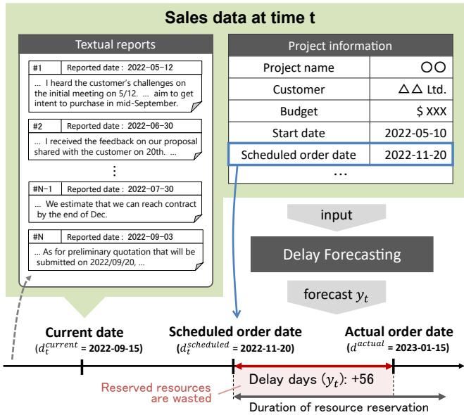
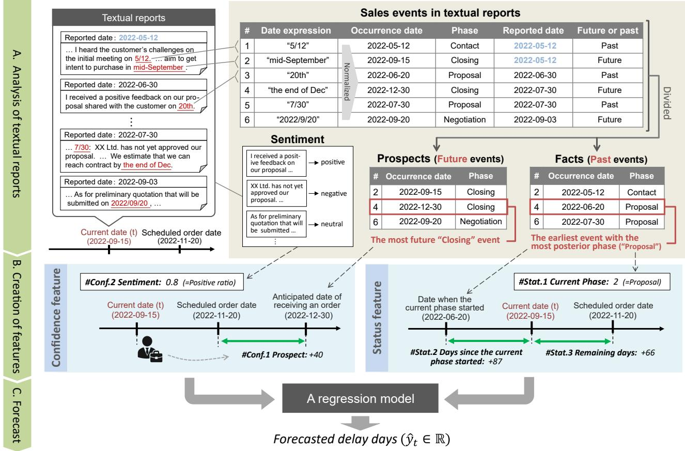
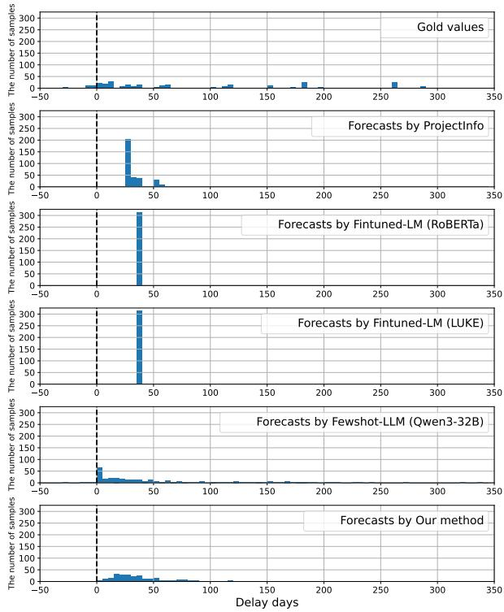
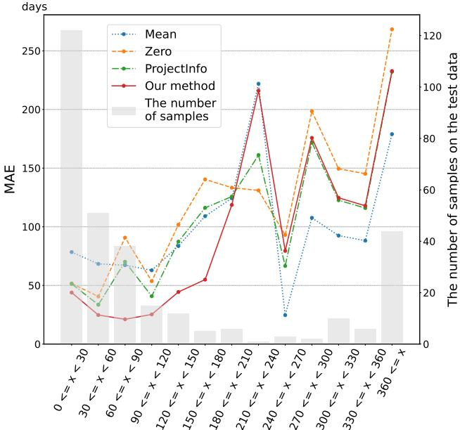

# Forecasting Sales Delay through Time-aware Analysis of Sales Events in Textual Reports

Masaya Tsunokake R&D Group, Hitachi, Ltd. Tokyo, Japan masaya.tsunokake.qu@hitachi.com

Terufumi Morishita R&D Group, Hitachi, Ltd. Tokyo, Japan terufumi.morishita.wp@hitachi.com

Yuta Koreeda R&D Group, Hitachi, Ltd. Tokyo, Japan yuta.koreeda.pb@hitachi.com

Teppei Inoue R&D Group, Hitachi, Ltd. Tokyo, Japan teppei.inoue.wa@hitachi.com

Yasuhiro Sogawa Hitachi, Ltd. Tokyo, Japan yasuhiro.sogawa.tp@hitachi.com

Yuhei Niwa   
R&D Group, Hitachi, Ltd.   
Tokyo, Japan   
yuhei.niwa.yh@hitachi.com

Hiroaki Ozaki Hitachi, Ltd. Tokyo, Japan hiroaki.ozaki.yu@hitachi.com

## Abstract

Business-to-business (B2B) companies develop and deliver a oneof-a-kind product in response to a client’s orders. To prepare resources for development beforehand, companies estimate dates when they will receive orders from clients in their sales process, called scheduled order dates. However, dates when the companies actually receive orders can difer from the scheduled order dates. This diference increases costs in the development. If the difer ence could be forecasted before receiving orders, companies could optimize their resource preparation. Towards reducing the costs, we introduce sales delay forecasting, a novel task of forecasting delay days from the scheduled order dates during sales process where sales representatives (sales reps) interact with the clients to receive orders. Sales delay forecasting is challenging because the sales process progress inherently involves uncertainty and depends on the client’s willingness to order. To address this task, we propose confidence features which represent sales reps’ confidence as a proxy measure of the client’s willingness to order. To represent it, our method extracts dates of future sales events anticipated by sales reps from textual reports. To consider whether the confidence objectively looks reasonable, we also introduce status features which describe sales process status based on current date and past events. In experiments using real sales data, our method achieved a 16% lower mean absolute error compared with a feature-based baseline similar to a prior work. Moreover, our method outperformed non-feature-based baselines using large language models, indicating that it is crucial to explicitly create our features.

## Keywords

Sales force automation (SFA), Text mining, Delay analysis, Sales delay, Time-to-event prediction, Natural language processing

## 1 Introduction

Many business-to-business (B2B) companies employ a make-toorder strategy, where they develop and deliver a one-of-a-kind product in response to a client’s order. This process requires much time and resources. Therefore, to start development quickly upon receiving the orders, B2B companies reserve development resources (e.g., workers, materials) in advance for the entire duration of development. The duration of the reservation begins on a scheduled order date, which is the date that a B2B company estimates when the company will receive an order. Since the company optimizes reservation plans to leverage the limited resources over multiple projects, the duration of reservation cannot be easily changed. However, an actual order date, which is the date when the company actually receives the order, can difer from the scheduled order date. This diference (i.e., �� = the actual order date - the scheduled order date) can incur additional costs. For example, if receiving an order is delayed $\left( y _ { t } > 0 \right)$ , the reserved resources are wasted for the duration of the delay, as shown in Figure 1. On the other hand, if the receiving of an order is earlier $( y _ { t } < 0 ) .$ , it may incur additional expenses to immediately start development.

  
Figure 1: Sales delay forecasting. We address this task of forecasting delay days (��) from scheduled order date utilizing sales data at time �.

B2B companies receive clients’ orders through a sales process where sales representatives (sales reps) capture the clients’ needs throughout continuous interaction. If $y _ { t }$ could be forecasted during sales process, companies could optimize their resource reservation plan beforehand, leading to cost cutting. Towards achieving this, we introduce a novel task called sales delay forecasting as shown in Figure 1. This task aims to forecast delay days (��) from the scheduled order date before receiving an order on the actual order date, utilizing sales data accumulated until �.

Sales delay forecasting is more challenging than similar tasks, which aim to forecast delay days for other processes such as software development and construction, in prior works [7, 8, 11, 19, 27]. Such a process steadily progresses by construction of artifacts (e.g., parts of software). Thus, the lead time of the process can be roughly estimated based on the uncompleted parts of the artifact. In contrast, a sales process is a consensus-building process where a sales rep reaches a mutual agreement with a client to receive an order. This indicates that whether a sales process progresses inherently involves uncertainty, and depends on the client’s willingness to order. However, the client’s willingness to order cannot be directly observed, which makes sales delay forecasting challenging.

To address this, we propose confidence features which represent sales reps’ confidence as a proxy measure of a client’s willingness to order, as shown in Figure 2. Through conversations with a client, a sales rep develops future prospects about the client’s decisions based on the client’s reactions and writes the prospects into textual reports. Our method extracts such prospects by identifying dates of anticipated future events written in textual reports to represent sales reps’ confidence.

On the other hand, sales reps’ confidence is potentially unreliable. Intuitively, when the scheduled order date is closing but the sales process is still in its initial phase (e.g., just contacting), �� becomes large even if the sales rep is highly confident in the process. To avoid depending solely on potentially unreliable features, we also introduce status features to consider whether the confidence objectively looks reasonable based on sales process status such as remaining days until the scheduled order date and a current phase which is determined from pre-defined phases in Figure 3.

Using real sales data, we evaluated our method against the following baselines: 1) a feature-based baseline similar to a prior work in software development [27], 2) non-feature-based baselines in which language models (e.g., RoBERTa, Qwen3) directly forecast �� based on textual reports. Our method achieved a 16% lower mean absolute error in forecasting $y _ { t }$ compared with the feature-based baseline, indicating the superiority of our feature. Our method also outperformed non-feature-based baselines using the same textual reports, indicating that it is crucial to explicitly create our features from the reports. Through an ablation study, we confirmed that both confidence and status features contribute to forecasting performance. We also confirmed that the errors $( \mathrm { i . e . , } | y _ { t } - \hat { y } _ { t } | )$ of our method notably decreased as the actual order date approaches $( \mathrm { i . e . } ,$ time � increases). This result suggests that our features capture the prospects and status updated as time � increases, and serve as a better indicator of forecasting.

Our contributions are as follows:

• Towards reducing costs in B2B business, we introduce the novel task of sales delay forecasting, which aims to forecast delay days $\left( y _ { t } \right)$ from a scheduled order date during a sales process.

• To address sales delay forecasting, we propose a forecasting method based on novel features that represent sales reps confidence and sales process status.

• In experiments using real sales data, we show that our method outperformed a feature-based baseline based on a prior work [27] and non-feature-based baselines wherein language models directly forecast $y _ { t } .$ The results indicate the efectiveness of our feature-based approach and the design.

• Further analysis suggests that our features capture the prospects and status updated as time � increases, and serve as a better indicator of forecasting.

## 2 Task Description

The objective of sales delay forecasting is to forecast delay days from a scheduled order date before receiving an order from a client on the actual order date. Figure 1 illustrates this task. Sales data contain sales project information (e.g., project name and budget) and textual reports written by sales reps. Each report is attached with a reported date. The sales data is periodically updated.

We formulate sales delay forecasting as a regression problem as in similar tasks in prior works [19, 27]. In our setting, objective and dependent variables change depending on time �. Thus, this task is formulated as follows:

$$
d ^ { \mathrm { a c t u a l } } - d _ { t } ^ { \mathrm { s c h e d u l e d } } : = y _ { t } = f ( x ^ { p } , x _ { t } , d _ { t } ^ { \mathrm { s c h e d u l e d } } )\tag{1}
$$

where � is the time of each forecasting point, $y _ { t }$ is the delay days from the scheduled order date $( d _ { t } ^ { \mathrm { s c h e d u l e d } } )$ at time $t , d ^ { \mathrm { a c t u a l } }$ is the actual order date, $x ^ { p }$ is the project information, and �� is information extracted from textual reports at time �. Note that $y _ { t }$ can be a negative value if the sales rep receives the order before $d _ { t } ^ { \mathrm { s } }$ cheduled

## 3 Proposed Method

## 3.1 Overview

Our method creates confidence features which represent sales reps’ confidence as a proxy measure of the client’s willingness to order. On the other hand, sales reps’ confidence is potentially unreliable due to sales reps’ biases. To avoid depending solely on potentially unreliable features, our method also creates status features to consider whether the confidence objectively looks reasonable based on sales process status.

As for confidence features, our method utilizes sales reps’ prospects about the client’s decisions, particularly the anticipated date of receiving orders. Intuitively, if an anticipated date of receiving an order is substantially later than the scheduled order date, the sales rep’s confidence is low, indicating a high likelihood of larger $y _ { t }$ . To quantify the gap between the anticipated date of receiving orders and the scheduled order date, our method extracts dates of anticipated future events related to the order from textual reports. Our method also detects sentiments in textual reports to capture the sales rep’s confidence more directly.

  
Figure 2: Overview of our method. Our method first extracts sales events from textual reports by identifying date expressions and keywords tied with sales phases, and then distinguishes whether the events refer to the future or the past. Example extracted events are shown in the top of this figure. Next, our method creates confidence and status features based on the extracted events. Confidence features represent sales reps’ confidence and are created through utilizing the extracted future events (#Conf.1) and sentiments detected from textual reports (#Conf.2). Status features objectively describe sales process status. Status features are created through utilizing remaining days until the scheduled order date (#Stat.3) and the extracted past events that determine the current phase (#Stat.1) and days since the current phase started (#Stat.2).

  
Figure 3: Sales phases. Generally, sales process finishes via sales events related to these phases.

As for status features, our method utilizes remaining days until the scheduled order date and a current phase of a sales process. To determine the current phase, our method extracts facts of sales events in the past (i.e., past events) from textual reports while associating each past event to pre-defined phases in Figure 3. Our method regards the most posterior phase in past events as the current phase.

Both confidence and status features are based on sales events written in textual reports. Hence, our method consists of three steps: (A) analysis of textual reports, (B) creation of features, and (C) forecast. Figure 2 illustrates three steps.

## 3.2 Analysis of textual reports

This first step extracts sales events and their occurrence dates by identifying co-occurrences of a mention to a sales event and a date expression in textual reports.

To identify date expressions, our method uses temporal expression extractor [20, 22, 23]. There are various types of temporal expressions in text. Our method only extracts temporal expressions whose types are “DATE” in the TimeML scheme [16] as date expressions and normalizes them, as shown in the top of Figure 2. When normalizing, there can be a date expression whose year, month, or day is missing. A missing year, month or day is complemented with the reported date of the textual report where the date expression is written. In the following steps, our method creates a sales event table, as shown in Figure 2, based on these normalized date expressions (occurrence dates).

Table 1: Our features. Confidence features represent sales reps’ confidence. Status features describe sales process status to consider whether the confidence objectively looks reasonable.
<table><tr><td>Feature Type</td><td>Name</td><td>Description</td><td>How to compute</td></tr><tr><td rowspan="2">Confidence</td><td>#Conf.1 Prospect</td><td>Days between date of most future event in future events with “Closing” phase  $( d _ { t } ^ { \mathrm { c l o s i n g } } )$  and scheduled order date  $( d _ { t } ^ { \mathrm { s c h e d u l e d } } )$ </td><td> $d _ { t } ^ { \mathrm { s c h e d u l e d } } - d _ { t } ^ { \mathrm { c l o s i n g } }$ </td></tr><tr><td>#Conf.2 Sentiment</td><td>Ratio of positive sentences in textual reports</td><td>number of sentences with positive sentiment number of all sentences</td></tr><tr><td rowspan="3">Status</td><td>#Stat.1 Current phase</td><td>An ordinal number of the most posterior phase in past events</td><td>See ordinal numbers in Figure 3</td></tr><tr><td>#Stat.2 Days since the cur- rent phase started</td><td>Days between current date  $( d _ { t } ^ { \mathrm { c u r r e n t } } )$  and the earliest date in past events with current phase  $( d _ { t } ^ { \mathrm { s t a r t } } )$ </td><td> $d _ { t } ^ { \mathrm { c u r r e n t } } - d _ { t } ^ { \mathrm { s t a r t } }$ </td></tr><tr><td>#Stat.3 Remaining days</td><td>Days between current date  $( d _ { t } ^ { \mathrm { c u r r e n t } } )$  and scheduled order date  $( d _ { t } ^ { \mathrm { s c h e d u l e d } } )$ </td><td> $d _ { t } ^ { \mathrm { s c h e d u l e d } } - d _ { t } ^ { \mathrm { c u r r e n t } }$ </td></tr></table>

Next, our method identifies mentions to a sales event in the sentence from which the date expressions were identified. Generally, a sales process has some phases towards receiving orders. This paper defines four sales phases: “Contact,” “Proposal,” “Negotiation,” and “Closing.” Figure 3 illustrates the phases. We focus on events that are important for each phase since irrelevant events are also written in textual reports. Our method associates each date expression with one of the sales phases by searching for the pre-defined keywords about important sales events 1. Date expressions that cannot be associated with the keywords are removed in this step.

Finally, to distinguish whether each sales event is a sales rep’s prospect, our method identifies whether the occurrence date refers to the future or the past. Specifically, if the occurrence date refers to a date after the reported date, our method regards the corresponding event as a sales rep’s prospect. Otherwise, the event is regarded as a past event. The top of Figure 2 shows sales events with all information described in this section.

## 3.3 Creation of features

This step creates confidence and status features, listed in Table 1, utilizing extracted sales events and other information.

3.3.1 Confidence features. These features represent sales reps’ confidence and include #Conf.1: Prospect and #Conf.2: Sentiment.

For #Conf.1, we quantify a sales rep’s confidence by measuring the diference between the scheduled order date $( d _ { t } ^ { \mathrm { s c h e d u l e d } } )$ and the date of receiving an order anticipated by the sales rep. To determine the latter date, our method uses future events associated with “Closing” phase which typically occur just before receiving order. The occurrence date of the most future event in the future events with “Closing” phase $( d _ { t } ^ { \mathrm { c l o s i n g } } )$ has the highest likelihood of the date of receiving an order. Thus, our method computes the number of days between $\boldsymbol d _ { t } ^ { \mathrm { c l o s i n g } }$ and $d _ { t } ^ { \mathrm { s c h e d u l e d } }$ as #Conf.1 .

If sales reps are more confident, positive sentiments should appear more frequently. Therefore, our method also computes the ratio of positive sentences in textual reports as #Conf.2. We utilize sentiment detection techniques studied in the field of natural language processing [14, 17, 18].

3.3.2 Statusfeatures. These features are designed to consider whether sales reps’ confidence objectively looks reasonable. This feature set includes #Stat.1: Current phase, #Stat.2: Days since the current phase started, and #Stat.3: Remaining days.

Our method obtains the most posterior phase in the past events and utilizes the ordinal number of the obtained phase as #Stat.1 . By utilizing the most posterior phase, we can approximately and objectively quantify how close a current sales process is to receiving an order.

Although #Stat.1 characterizes the sales process status, it is coarse-grained. To describe the sales process status at finer granularity, our method also computes the number of days since the current phase started as #Stat.2 . To compute it, the date of the earliest past event associated with the current phase $( d _ { t } ^ { \mathrm { s t a r t } } )$ is regarded as the starting date, as shown in Figure 2.

We quantify not only the current phase but also the remaining days until the scheduled order date as #Stat.3 . Concretely, our method computes the number of days between $d _ { t } ^ { \mathrm { s c h e d u l e d } }$ and a current date $\bar { ( d _ { t } ^ { \mathrm { c u r r e n t } } ) }$ ).

## 4 Experiment

By comparing our method, another feature-based method based on a prior work [27], and non-feature-based baselines using language models, we verify the efectiveness of our method that explicitly creates confidence and status features from textual reports.

## 4.1 Experimental Setup

4.1.1 Data. We used real sales data of a Japanese company. It consists of closed sales projects. To evaluate throughout the whole sales process, we set multiple forecasting points (i.e., time �) for each sales project. As the sales process status is updated, textual reports increase. Therefore, we set � every time reports were added. At each �, we created features using the reports accumulated up to �. Since our target projects are completely independent of each other, the sales projects in the data were randomly split into training (train), development (dev), and test sets. Note that each set contains multiple instances of time � for a single sales project. To simplify the comparison of diferent selections of features, we only experimented with time � at which all features could be created. The train, dev, and test sets have 1,242, 245, and 315 instances of time �, respectively.

## 4.1.2 Baselines. We introduce the following baselines.

Trivial baselines. We introduce two trivial baselines: 1) Zero that constantly predicts that the sales process would not be delayed and thus outputs 0 as $y _ { t } ,$ , and 2) Mean that constantly outputs the mean of� in the train set.

ProjectInfo. We introduce a feature-based baseline using only project information that represent similar information as in a prior work [27]. The features consist of an initial scheduled duration (i.e., days between scheduled order date and date when a sales project is launched) and a budget which means a planned revenue of the sales project.

Finetuned-LM. To verify the efectiveness of explicit feature creation from textual reports, we set non-feature-based baselines that directly forecast �� from same textual reports by using a finetuned language model (LM) without explicitly creating features. We verified three LMs which are common choices and successful in many applications: RoBERTa [9], LUKE [24], and BigBird [28]. Such LMs have acquired the capability of understanding textual semantics through pre-training on large textual corpora. We finetune each LM with an additional linear layer and MSE loss. Input text was created by concatenating the three latest textual reports and remaining days until scheduled order dates (i.e., #Stat.3).

Fewshot-LLM. As another non-feature-based baseline, we verify few-shot approach by large language model (LLM). Recent LLMs exhibit remarkable performances for unseen dificult tasks given few-shot samples in the prompt [3, 5, 12]. Due to the confidentiality of real sales data, we cannot use closed-models. Instead, we use Qwen3-32B [25] that has competitive performance with top-tier LLMs such as OpenAI-o1 [13] and DeepSeek-R1 [4] and is compatible with Japanese. We also employ Qwen3-8B [25] with distinct model size. Same as Finetuned-LM, input text was created by concatenating the three latest textual reports and #Stat.3 . We also provide 5-shot samples consisting of the input text and ��.

4.1.3 Hyperparameters . Since the best machine learning method (ML) varies on features, we set the type of ML as one of the hyperparameters to compare our method and ProjectInfo on their best settings. As candidates of MLs, we choose common MLs: SVM [21] with linear or RBF kernel, and Random Forest [2]. We selected the ML and hyperparameters2 exhibiting the lowest MAE in the dev set and evaluated the selected ML trained with the selected hyperparameters. We report the results averaged over five random seeds.

For Finetuned-LM baseline, we used Japanese RoBERTa, LUKE, and BigBird3. Each LM was fine-tuned on the train set up to 10 epochs. The training was terminated if the minimum loss on the dev set could not be updated within 3 epochs. The optimization function was AdamW [10]. We verified the performances on five random seeds. For each random seed, we selected hyperparameters4 exhibiting the lowest MAE on the dev set and evaluated the selected model on the test set.

Table 2: Example keywords tied with sales phases
<table><tr><td>Event type</td><td>Keywordsa</td></tr><tr><td>Contact</td><td>キックオフ(initial meeting),  $\in \supset \mathbb { \gamma } \cup \supset \mathcal { D } ( \mathrm { h e a r i n g } ) ,$  引き合い(inquiry),引合(inquiry)</td></tr><tr><td>Proposal</td><td>提案(proposal), rfp(request for proposal)</td></tr><tr><td>Negotiation</td><td>見積(quotation),要件定義(requirements definition)</td></tr><tr><td>Closing</td><td>内示(receiving intent to purchase), 発注(order) 受注(receiving order), 検収(receipt inspection)</td></tr></table>

a English translations follow original Japanese keywords.

For Fewshot-LLM baseline, we created 5-shot samples that are randomly selected from forecasting points (�) in the train set. We enable Qwen3’s thinking mode [25] which explicitly instructs the model to output intermediate reasoning towards final answers. As for generation parameters, we followed best practices in HuggingFace page5. We report the results averaged over five random seeds which afect the 5-shot sample selection and the generation probability.

4.1.4 Evaluation. We evaluated the errors in forecasts by using the mean absolute error (MAE) and root mean squared error (RMSE). RMSE squares the error so that it incurs a larger penalty compared with MAE when the model makes a large mistake.

## 4.2 Implementation

In our method, we split the textual reports into sentences using the ja\_ginza model via GINZA6 and spaCy7. Date expressions in each sentence were detected and normalized using ja-timex8, which is a rule-based parser based on the Japanese TimeML-like scheme [1]. To associate date expressions with the sales phases, we search for the keywords, listed in Table 2, in the sentences. When associating date expressions with the pre-defined sales phases shown in Figure 3, we used keywords in Table 2. Sentiment was detected by Asari9.MLs were implemented by scikit-learn [15]. We use HuggingFace to implement Finetuned-LM and Fewshot-LLM. The LMs were fine-tuned using NVIDIA A100 GPUs.

## 4.3 Results

Table 3 presents the results10. Our method achieved the lowest MAE among all methods. In particular, our method achieved 16% lower MAE than ProjectInfo baseline based on the prior work [27], which

Table 3: MAE and RMSE of delay days (��) forecasted by each method. Our method achieved lower MAE than all baselines.
<table><tr><td>Method</td><td>MAE</td><td>RMSE</td></tr><tr><td>Baselines</td><td></td><td></td></tr><tr><td>Mean</td><td>91.06</td><td>109.95</td></tr><tr><td>Zero ProjectInfo (similar to [27])</td><td>96.29</td><td>142.66</td></tr><tr><td>Finetuned-LM w/ RoBERTa</td><td>84.06 83.72</td><td>123.41</td></tr><tr><td>Finetuned-LM w/ LUKE</td><td>83.73</td><td>122.86 122.94</td></tr><tr><td>Finetuned-LM w/ BigBird</td><td></td><td></td></tr><tr><td>Fewshot-LLM w/ Qwen3-8B</td><td>92.41</td><td>110.10</td></tr><tr><td rowspan="2">Fewshot-LLM w/ Qwen3-32B</td><td>76.88</td><td>127.80</td></tr><tr><td>76.10 70.80</td><td>127.48</td></tr><tr><td>Our Method Ablation Study</td><td></td><td>112.82</td></tr><tr><td></td><td></td><td></td></tr><tr><td>w/o #Conf.1 Prospect</td><td>+44.17</td><td>+46.47</td></tr><tr><td>w/o #Conf.2 Sentiment</td><td>+23.20</td><td>+40.51</td></tr><tr><td>w/o #Stat.1 Current phase</td><td>+28.14</td><td>+42.93</td></tr><tr><td>w/o #Stat.2 Days since the current phase started</td><td>-1.19</td><td>+1.20</td></tr><tr><td>w/o #Stat.3 Remaining days</td><td>+13.75</td><td>+2.86</td></tr></table>

  
Figure 4: Histogram of gold delay days (��) on the test set and delay days (�ˆ ) forecasted by each method. Although the gold delay days in the top of this figure were widely distributed, Finetuned-LM forecasted a constant value.

demonstrates that it is efective to consider not project information but rather our confidence and status features.

Our method also exhibits lower MAE than all Finetuned-LM baselines. Figure 4 shows a histogram of gold delay days on the test set and the delay days (��) forecasted by diferent methods11. Finetuned-LMs such as LUKE and BigBird forecasted certain values, although the gold values were widely distributed. This suggests that sales delay forecasting is too noisy to capture solely from text without inductive biases introduced by features, and optimized LMs fell back to predicting certain values. In comparison, our method can forecast a broad range of values while achieving the lowest MAE among all methods. This indicates that it is crucial to explicitly design our features from textual reports.

Both MAE and RMSE ofall Fewshot-LLM baselines are inferior to our method, emphasizing the superiority of our method. As shown in Figure 4, the forecasts of Fewshot-LLM are slightly biased to �ˆ = 0 although they are widely spread compared to other baselines.

Mean baseline and Finetuned-LM w/ BigBird exhibited lower RMSEs than our method. This is attributed to the forecasting tendency ofthese methods. Mean baseline constantly outputs the mean of�� on the train set. As shown in Figure 4, Finetuned-LM w/ Big-Bird also forecasted a certain value. This characteristic of passive forecasting suppresses large errors. Since RMSE imposes a larger penalty when the model makes a large mistake, these methods tend to be highly rated. Our method achieved competitive RMSE against these methods while forecasting various values.

## 5 Analysis

## 5.1 Ablation study

To clarify which features are important in forecasting performance, we examined the change in the performance when each feature was excluded. The hyperparameters for this ablation study were selected using the same procedure as described in Section 4.1.

Table 3 presents the results. Each row with “w/o feature name” shows the change in the performance when the corresponding feature was excluded. When some confidence and status features were excluded, MAE and RMSE substantially got worse. This suggests that incorporating both confidence and status features is important for sales delay forecasting.

## 5.2 Performances with diferent time �

Intuitively, when a sales process has just started, it is dificult to forecast how smoothly the sales process will progress in the future. In contrast, as a sales project gets updated in the course of the sales process, the sales reps’ prospects become more accurate. Forecasting �� may become easier by capturing the updated prospect (confidence features) and status (status features). Therefore, we assumed that our method can more accurately forecast as the actual order date approaches (i.e., time � increases).

To represent how close sales project at time � is to the actual order date, we set discrete intervals based on days between the current date $( d _ { t } ^ { \mathrm { c u r r e n t } } )$ and the actual order date $( d ^ { \mathrm { a c t u a l } } )$ . We selected one random seed and investigated MAE in each interval on test set. Figure 5 shows the result. The position to the left in Figure 5 indicates that more time has passed in the sales process. In other words, MAE of our method largely decreased as time � increases in the sales process, and the rate of decrease $\begin{array} { r } { ( \mathrm { i . e . , ~ } \frac { M A E _ { t 2 } - M A E _ { t 1 } } { t 2 - t 1 } ) } \end{array}$ was higher than the baselines. This result suggests that our features capture the prospects and status updated as time � increases, and serve as better indicators of forecasting.

  
Days (x) between current date and actual order date  
Figure 5: MAEs with diferent time �. The horizontal axis indicates days (�) between current date $d _ { t } ^ { \mathbf { c u r r e n t } }$ and actual order date $d ^ { \bf { a c t u a l } } ( { \bf { i . e . , } } x = d ^ { \bf { a c t u a l } } – d _ { t } ^ { \bf { c u r r e n t } } )$ . The position to the left indicates that more time � has passed. The vertical axis indicates MAE on each evaluation interval of �.

The MAEs of all methods except Mean baseline tended to decrease as time � increases. This shows that it was more dificult to forecast delay days on the basis of information obtained in the initial period. Mean baseline exhibited a relatively stable performance at the early time in the right side in Figure 5. This is presumably because the Mean baseline outputs a certain value instead of relying on unsettled information obtained early.

## 5.3 Impact of the thinking by LLMs

In Table 3, Fewshot-LLM by Qwen3-8B and 32B invoked their thinking mode which explicitly instructs the model to output intermediate reasoning towards final answers. Without thinking mode, MAEs of Qwen3-8B and 32B got increased by +8.13 and +8.20, indicating that thinking mode is beneficial. Observing the thinking processes, the LLMs were trying to forecast by arithmetic operations using date expressions of sales events in textual reports. This emphasizes the importance of utilizing date expressions as in our method. On the other hand, our method outperformed Fewshot-LLM baselines with such thinking, indicating that our feature design is efective. Moreover, thinking by LLMs requires substantially more inference time than our feature-based method.

## 6 Related work

In the construction industry, delays frequently occur and might cause disputes between contractors and clients. Since the causes of the delays will determine the assignment of responsibilities between them, the construction is strictly managed with fine-grained milestone tables that are composed of many tasks and their task duration. Previous studies propose various methodologies for identifying the cause of an overall delay from a delay of each task [6– 8, 11, 26]. While many methodologies are based on the manual analysis by humans [6, 7, 26], Hegazy and Zhang [8] proposed a computational method that estimates the total delay days of the whole construction process by aggregating the delay information of each task. Oliveros and Fayek [11] also propose a computational method using fuzzy logic. However, it is dificult to create such fine-grained milestone tables in consensus-building process such as sales process.

Some studies propose methods for forecasting delay days without relying on delay information of constituting tasks [19, 27]. Zadeh and Kashef [27] verified the estimation of delay days on the basis of the initial project budgets and the initial project duration. In this paper, we verified ProjectInfo using similar information that can be obtained on sales projects and confirmed that our method outperformed ProjectInfo.

## 7 Conclusion

We introduced the novel task of sales delay forecasting. To address this task, we proposed confidence features which represent sales reps’ confidence as a proxy measure of the client’s willingness to order. We also proposed status features based on sales process status. On real sales data, our method achieved lower MAE by 16% compared with the feature-based baseline similar to a prior work [27]. Comparison with the non-feature-based baselines revealed the effectiveness of our feature-based approach. Further analysis suggests that our features capture the prospects and status updated as time � increases, and serve as a better indicator of forecasting.

## Acknowledgments

We would like to thank Kana Ozaki, Atsuki Yamaguchi, Gaku Morio, Koichi Nagatsuka, Yuichi Sasazawa, Kouki Takeshita, and Yumi Hamazono for their valuable feedback and Masaaki Shimizu for maintenance and management of large computational resources.

## GenAI Usage Disclosure

Generative AI models were utilized partially to modify some sentences and figures.

## References

[1] Masayuki Asahara, Sachi Kato, Hikari Konishi, Mizuho Imada, and Kikuo Maekawa. 2014. BCCWJ-TimeBank: Temporal and event information Annotation on Japanese text. International Journal ofComputational Linguistics & Chinese Language Processing 19, 3 (2014), 1–24.

[2] Leo Breiman. 2001. Random forests. Machine learning 45, 1 (2001), 5–32.

[3] Tom Brown, Benjamin Mann, Nick Ryder, Melanie Subbiah, Jared D Kaplan, Prafulla Dhariwal, Arvind Neelakantan, Pranav Shyam, Girish Sastry, Amanda Askell, et al. 2020. Language models are few-shot learners. Advances in neural information processing systems 33 (2020), 1877–1901.

[4] DeepSeek-AI, Daya Guo, Dejian Yang, Haowei Zhang, Junxiao Song, Ruoyu Zhang, Runxin Xu, Qihao Zhu, Shirong Ma, Peiyi Wang, Xiao Bi, Xiaokang Zhang, Xingkai Yu, Yu Wu, Z. F. Wu, Zhibin Gou, Zhihong Shao, Zhuoshu Li,

Ziyi Gao, Aixin Liu, Bing Xue, Bingxuan Wang, Bochao Wu, Bei Feng, Chengda Lu, Chenggang Zhao, Chengqi Deng, Chenyu Zhang, Chong Ruan, Damai Dai, Deli Chen, Dongjie Ji, Erhang Li, Fangyun Lin, Fucong Dai, Fuli Luo, Guangbo Hao, Guanting Chen, Guowei Li, H. Zhang, Han Bao, Hanwei Xu, Haocheng Wang, Honghui Ding, Huajian Xin, Huazuo Gao, Hui Qu, Hui Li, Jianzhong Guo, Jiashi Li, Jiawei Wang, Jingchang Chen, Jingyang Yuan, Junjie Qiu, Junlong Li, J. L. Cai, Jiaqi Ni, Jian Liang, Jin Chen, Kai Dong, Kai Hu, Kaige Gao, Kang Guan, Kexin Huang, Kuai Yu, Lean Wang, Lecong Zhang, Liang Zhao, Litong Wang, Liyue Zhang, Lei Xu, Leyi Xia, Mingchuan Zhang, Minghua Zhang, Minghui Tang, Meng Li, Miaojun Wang, Mingming Li, Ning Tian, Panpan Huang, Peng Zhang, Qiancheng Wang, Qinyu Chen, Qiushi Du, Ruiqi Ge, Ruisong Zhang, Ruizhe Pan, Runji Wang, R. J. Chen, R. L. Jin, Ruyi Chen, Shanghao Lu, Shangyan Zhou, Shanhuang Chen, Shengfeng Ye, Shiyu Wang, Shuiping Yu, Shunfeng Zhou, Shuting Pan, S. S. Li, Shuang Zhou, Shaoqing Wu, Shengfeng Ye, Tao Yun, Tian Pei, Tianyu Sun, T. Wang, Wangding Zeng, Wanjia Zhao, Wen Liu, Wenfeng Liang, Wenjun Gao, Wenqin Yu, Wentao Zhang, W. L. Xiao, Wei An, Xiaodong Liu, Xiaohan Wang, Xiaokang Chen, Xiaotao Nie, Xin Cheng, Xin Liu, Xin Xie, Xingchao Liu, Xinyu Yang, Xinyuan Li, Xuecheng Su, Xuheng Lin, X. Q. Li, Xiangyue Jin, Xiaojin Shen, Xiaosha Chen, Xiaowen Sun, Xiaoxiang Wang, Xinnan Song, Xinyi Zhou, Xianzu Wang, Xinxia Shan, Y. K. Li, Y. Q. Wang, Y. X. Wei, Yang Zhang, Yanhong Xu, Yao Li, Yao Zhao, Yaofeng Sun, Yaohui Wang, Yi Yu, Yichao Zhang, Yifan Shi, Yiliang Xiong, Ying He, Yishi Piao, Yisong Wang, Yixuan Tan, Yiyang Ma, Yiyuan Liu, Yongqiang Guo, Yuan Ou, Yuduan Wang, Yue Gong, Yuheng Zou, Yujia He, Yunfan Xiong, Yuxiang Luo, Yuxiang You, Yuxuan Liu, Yuyang Zhou, Y. X. Zhu, Yanhong Xu, Yanping Huang, Yaohui Li, Yi Zheng, Yuchen Zhu, Yunxian Ma, Ying Tang, Yukun Zha, Yuting Yan, Z. Z. Ren, Zehui Ren, Zhangli Sha, Zhe Fu, Zhean Xu, Zhenda Xie, Zhengyan Zhang, Zhewen Hao, Zhicheng Ma, Zhigang Yan, Zhiyu Wu, Zihui Gu, Zijia Zhu, Zijun Liu, Zilin Li, Ziwei Xie, Ziyang Song, Zizheng Pan, Zhen Huang, Zhipeng Xu, Zhongyu Zhang, and Zhen Zhang. 2025. DeepSeek-R1: Incentivizing Reasoning Capability in LLMs via Reinforcement Learning. arXiv preprint arXiv:2501.12948 (2025).

[5] Qingxiu Dong, Lei Li, Damai Dai, Ce Zheng, Jingyuan Ma, Rui Li, Heming Xia, Jingjing Xu, Zhiyong Wu, Tianyu Liu, Baobao Chang, Xu Sun, Lei Li, and Zhifang Sui. 2024. A Survey on In-context Learning. arXiv preprint arXiv:2301.00234 (2024).

[6] Muaz Fagiar, Yasser Mohamed, and Simaan AbouRizk. 2023. Simulation-Assisted Project Data Integration for Development and Analysis of As-Built Schedules. Buildings 13, 4 (2023), 974.

[7] Suroj Ghimire and Anjay Kumar Mishra. 2019. Comparative study of prospective delay analysis techniques (DATs). Saudi Journal of Civil Engineering 3, 5 (2019), 84–98.

[8] Tarek Hegazy and Kehui Zhang. 2005. Daily windows delay analysis. Journal of Construction Engineering and Management 131, 5 (2005), 505–512.

[9] Yinhan Liu, Myle Ott, Naman Goyal, Jingfei Du, Mandar Joshi, Danqi Chen, Omer Levy, Mike Lewis, Luke Zettlemoyer, and Veselin Stoyanov. 2019. RoBERTa: A Robustly Optimized BERT Pretraining Approach. arXiv preprint arXiv:1907.11692 (2019).

[10] Ilya Loshchilov and Frank Hutter. 2017. Decoupled weight decay regularization. arXiv preprint arXiv:1711.05101 (2017).

[11] Adriana V Ordóñez Oliveros and Aminah Robinson Fayek. 2005. Fuzzy logic ap proach for activity delay analysis and schedule updating. Journal ofConstruction Engineering and Management 131, 1 (2005), 42–51.

[12] OpenAI, Josh Achiam, Steven Adler, Sandhini Agarwal, Lama Ahmad, Ilge Akkaya, Florencia Leoni Aleman, Diogo Almeida, Janko Altenschmidt, Sam Altman, Shyamal Anadkat, Red Avila, Igor Babuschkin, Suchir Balaji, Valerie Balcom, Paul Baltescu, Haiming Bao, Mohammad Bavarian, Jef Belgum, Irwan Bello, Jake Berdine, Gabriel Bernadett-Shapiro, Christopher Berner, Lenny Bog donof, Oleg Boiko, Madelaine Boyd, Anna-Luisa Brakman, Greg Brockman, Tim Brooks, Miles Brundage, Kevin Button, Trevor Cai, Rosie Campbell, An drew Cann, Brittany Carey, Chelsea Carlson, Rory Carmichael, Brooke Chan, Che Chang, Fotis Chantzis, Derek Chen, Sully Chen, Ruby Chen, Jason Chen, Mark Chen, Ben Chess, Chester Cho, Casey Chu, Hyung Won Chung, Dave Cummings, Jeremiah Currier, Yunxing Dai, Cory Decareaux, Thomas Degry, Noah Deutsch, Damien Deville, Arka Dhar, David Dohan, Steve Dowling, Sheila Dunning, Adrien Ecofet, Atty Eleti, Tyna Eloundou, David Farhi, Liam Fe dus, Niko Felix, Simón Posada Fishman, Juston Forte, Isabella Fulford, Leo Gao, Elie Georges, Christian Gibson, Vik Goel, Tarun Gogineni, Gabriel Goh, Rapha Gontijo-Lopes, Jonathan Gordon, Morgan Grafstein, Scott Gray, Ryan Greene, Joshua Gross, Shixiang Shane Gu, Yufei Guo, Chris Hallacy, Jesse Han, Jef Harris, Yuchen He, Mike Heaton, Johannes Heidecke, Chris Hesse, Alan Hickey, Wade Hickey, Peter Hoeschele, Brandon Houghton, Kenny Hsu, Shengli Hu, Xin Hu, Joost Huizinga, Shantanu Jain, Shawn Jain, Joanne Jang, Angela Jiang, Roger Jiang, Haozhun Jin, Denny Jin, Shino Jomoto, Billie Jonn, Heewoo Jun, Tomer Kaftan, Łukasz Kaiser, Ali Kamali, Ingmar Kanitscheider, Nitish Shirish Keskar, Tabarak Khan, Logan Kilpatrick, Jong Wook Kim, Christina Kim, Yongjik Kim, Jan Hendrik Kirchner, Jamie Kiros, Matt Knight, Daniel Kokotajlo, Łukasz Kon draciuk, Andrew Kondrich, Aris Konstantinidis, Kyle Kosic, Gretchen Krueger,

Vishal Kuo, Michael Lampe, Ikai Lan, Teddy Lee, Jan Leike, Jade Leung, Daniel Levy, Chak Ming Li, Rachel Lim, Molly Lin, Stephanie Lin, Mateusz Litwin, Theresa Lopez, Ryan Lowe, Patricia Lue, Anna Makanju, Kim Malfacini, Sam Manning, Todor Markov, Yaniv Markovski, Bianca Martin, Katie Mayer, Andrew Mayne, Bob McGrew, Scott Mayer McKinney, Christine McLeavey, Paul McMil lan, Jake McNeil, David Medina, Aalok Mehta, Jacob Menick, Luke Metz, Andrey Mishchenko, Pamela Mishkin, Vinnie Monaco, Evan Morikawa, Daniel Mossing, Tong Mu, Mira Murati, Oleg Murk, David Mély, Ashvin Nair, Reiichiro Nakano, Rajeev Nayak, Arvind Neelakantan, Richard Ngo, Hyeonwoo Noh, Long Ouyang, Cullen O’Keefe, Jakub Pachocki, Alex Paino, Joe Palermo, Ashley Pantuliano, Giambattista Parascandolo, Joel Parish, Emy Parparita, Alex Passos, Mikhail Pavlov, Andrew Peng, Adam Perelman, Filipe de Avila Belbute Peres, Michael Petrov, Henrique Ponde de Oliveira Pinto, Michael, Pokorny, Michelle Pokrass, Vitchyr H. Pong, Tolly Powell, Alethea Power, Boris Power, Elizabeth Proehl, Raul Puri, Alec Radford, Jack Rae, Aditya Ramesh, Cameron Raymond, Francis Real, Kendra Rimbach, Carl Ross, Bob Rotsted, Henri Roussez, Nick Ryder, Mario Saltarelli, Ted Sanders, Shibani Santurkar, Girish Sastry, Heather Schmidt, David Schnurr, John Schulman, Daniel Selsam, Kyla Sheppard, Toki Sherbakov, Jessica Shieh, Sarah Shoker, Pranav Shyam, Szymon Sidor, Eric Sigler, Maddie Simens, Jordan Sitkin, Katarina Slama, Ian Sohl, Benjamin Sokolowsky, Yang Song, Natalie Staudacher, Felipe Petroski Such, Natalie Summers, Ilya Sutskever, Jie Tang, Nikolas Tezak, Madeleine B. Thompson, Phil Tillet, Amin Tootoonchian, Elizabeth Tseng, Preston Tuggle, Nick Turley, Jerry Tworek, Juan Felipe Cerón Uribe, Andrea Vallone, Arun Vijayvergiya, Chelsea Voss, Carroll Wainwright, Justin Jay Wang, Alvin Wang, Ben Wang, Jonathan Ward, Jason Wei, CJ Weinmann, Akila Welihinda, Peter Welinder, Jiayi Weng, Lilian Weng, Matt Wiethof, Dave Willner, Clemens Winter, Samuel Wolrich, Hannah Wong, Lauren Workman, Sherwin Wu, Jef Wu, Michael Wu, Kai Xiao, Tao Xu, Sarah Yoo, Kevin Yu, Qiming Yuan, Wojciech Zaremba, Rowan Zellers, Chong Zhang, Marvin Zhang, Shengjia Zhao, Tianhao Zheng, Juntang Zhuang, William Zhuk, and Barret Zoph. 2024. GPT-4 Technical Report. arXiv preprint arXiv:2303.08774 (2024).

[13] OpenAI, Aaron Jaech, Adam Kalai, Adam Lerer, Adam Richardson, Ahmed El-Kishky, Aiden Low, Alec Helyar, Aleksander Madry, Alex Beutel, Alex Carney, Alex Iftimie, Alex Karpenko, Alex Tachard Passos, Alexander Neitz, Alexander Prokofiev, Alexander Wei, Allison Tam, Ally Bennett, Ananya Kumar, Andre Saraiva, Andrea Vallone, Andrew Duberstein, Andrew Kondrich, Andrey Mishchenko, Andy Applebaum, Angela Jiang, Ashvin Nair, Barret Zoph, Behrooz Ghorbani, Ben Rossen, Benjamin Sokolowsky, Boaz Barak, Bob McGrew, Bo rys Minaiev, Botao Hao, Bowen Baker, Brandon Houghton, Brandon McKinzie, Brydon Eastman, Camillo Lugaresi, Cary Bassin, Cary Hudson, Chak Ming Li, Charles de Bourcy, Chelsea Voss, Chen Shen, Chong Zhang, Chris Koch, Chris Orsinger, Christopher Hesse, Claudia Fischer, Clive Chan, Dan Roberts, Danie Kappler, Daniel Levy, Daniel Selsam, David Dohan, David Farhi, David Mely, David Robinson, Dimitris Tsipras, Doug Li, Dragos Oprica, Eben Freeman, Ed die Zhang, Edmund Wong, Elizabeth Proehl, Enoch Cheung, Eric Mitchell, Eric Wallace, Erik Ritter, Evan Mays, Fan Wang, Felipe Petroski Such, Filippo Raso, Florencia Leoni, Foivos Tsimpourlas, Francis Song, Fred von Lohmann, Freddie Sulit, Geof Salmon, Giambattista Parascandolo, Gildas Chabot, Grace Zhao, Greg Brockman, Guillaume Leclerc, Hadi Salman, Haiming Bao, Hao Sheng, Hart Andrin, Hessam Bagherinezhad, Hongyu Ren, Hunter Lightman, Hyung Won Chung, Ian Kivlichan, Ian O’Connell, Ian Osband, Ignasi Clavera Gilaberte, Ilge Akkaya, Ilya Kostrikov, Ilya Sutskever, Irina Kofman, Jakub Pachocki, James Lennon, Jason Wei, Jean Harb, Jerry Twore, Jiacheng Feng, Jiahui Yu, Jiayi Weng, Jie Tang, Jieqi Yu, Joaquin Quiñonero Candela, Joe Palermo, Joel Parish, Jo hannes Heidecke, John Hallman, John Rizzo, Jonathan Gordon, Jonathan Uesato, Jonathan Ward, Joost Huizinga, Julie Wang, Kai Chen, Kai Xiao, Karan Singhal, Karina Nguyen, Karl Cobbe, Katy Shi, Kayla Wood, Kendra Rimbach, Keren Gu-Lemberg, Kevin Liu, Kevin Lu, Kevin Stone, Kevin Yu, Lama Ahmad, Lauren Yang, Leo Liu, Leon Maksin, Leyton Ho, Liam Fedus, Lilian Weng, Linden Li, Lindsay McCallum, Lindsey Held, Lorenz Kuhn, Lukas Kondraciuk, Lukasz Kaiser, Luke Metz, Madelaine Boyd, Maja Trebacz, Manas Joglekar, Mark Chen, Marko Tintor, Mason Meyer, Matt Jones, Matt Kaufer, Max Schwarzer, Meghan Shah, Mehmet Yatbaz, Melody Y. Guan, Mengyuan Xu, Mengyuan Yan, Mia Glaese, Mianna Chen, Michael Lampe, Michael Malek, Michele Wang, Michelle Fradin, Mike McClay, Mikhail Pavlov, Miles Wang, Mingxuan Wang, Mira Mu rati, Mo Bavarian, Mostafa Rohaninejad, Nat McAleese, Neil Chowdhury, Neil Chowdhury, Nick Ryder, Nikolas Tezak, Noam Brown, Ofir Nachum, Oleg Boiko, Oleg Murk, Olivia Watkins, Patrick Chao, Paul Ashbourne, Pavel Izmailov, Pe ter Zhokhov, Rachel Dias, Rahul Arora, Randall Lin, Rapha Gontijo Lopes, Raz Gaon, Reah Miyara, Reimar Leike, Renny Hwang, Rhythm Garg, Robin Brown, Roshan James, Rui Shu, Ryan Cheu, Ryan Greene, Saachi Jain, Sam Altman, Sam Toizer, Sam Toyer, Samuel Miserendino, Sandhini Agarwal, Santiago Hernandez, Sasha Baker, Scott McKinney, Scottie Yan, Shengjia Zhao, Shengli Hu, Shiban Santurkar, Shraman Ray Chaudhuri, Shuyuan Zhang, Siyuan Fu, Spencer Papay, Steph Lin, Suchir Balaji, Suvansh Sanjeev, Szymon Sidor, Tal Broda, Aidan Clark, Tao Wang, Taylor Gordon, Ted Sanders, Tejal Patwardhan, Thibault Sottiaux, Thomas Degry, Thomas Dimson, Tianhao Zheng, Timur Garipov, Tom Stasi, Trapit Bansal, Trevor Creech, Troy Peterson, Tyna Eloundou, Valerie Qi, Vineet

Kosaraju, Vinnie Monaco, Vitchyr Pong, Vlad Fomenko, Weiyi Zheng, Wenda Zhou, Wes McCabe, Wojciech Zaremba, Yann Dubois, Yinghai Lu, Yining Chen, Young Cha, Yu Bai, Yuchen He, Yuchen Zhang, Yunyun Wang, Zheng Shao, and Zhuohan Li. 2024. OpenAI o1 System Card. arXiv preprint arXiv:2412.16720 (2024).

[14] Bo Pang and Lillian Lee. 2004. A sentimental education: sentiment analysis using subjectivity summarization based on minimum cuts. In Proceedings of the 42nd Annual Meeting ofthe Association for Computational Linguistics (ACL-04). 271–278.

[15] Fabian Pedregosa, Gaël Varoquaux, Alexandre Gramfort, Vincent Michel, Bertrand Thirion, Olivier Grisel, Mathieu Blondel, Peter Prettenhofer, Ron Weiss, Vincent Dubourg, Jake Vanderplas, Alexandre Passos, David Cournapeau, Matthieu Brucher, Matthieu Perrot, and Édouard Duchesnay. 2011. Scikit-learn: Machine learning in Python. Journal of Machine Learning Research 12, 85 (2011), 2825–2830.

[16] James Pustejovsky, José M Castano, Robert Ingria, Roser Sauri, Robert J Gaizauskas, Andrea Setzer, Graham Katz, and Dragomir R Radev. 2003. TimeML: Robust specification of event and temporal expressions in text. Proceedings of the 2003 AAAI Spring Symposium.

[17] Sara Rosenthal, Noura Farra, and Preslav Nakov. 2017. SemEval-2017 Task 4: Sentiment Analysis in Twitter. In Proceedings ofthe 11th International Workshop on Semantic Evaluation (SemEval-2017). 502–518.

[18] Richard Socher, Alex Perelygin, Jean Wu, Jason Chuang, Christopher D Manning, Andrew Y Ng, and Christopher Potts. 2013. Recursive deep models for semantic compositionality over a sentiment treebank. In Proceedings ofthe 2013 conference on empirical methods in natural language processing. 1631–1642.

[19] Byung-Yun Son and Eul-Bum Lee. 2019. Using text mining to estimate schedule delay risk of 13 ofshore oil and gas EPC case studies during the bidding process. Energies 12, 10 (2019), 1956.

[20] Naushad UzZaman, Hector Llorens, Leon Derczynski, James Allen, Marc Verhagen, and James Pustejovsky. 2013. SemEval-2013 task 1: TempEval-3: Evaluating time expressions, events, and temporal relations. In Proceedings ofthe Seventh International Workshop on Semantic Evaluation. 1–9.

[21] Vladimir N Vapnik. 1995. The nature of statistical learning theory. Springer.

[22] Marc Verhagen, Robert Gaizauskas, Frank Schilder, Mark Hepple, Graham Katz, and James Pustejovsky. 2007. SemEval-2007 task 15: Tempeval temporal relation identification. In Proceedings of the Fourth International Workshop on Semantic Evaluations. 75–80.

[23] Marc Verhagen, Roser Sauri, Tommaso Caselli, and James Pustejovsky. 2010. SemEval-2010 task 13: TempEval-2. In Proceedings of the 5th International Workshop on Semantic Evaluation. 57–62.

[24] Ikuya Yamada, Akari Asai, Hiroyuki Shindo, Hideaki Takeda, and Yuji Matsumoto. 2020. LUKE: Deep Contextualized Entity Representations with Entity-aware Self-attention. In Proceedings of the 2020 Conference on Empirical Methods in Natural Language Processing (EMNLP). 6442–6454.

[25] An Yang, Anfeng Li, Baosong Yang, Beichen Zhang, Binyuan Hui, Bo Zheng, Bowen Yu, Chang Gao, Chengen Huang, Chenxu Lv, Chujie Zheng, Dayiheng Liu, Fan Zhou, Fei Huang, Feng Hu, Hao Ge, Haoran Wei, Huan Lin, Jialong Tang, Jian Yang, Jianhong Tu, Jianwei Zhang, Jianxin Yang, Jiaxi Yang, Jing Zhou, Jingren Zhou, Junyang Lin, Kai Dang, Keqin Bao, Kexin Yang, Le Yu, Lianghao Deng, Mei Li, Mingfeng Xue, Mingze Li, Pei Zhang, Peng Wang, Qin Zhu, Rui Men, Ruize Gao, Shixuan Liu, Shuang Luo, Tianhao Li, Tianyi Tang, Wenbiao Yin, Xingzhang Ren, Xinyu Wang, Xinyu Zhang, Xuancheng Ren, Yang Fan, Yang Su, Yichang Zhang, Yinger Zhang, Yu Wan, Yuqiong Liu, Zekun Wang, Zeyu Cui, Zhenru Zhang, Zhipeng Zhou, and Zihan Qiu. 2025. Qwen3 Technical Report. arXiv preprint arXiv:2505.09388 (2025).

[26] Jyh-Bin Yang and Chih-Kuei Kao. 2009. Review of delay analysis methods: A process-based comparison. The Open Construction & Building Technology Journal 3 (2009), 81–89.

[27] Mahta Taghi Zadeh and Rasha Kashef. 2022. The Impact ofIT Projects Complexity on Cost Overruns and Schedule Delays. arXiv preprint arXiv:2203.00430 (2022).

[28] Manzil Zaheer, Guru Guruganesh, Kumar Avinava Dubey, Joshua Ainslie, Chris Alberti, Santiago Ontanon, Philip Pham, Anirudh Ravula, Qifan Wang, Li Yang, et al. 2020. Big Bird: Transformers for longer sequences. Advances in neural information processing systems 33 (2020).