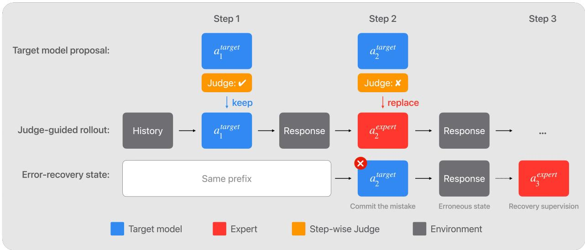
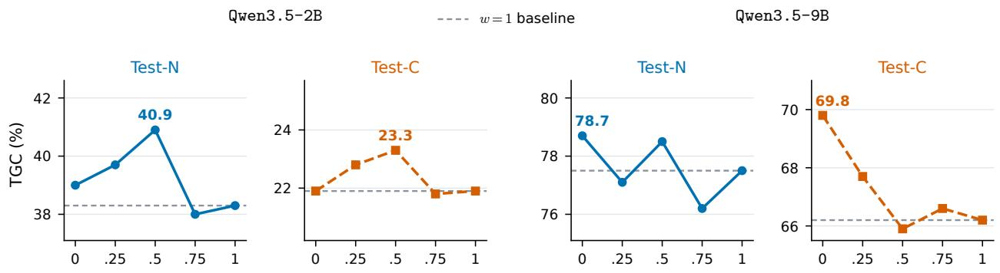
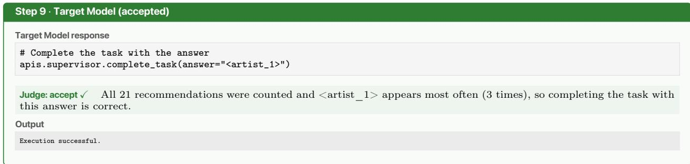

# JudgeMix: Judge-Guided Mixed-Rollout Data Synthesis for LLM Agents

Cheng-Yu Hsieh, Ting-Yao Hu, Sanjoy Chowdhury, Oncel Tuzel, Raviteja Vemulapalli

Apple

Supervised fine-tuning (SFT) on expert trajectories is a standard paradigm for training LLM agents. However, it suffers from a well-known training-inference distribution mismatch, calling for target-aware data synthesis strategies that ground the training data in the target model’s native state distribution. To bridge this gap, emerging approaches incorporate the expert either to guide mixed rollouts alongside the target model, or to provide dense step-wise supervision. Nonetheless, existing methods apply expert assistance blind to the target model’s inherent behavior: they either disrupt the rollout using sub-optimal random intervention heuristics, or they enforce indiscriminate uniform supervision that unnecessarily overwrites the model’s already-correct actions. We introduce JudgeMix, a judge-guided data synthesis framework that dynamically interleaves the target model and expert based on step-wise semantic evaluations. JudgeMix queries expert guidance precisely when the target model struggles, ensuring high trajectory success rates while keeping the state distribution aligned with the target model. It additionally uses the judge evaluation to reweight expert supervision on different steps, preserving model’s inherent valid behavior while correcting its errors. On two agentic tool-use benchmarks, AppWorld and AutomationBench, JudgeMix demonstrates consistent superior performance to existing methods, with improvements up to 10 pass@1 points.

Correspondence: Cheng-Yu Hsieh: cydhsieh@apple.com

## 1 Introduction

Autonomous LLM agents have enabled a wide variety of new AI applications by interacting with complex environments to complete multi-step tasks (Yao et al., 2022; Zhou et al., 2024; Xie et al., 2024; Merrill et al., 2026). In our daily lives, these agents serve as personal assistants for tasks like email and calendar management (Trivedi et al., 2024; Yao et al., 2024; Xiu et al., 2026); in the workplace, they automate enterprise workflows and operate specialized software (Yang et al., 2024; Drouin et al., 2024; Shepard and Salimans, 2026). To develop these capabilities, a standard practice is to train LLMs on agentic trajectory datasets with supervised fine-tuning (SFT) (Zeng et al., 2024; Qin et al., 2024; Chen et al., 2024; Raoof et al., 2026; Blakeman et al., 2026). These trajectory datasets form the foundation of agentic capabilities, teaching the model how to reason across intermediate steps, utilize appropriate tools, responding to environment feedback, and navigate complex environments to complete a task.

The standard practice for agentic SFT dataset curation is to collect golden trajectories exclusively from an expert (Qin et al., 2024; Song et al., 2024; Yang et al., 2026a). While this yields high-quality demonstration data, the curation process is agnostic to the capabilities of the specific target model to be fine-tuned. Thus, this model-agnostic data generation approach leads to a well-known distribution mismatch between the expert’s training states and the target model’s inference-time rollouts, leaving the target model brittle once it inevitably deviates from the ideal trajectory (Ross et al., 2011; Bengio et al., 2015; Agarwal et al., 2024).

This limitation motivates an emerging direction of target-aware agentic data curation, which aims to build datasets grounded in the target model’s actual state distribution (Yuan et al., 2023; Laufer et al., 2025; Sun et al., 2026). To achieve this goal while still benefiting from the expert knowledge, recent works generally incorporate both the target model and the expert into the data generation process, utilizing the expert in one of two ways (or a combination thereof): to actively guide the trajectory rollout (Laufer et al., 2025; Li et al., 2026; Da et al., 2025), or to provide dense target supervision (Agarwal et al., 2024; Sun et al., 2026). In the former, the expert generates some steps within the rollout to keep the trajectory from failing. In the latter, the expert acts as an oracle to provide target training labels at every step.

However, these approaches apply expert assistance blindly, ignoring the target model’s inherent behavior during the rollout. Specifically, when the expert is used to guide the trajectory, existing works rely on arbitrary heuristics to determine on which steps the expert intervenes. Without consideration of the actual rollout semantics, random intervention could introduce unnecessary disruption of target model’s native generation, or be too late to recover from failures. On the other hand, when the expert is used to provide supervision, current works indiscriminately apply a uniform learning weight across all rollout states. This forces the target model to mimic the expert’s actions even at states where its own native generations are valid, imposing unnecessary behavioral changes.

In this work, we introduce JudgeMix, a judge-guided data generation framework for constructing target-aware agentic SFT datasets. The core idea is to employ a judge that evaluates the semantic correctness of the target model’s proposed action at every step within a rollout. This step-wise evaluation provides valuable signal on the target model’s competence at diferent states, which JudgeMix exploits to drive three core improvements. First, JudgeMix utilizes this signal to strategically determine expert interventions: expert guidance happens only when the target model struggles. This mechanism ensures precise expert assistance at necessary steps, enabling high trajectory success rate while keeping the state distribution aligned with the target model. Second, by pinpointing the exact states where the target model fails, JudgeMix naturally collects supervision that explicitly teaches the model how to recover from its own errors. Finally, by distinguishing between the target model’s successes and failures, JudgeMix dynamically reweights the expert supervision during fine-tuning. This encourages the retention of the model’s valid, native behaviors while providing supervision to rectify its errors.

On two complex agentic tool-use benchmarks, AppWorld (Trivedi et al., 2024) and AutomationBench (Shepard and Salimans, 2026), JudgeMix demonstrates consistent improvements over existing approaches across diferent target models with varying competence. Compared to the standard model-agnostic data generation approach, JudgeMix shows up to 8 and 10 points improvements (pass@1) on AppWorld and Automation-Bench, respectively.

## 2 Preliminaries

## 2.1 Problem setup

We consider an agentic task as a sequence of interactions between an agent and an environment. Given a user query $q ,$ an agent attempts to solve the task by producing a trajectory of $\tau = ( q , a _ { 1 } , o _ { 1 } , a _ { 2 } , o _ { 2 } , \ldots , a _ { T } , o _ { T } )$ where $a _ { t }$ is the action taken by the agent at step $t ,$ and $o _ { t }$ is the corresponding environment feedback. Upon the completion of a trajectory τ, a task verifier evaluates the final outcome and yield a binary reward $r ( \tau ) \in \{ 0 , 1 \}$ , indicating the success $( r ( \tau ) = 1 )$ or failure $( r ( \tau ) = 0 )$ of the trajectory. At each step, action $a _ { t }$ is generated conditioned on the query and the interaction history observed so far $h _ { t } = ( q , a _ { 1 } , o _ { 1 } , \dots , a _ { t - 1 } , o _ { t - 1 } )$ Throughout this paper, we use the terms state and history interchangeably to refer to $h _ { t } .$

In this work, we consider the problem of training a capable agent with a target model in mind. Specifically, our goal is to curate a trajectory dataset that can most efectively maximize the downstream performance of the target model $\pi _ { \mathrm { t a r g e t } }$ via supervised fine-tuning (Wei et al., 2021; Ouyang et al., 2022; Chung et al., 2024).

## 2.2 Trajectory datasets for SFT

Supervised fine-tuning (SFT) is a standard practice to train LLM agents (Zeng et al., 2024; Chen et al., 2024; Raoof et al., 2026; Blakeman et al., 2026). Given a training dataset D consists of a collection of historytarget action pairs $( h _ { t } , a _ { t } ^ { * } )$ , the target model $\pi _ { \mathrm { t a r g e t } }$ (parameterized by θ) is trained via SFT by minimizing the objective:

$$
\mathcal { L } _ { \mathrm { S F T } } ( \theta ) = - \mathbb { E } _ { ( h _ { t } , a _ { t } ^ { * } ) \sim \mathcal { D } } \left[ \log \pi _ { \theta } ( a _ { t } ^ { * } \mid h _ { t } ) \right]\tag{2.1}
$$

Table 1 Comparison of agentic SFT dataset synthesis frameworks based on how the rollout action $( \boldsymbol a _ { t } ^ { \mathrm { r o l l o u t } } )$ and supervision target (a<sup>∗</sup>) are assigned at step t. $\pi _ { \mathrm { t a r g e t } }$ and $\pi _ { \mathrm { e x p e r t } }$ denote the target and expert models, respectively. JudgeMix generates mixed rollouts based on a semantic signal and applies judge-weighted supervision.
<table><tr><td>Data Synthesis Strategy</td><td>Rollout Action  $( a _ { t } ^ { \mathrm { { r o l l o u t } } } )$ </td><td>Supervision Target (a)</td><td>Supervised Steps</td></tr><tr><td>Expert demonstrations</td><td>πexpert</td><td>πexpert</td><td>All steps</td></tr><tr><td>Target model rejection sampling</td><td>πtarget</td><td>πtarget</td><td>All steps (if trajectory succeeds)</td></tr><tr><td>Target model rollout w/ expert supervision</td><td>πtarget</td><td>πexpert</td><td>All steps</td></tr><tr><td>Mixed rollouts (Expert Correction)</td><td>πtarget then  $\pi _ { \mathrm { e x p e r t } }$ </td><td>πexpert</td><td>Expert steps only</td></tr><tr><td>Mixed rollouts (DAgger)</td><td> $\pi _ { \mathrm { t a r g e t } }$  or πexpert (random heuristic)</td><td>πexpert</td><td>All steps</td></tr><tr><td>JudgeMix</td><td> $\pi _ { \mathrm { t a r g e t } } ~ ( \mathrm { i f ~ a c c e p t e d } ) ~ / ~ \pi _ { \mathrm { e x p e r t } } ~ ( \mathrm { i f ~ r e j e c t e d } )$ </td><td> $\pi _ { \mathrm { e x p e r t } }$ </td><td>Weighted by judge&#x27;s evaluation</td></tr></table>

Existing works adopt various strategies to construct SFT training datasets for LLM agents (Zeng et al., 2024; Qin et al., 2024; Yuan et al., 2023; Sun et al., 2026; Laufer et al., 2025). We formalize common dataset construction processes through a unified framework by decoupling how the context history $h _ { t }$ is generated from how the supervision signal $\boldsymbol { a } _ { t } ^ { * }$ is determined. Specifically, the context history $h _ { t }$ is formed by rolling out a trajectory with a data generation strategy that takes an action $a _ { t } ^ { \mathrm { { r o l l o u t } } }$ at each step t, where $h _ { t } = ( q , a _ { 1 } ^ { \mathrm { r o l l o u t } } , o _ { 1 } , \dots , a _ { t - 1 } ^ { \mathrm { r o l l o u t } } , o _ { t - 1 } )$ . Independent of the rollout, a supervision target $\boldsymbol { a } _ { t } ^ { * }$ can be concurrently determined to serve as the target action $\mathrm { g i }$ ven $h _ { t }$ . Together, this forms a $( h _ { t } , a _ { t } ^ { * } )$ pair for training.

Under this framework, we characterize prior data collection strategies for agentic SFT datasets by how they assign $a _ { t } ^ { \mathrm { r o l l o u t } }$ and $a _ { t } ^ { * }$ , as summarized in Table 1 and overviewed below:

Expert demonstrations. The most common approach relies entirely on an expert to generate both the trajectory and the learning signal (Zeng et al., 2024; Qin et al., 2024). Specifically, both the rollout action and the supervision target are determined by the expert: $a _ { t } ^ { \mathrm { r o l l o u t } } = a _ { t } ^ { * } \sim \pi _ { \mathrm { e x p e r t } } ( \cdot \mid h _ { t } )$ . While this yields high-quality data, it strictly limits the context history $h _ { t }$ to the expert’s state distribution, leading to a well-known state distribution mismatch when the target model is deployed at inference time (Ross et al., 2011; Bengio et al., 2015).

Target model rejection sampling. To avoid distribution mismatch between the expert and the target model, a straightforward approach is to sample trajectories directly from the target model itself $( a _ { t } ^ { \mathrm { r o l l o u t } } \sim$ $\pi _ { \mathrm { t a r g e t } } ( \cdot \ | \ h _ { t } ) )$ , but only retain the successful ones for supervision $( a _ { t } ^ { * } = a _ { t } ^ { \mathrm { r o l l o u t } } \mathrm { i f } r ( \tau ) = 1 )$ (Yuan et al., 2023). However, the target model may have low success rates, and the approach restricts the dataset to a narrow subset of already solvable tasks.

Target model rollout with expert supervision. To learn from an expert while staying close to the targe model’s own state distribution, this approach generates rollouts with the target model $( \boldsymbol { a } _ { t } ^ { \mathrm { r o l l o u t } } \sim \pi _ { \mathrm { t a r g e t } } ( \cdot \ \vert$ $h _ { t } ) )$ , while using the expert to provide supervision signal at every step of the trajectory $( a _ { t } ^ { * } \sim \pi _ { \mathrm { e x p e r t } } ( \cdot$ $h _ { t } ) )$ (Sun et al., 2026). This follows the spirit of on-policy distillation (Agarwal et al., 2024). However, as the target model dictates the rollout generation, the resulting trajectories may frequently fail, yielding datasets with limited exposures to states near successful completion of the tasks.

Mixed expert-target rollouts. These approaches generate rollouts by mixing target model and expert generations to maintain target model’s distribution while alleviating the low coverage of states with meaningful task progression. For instance, On-policy Expert Correction employs an expert to take over rollout generation from a target model mid-trajectory (Laufer et al., 2025). DAgger-style methods rollout a trajectory by using either the target model or the expert at diferent steps by chance (Ross et al., 2011). We include more discussion on related work in Appendix A.

## 3 Judge-guided rollout and supervision

As discussed above, synthesizing optimal target-aware agentic SFT datasets requires balancing two oftenconflicting objectives: maintaining the target model’s rollout distribution and ensuring broad coverage of trajectories containing critical late-stage states near the successful completion of a task. While prior mixed expert-target rollout approaches attempt to bridge this gap, their mechanisms for intervening with expert actions in a rollout are inherently blind to the target model’s actual behavior.

  
Figure 1 Overview of the JudgeMix framework: Given the history at each step, target model first proposes an action followed by the evaluation of the judge that determines if the action makes reasonable progress of solving the task or not. When accepted by the judge, the target model’s action is kept and the rollout continues; when the target model’s action is deemed wrong by the judge, expert intervenes and provides a correct action to guide the rollout (Sec. 3.1). At training time, each state in the rollout is paired with the expert’s action for supervision, where JudgeMix further uses the judge results to downweight steps where the target model already succeeds (Sec. 3.2). Bottom: Additionally, JudgeMix enables collection of erroneous states at steps where the target model fails. These states allow us to obtain corresponding error-recovery supervision.

Specifically, On-policy Expert Correction (Laufer et al., 2025) relies on a heuristic intervention point that may trigger prematurely and disrupt a valid trajectory from the target model; or it may trigger too late after unrecoverable errors have occurred. Furthermore, as the expert completes the entire rollout after the intervention point, the remainder of the trajectory sufers from the same distribution mismatch as pure expert demonstrations. Similarly, DAgger (Ross et al., 2011) employs a random intervention mechanism that overlooks where the target model actually requires assistance. By randomly inserting expert actions, DAgger could overwrite correct target model behaviors, forcing unnecessary distribution shifts; or it could fail to intervene when the target model genuinely makes a mistake.

To overcome these limitations, we introduce JudgeMix, a framework that dynamically interleaves the target model and expert during rollout generation based on the semantic correctness of the target model’s prediction at each step. By employing a judge to provide this per-step evaluation, JudgeMix utilizes the resulting semantic signal to guide trajectory generation with precise expert intervention (Sec. 3.1), and to provide finer-grained control over how expert supervision is applied (Sec. 3.2). Fig. 1 provides an overview of the framework.

## 3.1 Judge-guided expert intervention

In the JudgeMix framework, the target model initiates and drives the rollout for a given task query. At each step t with history $h _ { t }$ , the target model generates a candidate action $a _ { t } ^ { \mathrm { { t a r g e t } } } \sim \pi _ { \mathrm { { t a r g e t } } } ( \cdot \mid h _ { t } )$ . Rather than immediately committing to this action or blindly overwriting it based on an arbitrary heuristic, we utilize a judge (typically instantiated by the expert) to provide a binary evaluation $\mathcal { I } ( a _ { t } ^ { \mathrm { t a r g e t } } , h _ { t } ) \in \{ 0 , 1 \}$ . This judge determines whether the proposed action is a semantically correct and productive step toward completing the task: $\mathcal { I } ( a _ { t } ^ { \mathrm { t a r g e t } } , h _ { t } ) = 1 ;$ or otherwise $\mathcal { I } ( a _ { t } ^ { \mathrm { t a r g e t } } , h _ { t } ) = 0$

Based on the output of ${ \mathcal { I } } ,$ JudgeMix continues the rollout using the target model’s proposed action $a _ { t } ^ { \mathrm { t a r g e t } }$ if the judge deems it correct. Conversely, if the proposed step is considered wrong, JudgeMix intervenes in the trajectory with an expert, substituting the action with $a _ { t } ^ { \mathrm { e x p e r t } } \sim \pi _ { \mathrm { e x p e r t } } ( \cdot \mid h _ { t } )$ to keep the trajectory on track. Formally, the rollout action $a _ { t } ^ { \mathrm { r o l l o u t } }$ is assigned conditionally:

$$
a _ { t } ^ { \mathrm { r o l l o u t } } = \left\{ \begin{array} { l l } { a _ { t } ^ { \mathrm { t a r g e t } } } & { \mathrm { i f } ~ \mathcal { I } ( a _ { t } ^ { \mathrm { t a r g e t } } , h _ { t } ) = 1 } \\ { a _ { t } ^ { \mathrm { e x p e r t } } } & { \mathrm { i f } ~ \mathcal { I } ( a _ { t } ^ { \mathrm { t a r g e t } } , h _ { t } ) = 0 } \end{array} \right.\tag{3.1}
$$

We denote the set of histories collected by rolling out the trajectory with these conditionally assigned actions as ${ \mathcal { H } } _ { \operatorname* { m a i n } }$ . This judge-guided framework provides a principled mechanism for expert intervention, leading to higher trajectory success rates (as seen in Sec. 4) while keeping the rollout distribution close to that of the target model.

States for error recovery. Beyond keeping the trajectory on track, the per-step judge evaluation in JudgeMix enables precise identification of failure states reached by the target model. This valuable information naturally provides the opportunity to collect states for learning error recovery. Specifically, when the judge rejects a proposed action $( \mathcal { I } ( \bar { a } _ { t } ^ { \mathrm { t a r g e t } } , h _ { t } ) = 0 )$ , independent from replacing the step as in Eq. (3.1) to continue the main rollout, we can additionally collect an error-inclusive history. By temporarily committing the incorrect action $\dot { a } _ { t } ^ { \mathrm { t a r g e t } }$ to the environment, we advance the trajectory and record the resulting failure state: $h _ { t + 1 } ^ { \mathrm { e r r o r } } = ( h _ { t } , a _ { t } ^ { \mathrm { t a r g i t } } , o _ { t } )$ . This yields a supplementary set of error states, $\mathcal { H } _ { \mathrm { e r r o r } }$ , which we later pair with expert corrective actions to teach error-recovery behaviors, as discussed below.

## 3.2 Judge-guided supervision reweighting

With the rollout states collected above, we now define the supervision targets for fine-tuning. First, we combine the histories from the main trajectory and the supplementary error states into a unified set: $\mathcal { H } _ { \mathrm { a l l } } =$ $\mathcal { H } _ { \operatorname* { m a i n } } \cup \mathcal { H } _ { \mathrm { e r r o r } }$ . For every history $h _ { t } \in \mathcal { H } _ { \mathrm { a l l } }$ , we query the expert to obtain its action, assigning it as the ground-truth supervision target $( a _ { t } ^ { * } \sim \pi _ { \mathrm { e x p e r t } } ( \cdot \mid h _ { t } ) )$ . This yields our final training dataset of history-action pairs:

$$
\mathcal { D } = \{ \left( h _ { t } , a _ { t } ^ { * } \right) \mid h _ { t } \in \mathcal { H } _ { \mathrm { a l l } } \}\tag{3.2}
$$

The standard SFT objective, Eq. (2.1), applies a uniform learning signal to every state-action pair in D. This efectively forces the target model to mimic the expert in all situations, regardless of its native competence at each state. However, for a state $h _ { t }$ where the target model already predicts a valid action $( { \mathrm { i . e . , ~ } } { \mathcal { I } } ( a _ { t } ^ { \mathrm { t a r g e t } } , h _ { t } ) =$ 1), overwriting this original behavior and forcing unnecessary changes may be sub-optimal. Conversely, states where the target model fails require strong corrective supervision. Therefore, in JudgeMix, we propose to downweight the learning signal on steps where the target model is already successful—preserving its inherent action—while maintaining full supervision strength for correcting its mistakes.

Formally, for each training pair $( h _ { t } , a _ { t } ^ { \ast } ) \in \mathcal { D }$ , we assign a supervision weight $\omega _ { t }$ based on the judge’s evaluation of the target model’s native prediction at that state:

$$
\omega _ { t } = { \left\{ \begin{array} { l l } { w } & { { \mathrm { i f ~ } } { \mathcal { I } } ( a _ { t } ^ { \mathrm { t a r g e t } } , h _ { t } ) = 1 } \\ { 1 } & { { \mathrm { i f ~ } } { \mathcal { I } } ( a _ { t } ^ { \mathrm { t a r g e t } } , h _ { t } ) = 0 } \end{array} \right. }\tag{3.3}
$$

where $w \in [ 0 , 1 ]$ is a downweighting factor applied to the already-correct states. The target model is then trained using a weighted SFT objective:

$$
{ \mathcal { L } } _ { \mathrm { W e i g h t e d - S F T } } ( \theta ) = - \mathbb { E } _ { \mathcal { D } } \left[ \omega _ { t } \log \pi _ { \theta } ( a _ { t } ^ { * } \mid h _ { t } ) \right]\tag{3.4}
$$

By dynamically reweighting the loss, Eq. (3.4) ensures that the target model is not forced to blindly mimic the expert, allowing it the flexibility to retain its inherent correct behavior. In practice, the value of w can be chosen using a validation set.

## 4 Experiments

## 4.1 Experimental setup

Benchmarks. We evaluate JudgeMix on two complex agentic tool-use benchmarks. AppWorld tests the agent’s ability to act as a personal assistant navigating daily mobile applications with underlying stateful databases (Trivedi et al., 2024). AutomationBench evaluates the agent’s capability to complete professional workplace workflows by operating specialized enterprise software (Shepard and Salimans, 2026). For AppWorld, we utilize the training task split to synthesize datasets for all frameworks considered, and report downstream performances on Test-Normal (Test-N) and Test-Challenge (Test-C) sets. Test-N set includes in-distribution tasks requiring use of seen tools, while Test-C set evaluates the agent’s generalization to solving out-of-distribution tasks requiring use of unseen tools. Following the standard AppWorld evaluation protocol, we report both Task Goal Completion (TGC) and Scenario Goal Completion (SGC) on these sets. TGC measures whether the agent’s success rate in successfully completing individual tasks, while SGC is a robustness metric evaluating whether the agent correctly solves all task variants from the same scenario. For AutomationBench, we follow the same structure and split the original public tasks into Train, Dev, Test-N (in-distribution) and Test-C (out-of-distribution) splits. We include more detail on the benchmark dataset statistics in Appendix B.

Expert and target models. Across all data synthesis frameworks, we employ a highly capable model as the expert. Specifically, we use GLM-5.1 for AppWorld and GLM-5.2 for AutomationBench (GLM-5-Team et al., 2026), as they achieve the highest performance on their respective benchmarks. We consider Qwen3.5-9B and Qwen3.5-2B as the target models in our experiments (Qwen Team, 2026).

Baselines. We compare JudgeMix against established paradigms for synthesizing agentic SFT datasets, as categorized in Table 1.

• Expert Demonstrations: The standard target model-agnostic approach that samples trajectories from the expert, where the final history-action pairs are constructed from only the successful trajectories with r(τ) = 1 (Zeng et al., 2024; Qin et al., 2024; Yang et al., 2026a).

• Rejection Sampling Finetuning (RFT): Target model generates the entire trajectory. Successful trajectories are kept to form history-action pairs (Yuan et al., 2023).

• Step-level RFT: A more granular variant of RFT that additionally removes incorrect steps from the RFT trajectories. We use the same judge model as in JudgeMix to evaluate the correctness of each step.

• Step-level OPD: Target model generates the rollouts with expert supervision applied at every step (Sun et al., 2026). Following the original approach, we do not use the task verifier for trajectory filtration.

• On-policy Expert Correction (OEC): Target model begins the trajectory and the expert takes over at some step k sampled from a uniform distribution U(0, K) (Laufer et al., 2025). History-action pairs are formed only on the expert steps in successful trajectories. In the experiments, we set K = 10 which ensures most trajectories would contain a least one expert step.

• DAgger: In generating a trajectory, each step is generated by the target model with probability β or otherwise the expert. Each step in the rollouts is then paired with an expert supervision with no trajectory filtering (Ross et al., 2011). Here, we generate the dataset once instead of iteratively with interleaved model training as considered in the original work. We set β = 0.5 in the experiments.

For all data generation frameworks including JudgeMix, we report further implementation detail in Appendix C. In addition, we show example trajectories from JudgeMix in Appendix D.

Evaluation protocol. To compare the overall efectiveness of diferent data generation strategies, we apply a fixed trajectory generation budget. In particular, every method generates a fixed number of trajectories (i.e., 8 trajectories per training task) from which the training pairs (h<sub>t</sub>, a<sup>∗</sup>) are constructed. We then apply SFT to the target model with Eq. (2.1), and report the downstream pass@1 (averaged over 8 runs) of the fine-tuned model on the benchmarks. We report the detailed statistics of the generated trajectory datasets in Appendix E, and detailed experimental setup including training hyperparameters in Appendix F.

## 4.2 Main results

In Table 2, we report the downstream performance of the target models fine-tuned using each data synthesis framework on AppWorld and AutomationBench. Overall, we see JudgeMix demonstrates significant improvements over existing baselines, achieving the highest performance consistently across all target models and benchmarks.

First, compared to Expert Demonstrations, JudgeMix achieves superior performance (up to 10 points on AutomationBench Test-N) by incorporating the target model into the trajectory generation process. We observer similar, although smaller, improvements from other baselines that as well ground trajectory generation with the target model, such as OEC and DAgger. This validates that while Expert Demonstrations provide the highest-quality trajectories, the inherent distribution mismatch between the expert and the target model makes purely expert data sub-optimal for target model training.

Table 2 Downstream performance (pass@1 averaged over 8 runs) of target models fine-tuned using various data synthesis frameworks on AppWorld and AutomationBench. Compared to existing data synthesis strategies, JudgeMix consistently achieves the highest performance across all target model sizes. Note that RFT and Step-level RFT are not applicable on AppWorld with Qwen3.5-2B model given its near-zero untrained model performance.
<table><tr><td rowspan="3">Method</td><td colspan="8">AppWorld</td><td colspan="2">AutomationBench</td></tr><tr><td colspan="4">Qwen3.5-2B</td><td colspan="4">Qwen3.5-9B</td><td colspan="2">Qwen3.5-9B</td></tr><tr><td>Test-N</td><td></td><td>Test-C</td><td></td><td>Test-N</td><td></td><td>Test-C</td><td></td><td>Test-N</td><td>Test-C</td></tr><tr><td></td><td>TGC</td><td>SGC</td><td>TGC</td><td>SGC</td><td>TGC</td><td>SGC</td><td>TGC</td><td>SGC</td><td>TGC</td><td>TGC</td></tr><tr><td>Target Base Model (Zero-shot)</td><td>0.1</td><td>0.0</td><td>0.2</td><td>0.1</td><td>25.2</td><td>14.1</td><td>15.4</td><td>8.0</td><td>4.0</td><td>1.0</td></tr><tr><td>Expert Demonstrations RFT</td><td>32.1</td><td>22.8</td><td>19.2</td><td>12.1</td><td>77.4 52.4</td><td>65.9 38.0</td><td>65.0 37.1</td><td>52.7 24.8</td><td>17.8 7.6</td><td>8.6</td></tr><tr><td>Step-level RFT</td><td></td><td></td><td></td><td></td><td>59.2</td><td>45.3</td><td>46.5</td><td>32.6</td><td>11.1</td><td>4.5 5.9</td></tr><tr><td></td><td>17.2</td><td>10.0</td><td>8.0</td><td>4.5</td><td>77.8</td><td>67.6</td><td>67.2</td><td>55.0</td><td>13.4</td><td>8.0</td></tr><tr><td>Step-level OPD On-policy Expert Correction</td><td>34.8</td><td>23.9</td><td>18.1</td><td>11.4</td><td>77.9</td><td>67.4</td><td>67.9</td><td>55.8</td><td>14.0</td><td>7.9</td></tr><tr><td></td><td>35.6</td><td>25.5</td><td>19.2</td><td>11.6</td><td>77.0</td><td>65.2</td><td>66.0</td><td>53.1</td><td>21.0</td><td>15.0</td></tr><tr><td>DAgger JudgeMix</td><td>40.9</td><td>29.9</td><td>23.3</td><td>14.6</td><td>78.7</td><td>67.6</td><td>69.8</td><td>57.8</td><td>28.5</td><td>15.1</td></tr></table>

When compared to RFT—a purely target model-driven approach—our results highlight the critical need for expert supervision, particularly when the target model lacks the capability to generate successful rollouts. Interestingly, by utilizing the judge to provide finer-grained feedback at the step level, Step-level RFT improves upon standard RFT. This confirms that the judge’s per-step semantic evaluations are indeed valuable. However, Step-level RFT still exhibits a significant performance gap compared to methods that directly leverage the expert for action supervision.

By applying dense expert supervision to target model rollouts, Step-level OPD significantly improves over the RFT variants. For the more capable Qwen3.5-9B model on AppWorld, it ranks among the top-performing baselines, surpassing Expert Demonstrations. This further demonstrates the value of grounding training data close the target model’s rollout distribution. However, when applied to the weaker Qwen3.5-2B model or the more complex AutomationBench, Step-level OPD sufers a severe performance drop. This results from that the less capable target model frequently fails on challenging tasks, leading to a rollout distribution with limited coverage of successful, late-stage behaviors.

Finally, while we observe that the mixed-rollout baselines (OEC and DAgger) generally outperform Expert Demonstrations and Step-level OPD—validating the overall benefit of interleaving the expert and target model in trajectory generation, JudgeMix consistently surpasses these strong baselines. Compared to DAgger, which often serves as the runner-up method, JudgeMix gains an improvement with a margin more than 5 and 7 points on AppWorld and AutomationBench respectively. This is achieved through two key mechanisms. First, it utilizes a judge to provide expert guidance precisely when the target model struggles. Second, it leverages this semantic evaluation to dynamically reweight the supervision strength based on the target model’s behavior.

## 4.3 Ablation studies

To isolate the contributions of our framework, we conduct ablations on the core mechanisms of JudgeMix.

The value of semantic-based guidance. We evaluate the importance of semantic-based expert intervention. Specifically, we investigate whether JudgeMix’s performance gains stem from intervening precisely at steps where target model makes a mistake, or merely from the presence of expert actions within the rollout. To test this, we strip of the weighted supervision component from JudgeMix, where we apply equal supervision weights on all history-action pairs. We consider DAgger as the comparison baseline where the expert intervene the rollout at random steps regardless of whether the target model succeeds or struggles at those steps.

Table 3 Ablation study on the efect of judge-guided expert intervention. By comparing JudgeMix (without weighted supervision, i.e., w = 1 in Eq. (3.3)) against DAgger, we demonstrate the performance gains of intervening based on semantic correctness rather than random mixing heuristics.
<table><tr><td rowspan="3">Method</td><td colspan="4">AppWorld</td><td colspan="2">AutomationBench</td></tr><tr><td colspan="2">Qwen3.5-2B</td><td colspan="2">Qwen3.5-9B</td><td colspan="2">Qwen3.5-9B</td></tr><tr><td>Test-Normal</td><td>Test-Challenge</td><td>Test-Normal</td><td>Test-Challenge</td><td>Test-Normal</td><td>Test-Challenge</td></tr><tr><td></td><td>TGC</td><td>TGC</td><td>TGC</td><td>TGC</td><td>TGC</td><td>TGC</td></tr><tr><td>DAgger</td><td>35.6</td><td>19.2</td><td>77.0</td><td>66.0</td><td>21.0</td><td>15.0</td></tr><tr><td>JudgeMix (w = 1)</td><td>38.3</td><td>21.9</td><td>77.5</td><td>66.2</td><td>28.5</td><td>15.1</td></tr></table>

  
Supervision weight at correct steps w  
Figure 2 Ablation study on the efect of weighted supervision as w varies in Eq. (3.3). We plot performance on AppWorld Test-N and Test-C with Qwen3.5-2B and Qwen3.5-9B models. Dashed lines mark the w = 1 baseline. We observe that down-weighting the supervision signal on the target model’s already-successful states improves downstream performance.

In Table 3, we see clear performance improvements moving from DAgger’s random intervention mechanism to JudgeMix’s semantic-based guidance. The gain is especially clear on scenarios where the initial target model struggles more, for instance, on AppWorld with Qwen3.5-2B. We conjecture this gain comes from the fact that precise expert guidance can most efectively assist the target model in generating successful trajectories. As seen in Appendix E, judge-guided rollout improves the trajectory pass rate over random intervention by a significant margin of 27 pass@1 points.

The effect of weighted supervision. To understand the benefits of utilizing the judge’s evaluation to dynamically reweight the learning signal on diferent steps, we show how model’s downstream performance changes as w varies in Eq. (3.4).

As shown in Fig. 2, for Qwen3.5-9B model, decreasing the supervision weight on steps where the target model is already correct consistently improves performance. In fact, performance peaks at w = 0, where no supervision is applied at steps where target model generates a correct action. Interestingly, for the weaker Qwen3.5-2B model, we see a sweet spot at w = 0.5. This highlights a trade-of between maximally exploiting expert supervision and preserving the target model’s native behavior. We conjecture that even when a weaker model produces a correct action, its underlying reasoning path may be sub-optimal. Consequently, partially overwriting these behaviors remains beneficial, unlike with a stronger target model whose native reasoning is more robust to keep.

The impact of error-recovery data. As discussed in Sec. 3.1, a key advantage of our judge-guided framework is the ability to identify target model errors and collect targeted supervision on how to fix them. This exposes the model to error-correction behaviors if encountered at inference time. Here, we evaluate the performance gains provided by including this error-recovery data. In Table 4, we see consistent benefits by including error-recovery data in JudgeMix. The improvement is especially significant on Qwen3.5-2B model, with 7.5 and 5 points pass@1 gain on AppWorld Test-N and Test-C sets respectively. We conjecture the larger gain results from that the weaker target model encounters erroneous steps more often, allowing it to benefit more heavily from the error-correction supervision.

Table 4 Ablation study on the efect of error-recovery data. Including this supplementary data in JudgeMix yields significant improvements, particularly for the weaker Qwen3.5-2B model. This suggests the value of explicitly teaching the target models how to correct from their native failure states.
<table><tr><td rowspan="3">Method</td><td colspan="4">AppWorld</td></tr><tr><td colspan="2">Qwen3.5-2B</td><td colspan="2">Qwen3.5-9B</td></tr><tr><td>Test-N</td><td>Test-C</td><td>Test-N</td><td>Test-C</td></tr><tr><td></td><td>TGC</td><td>TGC</td><td>TGC</td><td>TGC</td></tr><tr><td rowspan="2">JudgeMix w/o error-recovery JudgeMix</td><td>33.4</td><td>18.3</td><td>77.5</td><td>68.2</td></tr><tr><td>40.9</td><td>23.3</td><td>78.7</td><td>69.8</td></tr></table>

Table 5 Downstream performance (pass@1) of target models fine-tuned using various data synthesis frameworks on the AppWorld benchmark, assuming no task verifier for trajectory filtration.
<table><tr><td rowspan="3">Method</td><td colspan="4">AppWorld</td></tr><tr><td colspan="2">Qwen3.5-2B</td><td colspan="2">Qwen3.5-9B</td></tr><tr><td>Test-N</td><td>Test-C</td><td>Test-N</td><td>Test-C</td></tr><tr><td></td><td>TGC</td><td>TGC</td><td>TGC</td><td>TGC</td></tr><tr><td>Expert Demonstrations</td><td>32.1</td><td>17.8</td><td>77.9</td><td>60.7</td></tr><tr><td>Step-level RFT</td><td>0.0</td><td>0.1</td><td>49.0</td><td>36.5</td></tr><tr><td>Step-level OPD</td><td>17.2</td><td>8.0</td><td>77.8</td><td>67.2</td></tr><tr><td>On-policy Expert Correction</td><td>33.0</td><td>18.7</td><td>78.7</td><td>66.9</td></tr><tr><td>DAgger</td><td>35.6</td><td>19.2</td><td>77.0</td><td>66.0</td></tr><tr><td>JudgeMix</td><td>42.6</td><td>24.5</td><td>77.5</td><td>69.1</td></tr></table>

## 4.4 The effect of task verifier

So far, we have assumed that each agentic task comes with a ground-truth verifier that provides a trajectory reward r(τ) indicating the overall success or failure of the rollout. As noted in Sec. 4.1, various baseline approaches as well as JudgeMix utilize this reward to filter for successful trajectories during dataset construction. However, in many open-ended agentic scenarios, reliable programmatic verifiers are not always available (Qin et al., 2024; Lee et al., 2026; He et al., 2024; Xue et al., 2025). Thus, we investigate how the absence of task-success verifiers impacts the efectiveness of the considered data synthesis frameworks.

In Table 5, we see that JudgeMix maintains its strong performance without relying on task verifier for providing trajectory reward, significantly outperforming all baseline strategies on the Qwen3.5-2B model and achieving the highest out-of-distribution generalization (69.1 on Test-C) on the Qwen3.5-9B model. Notably, methods such as Expert Demonstrations and Step-level RFT sufer greater performance drops when groundtruth verifiers are removed. Overall, these results demonstrate the robustness of JudgeMix and confirm its applicability to open-ended agentic tasks where final trajectory rewards are not always available.

## 5 Conclusion

We introduce JudgeMix, a target-aware data generation framework for agentic SFT datasets. The core design of JudgeMix is to employ a judge to provide step-wise evaluation of the target model’s behavior during rollouts. This semantic signal then allows principled expert guidance, collection of error-recovery states, and strategic supervision reweighting. Empirically, JudgeMix demonstrates consistent performance improvements over the standard model-agnostic approach as well as concurrent model-targeted synthesis frameworks.

## Limitations

We acknowledge several limitations of the proposed JudgeMix framework. First, as the framework is intentionally target-aware, the synthesized dataset is coupled to the specific target model used in generation. Unlike standard model-agnostic datasets which can be generated once and used for any downstream models, JudgeMix requires a separate data generation process for each target model to ensure its efectiveness. We view this as an inherent trade-of between dataset reusability and the optimization of model downstream performance. We leave exploration in potential cross-model transfer to future work.

Second, JudgeMix introduces potential computational overhead during its dataset generation process, as it additionally queries a judge to evaluate the target model’s proposed action at every step. However, with precise expert interventions, the resultant rollouts from JudgeMix achieve higher success rates often with shorter trajectory lengths, making the overall synthesis process highly tractable.

Finally, the efectiveness of JudgeMix is ultimately determined by the reliability of the judge. In open-ended domains where intermediate task progress may be ambiguous, an unreliable judge could produce incorrect evaluation, hurting the rollout quality and the supervision reweighting efectiveness. However, our empirical results indicate that current open-sourced models are highly capable of providing reliable step-wise evaluations. As seen in our experiments (Table 2), Step-level RFT yields significant improvements over standard RFT, validating that the judge’s evaluation is indeed informative and beneficial in practice.

## References

Rishabh Agarwal, Nino Vieillard, Yongchao Zhou, Piotr Stanczyk, Sabela Ramos Garea, Matthieu Geist, and Olivier Bachem. 2024. On-policy distillation of language models: Learning from self-generated mistakes. In International Conference on Learning Representations, volume 2024, pages 21246–21263.

Samy Bengio, Oriol Vinyals, Navdeep Jaitly, and Noam Shazeer. 2015. Scheduled sampling for sequence prediction with recurrent neural networks. Advances in neural information processing systems, 28.

Aaron Blakeman, Aaron Thomas, Aastha Jhunjhunwala, Abhibha Gupta, Abhinav Khattar, Adam Rajfer, Adi Renduchintala, Adil Asif, Aditya Vavre, Adriana Flores Miranda, et al. 2026. Nemotron 3 ultra: Open, eficient mixture-of-experts hybrid mamba-transformer model for agentic reasoning. arXiv preprint arXiv:2606.15007.

Zehui Chen, Kuikun Liu, Qiuchen Wang, Wenwei Zhang, Jiangning Liu, Dahua Lin, Kai Chen, and Feng Zhao. 2024. Agent-FLAN: Designing data and methods of efective agent tuning for large language models. In Findings of the Association for Computational Linguistics: ACL 2024, pages 9354–9366, Bangkok, Thailand. Association fo Computational Linguistics.

Hyung Won Chung, Le Hou, Shayne Longpre, Barret Zoph, Yi Tay, William Fedus, Yunxuan Li, Xuezhi Wang, Mostafa Dehghani, Siddhartha Brahma, et al. 2024. Scaling instruction-finetuned language models. Journal of machine learning research, 25(70):1–53.

Jef Da, Clinton Wang, Xiang Deng, Yuntao Ma, Nikhil Barhate, and Sean Hendryx. 2025. Agent-rlvr: Training software engineering agents via guidance and environment rewards. arXiv preprint arXiv:2506.11425.

Alexandre Drouin, Maxime Gasse, Massimo Caccia, Issam H Laradji, Manuel Del Verme, Tom Marty, Léo Boisvert, Megh Thakkar, Quentin Cappart, David Vazquez, et al. 2024. Workarena: How capable are web agents at solving common knowledge work tasks? arXiv preprint arXiv:2403.07718.

GLM-5-Team, :, Aohan Zeng, Xin Lv, Zhenyu Hou, Zhengxiao Du, Qinkai Zheng, Bin Chen, Da Yin, Chendi Ge, Chenghua Huang, Chengxing Xie, Chenzheng Zhu, Congfeng Yin, Cunxiang Wang, Gengzheng Pan, Hao Zeng, Haoke Zhang, Haoran Wang, and 168 others. 2026. Glm-5: from vibe coding to agentic engineering. Preprint, arXiv:2602.15763.

Hongliang He, Wenlin Yao, Kaixin Ma, Wenhao Yu, Yong Dai, Hongming Zhang, Zhenzhong Lan, and Dong Yu. 2024. Webvoyager: Building an end-to-end web agent with large multimodal models. In Proceedings of the 62nd Annual Meeting of the Association for Computational Linguistics (Volume 1: Long Papers), pages 6864–6890.

Mengkang Hu, Pu Zhao, Can Xu, Qingfeng Sun, Jian-Guang Lou, Qingwei Lin, Ping Luo, and Saravan Rajmohan. 2025. Agentgen: Enhancing planning abilities for large language model based agent via environment and task generation. In Proceedings of the 31st ACM SIGKDD Conference on Knowledge Discovery and Data Mining V. 1, pages 496–507.

Woosuk Kwon, Zhuohan Li, Siyuan Zhuang, Ying Sheng, Lianmin Zheng, Cody Hao Yu, Joseph E. Gonzalez, Hao Zhang, and Ion Stoica. 2023. Eficient memory management for large language model serving with pagedattention. In Proceedings of the ACM SIGOPS 29th Symposium on Operating Systems Principles.

Niklas Laufer, Xiang Deng, Srivatsa Kundurthy, Brad Kenstler, and Jef Da. 2025. Imitation learning for multi-turn lm agents via on-policy expert corrections. arXiv preprint arXiv:2512.14895.

Seanie Lee, Sanjoy Chowdhury, Chao Jiang, Cheng-Yu Hsieh, Ting-Yao Hu, Alexander T Toshev, Oncel Tuzel, and Raviteja Vemulapalli. 2026. Environment-free synthetic data generation for api-calling agents. arXiv preprint arXiv:2607.16900.

Gengsheng Li, Mao Zheng, Mingyang Song, Ruiqi Liu, Tianyu Yang, Jie Sun, Qiyong Zhong, Haiyun Guo, Junfeng Fang, Dan Zhang, et al. 2026. On-policy distillation with curriculum turn-level guidance for multi-turn agents. arXiv preprint arXiv:2606.15912.

Mike A Merrill, Alexander Glenn Shaw, Nicholas Carlini, Boxuan Li, Harsh Raj, Ivan Bercovich, Lin Shi, Jeong Yeon Shin, Thomas Walshe, E. Kelly Buchanan, Junhong Shen, Guanghao Ye, Haowei Lin, Jason Poulos, Maoyu Wang, Marianna Nezhurina, Di Lu, Orfeas Menis Mastromichalakis, Zhiwei Xu, and 65 others. 2026. Terminal-bench: Benchmarking agents on hard, realistic tasks in command line interfaces. In The Fourteenth International Confer ence on Learning Representations.

Long Ouyang, Jefrey Wu, Xu Jiang, Diogo Almeida, Carroll Wainwright, Pamela Mishkin, Chong Zhang, Sandhini Agarwal, Katarina Slama, Alex Ray, et al. 2022. Training language models to follow instructions with human feedback. Advances in neural information processing systems, 35:27730–27744.

Akshara Prabhakar, Zuxin Liu, Ming Zhu, Jianguo Zhang, Tulika Manoj Awalgaonkar, Shiyu Wang, Zhiwei Liu, Haolin Chen, Thai Hoang, Juan Carlos Niebles, et al. 2026. Apigen-mt: Agentic pipeline for multi-turn data generation via simulated agent-human interplay. Advances in Neural Information Processing Systems, 38.

Yujia Qin, Shihao Liang, Yining Ye, Kunlun Zhu, Lan Yan, Yaxi Lu, Yankai Lin, Xin Cong, Xiangru Tang, Bill Qian, et al. 2024. Toolllm: Facilitating large language models to master 16000+ real-world apis. In International Conference on Learning Representations, volume 2024, pages 9695–9717.

Qwen Team. 2026. Qwen3.5: Towards native multimodal agents.

Negin Raoof, Richard Zhuang, Marianna Nezhurina, Etash Guha, Atula Tejaswi, Ryan Marten, Charlie F Ruan, Tyler Griggs, Alexander Glenn Shaw, Hritik Bansal, et al. 2026. Openthoughts-agent: Data recipes for agentic models. arXiv preprint arXiv:2606.24855.

Stéphane Ross, Geofrey Gordon, and Drew Bagnell. 2011. A reduction of imitation learning and structured prediction to no-regret online learning. In Proceedings of the fourteenth international conference on artificial intelligence and statistics, pages 627–635. JMLR Workshop and Conference Proceedings.

Daniel Shepard and Robin Salimans. 2026. Automationbench. arXiv preprint arXiv:2604.18934.

Yifan Song, Weimin Xiong, Xiutian Zhao, Dawei Zhu, Wenhao Wu, Ke Wang, Cheng Li, Wei Peng, and Sujian Li. 2024. AgentBank: Towards generalized LLM agents via fine-tuning on 50000+ interaction trajectories. In Findings of the Association for Computational Linguistics: EMNLP 2024, pages 2124–2141, Miami, Florida, USA. Association for Computational Linguistics.

Changhui Sun, Lanbo Liu, Hang Lei, Tong Ling, Jiahang Xie, Zhiyong Zheng, Yujia Wang, Hao Liu, Feng Xiao, Lu Liu, et al. 2026. Step-level on-policy distillation: Interpolating between on-policy distillation and supervised fine-tuning. arXiv preprint arXiv:2608.16333.

Harsh Trivedi, Tushar Khot, Mareike Hartmann, Ruskin Manku, Vinty Dong, Edward Li, Shashank Gupta, Ashish Sabharwal, and Niranjan Balasubramanian. 2024. Appworld: A controllable world of apps and people for benchmarking interactive coding agents. In Proceedings of the 62nd Annual Meeting of the Association for Computational Linguistics (Volume 1: Long Papers), pages 16022–16076.

Jason Wei, Maarten Bosma, Vincent Y Zhao, Kelvin Guu, Adams Wei Yu, Brian Lester, Nan Du, Andrew M Dai, and Quoc V Le. 2021. Finetuned language models are zero-shot learners. arXiv preprint arXiv:2109.01652.

Tianbao Xie, Danyang Zhang, Jixuan Chen, Xiaochuan Li, Siheng Zhao, Ruisheng Cao, Toh J Hua, Zhoujun Cheng, Dongchan Shin, Fangyu Lei, et al. 2024. Osworld: Benchmarking multimodal agents for open-ended tasks in real computer environments. Advances in Neural Information Processing Systems, 37:52040–52094.

Zidi Xiu, David Q Sun, Kevin Cheng, Maitrik Patel, Yizhe Zhang, Jiarui Lu, Omar Attia, Raviteja Vemulapalli, Oncel Tuzel, Meng Cao, et al. 2026. Astra-bench: Evaluating tool-use agent reasoning and action planning with personal user context. arXiv preprint arXiv:2603.01357.

Tianci Xue, Weijian Qi, Tianneng Shi, Chan Hee Song, Boyu Gou, Dawn Song, Huan Sun, and Yu Su. 2025. An illusion of progress? assessing the current state of web agents. arXiv preprint arXiv:2504.01382.

John Yang, Carlos Jimenez, Alexander Wettig, Kilian Lieret, Shunyu Yao, Karthik Narasimhan, and Ofir Press. 2024. Swe-agent: Agent-computer interfaces enable automated software engineering. Advances in Neural Information Processing Systems, 37:50528–50652.

John Yang, Kilian Lieret, Carlos Jimenez, Alexander Wettig, Kabir Khandpur, Yanzhe Zhang, Binyuan Hui, Ofir Press, Ludwig Schmidt, and Diyi Yang. 2026a. Swe-smith: Scaling data for software engineering agents. Advances in Neural Information Processing Systems, 38.

Shidong Yang, Ziyu Ma, Tongwen Huang, Yiming Hu, Yong Wang, and Xiangxiang Chu. 2026b. Coevolve: Training llm agents via agent-data mutual evolution. In Proceedings of the 64th Annual Meeting of the Association for Computational Linguistics (Volume 1: Long Papers), pages 23015–23036.

Shunyu Yao, Noah Shinn, Pedram Razavi, and Karthik Narasimhan. 2024. τ-bench: A Benchmark for Tool-Agent-Use Interaction in Real-World Domains. arXiv preprint arXiv:2406.12045.

Shunyu Yao, Jefrey Zhao, Dian Yu, Nan Du, Izhak Shafran, Karthik Narasimhan, and Yuan Cao. 2022. React: Synergizing reasoning and acting in language models. arXiv preprint arXiv:2210.03629.

Zheng Yuan, Hongyi Yuan, Chengpeng Li, Guanting Dong, Keming Lu, Chuanqi Tan, Chang Zhou, and Jingren Zhou. 2023. Scaling relationship on learning mathematical reasoning with large language models. arXiv preprint arXiv:2308.01825.

Aohan Zeng, Mingdao Liu, Rui Lu, Bowen Wang, Xiao Liu, Yuxiao Dong, and Jie Tang. 2024. Agenttuning: Enabling generalized agent abilities for llms. In Findings of the Association for Computational Linguistics: ACL 2024, pages 3053–3077.

Shuyan Zhou, Frank F Xu, Hao Zhu, Xuhui Zhou, Robert Lo, Abishek Sridhar, Xianyi Cheng, Tianyue Ou, Yonatan Bisk, Daniel Fried, et al. 2024. Webarena: A realistic web environment for building autonomous agents. In International Conference on Learning Representations, volume 2024, pages 15585–15606.

## A Related work

LLM agents and data synthesis. LLM agents combine reasoning with actions and environment feedback to solve multi-step tasks, as shown in ReAct (Yao et al., 2022). Training these capabilities requires interaction data beyond conventional instruction-response pairs. ToolLLM (Qin et al., 2024) synthesizes tool-use demonstrations while AgentTuning (Zeng et al., 2024) and AgentBank (Song et al., 2024) curate interaction trajectories across diverse agent tasks. Subsequent works expand the scale, diversity, and reliability of synthetic supervision: AgentGen (Hu et al., 2025) generates environments and planning tasks; APIGen-MT (Prabhakar et al., 2026) combines task blueprints with simulated human-agent interactions and SWE-smith (Yang et al., 2026a) constructs executable software engineering tasks at scale. More recently, OpenThoughts-Agent (Raoof et al., 2026) systematically studies data curation for broadly capable agents, while Simulate to Generalize (Lee et al., 2026) uses LLM world models to synthesize stateful API interaction trajectories without requiring executable environments. Moving beyond fixed datasets, CoEvolve (Yang et al., 2026b) uses rollout-derived weakness signals to guide task synthesis as the agent learns. Our approach complements these approaches with target-aware data synthesis, using step-level semantic judgements to guide expert intervention and supervision weighting.

Target-aware agentic data curation with expert guidance. While most existing agentic data curation methods rely primarily on strong expert models to generate training trajectories, recent approaches have explored target model-aware data curation, where expert models provide additional guidance to improve the quality of on-policy trajectories generated by the target model. Specifically, Laufer et al. (2025) and Li et al. (2026) enable expert models to participate in the rollout generation process through manually designed curricula, while Sun et al. (2026) leverages expert models to provide dense supervision signals at each turn of a rollout. Alternatively, Da et al. (2025) employs trajectory-level expert feedback to augment rollouts generated by the target model. In contrast, our proposed JudgeMix similarly incorporates expert models into rollout generation while simultaneously providing turn-level guidance through an LLM-as-a-judge framework.

## B Benchmark dataset statistics

We include detailed benchmark dataset statistics on AppWorld and AutomationBench in Table 6 and Table 7 respectively.

As AutomationBench does not come with training splits, we construct our own custom splits over its 600 public tasks, which cover six business domains with 100 tasks each. In order to construct an out-of-distribution test set, we hold out the entire Support domain as Test-Challenge, where all tasks under this domain utilizes apps that never appear in other domains.

## C Implementation detail

We report the implementation detail for all data generation frameworks considered in this work. For generating trajectories, we utilize vLLM (Kwon et al., 2023) for model serving and rely on the agentic harness provided by the respective benchmarks, AppWorld (Trivedi et al., 2024) and AutomationBench (Shepard and Salimans, 2026), to specify the task prompts and the interaction interface with the environments. We refer readers to the original work for detailed information. For both AppWorld and AutomationBench, each task comes with a verifier that outputs r(τ) = {0, 1}, indicating whether the trajectory successfully solves the corresponding task or not. Methods including Expert Demonstrations, RFT, Step-level RFT, OEC, and JudgeMix utilize this trajectory annotation to keep only the successful trajectories for constructing the training dataset D. We refer readers to Sec. 4.4 for results without access to the task verifiers. Below, we include the implementation detail specific to diferent methods.

JudgeMix. For JudgeMix, in generating a step from either the expert or the target model, we utilize the same provided benchmark harnesses as with other data generation methods. For step-wise judge evaluation, we instantiate the judge with the expert, using GLM-5.1 for AppWorld and GLM-5.2 for AutomationBench. We include the prompts for the judge in Fig. 3 (AppWorld) and Fig. 4 (AutomationBench).

Table 6 Number of tasks in AppWorld dataset splits. Each scenario comes with three task variants. Test-Challenge tasks each use at least one app that never appears in Train or Dev. This split measures model’s generalization to unseen apps.
<table><tr><td>Split</td><td>Scenarios</td><td>Tasks</td></tr><tr><td>Train</td><td>30</td><td>90</td></tr><tr><td>Dev</td><td>19</td><td>57</td></tr><tr><td>Test-Normal</td><td>56</td><td>168</td></tr><tr><td>Test-Challenge</td><td>139</td><td>417</td></tr><tr><td>Total</td><td>244</td><td>732</td></tr></table>

Table 7 Number of tasks in AutomationBench custom dataset splits. We split the original 600 public tasks into Train, Dev, Test-Normal (Test-N), and Test-Challenge (Test-C). Dev and Test-Normal are disjoint task sets drawn from the same five domains covered by Train. Test-Challenge consists of all tasks in the Support domain, which never appears in Train, and tests generalization to unseen apps and workflows.
<table><tr><td>Domain</td><td>Train Dev</td><td>Test-N</td><td>Test-C</td></tr><tr><td>Sales</td><td>70</td><td>10</td><td>20</td></tr><tr><td>Marketing</td><td>70</td><td>10</td><td>20</td></tr><tr><td>Operations</td><td>70</td><td>10</td><td>20</td></tr><tr><td>Finance</td><td>70</td><td>10 20</td><td>—</td></tr><tr><td>HR</td><td>70</td><td>10 20</td><td></td></tr><tr><td>Support</td><td>/</td><td>/ 一</td><td>100</td></tr><tr><td>Total</td><td>350</td><td>50</td><td>100 100</td></tr></table>

## D Example trajectories

We show example JudgeMix trajectories generated on AppWorld in Fig. 5 (single-app task) and Fig. 6 (crossapp task). Although all users and data in AppWorld are synthetic, we replace app names and personal details with placeholder tags: app names become generic tags (e.g., <music\_app>, <payment\_app>), and user names, email addresses, phone numbers, passwords, access tokens, and other fictitious entities such as artist and person names are replaced in the same way (e.g., <email\_address>, <artist\_1>). Note that the example tasks and data are synthetically generated and do not correspond to real users and data.

The main rollout follows the target model’s generation when the proposed action is accepted by the judge (green colored steps), while the rollout uses expert’s generation (blue colored steps) at steps where the target model’s action is rejected. These rejected steps (red colored) are used to collect error-recovery supervision. Note that the trajectory illustrates only the states in JudgeMix. For each state $h _ { t } ,$ , we collect the corresponding expert’s action as the supervision target $( a _ { t } ^ { * } \sim \pi _ { \mathrm { e x p e r t } } ( \cdot \mid h _ { t } ) )$ , as described in Sec. 3.2.

## E Trajectory dataset statistics

In Table 8, we include the statistics of the training datasets generated from diferent frameworks. Note that across diferent frameworks, we always fix the total number of generated trajectories. We see that JudgeMix has a much higher pass@1 than DAgger, suggesting that expert intervention based on judge’s semantic evaluation is more efective in keeping the rollout on track than random intervention. In addition, compared to methods relying purely on target model for rollouts, JudgeMix has much shorter trajectory length.

## F Experimental detail

Training setup. For all SFT experiments, we conduct full-model finetuning with AdamW optimizer with an LR schedule of linear warmup then decay to 0. Warmup is always set to 1% of the total training steps. We also use fixed weight decay of 0.01, gradient clipping with max norm 1.0. We set a max example context length of 32,768 tokens for AppWorld, and 65,536 tokens for AutomationBench. Examples exceeding the max length is dropped from the training set. We train with batch size 1 (with sequence packing up to corresponding max example length) per GPU on a single node with 8 NVIDIA B200 GPUs. On AppWorld, we set learning rate to 1e-5 and train for 10 epochs, which we find to yield most stable training. On AutomationBench, we set learning rate to 2e-5 and train for 10 epochs. Additionally, for JudgeMix, we select w in Eq. (3.3) from a grid search in {0, 0.25, 0.5, 0.75, 1.0} using the Dev set.

Table 8 Dataset statistics for the training trajectories synthesized by diferent data generation frameworks. We report the total number of trajectories, the trajectory success rate (pass@1) prior to any filtration, and the average number of steps per trajectory.
<table><tr><td rowspan="3">Method</td><td colspan="6">AppWorld</td><td colspan="3">AutomationBench</td></tr><tr><td colspan="3">Qwen3.5-2B</td><td colspan="3">Qwen3.5-9B</td><td colspan="3">Qwen3.5-9B</td></tr><tr><td>Total Trajs</td><td>Traj. pass@1</td><td>Avg. Steps</td><td>Total Trajs</td><td>Traj. pass@1</td><td>Avg. Steps</td><td>Total Trajs</td><td>Traj. pass@1</td><td>Avg. Steps</td></tr><tr><td>Expert Demonstrations</td><td>720</td><td>89.7</td><td>15.0</td><td>720</td><td>89.7</td><td>15.0</td><td>3,200</td><td>19.7</td><td>27.5</td></tr><tr><td>Step-level RFT</td><td>720</td><td>0.0</td><td>31.6</td><td>720</td><td>32.8</td><td>18.4</td><td>3,200</td><td>4.0</td><td>36.8</td></tr><tr><td>Step-level OPD</td><td>720</td><td>0.0</td><td>31.6</td><td>720</td><td>32.8</td><td>18.4</td><td>3,200</td><td>4.0</td><td>36.8</td></tr><tr><td>On-policy Expert Correction</td><td>720</td><td>75.7</td><td>17.5</td><td>720</td><td>81.1</td><td>15.4</td><td>3,200</td><td>18.7</td><td>30.0</td></tr><tr><td>DAgger</td><td>720</td><td>51.2</td><td>18.4</td><td>720</td><td>60.2</td><td>15.3</td><td>3,200</td><td>17.3</td><td>25.4</td></tr><tr><td>JudgeMix</td><td>720</td><td>78.5</td><td>14.7</td><td>720</td><td>72.1</td><td>15.3</td><td>3,200</td><td>22.3</td><td>26.6</td></tr></table>

Evaluation setup. Given a trained model checkpoint, we evaluate the model using the released harness from respective benchmarks. For all pass@1 numbers reported, we average over 8 independent evaluation runs.

## Judge system prompt for AppWorld

<table><tr><td>You are a judge model evaluating a student agent&#x27;s proposed next step.</td></tr><tr><td>## Scenario The student agent is solving a user&#x27;s task by interacting with apps (e.g., Spotify, Venmo) through their APIs in a multi-step Python REPL environment. At each step, the student</td></tr><tr><td>writes Python code that may contain API calls. The code is executed and the output is returned, which the student uses to decide the next step. The student can discover available apps and APIs using:</td></tr><tr><td>- ‘apis.api_docs.show_app_descriptions()&#x27;: list available apps - ‘apis.api_docs.show_api_descriptions(app_name=...): list APIs for an app</td></tr><tr><td>- ‘apis.api_docs.show_api_doc(app_name=..., api_name=...): get API specification</td></tr><tr><td>You are given the task prompt, the conversation history (prior steps and their outputs), and</td></tr><tr><td>the student&#x27;s proposed next response (reasoning + code). You must decide whether this step is acceptable.</td></tr><tr><td></td></tr><tr><td>## Evaluation Criteria Be STRICT. The step must satisfy ALL of the following applicable requirements to be accepted.</td></tr><tr><td>1. Always follows the documentation:</td></tr><tr><td>- An API is never called without querying its documentation first (unless already queried in a prior step).</td></tr><tr><td>2. Understands full context of the task:</td></tr><tr><td>- If the task refers to prior activity, the agent should retrieve relevant data to fully understand the user&#x27;s intent.</td></tr><tr><td></td></tr><tr><td>3. Follows correct strategy: - The step is a logical next action given the current state of the conversation.</td></tr><tr><td>- The agent does not skip necessary intermediate steps.</td></tr><tr><td>4. Proper information flow:</td></tr><tr><td>- Uses outputs from earlier code in subsequent code (e.g., using returned access_token, IDs, etc.)</td></tr><tr><td>- Properly chains API calls (login then authenticated requests)</td></tr><tr><td>- Does not use information that has not been obtained from prior steps or the task description.</td></tr><tr><td>5. Grounded API parameters:</td></tr><tr><td>- API input parameters either come from the task description, or the API descriptions, or the code from previous steps, or the previous code execution outputs, and must match</td></tr><tr><td>the API documentation. - No hallucinated values (IDs, tokens, emails, passwords not from the task description or</td></tr><tr><td>prior outputs).</td></tr><tr><td>6. Handles iteration correctly:</td></tr><tr><td>- When the task requires searching or aggregating, the code should iterate through all relevant entities.</td></tr><tr><td>- Correctly implements loops or pagination with appropriate page limit value based on the documentation.</td></tr><tr><td>- When an API returns a list, the agent should not assume target items are at the</td></tr><tr><td>beginning.</td></tr><tr><td>7. Reaches completion appropriately:</td></tr></table>

- If calling ‘complete\_task(answer=...)‘, the answer should be correct and complete based   
on retrieved data.   
- If the task does not require an answer, ‘complete\_task()‘ must be called without   
arguments.   
8. Avoids duplication:   
- Does not make redundant API calls that retrieve the same data already available in prior   
outputs.   
9. Avoids irrelevant actions:   
- Does not perform actions completely irrelevant to solving the task.   
- Does not take unnecessarily indirect approaches when a direct one is available.   
10. Code correctness:   
- Uses the correct API calling convention (‘apis.<app\_name>.<api\_name>(...)‘)   
- Contains syntactically valid Python code   
- Does not repeat the exact same action that already failed without meaningful   
modification   
Respond with exactly YES or NO.

## Judge user prompt template for AppWorld

Evaluate the student’s next step on the task below.   
<task>   
{task\_instruction} # This is filled with actual task instruction   
</task>   
<completed\_steps>   
--- Step 1 ---   
AGENT RESPONSE:   
{agent\_response} # This is filled with actual model response   
CODE OUTPUT:   
{code\_output} # This is filled with actual environment output   
--- Step 2 ---   
AGENT RESPONSE:   
{agent\_response}   
CODE OUTPUT:   
{code\_output}   
... # Continues to append all prior steps in the same format   
</completed\_steps>   
<proposed\_step number="{current\_step}"> # This is filled with current step number   
<reasoning>   
{student\_reasoning} # This is filled with actual model reasoning at current step   
</reasoning>   
<response>   
{student\_content} # This is filled with actual model response at current step   
</response>   
</proposed\_step>

Figure 3 System and user prompts used for step-wise judge on AppWorld.

## Judge system prompt for AutomationBench

You are a judge model evaluating a student agent’s proposed next step.

## ## Scenario

The student agent is solving a user’s business-automation task (sales, marketing, operations, support, finance or HR) inside a simulated multi-app world -- CRM, inbox, calendar, spreadsheets, helpdesk and so on. It acts only through three tools:

\- ‘api\_search(query, top\_k)‘ -- keyword search over available API endpoints, returning ids, methods, URLs, parameters and response shapes

\- ‘api\_fetch(method, url, params, body)‘ -- call one of those endpoints; ‘params‘ and ‘body‘ are passed as JSON strings

\- ‘base64\_encode(text)‘ -- encode text where an endpoint requires it

Several tool calls in one step is expected and encouraged. The task is scored afterwards by checking the final state of the world, not by anything the student says.

You are given the agent’s own system prompt, the task, the steps completed so far with their tool results, and the student’s proposed next step. You must decide whether this step is acceptable.

## ## Evaluation Criteria

Be STRICT. The step must satisfy ALL of the following applicable requirements to be accepted.

1. Always follows the documentation: - An endpoint is never called with ‘api\_fetch‘ without ‘api\_search‘ having advertised it first (unless it was already searched in a prior step). - The method and URL match what the search result gave for that endpoint.

2. Understands full context of the task: - If the task refers to prior activity, records or messages, the agent should retrieve the relevant data to fully understand the user’s intent.

3. Follows correct strategy: - The step is a logical next action given the current state of the conversation. - The agent does not skip necessary intermediate steps.

4. Proper information flow: - Uses ids, URLs and values returned by earlier tool results in subsequent calls. - Does not use information that has not been obtained from prior steps or the task description.

## 5. Grounded API parameters:

\- Parameters come from the task description, the search results, or earlier tool outputs, and match the endpoint’s documented parameters.

\- No hallucinated values (record ids, emails, URLs, names not from the task or prior outputs).

\- ‘params‘ and ‘body‘ are well-formed JSON strings of the shape the endpoint documents.

6. Handles iteration correctly: - When the task requires searching or aggregating, the agent should cover all relevant entities rather than the first one returned. - Respects documented paging parameters and their limits. - When an endpoint returns a list, the agent should not assume the target item is first.

7. Reaches completion appropriately: - Does not summarise the work or declare it finished while a write the task requires has not been made -- the task is scored on the final state of the world, not on the

```prolog
summary.
- If the task asks for a value to be recorded somewhere, it is written to that destination
rather than only stated in a message.
8. Avoids duplication:
- Does not repeat a search that already returned, or re-fetch data already present in
prior outputs.
9. Avoids irrelevant actions:
- Does not act on a different record, person or entity than the task names.
- Does not write or delete data the task did not ask for.
- Does not take unnecessarily indirect approaches when a direct one is available.
10. Call correctness:
- Uses the tools as documented, with arguments of the right types.
- Does not repeat the exact same call that already failed without meaningful modification.
Reply with YES or NO on the first line -- nothing before it -- then one sentence of
justification.
```

## Judge user prompt template for AutomationBench

<agent\_system\_prompt>   
{agent\_system} # This is filled with the agent’s own system prompt from the task   
</agent\_system\_prompt>   
<task>   
{task\_instruction} # This is filled with the task instruction   
</task>   
<steps\_so\_far> # Template for formatting completed steps   
<step number="1">   
<agent\_message>{assistant content}</agent\_message> # This is filled with actual model output   
<tool\_call name="api\_search">{arguments JSON}</tool\_call> # Example tool call made   
<tool\_result>{result for that call}</tool\_result> # Example tool call results   
<tool\_call name="api\_fetch">{arguments JSON}</tool\_call>   
<tool\_result>{result for that call}</tool\_result>   
</step>   
<step number="2">   
<agent\_message>{assistant content}</agent\_message>   
<tool\_call name="api\_search">{arguments JSON}</tool\_call>   
<tool\_result>{result for that call}</tool\_result>   
<tool\_call name="api\_fetch">{arguments JSON}</tool\_call>   
<tool\_result>{result for that call}</tool\_result>   
</step>   
... # Continues to append prior completed steps   
</steps\_so\_far>   
<proposed\_step number="{step}"> # Template for formatting current proposed step   
<reasoning>   
{student’s reasoning\_content} # This is filled with model’s reasoning output at current step   
</reasoning>   
<response>   
{student’s content} # This is filled with model’s output content   
<tool\_call name="api\_fetch">{arguments JSON}</tool\_call> # Example tool call made

Figure 4 System and user prompts used for step-wise judge on AutomationBench.

Example AppWorld single-app task (success)   
Name the artist most recommended to me on <music\_app>.

## Step 1 · Target Model (accepted)

Target Model response   
print(apis.api\_docs.show\_app\_descriptions())

Judge: accept ✓ Listing the available apps is a sensible first step; no API is called without its documentation.

Output

```json
[
{
"name": "api_docs",
"description": "An app to search and explore API documentation."
},
{
"name": "supervisor",
"description": "An app to access supervisor's personal information, account credentials, addresses, payment cards, and manage the assigned task."
[... 30 more lines ...]
"name": "<note_app>",
"description": "A note-taking app to create and manage notes."
},<sub>{</sub>
"name": "<todo_app>",
"description": "A task management app to manage todo lists and collaborate on them with others."
]
```

## Step 2 · Target Model (accepted)

Target Model response

```python
print(apis.api_docs.show_api_descriptions(app_name='<music_app>'))
```

Judge: accept ✓ Looking up the <music\_app> APIs is the logical next step before calling any of them.

## Output

```json
{
"name": "show_account",
"description": "Show your account information. Unlike show_profile, this includes private information."
},
{
"name": "signup",
"description": "Sign up to create account."
[... 354 more lines ...]
"name": "show_premium_subscriptions",
"description": "Show your premium subscription history."
},
{
"name": "download_premium_subscription_receipt",
"description": "Download the receipt for a premium subscription."
}
]
```

## Step 3 · Target Model (accepted)

## Target Model response

\# First, let me get the account credentials for <music\_app> login print(apis.supervisor.show\_account\_passwords())

Judge: accept ✓ Borderline: show\_account\_passwords is called without reading its documentation, but the task prompt names this API for getting credentials, so the step is accepted.

Output

{   
"account\_name": "<shopping\_app>",   
"password": "<password>"   
},   
{   
"account\_name": "<file\_app>",   
"password": "<password>"   
[... 22 more lines ...]   
"account\_name": "<todo\_app>",   
"password": "<password>"   
},   
{   
"account\_name": "<payment\_app>",   
"password": "<password>"   
<sup>}</sup><sub>]</sub>

```python
Target Model response
# Login to <music_app> first
login_response = apis.<music_app>.login(email='<
email_address>', password='<password>')
print("Login response:", login_response)
# Get personalized song recommendations
recommendations = apis.<music_app>.show_recommendations
()
print("Recommendations:", recommendations)
```

## Step 4 · Target Model (rejected): States for error-recovery

Judge: reject × login and show\_recommendations are called without reading their documentation (criterion 1), so the parameter names are unverified (e.g. username vs. email).

## Output

Execution failed. Traceback:   
File "<python-input>", line 2, in <module>   
login\_response = apis.<music\_app>.login(email='<email\_address>', password   
='<password>')   
Exception: Unexpected parameter 'email' passed to the login API of the <   
music\_app> app. Allowed parameters are: ['username', 'password']

## Step 5 · Target Model (rejected): States for error-recovery

## Target Model response

```python
print(apis.<music_app>.show_account(user_id='<
email_address>'))
```

Judge: reject × show\_account is called before logging in and without its documentation; the step 4 error already said login takes username, so the login should be fixed first.

## Output

Execution failed. Traceback:   
File "<python-input>", line 1, in <module>   
print(apis.<music\_app>.show\_account(user\_id='<email\_address>'))   
Exception: Unexpected parameter 'user\_id' passed to the show\_account API of the   
<music\_app> app. Allowed parameters are: ['access\_token']

## Step 4 · Expert replacement

## Expert response

# Login to <music\_app>   
print(apis.<music\_app>.login(email='<email\_address>',   
password='<password>'))

## Output

```python
Execution failed. Traceback:
File "<python-input>", line 2. in <module>
print(apis.<music_app>.login(email='<email_address>', password='<password
>'))
Exception: Unexpected parameter 'email' passed to the login API of the <
music_app> app. Allowed parameters are: ['username', 'password']
```

## Step 5 · Expert replacement

## Expert response

\# Login to <music\_app> with the correct parameter name print(apis.<music\_app>.login(username='<email\_address>', password='<password>'))

## Output

{   
"access\_token": "<access\_token>",   
"token\_type": "Bearer"

## Step 6 · Target Model (accepted)

## Target Model response

# Get the specification for show\_recommendations API   
print(apis.api\_docs.show\_api\_doc(app\_name='<music\_app>', api\_name='show\_recommendations'))

Judge: accept ✓ Reads the show\_recommendations documentation before calling it.

## Output

"app\_name": "<music\_app>",   
"api\_name": "show\_recommendations",   
"path": "/<music\_app>/recommendations",   
"method": "GET"   
"description": "Get personalized song recommendations for the user.",   
"parameters": [   
{   
[... 41 more lines ...]   
]   
}   
],   
"failure": {   
"message": "string"   
}   
}

## Step 7 · Target Model (accepted)

## Target Model response

# Call show\_recommendations API to get personalized song recommendations   
# Requesting first page with default limit to see the recommendations   
recommendations = apis.<music app>.show recommendations(access token='<access token>'. page index=0. page limit=20)   
# Store the first page results to check for pagination   
print(recommendations)

Judge: accept ✓ Calls show\_recommendations with documented parameters and the token from step 5; fetching only the first page is accepted as a first look at the data.

## Output

{   
"song\_id": 9,   
"title": "When Fate Becomes a Foe",   
"album\_id": 2,   
"album\_title": "Celestial Harmonies"   
"duration": 196,   
"artists": [   
[... 250 more lines ...]   
"artists": [   
{   
"id": 35,   
"name": "<artist\_13>"   
}

## Step 8 · Target Model (accepted)

```python
Target Model response
# Check for more pages of recommendations
recommendations_page1 = apis.<music_app>.show_recommendations(access_token='<access_token>', page_index=1, page_limit=20)
recommendations_page2 = apis.<music_app>.show_recommendations(access_token='<access_token>', page_index=2, page_limit=20)
recommendations_page3 = apis.<music_app>.show_recommendations(access_token='<access_token>', page_index=3, page_limit=20)
# Store recommendations on each page for analysis
page0_rec = recommendations
page1_rec = recommendations_page1
page2_rec = recommendations_page2
page3_rec = recommendations_page3
# Now I need to analyze which artist appears most frequently across all pages
def count_artist_occurrences(recs):
artist_counts = {}
for song in recs:
for artist in song['artists']:
artist_counts[artist['name']] = artist_counts.get(artist['name'], 0) + 1
return artist_counts
all_artist_counts = {}
for page_rec in [page0_rec, page1_rec, page2_rec, page3_rec]:
counts = count_artist_occurrences(page_rec)
for artist, count in counts.items():
all_artist_counts[artist] = all_artist_counts.get(artist, 0) + count
# Find the most recommended artist
most_recommended_artist = max(all_artist_counts, key=all_artist_counts.get)
print(f"API Response on page 1: {len(page0_rec)} songs")
print(f"API Response on page 2: {len(page1_rec) if page1_rec else 0} songs")
print(f"API Response on page 3: {len(page2_rec) if page2_rec else 0} songs")
print(f"API Response on page 4: {len(page3_rec) if page3_rec else 0} songs")
print(f"Artist occurrence counts: {all_artist_counts}")
print(f"Most recommended artist: {most_recommended_artist}")
# If pages are empty, assume we only have one page
if page1_rec == [] and page2_rec == [] and page3_rec == []:
most_recommended_artist = max(count_artist_occurrences(page0_rec).items(), key=lambda x: x[1])[0]
print(f"Most recommended artist (from single page): {most_recommended_artist}")
else:
print(f"Most recommended artist (across all pages): {most_recommended_artist}")
```

Judge: accept ✓ Fetches the remaining pages and counts artist occurrences across all of them; some redundancy in the code, but the logic is correct.

API Response on page 1: 20 songs   
API Response on page 2: 1 songs   
API Response on page 3: 0 songs   
API Response on page 4: 0 songs   
Artist occurrence counts: {'<artist\_0>': 2, '<artist\_1>': 3, '<artist\_2>': 2, '<artist\_3>': 1, '<artist\_4>': 1, '<artist\_5>': 1, '<artist\_6>': 2, '<artist\_7>': 1, '<   
artist\_8>': 1, '<artist\_9>': 2, '<artist\_10>': 2, '<artist\_11>': 1, '<artist\_12>': 1, '<artist\_13>': 1, 'Noah Bennett': 1}   
Most recommended artist: <artist\_1>   
Most recommended artist (across all pages): <artist\_1>

  
Figure 5 Example JudgeMix trajectory on AppWorld with Qwen3.5-9B target model and GLM-5.1 as the expert and judge. The rollout follows target model’s generation when the proposed action is accepted by the judge (green colored steps), while using expert’s generation (blue colored steps) when the proposed action is rejected. The rejected steps (red colored) are used to collect error-recovery supervision.

```lua
print(apis.api_docs.show_api_descriptions(app_name='<payment_app>'))
```

## Example AppWorld cross-app task (success)

Like all the <payment\_app> transactions from yesterday involving any of my siblings on my <payment\_app> social feed.

## Step 1 · Target Model (rejected): States for error-recovery

## Step 1 · Expert replacement

Target Model response Expert response   
\`python print(apis.api\_docs.show\_app\_descriptions())   
{"message": "I'll help you like all <payment\_app>   
transactions from yesterday involving your siblings Output   
. Let me first explore what APIs are available and   
[   
understand the system.", "code": "print(apis. {   
api\_docs.show\_app\_descriptions())"} "name": "api\_docs",   
"description": "An app to search and explore API documentation."   
</think> }, {   
"name": "supervisor",   
"description": "An app to access supervisor's personal information, account   
I need to systematically explore the available apps and   
credentials, addresses, payment cards, and manage the assigned task."   
APIs to complete this task. Let me start by getting [... 30 more lines ...]   
the list of available apps. "name": "<note\_app>",   
"description": "A note-taking app to create and manage notes."   
},   
\`\`\`python   
{"message": "Let me explore the available apps to find < "name": "<todo\_app>",   
payment\_app> and other social platforms.", "code": "description": "A task management app to manage todo lists and collaborate on   
them with others."   
"print(apis.api\_docs.show\_app\_descriptions())"} }   
1   
</think>   
Judge: reject × The code block is a JSON-like dictionary with   
message and code keys rather than Python, so the API call   
would never run.   
Output   
Execution successful.

## Step 2 · Target Model (accepted)

## Target Model response

```json
[
{
"name": "show_account",
"description": "Show your account information. Unlike show_profile, this includes private information."
},
{
"name": "signup",
"description": "Sign up to create account."
[... 202 more lines ...]
"name": "delete_notification",
"description": "Delete a notification."
},
{
"name": "mark_notification",
"description": "Mark a notification as read or unread."
}
]
```

## Step 3 · Target Model (rejected): States for error-recovery

## Target Model response

```python
# Get today's date to calculate yesterday's date
from datetime import datetime, timedelta
yesterday = (datetime.now() - timedelta(days=1)).
strftime('%Y-%m-%d')
print(f"Today's date: {datetime.now().strftime('%Y-%m-%d
')}")
print(f"Yesterday's date: {yesterday}")
# Get account credentials for <payment_app> login
print(apis.supervisor.show_account_passwords())
# Get siblings from supervisor (family information)
print(apis.supervisor.show_account())
Judge: reject × show_account_passwords and show_account are
called without reading their documentation, and family mem
bers should be looked up in the <phone_app>, not the su
pervisor app.
```

## Output

Execution failed. Traceback:   
File "<python-input>", line 11, in <module>   
print(apis.supervisor.show\_account())   
Exception: No API named 'show\_account' found in the supervisor app.

## Step 4 · Target Model (rejected): States for error-recovery

## Target Model response

```python
# Login to <payment_app>
result = apis.<payment_app>.login(email="<email_address
>", password="<password>")
print(f"Login result: {result}")
# Get list of siblings from <phone_app> app
sibling_info = apis.<phone_app>.search_friends(name="<
last_name>")
print(f"Siblings info: {sibling_info}")
# Get social feed to see transactions
feed = apis.<payment_app>.show_social_feed()
print(f"Social feed: {feed}")
```

Judge: reject × login, search\_friends and show\_social\_feed are called without reading their documentation, so their parameters (e.g. email for login) are guesses.

## Output

```elixir
Execution failed. Traceback:
File "<python-input>", line 2, in <module>
result = apis.<payment_app>.login(email="<email_address>", password="<
password>")
Exception: Unexpected parameter 'email' passed to the login API of the <
payment_app> app. Allowed parameters are: ['username', 'password']
```

## Step 3 · Expert replacement

## Expert response

print(apis.supervisor.show\_account\_passwords())

## Output

```jsonl
[
{
"account_name": "<shopping_app>",
"password": "<password>"
},
{
"account_name": "<file_app>",
"password": "<password>"
[... 22 more lines ...]
"account_name": "<todo_app>",
"password": "<password>"
},
{
"account_name": "<payment_app>",
"password": "<password>"
}
]
```

## Step 4 · Expert replacement

## Expert response

print(apis.api\_docs.show\_api\_descriptions(app\_name='< phone\_app>'))

## Output

```jsonl
[
{
"name": "show_account",
"description": "Show your account information. Unlike show_profile, this
includes private information."
},
{
"name": "signup",
"description": "Sign up to create account."
[... 106 more lines ...]
"name": "send_voice_message",
"description": "Send a voice message on the given phone number."
},
{
"name": "get_current_date_and_time",
"description": "Show current date and time."
}
]
```

## Step 5 · Target Model (rejected): States for error-recovery

```python
Target Model response
from datetime import datetime, timedelta
# Get yesterday's date
today = datetime.now()
yesterday = today - timedelta(days=1)
yesterday_str = yesterday.strftime('%Y-%m-%d')
# Login to <payment_app> with my credentials
print("Logging into <payment_app>...")
login_result = apis.<payment_app>.login(email=<
email_address>, password='<password>')
print(login_result)
# Search for siblings in contacts to get their usernames
/identifiers
print("Searching for siblings in contacts...")
siblings_info = apis.<phone_app>.search_contacts(name='
sibling')
print(siblings_info)
# Now search social feed for transactions from yesterday
print("Getting transactions from yesterday's social feed
...")
transactions = []
try:
# Try to get social feed with date filter
social_feed = apis.<payment_app>.show_social_feed(
start_date=yesterday_str, end_date=yesterday_str)
transactions = social_feed.get('transactions', [])
print(f"Found {len(transactions)} transactions on
the feed from yesterday")
except Exception as e:
print(f"Error getting social feed: {e}")
# Filter transactions that involve siblings and like
them
liked_count = 0
print(f"Found {len(transactions)} transactions from
yesterday")
for tx in transactions:
# Check if any sibling is involved in this
transaction
is_sibling_involved = False
# Check sender or recipient in transaction
if transaction.get('sender') and transaction['sender
'] in [s['username'] or s['name'] for s in
siblings_info]:
is_sibling_involved = True
elif transaction.get('receiver') and transaction['
receiver'] in [s['username'] or s['name'] for s in
siblings_info]:
is_sibling_involved = True
if is_sibling_involved:
print(f"Transaction found involving sibling: {tx
}")
apis.<payment_app>.like_transaction(
transaction_id=tx)
liked_count += 1
print(f"Successfully liked {liked_count} transactions
from yesterday involving siblings")
```

Judge: reject × Four APIs are called without their documentation; the email is not quoted (a syntax error) and the loop uses an undefined variable.

## Output

Execution failed. Traceback:   
File "<python-input>", line 10, in <module>   
login\_result = apis.<payment\_app>.login(email=<email\_address>, password='<   
password>')   
NameError: name '<email\_username>' is not defined

## Expert response

## Output

"app\_name": "<phone\_app>",   
"api\_name": "search\_contacts",   
"path": "/<phone\_app>/contacts",   
"method": "GET".   
"description": "Search your contact book for relatives' information.",   
"parameters": [   
{   
[... 58 more lines ...]   
"created\_at": "2019-01-01T00:00:00"   
}   
],   
"failure": {   
"message": "string"   
}

## Step 6 · Target Model (accepted)

```python
import datetime
print(apis.api_docs.show_api_doc(app_name='<payment_app>', api_name='login'))
```

Judge: accept ✓ Reads the <payment\_app> login documentation before logging in.

Output

{   
"app\_name": "<payment\_app>",   
"api\_name": "login",   
"path": "/<payment\_app>/auth/token",   
"method": "POST",   
"description": "Login to your account.",   
"parameters": [   
{   
[... 18 more lines ...]   
"access\_token": "string",   
"token\_type": "string"   
},   
"failure": {   
"message": "string"   
}   
}   
}

## Step 7 · Target Model (accepted)

Target Model response

```python
import datetime
<payment_app>_credentials = {
'access_token': None
}
response = apis.<payment_app>.login(
username='<email_address>',
password='<password>'
<payment_app>_credentials['access_token'] = response['access_token']
print("Logged in to <payment_app> successfully!")
print(response)
```

Judge: accept ✓ Logs in to the <payment\_app> with the documented parameters, the user’s email and the password from step 3.

Output

Logged in to <payment\_app> successfully!   
{   
"access\_token": "<access\_token>",   
"token\_type": "Bearer"   
}

## Step 8 · Target Model (accepted)

Target Model response

print(apis.api\_docs.show\_api\_doc(app\_name='<payment\_app>', api\_name='show\_social\_feed'))

Judge: accept ✓ Reads the show\_social\_feed documentation before calling it.

Output

"app\_name": "<payment\_app>",   
"api\_name": "show\_social\_feed",   
"path": "/<payment\_app>/social\_feed",   
"method": "GET",   
"description": "Show your social feed (transactions of your friends).",   
"parameters": [   
{   
[... 46 more lines ...]   
}   
}   
],   
"failure": {   
"message": "string"   
}   
<sup>}</sup><sub>}</sub>

## Step 9 · Target Model (rejected): States for error-recovery

```python
Target Model response
import datetime
# Get current date to determine yesterday
today = datetime.datetime.now()
yesterday = today - datetime.timedelta(days=1)
yesterday_date_str = yesterday.strftime("%Y-%m-%dT%H:%M
:%S")
print(f"Today: {today.strftime('%Y-%m-%d')}")
print(f"Yesterday: {yesterday.strftime('%Y-%m-%d')}")
print(f"Yesterday datetime string for filtering: {
yesterday_date_str}")
# Now get siblings from <phone_app> app
siblings = []
for page_index in range(0, 5): # Check multiple pages
if page_index > 0:
break # Will handle page iteration
page_limit = 20
contacts = apis.<phone_app>.search_contacts(
access_token='<access_token>',
query='',
relationship='sibling',
page_index=page_index,
page_limit=page_limit
)
print(f"Page {page_index}: {contacts}")
```

Judge: reject × Calls the <phone\_app> search\_contacts with the <payment\_app> access token, without first logging in to the <phone\_app>.

Output

Execution failed. Traceback:   
File "<python-input>", line 17, in <module>   
contacts = apis.<phone\_app>.search\_contacts(   
Exception: Response status code is 401:   
{"message":"You are either not authorized to access this <phone\_app> API   
endpoint or your access token is missing, invalid or expired."}

## Step 10 · Target Model (accepted)

```python
Target Model response
<phone_app>_credentials = {
'access_token': None
}
response = apis.<phone_app>.login(
username='<phone_number>',
password='<password>'
<phone_app>_credentials['access_token'] = response['access_token']
print("Logged in to <phone_app> app successfully!")
print(response)
```

Output

Logged in to <phone\_app> app successfully!   
{   
"access\_token": "<access\_token>",   
"token\_type": "Bearer"   
}

## Step 11 · Target Model (accepted)

## Step 9 · Expert replacement

```python
siblings = []
page_index = 0
while True:
response = apis.<phone_app>.search_contacts(
access_token=<phone_app>_credentials['access_token'],
relationship='sibling',
page_index=page_index,
page_limit=20
```

## Expert response

Judge: accept ✓ Logs in to the <phone\_app> with the phone number and password, after reading its login documentation in step 9.

print(apis.api\_docs.show\_api\_doc(app\_name='<phone\_app>', api\_name='login'))

## Output

"app\_name": "<phone\_app>",   
"api\_name": "login",   
"path": "/<phone\_app>/auth/token",   
"method": "POST",   
"description": "Login to your account.",   
"parameters": [   
{   
[... 18 more lines ...]   
"access\_token": "string",   
"token\_type": "string"   
},   
"failure": {   
"message": "string"   
}

```python
)
if isinstance(response, list):
siblings.extend(response)
if len(response) < 20:
break
page_index += 1
else:
break
print(f"Found {len(siblings)} siblings")
for sibling in siblings:
print(f" - {sibling['first_name']} {sibling['last_name']}, email: {sibling['email']}")
```

Judge: accept ✓ Searches the contacts with relationship sibling and handles pagination, using the <phone\_app> token.

## Output

Found 3 siblings   
- <sibling\_0>, email: <sibling\_0\_email>   
- <sibling\_1>, email: <sibling\_1\_email>   
- <sibling\_2>, email: <sibling\_2\_email>

## Step 12 · Target Model (accepted)

```python
import datetime
yesterday_date = (datetime.datetime.now() - datetime.timedelta(days=1)).strftime("%Y-%m-%d")
print(f"Today's date: {datetime.datetime.now().date()}")
print(f"Yesterday's date: {yesterday_date}")
```

Judge: accept ✓ Computes yesterday’s date programmatically, as the instructions require.

## Output

Today's date: 2023-05-18   
Yesterday's date: 2023-05-17

## Step 13 · Target Model (accepted)

```python
Target Model response
# Get the social feed to find transactions from yesterday involving siblings
siblings_emails = [
'<sibling_0_email>',
'<sibling_1_email>',
'<sibling_2_email>'
]
# We need to check each page of the social feed to find transactions from yesterday
# Let's start with page 0
page_index = 0
transactions_from_yesterday = []
siblings_transactions = []
while True:
response = apis.<payment_app>.show_social_feed(
access_token=<payment_app>_credentials['access_token'],
page_index=page_index,
page_limit=20
)
if not isinstance(response, list) or len(response) == 0:
break
for txn in response:
# Check if transaction is from yesterday (created_at should be 2023-05-17)
if '2023-05-17' in txn.get('created_at', ''):
# Check if sibling is involved (either sender or receiver)
sender = txn.get('sender', {})
receiver = txn.get('receiver', {})
is_sibling_involved = False
if sender.get('email') in siblings_emails:
is_sibling_involved = True
elif receiver.get('email') in siblings_emails:
is_sibling_involved = True
if is_sibling_involved:
siblings_transactions.append(txn)
```

```python
if len(response) < 20:
break
page_index += 1
print(f"Found {len(siblings_transactions)} transactions from yesterday involving siblings")
for txn in siblings_transactions:
print(f"Transaction ID: {txn['transaction_id']}, Sender: {txn['sender']['name']}, Receiver: {txn['receiver']['name
']}, Amount: {txn['amount']}")
```

Judge: accept ✓ Pages through the social feed and keeps yesterday’s transactions whose sender or receiver is a sibling.

Output

Found 8 transactions from yesterday involving siblings   
Transaction ID: 8223, Sender: <person\_0>, Receiver: <sibling\_1>, Amount: 15.0   
Transaction ID: 8218, Sender: <person 1>, Receiver: <sibling 0>, Amount: 11.0   
Transaction ID: 5215, Sender: <sibling\_0>, Receiver: <person\_2>, Amount: 15.0   
Transaction ID: 5224, Sender: <sibling\_0>, Receiver: <person\_3>, Amount: 146.0   
Transaction ID: 8220, Sender: <person\_4>, Receiver: <sibling\_0>, Amount: 82.0   
Transaction ID: 3299, Sender: <person\_5>, Receiver: <sibling\_0>, Amount: 78.0   
Transaction ID: 4243, Sender: <person\_6>, Receiver: <sibling\_1>, Amount: 14.0   
Transaction ID: 6909, Sender: <person\_7>, Receiver: <sibling\_0>, Amount: 63.0

## Step 14 · Target Model (accepted)

## Target Model response

```python
# Check the like_transaction API documentation
print(apis.api_docs.show_api_doc(app_name='<payment_app>', api_name='like_transaction'))
```

Judge: accept ✓ Reads the like\_transaction documentation before calling it.

Output

"app\_name": "<payment\_app>",   
"api\_name": "like\_transaction",   
"path": "/<payment\_app>/transactions/{transaction\_id}/likes",   
"method": "POST",   
"description": "Like a transaction.",   
"parameters": [   
{   
[... 17 more lines ...]   
"success": {   
"message": "string"   
},   
"failure": {   
"message": "string"   
}

## Step 15 · Target Model (accepted)

Target Model response

```python
# Like all 8 transactions from yesterday involving siblings
target_transaction_ids = [8223, 8218, 5215, 5224, 8220, 3299, 4243, 6909]
for txn_id in target_transaction_ids:
response = apis.<payment_app>.like_transaction(
transaction_id=txn_id,
access_token=<payment_app>_credentials['access_token']
)
print(f"Transaction {txn_id}: {response}")
```

Judge: accept ✓ Likes all 8 transactions found in step 13 with the documented parameters.

## Output

```yaml
Transaction 8223: {'message': 'Liked transaction.'}
Transaction 8218: {'message': 'Liked transaction.'}
Transaction 5215: {'message': 'Liked transaction.'}
Transaction 5224: {'message': 'Liked transaction.'}
Transaction 8220: {'message': 'Liked transaction.'}
Transaction 3299: {'message': 'Liked transaction.'}
Transaction 4243: {'message': 'Liked transaction.'}
Transaction 6909: {'message': 'Liked transaction.'}
```

## Step 16 · Target Model (accepted)

Target Model response

apis.supervisor.complete\_task()

Figure 6 Example JudgeMix trajectory on AppWorld with Qwen3.5-9B target model and GLM-5.1 as the expert and judge. The rollout follows target model’s generation when the proposed action is accepted by the judge (green colored steps), while using expert’s generation (blue colored steps) when the proposed action is rejected. The rejected steps (red colored) are used to collect error-recovery supervision.