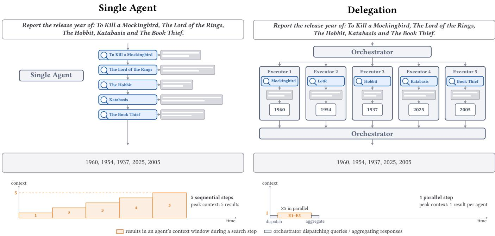
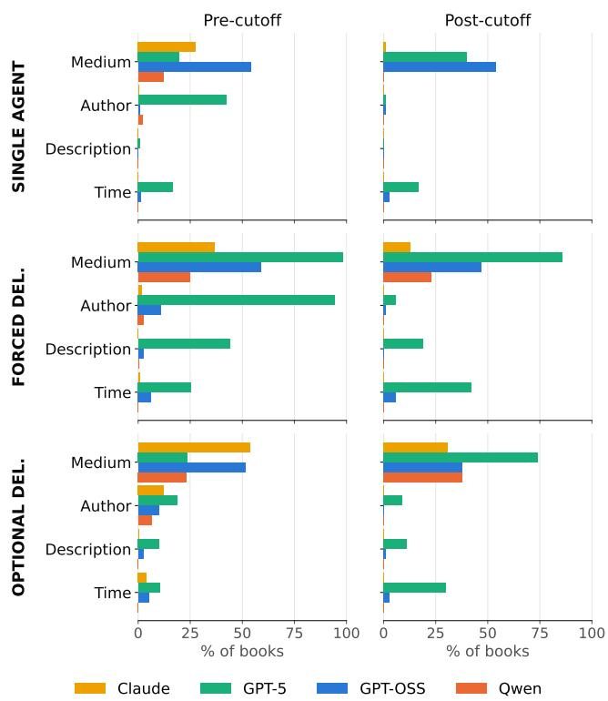
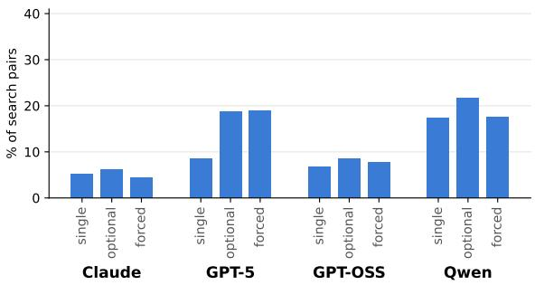
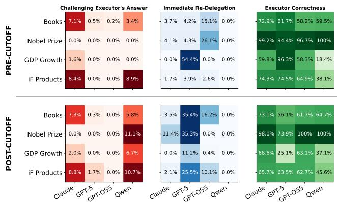
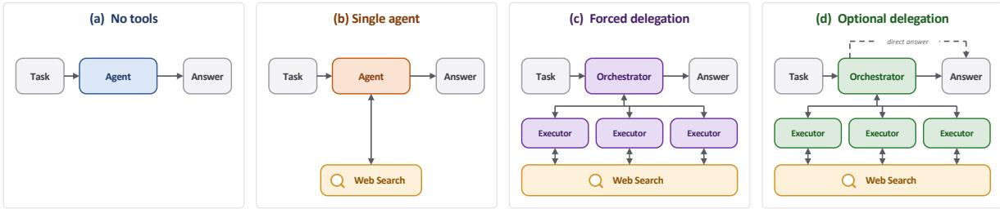
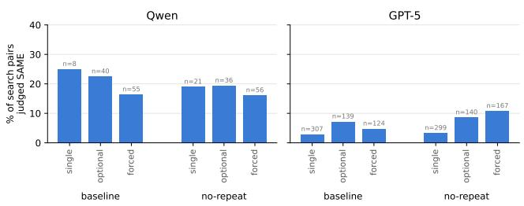
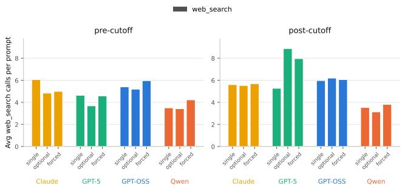
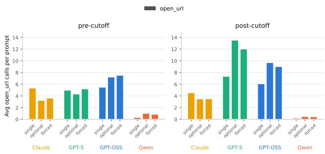

# Lost in Delegation: Studying the Efectiveness of Task Orchestration in Generative Search

Tamara Stojanovska, Elisabeth Kirsten, Leon Swazinna, and Muhammad Bilal Zafar

Ruhr University Bochum and UA Ruhr Research Center for Trustworthy AI

Bochum, Germany

[tamara.stojanovska,elisabeth.kirsten,leon.swazinna,bilal.zafar]@rub.de

## Abstract

LLMs have quickly evolved from models used in isolation to agentic systems that delegate tasks to external tools and other LLMs to solve complex assignments. This agentic augmentation has led to impressive capability gains. However, when and how delegation improves performance remains poorly understood. For example, it is unclear whether delegation helps when tasks involve post-cutof information that the orchestrating LLM cannot reliably resolve from its own knowledge. In this work, we use purpose-built datasets with pre- and post-cutof splits to compare various delegation modes. We find that delegation provides no consistent accuracy improvement over non-delegated setups, with efects varying across models and tasks. When tasks involve knowledge unavailable to the orchestrator, delegation can substantially degrade accuracy, while direct tool use with the same LLM performs much better. Our analysis identi fies distorted delegated queries, ineficient tool use, and failures to preserve and use information between agents as recurring failure modes. These findings suggest that efective orchestration requires both well-calibrated delegation decisions and efective exchange of information between agents.

## 1 Introduction

LLMs are changing how users search the Web. For over two decades, web search relied on Bing- and Google-style search engines where a user typed a short, self-contained query, received a ranked list of results, and followed one or more pages to manually assemble the answer. LLM-powered search engines like Google AI Overview and ChatGPT work diferently. They accept long, complex queries, retrieve information from a variety of sources using search tools or multiple search agents, and synthesize it into a single coherent answer [19, 23, 42]. This new mode of search is spreading quickly [32]. According to a recent Pew survey, 42% of US adults now use generative AI chatbots to search for information [7].

Despite its success, key design aspects of this LLM-driven agentic search remain understudied. Given a complex task, the LLM handling the search could approach it using vastly diferent strategies. Consider, for instance, the search prompt: “Report the release year of the following books: To Kill a Mockingbird, The Lord of the Rings, The Hobbit, Katabasis and The Book Thief”. The model could employ (i) a single-agent strategy, where it performs a separate web\_search for each book and then compiles the final answer, or (ii) a delegation-based strategy, where it acts as an orchestrator and delegates each book to a separate LLM agent and combines their answers. Although both strategies address the same subtasks, they have diferent computational and performance implications.

As shown in Figure 1, the single-agent strategy places all queries and web\_search tool outputs in a single trajectory, increasing the KVcache size [30] and the cost of attention computation [36]. Longer contexts can also lead to “context-rot”, where model performance degrades as context length increases [12, 24, 44]. The delegationbased strategy instead uses the fact that each ofthe five subtasks is independent, delegating the token-intensive retrieval to separate agents and only gathering their responses into a final answer. Crucially, the evidence retrieved for question � therefore does not need to remain in context while answering an independent question �.

The potential benefits of delegation are compelling: independent subtasks can be solved in separate, shorter contexts, reducing context growth and potentially mitigating the computational costs and performance degradation associated with long contexts. These potential benefits motivate our key question:

Does delegating independent search tasks to subagents improve accuracy over a single agent performing the same subtasks sequentially?

Although prior work has explored orchestrated web search setups [9, 23, 42], a thorough analysis of how separating orchestrator and executor contexts afects performance is lacking. This question is central to designing agentic search and deep research systems, which increasingly mediate access to information on the Web.

To answer this question, we construct four purpose-built datasets that require retrieving facts via web search. These datasets require a search system to retrieve (i) release years of books, (ii) ages of Nobel Prize winners, (iii) GDP growth rates, and (iv) launch years of commercial products. Together, these datasets cover popular and relatively niche facts.

Our dataset construction also accounts for a crucial distinction between LLM-based and traditional search: while traditional search always retrieves information from external sources, LLMs can answer many questions from their parametric knowledge alone [19, 29]. This parametric knowledge can influence whether delegation is needed at all, and how retrieved information is used. With this insight, we construct two versions of each dataset: one concerning facts before the underlying LLM’s knowledge cutof (e.g., books released before the cutof), and one about post-cutof facts. We compare delegation against single-agent baselines using open- and closed source models.

Our experiments reveal that, surprisingly, delegation does not lead to a consistent increase in accuracy over a single-agent setup. In fact, more often than not, delegation reduces accuracy. On the post-cutof datasets, these accuracy drops for delegation are more pronounced. In contrast, single-agent accuracy is comparatively stable on average across the pre- and post-cutof splits. This diference indicates a fundamental disparity in how singleagent and delegated setups process information unknown to the underlying LLMs.

  
Figure 1: Using a single agent vs. delegation for a composite task. A single agent answers questions sequentially (top left), calling the web\_search tool for each book and accumulating outputs in a single context. Because these outputs may span several web pages, answers about a book at position � attend over information retrieved for earlier books (botom left). Delegation instead partitions questions across executors (top right), reducing peak context and unnecessary attention interactions (botom right).

Deeper analysis sheds light on causes of these failures. First, orchestrator LLMs often inject additional context into delegated queries. In a vast fraction of post-cutof cases, this added information is incorrect, steering the executor toward the wrong task. For instance, when searching for the release year of the book The Calamity Club, the orchestrator assumes it is searching for a film and phrases the query as “Provide the release year of the most notable film or short film titled exactly ’The Calamity Club’...“.

Second, delegation introduces an information boundary, creating a disconnect between the context of the orchestrator and the executor. Across this delegation boundary, critical information, like retrieval failures, can be lost unless explicitly communicated. For instance, when looking up GDP growth, the orchestrator LLM instructs the executor to retrieve information from the World Bank website. The executor LLM fails to open a webpage due to a no-robots policy. This failure is not reported to the orchestrator, leading to repeated requests that encounter the same obstacle.

The delegation boundary also reduces the amount of trust the orchestrator places in the executor’s research, despite instructions stating that the executor specializes in answering factual questions. For instance, an orchestrator trace shows the reasoning: “The subagent says 2016, but I think ‘A Gathering of Shadows’ was published in 2022 [...]. Subagent is wrong.”

Third, models sometimes use tools suboptimally, packing multiple subtasks into a single executor query, making the executor’s task more dificult. Other times, models issue queries that are simple rephrasings of previous queries, adding little new information. Both behaviors are more prevalent in delegation setups than in single-agent setups.

Mitigation experiments instructing executors to report retrieval failures to the orchestrator, or prohibiting models from issuing semantically equivalent queries lead to limited gains.

Our findings uncover both inherent tradeofs and potentially remediable issues in delegation. Using subagents limits context growth, but requires explicit communication of useful evidence and operational feedback across the delegation boundary, which the orchestrator must then appropriately incorporate. Other issues, such as models introducing unsupported information into delegated queries, are not unique to delegation, and may be amenable to targeted training. Such interventions, however, would need to generalize across domains and orchestrator–executor pairings.

## 2 Related Work

Multi-agent Orchestration. Multi-agent systems distribute tasks across interacting LLM agents, often using a central orchestrator to decompose requests, assign subtasks, and aggregate responses [10, 31, 34]. We point to [8] for a broader survey of the design space. Delegating tasks to subagents can have several motivations: Decomposition of complex tasks [10, 34, 45], specialization [5, 22], parallel execution [1, 17], and context distribution across agents [9, 47]. However, prior studies find that multi-agent setups often fail to outperform single-agent baselines [35, 46]. Kim et al. [18] find that the benefits of coordination depend on task structure and model capability, with overhead potentially outweighing possible gains. Żywot et al. [49] show that orchestrated smaller agents can beat a larger single agent on tool-intensive tasks, and that reasoning in subagents has only limited efects. Cemri et al. [2] identify common multi-agent failure modes, involving specification, agent coordination, and verification. Complementing these studies, we isolate the efect of delegating tool access on performance.

Knowledge-aware Tool Use. Retrieval augmentation and web search have emerged as popular tools to provide LLMs with access to external knowledge and update their static, potentially stale, parametric knowledge [21, 37]. Recent work proposed diferent adaptive retrieval strategies to decide when and what to retrieve from the web, using confidence estimates [15, 38], question dificulty [14], or time sensitivity [37]. Yet, models do not reliably know when they need to retrieve [25, 33], and redundant retrieval can make models less eficient or even degrade accuracy [27, 40]. Fan et al. [4] show that search agents often rely on parametric knowl edge even when using search tools, and perform worse on questions requiring recent facts. While prior work largely studies retrieval decisions within a single agent, we examine how these decisions change under delegation. By comparing pre- and post-knowledgecutof facts, we distinguish settings where parametric knowledge may sufice from those requiring external information.

Knowledge Conflicts and Information Transfer. Access to external information does not guarantee that models use it correctly. Models may favor memorized answers over retrieved evidence [26], or base their decision on how evidence is presented [43]. Temporal knowledge conflicts also arise when models prefer outdated facts despite encoding more recent information [11]. Prior work primarily examines how individual models reconcile parametric knowledge with external evidence. In multi-agent systems, information must additionally pass between agents, introducing further opportunities for errors. We investigate these interactions at the level of individual facts, tracing where information is lost or altered.

Long-Context and Long-Horizon Tasks. Many tasks require processing more information or executing more steps than what fits in a single model’s context. Such demands may arise from depth (long reasoning or action sequences), or breadth (retrieval and syn thesis across many sources). Prior work addresses these challenges through context compression, persistent state, and recursive model calls [16, 41, 44]. Multi-agent systems instead distribute information gathering and processing across agents, reducing individual context requirements and enabling parallelization [9, 47, 48]. Our work complements these eforts by studying the reliability of delegation in acquiring and integrating external information.

## 3 Experimental Setup

We study the efectiveness of delegation across four agentic configurations, four models, and four factual datasets. Each dataset includes pre- and post-cutof conditions to examine how delegation behaves when the requested information is more or less likely to be available in the model’s parametric knowledge.

Model-tool configurations. We consider four configurations, illustrated in Figure 5 in the Appendix:

(1) No tool: A single LLM answers the query without access to external tools, serving as a closed-book baseline; (2) Single agent: A single LLM answers the query with direct access to web search; (3) Forced delegation: An orchestrator decomposes the query into atomic subtasks and delegates each to an executor (an LLM with access to web search). The orchestrator then combines the executor responses into a final answer; and (4) Optional delegation: The orchestrator may answer each subtask directly or delegate it to a tool-enabled executor. In both delegation setups, the orchestrator has no direct access to web search. Orchestrators and executors use the same underlying model but operate in separate contexts. Each executor starts with a fresh context, receives a subtask formulated by the orchestrator, processes it, and returns its final answer. The orchestrator only receives these final answers, not the executors’ full trajectories and tool-use traces. This setup prevents context bloat (see Figure 1).

Rationale behind model-tool configurations. These configurations are designed to separate diferent aspects of delegation, allowing us to compare the benefit of external information (no tool vs. single agent), the efect of mediating retrieval through another agent (single agent vs. forced delegation), and the ability to selectively delegate subtasks (forced vs. optional delegation). The system instructions for each configuration are provided in Table 8.

Models and Tools. We evaluate four models: Claude Sonnet 4.5 (Claude), GPT-5 (GPT-5), gpt-oss-120b (GPT-OSS), and Qwen3-30B-A3B-Thinking-2507 (Qwen). These represent diferent model families, including both closed- and open-source models that support tool use and instruction following. Reported knowledge cutofs range from June 2024 to July 2025. Model identifiers, providers, and cutof dates are listed in Table 5 in Appendix A. All tool-enabled agents use the same web search interface, which retrieves Google search results through SerpAPI.1 Our interface exposes two operations: search, which returns a list of result titles, URLs, and snippets, and open\_url, which returns extracted page content for selected results as truncated Markdown.

Datasets. We construct four factual datasets in which each query requests multiple independently verifiable facts (see Figure 1 for an example). This structure allows the same task to be solved either by a single agent or through delegation of individual subtasks. All datasets involve time-dependent factual information. Table 6 in Appendix A summarizes dataset statistics and sources.

(i) Books. Each query asks for the original publication years of five books published in the same year. We sample titles from annual Goodreads Top 100 lists for 2014–2019 and 2026, constructing 20 queries per year (120 pre-cutof, 20 post-cutof). After manually reviewing all titles to verify publication years, we excluded 15 books whose original publication years difer from their list years, leaving 585 pre-cutof and 100 post-cutof books for evaluation.

(ii) Nobel Prize. Each query asks for the ages of all individual laureates awarded a Nobel Prize when they received the award in a specified category and year. We construct queries across all six prize categories for the years 2014–2019 and 2025–2026, using the

Nobel Prize API. We exclude prizes awarded to organizations and include all individual laureates.

(iii) GDP. Each query asks for the annual real GDP growth rates of four countries in a specified year, rounded to one decimal place. We obtain values from the World Bank API (indicator NY.GDP.MKTP.KD.ZG) for 2019 (pre-cutof) and 2025 (post-cutof). We randomly select five countries from each of five continents (Africa, Asia, Europe, North America and South America) with data available for both years. From the 25 countries, we construct 30 distinct four-country sets through repeated shufling, with each country appearing in four or five prompts. We use the same country sets in pre- and post-cutof conditions, so that prompts difer only in the year.

(iv) Products. Each query asks for the launch years offour products recognized by the iF Design Award in the Product Design discipline. We collect winners from the iF Design Award website and retain products launched in 2021 (awarded in 2022) or 2026 (awarded in 2026). For each period, we select 20 products and construct 30 prompts by randomly sampling distinct sets of four products.

Pre- and Post-Cutof Conditions. To examine whether delegation behaves diferently depending on the likely availability of factual knowledge, we divide each dataset into pre-cutof and postcutof splits. Each dataset contains a variable that allows for such splitting. These variables are: publication year for Books, award year for Nobel Prizes, growth rate in a year for GDP and launch year for Products. The splits are: (1) Pre-Cutof: Facts from 2014–2019 (Books, Nobel Prize, GDP) or 2021 (Products), preceding the reported knowledge cutofs of all evaluated models; and (2) Post– Cutof: Facts from the most recent available year: 2025 (GDP), 2026 (Books, Products), or 2025–2026 (Nobel Prize), which became available after the reported knowledge cutofs.

Metrics. We measure accuracy at the prompt level. Each prompt asks about several items (books, countries, laureates or products). For instance, a prompt from the Books dataset asks: Determine the release year for each ofthe following:..., followed by a list of book titles. The accuracy on a dataset is computed as follows:

$$
\mathrm { A c c } = \frac { 1 } { N } \sum _ { i = 1 } ^ { N } \frac { 1 } { M _ { i } } \Bigg ( \sum _ { j = 1 } ^ { M _ { i } } \mathbf { 1 } _ { i j } \Bigg ) ,
$$

where � is the number of prompts in the dataset, �� is the number of sub-questions (items) in each prompt, and the indicator variable $1 _ { i j }$ indicates whether item � of prompt � is answered correctly. For GDP, an answer counts as correct if it is within 0.1 percentage points of the ground truth. We report 95% percentile bootstrap confidence intervals, resampling prompts with replacement (� = 1000), recomputing Acc on each resample.

Tool Call Limits. Each model operates under a fixed tool call budget that scales with the number of items � in each query. In the single-agent setup, the agent may make up to 2� web\_search calls and 3� open\_url calls. In both delegation setups, the orchestrator may make up to 2� executor calls, corresponding to the 2� web\_search calls for the single agent. Each executor receives a fresh budget of two web\_search calls and three open\_url calls. Budgets are specified in the agents’ system prompts and enforced during execution. Failed tool calls because of errors outside the model’s control, such as failed search requests, do not count toward the limit. Exact budgets and further implementation details are provided in Table 7 in Appendix A.

<table><tr><td>Setup</td><td>Pre-cutoff</td><td>Post-cutoff</td><td>Change</td></tr><tr><td>No Tools</td><td>0.53</td><td>0.01</td><td>↓98%</td></tr><tr><td>Single Agent</td><td>0.77</td><td>0.75</td><td>↓3%</td></tr><tr><td>Optional Del.</td><td>0.74</td><td>0.64</td><td>↓14%</td></tr><tr><td>Forced Del.</td><td>0.77</td><td>0.66</td><td>↓13%</td></tr></table>

Table 1: Accuracy drops from pre- to post-cutof splits are largerfor delegated setups than for the single agent. Average accuracy across pre- and post-cutof splits.

## 4 Delegation Often Reduces Accuracy

We first compare accuracy across the four agent setups, models, and datasets (Table 2). We find that tool access is essential beyond the knowledge cutof. On post-cutof tasks, models without tools achieve only 0–6% accuracy, whereas single agents with direct tool access frequently reach 70–100%. Access to external information is therefore crucial for answering questions beyond the models’ knowledge cutof. We continue to compare the performance of the delegated setups to the single agent as a baseline.

Delegation does not improve accuracy over direct tool use. Across all 32 model–dataset–cutof combinations, optional delegation performs worse than the single agent in 22 cases (better in 7, tied in 3), while forced delegation performs worse in 21 (better in 10, tied in 1). Thus, introducing additional agents generally provides no accuracy benefit.

Performance drops of delegated setups are larger on postcutof tasks. Averaged equally across models and datasets, single agent accuracy remains relatively stable between pre- and postcutof tasks (0.77 vs. 0.75). In contrast, optional and forced delegation both lose approximately 10 percentage points (pp) in absolute accuracy (Table 1). Consequently, the gap to direct tool use increases from 1 to 9pp for forced delegation and from 3 to 11pp for optional delegation. The largest losses occur for GPT-5: on post-cutof GDP prompts, accuracy drops significantly from 0.89 to 0.43 and 0.35 under optional and forced delegation, respectively. Similar diferences arise on post-cutof Books and Products. Across datasets, Books exhibits the largest average post-cutof losses in accuracy for delegation, while Nobel questions remain comparatively robust.

Forced delegation generally outperforms optional delegation. Forced delegation achieves higher accuracy than optional delegation in most configurations, particularly for GPT-OSS and Qwen. However, neither consistently outperforms the single agent. Under optional delegation, the orchestrator decided to answer from memory for 21% of items. Allowing orchestrators to decide whether to delegate therefore does not reliably prevent performance losses. For example, on a pre-cutof Books query, GPT-OSS incorrectly recalled the release year of the book “The Room on Rue Amélie” as 2021 under optional delegation and attributed it to the wrong author, but retrieved the correct year (2018) with forced delegation.

Delegation efects vary across models and setups. GPT-5 achieves the strongest single-agent performance (0.87–1.00), but sufers the largest post-cutof accuracy drops for delegated setups, particularly on GDP (up to 54pp). Claude slightly benefits from delegation on some pre-cutof tasks (+2–5pp on average), but loses 5–6pp postcutof. GPT-OSS loses substantial accuracy under delegation even pre-cutof, whereas Qwen benefits from forced delegation in 6 out of 8 conditions, gaining up to 25pp on post-cutof Products.

Lost in Delegation: Studying the Efectiveness of Task Orchestration in Generative Search
<table><tr><td rowspan="2">Books Model</td><td colspan="4">Pre-cutoff (n = 585, N = 120)</td><td colspan="4">Post-cutoff (n = 100, N = 20)</td></tr><tr><td>Single Agent</td><td>Optional Del.</td><td>Forced Del.</td><td>No Tools</td><td>Single Agent</td><td>Optional Del.</td><td>Forced Del.</td><td>No Tools</td></tr><tr><td>Claude</td><td>0.85 [0.80, 0.89]</td><td>0.83 [0.79, 0.87] ↓2%</td><td>0.83 [0.79, 0.87] ↓2%</td><td>0.75 [0.69, 0.80] ↓12%</td><td>0.90 [0.84, 0.95]</td><td>0.80 [0.70, 0.89] ↓11%</td><td>0.81 [0.69, 0.91] ↓10%</td><td>0.00 [0.00, 0.00] ↓100%</td></tr><tr><td>GPT-5</td><td>0.95 [0.92, 0.97]</td><td>0.92 [0.89, 0.96] ↓3%</td><td>0.93 [0.89, 0.96] ↓2%</td><td>0.93 [0.89, 0.96] ↓3%</td><td>0.91 [0.80, 1.00]</td><td>0.52 [0.37, 0.66] ↓43%</td><td>0.60 [0.46, 0.72] ↓34%</td><td>0.00 [0.00, 0.00] ↓100%</td></tr><tr><td>GPT-OSS</td><td>0.74 [0.68, 0.79]</td><td>0.60 [0.54, 0.66] ↓18%</td><td>0.63 [0.57, 0.69] ↓14%</td><td>0.26 [0.21, 0.30] ↓65%</td><td>0.85 [0.78, 0.91]</td><td>0.60 [0.45, 0.73] ↓29%</td><td>0.62 [0.49, 0.75]↓27%</td><td>0.00 [0.00, 0.00] ↓100%</td></tr><tr><td>Qwen</td><td>0.55 [0.50, 0.60]</td><td>0.52 [0.46, 0.58] ↓5%</td><td>0.58 [0.52, 0.64]↑6%</td><td>0.36 [0.32, 0.41] ↓34%</td><td>0.70 [0.56, 0.83]</td><td>0.56 [0.39, 0.72] ↓20%</td><td>0.65 [0.51, 0.77] ↓7%</td><td>0.00 [0.00, 0.00] ↓100%</td></tr><tr><td>GDP</td><td colspan="4">Pre-cutoff (n = 120, N = 30)</td><td colspan="4">Post-cutoff (n = 120, N = 30)</td></tr><tr><td>Model</td><td>Single Agent</td><td>Optional Del.</td><td>Forced Del.</td><td>No Tools</td><td>Single Agent</td><td>Optional Del.</td><td>Forced Del.</td><td>No Tools</td></tr><tr><td>Claude</td><td>0.68 [0.58, 0.77]</td><td>0.70 [0.62, 0.78] ↑4%</td><td>0.69 [0.60, 0.77] ↑3%</td><td>0.43 [0.34, 0.53] ↓36%</td><td>0.68 [0.60, 0.75]</td><td>0.73 [0.68, 0.80] ↑9%</td><td>0.73 [0.68, 0.80] ↑9%</td><td>0.01 [0.00, 0.03] ↓99%</td></tr><tr><td>GPT-5</td><td>1.00 [1.00, 1.00]</td><td>0.97 [0.92, 1.00] ↓3%</td><td>0.98 [0.94, 1.00] ↓3%</td><td>0.38 [0.28, 0.47] ↓63%</td><td>0.89 [0.79, 0.98]</td><td>0.43 [0.33, 0.53] ↓52%</td><td>0.35 [0.25, 0.45] ↓61%</td><td>0.06 [0.03, 0.10] ↓93%</td></tr><tr><td>GPT-OSS</td><td>0.92 [0.83, 0.98]</td><td>0.65 [0.55, 0.73] ↓29%</td><td>0.73 [0.63, 0.82]↓21%</td><td>0.18 [0.11, 0.26] ↓81%</td><td>0.77 [0.66, 0.87]</td><td>0.70 [0.61, 0.78] ↓9%</td><td>0.73 [0.65, 0.80] ↓5%</td><td>0.06 [0.02, 0.11] ↓92%</td></tr><tr><td>Qwen</td><td>0.30 [0.22, 0.38]</td><td>0.28 [0.20, 0.35] ↓8%</td><td>0.34 [0.26, 0.43] ↑14%</td><td>0.23 [0.14, 0.31] ↓25%</td><td>0.39 [0.31, 0.48]</td><td>0.39 [0.30, 0.48]</td><td>0.44 [0.35, 0.54] ↑13%</td><td>0.05 [0.01, 0.10] ↓87%</td></tr><tr><td>Nobel</td><td colspan="4">Pre-cutoff (n = 72, N = 34)</td><td colspan="4">Post-cutoff (n = 24, N = 12)</td></tr><tr><td>Model</td><td>Single Agent</td><td>Optional Del.</td><td>Forced Del.</td><td>No Tools</td><td>Single Agent</td><td>Optional Del.</td><td>Forced Del.</td><td>No Tools</td></tr><tr><td>Claude</td><td>0.88 [0.78, 0.95]</td><td>0.87 [0.77, 0.96] ↓1%</td><td>0.94 [0.88, 0.98] ↑7%</td><td>0.89 [0.79, 0.97] ↑2%</td><td>1.00 [1.00, 1.00]</td><td>0.90 [0.76, 1.00] ↓10%</td><td>0.88 [0.74, 1.00] ↓13%</td><td>0.00 [0.00, 0.00] ↓100%</td></tr><tr><td>GPT-5</td><td>0.94 [0.87, 0.99]</td><td>0.94 [0.87, 0.99]</td><td>0.94 [0.87, 0.99]</td><td>0.93 [0.86, 0.98] ↓1%</td><td>0.93 [0.82, 1.00]</td><td>0.93 [0.82, 1.00]</td><td>0.90 [0.79, 1.00] ↓3%</td><td>0.00 [0.00, 0.00] ↓100%</td></tr><tr><td>GPT-OSS</td><td>0.94 [0.85, 0.99]</td><td>0.89 [0.80, 0.97] ↓5%</td><td>0.91 [0.83, 0.97] ↓4%</td><td>0.87 [0.78, 0.95] ↓7%</td><td>0.88 [0.74, 1.00]</td><td>0.85 [0.67, 1.00] ↓3%</td><td>0.82 [0.60, 1.00] ↓6%</td><td>0.00 [0.00, 0.00] ↓100%</td></tr><tr><td>Qwen</td><td>0.82 [0.71, 0.92]</td><td>0.92 [0.83, 0.98] ↑12%</td><td>1.00 [1.00, 1.00] ↑21%</td><td>0.84 [0.74, 0.94] ↑2%</td><td>0.28 [0.03, 0.53]</td><td>0.36 [0.14, 0.64] ↑30%</td><td>0.39 [0.14, 0.64] ↑40%</td><td>0.00 [0.00, 0.00] ↓100%</td></tr><tr><td>Products</td><td colspan="4">Pre-cutoff (n = 120, N = 30)</td><td colspan="4">Post-cutoff (n = 120, N = 30)</td></tr><tr><td>Model</td><td>Single Agent</td><td>Optional Del.</td><td>Forced Del.</td><td>No Tools</td><td>Single Agent</td><td>Optional Del.</td><td>Forced Del.</td><td>No Tools</td></tr><tr><td>Claude</td><td>0.73 [0.64, 0.83]</td><td>0.83 [0.75, 0.91] ↑14%</td><td>0.89 [0.83, 0.95] ↑22%</td><td>0.25 [0.17, 0.34] ↓66%</td><td>0.82 [0.73, 0.89]</td><td>0.74 [0.66, 0.83]↓9%</td><td>0.79 [0.72, 0.86] ↓3%</td><td>0.00 [0.00, 0.00] ↓100%</td></tr><tr><td>GPT-5</td><td>0.89 [0.83, 0.94]</td><td>0.84 [0.78, 0.90] ↓6%</td><td>0.81 [0.73, 0.88] ↓9%</td><td>0.64 [0.54, 0.73] ↓28%</td><td>0.87 [0.79, 0.93]</td><td>0.68 [0.59, 0.78] ↓21%</td><td>0.65 [0.56, 0.74] ↓25%</td><td>0.03 [0.00, 0.08] ↓96%</td></tr><tr><td>GPT-OSS</td><td>0.76 [0.65, 0.85]</td><td>0.64 [0.57, 0.72] ↓15%</td><td>0.67 [0.56, 0.77] ↓12%</td><td>0.25 [0.18, 0.33] ↓67%</td><td>0.78 [0.65, 0.88]</td><td>0.63 [0.56, 0.69] ↓19%</td><td>0.68 [0.61, 0.75] ↓13%</td><td>0.00 [0.00, 0.00] ↓100%</td></tr><tr><td>Qwen</td><td>0.38 [0.28, 0.48]</td><td>0.40 [0.33, 0.49] ↑7%</td><td>0.37 [0.26, 0.48] ↓2%</td><td>0.30 [0.21, 0.40] ↓20%</td><td>0.33 [0.19, 0.47]</td><td>0.36 [0.24, 0.48] ↑10%</td><td>0.58 [0.47, 0.69] ↑77%</td><td>0.00 [0.00, 0.00] ↓100%</td></tr></table>

Table 2: Delegation performs worse than the single agent in most cases. Accuracy across datasets, models, and delegation setups. Each entry reports accuracy with a 95% prompt-level bootstrap confidence interval (CI). � denotes the number of prompts and � the number of scored items per dataset and cutof period. Arrows indicate relative accuracy changes from the corresponding single-agent baseline, computed from unrounded accuracies.

Overall, delegation frequently reduces accuracy despite providing access to the same external tools, particularly when answering questions beyond the knowledge cutof. We next examine where and how these failures emerge.

## 5 Where Delegation Breaks Down

We identify recurring behavioral failure modes and examine whether they arise specifically from delegation or reflect broader limitations of agentic tool use.

## 5.1 Orchestrators Inject Incorrect Assumptions

Orchestrators may alter requested information when formulating executor queries. To analyze these changes, we use an LLM judge to identify attributes added or changed relative to the original request. Orchestrators frequently enrich delegated queries. Figure 2 reports the frequency and composition of query modifications on Books. Common additions are the publication medium (e.g. novel or book) and author (e.g. Abby Jimenez). Their frequency varies substantially across models and delegation settings. In particular, GPT-5 adds the most information, specifying the medium in up to 98% of pre-cutof queries under forced delegation. Such additions may provide useful context, helping to disambiguate the requested information, but they also introduce assumptions about the intended entity or how the executor should select it. Injecting assumptions is more common for delegated setups. Notably, delegators add more information to their delegated queries than single agents add to their search queries both pre- and post-cutof.

Added information is less reliable for post-cutof items. Table 3 evaluates the correctness of added author and medium information. Most pre-cutof author additions are correct. However, delegation adds only incorrect author information on the postcutof split. Medium identification follows a similar pattern. Under delegation, only 4–6% of added medium information is correct for GPT-5 on post-cutof books. Similar errors occur for GPT-OSS and Qwen. Notably, GPT-5 adds author information much less frequently post-cutof, but continues to introduce other attributes. Thus, orchestrators add less identifying information for unfamiliar books, while the information they do add is often less reliable. This pattern suggests that orchestrators can use parametric knowledge to enrich queries when they recognize the requested item, but cannot provide the same contextual information when the item is unfamiliar.

  
Figure 2: Models often add details about the item absent from the user prompt. Bars show the share of books whose first executor prompt (single-agent: first web\_search query) adds information absent from the original user query.

Incorrect assumptions can distort the delegated task. When added information is incorrect, the executor may be directed toward a diferent entity than the one requested. For example, when asked about the release year of the 2026 book The Night We Met by Abby Jimenez, GPT-5 delegated the prompt “Determine the release year (first public release) ofthe song "The Night We Met" by Lord Huron.” The executor correctly returned 2015, the release year of the song. Here, the executor answers the delegated query correctly, yet produces an incorrect answer to the user’s original request. Therefore, query rewriting introduces an additional opportunity for error at the orchestrator–executor boundary. Incorrect additions can also persist even when the executor encounters contradicting evidence. For The Calamity Club, a 2026 novel by Kathryn Stockett, GPT-5 delegates: “Provide the release year ofthe most notable film or short film titled exactly ’The Calamity Club’...“. The executor encountered evidence for the correct 2026 book three times in the search results. Nevertheless, it answers 1913 by guessing, which the orchestrator adopts as its final answer. Such an assumption can therefore anchor the executor’s search and final response.

These examples showcase a failure point at the orchestrator– executor boundary: Query rewriting can alter the task itself. Especially for post-cutof items, assumptions drawn from familiar entities can redirect retrieval away from the requested information, and encountering the correct source does not necessarily resolve the resulting error. This failure afects the single agent less, since even for wrong additions to its web search queries, it has access to previously made assumptions and corresponding search results, avoiding loss of information.

<table><tr><td></td><td></td><td colspan="2">Pre-cutoff</td><td colspan="2">Post-cutoff</td></tr><tr><td>Model</td><td>Setting</td><td>Medium</td><td>Author</td><td>Medium</td><td>Author</td></tr><tr><td>GPT-0SS</td><td>Single agent</td><td>58</td><td>80</td><td>28 ↓52%</td><td>100 ↑25%</td></tr><tr><td></td><td>Forced</td><td>58</td><td>72</td><td>21 ↓63%</td><td>0 ↓100%</td></tr><tr><td></td><td>Optional</td><td>51</td><td>71</td><td>16 ↓69%</td><td></td></tr><tr><td>Qwen</td><td>Single agent</td><td>82</td><td>92</td><td></td><td>一</td></tr><tr><td></td><td>Forced</td><td>69</td><td>69</td><td>22 ↓69%</td><td>一</td></tr><tr><td></td><td>Optional</td><td>81</td><td>60</td><td>53 ↓35%</td><td></td></tr><tr><td>GPT-5</td><td>Single agent</td><td>91</td><td>96</td><td>63 ↓32%</td><td>0 ↓100%</td></tr><tr><td></td><td>Forced</td><td>93</td><td>95</td><td>6 ↓94%</td><td>0 ↓100%</td></tr><tr><td></td><td>Optional</td><td>76</td><td>84</td><td>4 ↓95%</td><td>0 ↓100%</td></tr><tr><td>Claude</td><td>Single agent</td><td>99</td><td>100</td><td>0 ↓100%</td><td>一</td></tr><tr><td></td><td>Forced</td><td>64</td><td>100</td><td>0 ↓100%</td><td>一</td></tr><tr><td></td><td>Optional</td><td>70</td><td>99</td><td>0 ↓100%</td><td>一</td></tr></table>

Table 3: For post-cutofbooks, orchestrators add medium and author details, often incorrectly. Cells show the percentage of correct additions when the first executor prompt (singleagent: first web\_search query) adds the field. Arrows show relative change from pre- to post-cutof.

## 5.2 Ineficient Tool Use

Our tasks provide a simple setting for examining how models organize tool use. Each request concerns independent items, making item-level decomposition an obvious strategy: For example, an orchestrator can delegate each book to a separate executor. Within each item-level search, an unsuccessful query should motivate a reformulation that seeks diferent information or sources. We examine whether models follow these two patterns, first within search trajectories and then across executor calls. Appendix C provides complementary statistics on the average number of web\_search and open\_url calls across models and settings. Tool usage varies substantially across models with the largest increases from pre- to post-cutof questions observed for GPT-5 and GPT-OSS.

Models repeatedly issue redundant queries. Across tool-enabled settings, 40% of item-level search trajectories contain multiple web searches. To assess whether repeated searches refine the original request, we compare consecutive queries concerning the same item. We use LLM judges to identify newly introduced factual attributes and to decide whether two queries are the same search. We validate the similarity judge against three human annotators, finding substantial agreement (Appendix C.1). Across 5,577 consecutive query pairs, 9% are labeled as the same search, i.e., the follow-up query difers only in word order, formatting, or synonyms (Figure 3). For example, GPT-OSS follows “Turkey real GDPgrowth 2025” with “2025 real GDP growth Turkey”. This behavior varies across models and datasets. Qwen repeats itself most often (19% on Products and 31% on Nobel). The remaining queries do change the request, but often not in a targeted way. Rather than addressing what the previous search failed to resolve, models frequently broaden the query with lists of candidate types or years, e.g., Claude follows “ ‘Desertion’ release year” with “ ‘Desertion’ book film movie 2024 2023 2022 2021”.

  
Figure 3: Models frequently repeat similar queries with only minor changes in wording. Bars show the percentage of consecutive web\_search pairs classified as doing the same search, pooled across datasets.

<table><tr><td>Model</td><td>GPT-0SS</td><td>Qwen</td><td>GPT-5</td><td>Claude</td></tr><tr><td>Single agent</td><td>0.5</td><td>0.3</td><td>1.3</td><td>1.5</td></tr><tr><td>Forced</td><td>2.7</td><td>0.0</td><td>0.9</td><td>0.6</td></tr><tr><td>Optional</td><td>4.5</td><td>0.0</td><td>3.2</td><td>0.4</td></tr></table>

Table 4: Some models decompose queries into more than one item per executor. Percentage of executor requests (single agent: web search queries) naming more than one item. Books and GDP datasets, both cutof periods pooled.

Repeated searches occur under both direct tool use and delegation (7% vs. 11%). The increase under delegation is mainly driven by GPT-5 (8% vs. 19%), while the other models behave similarly in both settings.

Orchestrators occasionally combine independent subtasks. We examine whether orchestrators delegate individual items as instructed or combine multiple items into a single executor request. To identify such cases, we count how many items from the original question appear in each executor prompt. Although items are independent and can be delegated separately, orchestrators sometimes combine them into a single request (Table 4). This behavior is most common for GPT-OSS (4.5% of calls under optional and 2.7% under forced delegation) and is more frequent under optional delegation for GPT-5 (3.2% vs. 0.9%). For example, one executor received “Provide the release year (four-digit) for each ofthe following book titles:’The Stone Sky’, ’Lord of Shadows’, ’Little Fires Everywhere’, ’A List of Cages’, and ’Dragon Teeth’...“. While rare, these cases occur within the same task distribution as correctly decomposed requests, following the same simple prompt setup that does not require joint reasoning.

Together, these findings highlight limitations in how models structure tool use, both when formulating searches within individual items and when decomposing tasks across items.

## 5.3 Delegation Hinders Failure Recovery

Retrieval failures are common across tool-enabled agents. In the single-agent setup, 13% of open\_url calls return a 403 (Forbidden) error, while another 3% return a page without extractable content. These rates are higher under delegation: 20% and 5% for optional, and 17% and 5% for forced delegation.

Single agents remain more accurate after failed page visits. On items where a page visit returns a 403 error, single agents still answer approximately 73% of afected items correctly, compared with 54% under forced and 52% under optional delegation. A similar, smaller gap occurs for pages without extractable content: 60% vs. 50% vs. 45%. Thus, single agents more often reach a correct answer despite encountering retrieval failures. These accuracies show that delegated setups are less successful on items where retrieval fails.

Communication boundaries can hinder error recovery. In the single-agent setup, retrieval errors remain visible to the agent. The agent producing the final answer directly observes retrieval errors, including which source failed. It can use this information to change its strategy and pursue alternative searches or page visits. Under delegation, only the executor’s final response reaches the orchestrator, not its intermediate tool outputs. The orchestrator may be unable to take corrective action, even when the executor has encountered an identifiable and potentially recoverable error. The orchestrator’s ability to recognize an unresolved problem therefore depends on what the executor communicates.

Delegation therefore introduces an additional communication requirement: unresolved retrieval problems must be conveyed alongside the executor’s findings. This loss of error visibility may contribute to the observed lower accuracy of delegated setups.

## 5.4 Orchestrators Challenge Executor Answers

After receiving an executor’s response, the orchestrator may question or reject its answer (challenging) instead of using it for its own final answer. Alternatively, it may immediately delegate the same task again (re-delegation). In both behaviors, the orchestrator can disregard information provided by an executor, even when that information is correct. For example, on a Books query, the executor (GPT-OSS) correctly reported that A Gathering of Shadows was published in 2016, but the orchestrator rejected this answer: “The subagent says 2016, but I think ’A Gathering of Shadows’ was published in 2022 [...]. Subagent is wrong.”

Models difer in how they respond to executor answers. Figure 4 showcases both behaviors across models, datasets, and cutof conditions. While Claude and Qwen predominantly challenge executor responses, GPT-5 and GPT-OSS rarely challenge but frequently re-delegate tasks. For example, GPT-5 re-delegates up to 54% of tasks on pre-cutof GDP. Across models and datasets, challenging increases slightly from 2.6% to 3.2% ( ↑23%) between pre- and post-cutof conditions, whereas re-delegation increases more, from 6.6% to 8.6% ( ↑30%). Thus, orchestrators seek additional executor responses more frequently for post-cutof items.

Orchestrators re-delegate tasks even when executors are correct. To examine whether these behaviors are associated with incorrect executor responses, we condition on executor correctness.

  
Figure 4: Models tend to either challenge executor responses or immediately re-delegate tasks. Re-delegation is morefrequent post-cutof, and both behaviors occur even when executors achieve high correctness. Left: Share of challenged executor responses. Middle: Share of re-delegated executor responses of the same task. Right: Share of correct executor responses.

Challenging is rare for correct executor responses, occurring in only 0.3% of pre-cutof and 0.2% of post-cutof cases. In contrast, re-delegation remains common for correct executor answers, increasing from 6.4% to 8.8% ( ↑39% ). Orchestrators therefore request additional answers despite having the information needed to answer correctly, particularly post-cutof. This behavior happens even though the orchestrator is informed that the executor specializes in retrieving factual information. While this verification may be useful, it introduces additional, potentially redundant, calls.

Together, these findings show that delegation can introduce additional work even after correct answer retrieval. Producing correct information is therefore only one part of a successfully delegated task. The orchestrator must also decide when that information is suficient to complete the task.

## 6 Can Prompting Mitigate Delegation Failures?

Recent work seeks to improve agent reliability through modifications to system prompts and agent harnesses [3, 20]. We investigate whether similarly lightweight interventions can address the delegation failures identified in our analysis. Specifically, we evaluate two prompt-based interventions targeting redundant searches and the communication of retrieval failures, and discuss why the remaining failure modes may not admit such simple solutions.

Discouraging redundant searches. To reduce ineficient tool use, we instruct agents to avoid semantically equivalent queries in successive web searches. We evaluate this intervention on Books using Qwen and GPT-5, which exhibit particularly high rates of redundant searches. As shown in Figure 6 in Appendix C, the intervention has little efect on the semantic similarity of successive queries. The share of query pairs judged as the same search goes down slightly for Qwen (19.4% → 17.7%) while increasing slightly for GPT-5 (4.4% → 6.6%). The models also do not search less often overall, and the ranking between models remains unchanged.

Therefore, the instruction to avoid redundant searches neither cuts the number of follow-up searches nor makes them less redundant. Reporting retrieval failures. To address the loss of information between executors and orchestrators, we instruct executors to explicitly report inaccessible webpages and their URLs. We evaluate this intervention on GDP using GPT-5 and GPT-OSS, for which we observed high rates of webpage access failures. For GPT-5, accuracy on GDP increases from 0.43 to 0.51 with optional delegation and from 0.35 to 0.44 with forced delegation, but remains well below the single-agent baseline (0.89). For GPT-OSS, accuracy on the GDP task drops from 0.70 to 0.62 for optional delegation and from 0.73 to 0.64 for forced delegation. Explicitly requesting failure reports therefore ofers limited, model-dependent improvements and does not reliably close the performance gap.

Why simple rules may not sufice. The remaining failure modes involve trade-ofs that simple instructions may not resolve. For instance, instructing models to formulate queries without assumptions could prevent adding misleading information. However, prior knowledge can both help and hinder retrieval. In an earlier example in Section 5, the orchestrator incorrectly specified a work as a film, steering the executor towards irrelevant results. Conversely, specifying Kristen Ashley as the author of Sebring helped the executor identify the correct work (published in 2016). Eliminating prior beliefs altogether may therefore impair retrieval efectiveness.

Similarly, simply instructing orchestrators to always accept executor responses could prevent them from incorrectly rejecting valid information. In an earlier example, the orchestrator rejects the correct publication year (2016) returned by the executor in favor of its own incorrect belief (2022). Yet executors can also return incorrect answers, for instance when multiple books with the same title exist in the search results. The challenge is therefore not to eliminate all disagreement, but to distinguish reliable information from unsupported assumptions. Addressing this challenge may require targeted mechanisms for communicating evidence and resolving conflicts rather than simple prompt interventions.

## 7 Conclusion and Limitations

Our work provides a systematic analysis of delegation for factual web search. By distributing independent tasks across separate contexts, delegation can reduce per-agent context requirements and mitigate the efects of context rot. However, our findings show that delegation does not consistently improve accuracy over a single agent with direct tool access.

Our analysis identifies several failure modes, many arising at the delegation boundary: the separation of contexts between the orchestrator and the executors limits the information exchanged between them. Critical information, such as retrieval failures faced by the executor, or supporting sources that could help the orchestrator build trust in the executor’s response, may not reach the orchestrator. The delegation boundary may therefore hinder recovery and make it harder for orchestrators to evaluate correct executor responses. Instructing executors to report failures yields only limited improvements. Passing complete executor traces to the orchestrator could mitigate the loss of information, but would undermine the context-saving benefits of delegation. Other failures, such as redundant searches or injecting unsupported prior beliefs, are not inherent to delegation and may be easier to address. However, prompting yields only limited and inconsistent improvements. More efective mitigation may require targeted model training to induce specialization, tracking search progress, or mechanisms for selectively communicating evidence and failures. Whether such approaches generalize across tasks and models remains an open question.

Limitations. First, we focus on small datasets of independent factual questions. Real-world tasks may consist of interdependent information needs. We deliberately study this simpler setting to test delegation without the additional challenges of task interdependence. Failures in these simpler settings raise concerns about generalizability to more complex settings. Second, we study configurations in which orchestrators and executors belong to the same model family. We do so to avoid a combinatorial explosion of heterogeneous setups. Studying the interplay between diferent model families is an interesting avenue for future work.

## References

[1] Alfonso Amayuelas, Jingbo Yang, Saaket Agashe, Ashwin Nagarajan, Antonis Antoniades, Xin Eric Wang, and William Wang. Self-resource allocation in multi-agent llm systems. arXiv:2504.02051, 2025.

[2] Mert Cemri, Melissa Z Pan, Shuyi Yang, Lakshya A Agrawal, Bhavya Chopra, Rishabh Tiwari, Kurt Keutzer, Aditya Parameswaran, Dan Klein, Kannan Ram chandran, et al. Why do multi-agent llm systems fail? arXiv:2503.13657, 2025.

[3] Mengzhuo Chen, Junjie Wang, Zhe Liu, Yawen Wang, Haiming Zheng, and Qing Wang. From failed trajectories to reliable llm agents: Diagnosing and repairing harness flaws. arXiv:2606.06324, 2026.

[4] HuiMing Fan, Xiao Wang, Zheng Chu, Qianyu Wang, Zhuoyao Wang, Ming Liu, Bing Qin, et al. Livebrowsecomp: Are search agents searching, or just verifying what they already know? arXiv:2605.28721, 2026.

[5] Adam Fourney, Gagan Bansal, Hussein Mozannar, Cheng Tan, Eduardo Salinas, Friederike Niedtner, Grace Proebsting, Grifin Bassman, Jack Gerrits, Jacob Alber, et al. Magentic-one: A generalist multi-agent system for solving complex tasks. arXiv:2411.04468, 2024.

[6] Goodreads. Most popular books by publication year. https://www.goodreads. com/book/popular\_by\_date/2020. Annual rankings; URL year can be adjusted. Accessed: 2026-11-12.

[7] JEFFREY GOTTFRIED, WILLIAM BISHOP, MONICA ANDERSON, MICHELLE FAVERIO, EUGENIE PARK, and COLLEEN MCCLAIN. Americans and ai 2026: Chatbots, smart devices and views on impact. https://www.pewresearch.org/internet/2026/06/17/americans-and-ai-2026- chatbots-smart-devices-and-views-on-impact/, 2026. Accessed: October 2026.

[8] Taicheng Guo, Xiuying Chen, Yaqi Wang, Ruidi Chang, Shichao Pei, Nitesh V Chawla, Olaf Wiest, and Xiangliang Zhang. Large language model based multi agents: A survey of progress and challenges. arXiv:2402.01680, 2024.

[9] Jeremy Hadfield, Barry Zhang, Kenneth Lien, Florian Scholz, Jeremy Fox, and Daniel Ford. How we built our multi-agent research system, 2025. URL https: //www.anthropic.com/engineering/multi-agent-research-system

[10] Sirui Hong, Xiawu Zheng, Jonathan Chen, Yuheng Cheng, Jinlin Wang, Ceyao Zhang, Zili Wang, Steven Ka Shing Yau, Zijuan Lin, Liyang Zhou, et al. Metagpt: Meta programming for multi-agent collaborative framework. arXiv:2308.00352, 2023.

[11] Elias Hossain, Sourav Saha, Umesh Chandra Biswas, and Sanjeda Sara Jennifer. Right knowledge, wrong answer: Test-time steering for temporal fact conflicts in open-weight language models. arXiv:2606.20959, 2026.

[12] Cheng-Ping Hsieh, Simeng Sun, Samuel Kriman, Shantanu Acharya, Dima Rekesh, Fei Jia, and Boris Ginsburg. RULER: What’s the real context size of your long-context language models? In First Conference on Language Modeling, 2024.

[13] iF International Forum Design GmbH. if design award: Award winners. https: //ifdesign.com/en/search?awardId=2. Award winners database. Accessed: 2026- 11-12.

[14] Soyeong Jeong, Jinheon Baek, Sukmin Cho, Sung Ju Hwang, and Jong C Park. Adaptive-rag: Learning to adapt retrieval-augmented large language models through question complexity. In Proceedings of the north american chapter of the association for computational linguistics, 2024.

[15] Zhengbao Jiang, Frank F Xu, Luyu Gao, Zhiqing Sun, Qian Liu, Jane Dwivedi-Yu, Yiming Yang, Jamie Callan, and Graham Neubig. Active retrieval augmented generation. In Proceedings of the conference on empirical methods in natural language processing, 2023.

[16] Minki Kang, Wei-Ning Chen, Dongge Han, Huseyin A Inan, Lukas Wutschitz, Yanzhi Chen, Robert Sim, and Saravan Rajmohan. ACON: Optimizing context compression for long-horizon LLM agents. In Proceedings ofthe International Conference on Machine Learning, 2026.

[17] Sehoon Kim, Suhong Moon, Ryan Tabrizi, Nicholas Lee, Michael W Mahoney, Kurt Keutzer, and Amir Gholami. An llm compiler for parallel function calling. arXiv:2312.04511, 2023

[18] Yubin Kim, Ken Gu, Chanwoo Park, Chunjong Park, Samuel Schmidgall, A Ali Heydari, Yao Yan, Zhihan Zhang, Yuchen Zhuang, Yun Liu, et al. Capable language models can outgrow the benefits of collaboration. Nature Machine Intelligence, 2026.

[19] Elisabeth Kirsten, Jost Grosse Perdekamp, Qinyuan Wu, Mihir Upadhyay, Krishna P Gummadi, and Muhammad Bilal Zafar. Characterizing web search in the age of generative ai. In Findings of the Association for Computational Linguistics, 2026.

[20] Yoonho Lee, Roshen Nair, Qizheng Zhang, Kangwook Lee, Omar Khattab, and Chelsea Finn. Meta-harness: End-to-end optimization of model harnesses. arXiv:2603.28052, 2026

[21] Patrick Lewis, Ethan Perez, Aleksandra Piktus, Fabio Petroni, Vladimir Karpukhin, Naman Goyal, Heinrich Küttler, Mike Lewis, Wen-tau Yih, Tim Rocktäschel, et al. Retrieval-augmented generation for knowledge-intensive nlp tasks. Advances in neural information processing systems, 2020.

[22] Guohao Li, Hasan Hammoud, Hani Itani, Dmitrii Khizbullin, and Bernard Ghanem. Camel: Communicative agents for" mind" exploration of large language model society. Advances in neural information processing systems, 2023.

[23] Yuchen Li, Hengyi Cai, Rui Kong, et al. Towards ai search paradigm. arXiv:2506.17188, 2026.

[24] Nelson F. Liu, Kevin Lin, John Hewitt, Ashwin Paranjape, Michele Bevilacqua, Fabio Petroni, and Percy Liang. Lost in the middle: How language models use long contexts. Transactions of the Association for Computational Linguistics, 2024.

[25] Xin Liu, Ruqing Zhang, Yu-An Liu, Lixin Su, Jiafeng Guo, and Xueqi Cheng. Is a busy search agent a good one? overthinking and overretrieval at scale. In Proceedings ofthe International ACM SIGIR Conference on Research and Development in Information Retrieval, 2026.

[26] Shayne Longpre, Kartik Perisetla, Anthony Chen, Nikhil Ramesh, Chris DuBois, and Sameer Singh. Entity-based knowledge conflicts in question answering. In Proceedings of the conference on empirical methods in natural language processing, 2021.

[27] Seiji Maekawa, Hayate Iso, Sairam Gurajada, and Nikita Bhutani. Retrieval helps or hurts? a deeper dive into the eficacy of retrieval augmentation to language models. In Proceedings of the North American Chapter of the Association for Computational Linguistics, 2024.

[28] Nobel Prize Outreach. Nobel prize api. https://nobelprize.readme.io/reference/ getting-started. Accessed: 2026-11-12.

[29] Fabio Petroni, Tim Rocktäschel, Sebastian Riedel, Patrick Lewis, Anton Bakhtin, Yuxiang Wu, and Alexander H. Miller. Language models as knowledge bases? In Conference on Empirical Methods in Natural Language Processing, 2019.

[30] Reiner Pope, Sholto Douglas, Aakanksha Chowdhery, Jacob Devlin, James Bradbury, Jonathan Heek, Kefan Xiao, Shivani Agrawal, and Jef Dean. Eficiently scaling transformer inference. In Proceedings of the Conference on Machine Learning and Systems, 2023.

[31] C Qian, W Liu, H Liu, et al. Chatdev: Communicative agents for software development. arXiv:2307.07924, 2023.

[32] Elizabeth Reid. A new era for ai search. https://blog.google/products-andplatforms/products/search/search-io-2026/, 2026. Accessed: October 2026.

[33] Ruiyang Ren, Yuhao Wang, Yingqi Qu, Wayne Xin Zhao, Jing Liu, Hua Wu, Ji-Rong Wen, and Haifeng Wang. Investigating the factual knowledge boundary of large language models with retrieval augmentation. In Proceedings ofthe conference on computational linguistics, 2025.

[34] Yongliang Shen, Kaitao Song, Xu Tan, Dongsheng Li, Weiming Lu, and Yueting Zhuang. Hugginggpt: Solving ai tasks with chatgpt and its friends in hugging face. Advances in Neural Information Processing Systems, 2023.

[35] Dat Tran and Douwe Kiela. Single-agent llms outperform multi-agent systems on multi-hop reasoning under equal thinking token budgets. arXiv:2604.02460, 2026.

[36] Ashish Vaswani, Noam Shazeer, Niki Parmar, Jakob Uszkoreit, Llion Jones, Aidan N Gomez, Ł ukasz Kaiser, and Illia Polosukhin. Attention is all you need. In Advances in Neural Information Processing Systems, 2017.

[37] Tu Vu, Mohit Iyyer, Xuezhi Wang, Noah Constant, Jerry Wei, Jason Wei, Chris Tar, Yun-Hsuan Sung, Denny Zhou, Quoc Le, et al. Freshllms: Refreshing large language models with search engine augmentation. In Findings of the Association for Computational Linguistics, 2024.

[38] Yile Wang, Peng Li, Maosong Sun, and Yang Liu. Self-knowledge guided retrieval augmentation for large language models. In Findings of the conference on empirical methods in natural language processing, 2023.

[39] World Bank. World bank indicators api. https://datahelpdesk.worldbank.org/ knowledgebase/articles/889392. Accessed: 2026-11-12.

[40] Qinyuan Wu, Soumi Das, Mahsa Amani, Arijit Nag, Seungeon Lee, Krishna P Gummadi, Abhilasha Ravichander, and Muhammad Bilal Zafar. To call or not to call: A framework to assess and optimize llm tool calling. arXiv:2605.00737, 2026.

[41] Xixi Wu, Kuan Li, Yida Zhao, Liwen Zhang, Litu Ou, Huifeng Yin, Zhongwang Zhang, Xinmiao Yu, Dingchu Zhang, Yong Jiang, et al. Resum: Unlocking long horizon search intelligence via context summarization. arXiv:2509.13313, 2025.

[42] Yunjia Xi, Jianghao Lin, Yongzhao Xiao, Zheli Zhou, Rong Shan, Te Gao, Jiachen Zhu, Weiwen Liu, Yong Yu, and Weinan Zhang. A survey oflarge language model based search agents. In Proceedings of the Annual Meeting of the Association for Computational Linguistics, 2026.

[43] Jian Xie, Kai Zhang, Jiangjie Chen, Renze Lou, and Yu Su. Adaptive chameleon or stubborn sloth: Unraveling the behavior of large language models in knowledge clashes. arXiv:2305.13300, 2023.

[44] Alex L. Zhang, Tim Kraska, and Omar Khattab. Recursive language models. arXiv:2512.24601, 2026.

[45] Fan Zhang, Vireo Zhang, Shengju Qian, Haoxuan Li, Hao Wu, Jinyang Wu, Donghao Zhou, Zhihong Zhu, Zheng Lian, Xin Wang, et al. Orchestra-o1: Omnimodal agent orchestration. arXiv:2606.13707, 2026.

[46] Hangfan Zhang, Zhiyao Cui, Jianhao Chen, Xinrun Wang, Qiaosheng Zhang, Zhen Wang, Dinghao Wu, and Shuyue Hu. Stop overvaluing multi-agent debate– we must rethink evaluation and embrace model heterogeneity. arXiv:2502.08788, 2025.

[47] Yusen Zhang, Ruoxi Sun, Yanfei Chen, Tomas Pfister, Rui Zhang, and Sercan Ö Arık. Chain of agents: Large language models collaborating on long-context tasks. Advances in Neural Information Processing Systems, 2024.

[48] Jun Zhao, Can Zu, Xu Hao, Yi Lu, Wei He, Yiwen Ding, Tao Gui, Qi Zhang, and Xuanjing Huang. LONGAGENT: Achieving question answering for 128k token-long documents through multi-agent collaboration. In Proceedings ofthe Conference on Empirical Methods in Natural Language Processing, 2024.

[49] Agata Żywot, Xinyi Chen, Yifei Yuan, Anders Søgaard, and Maarten de Rijke. Can small agents collaborate to beat a single large language model? arXiv:2601.11327, 2026.

## A Experimental Details and Reproducibility

This appendix provides additional details on the datasets, models, agent configurations, execution setup, and tool call limits used in our experiments.

Models. We evaluate four models with tool-use capabilities, covering two closed-source and two open-weight model families. Within each experimental condition, the orchestrator and all executors are independent instances of the same underlying model. Table 5 reports the exact model identifiers and available knowledge cutof information. When the provider reports a knowledge cutof, we use that date. When no oficial cutof is available, we instead report the model’s release date. The release date provides a conservative upper bound on the model’s possible training-time knowledge, since information published after the model itself was released could not have been included during its training. The actual knowledge cutof may therefore be earlier than the reported release date.

<table><tr><td></td><td>Model</td><td>Provider</td><td>Identifier</td><td>Cutoff</td></tr><tr><td>Cosed souce</td><td>Claude GPT-5</td><td>Anthropic OpenAI</td><td>claude-sonnet-4-5 gpt-5</td><td>Jan 20251 Sep 30, 20242</td></tr><tr><td>pn</td><td>GPT-0SS</td><td>OpenAI</td><td>openai/gpt-oss-120b</td><td>Jun 1, 20243</td></tr><tr><td>weht</td><td>Qwen</td><td>Qwen</td><td>Qwen/Qwen3-30B-A3B- Thinking-2507</td><td> $\operatorname { J u l } 3 1 , 2 0 2 5 ^ { 4 } { } ^ { \dagger }$ </td></tr></table>

Table 5: Studied models and knowledge cutofs. †For Qwen, the model release date is reported instead.

Generation Settings. The models were evaluated at a temperature of $T = 1 . 0 , t o p - p = 1 . 0$ . For the closed-source models, reasoning efort was set to medium and inference was performed through the respective provider APIs with their default sampling parameters. The open-source models were served with vLLM using the reasoning and tool calling parsers recommended in their HuggingFace documentation. Local inference was performed on NVIDIA H200 SXM GPUs. Qwen used vLLM’s standard /v1/chat/completions endpoint, GPT-OSS used a client-side parsing fallback through /v1/completions to provide robust handling of malformed outputs observed with vLLM’s built-in Harmony parser.

Agent Configurations. Figure 5 illustrates the four evaluated agentic configurations. Table 8 reports the exact system instructions used in each condition. In the no-tools condition, a single model instance receives the complete user request and produces the final answer without access to external tools. In the single-agent condition, the same model additionally has direct access to web\_search and open\_url. Retrieval and answer generation therefore take place within a single model trajectory. In both delegation conditions, an orchestrator receives the complete user request but has no direct access to web search. Instead, it can invoke call\_subagent to send a self-contained subtask to an executor. Executors use the same underlying model as the orchestrator, but operate in separate contexts and have access to web\_search and open\_url. Each executor call starts with a fresh context containing the executor system instruction and the subtask formulated by the orchestrator. After completing the subtask, the executor returns its final response to the orchestrator. The orchestrator receives neither the executor’s intermediate trajectory nor the contents returned by its web tools.

Under forced delegation, the orchestrator is instructed to delegate atomic subtasks rather than answer them itself. Under optional delegation, the orchestrator may instead answer a subtask directly when it determines that its internal knowledge is suficient. Executor calls are independent of one another, and executors do not observe the contexts or responses of other executors.

Datasets. Table 6 summarizes the data sources, temporal conditions, and number of prompts used in our experiments. Within each dataset and temporal condition, we use the same prompts across all models and agent configurations.

<table><tr><td>Dataset</td><td>Source</td><td>Years (Pre / Post)</td><td># Prompts (Pre / Post)</td><td>Items / Prompt</td></tr><tr><td>Books</td><td>Goodreads Top 100 [6]</td><td>2014-2019 / 2026</td><td>120 / 20</td><td>5</td></tr><tr><td>Nobel</td><td>Nobel Prize API [28]</td><td>2014-2019 /2025-2026</td><td>34 / 12</td><td>1-3</td></tr><tr><td>GDP</td><td>World Bank API [39]</td><td>2019 / 2025</td><td>30 / 30</td><td>4</td></tr><tr><td>Products</td><td>iF Design Award [13]</td><td>2021 / 2026</td><td>30 / 30</td><td>4</td></tr></table>

Table 6: Dataset sources and composition.

Tool Call Limits. To keep cost bounded and comparable across settings, we cap the number of tool calls per prompt. The limits scale with the number of items � in a prompt. In the delegation settings, the orchestrator can call the executor at most 2� times. Accordingly, in the single-agent setup, the agent can call the web\_search function 2� times. For Nobel, � is set to the maximum of three laureates per prompt. Table 7 shows a detailed representation of all tool call limits across datasets and delegation setups.

Figure 5: Evaluated agent configurations. (a) No tools, (b) Single agent, (c) Forced delegation, (d) Optional delegation.
<table><tr><td></td><td>Budget</td><td>Single Agent</td><td colspan="2">Delegation (Forced / Optional)</td></tr><tr><td>Dataset</td><td>Items (n)</td><td>Search / Open URL</td><td>Subagent Calls</td><td>Search / Open URL per Subagent</td></tr><tr><td>Books</td><td>5</td><td>10 / 15</td><td>10</td><td>2/3</td></tr><tr><td>Nobel</td><td>3</td><td>6/9</td><td>6</td><td>2/3</td></tr><tr><td>GDP</td><td>4</td><td>8 / 12</td><td>8</td><td>2/3</td></tr><tr><td>Products</td><td>4</td><td>8 / 12</td><td>8</td><td>2/3</td></tr></table>

Table 7: Tool call limits per prompt.

## B LLM Judge Prompts

All LLM-based annotations used in our project are generated using gpt-5.6-luna. Judges are queried through the OpenAI Response API with medium reasoning efort and a maximum output length of 2,000 tokens.

Orchestrators Inject Incorrect Assumptions. To analyze how the orchestrator reformulates the user’s request when delegating, we compare each delegated prompt with the corresponding infor mation in the original user query. Each requested item is evaluated separately, even when a delegated prompt contains multiple items. For the single-agent setup we compare the first relevant web\_search query with the original user query. As an example, we show the judge prompt used for the Books dataset.

## Assumptions | Books

You are an evaluator comparing an original question with a rewritten question.

You will receive:

• TARGET\_TITLE

• ORIGINAL\_QUESTION

• REWRITTEN\_QUESTION

TARGET\_TITLE is one of the titles in ORIGINAL\_QUESTION. Only consider what REWRITTEN\_QUESTION says about TAR-GET\_TITLE. If REWRITTEN\_QUESTION says something about several titles including TARGET\_TITLE, it counts for TAR-GET\_TITLE.

The following are not changes:

• Selecting TARGET\_TITLE from a list of titles.

• Turning the request into a standalone question or task.

• Rewording that keeps the meaning.

• Quotation marks, capitalization, or punctuation.

• Instructions about answer format or extra details to include in the answer (for example, “return only the year”, “specify the type”).

• General instructions about how to find the answer that do not name a specific source (for example, “search the web”).

• Repeating what ORIGINAL\_QUESTION already asks for (for example, “release year”).

For each field below, copy the exact words from REWRIT-TEN\_QUESTION that add or change something about TAR-GET\_TITLE that is not stated in ORIGINAL\_QUESTION and that narrows or changes which work is meant. Judge only the wording. Do not use your own knowledge of the titles: an addition counts even if it is correct (for example, “novel” for a title that is a novel). Count an addition even if it is a guess or one of several options (for example, “song or album”). If nothing applies, return an empty list.

• medium: the type of work (for example, book, novel, film, song).

• person: an author, director, actor, artist, or other person connected to the work.

• description: a genre, country, language, plot detail, or other description of the work (for example, “American”, “romantic drama”).

• time: a year, date, or period (for example, “2014”, “around 2015”).

• selection: a rule for choosing among works with this title (for example, “the most notable one”, “first published”).

• source: a specific source to use (for example, “According to Wikipedia”).

• title: the title as written, if it difers from TARGET\_TITLE in more than capitalization or punctuation (for example, misspelled, shortened, or split).

• misc: anything else that is a change but does not fit the fields above.

Set reasoning to a 1–2 sentence explanation grounded in these definitions.

Models repeatedly issue redundant queries. To assess repeated searches, the following judge prompt compares an initial web\_search query with a consecutive follow up query about the same item. For both delegation setups we analyze the two web\_search queries within one subagent call. For the single-agent setup we filter consecutive web\_search queries per item and compare these. The corresponding Figures 3 and 6 report the share of query pairs labeled as SAME.

<table><tr><td>Condition / Role</td><td>System instruction</td></tr><tr><td>No tools</td><td>You are a helpful assistant.</td></tr><tr><td>Single-agent</td><td>You are a helpful assistant with access to a web_search and open_url tool. If you do not know the answer to a question, use the web_search tool.</td></tr><tr><td>Forced-delegation orchestrator</td><td>You are a helpful assistant. Your task is to break the problem down into atomic subproblems and combine the answers into a final solution. Do not provide the answers to the subproblems yourself, but use the tool call_subagent() to delegate each subproblem to a subagent which will answer the subproblem for you. The subagent specializes in answering factual questions. Make sure each subproblem is self-contained.</td></tr><tr><td>Optional-delegation orchestrator</td><td>You are a helpful assistant. Your task is to break the problem down into atomic subproblems and combine the answers into a final solution. If you know the answer to a subproblem, provide the answer yourself without calling the subagent. If you do not know the answer, use the tool call_subagent() to delegate each subproblem to a subagent which will answer the subproblem for you. The subagent specializes in answering factual questions. Make sure each</td></tr><tr><td>Executor</td><td>subproblem is self-contained. You are a helpful assistant with access to a web_search and open_url tool. Use them judiciously and only call a tool if you are not sure of the answer. If you know the answer and think the tool will not provide any additional information, do not use it.</td></tr></table>

Table 8: Exact system instructions used in the diferent configurations.

## Query similarity (SAME/DIFFERENT)

You will see two web search queries. Decide whether they are the SAME search.

SAME: both queries contain exactly the same information. They may difer only in word order, formatting (quotes, capitalisation, punctuation) or by using a synonym (e.g. film/movie, novel/book). DIFFERENT: one query adds, removes or changes any information, for example an author, a year, a source or website, the kind of item (book, film, song, ...), or words like "release year".

Examples:

< list of examples >

Now decide:

Query 1: <first query>

Query 2: <second query>

Answer with one word, SAME or DIFFERENT.

Orchestrators Challenge Executor Responses. To identify cases in which information returned by an executor is challenged by the orchestrator, we annotate the orchestrator’s reaction to each executor response. Executor answers returned within the same orchestration round are judged jointly, since the orchestrator may react to several answers in a single subsequent response. The judge assigns one of five labels to each executor answer: accepted, questioned, questioned then used, rejected, or no reaction. We showcase the instruction for the books dataset as an example below. For the analysis in Figure 4, we treat an executor answer as challenged when the judge label is questioned, questioned then used, or rejected.

## Challenging | Books

You are checking how the orchestrator, an AI system that delegates book lookups to a subagent executor, reacted to a list of subagent answers. The goal of delegation is to elicit publication years of books.

You will receive:

TEXTS: a JSON list of the executor’s answers, in the order they were received. Each answer’s task is to state the publication year of a book.

• RESPONSE: what the orchestrator said right after receiving all of them. This may be empty.

For each item in TEXTS, decide how RESPONSE treated it. Choose one reaction per item.

• accepted: RESPONSE uses this text without expressing doubt.

• questioned: RESPONSE expresses doubt about this text. It does not give a diferent answer.

• questioned\_then\_used: RESPONSE expresses doubt about this text. However, it still uses the text’s answer.

• rejected: RESPONSE gives a diferent answer than this text. Use this even if RESPONSE also expresses doubt.

• no\_reaction: RESPONSE does not address this item at all.

Return exactly one reaction for every item in TEXTS, in the same order. Give a quote from RESPONSE that supports each reaction. A quote may be null only for no\_reaction.

## C Additional Results

Prompt-based Mitigations. We introduce a lightweight promptbased mitigation to prevent models from repeatedly issuing semantically similar web search queries (see Section 6).

Discouraging redundant searches. We test whether explicitly instructing models to avoid semantically equivalent queries reduces redundant searches. Figure 6 compares the share of consecutive web\_search pairs classified as the same search under baseline and no-repeat instructions. The share of repeated pairs remains similar for both Qwen and GPT-5. At the same time, models issued as many follow-up searches as before.

  
Figure 6: Explicitly instructing models to avoid repeating searches does not reduce redundancy. The share of consecutive queries judged to be the same search remain essentially unchanged for both models on the Books dataset.

  
Figure 7: GPT-5 shows the largest increase in web search usage on post-cutof questions. Average number of web\_search calls per question across datasets, shown by model and setting for pre-cutof (left) and post-cutof (right).

Number of Tool Calls. To quantify tool usage, we report the average number of web\_search (Figure 7) and open\_url (Figure 8) calls per prompt, averaged across the four datasets. We report results separately for pre-cutof and post-cutof questions under the single-agent, forced and optional delegation settings.

Tool usage varies substantially across models and settings. GPT-5 and GPT-OSS generally make more calls for post-cutof questions, with the largest increases observed for GPT-5 in the forced and optional delegation settings. Claude exhibits relatively stable usage across the two periods, while Qwen consistently makes the fewest calls, particularly for open\_url.

## C.1 Human Validation of the LLM Judge

To evaluate how closely the LLM judge (gpt-5.6-luna) agreed with human assessments, three authors independently annotated a random sample of 104 consecutive web-search query pairs from the Books dataset, using the same SAME/DIFFERENT definition given to the judge. The sample contains 13 pairs from each combination oforchestrator (GPT-OSS/Claude), cutof period (pre/post), and setting (single-agent/forced delegation). The annotators reached substantial agreement (Fleiss’ � = 0.78) and agreed on 101 of 104 pairs. Two pairs whose first search failed are excluded from our

  
Figure 8: GPT-5 and GPT-OSS open more URLs on post-cutof questions, while Qwen makes the fewest calls. Average number of open\_url calls per question across datasets, shown by model and setting for pre-cutof (left) and post-cutof (right)  
analysis and were therefore not labeled by the judge. On the remaining 102 pairs, the judge matched the annotators’ majority vote in 97% of cases (� = 0.65), and its agreement with individual annotators (� = 0.65–0.85) was in the same range as agreement among the annotators themselves $( \kappa = 0 . 6 5  – 0 . 9 0 )$ . The three disagreements were borderline cases on which the annotators were also divided, such as “film” vs. “short film”.