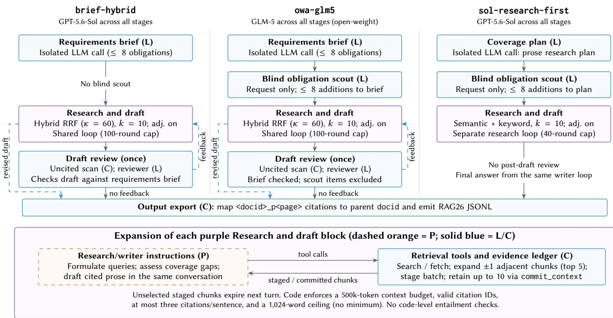
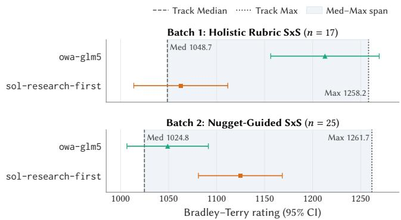
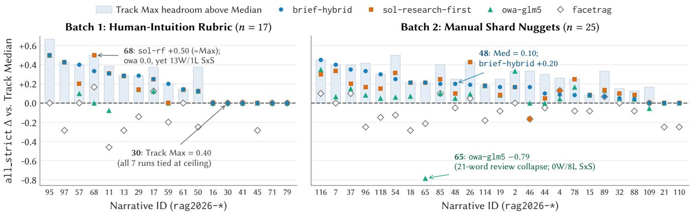

# RMIT-ADM+S at TREC RAG 2026: Research Agents, Retriever Ablations, and Open-Weight Replication

Oleg Zendel RMIT University Melbourne, Australia

Kun Ran RMIT University Melbourne, Australia

Nguyen Khoi Vo RMIT University Melbourne, Australia

Chenglong Ma RMIT University Melbourne, Australia

## Abstract

We describe the RMIT-ADM+S team’s participation in the TREC 2026 Retrieval-Augmented Generation (RAG) track using the Climb Mix corpus. We submitted seven research-agent runs using proprietary OpenAI and open-weight models, exploring diferent retrieval strategies, writer models, and agent workflows. Pre-submission ablations identified writer selection and adjacent-chunk expansion as the main factors afecting answer quality. In the oficial NIST evalu ation, six of seven runs exceeded the track median across all three rubric/nugget collections. Our best-performing run, brief-hybrid, achieved the highest all-item coverage among our submissions and tied the track maximum (0.892) for Batch-1 vital coverage. Human side-by-side preferences difered across evaluation batches: the open-weight owa-glm5 led Batch 1 despite lower automated coverage, while sol-research-first led Batch 2. These findings highlight diferences between automated coverage measures and human preferences, as well as the potential of lower-cost openweight models for research-agent systems.

## Keywords

retrieval-augmented generation, TREC RAG, agentic retrieval, Reciprocal Rank Fusion, open-weight models, trajectory fine-tuning

Shuai Wang∗ The University of Queensland Brisbane, Australia

## 1 Introduction

We describe our participation in the TREC 2026 RAG track [23], using the ClimbMix-400B-shuffle corpus [9]. The task involves producing cited reports of up to 1,024 words for 119 test narratives. We submitted seven research-agent runs using proprietary OpenAI and open-weight models, exploring diferent retrieval strategies, writer models, and agent workflows. These comparisons help assess whether more complex agent workflows and proprietary models justify their respective computational and monetary costs. This work complements our recent RAG competition systems, which explored generation-assisted retrieval and reranking in LiveRAG and adaptive retrieval with lightweight open-weight models in MMU-RAG [19, 20].

Our investigation focuses on three research questions: RQ1: Can open-weight agents achieve comparable quality to proprietary models at lower cost, and what explains any performance gaps? RQ2: Which model, retrieval, and orchestration choices have the greatest impact on quality and token cost? RQ3: Does multi-stage orchestration improve upon a simpler single-loop agent or compensate for a weaker writer?

We evaluate these questions using pre-submission RAGDollbased diagnostics (Section 4) and oficial NIST evaluations covering 17 Batch-1 and 25 Batch-2 narratives (Section 5). Contrary to expectations from our automated pre-submission evaluation, human preferences difered across evaluation settings: the open-weight owa-glm5 was significantly preferred under holistic evaluation in Batch 1, while the proprietary sol-research-first was preferred under nugget-guided evaluation in Batch 2. This highlights how system rankings can difer not only between automated and human evaluations, but also between human evaluations conducted under diferent guidelines.

## 2 System Overview

## 2.1 End-to-End Architectures

We use component markers to distinguish instructions embedded in prompts (P), separately invoked LLM stages (L), and executable code (C).

All seven submissions generate cited reports of up to 1,024 words directly from the test topics. Citations to individual chunks are mapped to parent document IDs in the final output. Table 1 summarizes the system configurations, while Figure 1 illustrates the control flow of our leading coverage run and two SxS priority runs.

Retrieval � is selected by the agent for each search call, except in facetrag, where it is fixed by code. When adjacent-chunk expansion is enabled, the system automatically retrieves the preceding and following chunks for the top-ranked search results.

Five submissions share a staged-evidence research architecture, difering in models, retrieval methods, planning stages, and review mechanisms. A shared evidence ledger lets agents select and retain retrieved chunks for report generation. Code enforces a 500,000- token context budget, a maximum of three citations per sentence, and the report word limit.

sol-default uses a single GPT-5.6-Sol conversation for research and drafting, with up to 100 research rounds(P) and no separate planning or review stages.

sol-research-first uses GPT-5.6-Sol across all stages. An isolated coverage planner(L) generates a research plan, supplemented by up to eight additional requirements from a blind obligation scout(L) that sees only the request. These outputs then guide a 40-round research loop, followed by drafting and a single-pass post-draft review(P).

  
Figure 1: Control flows for three submissions: our leading coverage run (brief-hybrid) and two SxS priority runs (owa-glm5, sol-research-first). Purple blocks are expanded in the panel below. Solid arrows show execution order, not prompt inputs; each scout sees only the request. Unboxed notes mark absent stages; � is the typical requested passages per search. Dashed blue arrows are conditional: review feedback resumes the writer loop, which may search again; the revised draft bypasses the once-only review. For staged evidence see Section 3.1.

Table 1: Configurations of the submitted systems. Runs marked ★ entered NIST human SxS assessment. Models denote the main and supporting LLMs (orchestrator and analyzer for facetrag). Sem: semantic; Kw: keyword; Hyb: hybrid RRF; SSR: shortest-substring ranking; Bool: Boolean search; Brief: requirements brief; Scout: blind obligation scout; Rev: post-draft review; Adj.: automatic adjacent-chunk expansion. Retrieval � denotes the most frequently requested number of passages per search call.
<table><tr><td>System</td><td>Models (main / support)</td><td>Retrieval (k)</td><td>Planning / Review</td><td>Adj.</td></tr><tr><td>sol-default</td><td>Sol / -</td><td>Sem+Kw (10)</td><td>None</td><td>No</td></tr><tr><td>sol-research-first*</td><td>Sol / Sol</td><td>Sem+Kw (10)</td><td>Plan+Scout</td><td>Yes</td></tr><tr><td>brief-base</td><td>Sol / Sol</td><td>Sem+Kw (10)</td><td>Brief+Rev</td><td>Yes</td></tr><tr><td>brief-hybrid</td><td>Sol / Sol</td><td>Hyb (10)</td><td>Brief+Rev</td><td>Yes</td></tr><tr><td>facets</td><td>Luna / −</td><td>Sem+Kw (10), Hyb (15)</td><td>Facets+coverage check</td><td>No</td></tr><tr><td>facetrag</td><td>GPT-OSS-120B / Qwen3-Next-80B</td><td>Sem+Kw+SSR+Bool (10), Hyb (15)</td><td>Facets+multi-stage review</td><td></td></tr><tr><td>owa-g1m5*</td><td>GLM-5 / GLM-5</td><td>Hyb (10)</td><td>Brief+Scout+Rev</td><td>Yes</td></tr></table>

brief-base and brief-hybrid extend sol-default with an isolated pre-flight requirements brief(L) and a single-pass post-draft review(L), both using GPT-5.6-Sol. The writer conducts research and drafting, guided by the brief(P). A code-based citation scan(C) flags uncited sentences, and reviewer feedback(L) is returned to the writer for revision. The two runs difer primarily in retrieval: brief-base provides the agent with semantic and keyword search, while brief-hybrid uses hybrid retrieval with Reciprocal Rank Fusion (RRF).

owa-glm5 follows the brief-hybrid architecture but uses the open-weight GLM-5 model across all stages. It also adds a blind obligation scout(L), whose requirements supplement the initial brief but are excluded from the post-draft review.

Pre-flight briefs and blind scouts each identify up to eight answer requirements. Scouts receive only the original test topic, independently of the other planning stages. Two additional submissions explore explicit facet decomposition, dividing each topic into subquestions requiring separate evidence:

facets uses a single GPT-5.6-Luna conversation to plan, research, and draft across multiple facets(P). Each search is associated with a specific requirement. A code-based coverage ${ \mathrm { c h e c k } } ^ { ( \mathrm { C } ) }$ identifies unresolved requirements and may return the draft for further research. No separate reviewer is used.

facetrag combines a GPT-OSS-120B orchestrator with a Qwen3-Next-80B-A3B analyzer to research 3–6 facets concurrently. Each facet has separate search-planning calls(L) and supports semantic, keyword, hybrid, and Boolean retrieval, including Shortest-Substring Ranking (SSR). The analyzer(L) identifies relevant passages and remaining gaps. An LLM curator(L) selects evidence based on relevance and diversity using an MMR-style approach [4], supplying up to five items per facet. Separate drafting, citation-checking, and formatting stages(L) produce the final report, followed by code validation(C).

## 2.2 Factorization of Design Choices

RAG systems combine interacting choices across retrieval, generation, curation, and evaluation; motivating systematic comparison of individual pipeline components [21]. We catalogued 14 structural factors and evaluated selected ablations (Section 4), alongside writer and helper model choices (writer, brief analyst, reviewer).1 Factors include pre-flight briefing, blind obligation scouting, single-pass review, 1 adjacent-chunk expansion, retrieval engines and cutofs, search-preview truncation, full-chunk staging versus LLM-generated snippets, and evidence pruning. brief-base and brief-hybrid were developed using one-factor-at-a-time hill climbing on a fixed 15-topic development set, evaluated with a rubric grader and head-to-head arena comparisons. brief-hybrid difers only in its retrieval engine (hybrid only). It achieved the highest rubric score, confirmed on a second 15-topic set, but a lower arena win rate than brief-base, so both were submitted.

sol-research-first was independently developed on a 30- topic development set against a Sol baseline. Adding an isolated coverage plan and a blind atomic scout to a continuous research conversation, which searches, retains evidence, and drafts the answer, improved rubric scores. Adding a post-draft repair stage reduced performance, so this stage was dropped. “First” refers to the ordering of planning and research before drafting. Across all runs, code enforces context, round, length, and citation-ID constraints, while semantic completeness and citation entailment remain modeldriven.

## 2.3 Resource Usage and Cost Estimates

Table 2 summarizes resource usage and estimated costs across all 119 test topics. sol-research-first produced the longest reports (936.6 words on average) and consumed 81% more processed tokens than sol-default. Compared with brief-base, brief-hybrid maintained similar report length and citation counts while reducing searches by 14.4% and processed tokens by 8.2%. The openweight owa-glm5 required fewer searches (12.7 per topic) and had a substantially lower estimated cost than sol-research-first (\$0.524 vs. \$2.823 per topic). facetrag issued the most searches (33.7 per topic) but produced the shortest reports (388.9 words on average), despite generating 49.7K output tokens across its multistage pipeline.

Table 2: Average resource usage and estimated cost per report across all 119 test topics. Srch: search calls; Refs: cited references; In: uncached input tokens; Cache: cached input tokens; Out: output tokens. Token counts are in thousands (K). Runs marked ★ entered NIST human SxS assessment.
<table><tr><td>System</td><td>Srch</td><td>Words</td><td>Refs</td><td>In (K)</td><td>Cache (K)</td><td>Out (K)</td><td>$/topic</td></tr><tr><td>sol-default</td><td>23.9</td><td>882.5</td><td>27.9</td><td>182.2</td><td>202.4</td><td>6.1</td><td>1.566</td></tr><tr><td>sol-research-first*</td><td>31.4</td><td>936.6</td><td>27.7</td><td>330.5</td><td>369.3</td><td>10.5</td><td>2.823</td></tr><tr><td>brief-base</td><td>26.4</td><td>830.2</td><td>25.8</td><td>319.6</td><td>388.5</td><td>8.0</td><td>2.356</td></tr><tr><td>brief-hybrid</td><td>22.6</td><td>834.3</td><td>24.7</td><td>293.1</td><td>322.4</td><td>7.5</td><td>2.156</td></tr><tr><td>facets</td><td>11.7</td><td>613.0</td><td>13.6</td><td>138.9</td><td>71.4</td><td>5.9</td><td>0.040</td></tr><tr><td>facetrag</td><td>33.7</td><td>388.9</td><td>13.9</td><td>411.7</td><td>0</td><td>49.7</td><td>0.106</td></tr><tr><td>owa-g1m5*</td><td>12.7</td><td>754.0</td><td>15.9</td><td>415.1</td><td>0</td><td>5.9</td><td>0.524</td></tr></table>

Costs are averages over successful attempts on the 119 topics, calculated from traced input, cache-read, and output tokens, supplemented by logged brief, review, and scout calls where necessary, using provider-specific rates. Estimates cover generation only, excluding failed attempts, experimentation, and judging.

## 3 Retrieval and Evidence Handling

We segmented ClimbMix-400B-shuffle [9] (6,543 shards, approximately 563 million documents) into paragraph-aware chunks, following recent findings that simple structure-based chunking strategies perform well for in-corpus retrieval [31]. The resulting BM25 index contains 921,892,634 chunks. Token counts were estimated at 1.3 tokens per word, targeting 200–500 tokens per chunk with a hard cap of 700. Each chunk was assigned a unique, 1-based <docid>\_p<page> identifier.

Sparse Lexical and Boolean Retrieval. We used a self-hosted Lucene/Anserini index [16, 27] with Pyserini’s default BM25 parameters $( k _ { 1 } ~ = ~ 0 . 9 , b ~ = ~ 0 . 4 )$ for keyword and Lucene Boolean search. facetrag additionally supports Shortest-Substring Ranking (SSR) [6] through a Cottontail-based Boolean retrieval system [7], which ranks results by compact matching spans.

Dense Semantic Retrieval. For semantic retrieval, we used our jina-v5-nano-trecrag26-agent-256d model,2 fine-tuned from jina-embeddings-v5-text-nano [2], producing 256-dimensional embeddings. We indexed these embeddings using DiskANN [14], an approximate nearest-neighbor search method designed for largescale, disk-based retrieval. The index used maximum inner product search, with graph degree $R \ : = \ : 6 4$ , construction search list size $L _ { \mathrm { b u i l d } } = 1 0 0$ , and 32-byte product quantization.

On 22 TREC RAG 2025 development topics (condensed metrics averaged over three judge variants), the fine-tuned model achieved slightly higher aggregate scores than the base model: nDCG@10 (0.720 vs. 0.713), MAP (0.113 vs. 0.103), and R@1000 (0.116 vs. 0.106). These small diferences should be interpreted cautiously given the limited validation set.

Hybrid Retrieval. Hybrid search combines semantic and lexical retrieval using unweighted Reciprocal Rank Fusion (RRF) [8], with � = 60. Both retrievers return at least 50 candidates before fusion, and the top-� chunks are returned. When adjacent-chunk expansion is enabled (Table 1), the system also retrieves the preceding and following chunks for the top five results, removing duplicates.

Query Generation. For hybrid retrieval, facets and facetrag use HyDE-style instructions [12] that encourage generating short hypothetical answer passages as search queries. Query formulations can vary substantially across both generation strategies and search contexts [1, 28], motivating direct evaluation of the querygeneration strategy. These instructions appear in the main prompt for facets and in individual search-planning calls for facetrag. They do not enforce this query format, and hypothetical passages are used only for retrieval, not as evidence.

On 15 development topics, plain hybrid retrieval scored 2.333/3, compared with 2.267/3 when adding HyDE-style instructions. Given the small diference, we found no clear benefit from HyDE-style query generation and used plain hybrid retrieval in brief-hybrid and its owa-glm5 derivative.

## 3.1 Staged Evidence and Retriever Fine-Tuning

We used a staged evidence approach to manage retrieved chunks and collect training data for the fine-tuning of the retriever. Retrieved chunks are initially available for one turn. The agent can call commit\_context to retain selected chunks in its evidence ledger; uncommitted chunks are reduced to markers and expire from the staged batch. We fine-tuned our dense retrieval encoder using evidence-selection decisions from initial agent runs. Recent work has similarly shown that search-agent trajectories can provide useful supervision for training retrievers that account for the agent’s interaction history [5, 30]. Two GPT-5.6- Luna configurations (semantic-only and keyword-only) processed all 119 oficial test topics. Chunks committed at any point during a run were labeled positive, while retrieved but non-selected chunks were treated as negative candidates. The resulting dataset export contained 2,143 search rows (1,073 semantic and 1,070 keyword), with 4,857 positive and 12,889 negative query–chunk pairs. These counts describe the exported data, not the final training set.

We trained the retriever on 95 topics, comprising 1,587 search sub-queries and 3,849 positive query–chunk pairs, and held out 24 topics for validation. We used a patched version of Tevatron [13] with InfoNCE [25], contrasting positive query–chunk pairs against other passages in the same batch (in-batch negatives). Training used $\tau = 0 . 0 5$ , batch size 64, 4 epochs, learning rate 10−4, bf16, and the first 256 embedding dimensions before normalization. We applied LoRA with $r = 1 6 , \alpha = 6 4$ , and dropout 0.1. On the 24 held-out topics (410 sub-queries), we observed an improvement in nDCG@10 from 0.751 to 0.793, evaluated over a pool of 4,071 agent-committed chunks. Based on agent-derived labels, rather than human relevance judgments or full-corpus retrieval.

The training data came from the oficial 2026 test topics, without using actual relevance labels. The held-out retrieval evaluation therefore does not establish independent end-to-end generation performance.3 All dense and hybrid submissions used this finetuned encoder.

## 4 Internal Evaluation (Pre-Submission)

We report pre-submission evaluations separately from the oficial results (Section 5). These evaluations used diferent assessment methods and, in some cases, diferent topic sets, so their scores are not directly comparable with the organizers’ results. Nevertheless, they provide insights into the relative performance of our systems under automated evaluation and the efects of design choices, helping guide our final submissions.

## 4.1 Evaluation Protocols and Limitations

Pre-submission evaluation used two automated RAGDoll protocols: pointwise grading and pairwise arena comparisons. Pointwise grading assessed approximately 31 criteria (scored 0–2) across six dimensions (Communication, Explicit Criteria, Implicit Criteria, Instruction Following, References/Citations, and Synthesis), plus an overall quality score (0–3), using GPT-5.6-Terra. Pairwise comparisons assessed which of two responses was preferred, evaluating both presentation orders (AB/BA).

System development used the 30 organizer Research-Rubrics [22] development topics, split into two disjoint 15-topic sets for tuning and validation. No submitted system configuration was selected using the 119 test topics, although the retriever was separately fine-tuned on agent trajectories from test topics (Section 3.1).

Our internal experiments revealed substantial sensitivity to the evaluation setup. On the same 20 topics, changing only the pairwise judge shifted our system’s win rate against the organizer baseline from 17.5% (GPT-5.6-Sol) to 45.0% (GPT-5.6-Luna), with GPT-5.6-Terra giving 25.0%. The judges were not equally independent ofthe compared systems, and changing answer presentation order also afected outcomes. Arena preferences were correlated with response length, while separate citation-support checks identified weaknesses that pairwise judgments did not capture. These findings highlight the limitations of relying on any automated judgments alone, consistent with prior observations that LLM-based assessment can be sensitive to evaluator and presentation choices [10, 29].

## 4.2 Writer, Retrieval, and Orchestration Sweeps

In the 15-topic brief-base sweep, writer choice had the largest impact on pointwise quality. Relative to the GPT-5.6-Sol baseline (2.267/3), switching to GPT-5.6-Terra or Luna reduced scores by 0.40, Qwen3-Next-80B-A3B by 0.867, and GPT-OSS-120B by 1.067. Of 12 structural changes, 10 changed scores by at most 0.067 (equivalent to one topic on this benchmark), while two reduced scores by 0.133 (search-preview truncation and adding SSR with Lucene Boolean search). Hybrid-only RRF (brief-hybrid) improved the pointwise score (2.333 vs. 2.267), with a larger advantage on the second, 15-topic validation set (2.333 vs. 2.133). As shown in Table 2, across the 119 test runs, brief-hybrid used 14.4% fewer searches and 8.2% fewer processed tokens than brief-base, with 8.5% lower estimated generation cost (\$2.156 vs. \$2.356 per topic). However, its 15-topic arena win rate against a Luna-based sol-research-first decreased from 40.0% to 33.3%, using a Terra judge across both presentation orders (30 battles).

Disabling 1 adjacent-chunk expansion reduced pointwise scores by 0.067 with Sol and 0.133 with Qwen3. Among development-time runs of the corresponding architectures on the 15-topic benchmark, brief-base (Sol) and sol-research-first (Luna) tied at 2.267/3, ahead of sol-default (Luna, 2.000) and facets (1.800). In a pairwise arena, brief-base lost to sol-research-first by 12 wins to 18 across 30 battles (15 topics evaluated in both orders). On a separate 30-topic development rubric, the sol-research-first configuration scored higher than sol-default (0.704 vs. 0.651). Across the report’s 30 proprietary-model cells, References and Citation Quality was the weakest dimension (mean 0.167/2, range 0.00–0.67). The sol-research-first development run scored 0.0 on this dimension, although this was based on only nine rubric criterion instances.

Overall, our internal experiments suggest that writer choice had a greater impact than most structural changes, while hybrid retrieval ofered modest quality and eficiency improvements. The evidence-handling analysis also highlight a trade-of between token eficiency and citation support, and show that automated prefer ence judgments can be sensitive to judge choice and may overlook citation-support weaknesses. However, these findings are based on a limited number of topics and should be interpreted cautiously. They do not necessarily predict performance on the oficial evaluation, which used diferent topics and assessment methods. Further research is needed to understand the generalizability of these results.

## 4.3 Open-Weight Analysis and Baseline Arena

On two 15-topic development sets, owa-glm5 scored 1.467/3 and 1.333/3, below the proprietary GPT-5.6 configurations (1.867–2.333). The largest gaps were in Implicit Criteria ( 0.294) and Synthesis ( 0.205). However, owa-glm5 scored higher on References and Ci tations (0.667/2 vs. 0.222 and 0.0), suggesting that its more frequent citation use may benefit this rubric dimension.

In an attempt to isolate the efects of the writer from retrieval and orchestration, we replaced the GPT-5.6-Sol writer in the sol-research-first system with Qwen3-Next-80B-A3B, keeping the same retriever and evidence collection strategy. Replaying evidence collected by sol-research-first into Qwen3 improved Synthesis ( 0.154) but barely changed Implicit Criteria ( 0.006), yielding an overall score of 1.267. Replacing Qwen3 helper models with GPT-5.6-Luna slightly reduced performance (1.0–1.067 vs. 1.20). Our internal experiments suggest that writer synthesis, rather than evidence collection or helper model quality alone, seem to be an important bottleneck.

To estimate performance in the oficial evaluation, we compared six completed runs against the organizer’s Sol agentic-search BM25 baseline on all 119 test topics using automated preference judgments. Unlike the development topics, these had no available evaluation labels or rubric, , so we used the arena as a presubmission sanity check rather than for system selection or optimization. owa-glm5 was finalized after this sweep and was not included. Table 3 summarizes the results.

Table 3: Internal both-order RAGDoll arena comparisons against the organizer’s shipped agentic BM25 baseline over all 119 narratives (GPT-5.6-Luna judge, seed 13; not oficial TREC judgments). Win rate is $( W + 0 . 5 T ) / 1 1 9$ . owa-glm5 was finalized after this sweep.
<table><tr><td>System</td><td>W</td><td>L</td><td>T</td><td>Win rate</td></tr><tr><td>sol-research-first</td><td>108</td><td>10</td><td>1</td><td>91.2%</td></tr><tr><td>sol-default</td><td>107</td><td>11</td><td>1</td><td>90.3%</td></tr><tr><td>brief-hybrid</td><td>101</td><td>18</td><td>0</td><td>84.9%</td></tr><tr><td>brief-base</td><td>99</td><td>19</td><td>1</td><td>83.6%</td></tr><tr><td>facets</td><td>13</td><td>105</td><td>1</td><td>11.3%</td></tr><tr><td>facetrag</td><td>0</td><td>119</td><td>0</td><td>0.0%</td></tr><tr><td>owa-glm5</td><td>一</td><td>一</td><td>一</td><td></td></tr></table>

In the arena against the organizer’s baseline results all four Sol runs achieved high win rates (83.6–91.2%), while facets (11.3%) and facetrag (0.0%) performed poorly. Internal pairwise comparisons revealed observable position bias. sol-research-first narrowly led sol-default (67 wins, 51 losses, 1 tie), but its non-tie win rate changed from 37.7% when presented as A to 76.7% as B. Similarly, brief-hybrid and brief-base were nearly tied overall (58 wins, 57 losses, 4 ties), despite win rates changing from 34.5% to 63.9% between display orders.

Compared with oficial NIST coverage results in Table 4, the internal arena broadly distinguished stronger and weaker systems but did not reliably reproduce their relative rankings. Across the six common systems, the arena’s ranking agreed only moderately with the oficial coverage rankings (Kendall’s � = 0.33-0.60; 3-5 of 15 system pairs ordered diferently; none significant at $n \ = \ 6 )$ with the highest agreement for B1 all-items and B2 automatic nuggets (� = 0.60). For example, sol-default nearly matched sol-research-first internally despite substantially lower B1 vital coverage (0.790 vs. 0.892). Together with the observed judge and position biases, these discrepancies highlight limitations of automated evaluation and motivate initiatives such as TREC Auto-Judge [11], which investigate the reliability of automated assessments.

## 5 Oficial TREC Evaluation

## 5.1 Rubric and Nugget Coverage

Table 4 reports oficial vital\_strict and all\_strict coverage [17, 18, 23, 26] across Batch-1 human-intuition rubrics (� = 17), Batch-2 manually authored nuggets (� = 25), and Batch-2 automatically generated RAGDoll AutoNuggetizer nuggets (� = 25). In all three batches, item support was assigned automatically using GPT-6.1 Sol at medium reasoning. Strict scoring gives credit only when an item is fully supported; partial support receives zero credit. vital\_strict considers vital items only, whereas all\_strict includes vital and “okay” items with equal weight.

Table 4: Oficial NIST TREC 2026 RAG coverage (vital\_strict / all\_strict) and numbers of narratives scoring at or above the global track median ( Med, V/A) across our seven submitted runs. Underlining marks our highest run per metric; ★ denotes a tie with the global track maximum before rounding. Two B2 manual narratives (rag2026-89, rag2026-114) contain no vital nuggets, capping vital\_strict at 23 25 = 0.920.
<table><tr><td></td><td></td><td colspan="2">B1 Human Rubric (n = 17)</td><td colspan="2">B2 Manual Nuggets (n = 25)</td><td colspan="2">B2 Auto Nuggets (n = 25)</td></tr><tr><td>Type</td><td>System</td><td>Vital / All</td><td>≥Med (V/A)</td><td>Vital / All</td><td>≥Med (V/A)</td><td>Vital / All</td><td>≥Med (V/A)</td></tr><tr><td rowspan="5">Proprietary</td><td>brief-hybrid</td><td>0.892* / 0.909</td><td>17 / 17</td><td>0.691 / 0.723</td><td>24 / 25</td><td>0.644 / 0.565</td><td>25 /  25</td></tr><tr><td>sol-research-first</td><td>0.892* / 0.887</td><td>17 / 17</td><td>0.684 / 0.702</td><td>25 / 24</td><td>0.649 / 0.560</td><td>25 / 25</td></tr><tr><td>facets</td><td>0.831 / 0.841</td><td>17 / 16</td><td>0.627  / 0.642</td><td>23 / 23</td><td>0.390 / 0.333</td><td>25 / 24</td></tr><tr><td>brief-base</td><td>0.824 / 0.862</td><td>17 / 16</td><td>0.691 / 0.721</td><td>24 / 25</td><td>0.648 / 0.555</td><td>25 / 25</td></tr><tr><td>sol-default</td><td>0.790 / 0.861</td><td>17 / 17</td><td>0.679 / 0.705</td><td>25 / 25</td><td>0.630 / 0.563</td><td>25 / 25</td></tr><tr><td rowspan="2">Open-weight</td><td>owa-g1m5</td><td>0.853 / 0.821</td><td>17 / 16</td><td>0.550 / 0.605</td><td>23 / 23</td><td>0.288 / 0.243</td><td>22 / 23</td></tr><tr><td>facetrag</td><td>0.600 / 0.622</td><td>11 / 10</td><td>0.460  / 0.481</td><td>13 / 10</td><td>0.139 / 0.110</td><td>12 / 11</td></tr><tr><td rowspan="4"></td><td>TREC Track Max</td><td>0.892 / 0.911</td><td>一</td><td>0.729 / 0.780</td><td>一</td><td>0.666 / 0.584</td><td></td></tr><tr><td>TREC Track Median</td><td>0.716 / 0.733</td><td>一</td><td>0.488 / 0.556</td><td>一</td><td>0.155 / 0.128</td><td></td></tr><tr><td>TREC Track Min</td><td>0.039 / 0.043</td><td>一</td><td>0.076 / 0.070</td><td>一</td><td>0.002 / 0.002</td><td></td></tr></table>

Our strongest coverage results came from brief-hybrid and sol-research-first. Both tied the global track maximum on Batch-1 vital\_strict at 0.892, while brief-hybrid achieved our highest all\_strict score in all three batches (0.909, 0.723, and 0.565). Six of seven submitted runs exceeded the global track median across all three batches.

The nominal rankings should be interpreted with a grain of salt. We conducted pairwise comparisons using Tukey’s HSD test [24] on the per-topic coverage scores and found no significant difer ences among the four leading proprietary runs, brief-hybrid, brief-base, sol-default, and sol-research-first on any of the six coverage metrics. facetrag was consistently the weakest system, while the separation between the leading runs, facets, and owa-glm5 was largest under Batch-2 automatic nuggets. The oficial coverage results therefore distinguish the strongest and weakest systems more clearly than they distinguish among the leading proprietary configurations.

We also observed a positive association between answer length and coverage within topics, increasing from a mean Spearman correlation of 0.42 in Batch 1 to 0.72 under Batch-2 automatic nuggets. This relationship is descriptive: answer length is confounded with system design and does not imply that longer answers alone cause higher coverage, but it does suggest that the fully automated Batch-2 evaluation may favor longer responses and does not penalize verbosity, unlike typical human evaluation.

## 5.2 Human Side-by-Side Preference

The organizers also performed human side-by-side evaluation for our two priority runs, owa-glm5 and sol-research-first, fitting separate Bradley–Terry (BT) ratings for each batch [3] (Figure 2).

In Batch 1, assessors strongly preferred owa-glm5, with a BT rating of 1212.8 compared with 1062.7 for sol-research-first. The diference was also robust when topics were treated as the unit of analysis: 13 of 17 topics favored owa-glm5, using a paired signflip test on per-topic battle-score diferences found the diference to be significant with � = 0.006. This contrasts with the coverage results, where sol-research-first scored higher on both Batch-1 strict metrics, showing that rubric coverage and holistic human preference can rank the same systems diferently. The direction reversed in Batch 2, where sol-research-first achieved a higher BT rating (1124.7 vs. 1049.0). However, the topic-level comparison was inconclusive $( p = 0 . 1 1 0 )$ , making this result less robust than the Batch-1 preference. The batches also difered in both topics and assessment protocol: Batch-1 assessors compared responses holistically, whereas Batch-2 assessors first constructed documentgrounded nuggets before performing their comparisons.

  
Figure 2: Oficial human side-by-side Bradley–Terry ratings with published 95% confidence intervals and track medians and maxima. Batch 1 (� = 17) and Batch 2 (� = 25) were fitted separately and used diferent topic sets and assessment protocols.

Overall, the human judgments provide a complementary signal to coverage. In particular, owa-glm5’s strong Batch-1 preference despite lower coverage suggests that characteristics not captured by strict rubric recall influenced assessor preferences. Section 6 examines readability and response style as possible contributors.

  
Figure 3: Per-topic oficial all\_strict coverage diference (Δ) relative to the TREC 2026 RAG track median across Batch 1 (� = 17, left) and Batch 2 manual nuggets (� = 25, right), sorted within each panel by brief-hybrid Δ. Shaded bars show the diference between the track maximum and median.

## 5.3 Per-Topic Divergence

Figure 3 shows substantial per-topic variation and illustrates why aggregate coverage alone does not fully characterize system behavior. We highlight two cases.

Review-Pass Failure. On Batch-2 topic 65 (hiring-AI compliance), brief-hybrid and sol-research-first both achieved 1.000/1.000 coverage, whereas owa-glm5 scored 0.0/0.0 and lost all eight side-by-side comparisons. Its trace shows 12 searches and five evidence commits followed by a 922-word draft. During review, the model was asked to add a citation to the opening sentence while preserving the report, but returned only a corrected 21-word sentence, which the harness accepted as the complete revision. This was therefore a post-draft revision failure rather than a failure to retrieve or synthesize evidence initially.

Coverage–Preference Divergence. On Batch-1 topic 68 (school safety), sol-research-first achieved 0.750/0.833 coverage, tying the global maximum on all\_strict, but recorded 6W/2T/6L in human comparisons. owa-glm5, despite substantially lower coverage (0.250/0.333), recorded 13W/0T/1L. This example emphasizes the surprising Batch-1 result: higher strict rubric coverage did not necessarily imply stronger holistic human preference.

## 6 Discussion

Batch 1 reveals a clear divergence between information coverage and holistic human preference. Although owa-glm5 covered fewer rubric items than sol-research-first (Table 4), assessors strongly preferred it in the side-by-side evaluation (Figure 2). This preference was robust at the topic level, with 13 of 17 topics favoring owa-glm5 (sign-flip � = 0.006), despite its lower Batch-1 coverage. The result is also notable from an eficiency perspective: estimated generation cost was \$0.524 per topic for owa-glm5, com pared with \$2.823 for sol-research-first. The per-topic example in Section 5.3 further illustrates that higher strict coverage does not necessarily imply stronger human preference.

To examine whether reading burden might contribute to this diference, we measured Flesch–Kincaid Grade Level [15] on the

Table 5: Report characteristics on the 17 matched Batch-1 topics (means, except topic counts).
<table><tr><td>Measure</td><td>owa-g1m5</td><td>sol-research-first</td></tr><tr><td>Words</td><td>805.3</td><td>951.2</td></tr><tr><td>Unique references</td><td>16.6</td><td>28.9</td></tr><tr><td>Flesch-Kincaid Grade Level ↓</td><td>15.7</td><td>22.2</td></tr><tr><td>Topics with shorter report</td><td>15/17</td><td>2/17</td></tr></table>

17 matched Batch-1 responses using textstat (US English). We excluded citation IDs, reference lists, and Markdown markers and used the library’s sentence segmentation. owa-glm5 was easier to read on all 17 topics, with a mean Flesch–Kincaid grade of 15.7 compared with 22.2 for sol-research-first (sign test $p < 0 . 0 0 1 ;$ Table 5). It also used shorter sentences on average (21.8 vs. 34.9 words per sentence). However, the per-topic readability diference was not associated with the per-topic preference margin (Spearman $\rho \ = \ + 0 . 2 7 , \ p \ = \ 0 . 3 0 , n \ = \ 1 7 )$ , and no readability measure was significant after correction for multiple comparisons. Answer length was likewise not associated with the Batch-1 preference diference $( \rho = - 0 . 1 5 , p = 0 . 5 6 )$ . Because owa-glm5 was easier to read on every topic, these data cannot separate readability from other systematic diferences between the systems, such as response structure, tone, or handling ofuncertainty. Readability therefore remains a plausible contributor rather than an explanation of the observed preference.

The preference direction reversed in Batch 2, although the topiclevel diference was not statistically significant. Both the topics and assessment protocol changed between batches, so this reversal cannot be attributed specifically to nugget-guided assessment. More broadly, the divergence between coverage and human preference, together with the judge sensitivity observed in our internal evaluation (Section 4.1), highlights the importance of using complementary evaluation signals rather than relying on a single automated or human metric.

## 7 Conclusion

RQ1. Open-weight agents were competitive on some measures but did not consistently match the coverage of the leading proprietary systems. owa-glm5 exceeded the global track median across all oficial coverage evaluations and was strongly preferred over sol-research-first in Batch-1 human side-by-side evaluation, despite lower rubric coverage (Table 4; Figure 2). Its estimated generation cost was \$0.524 per topic, compared with \$2.823 for sol-research-first (Table 2). However, it trailed the leading proprietary runs on Batch-2 nugget coverage, and diagnostics identified synthesis and revision weaknesses, including the review-pass failure in Figure 3. Its consistently lower Batch-1 Flesch–Kincaid scores suggest lower reading burden as a possible contributor to human preference, although our analysis did not establish such an efect (Section 6).

RQ2. Writer choice had the largest efect among the measured development ablations, while the benefit of adjacent-chunk expansion varied by writer (Section 4.2). Hybrid RRF provided the clearest eficiency improvement: brief-hybrid used 14.4% fewer searches, 8.2% fewer processed tokens, and had 8.5% lower estimated generation cost than brief-base. It also tied the global Batch-1 vital\_strict maximum and achieved our highest all\_strict score in all three oficial collections (Tables 2 and 4), although the leading proprietary systems were not statistically distinguishable on oficial coverage.

RQ3. More elaborate orchestration did not provide a consistent advantage across the systems we tested. sol-research-first improved over sol-default in our development evaluation and achieved higher Batch-1 coverage, but processed 81% more tokens with little diference in Batch-2 coverage. facetrag, despite its multi-stage architecture and high retrieval volume, remained the weakest system on oficial coverage. Because these systems difer in models, retrieval, and prompts as well as orchestration, these comparisons do not isolate the efect of orchestration alone.

Overall, our results show that there is no single best design for agentic RAG: diferent architectures ofer diferent trade-ofs in coverage, human preference, robustness, and eficiency. The same applies to evaluation. Our internal automated judgments, oficial rubric and nugget coverage, and human side-by-side preferences sometimes produced diferent system rankings, emphasizing that the choice of evaluation protocol is itself consequential. Developing a strong system therefore requires not only selecting appropriate models, retrieval, and orchestration, but also selecting evaluation methods that reflect the intended qualities and use case of the sys tem. Rather than relying on a single metric or evaluation paradigm, future work should combine complementary signals and validate that the chosen evaluation meaningfully captures the behavior it is intended to measure.

## Acknowledgments

We thank the TREC 2026 RAG track organizers for their eforts in running the track. This work was supported by the ARC Centre of Excellence for Automated Decision-Making and Society (ADM+S, CE200100005) and was undertaken with the assistance of computing resources from RACE (RMIT AWS Cloud Supercomputing).

## References

[1] Nuha Abu Onq, Chenglong Ma, Mark Sanderson, and Falk Scholer. 2026. Understanding and Modeling Heterogeneous Search Behavior. In Proceedings ofthe 49th International ACM SIGIR Conference on Research and Development in Information Retrieval (SIGIR ’26). 4–16. doi:10.1145/3805712.3809618

[2] Mohammad Kalim Akram, Saba Sturua, Nastia Havriushenko, Quentin Herreros, Michael Günther, Maximilian Werk, and Han Xiao. 2026. jina-embeddings-v5-text: Compact and Robust Text Embedding Models using Task-Targeted Distillation. In Proceedings ofthe 49th International ACM SIGIR Conference on Research and Development in Information Retrieval (SIGIR ’26). 4454–4458. doi:10.1145/3805712. 3808455

[3] Ralph Allan Bradley and Milton E. Terry. 1952. Rank Analysis of Incomplete Block Designs: I. The Method of Paired Comparisons. Biometrika 39, 3/4 (1952), 324–345. doi:10.2307/2334029

[4] Jaime Carbonell and Jade Goldstein. 1998. The Use of MMR, Diversity-Based Reranking for Reordering Documents and Producing Summaries. In Proceedings of the 21st Annual International ACM SIGIR Conference on Research and Development in Information Retrieval. ACM, New York, NY, USA, 335–336. doi:10.1145/290941. 291025

[5] Haodong Chen, Shuai Wang, Yu Yin, Shengyao Zhuang, Guido Zuccon, and Teerapong Leelanupab. 2026. ITER: Interaction-aware retrieval for agentic search. arXiv preprint arXiv:2608.27912 (2026).

[6] Charles L. A. Clarke and Gordon V. Cormack. 2000. Shortest-Substring Retrieval and Ranking. ACM Transactions on Information Systems 18, 1 (2000), 44–78. doi:10.1145/333135.33313

[7] Charles L. A. Clarke and Mark D. Smucker. 2026. Boolean Queries Are All You Need? arXiv:2607.11362 https://arxiv.org/abs/2607.11362

[8] Gordon V. Cormack, Charles L. A. Clarke, and Stefan Buettcher. 2009. Reciprocal Rank Fusion Outperforms Condorcet and Individual Rank Learning Methods. In Proceedings of the 32nd International ACM SIGIR Conference on Research and Development in Information Retrieval (SIGIR ’09). ACM, New York, NY, USA, 758–759. doi:10.1145/1571941.1572114

[9] Shizhe Diao, Yu Yang, Yonggan Fu, Xin Dong, Dan Su, Markus Kliegl, Zijia Chen, Peter Belcak, Yoshi Suhara, Hongxu Yin, Mostofa Patwary, Yingyan Lin, Jan Kautz, and Pavlo Molchanov. 2025. Nemotron-CLIMB: CLustering-based Iterative Data Mixture Bootstrapping for Language Model Pre-training. In Advances in Neural Information Processing Systems, Vol. 38. 29096–29124. doi:10.52202/085713-0865

[10] Laura Dietz, Oleg Zendel, Peter Bailey, Charles L. A. Clarke, Ellese Cotterill, Jef Dalton, Faegheh Hasibi, Mark Sanderson, and Nick Craswell. 2025. Principles and Guidelines for the Use ofLLM Judges. In Proceedings ofthe 2025 International ACM SIGIR Conference on Innovative Concepts and Theories in Information Retrieval (ICTIR) (ICTIR ’25). 218–229. doi:10.1145/3731120.3744588

[11] Naghmeh Farzi, Tim Hagen, Eugene Yang, Maik Fröbe, Ronak Pradeep, Hossein A. Rahmani, Xi Wang, Oleg Zendel, Martin Potthast, and Laura Dietz. 2026. Auto-Judge: A Cross-Task Benchmark for Comparing LLM Judges for Citation-Grounded RAG Systems. In Proceedings of the 49th International ACM SIGIR Conference on Research and Development in Information Retrieval (SIGIR ’26). 3159–3166. doi:10.1145/3805712.3808601

[12] Luyu Gao, Xueguang Ma, Jimmy Lin, and Jamie Callan. 2023. Precise Zero-Shot Dense Retrieval without Relevance Labels. In Proceedings of the 61st Annual Meeting ofthe Association for Computational Linguistics (Volume 1: Long Papers). Association for Computational Linguistics, Toronto, Canada, 1762–1777. doi:10. 18653/v1/2023.acl-long.99

[13] Luyu Gao, Xueguang Ma, Jimmy Lin, and Jamie Callan. 2023. Tevatron: An Eficient and Flexible Toolkit for Neural Retrieval. In Proceedings of the 46th International ACM SIGIR Conference on Research and Development in Information Retrieval (SIGIR ’23). ACM, New York, NY, USA, 3120–3124. doi:10.1145/3539618. 3591805

[14] Suhas Jayaram Subramanya, Fnu Devvrit, Harsha Vardhan Simhadri, Ravishankar Krishnawamy, and Rohan Kadekodi. 2019. DiskANN: Fast Accurate Billion-point Nearest Neighbor Search on a Single Node. In Advances in Neural Information Processing Systems, H. Wallach, H. Larochelle, A. Beygelzimer, F. d’Alché Buc, E. Fox, and R. Garnett (Eds.), Vol. 32. Curran Associates, Inc. https://proceedings.neurips. cc/paper\_files/paper/2019/file/09853c7fb1d3f8ee67a61b6bf4a7f8e6-Paper.pdf

[15] J. Peter Kincaid, Robert P. Fishburne, Jr., Richard L. Rogers, and Brad S. Chissom. 1975. Derivation ofNew Readability Formulas (Automated Readability Index, Fog Count and Flesch Reading Ease Formula) for Navy Enlisted Personnel. Technical Re port Research Branch Report 8-75. Chief of Naval Technical Training, Millington, TN. https://stars.library.ucf.edu/istlibrary/56/

[16] Jimmy Lin, Xueguang Ma, Sheng-Chieh Lin, Jheng-Hong Yang, Ronak Pradeep, and Rodrigo Nogueira. 2021. Pyserini: A Python Toolkit for Reproducible In formation Retrieval Research with Sparse and Dense Representations. In Proceedings ofthe 44th International ACM SIGIR Conference on Research and Development in Information Retrieval (SIGIR ’21). ACM, New York, NY, USA, 2356–2362. doi:10.1145/3404835.3463238

[17] Ronak Pradeep, Nandan Thakur, Shivani Upadhyay, Daniel Campos, Nick Craswell, and Jimmy Lin. 2024. Initial Nugget Evaluation Results for the

TREC 2024 RAG Track with the AutoNuggetizer Framework. arXiv:2411.09607 https://arxiv.org/abs/2411.09607

[18] Ronak Pradeep, Nandan Thakur, Shivani Upadhyay, Daniel Campos, Nick Craswell, Ian Soborof, Hoa Trang Dang, and Jimmy Lin. 2025. The Great Nugget Recall: Automating Fact Extraction and RAG Evaluation with Large Language Models. In Proceedings ofthe 48th International ACM SIGIR Conference on Research and Development in Information Retrieval (SIGIR ’25). ACM, New York, NY, USA, 180–190. doi:10.1145/3726302.3730090

[19] Kun Ran, Marwah Alaofi, Danula Hettiachchi, Chenglong Ma, Khoi Nguyen Dinh Anh, Khoi Vo Nguyen, Sachin Pathiyan Cherumanal, Lida Rashidi, Falk Scholer, Damiano Spina, et al. 2026. RMIT-ADM+ S at the MMU-RAG NeurIPS 2025 Competition. arXiv preprint arXiv:2602.20735 (2026).

[20] Kun Ran, Shuoqi Sun, Khoi Nguyen Dinh Anh, Damiano Spina, and Oleg Zendel. 2025. RMIT-ADM+ S at the SIGIR 2025 LiveRAG Challenge. arXiv preprint arXiv:2506.14516 (2025).

[21] David Rau, Hervé Déjean, Nadezhda Chirkova, Thibault Formal, Shuai Wang, Stéphane Clinchant, and Vassilina Nikoulina. 2024. BERGEN: A Benchmarking Li brary for Retrieval-Augmented Generation. In Findings ofthe Association for Computational Linguistics: EMNLP 2024. 7640–7663. doi:10.18653/v1/2024.findingsemnlp.449

[22] Manasi Sharma, Chen Bo Calvin Zhang, Chaithanya Bandi, Clinton Wang, Ankit Aich, Huy Nghiem, Tahseen Rabbani, Ye Htet, Brian Jang, Sumana Basu, Aishwarya Balwani, Denis Peskof, Marcos Ayestaran, Sean M. Hendryx, Brad Kenstler, and Bing Liu. 2025. ResearchRubrics: A Benchmark of Prompts and Rubrics For Evaluating Deep Research Agents. arXiv:2511.07685 [cs.AI] https://arxiv.org/abs/2511.07685

[23] TREC RAG Track Organizers. 2026. TREC Retrieval-Augmented Generation (RAG) Track. https://trec-rag.github.io/. Track website; accessed 2026-11-10.

[24] John W Tukey. 1949. Comparing individual means in the analysis of variance. Biometrics 5, 2 (1949), 99–114. doi:10.2307/3001913

[25] Aaron van den Oord, Yazhe Li, and Oriol Vinyals. 2018. Representation Learning with Contrastive Predictive Coding. arXiv:1807.03748 https://arxiv.org/abs/1807. 03748

[26] Ellen M. Voorhees. 2003. Overview of the TREC 2003 Question Answering Track. In Proceedings ofthe Twelfth Text REtrieval Conference (TREC 2003). 54–68. https://trec.nist.gov/pubs/trec12/papers/QA.OVERVIEW.pdf

[27] Peilin Yang, Hui Fang, and Jimmy Lin. 2017. Anserini: Enabling the Use of Lucene for Information Retrieval Research. In Proceedings ofthe 40th International ACM SIGIR Conference on Research and Development in Information Retrieval (SIGIR ’17). ACM, New York, NY, USA, 1253–1256. doi:10.1145/3077136.3080721

[28] Oleg Zendel, Sara Fahad Dawood Al Lawati, Lida Rashidi, Falk Scholer, and Mark Sanderson. 2025. A Comparative Analysis of Linguistic and Retrieval Diversity in LLM-Generated Search Queries. In Proceedings ofthe 34th ACM International Conference on Information and Knowledge Management (CIKM ’25). 4014–4023. doi:10.1145/3746252.3761382

[29] Oleg Zendel, J. Shane Culpepper, Falk Scholer, and Paul Thomas. 2024. Enhancing Human Annotation: Leveraging Large Language Models and Eficient Batch Processing. In Proceedings of the 2024 Conference on Human Information Interaction and Retrieval (CHIIR ’24). 340–345. doi:10.1145/3627508.3638322

[30] Yuqi Zhou, Sunhao Dai, Changle Qu, Liang Pang, Jun Xu, and Ji-Rong Wen. 2026. Learning to Retrieve from Agent Trajectories. In Proceedings ofthe 49th International ACM SIGIR Conference on Research and Development in Information Retrieval (SIGIR ’26). 2544–2555. doi:10.1145/3805712.3809675

[31] Yongjie Zhou, Shuai Wang, Bevan Koopman, and Guido Zuccon. 2026. Beyond Chunk-Then-Embed: A Comprehensive Taxonomy and Evaluation of Document Chunking Strategies for Information Retrieval. In Proceedings of the 49th International ACM SIGIR Conference on Research and Development in Information Retrieval. ACM, 3081–3091. doi:10.1145/3805712.3808575