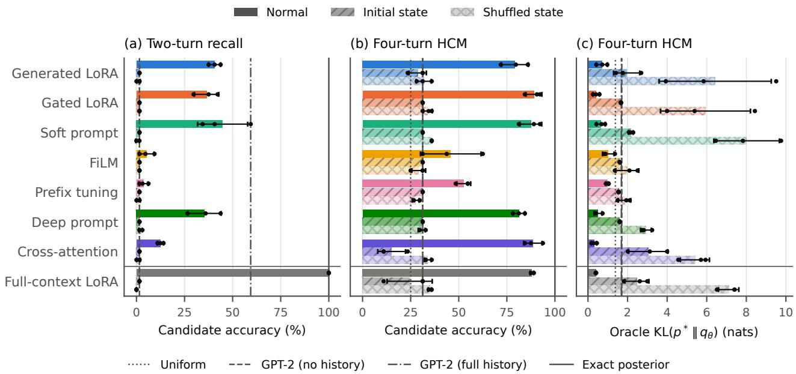
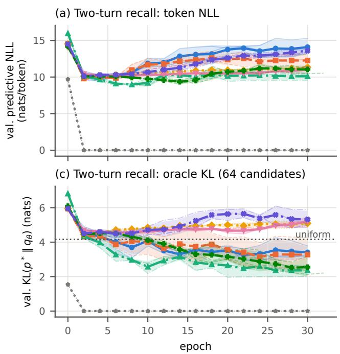
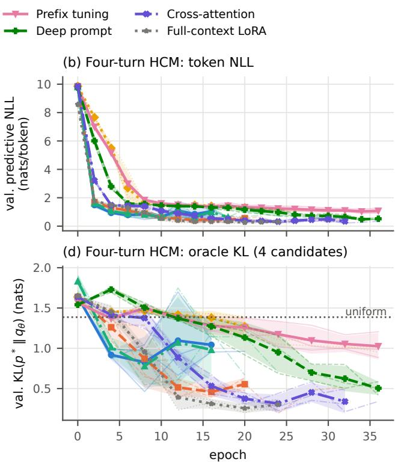

# Recursive State-Augmented Language Models: Persistent Latent-State Adaptation of Pretrained Language Models

Omer Haq 1

## Abstract

Language models rely on finite token contexts, limiting access to earlier interactions. We introduce Recursive State-Augmented Language Models (Recursive SALM), a framework in which a persistent latent state evolves with each observation and generates adaptations of a pretrained language model. A modular read– transition–write architecture separates observation encoding, latent dynamics, and predictor adaptation. We develop deterministic and stochastic formulations.

The experiments evaluate only deterministic SALM with frozen GPT-2 small and exclude earlier evidence from its decoder context. On a four-turn hypothesis-inference task, latent-gated LoRA reaches 89.1% accuracy, comparable to 88.0% for a trained full-context LoRA baseline, with earlier evidence available solely through a 64-dimensional state. Zeroing or shuffling the state substantially reduces accuracy. In a twoturn task with codewords unseen in training, several interfaces improve candidate ranking over chance, but rarely generate the exact codeword under the evaluated training schedule. These experiments show that persistent latent-conditioned adaptation can support sequential inference when earlier evidence is absent from the decoder context.

## 1. Introduction

An autoregressive language model predicts from the tokens available in its context. In a long-running interaction, retaining a growing history increases the cost of attention and the size of the key–value cache. Truncation bounds these costs but can remove evidence that a later prediction needs.

There are several ways to carry information across context boundaries. Longer contexts and retrieval give the predictor direct access to more tokens (Lewis et al., 2020). Recurrent memory instead passes a learned representation from one segment to the next, for example through memory tokens (Bulatov et al., 2022). We use recurrent memory to generate adaptations of a pretrained predictor. The state can generate a soft prompt, modulate intermediate features, or gate a low-rank weight update. The token context supplies the current input, while the state can change how the predictor processes it.

Recursive State-Augmented Language Models (Recursive SALM) implement this coupling with three operations. The read module encodes a completed observation using pretrained model representations. A learned transition combines that encoding with the previous latent state. The write module maps the updated state to an adaptation for the next prediction. The update can operate at the level of tokens, blocks, or whole interactions, and the transition can be deterministic or stochastic. This framework builds on LatentTrack’s sequential latent-conditioned weight generation (Haq, 2026) and examines how that idea applies to a pretrained language model with multiple adaptation interfaces.

We make three contributions.

1. A latent sequence formulation for adapting pretrained predictors from sequential observations, with an explicit separation between state propagation and Bayesian filtering.

2. A modular read–transition–write architecture that links deterministic or stochastic latent dynamics to input-, activation-, or weight-level adaptation.

3. A controlled study of deterministic SALM on frozen GPT-2 small, comparing adaptation interfaces, fullcontext references, and interventions on the latent state.

On four-turn hypothesis code memory (HCM), gated LoRA SALM achieves 89.1±4.1% accuracy, compared with 88.0±0.9% for trained full-context LoRA (mean and standard deviation over three seeds). The comparison is competitive on this task even though SALM receives earlier evidence only through a 64-dimensional latent state. Two-turn recall of unseen codewords exposes a gap between ranking a candidate and generating it from the full vocabulary. Section 13 reports both measures and the state interventions.

## 2. Related Work

Transformer memory and retrieval. Transformer-XL reuses hidden activations across segments, while Compressive Transformers compress older activations (Dai et al., 2019; Rae et al., 2020). Recurrent Memory Transformer passes information through dedicated memory tokens, and AutoCompressors represent preceding segments as soft prompts (Bulatov et al., 2022; Chevalier et al., 2023). Memorizing Transformers and retrieval-augmented generation instead retrieve stored representations or text (Wu et al., 2022; Lewis et al., 2020). SALM’s soft-prompt interface is closest to vector-based context compression. SALM separates the recurrent state update from the interface that uses the state, so the same architecture also supports feature modulation and weight updates.

Recurrent and latent-variable sequence models. Gated recurrent networks maintain hidden states with observation-conditioned updates (Cho et al., 2014; Hochreiter & Schmidhuber, 1997). Structured and selective state-space models use state transitions as sequencemodeling layers (Gu et al., 2022; Gu & Dao, 2023; Dao & Gu, 2024). In SALM, the recurrent state process surrounds a pretrained predictor and supplies its adaptations. Classical filtering and sequential latent-variable models motivate the distinction between prediction and posterior inference (Kalman, 1960; Rabiner, 1989; Chung et al., 2015; Krishnan et al., 2015; 2017). Latent world models such as PlaNet and Dreamer learn dynamics that can be rolled out without new observations (Hafner et al., 2019; 2020; 2023). Recursive SALM directly incorporates completed observations into its transition.

Conditional adaptation. Fast-weight networks and hypernetworks generate parameters from context (Schmidhuber, 1992; Ha et al., 2017). HyperTuning generates prefixes or LoRA from examples (Phang et al., 2023). Textto-LoRA generates adapters from task descriptions, Docto-LoRA from documents, and SHINE maps supplied context to LoRA in one pass (Charakorn et al., 2025; 2026; Liu et al., 2026). Test-time training layers and Titans update memory weights through self-supervised optimization (Sun et al., 2025; Behrouz et al., 2025). SALM’s write interfaces draw on soft prompts, prefixes, residual adapters, feature modulation, and low-rank updates (Lester et al., 2021; Li & Liang, 2021; Houlsby et al., 2019; Perez et al.,

2018; Hu et al., 2022).

Sequential adaptation. Code2LoRA-Evo shares SALM’s design of generating LoRA adapters from a recurrent state. It updates a GRU state from successive repository diffs to adapt a frozen code language model (Hotsko et al., 2026). Infinite-Parameter LLMs proposes online latent-belief-conditioned weight generation and evaluates a categorical belief over codes derived from data (Hu et al., 2026). LatentTrack combines latent filtering with hypernetwork weight generation for online prediction (Haq, 2026). Neural Processes condition predictions on a set of observations, using a latent variable to represent uncertainty over functions (Garnelo et al., 2018). Recursive SALM gives a common sequential formulation for deterministic and stochastic state, with interchangeable read and write interfaces and a stochastic trajectory ELBO. The deterministic study compares interfaces and uses state interventions to test whether predictions depend on persistent state.

## 3. Latent Sequence Formulation

Let $D _ { 1 : T } = ( D _ { 1 } , \ldots , D _ { T } )$ be a sequence of observations, where t indexes an update event. In dialogue, $D _ { t } = ( x _ { t } , y _ { t } )$ comprises the input $x _ { t }$ and response $y _ { t }$ . Let $z _ { 1 : T }$ denote latent states with $z _ { t } \in \mathcal { Z }$ . The state $z _ { t }$ is available for prediction at event $t ;$ the completed observation $D _ { t }$ enters the transition to $z _ { t + 1 }$ . We use $D _ { < t }$ and $z _ { < t }$ for the corresponding histories.

## 3.1. Chain rule and model assumptions

Ordering the variables as $z _ { 1 } , D _ { 1 } , \dots , z _ { T } , D _ { T }$ , the chain rule gives the unrestricted factorization

$$
\begin{array} { l } { \displaystyle p ( D _ { 1 : T } , z _ { 1 : T } ) = \prod _ { t = 1 } ^ { T } p ( z _ { t } , D _ { t } \mid z _ { < t } , D _ { < t } ) } \\ { \displaystyle \qquad = \prod _ { t = 1 } ^ { T } \big [ p ( z _ { t } \mid z _ { < t } , D _ { < t } ) } \\ { \displaystyle \qquad \quad \times p ( D _ { t } \mid D _ { < t } , z _ { \le t } ) \big ] . } \end{array}\tag{1}
$$

First-order Recursive SALM restricts the two factors as follows.

Assumption 1 (First-order recursive state). For $t \geq 2 ,$ , the generative transition depends only on the previous state and observation, so

$$
p ( z _ { t } \mid z _ { < t } , D _ { < t } ) = p _ { \phi } ( z _ { t } \mid z _ { t - 1 } , D _ { t - 1 } ) .\tag{2}
$$

Assumption 2 (Current-state decoding). Independence of the current observation from earlier latent states, given the observed history and current state, gives

$$
p ( D _ { t } \mid D _ { < t } , z _ { \leq t } ) = p ( D _ { t } \mid D _ { < t } , z _ { t } ) .\tag{3}
$$

The decoder may still use observed history directly. With $\ell _ { t } ( z _ { t } ) = p ( D _ { t } \mid D _ { < t } , z _ { t } )$ for the realized observation, the assumptions yield

$$
\begin{array} { l } { \displaystyle p ( D _ { 1 : T } , z _ { 1 : T } ) = p _ { \phi } ( z _ { 1 } ) \prod _ { t = 1 } ^ { T } \ell _ { t } ( z _ { t } ) } \\ { \displaystyle \times \prod _ { t = 2 } ^ { T } p _ { \phi } ( z _ { t } \mid z _ { t - 1 } , D _ { t - 1 } ) . } \end{array}\tag{4}
$$

Here $p _ { \phi } ( z _ { 1 } )$ denotes the initial state law. The sequence likelihood is

$$
p ( D _ { 1 : T } ) = \int p ( D _ { 1 : T } , z _ { 1 : T } ) d z _ { 1 : T } ,\tag{5}
$$

with sums for discrete states. We suppress model parameters in joint and marginal probabilities when the relevant factors are explicit.

## 3.2. Turn-level model with supplied inputs

In turn-level passive $\mathbf { S A L M } , x _ { t }$ is an exogenous input. We model responses and latent states conditional on the supplied inputs. Write $c _ { t } = W ( D _ { < t } )$ for the decoder’s token context from earlier observations and define the response likelihood by

$$
\lambda _ { t } ( z _ { t } ) = p _ { \theta } ( y _ { t } \mid c _ { t } , x _ { t } , z _ { t } ) .\tag{6}
$$

With $c _ { t } = \varnothing .$ , this is $p _ { \theta } ( y _ { t } \mid x _ { t } , z _ { t } )$ . For a fixed sequence of supplied inputs $x _ { 1 : T }$ , the conditional complete-data law is

$$
\begin{array} { l } { { \displaystyle p ( y _ { 1 : T } , z _ { 1 : T } \mid x _ { 1 : T } ) = p _ { \phi } ( z _ { 1 } ) \prod _ { t = 1 } ^ { T } \lambda _ { t } ( z _ { t } ) } } \\ { { \displaystyle ~ \times \prod _ { t = 2 } ^ { T } p _ { \phi } ( z _ { t } \mid z _ { t - 1 } , D _ { t - 1 } ) . } } \end{array}\tag{7}
$$

Each factor uses only the inputs supplied up to its turn. The response sequence likelihood $p ( y _ { 1 : T } \mid x _ { 1 : T } )$ integrates Equation (7) over $z _ { 1 : T }$ . For token chunks without a separate input, the joint model can score all tokens of $D _ { t }$ (Section 9).

## 4. Recursive Prediction

## 4.1. Predictive and filtering state distributions

For both models, let $b _ { t } ( z _ { t } ) = p ( z _ { t } \mid D _ { < t } )$ be the predictive state law, with $b _ { 1 } = p _ { \phi } ( z _ { 1 } )$ . In the joint observation model, the predictive likelihood and the exact filtering posterior are

$$
p ( D _ { t } \mid D _ { < t } ) = \int \ell _ { t } ( z _ { t } ) b _ { t } ( z _ { t } ) d z _ { t } ,\tag{8}
$$

$$
p ( z _ { t } \mid D _ { \leq t } ) = \frac { \ell _ { t } ( z _ { t } ) b _ { t } ( z _ { t } ) } { p ( D _ { t } \mid D _ { < t } ) } .\tag{9}
$$

The second expression applies when the predictive likelihood is positive. The next predictive law marginalizes the filtered state under the transition as

$$
\begin{array} { r } { b _ { t + 1 } ( z _ { t + 1 } ) = \int p _ { \phi } ( z _ { t + 1 } \mid z _ { t } , D _ { t } ) \qquad } \\ { \times p ( z _ { t } \mid D _ { \leq t } ) d z _ { t } . } \end{array}\tag{10}
$$

Thus $D _ { t }$ has two roles in the stochastic joint model. Its likelihood updates belief about the state that generated it. The completed observation also enters the generative kernel that propagates that belief to the next state. Conditioning the kernel on $D _ { t }$ supplies the second operation. The first follows from Bayes’ rule applied to the observation likelihood.

## 4.2. Prediction and filtering with supplied inputs

In the conditional model, $b _ { t }$ is determined by the completed history $D _ { < t }$ . The supplied input $x _ { t }$ conditions the response likelihood $\lambda _ { t }$ in Equation (6). Prediction averages this likelihood under $b _ { t }$ . After observing $y _ { t }$ , Bayes’ rule reweights $b _ { t }$ by the same response likelihood:

$$
p ( y _ { t } \mid x _ { t } , D _ { < t } ) = \int \lambda _ { t } ( z _ { t } ) b _ { t } ( z _ { t } ) d z _ { t } ,\tag{11}
$$

$$
p ( z _ { t } \mid D _ { \leq t } ) = { \frac { \lambda _ { t } ( z _ { t } ) b _ { t } ( z _ { t } ) } { p ( y _ { t } \mid x _ { t } , D _ { < t } ) } } .\tag{12}
$$

The posterior is defined for responses with positive predictive likelihood. Equation (10) propagates it to $b _ { t + 1 }$ 1 using the completed pair $D _ { t } = ( x _ { t } , y _ { t } )$ in the transition.

## 5. Deterministic Recursive SALM

A deterministic transition places a Dirac measure at the result of the state update $f _ { \phi }$ according to

$$
p _ { \phi } ( d z _ { t + 1 } \mid z _ { t } , D _ { t } ) = \delta _ { f _ { \phi } ( z _ { t } , D _ { t } ) } ( d z _ { t + 1 } ) .\tag{13}
$$

With a fixed initial state $\bar { z } _ { 1 }$ , both the predictive and filtering laws at event t are point masses at $\bar { z } _ { t }$ for histories with positive likelihood. To see this, the likelihood update reweights the point mass and leaves its location unchanged. Propagation by Equation (10) then moves it to

$$
\bar { z } _ { t + 1 } = f _ { \phi } ( \bar { z } _ { t } , D _ { t } ) .\tag{14}
$$

The state is therefore a deterministic function of the realized history. The response distribution is still the language model’s autoregressive distribution, given by

$$
p ( y _ { t } \mid x _ { t } , D _ { < t } ) = p _ { \theta } ( y _ { t } \mid c _ { t } , x _ { t } , { \bar { z } } _ { t } ) .\tag{15}
$$

Prediction uses a single state. Output tokens can still be sampled from Equation (15).

## 6. Stochastic Recursive SALM

A stochastic transition can represent multiple memory states for the same history. For example, let $e _ { t }$ be an encoding of the completed observation $D _ { t } . \mathrm { A }$ diagonal Gaussian parameterized by $F _ { \phi }$ takes the form

$$
\begin{array} { r l } & { ( \mu _ { t + 1 } , \log \sigma _ { t + 1 } ) = F _ { \phi } ( z _ { t } , e _ { t } ) , } \\ & { p _ { \phi } ( z _ { t + 1 } \mid z _ { t } , D _ { t } ) = \mathcal { N } \big ( z _ { t + 1 } ; \mu _ { t + 1 } , \mathrm { d i a g } ( \sigma _ { t + 1 } ^ { 2 } ) \big ) . } \end{array}\tag{16}
$$

Reparameterized samples take the form $z _ { t + 1 } = \mu _ { t + 1 } +$ $\sigma _ { t + 1 } \odot \epsilon _ { t + 1 } \mathrm { w i t h } \epsilon _ { t + 1 } \sim \mathcal { N } ( 0 , I )$ , where ⊙ denotes elementwise multiplication (Kingma & Welling, 2014; Rezende et al., 2014). Mixtures or normalizing flows can parameterize the same observation-conditioned kernel. Particles can approximate the resulting predictive and filtering laws.

Different states can induce different adaptations of the same backbone. The predictive distribution averages their output probabilities under Equation (11).

## 7. Observation Granularity and Chunking

The update index t is separate from autoregressive token time. For a token stream $s _ { 1 : N }$ , a chunking rule C may partition the stream as $( D _ { 1 } , \dots , D _ { T } ) = { \mathcal { C } } ( s _ { 1 : N } )$ . Token, fixedblock, and semantic chunking expose different amounts of evidence to each transition and change the number of updates between an observation and its later use. In dialogue, a completed input–response pair can serve as a chunk. The experiments also use a read-only query that requests a prediction from the current state and leaves it unchanged.

## 8. Recursive SALM Architecture

At interaction t, the write module maps the available state $z _ { t }$ to an adaptation $A _ { t }$ . The decoder uses $A _ { t }$ with the visible token context $c _ { t }$ and input $x _ { t }$ to predict $y _ { t }$ . Once the observation $D _ { t }$ is complete, the read module encodes it and the transition propagates the state. For deterministic SALM the between-interaction computation is

$$
\begin{array} { c } { { e _ { t } = E _ { \psi } \Big ( \{ H _ { \theta _ { 0 } } ^ { ( \ell ) } ( D _ { t } ) \} _ { \ell \in \cal S } \Big ) , } } \\ { { \bar { z } _ { t + 1 } = F _ { \phi } ( \bar { z } _ { t } , e _ { t } ) , } } \\ { { A _ { t + 1 } = G _ { \eta } \big ( \bar { z } _ { t + 1 } \big ) . } } \end{array}\tag{17}
$$

Here $\theta _ { 0 }$ denotes frozen backbone weights, $H _ { \theta _ { 0 } } ^ { ( \ell ) } ( D _ { t } )$ the layer-ℓ representations of the tokenized observation, and $s$ the selected layers. The trainable parameters $\psi , \phi ,$ , and η belong to the read encoder, transition, and adaptation generator, respectively. The notation $p _ { \theta }$ covers the stateconditioned predictor, including the backbone and write module. Dependence on $\psi$ through the transition input is implicit in $p _ { \phi }$

## 8.1. Read and transition

The read encoder converts token representations into a vector $e _ { t } ,$ for example by mean, last-token, or learned attention pooling. The experiments read from the unadapted backbone, using only the current observation. In this parameterization, the transition accesses $D _ { t }$ through $e _ { t }$ . The deterministic map $f _ { \phi }$ in Equation (14) is the composition of the read encoder with the recurrent cell $F _ { \phi } .$ . A GRU, recurrent MLP, or state-space update can implement the cell. Its state dimension may differ from the encoder output dimension.

In the stochastic parameterization, the transition produces a distribution as in Equation (16). The likelihood update precedes propagation in both models (Equations (9) and (12)). The read representation supplies the transition input.

## 8.2. Writing state-conditioned adaptations

The write module computes $A _ { t } = G _ { \eta } ( z _ { t } )$ from the state used for prediction. Its learned parameters η are shared across interactions. The generated adaptation varies with the state and is applied to the frozen backbone’s forward computation. It may change the effective input, intermediate activations, or weight operators.

Input and attention prefixes. A soft prompt inserts generated continuous embeddings alongside the input tokens. A prefix supplies generated key and value vectors to one or more attention layers. Both are conditioning mechanisms that use the recurrent state alongside the visible context.

Activations. Feature-wise modulation applies $\begin{array} { r l } { h ^ { \prime } } & { { } = } \end{array}$ $\gamma ( z _ { t } ) \odot h + \beta ( z _ { t } )$ to a hidden representation h. A residual adapter can add a learned function of $( h , z _ { t } )$ . A crossattention module lets the decoder attend to a representation of the state.

Weights. A generated low-rank update changes a base weight operator $W _ { 0 }$ to $W _ { 0 } + \Delta W _ { t }$ for the forward pass. Generated LoRA emits both factors of $\Delta W _ { t } ~ = ~ B _ { t } ^ { \mathrm { L } } A _ { t } ^ { \mathrm { L } }$ Gated LoRA instead uses learned, shared factors and a state-dependent gate on their rank components. More general hypernetworks may generate other weight subsets. These mechanisms differ in the size and cost of the generated object and in the part of the predictor they modify.

## 9. Finite Context and Persistent State

The response predictor in Equation (6) has two paths from history. The token context $c _ { t } = W ( D _ { < t } )$ can carry recent or retrieved text directly. The state carries a learned summary through successive updates. An observation omitted by W can still affect a later prediction through this second path. How well information survives depends on the state, transition, training objective, and interference from subsequent observations.

## 9.1. Storage and computation

For a dense Transformer pass over n tokens, there are $\Theta ( n ^ { 2 } )$ query–key interactions per layer for fixed head count, including with a causal mask. A conventional implementation may materialize a quadratic attention matrix. Activation memory depends on the attention implementation and on whether activations must be kept for backpropagation. With key–value (KV) caching, decoding one new token reuses existing keys and values and performs $\Theta ( n )$ attention interactions per layer with an n-token cache. The stored keys and values scale linearly with n at fixed layer count and width (Kwon et al., 2023).

A single persistent state $z _ { t } \in \mathbb { R } ^ { d }$ stores $\mathcal O ( d )$ numbers between updates, independent of how many interactions preceded it. A particle approximation retaining K states stores $\mathcal { O } ( K d )$ state coordinates plus weights. With a bounded decoder context, the model can carry information forward without retaining the earlier token history in its decoder or its KV cache.

This storage bound applies to the persistent state. Each update requires encoding the observation and applying the transition. An encoder pass has its own attention and activation costs, and a GRU’s cost depends on both state and encoding widths. Prediction also incurs the cost of generating and applying the adaptation. Soft prompts and prefixes add attention positions, low-rank operators add projections, and cross-attention adds an attention computation. The experiments measure predictive performance under constrained access to history. End-to-end latency, memory use, and long-horizon retention remain to be measured.

## 9.2. Autoregressive likelihood

For a response $y _ { t } = ( y _ { t , 1 } , \dots , y _ { t , m _ { t } } )$

$$
\begin{array} { l } { { \displaystyle p _ { \theta } \big ( y _ { t } \mid c _ { t } , x _ { t } , z _ { t } \big ) } } \\ { { \displaystyle \quad = \prod _ { j = 1 } ^ { m _ { t } } p _ { \theta } \big ( y _ { t , j } \mid c _ { t } , x _ { t } , y _ { t , < j } , z _ { t } \big ) . } } \end{array}\tag{18}
$$

The same $z _ { t }$ conditions every token in the response. For a pure token chunk the factorization applies to all tokens of $D _ { t }$ without a separate $x _ { t } .$ . For stochastic state, the observation or response likelihood marginalizes over a state shared across the chunk.

## 10. Training Deterministic Recursive SALM

The deterministic likelihood is the product of $\ell _ { t } ( \bar { z } _ { t } )$ for joint observations or $\lambda _ { t } ( \bar { z } _ { t } )$ for responses to supplied inputs, with $\bar { z } _ { t }$ computed from $D _ { < t }$ . Maximum-likelihood

training minimizes the sum of the negative log likelihoods. For response supervision at events $\mathcal { T } _ { \mathrm { s u p } }$ , the objective is

$$
\mathcal { L } _ { \mathrm { d e t } } = - \sum _ { t \in \mathcal { T } _ { \mathrm { s u p } } } \log p _ { \theta } ( y _ { t } \mid c _ { t } , x _ { t } , \bar { z } _ { t } ) .\tag{19}
$$

By Equation (18), this is token-level cross-entropy on the supervised responses. Earlier observations can affect the loss through the state trajectory even if they have no direct supervision. The experiments supervise only the query answer.

## 10.1. Backpropagation through persistent state

Truncated backpropagation through time detaches gradient history at an optimization-window boundary while retaining the numerical state, $z _ { t } ~ \gets ~ \mathrm { s t o p g r a d } ( z _ { t } )$ The decoder context determines which earlier tokens are visible at prediction time. The gradient window determines how far training credit can propagate through the recurrent state. Section 13 tests retention across decoder contexts and backpropagates through each entire episode. Learning across truncated gradient windows remains untested.

## 11. Training Stochastic Recursive SALM

## 11.1. Trajectory variational objective

Consider the turn-level model under a fixed sequence of supplied inputs $x _ { 1 : T }$ and a response sequence with $p ( y _ { 1 : T } \mid$ $x _ { 1 : T } ) > 0$ . Let $q _ { \rho } ( z _ { 1 : T } \mid D _ { 1 : T } )$ be absolutely continuous with respect to the exact trajectory posterior. With finite expectations, the evidence lower bound (ELBO) for the conditional response likelihood is

$$
\begin{array} { r l } & { \mathcal { I } _ { \mathrm { E L B O } } = \mathbb { E } _ { q _ { \rho } } \big [ \log p ( y _ { 1 : T } , z _ { 1 : T } \mid x _ { 1 : T } ) } \\ & { ~ - \log q _ { \rho } ( z _ { 1 : T } \mid D _ { 1 : T } ) \big ] . } \end{array}\tag{20}
$$

The gap log $p ( y _ { 1 : T } \mid x _ { 1 : T } ) - \mathcal { J } _ { \mathrm { E L B O } }$ is $\mathrm { K L } ( q _ { \rho } | | p ( \boldsymbol { z } _ { 1 : T } \ |$ $D _ { 1 : T } ) )$ , where $p ( z _ { 1 : T } \mid D _ { 1 : T } )$ is the smoothing posterior under the supplied inputs and observed responses. For the joint observation model, the same derivation uses $p ( D _ { 1 : T } , z _ { 1 : T } )$ and bounds log p $\left( D _ { 1 : T } \right)$

## 11.2. Causal approximate inference

A causal, ancestor-conditioned variational family is

$$
q _ { \rho } ( z _ { 1 : T } \mid D _ { 1 : T } ) = q _ { \rho } ( z _ { 1 } \mid D _ { 1 } ) \prod _ { t = 2 } ^ { T } q _ { \rho } ( z _ { t } \mid z _ { t - 1 } , D _ { t } ) .\tag{21}
$$

This factorization restricts how the variational sampler accesses the observed history. Its tth factor can use the completed $D _ { t }$ to infer $z _ { t } ;$ the generative transition into $z _ { t }$ uses $D _ { t - 1 }$ . The variational factor is an approximate inference distribution. Prediction before observing $D _ { t }$ uses $b _ { t } ,$ , and exact filtering after $D _ { t }$ uses Equation (12) in the turn-level model.

For Equation (21), define the local divergences

$$
\begin{array} { r l } & { ~ K _ { 1 } = \mathrm { K L } \big ( q _ { \rho } ( z _ { 1 } \mid D _ { 1 } ) \| p _ { \phi } ( z _ { 1 } ) \big ) , } \\ & { ~ K _ { t } ( z _ { t - 1 } ) = \mathrm { K L } \big ( q _ { \rho } ( z _ { t } \mid z _ { t - 1 } , D _ { t } ) } \\ & { ~ \| p _ { \phi } ( z _ { t } \mid z _ { t - 1 } , D _ { t - 1 } ) \big ) , ~ t \geq 2 . } \end{array}\tag{22}
$$

Substituting Equation (7) into the ELBO and collecting the conditional log ratios gives

$$
\begin{array} { r l r } {  { \mathcal { T } _ { \mathrm { E L B O } } = \sum _ { t = 1 } ^ { T } \mathbb { E } _ { q _ { \rho } } [ \log \lambda _ { t } ( z _ { t } ) ] } } \\ & { } & { \ - K _ { 1 } - \sum _ { t = 2 } ^ { T } \mathbb { E } _ { q _ { \rho } ( z _ { t - 1 } ) } [ K _ { t } ( z _ { t - 1 } ) ] , } \end{array}\tag{23}
$$

where $q _ { \rho } ( z _ { t - 1 } )$ abbreviates the corresponding marginal of Equation (21) for the observed trajectory. For joint observations the expansion uses $\ell _ { t }$ in place of $\lambda _ { t } .$ . The local KL terms compare conditional laws for the same ancestor. Variational families with access to more history or future observations can also optimize Equation (20), with a decomposition appropriate to their factorization. The trajectory ELBO here is distinct from an online objective that substitutes an approximate predictive marginal at each step.

## 11.3. Monte Carlo prediction

For equally weighted samples $z _ { t } ^ { ( k ) }$ from $b _ { t } , k = 1 , \dots , K$ the response likelihood for a supplied input is approximated by

$$
p ( y _ { t } \mid x _ { t } , D _ { < t } ) \approx \frac { 1 } { K } \sum _ { k = 1 } ^ { K } \lambda _ { t } ( z _ { t } ^ { ( k ) } ) .\tag{24}
$$

A weighted particle approximation uses the normalized weights of $b _ { t } .$ . For joint observations the mixture averages $\ell _ { t }$ to approximate $p ( D _ { t } \mid D _ { < t } )$ . Sequential Monte Carlo can approximate the filtering and propagation steps of Section 4.

## 12. Diagnosing Latent-State Use

A pretrained decoder can predict well from visible tokens even when its outputs depend little on the persistent state. We distinguish predictive performance, sensitivity to the state, and whether specific information can be decoded from the state.

## 12.1. State interventions

Hold the query and visible token context fixed, then replace the state $z _ { t }$ by its initial value or by a state from a different episode. The initial-state intervention removes episode-specific information while retaining the write module. Shuffling preserves the distribution of states across episodes while breaking their association with the query’s history. Performance changes measure state dependence under the chosen interventions.

## 12.2. Predictive divergence and probing

For fixed context $c _ { t }$ and input $x _ { t } .$ , the divergence

$$
\begin{array} { c } { \mathrm { K L } \big [ p _ { \theta } ( y _ { t } \mid c _ { t } , x _ { t } , z _ { t } ) } \\ { \big \| p _ { \theta } ( y _ { t } \mid c _ { t } , x _ { t } , z _ { t } ^ { \prime } ) \big ] } \end{array}\tag{25}
$$

measures how changing the state affects the response distribution. For autoregressive responses, exact sequencelevel KL requires an expectation over generated prefixes. Token-level estimates or Monte Carlo estimates provide diagnostics, and suitable estimators may also support auxiliary training objectives.

A probe trained to recover a known earlier attribute from $z _ { t }$ tests whether that information is decodable from the state. The interventions test whether the language model uses the state. Section 13 reports intervention accuracy and candidate KL to the task oracle, a different quantity from Equation (25).

## 13. Experiments

We test the central claim of deterministic Recursive SALM: that a learned recursive state can carry information from observations that are no longer in a frozen language model’s context and use it to change the model’s predictions. The experiments are deliberately small and controlled. They use one frozen backbone, two synthetic tasks, three model seeds per configuration, and 64 test episodes per task.

## 13.1. Model instantiation

Backbone. All arms use GPT-2 small (Radford et al., 2019) (124M parameters) with its byte-level BPE tokenizer. Its weights are frozen; no backbone parameter is ever in an optimizer.

Read. Each observation $D _ { t }$ is encoded alone by the frozen, unadapted GPT-2. The final-layer token states are combined by learned attention pooling into a 768- dimensional vector, which is normalized by centered RMS normalization: the mean pooled token state over the training observations is subtracted (a fixed buffer computed once per run from training data only), and the result is RMS-normalized. Without centering, GPT-2 representations of different evidence sentences were almost collinear in pilot runs (pairwise cosine ≈ 0.999), and the state barely moved.

Transition. The state is $z _ { t } ~ \in ~ \mathbb { R } ^ { 6 4 }$ with initial value $\bar { z } _ { 1 } = 0$ and a GRU transition (Cho et al., 2014), $\bar { z } _ { t + 1 } =$ $\mathrm { G R U C e l l } _ { \phi } ( e _ { t } , \bar { z } _ { t } )$ (Equation (14)). The decoder predicts from $\bar { z } _ { t }$ before $D _ { t }$ enters the transition.

Write and decoder context. The write module computes $A _ { t } = G _ { \eta } ( \bar { z } _ { t } )$ and applies it to the frozen backbone (Section 8). For SALM, the decoder receives the current input $x _ { t }$ and no earlier turns $( c _ { t } = \varnothing )$ . The response predictor is $p _ { \theta } ( y _ { t } \mid x _ { t } , \bar { z } _ { t } )$ , so earlier observations can affect the prediction only through the state.

## 13.2. Tasks

Two-turn recall. Turn 1 is “User: My code is <code> / Agent: Noted”. It carries no loss and only updates the state. Turn 2 is the query “User: What is my code?” with response “Agent: <code>”; only the code token is supervised. Codes are lowercase alphabetic words that are single GPT-2 tokens. The 256 training, 64 validation and 64 test episodes use pairwise disjoint code sets, so the evaluation measures recall of codes never seen in training. Each split is ranked against its own code list, so chance is 1.6%.

Four-turn hypothesis code memory (HCM). A hidden two-digit code is drawn uniformly from a fixed pool of four codes ({44, 19, 93, 90}, each a single GPT-2 token) shared by all splits. Three evidence turns follow, each a hard, truthful statement of a predicate on the code (parity, a threshold comparison, or an inclusive range, possibly negated), for example “My codeword is greater than 58.” The fourth turn is the read-only query “What is my code?”; only the answer token is supervised. Evidence turns update the state but carry no loss and never enter the decoder context. The query leaves the state unchanged. Episodes are kept only when their evidence satisfies a fixed rule that depends on the evidence alone. The three clues must identify exactly one code, at least two codes must remain after the first clue, and the last clue alone must leave at least two codes. The exact posterior given the evidence is therefore one-hot for every selected episode, and it is unaffected by the selection. No evidence sequence is repeated within or across the 256/64/64 splits; individual clue sentences do recur, so the task tests generalization to unseen evidence sequences over a fixed set of four hypotheses, not to unseen codes. The test hidden codes are imbalanced (22, 20, 15 and 7 of 64), so a constant prediction scores up to 34%; we therefore also report class-balanced accuracy.

All arms and seeds use the identical episodes. Each run’s metadata records a hash of every token, label and supervision mask, and the hashes agree across all runs.

Table 1. Trainable parameters by component, from the optimizer’s parameter groups. The frozen GPT-2 (124M) is excluded. ∆ is relative to the Generated LoRA anchor.
<table><tr><td>Arm</td><td></td><td>Encoder Transition</td><td>Adapter / LoRA</td><td>Total</td><td>∆ vs. anchor</td></tr><tr><td>Generated LoRA</td><td>591,360</td><td>160,128</td><td>1,604,032</td><td>2,355,520</td><td>+0.00%</td></tr><tr><td>Gated LoRA</td><td>591,360</td><td>160,128</td><td>1,618,692</td><td>2,370,180</td><td>+0.62%</td></tr><tr><td>Soft prompt</td><td>591,360</td><td>160,128</td><td>1,602,942</td><td>2,354,430</td><td>-0.05%</td></tr><tr><td>FiLM</td><td>591,360</td><td>160,128</td><td>1,603,893</td><td>2,355,381</td><td>-0.01%</td></tr><tr><td>Prefix tuning</td><td>591,360</td><td>160,128</td><td>1,597,952</td><td>2,349,440</td><td>-0.26%</td></tr><tr><td>Deep prompt</td><td>591,360</td><td>160,128</td><td></td><td>1,604,2242,355,712</td><td>+0.01%</td></tr><tr><td>Cross-attention</td><td>591,360</td><td>160,128</td><td></td><td>2,571,7123,323,200</td><td>+41.08%</td></tr><tr><td>Full-context LoRA</td><td>0</td><td>0</td><td></td><td>2,359,2962,359,296</td><td>+0.16%</td></tr></table>

## 13.3. Write interfaces and parameter matching

The three original interfaces are as follows. Generated LoRA: a hypernetwork emits rank-8 $( \alpha ~ = ~ 1 6 )$ low-rank factors $( A _ { t } , B _ { t } )$ for all twelve fused attention projections $( \mathsf { a t t n . c \_ a t t n } )$ . The slice producing $B _ { t }$ is zeroinitialized, so the untrained model is exactly GPT-2. Gated LoRA: learned static bases on the same twelve sites, modulated by a state-generated per-rank gate tanh $( W _ { g } z _ { t } + b _ { g } )$ (rank 43, $\alpha ~ = ~ 8 6 )$ Soft prompt: $z _ { t }$ is mapped by a one-hidden-layer network to four prompt embeddings prepended to the input (Lester et al., 2021).

The SALM interfaces share the same read and transition architectures. Generated LoRA, the configuration of an earlier pilot, serves as the parameter-count anchor. For each matched interface we choose one integer capacity setting to approximate the anchor’s total trainable parameter count (Table 1). This procedure also applies to FiLM (generator width 981), prefix tuning (8 key/value prefix tokens per layer, width 128), and deep prompting (8 prompt tokens per layer, width 256). The configured cross-attention interface is outside the matched comparison. Its 768-wide attention module alone has 2.37M parameters, already exceeding the anchor’s total. At this width, the cross-attention configuration has 41% more trainable parameters.

## 13.4. Training, selection and baselines

Objective and optimization. Training minimizes the supervised predictive negative log-likelihood of the query answer, Equation (19) restricted to the supervised turn,

$$
\mathcal { L } = - \frac { 1 } { N } \sum _ { i = 1 } ^ { N } \log p _ { \theta } \left( y _ { T } ^ { ( i ) } \mid x _ { T } ^ { ( i ) } , \bar { z } _ { T } ^ { ( i ) } \right) ,\tag{26}
$$

with backpropagation through the entire episode: every episode is a single backpropagation window. We use AdamW (Loshchilov & Hutter, 2019) (weight decay 0.01) with learning rate $1 0 ^ { - 3 }$ (two-turn) or $1 0 ^ { - 4 }$ (HCM), gradient clipping at 1.0, batches of eight episodes, and validation every two epochs. Training stops by patience on validation predictive NLL, after a minimum of 30 (two-turn) or 12 (HCM) epochs. Model seeds 0, 1 and 2 are reported for every arm, whether or not a seed passed the screening criteria.

Checkpoint selection. For HCM the selected checkpoint is the one with minimum validation predictive NLL. For two-turn, screening showed that once the model memorizes the 256 training codes, the full-vocabulary NLL of an unseen code rises, while its ranking among the unseen candidates keeps improving. After screening and before any test evaluation, the two-turn selection rule was therefore changed to maximum validation candidate-ranking accuracy, with ties broken by lower validation NLL. All twoturn runs were then re-run under that protocol. The main test results use these validation-selected checkpoints. Table 4 reports a separate checkpoint sensitivity comparison.

Interventions. The zero intervention replaces the state at the query by $\bar { z } _ { 1 } = 0 ,$ , removing episode-specific information while keeping the write interface active. The shuffled intervention replaces it with another episode’s state via a derangement of the test episodes. This preserves the empirical distribution of states and breaks their link to the evidence.

Baselines and references. Uniform provides a chance reference and the exact posterior is the task oracle. Frozen GPT-2 scores the query with no history, or with the complete preceding episode concatenated before it, with no fine-tuning. The full-context LoRA baseline fine-tunes ordinary static LoRA (rank 64, α = 128, on the same twelve projections; 2.36M parameters) on frozen GPT-2 that reads the complete preceding episode. Training, selection and loss are the same as for SALM, and only the answer is supervised. The baseline routes evidence to the predictor through the token context. Its interventions remove the history or replace it with another episode’s history.

Metrics. For a query with candidate set H we score $s ( h ) ~ = ~ \log p _ { \theta } ( y _ { t } ~ = ~ h ~ \mid ~ c _ { t } , x _ { t } , z _ { t } )$ and normalize over the candidates, $\begin{array} { r } { q _ { \theta } ( h ) = \exp { s ( h ) } / \sum _ { h ^ { \prime } \in \mathcal { H } } \exp { s ( h ^ { \prime } ) } } \end{array}$ Candidate-ranking accuracy is the fraction of queries for which arg maxh $q _ { \theta } ( h )$ equals the target $h ^ { \star }$ . We also report class-balanced accuracy and exact greedy generation from the full vocabulary. The predictive token NLL is $- s ( h ^ { \star } )$ The divergence $\mathrm { K L } ( p ^ { \star } \| q _ { \theta } )$ compares the candidate distribution to the task oracle $p ^ { \star }$ and equals $- \log q _ { \theta } ( h ^ { \star } )$ for a one-hot oracle.

## 13.5. Results

Sequential hypothesis inference (HCM). Gated LoRA SALM reaches 89.1±4.1% accuracy and trained fullcontext LoRA reaches 88.0±0.9% (Table 2). The difference is small relative to the observed seed variability. The full-context baseline reads the three clues directly, while SALM receives them only through its 64-dimensional state at the query. Generated LoRA and Soft prompt reach $7 9 . 2 { \pm } 7 . 0 \%$ and 87.5±5.6%, respectively. Greedy generation matches candidate accuracy for these three interfaces. Frozen GPT-2 with all clues visible scores 31.2%, at the constant-prediction level. Within this CPU study, mean HCM training time per seed was 0.32 h for full-context LoRA and 0.91 h for Gated LoRA SALM.

Do predictions use the state? On HCM, zeroing or shuffling the state reduces accuracy substantially (Table 2, Figure 1). Gated LoRA drops to 31.2±0.0% with its initial state. Across the three original interfaces, shuffling increases KL to the oracle by more than five nats on average for each interface. In the full-context baseline, removing or shuffling the history similarly reduces performance. On two-turn recall, the SALM interventions reduce candidate accuracy to near chance (Table 3, Figure 1a).

Ranking and generating unseen codes (two-turn). Generated LoRA, Gated LoRA, and Soft prompt rank the correct unseen code first in 40.6±3.1%, 36.5±6.3%, and 44.8±13.0% of episodes, respectively (chance 1.6%). Their greedy exact-match rates are 0.0±0.0%, 0.0±0.0%, and 2.6±2.4%, respectively. Full-context LoRA copies the code from the preceding turn, reaching 100.0±0.0% candidate accuracy and 100.0±0.0% exact generation. The gap between SALM’s ranking and generation measures shows that the state can improve the ranking among candidate code tokens while other vocabulary tokens remain more likely. Candidate ranking is also sensitive to checkpoint choice (Table 4).

Further write interfaces. Deep prompting reaches 81.2±3.1% on HCM and 35.4±8.6% on two-turn. FiLM and prefix tuning achieve lower accuracy on both tasks under this schedule (Tables 2 and 3). Cross-attention reaches 88.5±4.8% on HCM with 41% more trainable parameters than the Generated LoRA anchor. Its initial-state accuracy on HCM is 15.1±7.2%, below frozen GPT-2. The sidecar remains active at zero state, so the intervention removes episode information while leaving an adapted predictor. On two-turn, cross-attention reaches 12.5±1.6% candidate accuracy, with oracle KL 5.18±0.13 nats, above the uniform reference. The generation routine does not support the key/value adaptations for prefix tuning or deep prompting. Both interfaces are included in candidate scoring and the state interventions.

Training and variability. All two-turn SALM runs stopped at the 30-epoch minimum under validation-NLL patience, even though validation candidate accuracy often continued to improve (Figure 2). On HCM, several FiLM, establish a statistically reliable advantage of gated LoRA over full-context LoRA or resolve the relative performance of the top interfaces.

Table 2. Four-turn HCM, test split, mean ± s.d. over model seeds 0, 1, 2 (complete three-seed groups only). Zero/shuffled: state interventions for SALM; no-history/shuffled-history context interventions for full-context LoRA. Chance 25.0%; constant prediction of the majority code scores 34.4%.
<table><tr><td>Arm</td><td>Params</td><td>Acc.</td><td>Bal. acc.</td><td>Gen.</td><td>KL</td><td> $\mathrm { Z e r o ~ a c c . }$ </td><td>Shuf. acc.</td><td> $\Delta \mathrm { K L } _ { \mathrm { s h u f } }$ </td></tr><tr><td>Generated LoRA</td><td>2.36M</td><td> $7 9 . 2 \pm 7 . 0 $ </td><td> $8 1 . 4 { \pm } 4 . 7 $ </td><td> $7 9 . 2 { \pm } 7 . 0 $ </td><td> $0 . 7 1 { \pm } 0 . 2 8$ </td><td> $2 8 . 6 { \pm } 4 . 5 $ </td><td> $3 1 . 8 { \pm } 3 . 9 $ </td><td> $5 . 7 2 { \scriptstyle \pm 2 . 6 7 }$ </td></tr><tr><td>Gated LoRA</td><td>2.37M</td><td> $8 9 . 1 { \pm } 4 . 1 $ </td><td> $8 9 . 6 { \pm } 2 . 1 $ </td><td> $8 9 . 1 { \pm } 4 . 1 $ </td><td> $0 . 4 1 { \pm } 0 . 1 7$ </td><td> $3 1 . 2 { \pm } 0 . 0 $ </td><td> $3 3 . 9 { \pm } 2 . 4 $ </td><td> $5 . 5 2 { \pm } 2 . 1 6$ </td></tr><tr><td>Soft prompt</td><td>2.35M</td><td> $8 7 . 5 { \pm } 5 . 6 $ </td><td> $8 8 . 0 { \pm } 6 . 4 $ </td><td> $8 7 . 5 { \pm } 5 . 6 $ </td><td> $0 . 6 6 { \pm } 0 . 2 2$ </td><td> $3 1 . 2 { \pm } 0 . 0 $ </td><td> $3 5 . 9 { \pm } 0 . 0 \ $ </td><td> $7 . 3 6 { \pm } 1 . 8 8 $ </td></tr><tr><td>FiLM</td><td>2.36M</td><td> $4 5 . 8 { \pm } 1 5 . 7 $ </td><td> $4 6 . 1 { \pm } 2 0 . 3 $ </td><td> $4 5 . 8 { \pm } 1 5 . 7 $ </td><td> $1 . 0 3 { \pm } 0 . 2 9$ </td><td> $3 1 . 2 { \pm } 0 . 0 $ </td><td> $2 9 . 2 { \pm } 3 . 6 $ </td><td> $0 . 9 6 { \pm } 0 . 8 5$ </td></tr><tr><td>Prefix tuning</td><td>2.35M</td><td> $5 2 . 6 { \pm } 3 . 6 $ </td><td> $5 4 . 2 { \pm } 7 . 4 $ </td><td></td><td> $0 . 9 8 { \pm } 0 . 0 7$ </td><td> $3 1 . 2 { \pm } 0 . 0 $ </td><td> $2 7 . 6 { \pm } 1 . 8 $ </td><td> $0 . 8 7 { \pm } 0 . 3 9$ </td></tr><tr><td>Deep prompt</td><td>2.36M</td><td> $8 1 . 2 { \pm } 3 . 1 $ </td><td> $8 3 . 1 { \pm } 1 . 8 $ </td><td></td><td> $0 . 5 1 { \pm } 0 . 2 0 $ </td><td> $3 1 . 2 { \pm } 0 . 0 $ </td><td> $3 0 . 7 { \pm } 1 . 8 $ </td><td> $2 . 4 2 { \pm } 0 . 4 2$ </td></tr><tr><td>Cross-attention</td><td>3.32M</td><td> $8 8 . 5 { \pm } 4 . 8 $ </td><td> $8 9 . 2 \pm 3 . 7$ </td><td> $8 8 . 5 { \pm } 4 . 8 $ </td><td> $0 . 3 1 { \pm } 0 . 1 4$ </td><td> $1 5 . 1 { \pm } 7 . 2 $ </td><td> $3 3 . 9 { \pm } 1 . 8 $ </td><td> $5 . 1 0 { \pm } 0 . 7 6$ </td></tr><tr><td>Full-context LoRA</td><td>2.36M</td><td>88.0±0.9</td><td>88.2±0.6</td><td>88.0±0.9</td><td>0.40±0.01</td><td> $2 4 . 5 { \pm } 1 1 . 7 $ </td><td>34.9±0.9</td><td>6.71±0.50</td></tr><tr><td>Frozen GPT-2, no history</td><td>0</td><td>31.2</td><td></td><td></td><td>1.71</td><td></td><td></td><td></td></tr><tr><td>Frozen GPT-2, full history</td><td>0</td><td>31.2</td><td></td><td></td><td>1.69</td><td></td><td></td><td></td></tr><tr><td>Uniform</td><td>0</td><td>25.0</td><td></td><td></td><td>1.39</td><td></td><td></td><td></td></tr><tr><td>Exact posterior</td><td>0</td><td>100.0</td><td></td><td></td><td>0.00</td><td></td><td></td><td></td></tr></table>

Table 3. Two-turn recall of codes never seen in training, test split, mean ± s.d. over seeds 0, 1, 2. 64 candidates; chance 1.6%. Acc. is candidate-ranking accuracy and Gen. is exact greedy match. Each code occurs in one episode, so class-balanced accuracy equals accuracy.
<table><tr><td>Arm</td><td>Params</td><td>Acc.</td><td>Gen.</td><td>KL</td><td> $\mathrm { Z e r o ~ a c c . }$ </td><td> ${ \mathrm { S h u f . ~ a c c . } }$ </td><td> $\Delta K L _ { \mathrm { s h u f } }$ </td></tr><tr><td>Generated LoRA</td><td>2.36M</td><td> $4 0 . 6 { \pm } 3 . 1 $ </td><td> $0 . 0 { \pm } 0 . 0 \ $ </td><td> $2 . 7 3 { \pm } 0 . 3 0$ </td><td> $1 . 6 { \pm } 0 . 0 $ </td><td> $1 . 0 { \pm } 0 . 9 $ </td><td> $1 2 . 5 0 { \pm } 1 . 9 5 $ </td></tr><tr><td>Gated LoRA</td><td>2.37M</td><td> $3 6 . 5 { \pm } 6 . 3 $ </td><td> $0 . 0 { \pm } 0 . 0 \ $ </td><td> $3 . 2 3 { \pm } 0 . 2 9$ </td><td> $1 . 6 { \pm } 0 . 0 $ </td><td> $1 . 6 { \pm } 0 . 0 $ </td><td> $1 1 . 1 7 { \pm } 0 . 6 3 $ </td></tr><tr><td>Soft prompt</td><td>2.35M</td><td> $4 4 . 8 { \pm } 1 3 . 0 \ $ </td><td> $2 . 6 { \pm } 2 . 4 $ </td><td> $2 . 7 8 { \pm } 0 . 7 2$ </td><td> $1 . 6 { \pm } 0 . 0 $ </td><td> $0 . 5 { \pm } 0 . 9$ </td><td> $1 1 . 5 2 { \pm } 1 . 2 0 $ </td></tr><tr><td>FiLM</td><td>2.36M</td><td> $5 . 2 \pm 3 . 9$ </td><td> $0 . 0 { \pm } 0 . 0 \ $ </td><td> $4 . 7 4 \pm 0 . 4 5$ </td><td> $1 . 6 { \pm } 0 . 0 $ </td><td> $1 . 6 { \pm } 0 . 0 $ </td><td> $1 . 9 3 { \pm } 1 . 8 2 $ </td></tr><tr><td>Prefix tuning</td><td>2.35M</td><td>3.6±2.4</td><td></td><td> $5 . 0 8 { \pm } 0 . 2 7$ </td><td> $1 . 6 { \pm } 0 . 0 $ </td><td>1.0±0.9</td><td> $1 . 1 7 { \pm } 0 . 4 2$ </td></tr><tr><td>Deep prompt</td><td>2.36M</td><td> $3 5 . 4 { \pm } 8 . 6 $ </td><td></td><td> $3 . 2 0 { \pm } 0 . 3 2$ </td><td> $1 . 6 { \pm } 0 . 0 $ </td><td>2.1±0.9</td><td> $1 1 . 1 8 { \pm } 1 . 1 7$ </td></tr><tr><td>Cross-attention</td><td>3.32M</td><td> $1 2 . 5 { \pm } 1 . 6 $ </td><td> $0 . 0 { \pm } 0 . 0 \ $ </td><td> $5 . 1 8 { \pm } 0 . 1 3$ </td><td> $1 . 6 { \pm } 0 . 0 $ </td><td>1.0±0.9</td><td> $6 . 3 1 { \pm } 0 . 2 5 $ </td></tr><tr><td>Full-context LoRA</td><td>2.36M</td><td>100.0±0.0</td><td> $1 0 0 . 0 { \pm } 0 . 0 \ \qquad $ </td><td> $0 . 0 0 { \scriptstyle \pm 0 . 0 0 }$ </td><td>1.6±0.0</td><td>0.0±0.0</td><td>46.90±0.64</td></tr><tr><td>Frozen GPT-2, no history</td><td>0</td><td>1.6</td><td></td><td>6.34</td><td></td><td></td><td></td></tr><tr><td>Frozen GPT-2, full history</td><td>0</td><td>59.4</td><td></td><td>1.52</td><td></td><td></td><td></td></tr><tr><td>Uniform</td><td>0</td><td>1.6</td><td></td><td>4.16</td><td></td><td></td><td></td></tr><tr><td>Exact posterior</td><td>0</td><td>100.0</td><td></td><td>0.00</td><td></td><td></td><td></td></tr></table>

Table 4. Two-turn test candidate-ranking accuracy (%) at the validation-selected, minimum-validation-NLL, and final checkpoints. Checkpoint epochs are shown as mean ± s.d.
<table><tr><td>Arm</td><td>Selected</td><td>Epoch Min-NLL ckpt</td><td></td><td>Epoch</td><td>Final ckpt</td></tr><tr><td>Generated LoRA</td><td>40.6±3.1</td><td>22.0±7.2</td><td>9.4±8.7</td><td>4.7±1.2</td><td>51.6±9.5</td></tr><tr><td>Gated LoRA</td><td>36.5±6.3</td><td>27.3±3.1</td><td>10.4±8.6</td><td>3.3±2.3</td><td>38.0±8.6</td></tr><tr><td>Soft prompt</td><td>44.8±13.0</td><td>20.7±3.1</td><td>28.6±12.1</td><td>8.7±2.3</td><td>48.4±9.8</td></tr><tr><td>FiLM</td><td>5.2±3.9</td><td>20.7±16.2</td><td>1.6±0.0</td><td>2.0±0.0</td><td>5.2±3.9</td></tr><tr><td>Prefix tuning</td><td>3.6±2.4</td><td>26.7±3.1</td><td>1.6±0.0</td><td>5.3±2.3</td><td>5.7±3.9</td></tr><tr><td>Deep prompt</td><td>35.4±8.6</td><td>28.7±2.3</td><td>21.4±6.3</td><td>14.7±1.2</td><td>37.5±1.6</td></tr><tr><td>Cross-attention</td><td>12.5±1.6</td><td>27.3±1.2</td><td>1.6±0.0</td><td>2.7±1.2</td><td>14.6±2.4</td></tr><tr><td>Full-context LoRA 100.0±0.0</td><td></td><td>30.0±0.0</td><td>100.0±0.0 30.0±0.0 100.0±0.0</td><td></td><td></td></tr></table>

## 13.6. Directions not yet evaluated

The experiments do not yet address several questions the formulation raises:

• performance as a function of the number of state updates between storage and query;

prefix, deep-prompt, and cross-attention runs reached the epoch cap. These results characterize the original schedule. Evaluating longer training with a stopping rule aligned with candidate ranking or exact generation remains open. Across the three seeds, each configuration uses the same 64 test episodes. The seed standard deviation measures variation across trained models on this split. The study does not • overwrite and interference;

• capacity as a function of the latent dimension;

• learning under truncated backpropagation across a stored observation;

• ablations of the read interface.

  
Figure 1. Memory dependence on the test split. Panels (a) and (b) show candidate-ranking accuracy and panel (c) shows KL divergence to the HCM oracle. Bars show the normal model, its initial state, and a shuffled state. For full-context LoRA, the interventions remove or shuffle the history. Dots show individual seeds and error bars show ± s.d. over three seeds. Vertical lines mark the uniform predictor, frozen GPT-2 with or without history, and the exact posterior. Some reference values coincide.

## 14. Discussion

Recursive SALM uses a single observation-conditioned transition structure for deterministic and stochastic state. Its encoder, transition, and write module can be chosen separately. This separation makes it possible to test the effect of a write interface while holding the backbone and state process fixed.

The kernel $p _ { \phi } ( z _ { t + 1 } \mid \mathbf { \theta } z _ { t } , D _ { t } )$ requires an observation to propagate the state. Rollout beyond the observed stream therefore requires specified or simulated observations.

## 15. Limitations

The experiments use GPT-2 small, a 64-dimensional state, 256 training episodes per task, and three model seeds on fixed 64-episode test sets. HCM uses four fixed hypotheses, hard truthful clues, and an imbalanced test split. The study measures performance on two- and four-turn episodes within a single gradient window. It leaves memory capacity, overwrite and interference, retention over longer horizons, and learning with truncated gradients open.

Two-turn candidate ranking and exact generation measure different capabilities. The validation-NLL stopping rule fired at the 30-epoch minimum, often while validation ranking accuracy was still improving. Results characterize the evaluated schedule. The read encoder and state dimension were held fixed, and cross-attention used more trainable parameters than the matched interfaces.

The experiments evaluate only deterministic SALM. Future revisions will evaluate stochastic SALM under ambiguous or noisy evidence, including the effect of approximate inference on predictive quality and the cost of evaluating multiple adapted predictors. The persistent-state storage bound alone leaves end-to-end runtime and memory use open.

## 16. Conclusion

Recursive SALM couples observation-conditioned latent dynamics to the adaptation of a pretrained predictor. Its filtering recursion specifies how to filter the current state and propagate to the next one, with a deterministic recurrence as a special case. In a controlled four-turn inference task, deterministic SALM achieves accuracy comparable to trained full-context LoRA while carrying earlier evidence in a 64-dimensional state. The interventions show that the predictions depend on that state. The two-turn results distinguish candidate ranking from verbatim generation and motivate further study of what the recurrent state can retain and express through the decoder.

## References

Behrouz, A., Zhong, P., and Mirrokni, V. Titans: Learning to memorize at test time. In Advances in Neural Infor-

  
Figure 2. Validation learning curves (thick: mean over seeds; $\mathbf { b a n d } \colon \pm \mathbf { s . d . }$ ; thin: individual seeds). (a, b) Predictive NLL of the answer token over the full vocabulary. (c, d) Oracle KL of the candidate-normalized prediction. On two-turn, token NLL and candidate KL diverge as training proceeds. HCM means are drawn only while every seed of an arm is still training.

## mation Processing Systems, 2025.

Bulatov, A., Kuratov, Y., and Burtsev, M. Recurrent memory transformer. In Advances in Neural Information Processing Systems, 2022.

Charakorn, R., Cetin, E., Tang, Y., and Lange, R. T. Textto-LoRA: Instant transformer adaption. In International Conference on Machine Learning, pp. 7485–7514, 2025.

Charakorn, R., Cetin, E., Uesaka, S., and Lange, R. T. Doc-to-LoRA: Learning to instantly internalize contexts. In International Conference on Machine Learning, pp. 12967–12997, 2026.

Chevalier, A., Wettig, A., Ajith, A., and Chen, D. Adapting language models to compress contexts. In Proceedings of the 2023 Conference on Empirical Methods in Natural Language Processing, pp. 3829–3846, 2023.

Cho, K., van Merriënboer, B., Gulcehre, C., Bahdanau, D., Bougares, F., Schwenk, H., and Bengio, Y. Learning phrase representations using RNN encoder–decoder for statistical machine translation. In Proceedings ofthe 2014 Conference on Empirical Methods in Natural Language Processing, pp. 1724–1734, 2014.

Chung, J., Kastner, K., Dinh, L., Goel, K., Courville, A. C., and Bengio, Y. A recurrent latent variable model for sequential data. In Advances in Neural Information Processing Systems, 2015.

Dai, Z., Yang, Z., Yang, Y., Carbonell, J., Le, Q., and Salakhutdinov, R. Transformer-XL: Attentive language models beyond a fixed-length context. In Proceedings of the 57th Annual Meeting of the Association for Computational Linguistics, pp. 2978–2988, 2019.

Dao, T. and Gu, A. Transformers are ssms: Generalized models and efficient algorithms through structured state space duality. In International Conference on Machine Learning, 2024.

Garnelo, M., Schwarz, J., Rosenbaum, D., Viola, F., Rezende, D. J., Eslami, S. M. A., and Teh, Y. W. Neural processes. arXiv preprint arXiv:1807.01622, 2018.

Gu, A. and Dao, T. Mamba: Linear-time sequence modeling with selective state spaces. In arXiv preprint arXiv:2312.00752, 2023.

Gu, A., Goel, K., and Ré, C. Efficiently modeling long sequences with structured state spaces. In International Conference on Learning Representations, 2022.

Ha, D., Dai, A., and Le, Q. V. Hypernetworks. In International Conference on Learning Representations, 2017.

Hafner, D., Lillicrap, T., Fischer, I., Villegas, R., Ha, D., Lee, H., and Davidson, J. Learning latent dynamics for planning from pixels. In International Conference on Machine Learning, pp. 2555–2565, 2019.

Hafner, D., Lillicrap, T., Ba, J., and Norouzi, M. Dream to control: Learning behaviors by latent imagination. In International Conference on Learning Representations, 2020.

Hafner, D., Pasukonis, J., Ba, J., and Lillicrap, T. Mastering diverse domains through world models. arXiv preprint arXiv:2301.04104, 2023.

Haq, O. LatentTrack: Sequential weight generation via latent filtering. arXiv preprint arXiv:2602.00458, 2026.

Hochreiter, S. and Schmidhuber, J. Long short-term memory. Neural Computation, 9(8):1735–1780, 1997.

Hotsko, L., Li, Y., Deng, Y., and Nie, P. Code2LoRA: Hypernetwork-generated adapters for code language models under software evolution. arXiv preprint arXiv:2606.06492, 2026.

Houlsby, N., Giurgiu, A., Jastrzebski, S., Morrone, B., De Laroussilhe, Q., Gesmundo, A., Attariyan, M., and Gelly, S. Parameter-efficient transfer learning for nlp. In International Conference on Machine Learning, pp. 2790–2799, 2019.

Hu, E. J., Shen, Y., Wallis, P., Allen-Zhu, Z., Li, Y., Wang, S., Wang, L., and Chen, W. Lora: Low-rank adaptation of large language models. In International Conference on Learning Representations, 2022.

Hu, J., Clarke, R. M., Zhang, Y., and Hernández-Lobato, J. M. Infinite-parameter LLMs: Generating and adapting weights from live data. arXiv preprint arXiv:2609.18842, 2026.

Kalman, R. E. A new approach to linear filtering and prediction problems. Journal of Basic Engineering, 82(1): 35–45, 1960.

Kingma, D. P. and Welling, M. Auto-encoding variational bayes. In International Conference on Learning Representations, 2014.

Krishnan, R. G., Shalit, U., and Sontag, D. Deep kalman filters. In arXiv preprint arXiv:1511.05121, 2015.

Krishnan, R. G., Shalit, U., and Sontag, D. Structured inference networks for nonlinear state space models. In AAAI Conference on Artificial Intelligence, 2017.

Kwon, W., Li, Z., Zhuang, S., Sheng, Y., Zheng, L., Yu, C. H., Gonzalez, J. E., Zhang, H., and Stoica, I. Efficient memory management for large language model serving with PagedAttention. In Proceedings ofthe ACM SIGOPS Symposium on Operating Systems Principles, 2023.

Lester, B., Al-Rfou, R., and Constant, N. The power of scale for parameter-efficient prompt tuning. In Empirical Methods in Natural Language Processing, 2021.

Lewis, P., Perez, E., Piktus, A., Petroni, F., Karpukhin, V., Goyal, N., Küttler, H., Lewis, M., Yih, W.-t., Rocktäschel, T., Riedel, S., and Kiela, D. Retrievalaugmented generation for knowledge-intensive NLP tasks. In Advances in Neural Information Processing Systems, 2020.

Li, X. L. and Liang, P. Prefix-tuning: Optimizing continuous prompts for generation. In Association for Computational Linguistics, 2021.

Liu, Y., Wang, X., Mao, Y., Gelberg, Y., Maron, H., and Zhang, M. SHINE: A scalable in-context hypernetwork for mapping context to LoRA in a single pass. In International Conference on Machine Learning, pp. 78777– 78807, 2026.

Loshchilov, I. and Hutter, F. Decoupled weight decay regularization. In International Conference on Learning Representations, 2019.

Perez, E., Strub, F., De Vries, H., Dumoulin, V., and Courville, A. Film: Visual reasoning with a general conditioning layer. In AAAI Conference on Artificial Intelligence, 2018.

Phang, J., Mao, Y., He, P., and Chen, W. HyperTuning: Toward adapting large language models without backpropagation. In International Conference on Machine Learning, pp. 27854–27875, 2023.

Rabiner, L. R. A tutorial on hidden markov models and selected applications in speech recognition. Proceedings ofthe IEEE, 77(2):257–286, 1989.

Radford, A., Wu, J., Child, R., Luan, D., Amodei, D., and Sutskever, I. Language models are unsupervised multitask learners. Technical report, OpenAI, 2019.

Rae, J. W., Potapenko, A., Jayakumar, S. M., and Lillicrap, T. P. Compressive transformers for long-range sequence modelling. In International Conference on Learning Representations, 2020.

Rezende, D. J., Mohamed, S., and Wierstra, D. Stochastic backpropagation and approximate inference in deep generative models. In International Conference on Machine Learning, pp. 1278–1286, 2014.

Schmidhuber, J. Learning to control fast-weight memories: An alternative to dynamic recurrent networks. Neural Computation, 4(1):131–139, 1992.

Sun, Y., Li, X., Dalal, K., Xu, J., Vikram, A., Zhang, G., Dubois, Y., Chen, X., Wang, X., Koyejo, S., Hashimoto, T., and Guestrin, C. Learning to (learn at test time): RNNs with expressive hidden states. In International Conference on Machine Learning, pp. 57503–57522, 2025.

Wu, Y., Rabe, M. N., Hutchins, D., and Szegedy, C. Memorizing transformers. In International Conference on Learning Representations, 2022.