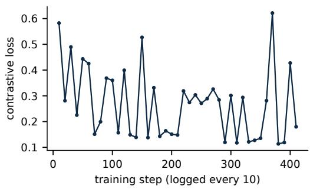
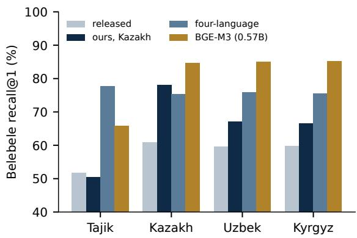

# Saidzoda-Kazakh-EmbeddingGemma-300M: How Far One Epoch of Generated Questions Takes a Small Kazakh Embedder

Tohir Saidzoda and Madina Abdusalomzoda and Abubakr Abdullozoda Amin Jalilov and Faroiz Bobokhon and Aibek Shokanuly Saidzoda AI Lab, Saidzoda Engineering Company, Dushanbe, Tajikistan tohir@saidzoda.com

## Abstract

EmbeddingGemma-300M is a small open embedder, and used as released it finds the right passage first for 60.8% of the Kazakh Belebele retrieval questions. We present Saidzoda Kazakh-EmbeddingGemma-300M, the same model fully fine-tuned for one epoch on 208,511 pairs: 166,263 Kazakh questions that our own language model wrote about source passages from encyclopedias, Wikipedia, news and books, each checked by a second model, plus English and Russian replay. On Kazakh Belebele, recall@1 rises from 60.8% to 78.0% and recall@10 from 76.3% to 91.4%. Our model scores above 161 of the 194 models with a published MTEB score on the same test, among them OpenAI text-embedding-3- large (47.1%). The other 33 score higher: the ten best are large multi-billion-parameter or closed models, reaching up to 92.2%, and at least 9 are open models of up to 0.6B parame ters, the smallest with 339M. We also scored 6 Kazakh-specific embedders shared on Hug ging Face with the same code in one run: our model (77.3% there) is ahead of 4 of them, in cluding the two E5-base models of similar size (72.6% and 69.0%), and behind kaz-embedder (86.0%, three towers with 1,695M parameters in total) and a BGE-M3 fine-tune (81.0%); at recall@10 its interval overlaps those of its nearest neighbours on both sides. Our four language model, trained with a capped share of the same Kazakh pairs, is 2.8 points lower at recall@1, with overlapping recall@10 intervals. The Kazakh model also scores higher than the released model on the Uzbek and Kyr gyz versions of Belebele, but our Tajik model, trained without any Turkic pairs, gains as much there, so these gains are not specific to Kazakh training. Our Kazakh Wikipedia test questions come from the same generator family as the training questions, so we rest the main claims on Belebele.

## 1 Introduction

Kazakh is a Turkic language written in Cyrillic with nine letters beyond the Russian alphabet. It has public retrieval resources, among them a question answering and retrieval set (Yeshpanov et al., 2024) and a retrieval benchmark (Tleubayeva et al., 2026), yet the small open embedder EmbeddingGemma-300M (Vera et al., 2025), used as released, finds the right Belebele passage (Bandarkar et al., 2024) first for 60.8% of Kazakh questions.

Our earlier reports adapted language models to Tajik (Saidzoda et al., 2026e,a) and fine-tuned multilingual-e5-large-instruct for Tajik retrieval (Saidzoda et al., 2026c); companion reports finetune EmbeddingGemma-300M for Tajik (Saidzoda et al., 2026d) and for four Central Asian languages together (Saidzoda et al., 2026b). This report covers the Kazakh model of that series: the released EmbeddingGemma-300M trained on Kazakh alone. We ask how far one epoch of generated question and passage pairs takes it, how it compares with the published scores of other embedders and with our four-language model, and what it does to the other languages we test.

Our contributions are:

1. The model and its recipe. EmbeddingGemma-300M fine-tuned on Kazakh questions grounded in source passages, with the data pipeline and its contamination guards (Sections 4 and 5).

2. Position against published models. The model gains 17.2 points of Belebele recall@1; of the 194 models with a published MTEB score on the same test, 33 score higher, at least 9 of them with up to 0.6B parameters (Section 6).

3. Kazakh-specific embedders, scored by us. 6 embedders shared on Hugging Face, scored with the same code in one run: ours is ahead of 4 of them and behind two larger ones (Section 6).

4. Effects outside Kazakh. Gains on the Uzbek and Kyrgyz versions of Belebele that a Tajikonly model also shows, and a rise in Tajik tax retrieval on a small set, with Tajik law within its interval (Section 6).

## 2 Four Languages, One Culture

Tajik is Persian: Tajik, Iranian and Afghan Persian are mutually intelligible varieties of the same language, and Tajik is written in a modified Cyrillic alphabet (Merchant et al., 2025). Kazakh, Uzbek and Kyrgyz are Turkic languages (Hammarström et al., 2025). The two groups share one culture, which historians call Turko-Persian (Green, 2019). Under the Samanids, who ruled from Bukhara from the ninth century, Persian became a written language of state, and by the tenth century the court poetry of Bukhara had made it a language of government and learning in a region that later stretched from China to the Balkans. The Turkic dynasties that ruled after the Samanids, from the Ghaznavids and Saljuqs to the Timurids and Shaybanids, kept it as their language of state. Across much of the region Persian was “a literate island in a sea of spoken Turkic”, the written language of courts and scholars while many nomadic peoples spoke Turkic; as Green (2019) notes, a learned language of this kind is “geographically broad but socially shallow”. For centuries Bukhara, Samarkand, Tashkent and Kokand were also centres of Islamic learning, and their madrasas were still numerous on the eve of the Russian invasion: even at the end of the nine teenth century Samarkand province alone had fiftyeight, and the madrasas of Kokand attracted stu dents even from Bukhara (Khalid, 1998). Writers of the time counted between 200 and 400 madrasas in the Emirate of Bukhara, whose students came from Iran, Afghanistan, India, Kashgar, Crimea, Tatarstan and the North Caucasus (Bobojonova and Ochilov, 2022); Bukhara was a common destination for Tatar scholars, and nomadic families hired teachers from Bukhara for their children (Khalid, 1998). Bedil, whose Persian poetry was widely read in Afghanistan and Transoxiana, was born in India to a family of the Arlas, a Chaghatay Turkic tribe (Ferhâdî, 1992).

This long contact left a shared vocabulary. The names of the days of the week in Uzbek, Kazakh and Kyrgyz come from Persian (Rosenfeld, 1996); Uzbek surnames are mostly of Arabic or Persian origin (Koziyeva, 2022); and the Tajik of Bukhara has taken Uzbek words, suffixes and even the question particle mi, while almost all of its speakers also speak Uzbek (Ido, 2014). The Russian Empire invaded the region in the 1860s and 1870s. Under Soviet rule the madrasas were closed: by 1927 madrasa education had been abolished in Tashkent and cut sharply in Bukhara and Samarkand, before the assault on Islam of the 1930s. The nationalterritorial delimitation of 1924 created national republics in place of Turkestan, Bukhara and Khiva, and the alphabet was changed twice, Uzbek for example moving from the Arabic script to Latin and, in 1940, to Cyrillic (Khalid, 2015). The Soviet period also added the Russian endings -ov and -ova to these surnames, a custom that continues today (Koziyeva, 2022).

## 3 Related Work

Multilingual embedders. Many open multilingual embedders build on XLM-RoBERTa (Conneau et al., 2020), among them multilingual E5 (Wang et al., 2024) and BGE-M3 (Chen et al., 2024); EmbeddingGemma (Vera et al., 2025) is a 300M encoder initialised from Gemma 3 (Gemma Team et al., 2025). MTEB and MMTEB (Muennighoff et al., 2023; Enevoldsen et al., 2025) evaluate them across many languages, and their Belebele retrieval task covers Kazakh.

Kazakh retrieval. Turkic Central Asian languages have gained resources in recent years (Veitsman and Hartmann, 2025). KazQAD (Yeshpanov et al., 2024) is a Kazakh open-domain question answering dataset with a retrieval part, and KazakhTextDuplicates (Tleubayeva et al., 2026) is a peer-reviewed benchmark for duplicate detection, semantic similarity and retrieval. A further Kazakh retrieval benchmark, a single-author preprint that is not peer-reviewed, compares morphological and dense methods on about three hundred queries (Seidalin, 2026). In a search of arXiv and the ACL Anthology in November 2026 we found no report of a fine-tuned EmbeddingGemma for Kazakh. Several Kazakh embedders are shared on Hugging Face or GitHub without a paper; our search was by name and is not exhaustive. kaz-embedder1 combines BGE-M3 and multilingual-e5-large-instruct towers and reports results on its own KazMTEB set; kazembed-v52 and kazakh-e5-rag-embedding3

## Saidzoda AI Lab

fine-tune multilingual-e5-base on KazQAD and report KazQAD subsets; Darmm fine-tunes BGE-M3 and reports its own question sets.4 A comparison of Kazakh fine-tunes with BGE-M3 on the full KazQAD corpus found no fine-tune clearly ahead.5 None of these reports a Belebele score, and each uses its own test, so we scored them ourselves on our Kazakh Belebele set (Section 6). The only EmbeddingGemma variants for Kazakh we found there are copies whose vocabulary was trimmed to Kazakh text, and their cards report no retrieval evaluation.6

Training on generated questions. Training retrievers on questions written by a language model goes back to InPars, Promptagator and GPL (Bonifacio et al., 2022; Dai et al., 2022; Wang et al., 2022), and has been used for many languages at once (Thakur et al., 2024). Test sets built the same way may favour systems close to the generator (Rahmani et al., 2024, 2025), which is why we read our generated test set as an upper bound. We train with the in-batch multiple-negatives loss (Henderson et al., 2017) with gradient caching (Gao et al., 2021) in sentence-transformers (Reimers and Gurevych, 2019), with hard negatives mined as in NV-Retriever (Moreira et al., 2024).

## 4 Data and Benchmark

Grounded question and passage pairs. According to our data-generation records, our in-house Central Asian fine-tune of a 27B Qwen model wrote questions about Kazakh source passages from encyclopedias, Wikipedia, news and books, and a second model, the released Qwen3.6-27B, checked that each question is answered by its passage and that the answer is correct; only questions that passed were kept, and the passage itself, not the generated answer, is the positive. The two models are of the same family, so the check is not fully independent. The records give a pass rate of about 65% for the first production window only; the prompts and the overall rejection rate are not reported here, and the teacher is not released, so the generation step cannot be reproduced exactly by others. We call these questions grounded; they are generated, not written by people. This gave

<table><tr><td>Part</td><td>Pairs</td></tr><tr><td>Kazakh, with a mined negative Kazakh, in-batch negatives only</td><td>153,906 12,357</td></tr><tr><td>English replay Russian replay</td><td>24,993 17,255</td></tr><tr><td>Total</td><td>208,511</td></tr></table>

Table 1: Training pairs of our Kazakh model, as counted by the training run.

251,778 checked rows. Before any pair was built, Kazakh Wikipedia articles for testing were frozen in an earlier stage of this work, as a list of article identifiers in the same form as the passage identifiers of the generated rows; we dropped 6,880 rows about a held-out article, 69,404 rows whose passage is in a test corpus, 9,218 rows whose passage could not be found and 13 repeated questions. Positives that share any 13-word sequence with a Belebele or replay test passage were also to be dropped (0 found), as were questions equal to a test question; this guard catches copied text only, not paraphrases or translations. This leaves 166,263 pairs over 93,914 distinct passages.

Training set. Table 1 lists the 208,511 pairs: all Kazakh pairs and half of the English and Russian replay sets of our Tajik model (20% of the set), from Natural Questions (Kwiatkowski et al., 2019), MIRACL (Zhang et al., 2023) and a Russian hardnegative set (ru-HNP). 93% of the Kazakh pairs carry one hard negative, mined with the released BGE-M3 (Chen et al., 2024) from ranks 10 to 50 of the Kazakh passage pool, from a different article than the positive and with a score below 0.95 times that of the positive (Moreira et al., 2024).

## Test sets.

• Belebele (Bandarkar et al., 2024): 900 Kazakh questions, each to be matched to its own passage among 488 distinct passages, as in the Belebele retrieval task of MMTEB (Enevoldsen et al., 2025). It is the only test not produced by our generator, so our main claims rest on it. The dataset is fully parallel, so its Tajik, Uzbek and Kyrgyz versions are one test in three translations, not independent tests.

• Kazakh Wikipedia: 500 generated questions on held-out articles, searched over 30,000 passages.

• Tajik: the law (1,000 questions over 72,920 chunks), tax (109 over 23,282) and Wikipedia sets of our E5 report (Saidzoda et al., 2026c), and

## Saidzoda AI Lab

Belebele in Tajik, Uzbek and Kyrgyz, to look at effects outside Kazakh.

• Russian and English Belebele to check that the replay languages are kept.

We report recall@1 and recall@10 with 95% bootstrap intervals for recall@10 (1,000 resamples over questions, with the passages fixed; Belebele has several questions per passage, so these intervals are somewhat too narrow); the result files hold no intervals for recall@1, and no per-question ranks, so we cannot run paired tests. All models are scored with the same script in bfloat16, each with its own prompts: for EmbeddingGemma “task: search result | query: ” and “title: none | text: ”, for the E5 models the web-search instruction of multilinguale5-large-instruct on queries, and none for BGE-M3.

## 5 Training Recipe

Starting point. We start from the released EmbeddingGemma-300M (Vera et al., 2025): a Gemma 3 encoder with 24 layers, a vocabulary of 262,144 tokens and 768-dimensional output vectors. Its tokenizer splits a Kazakh word into 3.19 tokens on average, against 1.87 for Russian.

Settings. The recipe is inherited from our Tajik EmbeddingGemma model (Saidzoda et al., 2026d) and was not tuned for Kazakh: full fine-tuning with the cached multiple-negatives ranking loss (inbatch negatives plus the mined negative, scale 20), global batch 512, learning rate 2 × 10−5 with linear decay and 5% warm-up, one epoch, sequences up to 512 tokens, seed 42, fp32 with eager attention, and the model’s own query and document prompts. Each batch is drawn from one part of the training set, parts are sampled in proportion to their size, and no text appears twice in a batch. The epoch took 410 steps rather than the 407 that the pair count divided by 512 would give, because each of the five parts of the training set ends in its own partial batch (410 batches in total); it ran on one H100 GPU shared with other jobs, with a gradientcaching mini-batch of 8, which does not change the global batch. The training pairs as counted by the run are identical to Table 1. The run was stopped by an operator error after about 165 steps and resumed from its step-100 checkpoint with the trainer’s checkpoint resume, which restores the optimiser, the learning-rate schedule and the random state; the 6 logged steps that the two segments share have identical loss values, which shows the run resumed consistently, but we did not compare it with an uninterrupted run.

  
Figure 1: Training loss of Saidzoda-Kazakh-EmbeddingGemma-300M, logged every 10 steps (the resumed segment overwrites the repeated steps, whose values are identical).

Training loss. The logged loss is that of one batch every 10 steps and varies widely from step to step (Figure 1); it is 0.58 at the first logged step and 0.29 on average over the last five, with no sign of divergence.

## 6 Results

Gains over the released model. Table 2 gives the Kazakh results. On Belebele, recall@1 rises by 17.2 points, from 60.8 to 78.0, and recall@10 from 76.3 to 91.4; the recall@10 intervals do not overlap. On the generated Wikipedia set recall@1 rises from 84.2 to 91.4; this set starts high and its absolute values are optimistic.

Against larger released models. Used as released, the 560M XLM-RoBERTa models are ahead on Kazakh Belebele: BGE-M3 by 6.6 points of recall@1 (84.6 against 78.0) and multilinguale5-large-instruct by 4.4 points (82.4), and in both cases the recall@10 intervals do not overlap. Our Tajik E5 model (Saidzoda et al., 2026c), which never saw Kazakh pairs, also scores higher (85.4). On the generated Wikipedia set our model is close to multilingual-e5-large-instruct (91.4 against 93.6 at recall@1, overlapping recall@10 intervals), but this set comes from the same generator family as our training questions and is near the ceiling at recall@10, so it says little about the gap.

To check our scoring, we compared our Belebele scores of the three released models with the published MTEB results on the same-language Kazakh subset (Table 3).7 They agree within 2.4 points of recall@1 across the three models and all four Central Asian languages; we did not trace the remaining differences, which may come from scoring details such as precision, prompts or library versions. This checks our scoring of the released models, not our model, which is not in MTEB.

<table><tr><td></td><td colspan="3">Belebele Kazakh (900)</td><td colspan="3">Wikipedia Kazakh (500)</td></tr><tr><td>Model</td><td>R@1</td><td>R@10</td><td>95% interval</td><td>R@1</td><td>R@10</td><td>95% interval</td></tr><tr><td colspan="7">EmbeddingGemma-300M, as released and fine-tuned by us</td></tr><tr><td>EmbeddingGemma-300M</td><td>60.8</td><td>76.3</td><td>[73.6, 79.3]</td><td>84.2</td><td>93.6</td><td>[91.4, 95.8]</td></tr><tr><td>Tajik model</td><td>64.4</td><td>82.0</td><td>[79.6, 84.7]</td><td>88.8</td><td>96.6</td><td>[95.0, 98.0]</td></tr><tr><td>Ours (Kazakh)</td><td>78.0</td><td>91.4</td><td>[89.6, 93.3]</td><td>91.4</td><td>98.4</td><td>[97.2, 99.4]</td></tr><tr><td>Four-language model</td><td>75.2</td><td>89.8</td><td>[87.9, 91.8]</td><td>92.2</td><td>98.2</td><td>[97.0, 99.2]</td></tr><tr><td colspan="7">Larger encoders (0.56B to 0.57B), scored by us</td></tr><tr><td>multilingual-e5-large-instruct</td><td>82.4</td><td>95.9</td><td>[94.6, 97.2]</td><td>93.6</td><td>99.2</td><td>[98.4, 99.8]</td></tr><tr><td>BGE-M3</td><td>84.6</td><td>95.9</td><td>[94.6, 97.2]</td><td>n/a</td><td>n/a</td><td>n/a</td></tr><tr><td>Saidzoda-Tajik-E5-Large</td><td>85.4</td><td>96.7</td><td>[95.6, 97.9]</td><td>92.8</td><td>99.4</td><td>[98.6, 100.0]</td></tr></table>

Table 2: Kazakh retrieval in percent. Belebele: each of the 900 questions must find its own passage among 488 Kazakh passages; the dataset is fully parallel across languages. Wikipedia: generated questions on held-out articles over 30,000 passages, written by the same generator family as our training questions, so the values are optimistic. Intervals are 95% bootstrap intervals for recall@10. Our model is the row in bold. The Tajik model and the four-language model are our earlier EmbeddingGemma fine-tunes; Saidzoda-Tajik-E5-Large is our Tajik E5 model. Published scores of further models are in Table 4.

<table><tr><td>Model</td><td>MTEB ours</td></tr><tr><td>EmbeddingGemma-300M</td><td>60.7 60.8</td></tr><tr><td>mE5-large-instruct</td><td>82.9 82.4</td></tr><tr><td>BGE-M3</td><td>84.084.6</td></tr></table>

Table 3: Kazakh Belebele retrieval recall@1 (percent) of the three released models, as published in the MTEB results repository and as scored by us. mE5 is multilingual-e5-large-instruct.

Against published models. Table 4 places our model among all published MTEB scores on the same Kazakh Belebele subset. Of the 194 models with a published score, 33 score higher than ours at recall@1. The highest, Mira190/Euler-Legal-Embedding-V1, reaches 92.2, 14.2 points above ours, and the ten best are large models built on language models of several billion parameters, or closed models behind an API. Smaller models score higher too: 9 open models with a published parameter count of up to 0.6B are above ours, the smallest of them lightonai/mSlideOn with 339M parameters (80.7); our model has 308M. A further 10 models above ours publish no parameter count, so the number of small models above ours is a lower bound. So our model is not the strongest small Kazakh embedder. Fine-tuning moves EmbeddingGemma-300M from 60.8 to 78.0, above 161 of the 194 published models, among them OpenAI text-embedding-3-large (47.1). The table mixes two sources, published scores and our own scoring of our model; for three released models the two differ by at most 2.4 points over the four Central Asian languages (Kazakh in Table 3). Kazakh-specific embedders shared by others on Hugging Face are not in MTEB, so we scored them ourselves.

Against Kazakh-specific embedders. Table 5 gives 6 Kazakh embedders shared on Hugging Face (Section 3), our model and two released models, all scored in one run with the same code on the same Kazakh Belebele set. Our three earlier-scored models reproduce their earlier recall@1 within 0.8 points (our model: 77.3 here, 78.0 in Table 2), so the run is comparable, and its rows are compared with each other. Two of the Kazakh-specific models are ahead of ours, as is the released BGE-M3 (83.8): kaz-embedder (86.0 at recall@1), which encodes queries and documents with separate BGE-M3 towers and has 1,695M parameters in all its towers, with recall@10 intervals that do not overlap with ours, and a BGE-M3 fine-tune by Darmm (81.0, 568M parameters, overlapping recall@10 intervals). Ours is ahead of the other 4: the two E5-base models of similar size, kazakh-e5-rag-embedding (72.6) and kazembed-v5 (69.0), a second Darmm model (64.3) and the vocabulary-trimmed EmbeddingGemma (57.8). At recall@1 our lead over kazakh-e5-rag-embedding is 4.7 points, but at recall@10 the two are level (91.4 against 91.6) with intervals that overlap; against kazembed-v5 the re-

## Saidzoda AI Lab

<table><tr><td>Model</td><td>Parameters</td><td>R@1</td><td>nDCG@10</td></tr><tr><td>Mira190/Euler-Legal-Embedding-V1</td><td>8.00B</td><td>92.2</td><td>95.9</td></tr><tr><td>Octen/Octen-Embedding-8B</td><td>7.57B</td><td>92.1</td><td>95.7</td></tr><tr><td>Qwen/Qwen3-Embedding-8B</td><td>7.57B</td><td>92.0</td><td>95.6</td></tr><tr><td>geevec-ai/geevec-embeddings-1.0</td><td>API</td><td>90.9</td><td>95.2</td></tr><tr><td>google/gemini-embedding-001</td><td>API</td><td>90.9</td><td>94.7</td></tr><tr><td>ai-sage/Giga-Embeddings-instruct-10B-A1.8B-0826</td><td>10.48B</td><td>88.1</td><td>92.9</td></tr><tr><td>ai-sage/Giga-Embeddings-instruct-3B-0826</td><td>3.15B</td><td>87.8</td><td>93.0</td></tr><tr><td>nvidia/llama-embed-nemotron-8b</td><td>7.50B</td><td>87.4</td><td>92.4</td></tr><tr><td>tencent/KaLM-Embedding-Gemma3-12B-2511</td><td>n/a</td><td>87.2</td><td>92.3</td></tr><tr><td>microsoft/harrier-oss-v1-27b</td><td>27.01B</td><td>86.9</td><td>92.3</td></tr><tr><td>BAAI/bge-m3</td><td>0.57B</td><td>84.0</td><td>90.2</td></tr><tr><td>intfloat/multilingual-e5-large-instruct</td><td>0.56B</td><td>82.9</td><td>89.5</td></tr><tr><td>Snowflake/snowflake-arctic-embed-1-v2.0</td><td>0.57B</td><td>82.8</td><td>89.2</td></tr><tr><td>jinaai/jina-embeddings-v3</td><td>0.57B</td><td>82.4</td><td>89.1</td></tr><tr><td>nomic-ai/nomic-embed-text-v2-moe</td><td>0.48B</td><td>81.7</td><td>88.2</td></tr><tr><td>lightonai/mSlideOn</td><td>0.34B</td><td>80.7</td><td>87.8</td></tr><tr><td>manu/bge-m3-custom-fr</td><td>0.57B</td><td>80.1</td><td>87.4</td></tr><tr><td>OrdalieTech/Solon-embeddings-large-0.1</td><td>0.56B</td><td>79.8</td><td>86.9</td></tr><tr><td>Lajavaness/bilingual-embedding-large</td><td>0.56B</td><td>78.7</td><td>86.8</td></tr><tr><td>Saidzoda-Kazakh-EmbeddingGemma-300M (ours, scored by us)</td><td>0.31B</td><td>78.0</td><td>84.9</td></tr><tr><td>google/embeddinggemma-300m</td><td>0.31B</td><td>60.7</td><td>68.4</td></tr><tr><td>openai/text-embedding-3-large</td><td>API</td><td>47.1</td><td>55.6</td></tr></table>

Table 4: Kazakh Belebele retrieval (percent): published MTEB scores (BelebeleRetrieval, kaz\_Cyrl-kaz\_Cyrl, test; results repository commit 62d67f4a05, 194 models) and our model as scored by us; our scoring of three released models is within 2.4 points of their published recall@1 over the four Central Asian languages (Kazakh in Table 3). Rows: the ten highest-scoring models, every model with a published count of 0.6B parameters or fewer that scores above ours, the released EmbeddingGemma-300M and OpenAI text-embedding-3-large. Parameter counts are from the MTEB model metadata; API: closed model, no count published; n/a: open model without a count in the metadata. nDCG@10 is the main MTEB score.

call@10 intervals overlap as well, by a small margin. So among the Kazakh-specific models of our size, ours is first at recall@1, and the recall@10 intervals do not separate it from the two E5-base models.

Against our four-language model. Our fourlanguage model (Saidzoda et al., 2026b) was trained from our Tajik model on a capped sample of the same Kazakh pairs together with Uzbek, Kyrgyz and Tajik pairs. On Kazakh it is 2.8 points below the Kazakh model at Belebele recall@1 (75.2 against 78.0) with overlapping recall@10 intervals, and 0.8 points above it on the generated Wikipedia set. With one seed per model and no interval for recall@1, the Belebele difference may or may not be real.

Effects on the other Belebele languages. Table 6 gives Belebele recall@1 in all four languages, and Figure 2 draws it; the four columns are translations of one question set. Training on Kazakh alone raises Uzbek by 7.3 points and Kyrgyz by 6.6 points; in Uzbek the recall@10 intervals of the released and the Kazakh model do not overlap, and in Kyrgyz they do not overlap. Tajik Belebele does not improve (50.4 against 51.7). But the Tajik model, trained without any Turkic pairs, raises Kazakh, Uzbek and Kyrgyz as well, by 3.6, 9.2 and 5.9 points, as much as the Kazakh model in Uzbek and Kyrgyz. So these gains are not specific to Kazakh training; general retrieval training or adaptation to the Belebele format would explain them as well as closeness of the languages, and we did not separate these. In Kyrgyz, the Kazakh model (66.4) is close to the Tajik model (65.7), and far below the four-language model, which saw Kyrgyz pairs (75.4).

Tajik domain text and the replay languages. Table 7 shows the effect on our Tajik domain sets and on Russian and English. Tajik tax recall@10 rises by 20.2 points on its 109 questions (intervals do not overlap, but only just: 55.0 and 56.9), a point estimate on a small set that we cannot explain, since Tajik Belebele does not improve; Tajik law rises by 4.4 points (intervals overlap). Both stay far below our Tajik model (92.4 on law). Russian and English show no measurable change: recall@10 moves by -0.5 and -0.8 points with overlapping intervals, and recall@1 by -1.6 and -0.9, differences we cannot resolve without intervals.

## Saidzoda AI Lab

<table><tr><td>Model</td><td>Parameters</td><td>R@1</td><td>R@10</td><td>95% interval</td><td>nDCG@10</td></tr><tr><td>BekbolatShanakbay/kaz-embedder</td><td>1.70B</td><td>86.0</td><td>96.2</td><td>[94.8, 97.4]</td><td>91.2</td></tr><tr><td>Darmm/darmm-embedding-multilingual</td><td>0.57B</td><td>81.0</td><td>94.9</td><td>[93.3, 96.3]</td><td>88.0</td></tr><tr><td>Saidzoda-Kazakh-EmbeddingGemma-300M (ours)</td><td>0.31B</td><td>77.3</td><td>91.4</td><td>[89.6, 93.3]</td><td>84.6</td></tr><tr><td>shyngys879/kazakh-e5-rag-embedding</td><td>0.28B</td><td>72.6</td><td>91.6</td><td>[89.7, 93.3]</td><td>81.9</td></tr><tr><td>Nurlykhan/kazembed-v5</td><td>0.28B</td><td>69.0</td><td>87.9</td><td>[85.7, 90.0]</td><td>78.2</td></tr><tr><td>Darmm/darmm-embed-kazakh-v2</td><td>0.57B</td><td>64.3</td><td>85.9</td><td>[83.6, 88.1]</td><td>74.7</td></tr><tr><td>alphaedge-ai/embeddinggemma-kaz-32768</td><td>0.13B</td><td>57.8</td><td>74.3</td><td>[71.4, 77.1]</td><td>66.0</td></tr><tr><td>Released models, scored in the same run as a check</td><td></td><td></td><td></td><td></td><td></td></tr><tr><td>BAAI/bge-m3 (released)</td><td>0.57B</td><td>83.8</td><td>95.8</td><td>[94.4, 97.1]</td><td>90.0</td></tr><tr><td>google/embeddinggemma-300m (released)</td><td>0.31B</td><td>60.7</td><td>76.7</td><td>[73.7, 79.6]</td><td>68.5</td></tr></table>

Table 5: Kazakh-specific embedders shared on Hugging Face, our model and two released models, all scored by us in one run on one T4 GPU with the same code and the same Kazakh Belebele set (percent; 900 questions, 488 passages). Each model is used as its card prescribes: kaz-embedder with its separate query and document towers (parameters: all three towers), the two E5-base models with query and passage prefixes, EmbeddingGemma models with their own prompts, the others without a prompt. Our three earlier-scored models reproduce their earlier recall@1 within 0.8 points, so this run is comparable with Table 2 but its rows should be compared with each other. Intervals: 95% bootstrap intervals for recall@10.

<table><tr><td>Model</td><td>tg</td><td>kk</td><td>uz</td><td>ky</td></tr><tr><td>Released</td><td>51.7</td><td>60.8</td><td>59.7</td><td>59.8</td></tr><tr><td>Ours (Kazakh)</td><td>50.4</td><td>78.0</td><td>67.0</td><td>66.4</td></tr><tr><td>Tajik model</td><td>76.6</td><td>64.4</td><td>68.9</td><td>65.7</td></tr><tr><td>Four-language</td><td>77.7</td><td>75.2</td><td>75.8</td><td>75.4</td></tr></table>

Table 6: Belebele recall@1 (percent) in all four languages. The Kazakh and the Tajik model were each trained on one language only, plus English and Russian replay; the four-language model saw pairs in all four.
<table><tr><td>Test set</td><td>Released</td><td>Ours</td><td>Change</td></tr><tr><td>Recall@10</td><td></td><td></td><td></td></tr><tr><td>Tajik law</td><td>49.3</td><td>53.7</td><td>+4.4</td></tr><tr><td>Tajik tax</td><td>45.9</td><td>66.1</td><td>+20.2</td></tr><tr><td>Tajik Wikipedia</td><td>89.6</td><td>90.8</td><td>+1.2</td></tr><tr><td>Belebele Russian</td><td>98.6</td><td>98.1</td><td>-0.5</td></tr><tr><td>Belebele English</td><td>99.2</td><td>98.4</td><td>-0.8</td></tr><tr><td>Recall@1</td><td></td><td></td><td></td></tr><tr><td>Belebele Russian</td><td>91.2</td><td>89.6</td><td>-1.6</td></tr><tr><td>Belebele English</td><td>93.2</td><td>92.3</td><td>-0.9</td></tr></table>

Table 7: Tajik and the replay languages (percent), EmbeddingGemma-300M as released and our Kazakh model. Law: 1,000 questions; tax: 109.

## 7 Discussion

When to use which model. For Kazakh alone, the published scores favour other models: large or closed embedders score far higher on Belebele, and at least 9 open models of up to 0.6B parameters score higher as well (Table 4). Among the Kazakhspecific models we scored, kaz-embedder is clearly ahead, with separate towers totalling 1,695M parameters, and at our size our model leads at recall@1 but is level with two E5-base models at recall@10. Our model has fewer parameters than every model above it that publishes a parameter count, and 768-dimensional vectors, but we did not measure its speed or memory against them, so any advantage on small hardware is untested. Where Tajik, Uzbek or Kyrgyz are also needed, our four-language model is 2.8 points lower on Kazakh Belebele recall@1, with overlapping recall@10 intervals, and serves all four languages.

  
Figure 2: Belebele recall@1 per language: EmbeddingGemma-300M as released, our Kazakh model, our four-language model, and BGE-M3 as released.

What we cannot explain yet. Fine-tuning closes 17.2 of the 23.8 points of recall@1 that separated the released EmbeddingGemma from BGE-M3 on Kazakh Belebele, but not the rest. Our pairs are questions on encyclopedia, Wikipedia, news and book passages, while Belebele asks readingcomprehension questions about short news and travel passages; the smaller model, the different

## Saidzoda AI Lab

pretraining and this difference in question style are all candidates, and we did not test them. We also did not test a second epoch, a different replay share, or training from our Tajik model instead of the released one.

## 8 Release

What we release. The model is on the Hugging Face Hub as Tohirju/ Saidzoda-Kazakh-EmbeddingGemma-300M in sentence-transformers format with its prompts, together with its training log and the result files behind every score in this report. Access is given on request: the repository is public, and each request is approved by us. The training pairs and the code are available on request.

Licence. EmbeddingGemma-300M is distributed under the Gemma Terms of Use (ai.google.dev/gemma/terms), and our weights are a model derivative under those terms: the repository states that the weights were modified, includes the Terms and the Gemma Prohibited Use Policy, and passes their use restrictions on to every user, and the access gate requires accepting them. In addition, our model is offered under the Saidzoda model licence: organisations with revenue need a paid licence, while startups and individuals without revenue may use it free of charge until they earn from it; where the two conflict, the Gemma Terms govern. Access requests go through ai.saidzoda.com/access.

How to use it. Load the model with sentencetransformers, encode questions with the “query” prompt and passages with the “document” prompt, and rank passages by cosine similarity, with inputs of up to 512 tokens. Retrieved text should be checked before an answer reaches a user.

## 9 Conclusion

One epoch on 166,263 generated Kazakh questions grounded in source passages raised the Kazakh Belebele recall@1 of EmbeddingGemma-300M from 60.8 to 78.0. Of 194 models with a published MTEB score on the same test, 33 score higher, among them at least 9 open models of up to 0.6B parameters, so the model is not the strongest small Kazakh embedder; our scores of three released models are within 2.4 points of their published results. Among 6 Kazakh-specific embedders we scored ourselves, ours is ahead of 4 and behind two larger models. Our four-language model is 2.8 points lower than the Kazakh model on Kazakh Belebele recall@1. The gains on the Uzbek and Kyrgyz versions of Belebele are matched by a Tajikonly model, so they are not evidence of transfer from Kazakh. The missing evaluation is a set of questions written by Kazakh speakers about real documents.

## Limitations

Generated test questions. The Kazakh Wikipedia questions, and the Tajik law, tax and Wikipedia questions, were written by language models of the same family as the training questions, on disjoint articles and documents, so their scores are upper bounds. Belebele is independent, but it consists of reading-comprehension questions about short news and travel texts, not the questions people ask a search system, and it is fully parallel across languages, so the four languages in Table 6 are one test in four translations, not independent samples. The contamination guard catches copied text only; Belebele passages come from public web sources, and paraphrased or translated overlap with our training passages is not ruled out.

Statistics. The intervals are per-model bootstrap intervals for recall@10 that resample questions only; we have no paired tests and no intervals for recall@1, and most of our comparisons are at recall@1. We treat a difference as a separation only when the recall@10 intervals do not overlap; recall@1 figures are descriptive. The Kazakh Belebele gain of 15.1 points at recall@10 is far larger than the interval half-widths of 1.9 to 2.9. Every model was trained once, with one seed. The tax set has only 109 questions.

Confounds. The four-language model starts from our Tajik model and was trained for a second epoch on a capped sample of the Kazakh pairs, so its comparison with this model mixes several differences. The run was stopped and resumed once from a checkpoint; the repeated steps logged identical losses, but we did not compare against an uninterrupted run. Training ran in fp32 while all scoring is in bfloat16. The negatives were mined with the released BGE-M3.

Scope. Other models enter through their published MTEB scores, which come from several MTEB versions; we rescored only three released models, none of them a large model, and we cannot

## Saidzoda AI Lab

rule out that some published models saw Belebelelike data in training. We scored the Kazakh-specific embedders in a separate run on a different GPU; three earlier-scored models reproduce within 0.8 points, so differences of that size between the two runs are not meaningful. Each was used as its card prescribes, and another prompt choice could change its score; kaz-embedder was scored only through its retrieval towers. We did not evaluate on KazQAD or other Kazakh benchmarks. We tested retrieval only, with inputs of up to 512 tokens, in bfloat16 scoring. We report no latency: the timing in our result files was measured on shared, busy cards.

## Use of AI Assistants

We used AI assistants (Anthropic Claude models) to write data-processing, training and analysis scripts, to search for and check references, and to draft parts of the text. The training and Wikipedia test questions were generated by our own language models, as described in Section 4. The authors designed the study, ran the training, checked every number against the recorded files, and take full responsibility for the content. Every number in this report is generated by a script from logged files, and each reference was checked against its arXiv, ACL Anthology or DOI record. AI assistants are not authors.

## Acknowledgements

We thank NVIDIA for access to the NVIDIA Inception programme, through which the training compute for this work was provided.

## References

Lucas Bandarkar, Davis Liang, Benjamin Muller, Mikel Artetxe, Satya Narayan Shukla, Donald Husa, Naman Goyal, Abhinandan Krishnan, Luke Zettlemoyer, and Madian Khabsa. 2024. The belebele benchmark: a parallel reading comprehension dataset in 122 language variants. In Proceedings of the 62nd Annual Meeting of the Association for Computational Linguistics (Volume 1: Long Papers), pages 749–775, Bangkok, Thailand. Association for Computational Linguistics.

Feruza Khayatovna Bobojonova and Alisher Tulisuglu Ochilov. 2022. Madrasahs in Bukhara emirate. International Journal ofEarly Childhood Special Education, 14(6).

Luiz Bonifacio, Hugo Abonizio, Marzieh Fadaee, and Rodrigo Nogueira. 2022. InPars: Data Augmentation

for Information Retrieval using Large Language Models. arXiv:2202.05144. Preprint, arXiv:2202.05144.

Jianlyu Chen, Shitao Xiao, Peitian Zhang, Kun Luo, Defu Lian, and Zheng Liu. 2024. M3- Embedding: Multi-Linguality, Multi-Functionality, Multi-Granularity Text Embeddings Through Self-Knowledge Distillation. In Findings of the Association for Computational Linguistics: ACL 2024, pages 2318–2335, Bangkok, Thailand. Association for Computational Linguistics. ArXiv:2402.03216.

Alexis Conneau, Kartikay Khandelwal, Naman Goyal, Vishrav Chaudhary, Guillaume Wenzek, Francisco Guzmán, Edouard Grave, Myle Ott, Luke Zettlemoyer, and Veselin Stoyanov. 2020. Unsupervised cross-lingual representation learning at scale. In Proceedings of the 58th Annual Meeting of the Associationfor Computational Linguistics, pages 8440– 8451, Online. Association for Computational Linguistics.

Zhuyun Dai, Vincent Y. Zhao, Ji Ma, Yi Luan, Jianmo Ni, Jing Lu, Anton Bakalov, Kelvin Guu, Keith B. Hall, and Ming-Wei Chang. 2022. Promptagator: Few-shot Dense Retrieval From 8 Examples. arXiv:2209.11755. Preprint, arXiv:2209.11755.

Kenneth Enevoldsen, Isaac Chung, Imene Kerboua, Márton Kardos, Ashwin Mathur, David Stap, Jay Gala, Wissam Siblini, Dominik Krzeminski,´ Genta Indra Winata, Saba Sturua, Saiteja Utpala, Mathieu Ciancone, Marion Schaeffer, Gabriel Sequeira, Diganta Misra, Shreeya Dhakal, Jonathan Rystrøm, Roman Solomatin, et al. 2025. MMTEB: Massive Multilingual Text Embedding Benchmark. arXiv:2502.13595. Preprint, arXiv:2502.13595.

Abdülgafûr Revân Ferhâdî. 1992. Bîdil. In Türkiye Diyanet Vakfı ˙Islam Ansıklopedisi, volume 6. Türkiye Diyanet Vakfı, Istanbul.

Luyu Gao, Yunyi Zhang, Jiawei Han, and Jamie Callan. 2021. Scaling Deep Contrastive Learning Batch Size under Memory Limited Setup. arXiv:2101.06983. Preprint, arXiv:2101.06983.

Gemma Team, Aishwarya Kamath, Johan Ferret, Shreya Pathak, et al. 2025. Gemma 3 Technical Report. Preprint, arXiv:2503.19786.

Nile Green, editor. 2019. The Persianate World: The Frontiers of a Eurasian Lingua Franca. University of California Press, Oakland, CA.

Harald Hammarström, Robert Forkel, Martin Haspelmath, and Sebastian Bank. 2025. Glottolog 5.3. Max Planck Institute for Evolutionary Anthropology. Languoids taji1245, uzbe1247, kaza1248, kirg1245. Accessed 2026-11-08.

Matthew Henderson, Rami Al-Rfou, Brian Strope, Yun-hsuan Sung, Laszlo Lukacs, Ruiqi Guo, Sanjiv Kumar, Balint Miklos, and Ray Kurzweil. 2017. Efficient Natural Language Response Suggestion for Smart Reply. arXiv:1705.00652. Preprint, arXiv:1705.00652.

## Saidzoda AI Lab

Shinji Ido. 2014. Illustrations of the IPA: Bukharan Tajik. Journal of the International Phonetic Association, 44(1).

Adeeb Khalid. 1998. The Politics ofMuslim Cultural Reform: Jadidism in Central Asia. University of California Press, Berkeley.

Adeeb Khalid. 2015. Making Uzbekistan: Nation, Empire, and Revolution in the Early USSR. Cornell University Press, Ithaca, NY.

Iqbol Komiljonovna Koziyeva. 2022. Etymological peculiarities of anthroponyms in Uzbek and Russian languages. European Journal ofBusiness Startups and Open Society, 2(5).

Tom Kwiatkowski, Jennimaria Palomaki, Olivia Redfield, Michael Collins, Ankur Parikh, Chris Alberti, Danielle Epstein, Illia Polosukhin, Jacob Devlin, Kenton Lee, Kristina Toutanova, Llion Jones, Matthew Kelcey, Ming-Wei Chang, Andrew M. Dai, Jakob Uszkoreit, Quoc Le, and Slav Petrov. 2019. Natural Questions: A Benchmark for Question Answering Research. Transactions ofthe Associationfor Computational Linguistics, 7:452–466.

Rayyan Merchant, Akhilesh Kakolu Ramarao, and Kevin Tang. 2025. Connecting the persianspeaking world through transliteration. Preprint, arXiv:2502.20047.

Gabriel de Souza P. Moreira, Radek Osmulski, Mengyao Xu, Ronay Ak, Benedikt Schifferer, and Even Oldridge. 2024. NV-Retriever: Improving text embedding models with effective hard-negative mining. arXiv:2407.15831. Preprint, arXiv:2407.15831.

Niklas Muennighoff, Nouamane Tazi, Loic Magne, and Nils Reimers. 2023. MTEB: Massive Text Embedding Benchmark. In Proceedings of the 17th Conference ofthe European Chapter ofthe Association for Computational Linguistics, pages 2014–2037, Dubrovnik, Croatia. Association for Computational Linguistics.

Hossein A. Rahmani, Nick Craswell, Emine Yilmaz, Bhaskar Mitra, and Daniel Campos. 2024. Synthetic Test Collections for Retrieval Evaluation. arXiv:2405.07767. Preprint, arXiv:2405.07767.

Hossein A. Rahmani, Varsha Ramineni, Emine Yilmaz, Nick Craswell, and Bhaskar Mitra. 2025. Towards Understanding Bias in Synthetic Data for Evaluation. arXiv:2506.10301. Preprint, arXiv:2506.10301.

Nils Reimers and Iryna Gurevych. 2019. Sentence-BERT: Sentence Embeddings using Siamese BERT-Networks. In Proceedings ofthe 2019 Conference on Empirical Methods in Natural Language Processing and the 9th International Joint Conference on Natural Language Processing (EMNLP-IJCNLP), pages 3982–3992, Hong Kong, China. Association for Computational Linguistics.

Boris Rosenfeld. 1996. The history of the seven-day week. Erdem, 9(26).

Tohir Saidzoda, Madina Abdusalomzoda, Nasimjon Rajabov, Akhrorkhon Ikromov, Komron Giyosiev, Abubakr Abdullozoda, Amin Jalilov, Jonibek Kishvarov, Rahmonali Sharipov, and Mariyamkhon Shodyeva. 2026a. Adapting Qwen3 to Tajik from 0.6B to 8B: Lower Text Loss Did Not Mean Better Understanding. Preprint, arXiv:2611.06062.

Tohir Saidzoda, Nekruz Maxudov, Bedil Karimov, Abubakr Abdullozoda, Amin Jalilov, Jonibek Kishvarov, Rahmonali Sharipov, and Mariyamkhon Shodyeva. 2026b. Saidzoda-CA-EmbeddingGemma-300M: One Small Embedder for Tajik, Kazakh, Uzbek and Kyrgyz. Preprint, arXiv:2611.11471.

Tohir Saidzoda, Nekruz Maxudov, Bedil Karimov, Abubakr Abdullozoda, Amin Jalilov, Jonibek Kishvarov, Rahmonali Sharipov, and Mariyamkhon Shodyeva. 2026c. Saidzoda-Tajik-E5-Large: Fine-Tuning a 560M Embedder for Tajik Retrieval. Preprint, arXiv:2611.00592.

Tohir Saidzoda, Nekruz Maxudov, Bedil Karimov, Abubakr Abdullozoda, Amin Jalilov, Jonibek Kishvarov, Rahmonali Sharipov, and Mariyamkhon Shodyeva. 2026d. Saidzoda-tajik-embeddinggemma-300m: Knowing every letter is not reading tajik. Technical report, submitted to arXiv, Saidzoda AI Lab. Model: https://huggingface.co/Tohirju/ Saidzoda-Tajik-EmbeddingGemma-300M.

Tohir Saidzoda, Nekruz Maxudov, Bedil Karimov, Abubakr Abdullozoda, Amin Jalilov, Jonibek Kishvarov, Rahmonali Sharipov, and Mariyamkhon Shodyeva. 2026e. Saidzoda-Tajik-LFM-2.6B: Adapting a 2.6B Hybrid Model to Tajik Tool Calling, and What Continued Pretraining Takes Away. Preprint, arXiv:2610.41576.

Timur Seidalin. 2026. Morphology Beats Multilingual Embeddings for Kazakh Retrieval: A 300-Query Benchmark with Honest Negative Results. Zenodo preprint, version 1.0, published 2026-06-09.

Nandan Thakur, Jianmo Ni, Gustavo Hernandez Abrego, John Wieting, Jimmy Lin, and Daniel Cer. 2024. Leveraging LLMs for Synthesizing Training Data Across Many Languages in Multilingual Dense Retrieval. In Proceedings of the 2024 Conference of the North American Chapter of the Association for Computational Linguistics: Human Language Technologies (Volume 1: Long Papers), pages 7699–7724, Mexico City, Mexico. Association for Computational Linguistics.

Tleubayeva, Biloshchytska, Kuchanskyi, Andrashko, Sarisaray Boluk, and Lisnevskyi. 2026. Kazakhtextduplicates: A controlled multi-regime benchmark for semantic deduplication, semantic similarity, and retrieval in kazakh. Data, 11(6):133.

Yana Veitsman and Mareike Hartmann. 2025. Recent advancements and challenges of turkic central asian language processing. In Proceedings of the First Workshop on Language Models for Low-Resource Languages (LoResLM 2025), pages 309–324.

## Saidzoda AI Lab

Henrique Schechter Vera, Sahil Dua, Biao Zhang, Daniel Salz, Ryan Mullins, Sindhu Raghuram Panyam, Sara Smoot, Iftekhar Naim, Joe Zou, Feiyang Chen, Daniel Cer, Alice Lisak, Min Choi, Lucas Gonzalez, Omar Sanseviero, Glenn Cameron, Ian Ballantyne, Kat Black, Kaifeng Chen, and 70 others. 2025. EmbeddingGemma: Powerful and Lightweight Text Representations. arXiv:2509.20354. Preprint, arXiv:2509.20354.

Kexin Wang, Nandan Thakur, Nils Reimers, and Iryna Gurevych. 2022. GPL: Generative Pseudo Labeling for Unsupervised Domain Adaptation of Dense Retrieval. In Proceedings of the 2022 Conference of the North American Chapter of the Association for Computational Linguistics: Human Language Technologies, pages 2345–2360, Seattle, United States. Association for Computational Linguistics. ArXiv:2112.07577.

Liang Wang, Nan Yang, Xiaolong Huang, Linjun Yang, Rangan Majumder, and Furu Wei. 2024. Multilingual E5 Text Embeddings: A Technical Report. arXiv:2402.05672. Preprint, arXiv:2402.05672.

Rustem Yeshpanov, Pavel Efimov, Leonid Boytsov, Ardak Shalkarbayuli, and Pavel Braslavski. 2024. KazQAD: Kazakh open-domain question answering dataset. In Proceedings of the 2024 Joint International Conference on Computational Linguistics, Language Resources and Evaluation (LREC-COLING 2024), pages 9645–9656, Torino, Italia. ELRA and ICCL.

Xinyu Zhang, Nandan Thakur, Odunayo Ogundepo, Ehsan Kamalloo, David Alfonso-Hermelo, Xiaoguang Li, Qun Liu, Mehdi Rezagholizadeh, and Jimmy Lin. 2023. MIRACL: A Multilingual Retrieval Dataset Covering 18 Diverse Languages. Transactions of the Association for Computational Linguistics, 11:1114–1131.

A Example Test Questions

<table><tr><td>Question (Kazakh) English gloss</td></tr><tr><td>MeH ep What is the total length of the Indyke river, which    </td></tr><tr><td>flows through Tomsk Oblast and Krasnoyarsk Krai?</td></tr><tr><td>?      How does the law classify human actions into law-    ? ful and unlawful ones?</td></tr></table>

Table 8: Example questions from the Kazakh Wikipedia test set, exactly as written by the generator. The English glosses are ours.